

# 17 Kiểm chứng Semi-Formal

DOI: [10.1201/9781003598145-17](https://doi.org/10.1201/9781003598145-17)

Cùng với [Chương 18](ch18_formal_verification.vi.md), chương trình bày các phương pháp kiểm chứng hình thức,[1](#fn17_1) chương này xem xét một số kỹ thuật có thể được dùng để trả lời câu hỏi: *“Một hệ thống được hiện thực theo thiết kế đề xuất có đáp ứng được những gì được yêu cầu ở nó không?”* Những câu hỏi chi tiết hơn có thể là: Chúng ta tin tưởng đến mức nào rằng:

- hệ thống này sẽ đáp ứng các yêu cầu dependability (availability hoặc reliability) của nó?
- protocol giao tiếp giữa subsystem A và B sẽ không bao giờ bị treo cứng?
- hệ thống sẽ đáp ứng các yêu cầu real-time của nó trong *mọi* chuỗi sự kiện?
- không có race condition nào giữa các thread trong thiết kế này có thể dẫn đến hành vi không lường trước, hiếm gặp nhưng có thể xảy ra?

Sau một phần giải thích ngắn về việc khi nào có thể cần thực hiện kiểm chứng thiết kế một cách hồi tố trên một hệ thống đã được hiện thực, chương này mô tả các kỹ thuật semi-formal là discrete event simulation ([Mục 17.2](#sec17_2)) và timed Petri net ([Mục 17.3](#sec17_3)). Các kỹ thuật này không độc lập với nhau và có thể được coi là những cách khác nhau để biểu diễn cùng một mô phỏng.

Đây không phải là những kỹ thuật semi-formal duy nhất được dùng để kiểm chứng thiết kế; IEC 61508-7 có các tham chiếu đến data flow diagram, UML diagram, decision table, message sequence chart, mô hình entity-relationship-attribute và các phương pháp semi-formal khác. Tôi đã chọn discrete event simulation và timed Petri net để giải thích ở đây vì tôi thấy chúng mạnh hơn các kỹ thuật kia và vì chúng là tập cha của một số kỹ thuật khác, đặc biệt là finite state machine, message sequence chart, activity diagram của SysML và data flow diagram.

> Giai thoại 26 *Tôi từng làm việc về kiểm chứng thiết kế cho một bộ lập lịch thread rất tinh vi. Tôi đã cố gắng một thời gian để tạo ra một kiểm chứng hình thức về tính đúng đắn của nó, nhưng không thể hoàn tất chứng minh — phép toán số nguyên trong thuật toán quá phức tạp đối với các automated theorem prover. Tuy nhiên, bằng cách áp dụng discrete event simulation cho những phần của thuật toán không phù hợp với chứng minh hình thức, tôi đã có thể chứng tỏ tính đúng đắn của thuật toán với độ tin cậy cao.*

[1](#fn17_117b)Để biết mô tả về sự khác biệt giữa các phương pháp informal, semi-formal và formal, xem trang 18.

Việc so sánh back-to-back giữa một mô hình và code được mô tả trong [Mục 22.2](ch22_integration_and_system_testing.vi.md#sec22_2) là một ví dụ về việc kết hợp một trong các kỹ thuật được mô tả ở đây, discrete event simulation, với một kỹ thuật kiểm định.

## 17.1 Kiểm chứng một thiết kế được tái dựng

Lý tưởng nhất, một thiết kế được kiểm chứng ngay khi nó được tạo ra; một khi một số quyết định thiết kế đã được đưa ra, những quyết định đó có thể được kiểm chứng để xác nhận rằng chúng đáp ứng các yêu cầu của hệ thống.

Tuy nhiên, có những lúc việc kiểm chứng thiết kế cần được thực hiện một cách hồi tố, sau khi thiết kế đã được hiện thực; xem [Hình 17.1](#fig17_1).

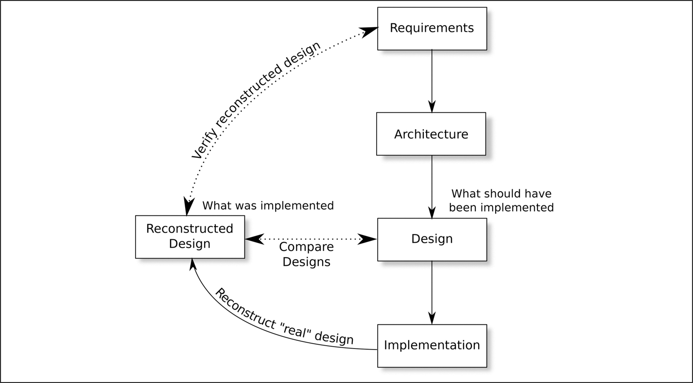

*Hình 17.1: Kiểm chứng thiết kế hồi tố.[⏎](#b17fig17_1)*

Trường hợp hiển nhiên nhất cho việc tạo ra thiết kế một cách hồi tố là khi một sản phẩm hiện có, được phát triển theo một tiêu chuẩn thấp hơn, giờ cần được kiểm định để dùng trong một hệ thống safety-critical, và khi thiết kế ban đầu được ghi lại không đầy đủ hoặc đã bị mất.

Cũng có những lý do ít hiển nhiên hơn để tái dựng “thiết kế” từ phần hiện thực và kiểm chứng nó. Trong quá trình phát triển sản phẩm, các mối liên kết giữa yêu cầu, architecture và thiết kế có thể được giữ khá chặt chẽ. Mỗi yêu cầu an toàn có thể được truy vết qua architecture và thiết kế, và mỗi khía cạnh của thiết kế có thể được truy vết ngược về một yêu cầu. Xem [mục 7.4.2](ch07_foundational_analyses.vi.md#sec7_4_2) của ISO 26262-6:

> *Trong quá trình phát triển software architectural design, phải xem xét những điều sau: … khả năng kiểm chứng của software architectural design;*
>
> …
>
> *LƯU Ý: Điều này ngụ ý truy vết bi-directional giữa software architectural design và các yêu cầu an toàn phần mềm.*

Tuy nhiên, việc truy vết chặt chẽ này có thể bị mất ở bước giữa thiết kế và hiện thực — nhóm hiện thực có khả năng lớn và quy trình hiện thực có thể khó kiểm soát hơn. Ngoài ra, ánh xạ giữa phần tử thiết kế và phần hiện thực hiếm khi là one-to-one: phần hiện thực của một yêu cầu cụ thể có thể trải rộng trên nhiều module và một module duy nhất có thể cung cấp các service chung để thỏa mãn nhiều yêu cầu. Việc tái dựng “thiết kế” từ phần hiện thực hiện có và so sánh nó với thiết kế thật, như được minh họa trong [Hình 17.1](#fig17_1), khi đó có thể hữu ích trong việc khép kín vòng lặp.

Food and Drug Administration (FDA) ở Mỹ chịu trách nhiệm bảo đảm rằng các thiết bị y tế mới an toàn để sử dụng ở quốc gia đó. Trong thập kỷ đầu tiên của thế kỷ 21, FDA nhận ra rằng việc kiểm thử các thiết bị software-based ngày càng kém hiệu quả, khi Heisenbug bắt đầu chiếm ưu thế,[2](#fn17_2) và đã tìm kiếm các kỹ thuật khác. Tài liệu tham khảo [[1](#refbib17_1)] của Dharmalingam Ganesan *et al.* mô tả cách các đặc tính design-level của một hệ thống bơm truyền dịch có thể được rút ra một cách hồi tố từ source code. Những đặc tính này sau đó có thể được dùng để kiểm chứng rằng các yêu cầu an toàn được đáp ứng và cũng có thể cung cấp những gợi ý hữu ích về các vùng của phần hiện thực cần phân tích sâu hơn.

## 17.2 Discrete event simulation

Khi chúng ta kiểm định một thiết kế, discrete event simulation có thể trả lời một số câu hỏi quan trọng:

- Chúng ta có thể mong đợi mức dependability nào từ một hệ thống được hiện thực theo thiết kế này? Khi được dùng để trả lời câu hỏi này, discrete event simulation thay thế hoặc, hữu ích hơn, bổ sung cho fault tree analysis ([Mục 15.2](ch15_the_fault_tree.vi.md#sec15_2)) và Petri net ([Mục 17.3](#sec17_3)).
- Sẽ cần bao nhiêu tài nguyên mỗi loại (memory, mutex, message buffer, v.v.) để bảo đảm rằng xác suất cạn kiệt thấp hơn *x* mỗi giờ hoạt động?
- Có thể mong đợi những độ trễ nào, với tải khác nhau trên hệ thống?
- Thuật toán phức tạp *X* sẽ hành xử thế nào trong các điều kiện cực đoan? Khi được dùng để trả lời câu hỏi này, discrete event simulation có thể bổ sung cho kiểm chứng hình thức — xem [Chương 18](ch18_formal_verification.vi.md).

[2](#fn17_217b)Xem trang 22 để biết mô tả về Heisenbug và ảnh hưởng của chúng lên hiệu quả kiểm thử.

Máy tính số đã thực hiện discrete event simulation gần như từ khi chúng ra đời. Trên giá sách của tôi có một cuốn hướng dẫn về ngôn ngữ general purpose system simulation (GPSS) (tài liệu tham khảo [[2](#refbib17_2)] của Thomas Schriber) đề năm 1974, thời điểm mà GPSS đã là một ngôn ngữ trưởng thành. Appendix F của cuốn sách đó giờ trông thật cổ lỗ. Nó liệt kê kích thước tối đa của một mô hình mô phỏng có thể được thực thi, kích thước này phụ thuộc vào lượng memory được lắp trong máy tính mainframe chạy trình thông dịch GPSS. Lượng memory thay đổi từ 64 kbyte đến tận 256 kbyte khổng lồ.

> Giai thoại 27[⏎](#b17aned27) *Khi tôi lần đầu gặp GPSS (và mua tài liệu tham khảo [[2](#refbib17_2)]), tôi đang mô phỏng luồng di chuyển của các tấm vỏ nồi hơi hot-water gia dụng qua một xưởng sơn tự động. Mô phỏng chạy trên một mainframe IBM 370 với 128 kbyte memory.*

### 17.2.1 Discrete event simulation và các tiêu chuẩn

EN 50176 nói rằng *“Mô phỏng và mô hình hóa có thể được dùng để bổ sung cho quá trình kiểm định”* và nó rất khuyến nghị mô phỏng ở mọi SIL cho việc chuẩn bị dữ liệu. So sánh các phương pháp formal và semi-formal, nó nói, *“Đối với các hệ thống đơn giản, có thể có một lời giải giải tích, trong khi đối với các hệ thống phức tạp hơn, cần một dạng mô phỏng nào đó để có được kết quả chính xác.”*

ISO 26262-6 khuyến nghị mô phỏng như một phương pháp cho *“kiểm chứng software architectural design.”* Mô phỏng cũng được mô tả như một kỹ thuật mô hình hóa trong Annex B của ISO 26262-6.

IEC 61508 dùng thuật ngữ “Monte-Carlo simulation” cho discrete event simulation. Đây là một trong những thuật ngữ rất sớm, giờ hiếm khi được nghe thấy trong ngành máy tính. Section B.6.5.6 của IEC 61508-7 viện đến discrete event simulation khi các yêu cầu mô hình hóa vượt quá các phân phối mũ mà Markov model có thể xử lý — xem [Chương 14](ch14_markov_models.vi.md) — và toàn bộ B.6.5.8 được dành cho discrete event simulation.

Đối với các hệ thống y tế, ISO 14971 mô tả việc dùng discrete event simulation để ước lượng xác suất (mục D.3.2.2) và khuyên rằng nó nên được dùng cùng với các cách tiếp cận khác, mỗi cách đóng vai trò kiểm tra độc lập cho các cách khác.

### 17.2.2 Sinh số Pseudo-Random

Mọi dạng discrete event simulation đều cần một luồng số ngẫu nhiên. Các số thực sự ngẫu nhiên vừa khó sinh ra (đòi hỏi, chẳng hạn, một bộ đếm các phân rã nguyên tử) vừa khó dùng vì chúng khiến không thể chạy cùng một mô phỏng hai lần cho mục đích debug hoặc so sánh.

Thay vì các số thực sự ngẫu nhiên, các số pseudo-random thường được dùng. Một câu trích well-known từ tài liệu tham khảo [[3](#refbib17_3)] của John von Neumann là

> *“Bất kỳ ai xem xét các phương pháp số học để tạo ra các chữ số ngẫu nhiên, dĩ nhiên, đều đang ở trong trạng thái phạm tội. Vì, như đã được chỉ ra nhiều lần, không có thứ gì gọi là một số ngẫu nhiên — chỉ có các phương pháp để tạo ra số ngẫu nhiên, và một thủ tục số học chặt chẽ dĩ nhiên không phải là một phương pháp như vậy.”[3](#fn17_3)*

[3](#fn17_317b)Tài liệu tham khảo này rất khó tìm. Vào thời điểm viết cuốn sách này, có thể tìm thấy một bản scan tại [https://web.archive.org/web/20210428064437/https://dornsifecms.usc.edu/assets/sites/520/docs/VonNeumann-ams12p36-38.pdf](https://web.archive.org/web/20210428064437/https://dornsifecms.usc.edu/assets/sites/520/docs/VonNeumann-ams12p36-38.pdf)

Các số Pseudo-random được sinh ra một cách tất định từ một “seed” ban đầu. Với cùng seed ban đầu, cùng một chuỗi số pseudo-random sẽ được sinh ra.

Nếu một nguồn số như vậy được dùng trong một mô phỏng để cung cấp bằng chứng cho hoạt động đúng của một hệ thống safety-critical, cần phải chú ý đến việc chứng tỏ rằng luồng số pseudo-random đủ ngẫu nhiên. Qua nhiều năm, nhiều thuật toán sinh số kém đã được thử, dẫn đến hoặc những chuỗi số rất ngắn trước khi xảy ra lặp lại hoặc output phân phối không thỏa đáng. [Chương 3](ch03_safety_standards_and_certification.vi.md) (tập 2) của tài liệu tham khảo [[4](#refbib17_4)] của Donald E Knuth đã cũ, nhưng vẫn là một nguồn thông tin đáng tin cậy về việc kiểm tra tính ngẫu nhiên của một luồng số được sinh ra. Công cụ open-source *dieharder* rất hữu ích cho kiểu kiểm tra này.

### 17.2.3 Mô phỏng các hệ thống tất định

Mô phỏng có thể được dùng để phân tích cả hệ thống tất định lẫn hệ thống non-deterministic. Một ví dụ tốt cho loại thứ nhất là bài tập ước lượng *π* bằng cách mô phỏng việc ném phi tiêu vào một bảng phi tiêu; xem [Hình 17.2](#fig17_2). Nếu vị trí của mỗi phi tiêu được xác định bởi hai số ngẫu nhiên, mỗi số nằm trong $( 0 , 1 )$, thì tỷ lệ phi tiêu rơi vào bảng phi tiêu hình tròn là $\frac{π}{4}$.

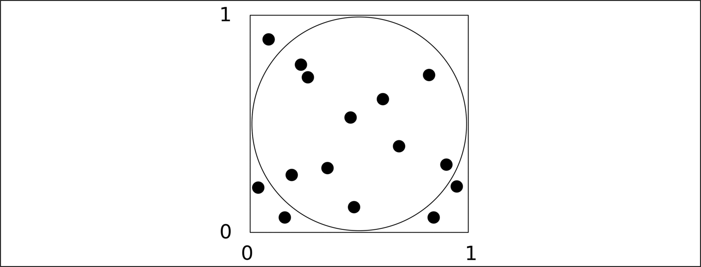

*Hình 17.2: Một bảng phi tiêu và người ném phi tiêu ngẫu nhiên.[⏎](#b17fig17_2)*

Tôi vừa chạy một chương trình Python đơn giản để ném 10 000 000 phi tiêu vào bảng. 7 853 379 phi tiêu rơi vào bảng phi tiêu hình tròn, và 2 146 621 phi tiêu rơi ra ngoài. Điều này cho ra một ước lượng $π ≈ 3 , 14135$. Dĩ nhiên, đây thực ra là đo tính ngẫu nhiên của bộ sinh số pseudo-random, chứ không phải là một phương pháp thực tế để ước lượng *π*.

Trong trường hợp này, không có gì ngẫu nhiên về hệ thống đang được mô phỏng, các số pseudo-random chỉ được dùng để khám phá nó. Mặc dù việc tính *π* theo cách khá kém hiệu quả này không mấy hữu ích, kỹ thuật mô phỏng một hệ thống tất định thường hữu ích khi một kết quả toán học (ví dụ, một tích phân high-dimensional) không thể thu được bằng giải tích hoặc khi không thể thiết lập các phương trình mô tả một hệ thống phức tạp.

Trong trường hợp sau, có thể dùng pattern được minh họa trong [Hình 17.3](#fig17_3). Trong hình đó, một thuật toán tối ưu hóa đang cố tìm giá trị nhỏ nhất (hoặc lớn nhất) của một bề mặt đa chiều phức tạp biểu diễn hệ thống vật lý. Cả IEC 61508 lẫn ISO 26262 đều không nhắc đến các thuật toán tối ưu hóa, vì vậy tôi sẽ không đi sâu vào chúng ở đây. Chỉ cần nói rằng simulated annealing, genetic algorithm và các kỹ thuật cực tiểu hóa khác hoạt động bằng cách thăm dò bề mặt đa chiều của tham số đang được cực tiểu hóa (ví dụ, chi phí) và dần dần đi “xuống dốc” về phía một cực tiểu cục bộ. Chúng cần một cơ chế nào đó để trả lời câu hỏi, *“Nếu chúng ta làm x, chi phí sẽ thay đổi thế nào?”* Trong một số trường hợp, câu hỏi này có thể được trả lời bằng một phép tính số học đơn giản; trong các trường hợp khác, một discrete event simulation có thể là con đường dễ nhất.

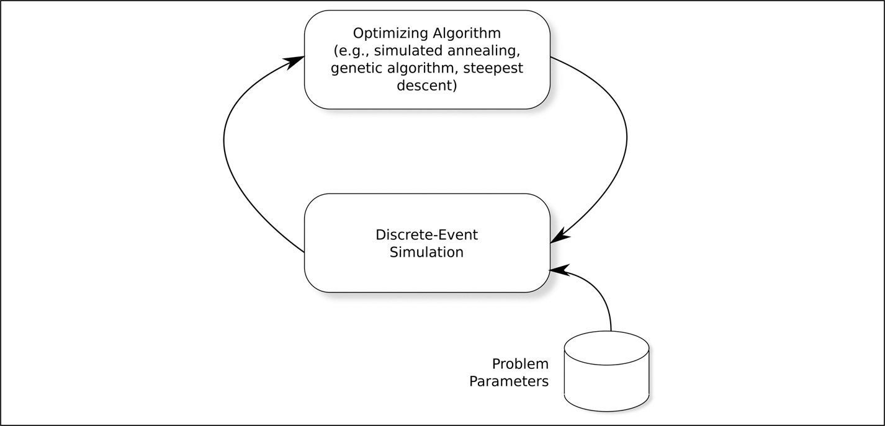

*Hình 17.3: Mô phỏng như một công cụ hỗ trợ tối ưu hóa.[⏎](#b17fig17_3)*

Hãy xem xưởng sơn tự động trong [Giai thoại 27](#aned27). Vấn đề không phải là việc các tấm vỏ nồi hơi đi qua bể axit, phòng sơn electro-static và lò sấy là ngẫu nhiên. Ngược lại, việc này rất tất định. Vấn đề là một tấm mất khoảng 40 phút để đi qua quy trình, và mất hơn một giờ để đổi màu sơn (thổi sạch sơn cũ và nạp màu mới vào hệ thống). Vào chiều thứ Sáu, số tấm các màu khác nhau cho tuần tiếp theo đã được biết, và điều cần thiết là lịch sơn tối ưu. Một nồi hơi không thể được lắp ráp cho đến khi mọi tấm vỏ của nó (chẳng hạn, 3 tấm đỏ, 4 tấm xanh và 1 tấm trắng) đều sẵn sàng và, đáng tiếc là, khu vực lưu trữ các tấm đã sơn nhưng chưa dùng có hạn. Với một số lượng lớn các nồi hơi khác nhau cần lắp ráp và độ trễ lớn khi đổi màu sơn, việc tìm một lịch trình tối đa hóa hiệu quả của xưởng sơn không hề đơn giản.

Tôi đã nghĩ ra một thuật toán tối ưu hóa (dùng steepest descent), nhưng nó cần biết điều gì sẽ xảy ra nếu lịch trình được thay đổi sao cho sơn trắng được giữ chảy đến 11:00 thứ Ba thay vì 09:00. Đây là việc tuyệt vời cho một mô phỏng tất định: mô phỏng các tấm vỏ đi qua và trả kết quả của tuần cho thuật toán tối ưu hóa.

Một ví dụ có lẽ sát hơn về việc dùng kỹ thuật trong [Hình 17.3](#fig17_3) là việc làm với một công ty phát triển để áp dụng một hệ thống như vậy nhằm tối ưu hóa các mức ưu tiên được gán cho các thread khác nhau trong một hệ thống. Công ty có một nhóm phát triển khác nhau tạo ra mỗi subsystem phần mềm và mỗi nhóm phân bổ mức ưu tiên cho các thread trong subsystem của riêng mình. Khi các subsystem được ghép lại với nhau, đương nhiên có những xung đột về mức ưu tiên. Hệ thống trong [Hình 17.3](#fig17_3) ban đầu gán mức ưu tiên ngẫu nhiên cho mỗi thread trong toàn bộ hệ thống, và dùng mô phỏng để phát hiện ra rằng điều này khiến một số thread lỡ deadline. Một thuật toán tối ưu hóa sau đó đã cố tìm một cách phân bổ mức ưu tiên khiến ít thread nhất (tốt nhất là không có thread nào) lỡ deadline.

### 17.2.4 Mô phỏng các hệ thống không tất định

Trong một hệ thống không tất định, chẳng hạn hệ thống mà các request đến một cách ngẫu nhiên, các số pseudo-random được dùng để mô phỏng các phần của chính hệ thống.

Mô phỏng có thể được dùng để ước lượng dependability của hệ thống và ước lượng số tài nguyên (file descriptor, buffer, v.v.) cần để đáp ứng các yêu cầu của hệ thống. Lưu ý việc dùng thuật ngữ “ước lượng” trong câu đó. Các kỹ thuật khác để đánh giá dependability của hệ thống, như Markov model hoặc fault tree analysis, cho một câu trả lời chính xác (mặc dù không nhất thiết đúng); mô phỏng chỉ cung cấp một sự bảo đảm mang tính thống kê. Ví dụ, một mô phỏng có thể cho chúng ta độ tin cậy 95% rằng hệ thống, như được mô phỏng, sẽ không cần quá 48 message buffer thường xuyên hơn một lần mỗi tuần sử dụng liên tục.

Điều này có nghĩa là nhà phân tích mô phỏng cần có kiến thức cơ bản về các kỹ thuật thống kê, một nhu cầu ngày càng tăng xuyên suốt quá trình kiểm chứng thiết kế. Trước đây, khi bộ xử lý và phần mềm còn đơn giản, các nhà phân tích tìm kiếm những bảo đảm tuyệt đối về việc phần mềm kết thúc: “Trong bất kỳ chuỗi sự kiện nào, tiến trình A sẽ luôn hoàn tất trong vòng *x* mili giây.” Với các bộ xử lý hiện đại có data caching và instruction caching, điều này không còn khả thi, và các “bảo đảm” trở thành thống kê: “Trong chuỗi sự kiện dự kiến, xác suất tiến trình A không hoàn tất các hành động của nó trong vòng *x* mili giây nhỏ hơn *y*%.”

### 17.2.5 Các framework discrete event simulation

Đối với các mô phỏng đơn giản nhất, đặc biệt là những mô phỏng được viết để ước lượng availability của hệ thống, không cần framework nào; có thể viết trực tiếp một chương trình để thực hiện mô phỏng.

Đối với các mô phỏng phức tạp hơn, một trong nhiều framework thương mại và open-source có thể đáp ứng mục đích. Chúng chia thành hai loại chính:

1. **Mô phỏng Event-based.**

   Đúng như tên gọi, trọng tâm ở đây là các sự kiện. Một sự kiện xảy ra (ví dụ, failure của một thành phần) có thể khiến các sự kiện khác (như việc một kỹ thuật viên sửa chữa đến) được lên lịch cho tương lai. Framework mô phỏng giữ một danh sách các sự kiện tương lai được sắp xếp theo thời gian và lặp, lấy sự kiện tiếp theo ra khỏi danh sách, cập nhật thời gian mô phỏng thành thời gian của sự kiện (do đó có thuật ngữ *discrete* event simulation — thời gian di chuyển theo các bước rời rạc) và xử lý nó, thêm các sự kiện mới vào danh sách khi cần. Mô phỏng kết thúc khi danh sách sự kiện rỗng hoặc khi đạt tới một thời gian mô phỏng định trước.

2. **Mô phỏng Transaction- hoặc process-based.**

   Kỹ thuật này tập trung vào các transaction được *sinh ra*, di chuyển qua *vòng đời* của chúng, tương tác với nhau và với các service khác nhau của hệ thống, rồi bị *kết thúc*. Một transaction có thể là một thông điệp được một thiết bị nhận, được xếp hàng trong khi chờ bộ xử lý, rồi chiếm một phần thời gian của bộ xử lý trước khi di chuyển qua các phần khác của hệ thống được mô phỏng và cuối cùng bị loại khỏi mô phỏng.

   Trong trường hợp này, cần duy trì hai danh sách: danh sách sự kiện tương lai, như với các mô phỏng event-based, và một danh sách sự kiện hiện tại, chứa các transaction đang chờ một điều gì đó xảy ra (ví dụ, một lõi xử lý trở nên sẵn sàng). Hiệu quả xử lý danh sách sự kiện hiện tại thường là yếu tố quyết định thời gian chạy của một mô phỏng vì toàn bộ danh sách cần được quét ở mỗi bước mô phỏng.

Tôi thấy các mô phỏng event-based rất dễ lập trình cho các hệ thống nhỏ, nhưng thấy rằng số lượng sự kiện tăng vọt khi độ phức tạp của hệ thống tăng lên.

Các framework Transaction-based, như SimPy[4](#fn17_4) và GPSS lâu đời, cung cấp các abstraction cho các loại thực thể mà transaction tương tác: queue, facility phục vụ queue (ví dụ, một bộ xử lý), level mà một transaction có thể chờ (ví dụ, một lượng memory trống), gate có thể tạm thời chặn sự tiến triển của một transaction cho đến khi một transaction khác mở gate, và nhiều thứ khác.

### 17.2.6 Ví dụ discrete event simulation

Thay vì thảo luận thêm về discrete event simulation một cách trừu tượng, tôi sẽ áp dụng nó vào một ví dụ. Mô phỏng có thể được dùng để ước lượng nhiều thứ, nhưng có lẽ thứ đơn giản nhất để mô phỏng là failure rate của một hệ thống. Nhìn chung, việc này không liên quan đến bất kỳ tính năng tinh vi nào được liệt kê ở trên: queue, facility, v.v.

[Hình 14.1](ch14_markov_models.vi.md#fig14_1) ở trang 169 minh họa một phần của một hệ thống, và failure rate của hệ thống này đã được tính bằng một phép tính Markov trong [Mục 14.4](ch14_markov_models.vi.md#sec14_4). Một trong những nhược điểm của Markov model là nó chỉ có thể xử lý thời gian giữa các lần xảy ra có phân phối mũ âm. Ưu điểm của mô phỏng là có thể dùng bất kỳ loại phân phối nào, thậm chí một phân phối thực nghiệm (đo được) mà phân phối toán học chưa biết.

Dưới đây tôi đưa ra kết quả của hai mô phỏng: mô phỏng thứ nhất dùng giả định Markov, mô phỏng thứ hai với các phân phối phức tạp hơn. Ưu điểm của việc dùng các giả định Markov, dĩ nhiên, là chúng ta đã biết câu trả lời — xem [Bảng 14.1](ch14_markov_models.vi.md#tbl14_1) ở trang 172.

[4](#fn17_417b)[https://simpy.readthedocs.io/en/latest/](https://simpy.readthedocs.io/en/latest/)

#### 17.2.6.1 Lặp lại phép tính Markov

Tôi đã viết một chương trình Python ngắn để mô phỏng hệ thống di chuyển qua các trạng thái được thể hiện trong [Hình 14.2](ch14_markov_models.vi.md#fig14_2) ở trang 171 và, đối với ví dụ đầu tiên, giả định phân phối mũ âm cho thời gian giữa các lần xảy ra fault và sửa chữa — tức là giả định các failure tuân theo các giả định Markov.

[Bảng 17.1](#tbl17_1) liệt kê kết quả về thời gian trung bình ở trạng thái 1 (không có failure) và 12 (hệ thống hỏng) trong mỗi lần chạy trong số 10 lần chạy mô phỏng, dùng các seed số pseudo-random khác nhau. Mỗi lần chạy mô phỏng 500 năm vòng đời của hệ thống và mất khoảng 9ms để thực thi trên laptop của tôi. Các con số trong [Hình 17.1](#fig17_1) có thể được so sánh với giá trị đúng là $92 , 963 \; 044$ % và $0 , 063 \; 491$ % lần lượt cho các trạng thái 1 và 12.

*Bảng 17.1 Mô phỏng với các giả định Markov.[⏎](#b17tbl17_1)*

| Lần chạy | Phần trăm thời gian ở … |  |
|---|---|---|
| Trạng thái 1 | Trạng thái 12 |  |
| 1 | $92 , 569 \; 203 \; 542 \; 8$ | $0 , 054 \; 752 \; 117 \; 286 \; 9$ |
| 2 | $93 , 093 \; 167 \; 223 \; 8$ | $0 , 053 \; 169 \; 882 \; 801 \; 3$ |
| 3 | $93 , 540 \; 019 \; 579 \; 2$ | $0 , 060 \; 073 \; 435 \; 435 \; 6$ |
| 4 | $92 , 707 \; 482 \; 852 \; 3$ | $0 , 079 \; 280 \; 710 \; 351 \; 8$ |
| 5 | $92 , 819 \; 191 \; 716 \; 1$ | $0 , 053 \; 710 \; 152 \; 880 \; 4$ |
| 6 | $92 , 677 \; 917 \; 139 \; 3$ | $0 , 061 \; 319 \; 266 \; 597 \; 0$ |
| 7 | $92 , 716 \; 136 \; 984 \; 7$ | $0 , 060 \; 442 \; 469 \; 245 \; 4$ |
| 8 | $92 , 725 \; 385 \; 909 \; 7$ | $0 , 083 \; 265 \; 491 \; 124 \; 4$ |
| 9 | $92 , 922 \; 825 \; 170 \; 1$ | $0 , 065 \; 441 \; 020 \; 206 \; 9$ |
| 10 | $92 , 969 \; 421 \; 261 \; 2$ | $0 , 069 \; 307 \; 701 \; 014 \; 8$ |
| Trung bình mẫu $( \overline{x} )$ | $92 , 874 \; 075 \; 137 \; 9$ | $0 , 064 \; 076 \; 224 \; 694 \; 4$ |
| Phương sai mẫu $( {s}^{2} )$ | $0 , 079 \; 132 \; 618 \; 462 \; 9$ | $0 , 000 \; 108 \; 756 \; 153 \; 029$ |

Mặc dù chúng ta có một câu trả lời chính xác từ phân tích Markov, chúng ta chỉ có một câu trả lời thống kê từ mô phỏng, và trong [Bảng 17.1](#tbl17_1) còn rõ ràng hơn so với trong [Bảng 14.1](ch14_markov_models.vi.md#tbl14_1) rằng việc đưa ra nhiều chữ số thập phân là vô nghĩa và có thể gây hiểu lầm.

#### 17.2.6.2 Ước lượng khoảng tin cậy

Với trung bình mẫu và phương sai mẫu, có thể dùng các kỹ thuật thống kê thông thường để tính một khoảng tin cậy:

$$\begin{array}{l} \overline{x} \pm \frac{s}{\sqrt{n}} {t}_{q} ( n - 1 ) \end{array} \tag{17.1}$$

trong đó $\overline{x}$ là trung bình mẫu, *s* là độ lệch chuẩn mẫu, *n* là số mẫu, và ${t}_{q} ( n - 1 )$ là giá trị của phân phối *t* Student tương ứng với mức tin cậy *q*% với $( n - 1 )$ bậc tự do.

Với công thức này, và giảm số chữ số thập phân xuống mức hợp lý, khoảng tin cậy phân vị thứ 95 về phần trăm thời gian ở Trạng thái 12 (hệ thống hỏng) là

$$\begin{array}{l} \overline{x} \pm \frac{s}{\sqrt{n}} {t}_{q} ( n - 1 ) = 0 , 064 \pm \sqrt{\frac{0 , 000109}{10}} \times 2 , 262 = 0 , 064 \pm 0 , 00747 \end{array} \tag{17.2}$$

Điều này cho ra khoảng tin cậy 95% là từ 0,057 đến 0,072, và khoảng tương đương cho Trạng thái 1 (không có failure) là từ 92,7 đến 93,1. Các khoảng này bao trùm các câu trả lời đúng được tính từ Markov model.

Khi dùng kỹ thuật này, hãy nhớ chính xác khoảng tin cậy có nghĩa là gì. Nó không phải là khoảng tin cậy quanh giá trị đúng (chưa biết) của trung bình — nó là khoảng tin cậy quanh giá trị tiếp theo sẽ được mô phỏng báo cáo. Đây có thể là những thứ rất khác nhau.

Khoảng tin cậy có thể được tính hoặc, như ở đây, bằng cách thực thi mô phỏng một số lần với các luồng số ngẫu nhiên khác nhau, hoặc bằng cách thực thi một lần chạy rất dài rồi chia nó thành các đoạn ngắn hơn, coi mỗi đoạn là độc lập với các đoạn khác.

#### 17.2.6.3 Mô phỏng không có giả định Markov

Dĩ nhiên, không cần thực hiện mô phỏng trên hệ thống này nếu mọi xác suất failure đều là Poisson, khi đó Markov model là hoàn toàn chính xác. Mô phỏng trở nên hữu ích khi các phân phối failure rate là non-Poisson và, đặc biệt, nếu chúng là các phân phối đo được không có công thức toán học.

Để minh họa điều này, tôi sẽ giữ nguyên các tốc độ trung bình của failure thành phần và thời gian sửa chữa, nhưng sẽ giả định các phân phối khác, như được liệt kê trong [Bảng 17.2](#tbl17_2). Mọi phân phối chuẩn (Gauss) đều bị cắt tại 0.

*Bảng 17.2 Các giả định về phân phối.[⏎](#b17tbl17_2)*

| Thành phần | Tốc độ trung bình (mỗi năm) | Phân phối xuất hiện (“sd” $\to$ “độ lệch chuẩn”) |
|---|---|---|
| 1A hỏng | 0,333 | chuẩn, trung bình 3 năm, sd 2 năm |
| 1B hỏng | 0,333 | chuẩn, trung bình 3 năm, sd 2 năm |
| 2A hỏng | 0,333 | đều từ 2 đến 4 năm |
| 2B hỏng | 0,333 | đều từ 2 đến 4 năm |
| 2C hỏng | 0,333 | đều từ 1 đến 5 năm |
| 2D hỏng | 0,333 | đều từ 1 đến 5 năm |
| Bộ nguồn hỏng | 0,2 | chuẩn, trung bình 5 năm, sd 2 năm |
| Sửa chữa, chưa hỏng | 26,00 | đều từ 5 đến 9 ngày |
| Sửa chữa, đã hỏng | 365,25 | đều từ 14 đến 34 giờ |

Việc thực hiện những sửa đổi nhỏ cho chương trình mô phỏng để dùng các phân phối từ [Bảng 17.2](#tbl17_2) thay vì Poisson cho ra khoảng tin cậy 95% về tỷ lệ thời gian ở Trạng thái 1 (không có failure) là từ 98,8% đến 98,9%, và thời gian ở Trạng thái 12 (hệ thống hỏng) là từ 0,0088% đến 0,0121%.

Lưu ý rằng, mặc dù các tốc độ trung bình của failure và sửa chữa vẫn giữ nguyên cho hai mô phỏng, up-time trung bình của hệ thống đã thay đổi từ 99,93% sang 99,98%. Điều này có đáng kể hay không phụ thuộc vào các yêu cầu dependability của hệ thống.

### 17.2.7 Biết khi nào bắt đầu

Các mô phỏng ví dụ được đưa ra ở trên rất đơn giản và không chịu các lỗi khởi động thông thường của những mô phỏng tinh vi hơn.

Hầu hết các mô phỏng đều bao gồm các queue transaction đang chờ một server (ví dụ, các queue packet đến đang chờ được communications stack xử lý) và một số server. Ban đầu, các queue rỗng và các server rảnh. Cho đến khi mô phỏng đã chạy được một thời gian, nó cung cấp một mô hình không chính xác về hành vi steady-state của hệ thống.

Để loại bỏ sự không chính xác này, mô phỏng được để cho đạt tới một steady-state rồi mọi số liệu thống kê (độ dài queue, mức sử dụng server, v.v.) được reset và việc thu thập số liệu thống kê bắt đầu lại. Rất khó biết khi nào nên thực hiện việc reset như vậy: làm quá sớm thì kết quả sẽ sai, làm quá muộn thì thời gian xử lý đã bị lãng phí.

### 17.2.8 Biết khi nào dừng

Nếu việc biết khi nào bắt đầu thu thập số liệu thống kê đã khó, thì việc biết khi nào dừng còn khó hơn. Trong ví dụ trên, tôi đã mô phỏng 500 năm. Tại sao không phải 10 năm? Tại sao không phải 1 000 năm?

Đây là một vấn đề đặc biệt nếu các sự kiện hiếm gặp xảy ra trong hệ thống. Nếu hầu hết các sự kiện xảy ra trong mô hình mỗi mili giây, nhưng một sự kiện cụ thể (ví dụ, một failure) chỉ xảy ra mỗi 5 năm, thì, để có ý nghĩa thống kê đối với sự kiện hiếm gặp đó, sẽ cần chạy mô phỏng trong thời gian mô phỏng có lẽ là 50 năm. Trong thời gian đó sẽ có khoảng 1012 lần xảy ra sự kiện mili giây. Nhiệm vụ của người mô hình hóa là tránh tình huống này.

Tiêu chí thực tế chính để quyết định độ dài của lần chạy mô phỏng là giám sát các số liệu thống kê then chốt và quan sát thấy rằng chúng không còn thay đổi đáng kể.

## 17.3 Timed Petri net

### 17.3.1 Petri net và các tiêu chuẩn

EN 50716 rất khuyến nghị việc dùng Petri net, đặc biệt là timed Petri net, cho mô hình hóa ở mọi SIL.

IEC 61508-3 khuyến nghị việc dùng *các phương pháp semi-formal* và đưa Time Petri[5](#fn17_5) net vào như một trong những phương pháp đó.

ISO 26262 không nhắc tường minh đến Petri net, nhưng tham chiếu đến *“mô phỏng các phần động của thiết kế”* trong Table 4 của [phần 6](part6_implementation_verification.vi.md) và phần mở rộng của nó trong Annex B bao quát việc dùng Petri net, vốn phù hợp cho loại mô phỏng này.

### 17.3.2 Lịch sử của Petri net

Không giống nhiều kỹ thuật được mô tả trong cuốn sách này, vốn có vẻ đã phát triển từ những ý tưởng then chốt bị lạc mất trong màn sương lịch sử, Petri net có một khởi đầu rõ ràng. Có thông tin rằng vào tháng Tám năm 1939, cậu bé 13-year-old Carl Adam Petri đã phát minh ra ký hiệu này để mô tả các quá trình hóa học. Ý tưởng được công bố trong luận án tiến sĩ của Petri (tài liệu tham khảo [[5](#refbib17_5)]) năm 1962.

Kể từ thiết kế ban đầu của Petri, nhiều loại Petri net đã xuất hiện, bao gồm timed Petri net, colored Petri net, dualistic Petri net, fuzzy Petri net, prioritized Petri net và stochastic Petri net.

Đối với mục đích thiết kế hệ thống nhúng, timed Petri net và phần mở rộng của chúng là timed stochastic Petri net là những loại hữu ích nhất, và tôi sẽ dùng thuật ngữ đơn giản “Petri net” để chỉ một trong hai loại đó.

### 17.3.3 Petri net là gì?

Một Petri net có thể được coi đơn giản là một ký hiệu khác để mô tả một Markov model hoặc một discrete event simulation. Nó là một ký hiệu đồ họa đặc biệt hữu ích để biểu diễn các loại Markov model được đưa ra trong [Chương 14](ch14_markov_models.vi.md). Tài liệu tham khảo [[6](#refbib17_6)] của Ajmone Marsan, mặc dù hơi cũ, vẫn cung cấp một phần giới thiệu cơ bản xuất sắc về timed Petri net.

Khi một hệ thống đã được mô tả bằng một Petri net, có sẵn các công cụ để phát hiện:

- deadlock: có trạng thái nào mà khi đạt tới thì không thể thoát ra không?
- livelock: có một tập nhỏ các trạng thái nào mà khi đạt tới bất kỳ trạng thái nào trong tập đó, hệ thống sẽ ở mãi trong tập nhỏ đó không?
- thiếu liveness: có những đường đi qua mô hình nào mà không phải mọi transition đều được thực thi vô hạn lần không?

### 17.3.4 Một Petri net đơn giản

Ký hiệu Petri net bao gồm các “place”, “transition”, “token” và một cách bố trí token ban đầu, như được minh họa trong [Hình 17.4](#fig17_4). Đây đều là những khái niệm trừu tượng và có thể biểu diễn các khía cạnh khác nhau của một hệ thống.

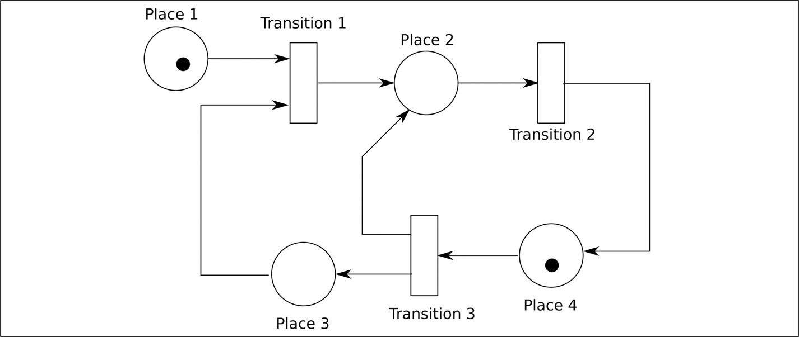

*Hình 17.4: Một Petri net đơn giản.[⏎](#b17fig17_4)*

[5](#fn17_517b)Lưu ý rằng IEC 61508 gọi chúng là “time Petri net” thay vì “timed Petri net.”

Trong [Hình 17.4](#fig17_4), các place được biểu diễn bằng hình tròn, các transition bằng hình chữ nhật (các loại hình chữ nhật khác nhau biểu diễn các loại transition khác nhau như được giải thích bên dưới), và các token bằng các chấm đen. Trong trường hợp này, cách bố trí ban đầu có một token ở place 1 và một token ở place 4.

Một transition có thể “fire” nếu mỗi place input của nó chứa ít nhất một token. Khi nó fire, một token được lấy ra khỏi mỗi place input của nó, và một token được đặt vào mỗi place output của nó.

Tôi thích nghĩ về điều này như một loại trò chơi cờ bàn để chơi với bọn trẻ vào mùa nghỉ lễ khi trời mưa bên ngoài. Các công cụ Petri net cho phép nhà thiết kế mô phỏng sự chuyển dịch của các token, và nhiều công cụ thực sự gọi đây là “the token game.”

Trong [Hình 17.4](#fig17_4), transition 1 không thể fire vì, mặc dù có một token ở place 1, không có token nào ở input còn lại của nó, place 3. Transition 2 cũng không thể fire, nhưng transition 3 thì có thể. Khi transition 3 fire, kết quả như được đưa ra trong [Hình 17.5](#fig17_5).

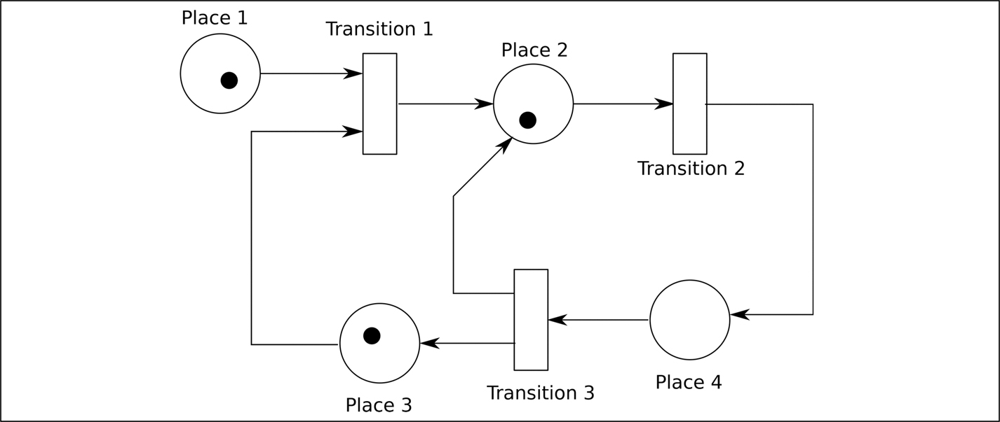

*Hình 17.5: [Hình 17.4](#fig17_4) sau một bước.[⏎](#b17fig17_5)*

Lưu ý rằng không có sự bảo toàn token: một token ở place 4 đã trở thành hai token, một ở place 2 và một ở place 3. Giờ transition 1 và transition 2 đều có thể fire, và “trò chơi” tiếp diễn.

### 17.3.5 Mở rộng Petri net đơn giản

Petri net đã được mở rộng theo nhiều cách. [Hình 17.6](#fig17_6) minh họa một vài mở rộng phổ biến hơn.

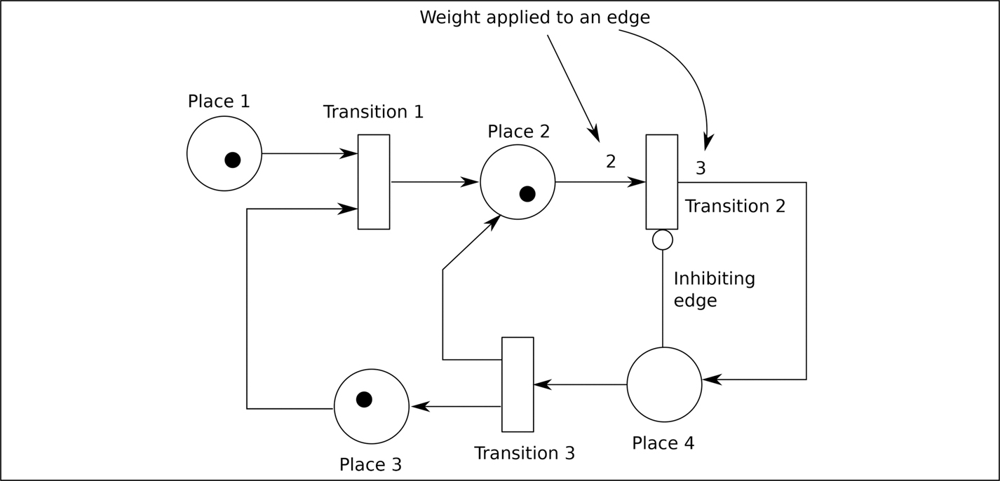

*Hình 17.6: Các mở rộng Petri net đơn giản.[⏎](#b17fig17_6)*

Trong hình đó, các trọng số đã được đưa vào trên hai cạnh. Trọng số 2 trên cạnh input của transition 2 có nghĩa là nó sẽ không fire trừ khi có ít nhất hai token ở place 2. Khi nó fire, hai token sẽ bị lấy ra khỏi place 2. Trọng số 3 trên cạnh output từ transition 2 có nghĩa là, khi transition đó fire, ba token sẽ được đặt vào place 4.

[Hình 17.6](#fig17_6) cũng có một cạnh ức chế (inhibiting edge). Cạnh này hoạt động theo cách ngược lại với một cạnh bình thường: một token ở place 4 ngăn transition 2 fire, bất kể trạng thái của place 2.

### 17.3.6 Timed Petri net và stochastic Petri net

IEC 61508 khuyến nghị tường minh *time Petri net*, và tôi đã lướt qua câu hỏi về định thời ở trên. Trong [Hình 17.5](#fig17_5), transition 1 và 2 đều có thể fire. Điều này đặt ra hai câu hỏi: transition nào sẽ fire, và một lần fire mất bao lâu? Câu hỏi thứ nhất được trả lời bên dưới trong mục về non-determinism ([Mục 17.3.11](#sec17_3_11)). Câu trả lời cho câu hỏi thứ hai là đối với một timed Petri net, các thời gian trễ (có thể bằng không) được gắn với mỗi transition. Nếu thời gian fire là ngẫu nhiên theo một cách nào đó, thì mạng trở thành một stochastic timed Petri net.

Các tác giả khác nhau dùng các ký hiệu khác nhau cho các transition với các loại định thời khác nhau. [Hình 17.7](#fig17_7) liệt kê các ký hiệu mà tôi thường dùng.

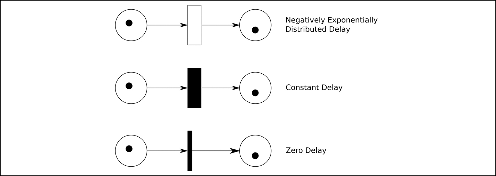

*Hình 17.7: Các loại transition.[⏎](#b17fig17_7)*

Trong một timed Petri net, có thể hình dung một transition fire theo ba giai đoạn:

1. Khi được enable, các token được lấy ra khỏi các place input.
2. Độ trễ gắn với transition diễn ra.
3. Các token xuất hiện ở các place output.

Điều này được minh họa trong [Hình 17.8](#fig17_8), nơi một transition tức thời (không có độ trễ) được dùng để lấy các token ra khỏi các place input và một place trung gian được dùng để giữ các token bên trong cho đến khi độ trễ đã qua và chúng có thể xuất hiện ở các place output.

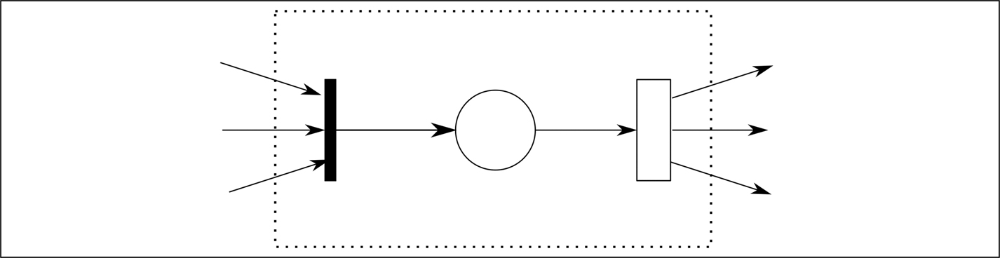

*Hình 17.8: Cấu trúc bên trong của một timed transition.[⏎](#b17fig17_8)*

### 17.3.7 Tiệm cắt tóc

Theo truyền thống trong giới mô phỏng, người ta bắt đầu bằng một tiệm cắt tóc — đây là thứ tương đương với chương trình “hello world” khi học một ngôn ngữ lập trình mới.

Giả sử tiệm cắt tóc không nhận đặt lịch trước và mọi người đến cắt tóc theo một Poisson process với thời gian trung bình giữa các lần đến là 12,5 phút, chờ trong phòng chờ cho đến khi thợ cắt tóc rảnh, rồi được phục vụ trong một khoảng thời gian có phân phối mũ âm với trung bình 10 phút. Sau đó họ rời tiệm. Chúng ta muốn biết thợ cắt tóc sẽ bận đến mức nào và cần mua bao nhiêu ghế cho phòng chờ. [Hình 17.9](#fig17_9) thể hiện một cách mô tả khả dĩ cho tình huống này dưới dạng Petri net.

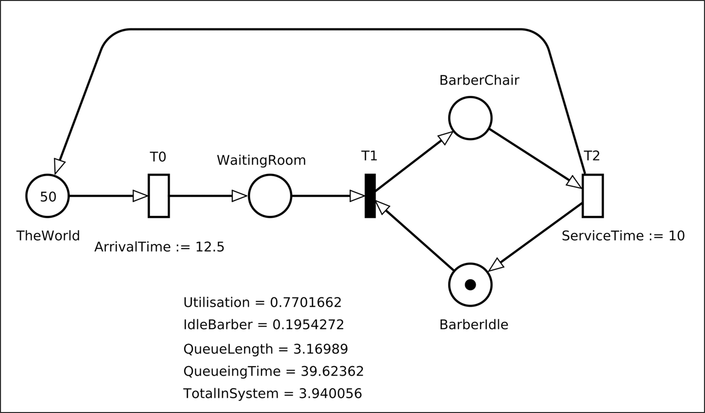

*Hình 17.9: Một tiệm cắt tóc.[⏎](#b17fig17_9)*

Nguồn (“The World”) và transition T0 cung cấp một token mới cho phòng chờ theo một Poisson process với thời gian trung bình giữa các lần đến là 12,5 phút. Mặc dù thế giới có một số hữu hạn người muốn cắt tóc (năm mươi người), điều này sẽ không ảnh hưởng đáng kể đến các giá trị thu được vì xác suất tất cả đều muốn cắt tóc và có mặt trong tiệm cùng lúc là $< 3 \times {10}^{- 6}$.

Một khi có ít nhất một khách trong phòng chờ và một thợ cắt tóc rảnh, việc cắt tóc bắt đầu ngay lập tức (T1 là một transition zero-delay). Việc cắt tóc mất trung bình 10 phút, rồi thợ cắt tóc lại rảnh, token biểu diễn khách hàng đã được gửi trở lại thế giới bên ngoài.

Nếu Petri net này được đưa vào một công cụ phù hợp, thì công cụ có thể thực hiện một mô phỏng hoặc phép tính và xác định số người trung bình trong phòng chờ, thời gian khách hàng sẽ phải chờ và tỷ lệ thời gian ghế cắt tóc có người ngồi (tức là khi thợ cắt tóc bận); xem chú thích ở cuối [Hình 17.9](#fig17_9). Hình này được tạo ra bằng công cụ TimeNET.[6](#fn17_6) TimeNET miễn phí cho mục đích non-commercial (mặc dù cần đăng ký) và có thể dùng cho mục đích thương mại với một khoản phí.

Ví dụ, có thể thấy rằng thợ cắt tóc rảnh 19,5% thời gian. Ngoài việc ghi điều này lên hình đồ họa của Petri net, TimeNET còn cung cấp một output dạng văn bản kèm dung sai. Trong trường hợp thời gian rảnh của thợ cắt tóc, khoảng giá trị với độ tin cậy 95% là từ 18,4% đến 20,7%. Thực ra không cần tạo một Petri net cho bài toán cụ thể này vì các kết quả có thể được tính bằng toán học. Giá trị đúng của thời gian rảnh của thợ cắt tóc là 20,0%.

Tương tự, độ dài hàng đợi trung bình có thể được tính bằng toán học là 3,2 và TimeNET cho khoảng tin cậy 95% là từ 3,0 đến 3,3. Thời gian xếp hàng trung bình là 40,0 phút và TimeNET cho khoảng tin cậy 95% là từ 37,5 đến 41,7 phút.

Trong thế giới thực, khó có khả năng chúng ta biết chính xác thời gian inter-arrival và thời gian phục vụ, và TimeNET cung cấp một công cụ để thay đổi bất kỳ tham số nào và xem điều này ảnh hưởng thế nào đến kết quả. Ví dụ, [Hình 17.10](#fig17_10) cho thấy thời gian chờ trung bình trong tiệm sẽ bị ảnh hưởng thế nào khi trung bình thời gian phục vụ thay đổi từ 9 đến 11 phút. Dĩ nhiên, đây lẽ ra phải là một đường cong trơn, nhưng chúng ta đang yêu cầu TimeNET thực hiện nhiều mô phỏng đến mức tin cậy 95%.

[6](#fn17_617b)Có tại [https://timenet.tu-ilmenau.de](https://timenet.tu-ilmenau.de)

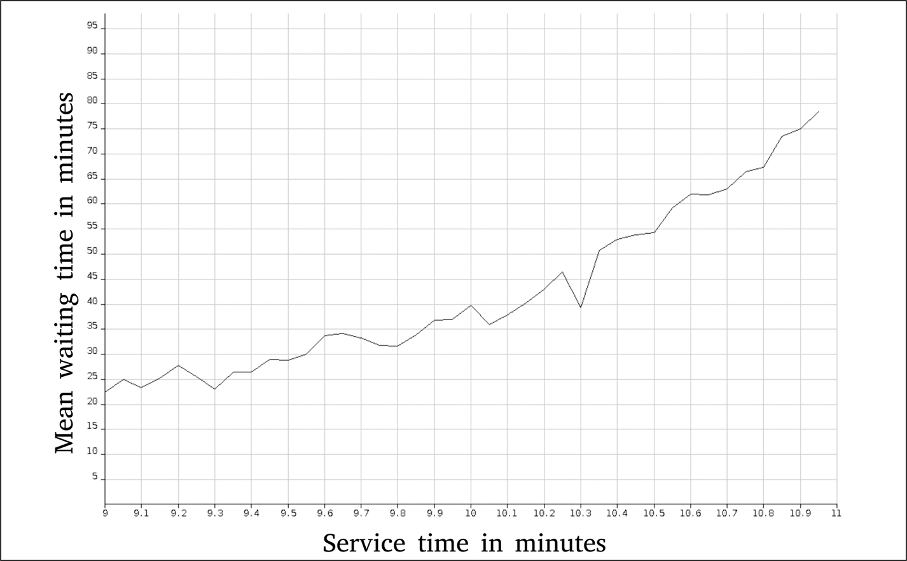

*Hình 17.10: Thay đổi thời gian phục vụ từ 9 đến 11 phút.[⏎](#b17fig17_10)*

Trong trường hợp này, đã có thể kiểm tra kết quả của Petri net với các giá trị mathematically-calculated. Điều này chỉ khả thi vì thời gian giữa các lần đến và thời gian phục vụ đều có phân phối mũ: có thể vẽ một Markov model cho số khách trong tiệm cắt tóc; xem [Hình 17.11](#fig17_11), nơi con số trong mỗi trạng thái biểu thị số khách trong tiệm. Nhìn chung, với các khoảng thời gian không đổi hoặc các khoảng thời gian lấy từ các phân phối đo được, không có kết quả toán học nào.

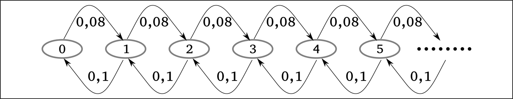

*Hình 17.11: Một Markov model của tiệm cắt tóc.[⏎](#b17fig17_11)*

Các kỹ sư phần mềm nhúng không thường được yêu cầu ước lượng diện tích phòng chờ cần thiết của một tiệm cắt tóc. Sự liên quan của nguyên lý này với các thông điệp đến một bộ xử lý và cần được lưu trữ trước khi được xử lý, tôi hy vọng, là rõ ràng.

### 17.3.8 Petri net và Markov model

Một phép biến đổi đặc biệt dễ dàng là tạo một Petri net từ một Markov model có dạng như trong [Hình 14.2](ch14_markov_models.vi.md#fig14_2) ở trang 171. Mỗi trạng thái trở thành một place của Petri net, và một transition mũ âm được chèn vào mỗi mũi tên. Một token duy nhất biểu diễn trạng thái hiện tại của hệ thống và ban đầu được đặt ở Trạng thái 1. Công cụ Petri net khi đó sẽ tính tất cả các kết quả được đưa ra trong [Bảng 14.1](ch14_markov_models.vi.md#tbl14_1) ở trang 172.

Mặc dù đây là một cách hữu ích để biểu diễn một Markov model, việc có mọi transition đều là mũ âm theo cách này không khai thác hết sự linh hoạt của Petri net.

### 17.3.9 Token và place biểu diễn điều gì?

Token và place có thể biểu diễn bất cứ thứ gì.

Khi Petri net đang được dùng để biểu diễn một Markov model, sẽ có một place cho mỗi trạng thái và một token biểu diễn trạng thái hiện tại.

Trong [Hình 17.9](#fig17_9), các place trừu tượng hơn. Place biểu diễn phòng chờ có lẽ là ít trừu tượng nhất, nhưng place biểu diễn nguồn thì hoàn toàn trừu tượng. Trong trường hợp này, các token biểu diễn thợ cắt tóc và các khách hàng.

### 17.3.10 Colored Petri net

Petri net đơn giản trong [Hình 17.9](#fig17_9) có thể dễ dàng được mở rộng. Nếu có hai loại khách cho thợ cắt tóc, có lẽ là người lớn và thiếu niên, mỗi loại mất một khoảng thời gian cắt tóc khác nhau, thì có thể cung cấp hai nguồn, cả hai đều đổ vào cùng một phòng chờ. Tuy nhiên, để xử lý hai loại khác nhau, các token sẽ cần phân biệt được.

Sự phân biệt này được cung cấp bởi khái niệm token “có màu” (colored): các token mang thông tin theo chúng. Trong trường hợp này, thông tin sẽ đơn giản chỉ là một loại (“adult” hoặc “teenager”), nhưng nó có thể phức tạp hơn.

Khi đó một transition có thể được cấu hình để chỉ fire nếu có, ví dụ, 3 token của một “màu” và 2 token của một “màu” khác trong các place input của nó.

Tài liệu tham khảo [[7](#refbib17_7)] của Francesca Saglietti và Matthias Meitner áp dụng một colored Petri net cho bài toán bảo đảm đủ an toàn trong một khu vực có nhiều robot tự hành. Tài liệu này nói rằng lợi ích chính của việc dùng colored Petri net là nó cho phép tách biệt rõ ràng các mối quan tâm: các phần chung và non-changing của hệ thống (ví dụ, bố cục khu vực làm việc) có thể được tách khỏi các phần biến đổi (ví dụ, số robot có sẵn) trong mô hình.

### 17.3.11 Petri net và Non-Determinism

Điều gì xảy ra khi hai transition cùng được enable bởi một token đến một place?

Làm ví dụ, hãy xét mạng trong [Hình 17.12](#fig17_12). Cả T0 lẫn T1 đều không thể fire vì thiếu token ở P1. Tuy nhiên, nếu T2 fire, thì một token sẽ xuất hiện ở P1 và cả T0 lẫn T1 đều sẽ có thể fire. Transition nào fire trước sẽ lấy token ra khỏi P1, qua đó vô hiệu hóa transition kia.

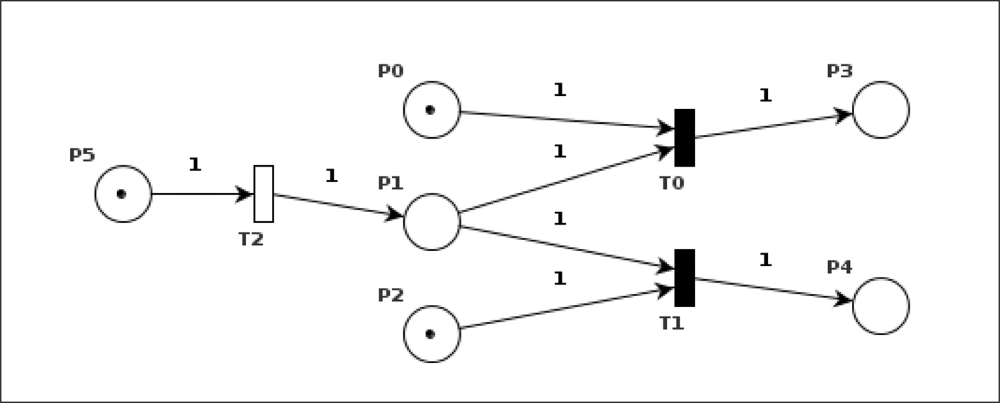

*Hình 17.12: Non-determinism trong một Petri net.[⏎](#b17fig17_12)*

Một khi T2 đã fire, hành vi của mạng này là non-deterministic; nó có thể thể hiện hành vi khác nhau trong các lần chạy khác nhau. Thay vì là một nhược điểm của ngôn ngữ mô hình hóa, điều này thực ra phản ánh các điều kiện đồng thời vốn có trong hệ thống đang được mô hình hóa, và vì vậy là thiết yếu đối với mô hình. Trong hệ thống đang được mô hình hóa, hai interrupt có thể xảy ra gần như cùng một thời điểm và được xử lý theo thứ tự khác nhau vào những thời điểm khác nhau. Ngôn ngữ mô hình hóa nên đủ mạnh để cho phép mô hình hóa loại đồng thời này, để tính đúng đắn của thiết kế có thể được chứng tỏ trong mọi điều kiện.

[Chương 18](ch18_formal_verification.vi.md) có phần mô tả ngôn ngữ PROMELA: một ví dụ khác về một ngôn ngữ non-deterministic được dùng để định nghĩa hành vi hệ thống.

### 17.3.12 Các idiom của Petri net

Petri net là một ngôn ngữ và, như với bất kỳ ngôn ngữ nào, có những idiom mà, khi đã biết, giúp ngôn ngữ dễ đọc và dễ viết hơn. Tài liệu tham khảo [[8](#refbib17_8)] của Winfrid G. Schneeweiss là một cuốn sách tranh hữu ích chứa nhiều idiom như vậy.

Ví dụ, [Hình 17.13](#fig17_13) minh họa cách các token có thể được gửi luân phiên xuống hai đường khác nhau. P0/T0 cùng nhau sinh ra vô hạn token theo các khoảng thời gian do T0 xác định. Các token này sẽ đi luân phiên tới P4 hoặc P5, vốn sẽ dẫn đến các phần khác nhau của mạng đầy đủ, hướng đi được P2 và P3 luân phiên.

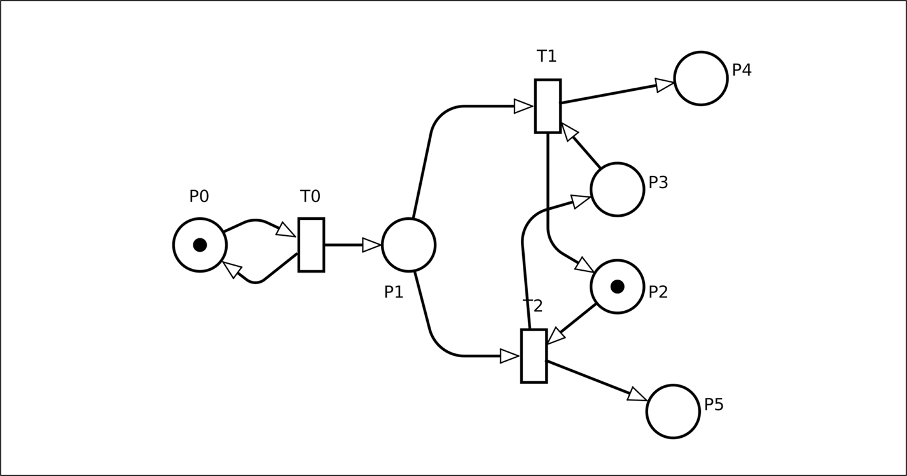

*Hình 17.13: Idiom để chọn các đường đi luân phiên.[⏎](#b17fig17_13)*

Tài liệu tham khảo [[9](#refbib17_9)] của Schneeweiss chứa các khuôn mẫu liên quan đến việc áp dụng Petri net vào mô hình hóa dependability của hệ thống.

## 17.4 Mô phỏng và các công ty ví dụ

Các công ty tiêu biểu được giới thiệu trong [Chương 4](ch04_representative_companies.vi.md) sẽ được dự kiến triển khai mô phỏng, dù dùng discrete event simulation hay Petri net, theo những cách khác nhau.

Alpha Device Corporation (ADC) sản xuất các thiết bị hoàn chỉnh, bao gồm cả phần cứng lẫn phần mềm, và sẽ cần một số bằng chứng rằng phần mềm tiếp tục hoạt động đúng khi đối mặt với bất kỳ tổ hợp và định thời nào của các input từ phần cứng. Nếu có thể, một phần bằng chứng này, đặc biệt là phần liên quan đến các điều kiện liveness (xem trang 19 để biết sự phân biệt giữa điều kiện safety và điều kiện liveness), sẽ được cung cấp bằng cách chứng minh hình thức tính đúng đắn của nó ([Chương 18](ch18_formal_verification.vi.md)). Tuy nhiên, bằng chứng để hỗ trợ các tuyên bố về định thời và availability có lẽ sẽ đến từ mô phỏng — discrete event simulation hoặc Petri net.

Nếu thiết bị do ADC tạo ra có một giao diện người dùng đặc biệt phức tạp, một cách dùng khả dĩ khác của mô phỏng là cho phép các khách hàng tiềm năng thử nghiệm giao diện đó trước khi thiết kế hoàn tất. Điều này cho phép nhận diện các vấn đề về giao diện người dùng trước khi sản phẩm được xuất xưởng. Tài liệu tham khảo [[10](#refbib17_10)] của Harold Thimbleby có một mô phỏng thú vị về việc các chuyên gia y tế mắc lỗi trên các loại bàn phím khác nhau khi cố nhập một con số, chủ yếu để đánh giá loại bàn phím nào sẽ dẫn đến ít lỗi nhất.

Mặt khác, Beta Component Incorporated (BCI) đang xây dựng một sản phẩm software-only sẽ là một thành phần trong thiết bị của ADC. Mô phỏng trong trường hợp của họ sẽ cung cấp bằng chứng hữu ích rằng đã phân bổ đủ tài nguyên — memory, file descriptor, message block, v.v. — để bảo đảm rằng hệ thống sẽ không hỏng vì thiếu tài nguyên, đặc biệt khi tài nguyên trong các hệ thống safety-critical thường được cấp phát tĩnh lúc start-up hoặc cấp phát động theo cách rất có kiểm soát — như được khuyến nghị trong IEC 61508-3, Table A.2.

## Tài liệu tham khảo

[1] D. Ganesan, M. Lindvall, R. Cleaveland, R. Jetley, P. Jones, and Y. Zhang, “Architecture reconstruction and analysis of medical device software,” in *Proceedings of the 2011 Ninth Working IEEE/IFIP Conference on Software Architecture*, WICSA'11, (Washington, DC, USA), pp. 194–203, IEEE Computer Society, 2011.[⏎](#b17refbib17_1)

[2] T. J. Schriber, *Simulation Using GPSS*. John Wiley and Sons, 1974.[⏎](#b17refbib17_2)

[3] J. von Neumann, “Various Techniques Used in Connection with Random Digits,” *J. Res. Nat. Bur. Stand*., vol. 12, pp. 36–38, 1951.[⏎](#b17refbib17_3)

[4] D. E. Knuth, *The Art of Computer Programming, Volume 2 (3rd edition): Seminumerical Algorithms*. Boston, MA, USA: Addison-Wesley Longman Publishing Co., Inc., 1997.[⏎](#b17refbib17_4)

[5] C. A. Petri, *Kommunikation mit Automaten*. PhD thesis, Institut für instrumentelle Mathematik, Bonn, 1962.[⏎](#b17refbib17_5)

[6] M. A. Marsan, “Stochastic Petri Nets: An Elementary Introduction,” *Lecture Notes in Computer Science; Advances in Petri Nets 1989*, vol. 424, pp. 1–29, 1990. NewsletterInfo: 36.[⏎](#b17refbib17_6)

[7] F. Saglietti and M. Meitner, “Model-driven structural and statistical testing of robot cooperation and reconfiguration,” in *Proceedings of the 3rd Workshop on Model-Driven Robot Software Engineering*, MORSE ‘16, (New York, NY, USA), p. 17–23, Association for Computing Machinery, 2016.[⏎](#b17refbib17_7)

[8] W. Schneeweiss, *Petri Net Picture Book*. LiLoLe-Verlag GmbH, 2004.[⏎](#b17refbib17_8)

[9] W. Schneeweiss, *Petri Nets for Reliability Modeling*. LiLoLe-Verlag GmbH, 1999.[⏎](#b17refbib17_9)

[10] H. Thimbleby, “Safety versus Security in Healthcare IT,” in *Addressing Systems Safety Challenges, Proceedings of the 22nd Safety-Critical Systems Symposium* (C. Dale and T. Anderson, eds.), pp. 133–146, 2014.[⏎](#b17refbib17_10)
