<a id="p220"></a>

<a id="chapter18"></a>

# 18 Kiểm chứng hình thức (Formal Verification)

DOI: [10.1201/9781003598145-18](https://doi.org/10.1201/9781003598145-18)

> *Formal method nên là một phần trong việc đào tạo mọi nhà khoa học máy tính và kỹ sư phần mềm, cũng như ngành toán ứng dụng thích hợp là một phần cần thiết trong việc đào tạo mọi kỹ sư khác. Formal method cung cấp nền tảng trí tuệ cho lĩnh vực của chúng ta; chúng có thể định hình tư duy của chúng ta và giúp định hướng cách tiếp cận vấn đề theo những con đường hiệu quả; chúng cung cấp các ký hiệu để ghi lại yêu cầu và thiết kế, và để truyền đạt suy nghĩ của chúng ta cho người khác một cách chính xác và sáng sủa; và chúng cung cấp cho chúng ta các công cụ phân tích để tính toán các thuộc tính và hệ quả của những yêu cầu và thiết kế mà chúng ta ghi lại.*
>
> John Rushby trong tài liệu tham khảo [<a id="b18refbib18_1"></a>[1](#refbib18_1)] (1993)

[Chương 17](ch17_semi_formal_verification.vi.md) đã trình bày một số kỹ thuật semi-formal có thể được dùng để trả lời câu hỏi: *“Một hệ thống được hiện thực theo thiết kế này có đáp ứng được những gì được yêu cầu ở nó không?”* Chương này đề cập đến cùng câu hỏi đó, nhưng dùng formal method.

Ý định của việc kiểm chứng thiết kế hình thức là tạo ra một định nghĩa đầy đủ về mặt toán học của thiết kế rồi chứng minh rằng thiết kế là đúng theo các invariant được chọn, vốn phải luôn đúng bất kể chuỗi sự kiện mà hệ thống phải chịu.

Thực ra, formal method có thể phục vụ nhiều mục đích hơn là chỉ kiểm tra tính đúng đắn của một thiết kế. Như IEC TS 61508-3-2 chỉ ra: *“các phương pháp [hình thức] như vậy có sẵn để đặc tả yêu cầu, để đánh giá thiết kế, để kiểm tra source code và object code, để suy ra các bộ test, và để giám sát hoạt động đúng của phần mềm lúc runtime.”*

## 18.1 Formal method là gì?

[Mục 2.1.8](ch02_terminology_of_safety.vi.md#sec2_1_8) ở trang 18 đưa ra một ý niệm về sự phân biệt giữa các ngôn ngữ formal, semi-formal và informal. Một thiết kế có thể được biểu diễn một cách informal (ví dụ, bằng tiếng Anh), semi-formally (ví dụ, như một Petri net), hoặc một cách formal. Ngôn ngữ formal duy nhất của chúng ta là toán học, nhưng một số công cụ được dùng để biểu diễn thiết kế bằng một ngôn ngữ formal che giấu một phần, nếu không nói là toàn bộ, toán học khỏi người dùng.

<a id="p221"></a>Một khi thiết kế của một hệ thống, một thành phần hay một thuật toán được biểu diễn một cách formal, chúng ta có thể suy luận về nó. Liệu thuật toán có luôn hoàn tất trong một khoảng thời gian hữu hạn bất kể tổ hợp và định thời của các sự kiện xảy ra? Liệu việc nhận thông điệp A có *luôn luôn* dẫn đến việc gửi thông điệp B? Có *bất kỳ* tổ hợp tình huống nào mà thông điệp B được gửi mà không có thông điệp A được nhận trước đó không? Các tiến trình có thể deadlock không? Nếu tiến trình A cố gửi thông điệp X vô hạn lần, thì nó có thành công vô hạn lần không?

Việc biểu diễn thiết kế một cách formal mang lại nhiều hơn là kiểm chứng: với thiết kế formal, có thể sinh ra phần mềm một cách tự động. Về nguyên tắc, khi đó không cần kiểm thử phần hiện thực; nếu code đã được tạo ra bởi một thuật toán đáng tin cậy từ một thiết kế đã được chứng minh là đúng, thì tại sao lại cần kiểm thử? Trong thực tế, kiểm thử vẫn sẽ cần thiết, nhưng IEC 61508-3 lưu ý rằng, khi formal method được sử dụng, nỗ lực kiểm thử tích hợp có thể được giảm bớt. Hãy nhớ lời cảnh báo năm 1977 của Donald Knuth: *“Hãy coi chừng bug trong đoạn code trên; tôi chỉ mới chứng minh nó đúng, chưa chạy thử nó.”*

## 18.2 Lịch sử của formal method

Có lẽ ngôn ngữ formal thực tế đầu tiên để biểu diễn thiết kế hệ thống là Vienna Development Method (VDM), bắt nguồn từ phòng thí nghiệm Vienna của IBM vào những năm 1970. Công trình này được Dines Bjørner và Cliff B. Jones công bố năm 1978 trong tài liệu tham khảo [<a id="b18refbib18_2"></a>[2](#refbib18_2)].

Song song với VDM, Jean-Raymond Abrial đang làm việc với ngôn ngữ Z, ngôn ngữ cũng xuất hiện trên ấn phẩm vào cuối những năm 1970. Tôi mô tả công cụ Rodin bên dưới, và công cụ này hoạt động với ngôn ngữ Event-B, một dẫn xuất của ngôn ngữ B (cũng do Abrial xây dựng), bản thân ngôn ngữ B là hậu duệ trực tiếp của Z.

Các ngôn ngữ này dựa trên lý thuyết tập hợp, phép tính lambda và logic vị từ first-order, mặc dù những gì đòi hỏi ở người dùng chỉ hơn một chút so với kiến thức cơ bản về lý thuyết tập hợp, bao gồm hàm, và sự sẵn lòng học ký hiệu toán học.

Bắt đầu từ năm 1980, cùng thời với sự phát triển Z/B/Event-B, công cụ Spin được Gerard Holzmann và những người khác phát triển tại Computing Sciences Research Center ở Bell Labs. Thay vì lý thuyết tập hợp, Spin dựa trên các Büchi automata non-deterministic, được đặt theo tên Julius Richard Büchi, một nhà toán học Thụy Sĩ giữa thế kỷ 20. Một lần nữa, gần như toàn bộ sự phức tạp này được che giấu khỏi người dùng.

Kể từ những ngày đầu đó, các công cụ hỗ trợ những ngôn ngữ này đã được cải tiến, đặc biệt trong lĩnh vực các thuật toán xây dựng chứng minh toán học.

<a id="p222"></a>

## 18.3 <a id="p222"></a>Formal method và các tiêu chuẩn

### 18.3.1 EN 50716

Table A.17 của EN 50716 “rất khuyến nghị” formal method như một kỹ thuật mô hình hóa phù hợp ở mọi SIL. Điều này khác với EN 50128, tiêu chuẩn mà EN 50716 thay thế, vốn “khuyến nghị” formal method ở SIL 1 và SIL 2 và chỉ “rất khuyến nghị” chúng ở SIL 3 và SIL 4.

### 18.3.2 IEC 61508

IEC 61508-3 lưu ý rằng, khi formal method được sử dụng, phạm vi các test case cần thiết cho kiểm chứng có thể được giảm bớt. Table A.1, A.2 và A.4 khuyến nghị dùng formal method để đặc tả các yêu cầu an toàn và để đặc tả thiết kế phần mềm. Việc dùng formal method cho kiểm thử được khuyến nghị trong Table A.5 và A.9. Ngoài ra, Table A.7 viện đến Table B.5, bảng khuyến nghị formal method như một công cụ mô hình hóa.

IEC 61508-7 mô tả formal method và chỉ định mục đích của việc dùng chúng:

> *Formal method chuyển các nguyên tắc suy luận toán học vào việc đặc tả và hiện thực các hệ thống kỹ thuật [qua đó tăng] tính đầy đủ, tính nhất quán hoặc tính đúng đắn của một đặc tả hoặc phần hiện thực.*

Nó còn nói thêm rằng, *“[Formal method] có thể trở nên không thể tránh khỏi khi độ phức tạp tăng lên và cần một mức độ tin cậy cao (SIL trên 2),”* nhưng tiếp tục liệt kê một số nhược điểm khả dĩ của formal method:<a id="fn18_118b"></a>[<sup>1</sup>](#fn18_1)

<a id="fn18_1"></a>

[<sup>1</sup>](#fn18_118b)Tôi đã giữ nguyên cách diễn đạt chính xác từ IEC 61508, ngay cả khi tiếng Anh có vẻ hơi gượng gạo.

- *IEC 61508: “Mức trừu tượng cố định.”*

  Công cụ Rodin được mô tả bên dưới tránh được điều này bằng cách có một hệ phân cấp các mức trừu tượng. Ở mức thấp nhất, đặc tả hoàn toàn trừu tượng. Ở mỗi bước, đặc tả trở nên cụ thể hơn, cho đến khi cuối cùng nó hoàn toàn cụ thể và code có thể được sinh ra.

- *IEC 61508: “Hạn chế trong việc nắm bắt mọi chức năng có liên quan ở giai đoạn nhất định.”*

  Không rõ ý ở đây là gì; chắc chắn người xây dựng mô hình phải bảo đảm rằng mọi chức năng có liên quan đều đã được đưa vào, và các nhà thiết kế đôi khi không thể mô hình hóa một cách formal mọi khía cạnh của hệ thống. Như tài liệu tham khảo [<a id="b18refbib18_3"></a>[3](#refbib18_3)] của P. C. Ölveczky và J. Meseguer nói:

  > *Hiện tại, những người thiết kế các hệ thống real-time đang đối mặt với một thế khó giữa khả năng biểu đạt và kiểm chứng tự động. Nếu họ có thể đặc tả một số <a id="p223"></a>khía cạnh của hệ thống của mình bằng một formalism automaton-based bị giới hạn hơn, thì có thể đạt được kiểm chứng tự động các thuộc tính hệ thống bằng các thủ tục quyết định model checking chuyên biệt. Nhưng điều này có thể khó hoặc không thể đối với các thành phần hệ thống phức tạp hơn. … Trong trường hợp đó, mô phỏng mang lại sự linh hoạt mô hình hóa lớn hơn, nhưng thường khá yếu về các loại phân tích hình thức có thể được thực hiện.*

  Ngôn ngữ real-time Maude được thiết kế riêng để bắc cầu qua khoảng cách giữa tính hình thức và khả năng biểu đạt.

- *IEC 61508: “Khó khăn của các kỹ sư hiện thực trong việc hiểu mô hình.”*

  Đây có thể là một vấn đề. Như Guy Broadfoot, Akramul Azim và tôi đã chỉ ra trong tài liệu tham khảo [<a id="b18refbib18_4"></a>[4](#refbib18_4)], đây không chỉ là vấn đề của các kỹ sư hiện thực. Theo kinh nghiệm của chúng tôi, ít assessor nào, khi đối mặt với hàng trang định lý và chứng minh được cho là biện minh cho tính đúng đắn của một thiết kế, có thể tiếp thu chúng và đánh giá mức độ liên quan của chúng.

- *IEC 61508: “Nỗ lực cao để phát triển, phân tích và bảo trì mô hình trong suốt vòng đời của hệ thống.”*

  *Có* một chi phí dự án gắn với việc phát triển các formal model nhưng, như chính IEC 61508 chỉ ra, chi phí này có thể được bù đắp phần nào nhờ giảm thời gian kiểm thử. Việc sinh code tự động từ mô hình cũng có thể giảm tổng thời gian dự án; xem [Mục 18.6](#sec18_6).

  Có vẻ như (xem, ví dụ, tài liệu tham khảo [<a id="b18refbib18_5"></a>[5](#refbib18_5)] của Steve King *et al*) cán cân kinh tế đang nghiêng từ kiểm chứng qua kiểm thử sang kiểm chứng bằng formal method.

- *IEC 61508: “Sự sẵn có của các công cụ hiệu quả hỗ trợ việc xây dựng và phân tích mô hình.”*

  Đây là điều đã được cải thiện trong thế kỷ 21 khi năng lực máy tính và các thuật toán được cải thiện. Công cụ Spin được mô tả bên dưới đã có từ năm 1980, nhưng sự gia tăng năng lực tính toán và memory đã khiến nó hữu ích hơn nhiều gần đây. Các công cụ Rodin và TLA<sup>+</sup>, cũng được mô tả bên dưới, được tạo ra trong thập kỷ đầu tiên của thế kỷ 21.

- *IEC 61508: “Sự sẵn có của nhân sự có khả năng phát triển và phân tích mô hình.”*

  Đúng là rất khó tìm được nhân sự có khả năng phát triển formal model. Như câu trích ở đầu chương này nói, cần nhiều đào tạo hơn, nhưng, như được thể hiện trong các ví dụ bên dưới, mức chuyên môn toán học cần thiết không cao.

  Tôi cảm thấy câu hỏi cốt lõi là, ai nên tạo ra các mô hình? Các nhóm phát triển theo truyền thống gồm những người về bản chất là lập trình viên — họ có thể đang làm nhà thiết kế, người hiện thực hoặc tester, nhưng thực chất họ là <a id="p224"></a>lập trình viên. Có lẽ tốt hơn là không dùng lập trình viên để tạo ra mô hình vì, mặc dù hai kỹ năng có liên quan, chúng thực ra khác biệt. Việc tạo một formal model bằng ngôn ngữ PROMELA của Spin như được mô tả bên dưới rất gần với việc viết một chương trình C. Điều này có thể gây nhầm lẫn vì, bất chấp sự tương đồng về cú pháp, một chương trình PROMELA *không phải* là một chương trình máy tính, nó là một định nghĩa của một thiết kế.

- *IEC 61508: “Việc mô hình hóa chức năng mục tiêu của hệ thống thường có thể làm giảm sự chú trọng vào khả năng chịu lỗi của hệ thống.”*

  Đây là vấn đề về cách áp dụng công cụ: tính robust và chức năng đều có thể được mô hình hóa, nhưng nhiều ví dụ được đưa ra trong tài liệu giả định rằng các thiết bị là hoàn hảo và không bao giờ hỏng. Tuy nhiên, Ken Robinson đã nhiều lần chỉ ra rằng Event-B chắc chắn có thể xử lý nhiều yêu cầu phi chức năng bao gồm dung lượng, định thời và availability.

### 18.3.3 IEC TS 61508-3-2

Technical Specification này được công bố vào tháng Tám năm 2024 để mở rộng các tham chiếu đến formal method trong IEC 61508-3. Nó đặt ra một kỹ thuật tinh chỉnh dần dần, theo đó mỗi bước trong việc phát triển phần mềm có thể được kiểm tra:

- Các yêu cầu an toàn phải được viết theo một cách theo một cách rõ ràng, đầy đủ và nhất quán. Đặc biệt, phải chứng tỏ được rằng không có hành vi safety-related nào bị bỏ sót, không có sự mơ hồ nào cho phép hành vi không an toàn và ngôn ngữ được dùng đủ formal để có thể phân biệt rõ ràng giữa hành vi an toàn và không an toàn.
- Architecture và thiết kế phải được ghi lại theo một cách formal. Sau đó chúng phải được chứng minh là đáp ứng các yêu cầu an toàn.
- Dù dùng ngôn ngữ lập trình nào, code ở Executable Source-Code Level (ESCL) phải được chứng minh là đáp ứng thiết kế. Việc chứng minh hình thức cho bước này có thể là một hoạt động thủ công, thay vì tự động.
- Object code phải được chứng tỏ là đã được sinh ra đúng từ ESCL. Xem [Mục 23.4.3](ch23_the_offline_tools.vi.md#sec23_4_3) ở trang 313 để biết một số suy nghĩ về việc kiểm chứng một lần biên dịch.
- Phải chứng minh được rằng code thu được không có lỗi runtime. Một ngôn ngữ như SPARK/Ada có thể cung cấp loại bảo đảm này.

Ý định là có thể chứng tỏ rằng các yêu cầu an toàn được đáp ứng xuyên suốt cho đến tận mức object-code.

IEC TS 61508-3-2 cũng mô tả việc sinh test case từ các đặc tả formal khác nhau như được mô tả trong [Mục 22.2.1](ch22_integration_and_system_testing.vi.md#sec22_2_1) ở trang 294.

<a id="p225"></a>

### 18.3.4 <a id="p225"></a>DO-333

Cuốn sách này không đề cập đến các tiêu chuẩn DO-178C và DO-278A về phần mềm trong các hệ thống hàng không, nhưng DO-333, có tên “Formal Methods Supplement to DO-178C and DO-278A,” đề cập đến việc áp dụng formal method và có thông tin hữu ích về tool qualification. DO-333 được xuất bản năm 2011 và vì vậy cũ hơn nhiều so với IEC TS 61508-3-2, nhưng, giống đặc tả đó, nó khuyến nghị dùng formal method xuyên suốt từ việc kiểm tra các yêu cầu high-level của hệ thống, qua architecture và thiết kế, đến source code. Không giống IEC TS 61508-3-2, nó không xem xét object code được sinh ra. Tài liệu tham khảo [<a id="b18refbib18_6"></a>[6](#refbib18_6)] của Darren Cofer và Steven Miller cung cấp ba case study về cách DO-333 có thể được áp dụng cho các hệ thống thực.

### 18.3.5 ISO 26262

ISO 26262-6 khuyến nghị formal method cho nhiều hoạt động khác nhau. Table 2 khuyến nghị dùng ký hiệu formal để ghi lại software architecture và thiết kế unit, và Table 4 và 7 khuyến nghị kiểm chứng hình thức cho các hệ thống cần tuân thủ ASIL C hoặc D.

### 18.3.6 IEC 62304

Tham chiếu duy nhất của IEC 62304 đến formal method khá tiêu cực. Đoạn 5.2.6 nói, *“Tiêu chuẩn này không đòi hỏi việc dùng một ngôn ngữ đặc tả formal.”*

<a id="aned28"></a>

> Giai thoại 28[⏎](#b18aned28) *Nhiều năm trước, công ty mà tôi làm việc khi đó đang thiết kế một thiết bị có giao diện người dùng phức tạp cho một khách hàng lớn. Tôi đã xây dựng một formal model của thiết bị, và khách hàng được mời dành một ngày với chúng tôi để thử nghiệm giao diện người dùng. Trong quá trình khám phá, nhiều vấn đề đã được tìm thấy với giao diện, và tôi đã sửa chúng trong mô hình khi buổi thử nghiệm tiến triển. Vào cuối buổi thử nghiệm, khách hàng đề nghị ký vào một bản in của mô hình cuối cùng làm hợp đồng giữa hai bên vì giờ nó định nghĩa rõ ràng, không mơ hồ cách thiết bị nên hoạt động.*
>
> *Tôi rất vui vì mô hình của mình đã thành công như vậy — tôi đã phát minh ra ngôn ngữ (mà tôi gọi là “CHISEL”: Chris Hobbs' Intermediate Specification Language!) và tự viết công cụ. Nhưng chẳng bao lâu sau, rõ ràng rằng tôi là một kỹ sư ngây thơ. Công ty của tôi đã từ chối chấp nhận đặc tả làm hợp đồng.*
>
> *Bằng thái độ lịch sự nhất của mình, tôi hỏi tại sao, và được trả lời rằng một đặc tả rõ ràng không mơ hồ không chừa chỗ để xoay xở khi sản phẩm cuối cùng được giao. Thay vào đó, công ty của tôi khăng khăng dùng một đặc tả English-language mơ hồ.*
>
> *Bài học của câu chuyện là, mặc dù các kỹ sư muốn các yêu cầu rõ ràng không mơ hồ, và các tiêu chuẩn khuyến khích điều này, nó có thể không phải lúc nào cũng được chấp nhận về mặt thương mại. May mắn là sản phẩm đó không phải safety-critical.*

<a id="p226"></a>

## 18.4 <a id="p226"></a>Formal method có hiệu quả không?

Từ năm 1990, Anthony Hall đã viết một bài báo (tài liệu tham khảo [<a id="b18refbib18_7"></a>[7](#refbib18_7)]) nhận diện và xua tan bảy huyền thoại gắn với formal method. Năm năm sau, Jonathan Bowen và Michael Hinchey đã công bố một bài báo follow-up với bảy huyền thoại bổ sung (tài liệu tham khảo [<a id="b18refbib18_8"></a>[8](#refbib18_8)]).

Đây là các huyền thoại mà Anthony Hall đã liệt kê, cùng với những nhận xét đương đại của tôi về chúng:

*Huyền thoại: Formal method có thể bảo đảm rằng phần mềm là hoàn hảo.*

Thực ra, chúng chỉ hoạt động trên các mô hình của hệ thống; nhiệm vụ của nhà phân tích là bảo đảm rằng mô hình phản ánh thực tế đủ tốt.

*Huyền thoại: Formal method hoàn toàn là về chứng minh chương trình.*

Chứng minh chương trình đúng là một trào lưu đặc biệt vào cuối những năm 1980 và đầu những năm 1990, khi bài báo của Hall được viết. Formal method như được mô tả ở đây không chủ yếu để suy luận về chương trình; chúng để suy luận về các mô hình của hệ thống và, như IEC TS 61508-3-2 chỉ ra, để đặc tả yêu cầu, để suy ra các bộ test, và để giám sát hoạt động đúng của phần mềm lúc runtime.

*Huyền thoại: Formal method chỉ hữu ích cho các hệ thống safety-critical.*

Chúng cũng hữu ích cho các hệ thống security- và mission-critical — bất kỳ hệ thống nào cần dependability.

*Huyền thoại: Formal method đòi hỏi các nhà toán học highly-trained.*

Ký hiệu toán học và một chút tư duy toán học là có liên quan, nhưng không cần các nhà toán học được đào tạo chuyên sâu, phần lớn toán học được các công cụ che giấu. TLA<sup>+</sup> có lẽ là ngoại lệ ở đây: Leslie Lamport, người tạo ra TLA<sup>+</sup>, kiên quyết cho rằng công cụ không nên che giấu toán học — nếu chúng ta đang tư duy theo kiểu toán học, chúng ta nên sẵn sàng viết theo kiểu toán học.

*Huyền thoại: Formal method làm tăng chi phí phát triển.*

Huyền thoại này đặc biệt nguy hại. Thực ra, việc dùng chúng đẩy chi phí lên sớm hơn trong dự án, tăng chi phí cho công việc architecture và thiết kế và giảm chi phí hiện thực và kiểm thử. Tuy nhiên, các nhà quản lý thường đánh giá tiến độ của một dự án bằng tiến độ của việc hiện thực (viết code), và điều này làm nảy sinh huyền thoại này.

*Huyền thoại: Formal method không được người dùng chấp nhận.*

Xem <a id="b18aned28"></a>[Giai thoại 28](#aned28). Như giai thoại đó cho thấy, khách hàng (người dùng) thấy cách biểu diễn hình thức các yêu cầu của họ rất dễ chấp nhận.

<a id="p227"></a>*Huyền thoại: Formal method không được dùng cho phần mềm thực tế, large-scale.*

Có một số dự án rất thành công được trích dẫn trong các phân tích về phương pháp luận hình thức, ví dụ Paris Metro và Rotterdam Flood Barrier. Tần suất cùng những ví dụ đó xuất hiện trong tài liệu có thể phản ánh rằng có một phần sự thật trong huyền thoại này, mặc dù các ví dụ khác đang bắt đầu xuất hiện. Ví dụ, tài liệu tham khảo [<a id="b18refbib18_9"></a>[9](#refbib18_9)] của Chris Newcombe *et al.* mô tả cách formal method, dùng TLA<sup>+</sup>, được Amazon Web Services áp dụng cho các thuật toán phân tán. Ba nhận định then chốt trong nghiên cứu đó như sau:
1. Formal method tìm ra những bug trong thiết kế hệ thống mà không thể tìm ra bằng bất kỳ kỹ thuật nào khác mà chúng tôi biết.
2. Formal method khả thi một cách đáng ngạc nhiên đối với việc phát triển phần mềm phổ thông và mang lại lợi tức đầu tư tốt.
3. Tại Amazon, formal method được áp dụng thường xuyên cho việc thiết kế phần mềm real-world phức tạp, bao gồm các dịch vụ public cloud.

Tài liệu tham khảo [[4](#refbib18_4)] đề cập đến việc áp dụng thành công formal method (dùng công cụ Rodin; xem [Mục 18.8](#sec18_8)) cho một thiết bị y tế.

Tài liệu tham khảo [<a id="b18refbib18_10"></a>[10](#refbib18_10)], của Hubert Garavel *et al*, báo cáo về một thí nghiệm trong đó khoảng 130 chuyên gia đã trả lời một khảo sát well-controlled với những câu hỏi như:

- “Có thể thiết kế các hệ thống (phần cứng hoặc phần mềm) đáng tin cậy mà không dùng formal method không?” 62,3% người trả lời nói “có lẽ là không” hoặc “chắc chắn là không.”
- “Bạn có tin rằng formal method, cùng với việc sử dụng nghiêm ngặt các công cụ phân tích hình thức, có thể thực hiện được lời hứa cải thiện an toàn hệ thống không?” 92,3% nói “chắc chắn là có.”

## 18.5 Các loại formal method

Rất khó phân loại rõ ràng các loại ngôn ngữ và công cụ formal sẵn có, nhưng cách sau có thể cung cấp một phân loại hữu ích:

*Các kỹ thuật Model-oriented.*

Với các kỹ thuật này, nhà phân tích định nghĩa hệ thống theo hành vi của nó: *“Khi X xảy ra, hệ thống làm Y.”* Z, B, Event-B, TLA<sup>+</sup> và VDM là những ví dụ về các ngôn ngữ được xây dựng xoay quanh cách tiếp cận này.

*Các kỹ thuật Property-oriented.*

Ở đây, nhà phân tích tập trung vào các thuộc tính thay vì hành vi của hệ thống: *“Luôn luôn đúng rằng trạng thái hệ thống X rốt cuộc sẽ xảy ra.”* Larch, OBJ, CASL, <a id="p228"></a>Clear và ACT One là những ví dụ về cách tiếp cận này. Linear Temporal Logic cũng thuộc loại này; xem Phụ lục D.6 và ứng dụng của nó trong Spin ở [Mục 18.7.5](#sec18_7_5).

*Các kỹ thuật process algebra.*

Các kỹ thuật này phần lớn dựa trên công trình gốc (1978) của C.A.R. Hoare về Communicating Sequential Processes: tài liệu tham khảo [<a id="b18refbib18_11"></a>[11](#refbib18_11)]. Chúng xử lý các tương tác phức tạp giữa các tiến trình khác nhau trong một hệ thống.

Trong các mục sau, tôi xem xét chi tiết hơn ba công cụ: Spin, TLA<sup>+</sup> và Rodin. Tôi đã chọn chúng từ rất nhiều ngôn ngữ và công cụ khả dĩ vì chúng rất khác nhau, vì chúng là những công cụ tôi quen thuộc nhất, và vì tất cả đều miễn phí.

<a id="sec18_6"></a>

## 18.6 Sinh code và test tự động

Với một định nghĩa formal về thiết kế dự định của hệ thống đã được chứng minh là đúng, có thể sinh code để hiện thực thiết kế một cách tự động. Với một số công cụ thì đúng là như vậy: công cụ Rodin được mô tả trong [Mục 18.8](#sec18_8) có một bộ sinh code để tạo code Java, C, C++ và C#. Nhiều công cụ thương mại tạo ra code high-quality.

Việc sinh code tự động vừa có lợi vừa có hại: nó đòi hỏi thay đổi cấu trúc các nhóm phát triển — có lẽ năm nhà thiết kế và ba lập trình viên thay vì hai nhà thiết kế và mười lập trình viên — và nó có thể làm phức tạp quy trình phê duyệt khi phải biện minh cho chất lượng của bộ sinh code.

Nó cũng làm phức tạp việc bảo trì code. Code có lẽ sẽ không được sinh ra theo coding standard của công ty<a id="fn18_218b"></a>[<sup>2</sup>](#fn18_2) và phải đưa ra quyết định liệu code được sinh ra có bao giờ được con người sửa đổi hay không, hay mô hình luôn phải được thay đổi và code được sinh lại.

Một ưu điểm lớn có thể có được từ hình thức sinh code tự động này, nhưng dường như chưa có trong các công cụ hiện có, là việc sinh song song các integration test case tốt. Bài báo của tôi, tài liệu tham khảo [<a id="b18refbib18_12"></a>[12](#refbib18_12)], phác thảo một số nguy cơ mà chúng ta đối mặt khi sinh module test từ code để đạt được các code coverage metric mà các tiêu chuẩn đòi hỏi. Việc sinh module test và integration test từ thiết kế hệ thống formal sẽ tránh được nguy cơ đó và sẽ cung cấp các test case high-quality. Chủ đề này được khám phá lại trong [Mục 22.2](ch22_integration_and_system_testing.vi.md#sec22_2).

<a id="fn18_2"></a>

[<sup>2</sup>](#fn18_218b)Điều thú vị là một số công cụ thương mại, ví dụ công cụ sinh AutoSAR OS của ETAS, không chỉ tạo ra code tuân theo các tiêu chuẩn MISRA C, mà còn sinh ra một báo cáo về mức độ tuân thủ và lý lẽ biện minh cho các vi phạm.

<a id="sec18_7"></a>

<a id="p229"></a>

## 18.7 <a id="p229"></a>Công cụ mô hình hóa Spin

### 18.7.1 Lịch sử của Spin

Spin là một công cụ trưởng thành có nguồn gốc có thể truy ngược về những năm 1980, và nó có thể được dùng ở chế độ mô phỏng và chế độ kiểm chứng để debug một thiết kế rồi chứng minh tính đúng đắn của nó (hoặc tìm ra một phản ví dụ). Trong quá trình kiểm chứng, nó sẽ cố chứng minh tính đúng của các invariant được chỉ định bằng assertion hoặc Linear Temporal Logic (LTL); xem Phụ lục D.6. Nó được phát hành theo nhiều giấy phép khác nhau, bao gồm GPLv2.

### 18.7.2 Cấu trúc của Spin

Mục này chỉ có thể chạm tới bề mặt của hệ thống mô hình hóa Spin. Để biết thêm chi tiết, hãy tham khảo cuốn sách kinh điển của Gerard Holzmann, tài liệu tham khảo [<a id="b18refbib18_13"></a>[13](#refbib18_13)].

<a id="b18fig18_1"></a>[Hình 18.1](#fig18_1) minh họa quy trình được dùng để tạo và kiểm chứng một mô hình Spin:

1. Lập trình viên tạo một mô hình của hệ thống đang được nghiên cứu bằng PROMELA (viết tắt của PROcess MEtaLAnguage).
2. Nếu có các invariant cần được biểu diễn bằng LTL (xem Phụ lục D.6), thì lập trình viên code chúng bằng một dạng LTL keyboard-friendly: ⋄ (“rốt cuộc”) trở thành $<>$ và □ (“luôn luôn”) trở thành [ ].
3. Spin chuyển các câu linear temporal logic thành PROMELA và kết hợp chúng với PROMELA do lập trình viên viết để tạo ra một chương trình C sẽ thực hiện việc kiểm chứng.
4. <a id="p230"></a>Chương trình C được biên dịch và thực thi theo cách thông thường. Kết quả hoặc là một chứng minh rằng các invariant luôn đúng, hoặc là một chuỗi sự kiện dẫn đến một invariant bị vi phạm do một fault trong thiết kế.

<a id="fig18_1"></a>

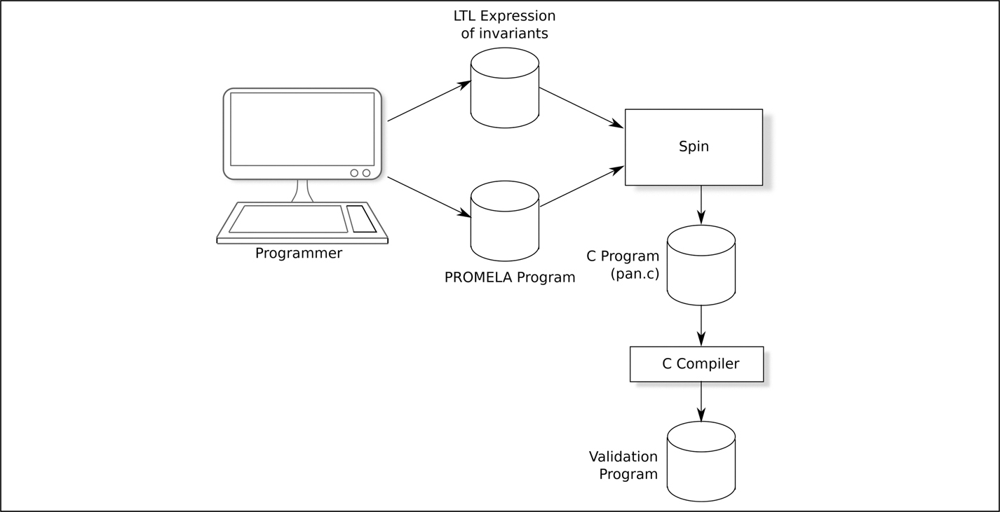

*Hình 18.1: Sử dụng Spin.[⏎](#b18fig18_1)*

Các bước này và các bước liên quan (ví dụ, mô phỏng hệ thống để kiểm tra xem nó đã được đặc tả đúng chưa) có thể được thực hiện bằng command-line của Spin, hoặc có thể được ẩn sau một giao diện người dùng đồ họa, như `ispin` hoặc `jspin`.

### 18.7.3 Ngôn ngữ PROMELA

PROMELA không phải là một ngôn ngữ lập trình; thay vào đó, nó là một ngôn ngữ để mô tả thiết kế của một hệ thống, thuật toán hoặc protocol.

Phần giới thiệu nhẹ nhàng nhất về PROMELA có lẽ là phần có trong cuốn sách của Mordechai Ben-Ari, tài liệu tham khảo [<a id="b18refbib18_14"></a>[14](#refbib18_14)]. Tuy nhiên, tôi có những dè dặt về cuốn sách đó vì Ben-Ari *có* giới thiệu PROMELA như một ngôn ngữ lập trình, và các ví dụ đầu tiên là các bài tập lập trình truyền thống: tìm số lớn hơn trong hai số, định nghĩa số ngày trong mỗi tháng, tính biệt thức của một phương trình bậc hai, v.v. Tôi cảm thấy rằng ai đó học PROMELA theo cách này có thể nhầm lẫn giữa PROMELA và C, ngôn ngữ mà cú pháp PROMELA dựa vào.

Một đặc điểm của PROMELA là nó là một ngôn ngữ non-deterministic. Hãy xét đoạn code C trong <a id="b18fig18_2"></a>[Hình 18.2](#fig18_2). C là một ngôn ngữ tất định và, nếu chương trình này được thực thi, output luôn như nhau:

```
First with i = 1
Second with i = 1
Third with i = 1
First with i = 2
Second with i = 2
Third with i = 2
First with i = 3
...
Third with i = 10
```

<a id="fig18_2"></a>

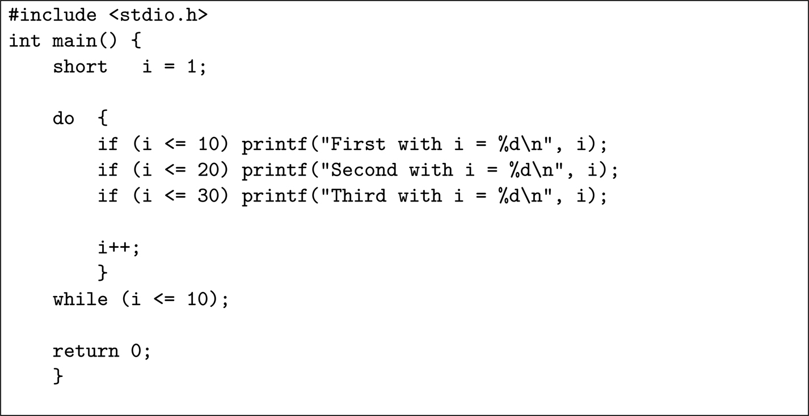

*Hình 18.2: Một chương trình tất định bằng C[⏎](#b18fig18_2)*

<a id="b18fig18_3"></a>[Hình 18.3](#fig18_3) có cùng chương trình được viết bằng PROMELA. Chương trình này cũng bắt đầu với một biến *i* được đặt là 1 và có vẻ lặp cho đến khi $i > 10$, tại đó nó break. Tuy nhiên, đây là một output mẫu:

```
	First with i = 1
	Third with i = 2
	Second with i = 3
	Second with i = 4
	First with i = 5
	Second with i = 6
	First with i = 7
	Third with i = 8
	Third with i = 9
	First with i = 10
	Second with i = 11
	Second with i = 12
	Third with i = 13
	Third with i = 14
	Second with i = 15
```

<a id="fig18_3"></a>

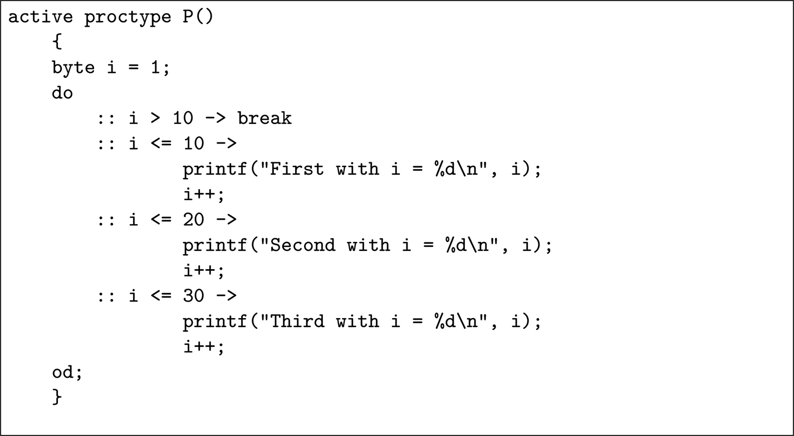

*Hình 18.3: Một phiên bản non-deterministic bằng PROMELA[⏎](#b18fig18_3)*

Output khác nhau mỗi lần chạy chương trình và, như có thể thấy, *i* có thể nhận một giá trị lớn hơn 10. Khi *i* được tăng lên 11, điều kiện $i <= 10$ không <a id="p232"></a>còn đúng, nhưng ba điều kiện kia thì có. Spin đã chọn một trong các điều kiện đó và không chọn

```
:: i > 10 -> break
```

cho đến khi *i* bằng 15.

Tính non-determinism này cực kỳ hữu ích để phản ánh non-determinism trong hệ thống đang được mô hình hóa. Có lẽ trong hệ thống, interrupt A có thể xảy ra hơi trước hoặc hơi sau interrupt B; điều kiện nào cũng có thể xảy ra và chúng ta cần chắc chắn rằng các invariant của mình đúng trong cả hai trường hợp. Đoạn code PROMELA trong [Hình 18.3](#fig18_3) cũng tương tự: nếu *i* bằng 25, thì một trong hai điều kiện $i > 10$ hoặc $i \le 30$ đều có thể xảy ra.

Cũng có những khác biệt về cú pháp giữa PROMELA và C. Ví dụ, dấu chấm phẩy là một dấu phân cách chứ không phải dấu kết thúc như trong C: trong đoạn code trên, không cần dấu chấm phẩy sau `break`.

### 18.7.4 Dùng Spin để kiểm tra một thuật toán mutual exclusion

Để minh họa việc dùng Spin trong một ứng dụng đơn giản đến mức không cần LTL, tôi sẽ lấy một thuật toán mutual exclusion được công bố năm 1966. Vì thuật toán có chứa một lỗi, tôi sẽ không đưa ra tham chiếu đến bài báo, nhưng tôi xin nói thêm rằng tạp chí công bố nó đã, và vẫn, rất có uy tín.

Mục đích của một thuật toán mutual exclusion là cung cấp cho một thread quyền truy cập một tài nguyên cụ thể, các thread khác bị loại trừ cho đến khi thread sở hữu giải phóng nó. Thuật toán thực chất cố gắng hiện thực một mutex. Trong trường hợp thuật toán đã công bố, có hai thread tranh giành tài nguyên: Thread 0 và Thread 1. Ba biến cho phép hai thread tránh xung đột về tài nguyên:

1. `flag[0],` được khởi tạo là 0
2. `flag[1],` được khởi tạo là 0
3. `turn,` được khởi tạo là 0 hoặc 1

Khi Thread *i* muốn có quyền truy cập độc quyền vào tài nguyên, nó thực thi như sau:

1. Đặt `flag[i]` thành 1
2. Trong khi `turn` khác *i*:

   (a) Chờ `flag[1 - i]` trở thành 0

   (b) Đặt `turn` thành *i*

3. Truy cập tài nguyên, thread kia bị loại trừ
4. Đặt `flag[i]` thành 0

Code PROMELA tương ứng với thuật toán này được thể hiện trong <a id="b18fig18_4"></a>[Hình 18.4](#fig18_4). Lưu ý rằng để bảo đảm cả hai thread không bao giờ ở trong critical section cùng lúc, mỗi thread tăng rồi giảm biến `critical`. Nếu thuật toán đúng, thì biến này không bao giờ có thể lớn hơn 1 — do đó có câu lệnh `assert()` ở dòng 17.

<a id="fig18_4"></a>

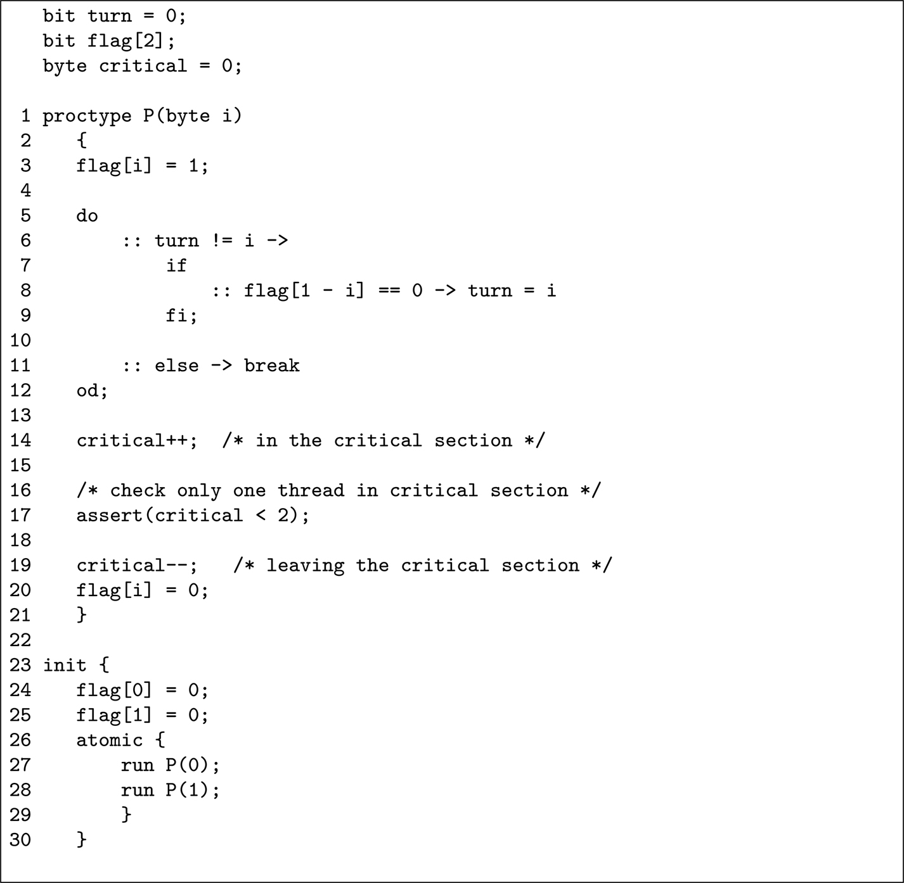

*Hình 18.4: Code PROMELA cho thuật toán mutual exclusion.[⏎](#b18fig18_4)*

Khi được thực thi, Spin tìm ra một chuỗi sự kiện dẫn đến việc cả hai thread cùng ở trong critical section của chúng tại cùng một thời điểm, được biểu thị bởi `critical` lớn hơn 1. Chuỗi sự kiện là:

1. Thread 1 cần truy cập tài nguyên và đặt `flag[1]` = 1 (bước 1 trong thuật toán)
2. Thread 1 thấy rằng `turn` không phải là 1 vì nó được khởi tạo là 0 (bước 2)
3. Thread 1 truy cập `flag[0]` và thấy nó bằng 0 (bước 2a)
4. Tại thời điểm này, thread 0 thức dậy và cần truy cập tài nguyên. Nó đặt `flag[0]` = 1 (bước 1). Lưu ý rằng Thread 1 đã nạp giá trị trước đó của `flag[0]` nhưng bị ngắt trước khi có thể hành động dựa trên nó.
5. <a id="p234"></a>Thread 0 thấy rằng `turn` bằng 0 và vì vậy đi vào critical section của nó (bước 2 và 3)
6. Trong khi Thread 0 đang ở trong critical section, Thread 1 chạy lại và đặt `turn` = 1 (bước 2b)
7. Thread 1 giờ có thể đi vào critical section của nó (bước 3)

Cả hai thread giờ đều tin rằng chúng có quyền truy cập độc quyền vào tài nguyên chung! Theo mô hình, mỗi thread tăng `critical` và, khi thread thứ hai làm vậy, câu lệnh `assert()` phát hiện ra điều kiện lỗi.

Giờ chúng ta đã có các công cụ cần thiết để chứng minh rằng chương trình được đưa ra trong [Hình 7.4](ch07_foundational_analyses.vi.md#fig7_4) ở trang 79 có chứa một fault nghiêm trọng. Việc chuyển chương trình này sang PROMELA rất đơn giản, và một câu lệnh `assert(x != 2)` ngay trước `printf()` nhanh chóng tạo ra chuỗi sự kiện sẽ dẫn đến phép chia cho không.

<a id="sec18_7_5"></a>

### 18.7.5 Spin và Linear Temporal Logic

Cả thuật toán mutual exclusion đơn giản lẫn chương trình trong [Hình 7.4](ch07_foundational_analyses.vi.md#fig7_4) đều không cần dùng linear temporal logic (LTL) vì trong cả hai trường hợp chúng ta đang dùng câu lệnh `assert()` để kiểm tra rằng một điều kiện nào đó *không bao giờ* xảy ra. Trong trường hợp thuật toán mutual exclusion, chúng ta quan tâm đến việc chứng minh giá trị của `critical` *không bao giờ* có thể lớn hơn 1; trong trường hợp [Hình 7.4](ch07_foundational_analyses.vi.md#fig7_4), chúng ta quan tâm đến điều kiện *x* *không bao giờ* có thể bằng 2 sau khi hai thread đã hoàn tất việc thực thi.

Dùng ký hiệu LTL được mô tả trong Phụ lục D.6, điều kiện `critical` không bao giờ có thể lớn hơn 1 có thể được biểu diễn như sau:

\#define exclusion (critical ≤ 1)

□ exclusion

trong đó □ là ký hiệu có nghĩa là *“luôn luôn đúng rằng …”*

Spin có thể được dùng để chuyển phủ định của một câu LTL như vậy thành PROMELA bằng tùy chọn command-line `-f` như được minh họa trong <a id="b18fig18_5"></a>[Hình 18.5](#fig18_5). Lưu ý rằng điều này tạo ra một mệnh đề `never`, dẫn đến một số suy nghĩ rối rắm với phủ định kép. Code kiểm tra tuyên bố rằng *không* $( ¬$ hoặc ! trong ASCII) đúng rằng `exclusion` luôn đúng $( ◻$ exclusion).

<a id="fig18_5"></a>

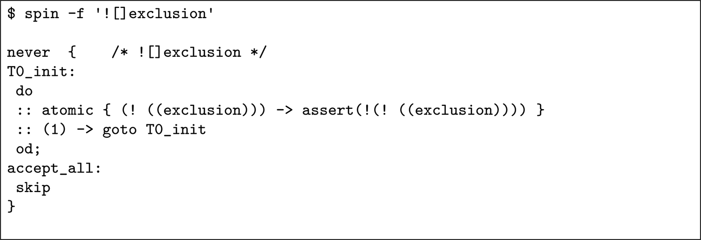

*Hình 18.5: Spin tạo mệnh đề “never” cho ‘□ exclusion’.[⏎](#b18fig18_5)*

Code PROMELA được sinh ra này có thể được sao chép vào chương trình, và câu lệnh `assert()` ở dòng 17 có thể bị xóa. Việc dùng LTL an toàn hơn việc đặt các câu lệnh `assert()` vào code một cách thủ công, vì câu LTL sẽ được kiểm tra sau mỗi câu lệnh PROMELA, chứ không chỉ tại điểm mà chúng ta đã đặt `assert()` thủ công. Chạy Spin checker với PROMELA bổ sung này cho cùng kết quả.

Dùng thuật ngữ được mô tả ở trang 19, LTL này đang kiểm tra một thuộc tính “safety”. Cũng có thể sinh code PROMELA để kiểm tra các thuộc tính “liveness”. Ví dụ, phủ định của thuộc tính $⋄ ◻ P$ có thể được kiểm tra bằng code PROMELA trong <a id="b18fig18_6"></a>[Hình 18.6](#fig18_6).<a id="p235"></a>

<a id="fig18_6"></a>

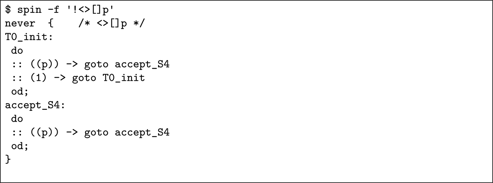

*Hình 18.6: Spin tạo mệnh đề “never” cho $⋄ ◻ P$.[⏎](#b18fig18_6)*

### 18.7.6 Tóm tắt về Spin

Mục này đã đưa ra một mô tả rất hời hợt về công cụ Spin (tài liệu tham khảo [[13](#refbib18_13)] có một mô tả đầy đủ hơn và dài 596 trang!).

Trong thực tế, mặc dù các thuật toán được dùng trong Spin hiệu quả, có một kích thước tối đa của không gian trạng thái hệ thống mà Spin có thể xử lý. Tài liệu tham khảo [[13](#refbib18_13)] có một số gợi ý để giảm không gian trạng thái của một mô hình, nhưng rốt cuộc, kích thước của mô hình có thể trở nên quá lớn để Spin xử lý. Tôi thấy Spin thực sự hữu ích để chứng tỏ tính đúng đắn của các phần thuật toán của một thiết kế, hơn là một thiết kế hoàn chỉnh.

<a id="sec18_8"></a>

## 18.8 Công cụ mô hình hóa Rodin

### 18.8.1 Lịch sử của Rodin

Việc phát triển Rodin bắt đầu năm 2004 như một dự án được European Commission tài trợ. Việc tài trợ được tiếp tục trong dự án Deploy cho đến năm 2012, rồi trong dự án Advance cho đến năm 2014 và sau đó bởi French National Research Agency <a id="p236"></a>trong dự án IMPEX. Nhiều đối tác công nghiệp đã hỗ trợ việc phát triển, bao gồm Robert Bosch GmbH, Siemens Transportation Systems và Space Systems Finland.

Việc phát triển Rodin vẫn đang diễn ra tích cực với phiên bản mới nhất có thể tải về tại: [https://wiki.event-b.org/index.php/Main_Page](https://wiki.event-b.org/index.php/Main_Page).

Nó dựa trên framework Eclipse ([https://eclipseide.org/](https://eclipseide.org/)) và được phát hành theo Eclipse Public License v1.0.

### 18.8.2 Cấu trúc của Rodin

<a id="b18fig18_7"></a>[Hình 18.7](#fig18_7) minh họa khái niệm nền tảng của Rodin. Bắt đầu từ phần dưới cùng của hình đó, nhà phân tích ban đầu định nghĩa một mô hình rất trừu tượng của hệ thống gồm ba phần:

*Một context*.

Phần này định nghĩa thông tin tĩnh về mô hình ở một mức trừu tượng cụ thể — hằng số, tập hợp, v.v.

<a id="p237"></a>*Một machine*.

Phần này mô tả các thay đổi trạng thái có thể xảy ra trong mô hình ở mức trừu tượng đó.

*Một danh sách các invariant*.

Đây là những điều kiện phải đúng vô điều kiện trong mô hình ở mức trừu tượng đó và ở mọi mức (cao hơn) ít trừu tượng hơn.

<a id="fig18_7"></a>

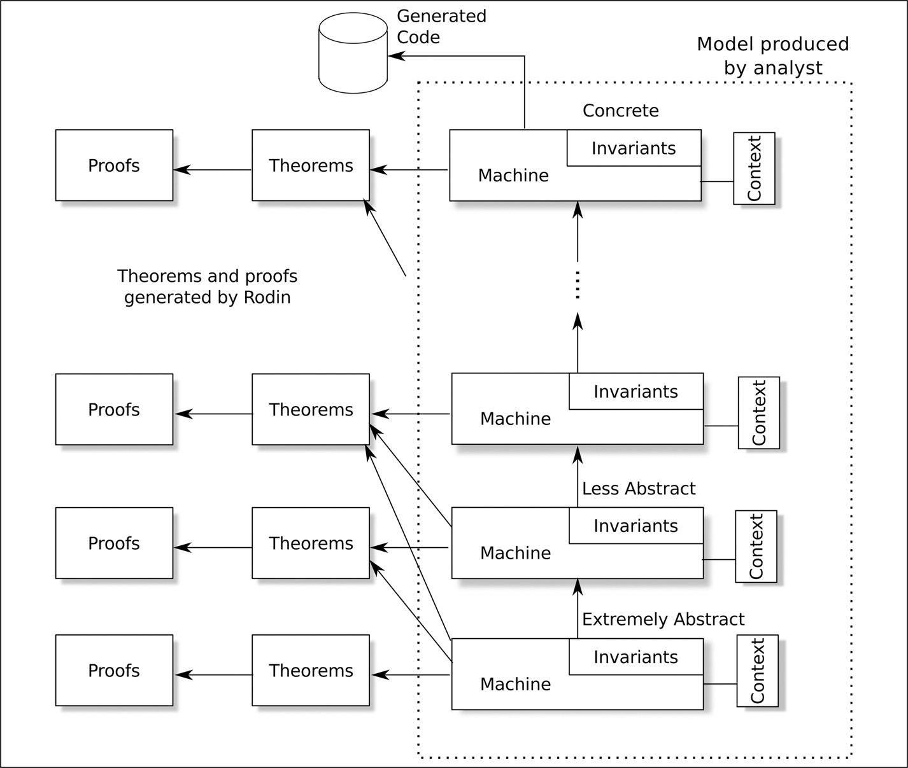

*Hình 18.7: Khái niệm Rodin.[⏎](#b18fig18_7)*

Các context và machine sau đó được làm cho cụ thể dần bằng cách tinh chỉnh các thuật toán, tương tác và sự kiện. Ví dụ, một invariant trừu tượng có thể chỉ đơn giản nói rằng *“một input tạo ra một output chấp nhận được”* mà không mô tả thế nào là một input và thế nào là một output chấp nhận được.

Một bước tinh chỉnh sau đó sẽ thêm chi tiết về thế nào là một input (ví dụ, một giá trị số trong phạm vi 1 đến 10), input được biến đổi thành output thế nào và chính xác thế nào là một output *chấp nhận được*. Tương tự, một tương tác trừu tượng thuộc loại *“một người vận hành được phê duyệt có thể bắt đầu dòng thuốc tới bệnh nhân”* có thể được làm cho cụ thể hơn ở mức tiếp theo bằng cách chỉ ra người vận hành trở thành “được phê duyệt” như thế nào — có lẽ bằng cách nhập mật khẩu. Các sự kiện cũng có thể được tinh chỉnh. Vì vậy sự kiện trừu tượng *“bệnh nhân cần được chú ý”* có thể được tinh chỉnh thành *“nhịp tim của bệnh nhân vượt ra ngoài phạm vi 45 đến 100.”*

Ở mỗi mức tinh chỉnh, không chỉ các invariant mới được thêm ở mức đó phải đúng phổ quát, mà mọi invariant được định nghĩa ở các mức trừu tượng hơn (thấp hơn) cũng phải đúng.

Rốt cuộc, khi mô hình hoàn toàn cụ thể và đã được chứng minh là đúng, có thể sinh code tự động từ nó, và có nhiều plug-ins để làm đúng việc đó.

Rodin cung cấp sự hỗ trợ trong quá trình mô hình hóa. Sau khi kiểm tra cú pháp của context, machine và invariant, Rodin tự động sinh ra các định lý cần được chứng minh để bảo đảm rằng mô hình well-formed và các invariant luôn đúng.

Sau khi sinh ra các định lý, Rodin dùng một hoặc nhiều plug-ins theorem-prover của nó (ví dụ, proB) để cố chứng minh chúng. Nếu theorem prover không thể tìm ra chứng minh mà không có trợ giúp, nhà phân tích có thể đưa ra trợ giúp: có lẽ thêm một câu nói rằng *X* luôn lớn hơn 50. Rodin không chấp nhận những điều này một cách mặc nhiên; thay vào đó, nó thêm chúng vào danh sách những điều cần chứng minh, nhưng việc đưa ra gợi ý có thể đẩy theorem prover theo một hướng mới, thường dẫn đến một chứng minh hoàn chỉnh.

> Giai thoại 29 *Các automatic theorem prover đi kèm Rodin rất mạnh. Với một ngoại lệ, những lần tôi đã dành thời gian quát mắng máy tính và vò đầu bứt tai cố hiểu tại sao cái thứ ngu ngốc đó không thể chứng minh được điều mà với tôi là một định lý hiển nhiên đúng, tôi đều phát hiện ra rằng mình đã bỏ sót một corner case và, thực tế, định lý đó sai — công cụ đúng còn tôi sai. Trong trường hợp như vậy, tốt nhất là xin lỗi prover vì đã quát mắng nó, để tránh những vấn đề tương tự với định lý tiếp theo.*

<a id="p238"></a>Vì là Eclipse-based, Rodin có rất nhiều plug-ins sẵn có để nâng cao sản phẩm cơ bản. Chúng bao gồm một engine LTL mạnh mẽ (xem Phụ lục D.6) có thể kiểm tra acceptance cycle, một dạng kiểm tra liveness, trong đó có thể viết một invariant để biểu diễn điều kiện rằng một phần cụ thể của thiết kế luôn được thực thi vô hạn lần. Các plug-ins khác bao gồm một chương trình B2LaTeX sẽ tạo ra một tài liệu LaTeX từ mô hình Rodin, và công cụ thu thập yêu cầu ProR.

Bất chấp sự tồn tại của B2LaTeX, có lẽ cũng đáng nói rằng tôi thấy một trong những điểm yếu chính của Rodin là không thể tạo ra các báo cáo tóm tắt tốt về định nghĩa mô hình, các định lý và chứng minh.

### 18.8.3 Sử dụng Rodin

Rodin là một công cụ để thao tác ngôn ngữ Event-B và dựa trên framework Eclipse. Bất kỳ ai quen với Eclipse sẽ ngay lập tức cảm thấy quen thuộc với Rodin; xem <a id="b18fig18_8"></a>[Hình 18.8](#fig18_8), hình minh họa màn hình được dùng để soạn thảo các context và machine.

<a id="fig18_8"></a>

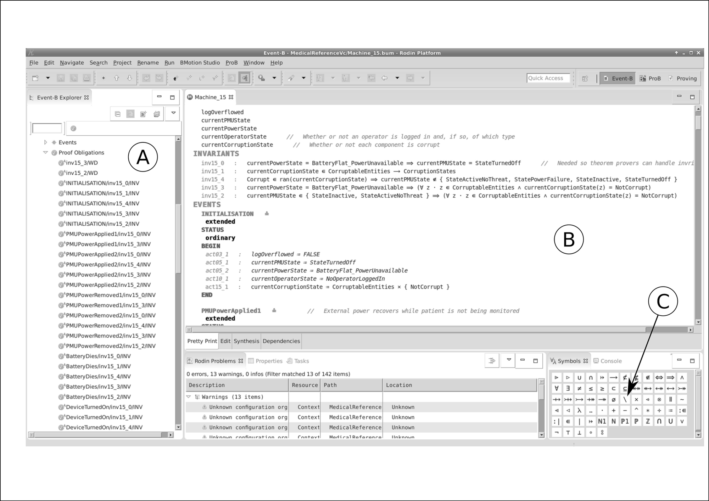

*Hình 18.8: Khái niệm Rodin.[⏎](#b18fig18_8)*

Vùng A liệt kê các dự án khác nhau, và vùng B là nơi diễn ra việc soạn thảo. Vì các ký hiệu toán học non-ASCII cần được dùng trong context và mô hình, vùng C cung cấp một bảng các ký hiệu này, mặc dù tất cả chúng đều có thể được gõ bằng các tổ hợp phím (ví dụ, ∃ có thể được gõ là “#” và ∈ là “:”). Trước khi qua đời năm 2020, Ken Robinson, một thành viên tích cực của các cộng đồng Event B và Rodin, đã công bố một “cheat sheet” rất hữu ích về các toán tử của Rodin và cách gõ chúng. Nó vẫn có sẵn tại

[https://stups.hhu-hosting.de/handbook/rodin/current/html/files/EventB-Summary.pdf](https://stups.hhu-hosting.de/handbook/rodin/current/html/files/EventB-Summary.pdf).

Rodin có nhiều trình soạn thảo để tạo context và machine. Đặc biệt, plug-in Camille<a id="fn18_318b"></a>[<sup>3</sup>](#fn18_3) có vẻ rất phổ biến, nhưng tôi thích trình soạn thảo built-in khá vụng về hơn, có lẽ vì đó là trình soạn thảo tôi dùng khi bắt đầu sử dụng Rodin.

### 18.8.4 Chứng minh định lý của Rodin

Một khi một hoặc nhiều tầng của mô hình đã được tạo ra, Rodin sinh ra các định lý cần thiết để bảo đảm rằng các invariant không thể bị phá vỡ. Các plug-ins của nó sau đó cố chứng minh các định lý đó; xem <a id="b18fig18_9"></a>[Hình 18.9](#fig18_9).

<a id="fig18_9"></a>

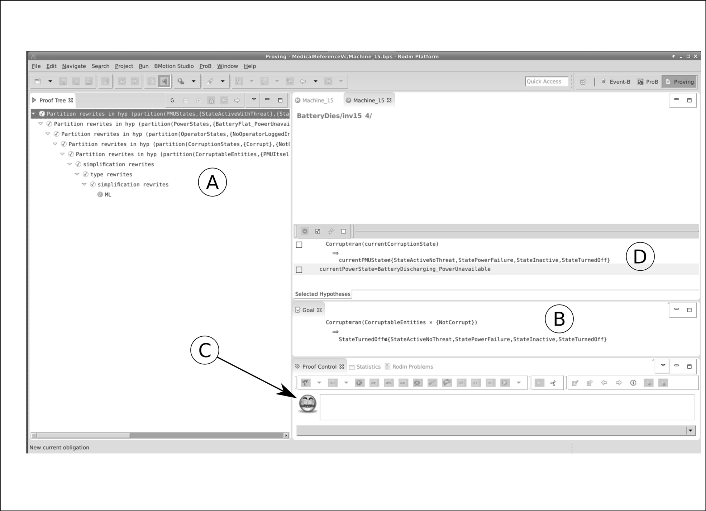

*Hình 18.9: Màn hình chứng minh của Rodin.[⏎](#b18fig18_9)*

Với mỗi định lý, *proving perspective<a id="fn18_418b"></a>[<sup>4</sup>](#fn18_4)* chứa mục tiêu mà nó đang cố chứng minh (cửa sổ B), các bước chứng minh cho đến nay (cửa sổ A), bước mà nó đang thực hiện (cửa sổ D), và, quan trọng nhất, một khuôn mặt cười hoặc mặt buồn (điểm C) chỉ ra liệu nỗ lực chứng minh có thành công hay không. Trong [Hình 18.9](#fig18_9), khuôn mặt đang cười, chỉ ra rằng đã tìm được một chứng minh.<a id="p241"></a>

<a id="fn18_3"></a>

[<sup>3</sup>](#fn18_318b)Trong thế giới thực, Camille Claudel là một trong những người mẫu và nguồn cảm hứng của nhà điêu khắc Rodin.

<a id="fn18_4"></a>

[<sup>4</sup>](#fn18_418b)Theo thuật ngữ Eclipse, mỗi loại thao tác có perspective riêng của nó, tức là một tập cửa sổ.

### 18.8.5 Kiểm tra lại thuật toán mutual exclusion

Áp dụng Rodin cho mô hình mutual exclusion được mô tả ở trang 232 có phần giống như dùng búa máy để đập một quả hạt, nhưng tôi đã áp dụng nó để có thể so sánh output của nó với output của Spin.

Chìa khóa của mô hình là invariant rằng hai tiến trình không bao giờ được cùng ở trong critical section của chúng tại cùng một thời điểm. Thay vì dùng mẹo tăng và giảm một bộ đếm như tôi đã làm với mô hình Spin, tôi đã code invariant sau vào mô hình Rodin:

$$¬ ( \text{proc0State = ProcessCritical} ∧ \text{proc1State = ProcessCritical} )$$

Tức là, không $( ¬ )$ đúng rằng trạng thái của tiến trình 0 và $( ∧ )$ trạng thái của tiến trình 1 đều là critical cùng lúc.

Rodin gần như không mất thời gian để phát hiện ra rằng invariant này có thể bị vi phạm; xem <a id="b18fig18_10"></a>[Hình 18.10](#fig18_10), nơi vi phạm được nhận diện (nhãn A) và chuỗi sự kiện dẫn đến vi phạm đó được liệt kê (nhãn B; đọc các sự kiện từ dưới lên trên).

<a id="fig18_10"></a>

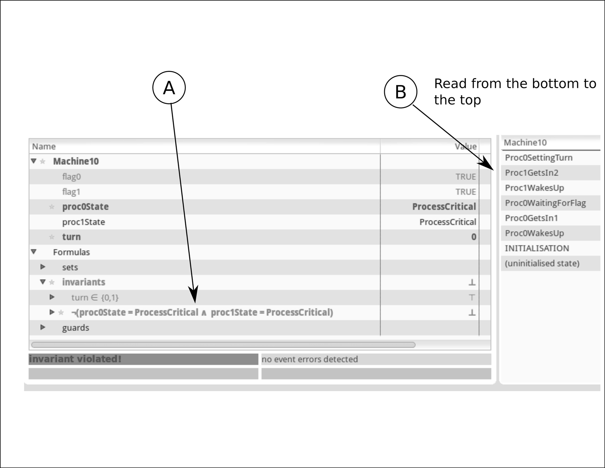

*Hình 18.10: Rodin tìm ra vi phạm.[⏎](#b18fig18_10)*

Điều thú vị là Rodin đã tìm ra một chuỗi sự kiện hơi khác so với chuỗi mà Spin tìm ra. Điều này xảy ra vì, như một phần của việc khởi tạo, tôi đã chỉ định rằng “$\text{turn} ∈ \{ 0 , 1 \}$ ”. tức là `turn` có thể bắt đầu với giá trị 0 hoặc 1. Đường đi của Rodin tới việc phá vỡ invariant bắt đầu với $t u r n = 1$.

Lưu ý rằng, ngay cả với một mô hình đơn giản như thế này, Rodin đã sinh ra 17 định lý phải được chứng minh. Có thể thấy từ <a id="b18fig18_11"></a>[Hình 18.11](#fig18_11) rằng Rodin đã tìm được chứng minh cho tất cả trừ 2 invariant: invariant 6 và 8. Đây là hai invariant nói rằng cả hai tiến trình không được cùng ở trong critical section của chúng đồng thời — rõ ràng các định lý này không thể được chứng minh, vì chúng không đúng!

<a id="fig18_11"></a>

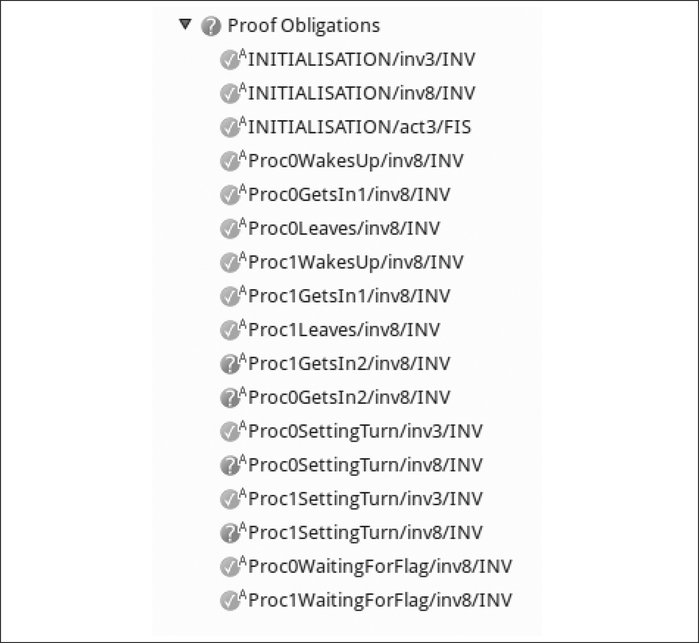

*Hình 18.11: Rodin chứng minh tất cả trừ hai định lý.[⏎](#b18fig18_11)*

<a id="sec18_9"></a>

## 18.9 Công cụ TLA<sup>+</sup>

### 18.9.1 Lịch sử của TLA<sup>+</sup>

TLA là viết tắt của “Temporal Logic of Actions” và Leslie Lamport đã nghĩ ra một ngôn ngữ TLA vào cuối những năm 1980, ngôn ngữ này tiến hóa thành ngôn ngữ và công cụ TLA<sup>+</sup> được mô tả trong tài liệu tham khảo [<a id="b18refbib18_15"></a>[15](#refbib18_15)]. Đã có các bản cập nhật cho ngôn ngữ và công cụ vào năm 2009, 2012 và 2014 và, vào thời điểm viết sách, Leslie Lamport đã tạm dừng công việc soạn một phiên bản mới của tài liệu tham khảo [[15](#refbib18_15)]; bản nháp có tại [https://lamport.azurewebsites.net/tla/hyperbook.html](https://lamport.azurewebsites.net/tla/hyperbook.html).

Một bộ video rất hữu ích về TLA<sup>+</sup> có tại

[https://lamport.azurewebsites.net/video/videos.html](https://lamport.azurewebsites.net/video/videos.html).

Như đã đề cập ở trên, một điểm khác biệt của TLA<sup>+</sup> là nó cố ý không che giấu toán học khỏi người dùng. Như Lamport nói trong phần giới thiệu của tài liệu tham khảo [[15](#refbib18_15)]: *“Hầu hết các nhà toán học và nhà khoa học nghĩ rằng toán học hình thức, không có lời, là dài dòng và mệt mỏi. Họ sai. … Chỉ cần khoảng hai chục dòng để định nghĩa lời giải cho một phương trình vi phân tùy ý … Nhưng ít đặc tả nào cần toán học tinh vi đến vậy. Hầu hết chỉ đòi hỏi việc áp dụng đơn giản một vài khái niệm toán học tiêu chuẩn.”*

> Giai thoại 30 *Nỗi sợ toán học là có thật. Tôi từng trình bày một số formal method này cho một nhóm lập trình viên và một lập trình viên sau đó đã nói với tôi, “Tôi đi làm lập trình để không phải làm toán.” Có thể anh ta đã nói đùa.*

### 18.9.2 Ngôn ngữ và Toolbox TLA<sup>+</sup>

Một đặc tả TLA<sup>+</sup> là một state machine: người dùng chỉ định các biến của hệ thống, trạng thái ban đầu của chúng và các chuyển trạng thái khả dĩ.

<a id="p244"></a>TLA<sup>+</sup> đi kèm một “toolkit” là một GUI Eclipse-like. Toolkit này cho phép người dùng viết và debug đặc tả của hệ thống và định nghĩa “mô hình” chứa các giá trị cụ thể sẽ được dùng cho một chứng minh. Ví dụ, như được minh họa trong mục bên dưới, đặc tả có thể nói rằng hệ thống xử lý một số thread, trong khi mô hình sẽ chỉ định rằng chứng minh nên được tạo cho 3 thread. Mô hình cũng định nghĩa các điều kiện cần được kiểm tra: ví dụ, deadlock, việc phá vỡ invariant hoặc các điều kiện temporal (LTL).

### 18.9.3 Áp dụng TLA<sup>+</sup> cho chương trình Two-Threaded

Chương trình trong [Hình 7.4](ch07_foundational_analyses.vi.md#fig7_4) ở trang 79 sẽ hỏng nếu *x* có giá trị 2 sau khi cả hai thread đã thực thi xong và vì vậy chúng ta có thể yêu cầu TLA<sup>+</sup> chứng minh rằng điều này không bao giờ xảy ra. Tôi đã dùng invariant

Invariant là *X* không thể bằng 2 khi mọi thread đã kết thúc

$$\begin{array}{ll} N o t T w o & ≜ ( ∀ t h r ∈ T h r e a d : t h r e a d S t a t e [ t h r ] = ‘ ‘ {\text{ finished}}^{′ ′} \\ & \; \; \; ⇒ ¬ ( X = 2 ) \end{array}$$

có thể được đọc là, *“với mọi thread trong tập các thread, nếu trạng thái của thread đó là ‘finished’, thì điều đó ngụ ý rằng không đúng là X bằng 2.”* Hay, đơn giản hơn, khi mọi thread đã kết thúc, X không bằng 2.

Khi số thread được đặt là 2 (như trong [Hình 7.4](ch07_foundational_analyses.vi.md#fig7_4)), thì TLA<sup>+</sup> phát hiện, trong chưa đầy một giây trên laptop của tôi, rằng “Invariant NotTwo is violated.” Để xác định điều này, nó đã sinh ra một bảng trạng thái với 22 846 trạng thái phân biệt. Sau đó nó cũng cung cấp một trace về cách có thể đạt tới trạng thái không hợp lệ (X = 2).

Để đặt điều này vào bối cảnh: việc kiểm thử chương trình trong [Hình 7.4](ch07_foundational_analyses.vi.md#fig7_4) khó có khả năng phát hiện ra bug trong vài trăm năm, nhưng chạy một mô hình TLA<sup>+</sup> đơn giản tìm ra bug trong chưa đầy một giây. Và, trong một hệ thống safety-critical, bug đó có thể gây ra failure ngay lần đầu chương trình được thực thi.

Sửa đổi mô hình của đặc tả này để tăng số thread lên ba và chạy lại TLA<sup>+</sup> thì dễ dàng, nhưng không gian trạng thái giờ lớn hơn và việc thực thi mất nhiều thời gian hơn: 20 giây trên laptop của tôi. Kết quả vẫn như vậy: một chuỗi sự kiện đã được tìm thấy trong đó X = 2 ở cuối quá trình thực thi. Bảng trạng thái giờ chứa 9 848 454 trạng thái phân biệt. Chuỗi sự kiện chính xác phải xảy ra để kết thúc với X = 2 trong thế giới thực với ba thread xa vời đến mức có lẽ nó sẽ không xảy ra trước cái chết nhiệt của vũ trụ, nhưng nó có thể xảy ra ngay lần đầu chương trình được thực thi.

<a id="sec18_10"></a>

## 18.10 Mô hình hóa hình thức của các công ty ví dụ

Các công ty tiêu biểu được giới thiệu trong [Chương 4](ch04_representative_companies.vi.md) có lẽ đều sẽ sử dụng một dạng kiểm chứng hình thức nào đó cho các thiết kế của mình. Theo IEC TS 61508-3-2, họ cũng có thể áp dụng kiểm chứng hình thức để kiểm tra tính đầy đủ của các yêu cầu của mình.

<a id="p245"></a>Alpha Device Corporation (ADC) có thể hợp lý áp dụng Rodin để kiểm chứng thiết kế tổng thể của thiết bị của mình và Beta Component Incorporated (BCI) có thể áp dụng Spin hoặc TLA<sup>+</sup> cho nhiều thuật toán low-level trong kernel hệ điều hành (thuật toán lập lịch, thuật toán cấp phát memory, thuật toán mutual exclusion, v.v.).

Với công việc này đã hoàn thành, cả ADC lẫn BCI đều có thể gặp vấn đề đã được chỉ ra ở trang 223 và trong tài liệu tham khảo [[4](#refbib18_4)]: làm thế nào để trình bày những chứng minh này cho các assessor chứng nhận?

Spin, Rodin và TLA<sup>+</sup> có lẽ được phân loại là TI2/TD2 theo thuật ngữ được dùng trong ISO 26262-8, là TIC2 theo IEC 61508 và là T2 theo thuật ngữ EN 50716.<a id="fn18_518b"></a>[<sup>5</sup>](#fn18_5) Chúng không ảnh hưởng trực tiếp đến code được giao, nhưng chúng có thể không làm lộ ra một defect tồn tại trong thiết kế.

Điều này có nghĩa là không chỉ output từ các công cụ phải được trình cho assessor, mà tính đúng đắn của bản thân các công cụ cũng phải được biện minh. Việc thứ nhất đã đủ khó vì, trong trường hợp ADC dùng Rodin, một danh sách in ra gồm vài trăm định lý và các chứng minh đi kèm có thể gây ấn tượng với assessor, nhưng theo kinh nghiệm của tôi, nhiều assessor sẽ không thể đánh giá được những định lý và chứng minh đó. BCI còn có một rào cản lớn hơn phải vượt qua nếu dùng Spin, vì Spin không tạo ra báo cáo, nghĩa là assessor sẽ phải ngồi trước màn hình và dùng giao diện đồ họa `ispin` hoặc `jspin`.

Ở một mức độ nào đó, đây không phải là vấn đề của ADC hay BCI: các tiêu chuẩn (rất) khuyến nghị các kỹ thuật hình thức và vì vậy các công ty chứng nhận có trách nhiệm chuẩn bị sẵn sàng để đánh giá output từ các công cụ liên quan.

Một câu hỏi chứng nhận khác được đặt ra nếu ADC dùng mô hình để sinh code tự động. Có hai loại lập luận khả dĩ gắn với code này:

1. *Code lẽ ra có thể được một con người viết ra; thực tế, nó đã được một máy tính tạo ra. Không có gì trong giai đoạn kiểm chứng phụ thuộc vào nguồn gốc của code — nó vẫn sẽ được module test, integration test và system test và vì vậy nguồn gốc của nó không quan trọng.*

   Lập luận này mạnh hơn, nhưng nó bỏ qua việc code không tuân theo coding standard của công ty, nên có thể khó review. Hơn nữa, nó không đề cập đến việc bảo trì code — ADC cần có một quy trình được định nghĩa rõ ràng về cách code sẽ được sửa đổi nếu cần thay đổi: nó sẽ được thay đổi thủ công và, nếu vậy, liệu các coding standard có được áp dụng khi đó không?

2. *Code đã được tạo ra bởi một thuật toán đáng tin cậy và vì vậy không cần được kiểm tra hay được module test.*

   Việc hỗ trợ lập luận này có nghĩa là phải review các thuật toán sinh code, việc có thể rất tẻ nhạt.

<a id="fn18_5"></a>

[<sup>5</sup>](#fn18_518b)Các phân loại này được giải thích trong [Mục 23.1](ch23_the_offline_tools.vi.md#sec23_1) ở trang 308.

## 18.11 Formal method: Tóm tắt

Như có thể thấy từ năm xuất bản của các bài báo trong danh mục tài liệu tham khảo bên dưới, formal method đã hứa hẹn nhiều từ ít nhất là cuối những năm 1980, nhưng đã mang lại tương đối ít. Một phần, kết quả đáng thất vọng này là do các hạn chế kỹ thuật, nhưng phần lớn hơn là vì những người ủng hộ formal method đã không bắc cầu thành công qua khoảng cách giữa lý thuyết và lập trình viên thực hành.

Các thuật toán được cải tiến và bộ xử lý nhanh hơn đang làm giảm các hạn chế kỹ thuật và các công cụ như Rodin đang làm cho formal method trở nên dễ tiếp cận đối với lập trình viên ngồi trước bàn phím. Tuy nhiên, điều này đặt ra câu hỏi mà tôi đã đề cập trước đó — ai nên tạo ra và kiểm chứng các mô hình của thiết kế?

Ở nhiều tổ chức, để tránh sự lệch pha giữa thiết kế và hiện thực, công việc thiết kế được thực hiện bởi chính những lập trình viên sẽ phải hiện thực nó. Các kỹ năng và công cụ cần cho thiết kế và cho lập trình là khác nhau, và ít kỹ sư thành thạo cả hai. Điều này có nghĩa là việc đưa các phương pháp này vào quy trình của một công ty buộc phải có một thay đổi cơ bản trong cấu trúc của công ty: ít lập trình viên hơn và nhiều nhà thiết kế hơn. Và công việc lập trình sẽ trở nên đòi hỏi ít kỹ năng hơn phần nào.

## Tài liệu tham khảo

<a id="refbib18_1"></a>[1] J. Rushby, “Formal Methods and the Certification of Critical Systems,” Tech. Rep. SRI-CSL-93-7, Computer Science Laboratory, SRI International, Menlo Park, CA, Dec. 1993. Also issued under the title *Formal Methods and Digital Systems Validation for Airborne Systems* as NASA Contractor Report 4551, December 1993.[⏎](#b18refbib18_1)

<a id="refbib18_2"></a>[2] D. Bjørner and C. B. Jones, eds., *The Vienna Development Method: The Meta-Language*, vol. 61 of *Lecture Notes in Computer Science*, Springer, 1978.[⏎](#b18refbib18_2)

<a id="refbib18_3"></a>[3] P. C. Ölveczky and J. Meseguer, “Semantics and pragmatics of Real-Time Maude,” *Higher-Order and Symbolic Computation*, vol. 20, no. 1-2, pp. 161–196, 2007.[⏎](#b18refbib18_3)

<a id="refbib18_4"></a>[4] C. Hobbs, G. Broadfoot, and A. Azim, “Hat das Zeitalter der formalen Methoden schon begonnen?,” in *Proceedings of* *ESE Kongress 2012*, 2012.[⏎](#b18refbib18_4)

<a id="refbib18_5"></a>[5] S. King, J. Hammond, R. Chapman, and A. Pryor, “Is proof more cost-effective than testing?,” *Software Engineering, IEEE Transactions on*, vol. 26, no. 8, pp. 675–686, 2000.[⏎](#b18refbib18_5)

<a id="refbib18_6"></a>[6] D. Cofer and S. Miller, “DO-333 Certification Case Studies,” in *Proceedings of the* *6th International Symposium on NASA Formal Methods - Volume 8430*, (Berlin, Heidelberg), pp. 1–15, Springer-Verlag, 2014.[⏎](#b18refbib18_6)

<a id="refbib18_7"></a>[7] A. Hall, “Seven Myths of Formal Methods,” *IEEE Software*, vol. 7, pp. 11–19, September 1990.[⏎](#b18refbib18_7)

<a id="refbib18_8"></a>[8] J. Bowen and M. Hinchey, “Seven More Myths of Formal Methods,” *IEEE Software*, vol. 12, pp. 34–41, 07 1995.[⏎](#b18refbib18_8)

<a id="refbib18_9"></a>[9] C. Newcombe, T. Rath, F. Zhang, B. Munteanu, M. Brooker, and M. Deardeuff, “How Amazon Web Services Uses Formal Methods,” *Commun. ACM*, vol. 58, pp. 66–73, Mar. 2015.[⏎](#b18refbib18_9)

<a id="refbib18_10"></a>[10] H. Garavel, M. H. ter Beek, and J. van de Pol, “The 2020 Expert Survey on Formal Methods,” in *Formal Methods for Industrial Critical Systems: 25th International Conference, FMICS 2020, Vienna, Austria, September 2–3, 2020, Proceedings*, (Berlin, Heidelberg), pp. 3–69, Springer-Verlag, 2020.[⏎](#b18refbib18_10)

<a id="refbib18_11"></a>[11] C. A. R. Hoare, “Communicating Sequential Processes,” *Commun. ACM*, vol. 21, pp. 666–677, Aug. 1978.[⏎](#b18refbib18_11)

<a id="refbib18_12"></a>[12] C. Hobbs, “Das Paradoxon dynamischer Softwaretests,” in *Proceedings of ESE Kongress 2014*, 2014.[⏎](#b18refbib18_12)

<a id="refbib18_13"></a>[13] G. Holzmann, *The SPIN Model Checker: Primer and Reference Manual*. Addison-Wesley Professional, 1st ed., 2003.[⏎](#b18refbib18_13)

<a id="refbib18_14"></a>[14] M. Ben-Ari, *Principles of the Spin Model Checker*. Springer, 1 ed., 2008.[⏎](#b18refbib18_14)

<a id="refbib18_15"></a>[15] L. Lamport, *Specifying Systems: The TLA<sup>+</sup> Language and Tools for Hardware and Software Engineers*. Addison-Wesley, 2003.[⏎](#b18refbib18_15)
