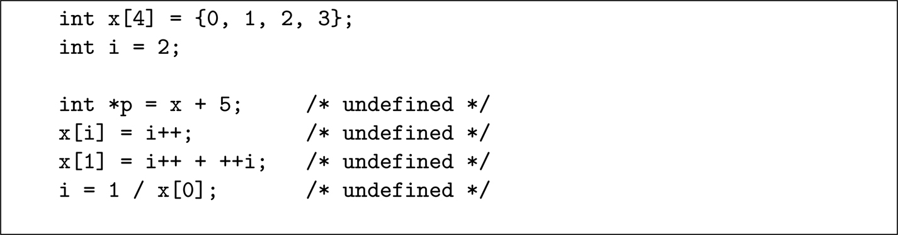
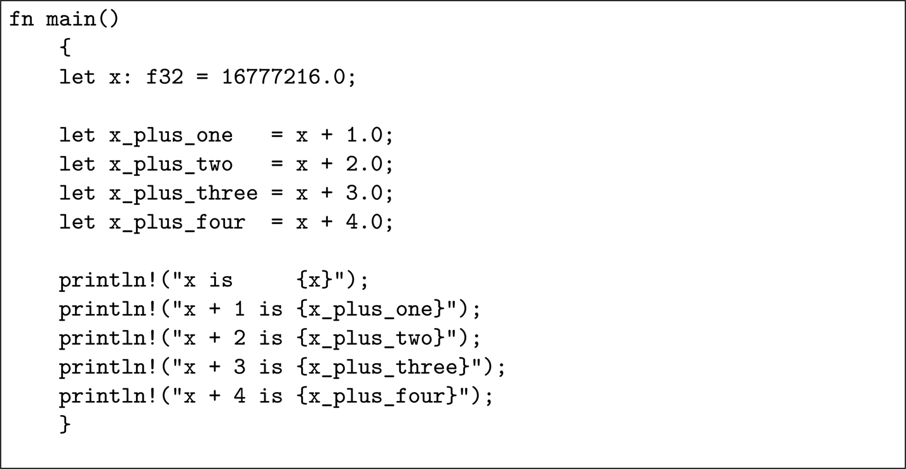
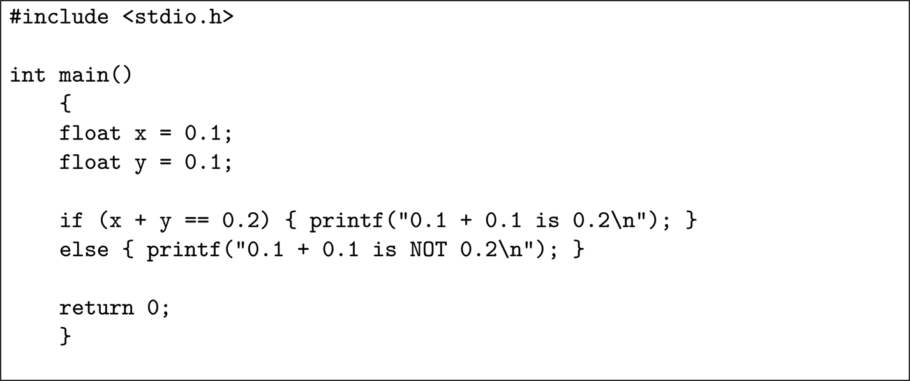
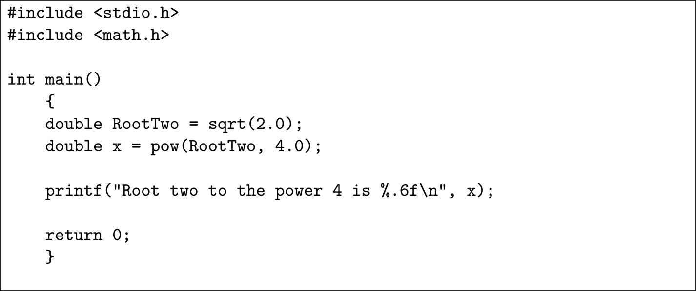

<a id="p251"></a>

<a id="chapter19"></a>

# 19 Hướng dẫn viết code

DOI: [10.1201/9781003598145-19](https://doi.org/10.1201/9781003598145-19)

Chương này, cùng với [Chương 20](ch20_code_coverage_metrics.vi.md) và [21](ch21_static_analysis.vi.md), đề cập đến một vài kỹ thuật được các tiêu chuẩn quốc tế “khuyến nghị” hoặc “rất khuyến nghị” cho việc hiện thực phần mềm, chứ không phải cho thiết kế hay kiểm chứng.

## 19.1 Lựa chọn ngôn ngữ lập trình

Các nhà thiết kế và lập trình viên hiếm khi được tự do chọn ngôn ngữ lập trình. Thường thì đã có một hệ thống cũ được viết sẵn, từ đó hệ thống mới sẽ được phát triển; thông thường, công ty phát triển chỉ hỗ trợ một vài ngôn ngữ, và một số ngôn ngữ đơn giản là không phù hợp cho một số nhiệm vụ.

Thẳng thắn mà nói, không có ngôn ngữ lập trình lý tưởng nào để viết code cho các hệ thống safety-critical, đặc biệt là cho các hệ thống nhúng low-level. Ở một mức độ nào đó, đây là một vấn đề con người: chúng ta không được tạo ra để viết một số lượng lớn các câu lệnh rõ ràng không mơ hồ bằng những ngôn ngữ được định nghĩa kém. Chúng ta cũng là nạn nhân của khát khao hiệu quả — đối với hầu hết các ứng dụng (non-safety), chúng ta thích các ngôn ngữ dễ được tối ưu về không gian hoặc tốc độ hơn là dễ được chứng tỏ là đúng. Ví dụ, một con trỏ trong ngôn ngữ C rất hiệu quả và rất nguy hiểm.

Có thể có hai lối thoát khỏi *ngõ cụt* này: sinh nhiều code hơn một cách tự động từ một thiết kế formal (xem [Chương 18](ch18_formal_verification.vi.md)), và triển khai các công cụ phân tích tĩnh tốt hơn nhiều (xem [Chương 21](ch21_static_analysis.vi.md)) để kiểm tra phần code vẫn do con người viết.

Trước khi đạt tới trạng thái đó, điều tốt nhất chúng ta có thể làm là chọn một ngôn ngữ phù hợp cho ứng dụng đang được tạo ra, định nghĩa một tập con chấp nhận được của ngôn ngữ đó, và áp đặt tập con đó lên những lập trình viên có thể không sẵn lòng thông qua các đợt kiểm tra code nghiêm ngặt, tốt nhất là do một công cụ tự động thực hiện.

## 19.2 Ngôn ngữ lập trình và các tiêu chuẩn

Table C.1 của IEC 61508-7 liệt kê một số ngôn ngữ lập trình và cho biết chúng có được khuyến nghị dùng trong các ứng dụng safety-critical hay không. ISO 26262 ít tường minh hơn, <a id="p252"></a>chỉ đơn giản cung cấp một danh sách các đặc tính mà một ngôn ngữ lập trình cần có (5.4.2 của ISO 26262-6).

EN 50716 cũng cung cấp một danh sách các đặc tính thiết yếu của ngôn ngữ: ngữ nghĩa được định nghĩa, hỗ trợ lập trình module, hỗ trợ comment, strong typing, hỗ trợ phân tích tĩnh, hỗ trợ kiểm thử động. Cụ thể, nó gợi ý rằng ngôn ngữ không nên hỗ trợ cấp phát memory động, lệnh nhảy không điều kiện hoặc đệ quy. Nhìn chung, EN 50716 không nhắc đến các ngôn ngữ cụ thể, mặc dù nó dùng Ada, Pascal và Modula-2 làm ví dụ về các ngôn ngữ có strong typing.

## 19.3 Các tính năng của ngôn ngữ

Các tính năng của một ngôn ngữ lập trình có thể giúp đỡ hoặc cản trở việc dùng nó để phát triển một sản phẩm an toàn. Khi bình luận năm 1981 (tài liệu tham khảo [<a id="b19refbib19_1"></a>[1](#refbib19_1)]) về định nghĩa của ngôn ngữ Ada khi đó then-new, C.A.R. Hoare đã nói:

> *Lúc đầu tôi đã vô cùng hy vọng. Các mục tiêu ban đầu của ngôn ngữ bao gồm độ tin cậy, khả năng đọc của chương trình, tính hình thức của định nghĩa ngôn ngữ, và thậm chí cả sự đơn giản. Dần dần các mục tiêu này đã bị hy sinh để đổi lấy sức mạnh, được cho là đạt được nhờ vô số tính năng và quy ước ký hiệu, nhiều trong số đó không cần thiết và một số, như exception handling, thậm chí còn nguy hiểm. Chúng ta sống lại lịch sử thiết kế xe hơi. Những món đồ chơi và sự hào nhoáng lấn át các mối quan tâm cơ bản về an toàn và kinh tế.*

Dưới đây tôi liệt kê một vài đặc tính mà một ngôn ngữ lập trình cần có nếu nó được dùng để tạo ra các hệ thống an toàn. Tôi thậm chí còn dè dặt không đồng ý cả với Hoare lẫn với các tiêu chuẩn về việc dùng exception.

> Giai thoại 31 *Khi tôi chuẩn bị phiên bản thứ ba của cuốn sách này, có một chương trình Ada đang mở ở một cửa sổ khác trên laptop của tôi. Mối nguy mà Hoare thấy, ở một mức độ nào đó, đã được tránh và một ngôn ngữ rất hữu ích đã ra đời. Hiện tôi đang làm việc trong một dự án cho một công ty lớn sản xuất phần mềm safety-critical bằng Ada.*

### 19.3.1 Định nghĩa đầy đủ

Một đặc tính tích cực lớn của một ngôn ngữ lập trình là một định nghĩa rõ ràng không mơ hồ và đầy đủ của ngôn ngữ. Ví dụ, ngôn ngữ C và Ada lần lượt được định nghĩa trong ISO/IEC 9899:2018 và ISO/IEC 8652:2023. Ngược lại, ngôn ngữ Rust không được định nghĩa trong một tiêu chuẩn quốc tế. Ferrous Systems và <a id="p253"></a>AdaCore đã tạo ra “Ferrocene Language Specification” (FLS) và một Rust Specification Team đã được thành lập năm 2023, nhưng vào thời điểm viết sách, ngôn ngữ này vẫn chưa được chính thức hóa thành một tiêu chuẩn.

Ngôn ngữ C có một đặc tả, nhưng ISO/IEC 9899 nói rõ rằng một một số câu lệnh có vẻ đúng cú pháp là undefined và:

> *[nếu một] lần thực thi chứa một thao tác undefined, Tiêu chuẩn Quốc tế này không đặt ra yêu cầu nào đối với phần hiện thực thực thi chương trình đó với input đó (thậm chí cả đối với các thao tác đứng trước thao tác undefined đầu tiên).*

Vì vậy, nếu một chương trình chứa bất kỳ thao tác undefined nào, compiler được phép sinh ra bất kỳ code nào cho chương trình đó! Các ví dụ về sự mơ hồ như vậy có trong <a id="b19fig19_1"></a>[Hình 19.1](#fig19_1).

<a id="fig19_1"></a>



*Hình 19.1: Một số thao tác undefined trong C[⏎](#b19fig19_1)*

Như Andrew Ruef *et al.* nói trong tài liệu tham khảo [<a id="b19refbib19_2"></a>[2](#refbib19_2)] khi thảo luận về phần mở rộng Checked C được đề xuất cho C:

> *Nguồn gốc của sự mất an toàn memory bắt đầu từ các định nghĩa ngôn ngữ của C và C++, vốn coi các phép dereference con trỏ out-of-bounds là “undefined.” Các compiler truyền thống giả định rằng chúng không bao giờ xảy ra.*

Những cấu trúc undefined này cản trở các công cụ như Csmith và YARPgen, những công cụ sinh ra các chương trình C và C++ ngẫu nhiên có thể được dùng để kiểm tra hoạt động đúng của compiler (xem [Mục 23.5](ch23_the_offline_tools.vi.md#sec23_5)).

### 19.3.2 An toàn memory

Một số ngôn ngữ (ví dụ Ada và Rust) kiểm tra các truy cập memory không hợp lệ, đặc biệt là việc vượt quá hoặc chưa đến giới hạn của một mảng, do lỗi lập trình hoặc do một kẻ tấn công độc hại. C và C++ không có cơ chế kiểm tra này được tích hợp sẵn, nhưng có một phiên bản hardened của `libc++` để cung cấp nó. Thư viện đó có ba mức kiểm tra:

1. Fast mode: các kiểm tra có thể chạy mà không có chi phí đáng kể và vì vậy có thể được đưa vào sản phẩm xuất xưởng.
2. Extensive mode: các kiểm tra bổ sung phát hiện hành vi undefined, nhưng làm tăng thời gian chạy ở mức đo được.
3. <a id="p254"></a>Debug mode: các kiểm tra bổ sung, bao gồm các kiểm tra heuristic bắt được nhiều bug, nhưng làm tăng đáng kể thời gian chạy của chương trình. Mức này không dành cho code phát hành.

Blog bảo mật của Google ngày 15 tháng Mười Một năm 2024 báo cáo về thành công của họ trong việc dùng `libc++` hardened. Trong blog, Google báo cáo rằng *“Các kiểm tra an toàn đã phát hiện hơn 1000 bug, và sẽ ngăn 1000 đến 2000 bug mới mỗi năm với tốc độ phát triển C++ hiện tại của chúng tôi.”* Google cũng coi thư viện này là một phương tiện giúp bước chuyển từ C++ sang một ngôn ngữ memory-safe dễ dàng hơn.

### 19.3.3 Runtime contract

Một số ngôn ngữ, ví dụ Eiffel, Ada 2012 và D, có hỗ trợ programming by contract (xem [Mục 2.2.4](ch02_terminology_of_safety.vi.md#sec2_2_4)) được tích hợp vào ngôn ngữ, và các ngôn ngữ cũ hơn, như ALGOL, hỗ trợ recovery block ([Mục 11.5](ch11_error_detection_and_handling.vi.md#sec11_5)). Cả hai kỹ thuật này đều có thể hữu ích để viết code an toàn. Mặc dù không khó để hiện thực programming by contract trong các ngôn ngữ khác (có các package cho C++, Java, Python và Ruby), sẽ thuận tiện hơn nếu có nó như một tính năng built-in của ngôn ngữ. Vào thời điểm viết sách, Felix Klock đã đề xuất đưa contract vào ngôn ngữ Rust, nhưng đề xuất này chưa được chấp nhận.

### 19.3.4 Định thời có thể dự đoán được

Các ứng dụng Real-time (xem trang 23 để biết ý nghĩa của thuật ngữ này) có thể cần hành xử một cách có thể dự đoán được để có thể đáp ứng các bảo đảm về định thời. Ngày nay, trong một số thiết kế, bảo đảm mạnh này đang yếu đi, được thay bằng một xác suất thấp rằng hệ thống không đáp ứng deadline, nhưng nó vẫn được yêu cầu trong một số hệ thống. Trước đây, các ngôn ngữ cung cấp garbage collection tự động<a id="fn19_119b"></a>[<sup>1</sup>](#fn19_1) không thể cung cấp khả năng dự đoán này vì thời điểm và thời lượng của garbage collection không được biết trước.

> Giai thoại 32 *Tôi từng làm việc trên một hệ thống có các ràng buộc real-time được viết bằng hai phương ngữ của LISP. Thỉnh thoảng, khi garbage collection diễn ra, ứng dụng bị tạm dừng lâu đến mức, khi được đánh thức, nó cho rằng người vận hành đã thay đổi đồng hồ hệ thống và đi vào routine clock-resetting của nó.*

Ngày nay, các thuật toán garbage collection tinh vi hơn và có thể được khởi động vào những thời điểm thuận tiện. Sự khó dự đoán của garbage collection giờ phải được cân bằng với việc giảm đáng kể memory leak và các fault khác gắn với việc quản lý memory thủ công.

<a id="fn19_1"></a>

[<sup>1</sup>](#fn19_119b)“Garbage collection” là việc tự động thu hồi memory không còn được các ứng dụng cần đến, qua đó loại bỏ cho nhà phát triển ứng dụng gánh nặng phải nhớ giải phóng nó một cách tường minh.

<a id="p255"></a>

### 19.3.5 <a id="p255"></a>Exception handling

Có tranh luận về việc liệu một giá trị trả về lỗi từ một routine nên được xử lý bằng một hệ phân cấp exception hay bằng cách truyền return code từ server về client. Tôi kiên quyết cho rằng, nếu ngôn ngữ lập trình hỗ trợ exception handling, thì các nhược điểm của return code có nghĩa là exception là cách hợp lý duy nhất để báo lỗi trong một ứng dụng safety-critical.

Return code phải là những giá trị không thể được trả về trong trường hợp non-error, và điều này có nghĩa là chúng khác nhau giữa các hàm. Nhưng điểm yếu chính của việc dùng return code là server mất quyền kiểm soát cuộc trao đổi — nó không thể bảo đảm rằng client sẽ kiểm tra return code. Lần cuối bạn kiểm tra giá trị trả về của `printf()` là khi nào?

Tuy nhiên, annex C.2.6.2 của IEC 61508-7 đặc biệt “gợi ý” rằng nên triển khai coding standard để hạn chế việc dùng “Ada or C++-like exceptions.” Mặc dù tôi ngần ngại tranh luận với C.A.R. Hoare (xem câu trích ở trên) và ít ngần ngại hơn khi tranh luận với IEC 61508, tôi tin rằng việc không khuyến khích dùng exception là sai — một hệ phân cấp exception well-structured là một môi trường được kiểm soát tốt hơn so với một tình trạng free-for-all của các return code có thể không được kiểm tra.

### 19.3.6 Tính phù hợp với kiểm tra tĩnh

Với việc kiểm thử ngày càng kém hiệu quả khi kích thước không gian trạng thái của chương trình tăng lên, kiểm tra tĩnh đang trở nên quan trọng hơn. Sẽ thật tốt nếu các ngôn ngữ lập trình giúp kiểm tra tĩnh hiệu quả hơn, nhưng, đối với hầu hết các ngôn ngữ, đây không phải là mục tiêu trong thiết kế của chúng.

Ở một đầu của dải phổ, việc C dùng nhiều con trỏ, đặc biệt là con trỏ hàm, khiến phân tích tĩnh rất khó khăn. Ở đầu kia, một số ngôn ngữ đặc biệt phù hợp với việc kiểm tra như vậy. Ví dụ, các ngôn ngữ lập trình như Rust, Erlang, Haskell và OCaml có các tính năng như biến write-once giúp phân tích tĩnh hiệu quả hơn nhiều.

### 19.3.7 Lượng sử dụng ngoài thực địa đáng kể

Việc chứng tỏ tính đúng đắn của tool-chain offline được dùng để tiền xử lý, biên dịch, assemble và link source code của một thiết bị safety-critical không hề dễ — xem [Chương 23](ch23_the_offline_tools.vi.md). Một trong những lập luận có lẽ sẽ tạo thành một phần của safety case là lượng sử dụng ngoài thực địa mang lại một mức độ tin tưởng nhất định vào một compiler. Đối với GNU C compiler, có một lịch sử sử dụng và báo cáo lỗi đồ sộ; đối với các ngôn ngữ khác, như Rust, mức “tin tưởng từ việc sử dụng” đó có thể chưa có.

Lưu ý rằng, để lập luận về sự tin tưởng từ việc sử dụng trước đó của một công cụ, IEC 61508 đòi hỏi phải đưa ra bằng chứng về phiên bản chính xác của công cụ, các dự án đã dùng công cụ trước đó, việc sử dụng công cụ hiện tại giống hệt với việc sử dụng trong các dự án trước, và một phân tích mọi báo cáo bug về công cụ.

<a id="p256"></a>

### 19.3.8 <a id="p256"></a>Strong typing và dynamic typing

Có hai khái niệm đôi khi bị nhầm lẫn: strong/weak typing và dynamic/static typing.

Một ngôn ngữ có strong typing nếu một biến chỉ có thể được dùng theo cách phù hợp với kiểu của nó. Ví dụ, Python cung cấp strong typing và ngăn việc cộng một số nguyên với một chuỗi:

```
>>> x = "5" + 6
Traceback (most recent call last):
  File "<stdin>", line 1, in <module>
TypeError: cannot concatenate 'str' and 'int' objects
```

Chương trình tương đương bằng C biên dịch và thực thi mà không có thông báo lỗi nào vì C là weakly typed:

```
int main()
    {
    printf("%s\n", "5"+6);
    return 0;
    }
```

Ada là một ngôn ngữ strongly-typed đặc biệt, cho phép định nghĩa các subtype. Ví dụ, `Length` và `Area` đều có thể được định nghĩa là kiểu `Float`. Khi đó compiler sẽ ngăn việc cộng một biến kiểu `Length` với một biến kiểu `Area`, mặc dù cả hai đều là số dấu phẩy động.

Các tiêu chuẩn đồng ý rằng weak typing nhìn chung không phù hợp cho một ngôn ngữ được dùng cho các ứng dụng safety-critical.

Việc hỗ trợ dynamic typing và static typing thì mơ hồ hơn. Ví dụ, Python cho phép kiểu của một biến thay đổi động:

```
>>> x = "hello"      # x has type string
>>> print x + " Chris"
hello Chris
>>> x = 8            # x has a numeric type
>>> print x + 32
40
```

trong khi C không cho phép thay đổi kiểu của một biến mà không ép kiểu:

```
int main()
    {
    char x[] = "hello";
    printf("%s\n", x);
    int   x = 8;
    printf("%d\n", x+32);
    return 0;
    }
>> gcc tryit.c
tryit.c: In function main:
tryit.c:7:11: error: conflicting types for x
      int  x = 8;
```

<a id="p257"></a>Dynamic typing cho phép code gọn hơn và, đặc biệt, có ít câu lệnh điều kiện hơn. Các câu lệnh điều kiện là nguồn gốc của các test case bổ sung và là loại câu lệnh có khả năng chứa fault cao nhất. Có thể lập luận rằng việc tránh chúng bằng cách dùng một ngôn ngữ có dynamic typing là đáng giá.

Tuy nhiên, các tiêu chuẩn tìm kiếm cả strong typing lẫn static typing, vì vậy việc dùng một ngôn ngữ có dynamic typing thay vì static typing sẽ phải được biện minh.

### 19.3.9 Phát hiện lỗi của lập trình viên

Các lập trình viên con người mắc những lỗi phổ biến khi viết, và đặc biệt khi sửa đổi, code. Một ngôn ngữ cho phép phát hiện các lỗi phổ biến lúc biên dịch là ngôn ngữ đáng ưu tiên hơn.

Ví dụ, một ngôn ngữ mà trong đó

```
if ((x = 16)) { printf("Hello\n"); }
```

là đúng cú pháp nhưng không có nghĩa là “nếu x bằng 16, in Hello” có thể không phù hợp cho các ứng dụng đáng tin cậy. Với hai lớp ngoặc tròn bao quanh `x = 16`, dòng này thậm chí không sinh ra cảnh báo nào của compiler với tùy chọn `-Wall` trên compiler gcc phiên bản 10.3.1.

Khi tôi hoàn tất phiên bản thứ hai của cuốn sách này, tôi vừa mất một giờ để truy vết một bug khó hiểu trong một hệ thống C lớn, hóa ra là một dấu semi-colon sai nằm sâu trong code:

```
if (oldValue == *v); { return 0; }
```

Một lỗi lập trình phổ biến khác, đặc biệt khi sửa đổi code hiện có, là vô tình thay đổi giá trị của biến đếm vòng lặp bên trong vòng lặp. Để ngăn điều này, Ada làm cho biến vòng lặp là read-only bên trong vòng lặp và undefined bên ngoài vòng lặp.

Các ngôn ngữ lập trình D và Rust cho phép đánh dấu code là `@safe` (hoặc, trong trường hợp Rust, `unsafe`). Đối với code an toàn, compiler ngăn việc dùng các instruction có thể không memory-safe, như ép kiểu từ một kiểu con trỏ sang bất kỳ kiểu nào khác ngoài `void*`, phép toán con trỏ, lấy địa chỉ của một biến cục bộ hoặc tham số hàm và dùng void initializer cho con trỏ.

Rust và SPARK Ada cũng ngăn loại lỗi lập trình được minh họa trong [Hình 7.4](ch07_foundational_analyses.vi.md#fig7_4) ở trang 79. Bản tương đương bằng Rust của chương trình đó sẽ không biên dịch được: biến toàn cục *x* phải là mutable và điều này cho ra thông báo của compiler: *“mutable statics can be mutated by multiple threads: aliasing violations or data races will cause undefined behavior.”* Rust cũng sẽ không cho phép một biến không có owner duy nhất.

Ada sẽ biên dịch chương trình tương đương, nhưng khi SPARK được bật, sẽ có một lỗi compiler: *“error: volatile object cannot appear in this context (SPARK RM 7.1.3(10).”*

<a id="p258"></a>

### 19.3.10 <a id="p258"></a>Các ngôn ngữ hàm

Theo kinh nghiệm của tôi, các ngôn ngữ lập trình hàm như Lisp/Clojure, Scheme, Erlang, OCaml và Haskell đã được dùng trong các hệ thống nhúng mission-critical, nhưng không phải trong các hệ thống nhúng safety-critical.

Các tiêu chuẩn an toàn không khuyến khích đệ quy, nền tảng của lập trình hàm, vì khả năng tràn stack. Đối với một số ngôn ngữ này, vấn đề chứng nhận máy ảo bên dưới có thể là không thể vượt qua. Nhưng việc chúng về bản chất không có side effect khiến chúng trở thành những ứng viên lý tưởng cho phân tích tĩnh chuyên sâu.

## 19.4 Sử dụng các tập con ngôn ngữ

Cả ISO 26262 lẫn IEC 61508 đều rất khuyến nghị việc dùng “tập con ngôn ngữ” (language subset), đặt ra các hạn chế về việc dùng các tính năng ngôn ngữ khác nhau để tránh một số phần gây hiểu lầm hoặc mơ hồ hơn của ngôn ngữ và để giảm khả năng xảy ra lỗi runtime. Các hạn chế này thường được định nghĩa trong một coding standard.

Table C.1 của IEC 61508-7 liệt kê một số ngôn ngữ lập trình, và không ngôn ngữ nào được rất khuyến nghị cho các ứng dụng SIL 3 hoặc SIL 4 trừ khi một tập con được định nghĩa và sử dụng. Mặc dù không được *rất* khuyến nghị, điều thú vị cần lưu ý là Ada, Pascal và FORTRAN 77 được khuyến nghị ở dạng đầy đủ (thay vì tập con) để dùng trong các ứng dụng SIL 3 và SIL 4. Vì thực hiện garbage collection, Java không được khuyến nghị, ngay cả khi bị giới hạn trong một tập con.

Cả IEC 61508 lẫn ISO 26262 đều không đưa ra ví dụ về các coding standard chấp nhận được, vì chúng language-specific và, ở một mức độ nào đó, application-specific. Tuy nhiên, ISO 26262 có dùng MISRA C<a id="fn19_219b"></a>[<sup>2</sup>](#fn19_2) làm ví dụ về coding standard cho ngôn ngữ C, và mục C.2.6.2 của IEC 61508-7 có các gợi ý về các loại hạn chế cần xem xét khi viết một coding standard.

Coding standard chưa bao giờ được các lập trình viên ưa chuộng, họ thường cảm thấy như mình bị bắt viết code trong khi mặc áo bó. *“Nó giống như yêu cầu một họa sĩ vẽ tranh trong khi bị cấm dùng sơn vàng. Coding standard làm tê liệt sự sáng tạo của tôi.”*

Quan điểm này có thể có phần có lý. Ví dụ, trong ngôn ngữ C, nhiều lỗi xảy ra khi các biến signed và unsigned bị trộn lẫn trong một biểu thức (như trong [Hình 23.1](ch23_the_offline_tools.vi.md#fig23_1) ở trang 307), và việc chỉ định một tập con ngôn ngữ cấm những cấu trúc như vậy không phải là vô lý. Điều này dẫn đến việc một khai báo như

```
unsigned int x = 0;
```

bị đánh dấu là vi phạm coding standard vì *x* là unsigned, trong khi 0 là signed. Chính kiểu diễn giải over-strict như vậy đối với tập con ngôn ngữ đã làm các lập trình viên bực bội.

<a id="fn19_2"></a>

[<sup>2</sup>](#fn19_219b)Xem [http://www.misra.org.uk/](http://www.misra.org.uk/)

<a id="p259"></a>Có thể nhận thấy một sự chuyển dịch thú vị giữa tiêu chuẩn MISRA C năm 2004 và năm 2012 — một bước chuyển hướng tới tỷ lệ lớn hơn các quy tắc có thể được kiểm tra tự động (các quy tắc “decidable”), ngay cả khi điều đó có nghĩa là “làm mềm” quy tắc đi một chút. Tôi đã nghe các lập trình viên nói, “Tôi không quan tâm có 10 hay 1 000 quy tắc viết code, miễn là tất cả đều được kiểm tra tự động cho tôi.”

Trước đây, có xu hướng các quy tắc viết code chỉ liên quan đến một file nguồn duy nhất; giờ đây, tiêu chuẩn MISRA C đã đưa ra các quy tắc viết code system-wide. Ví dụ, “Cùng một file không được mở để đọc và ghi cùng lúc trên các stream khác nhau.”

## 19.5 Vậy, ngôn ngữ lập trình nào là tốt nhất?

Câu hỏi ngôn ngữ lập trình nào là tốt nhất để phát triển một thiết bị nhúng safety-critical là một chủ đề muôn thuở trong cả các nhóm thảo luận trên Internet lẫn face-to-face. Lựa chọn cá nhân của tôi có lẽ là Ada, đặc biệt là tập con SPARK của Ada, tiếp theo là Rust, đặc biệt nếu sự tin tưởng vào compiler Rust có thể tiếp tục được tạo dựng. SPARK 2014, một tập con của Ada 2012, hỗ trợ một mức kiểm chứng code rất cao. Công việc đang được Safety-Critical Rust Consortium thực hiện có thể đảo ngược sở thích cá nhân của tôi trong vài năm tới.

Quentin Ochem của AdaCore đã công bố một so sánh hữu ích giữa Ada, SPARK và Rust để dùng trong các hệ thống safety-critical tại

[https://blog.adacore.com/should-i-choose-ada-spark-or-rust-over-c-c](https://blog.adacore.com/should-i-choose-ada-spark-or-rust-over-c-c)

Vào tháng Chín năm 2024, Sean Baxter và Christian Mazakas đã đề xuất một “Safe C++” cho study group 23 (Safety & Security) của ISO C++ Standization Committee. Đề xuất có thể được tìm thấy tại [https://safecpp.org/P3390R0.html](https://safecpp.org/P3390R0.html) và bao quát an toàn memory, định nghĩa ngôn ngữ đầy đủ, an toàn kiểu nghiêm ngặt và borrow checking của Rust. Để hiện thực nó, C++ Standard Library sẽ cần được thiết kế lại vì nhiều hàm của nó không an toàn.

Erlang có nhiều tính năng hấp dẫn, nhưng việc dùng nó trong một ứng dụng safety-related bị hạn chế bởi nhu cầu chứng tỏ tính đúng đắn của máy ảo bên dưới.

## 19.6 Lập trình với dấu phẩy động

Tiêu chuẩn định nghĩa cách các giá trị dấu phẩy động được lưu trong bộ xử lý, IEEE 754, được công bố lần đầu năm 1985. Nó được cập nhật năm 2008, nhưng vẫn giữ lại gần như toàn bộ đặc tả ban đầu. Một bản cập nhật nhỏ được công bố năm 2019. Điều này có nghĩa là định dạng lưu trữ và thao tác các biến dấu phẩy động về thực chất vẫn không thay đổi kể từ năm 1985.

<a id="p260"></a>Việc thao tác các biến dấu phẩy động có thể khiến một lập trình viên thiếu kinh nghiệm viết ra code sai. Điều này ảnh hưởng đến mọi ngôn ngữ lập trình. Hãy xét chương trình Rust đơn giản được đưa ra trong <a id="b19fig19_2"></a>[Hình 19.2](#fig19_2), định nghĩa năm biến dấu phẩy động, bốn biến cuối mỗi biến lớn hơn biến trước một đơn vị. Sẽ rất bổ ích nếu bạn đoán trước kết quả của các câu lệnh `println!` trước khi chạy chương trình này.

<a id="fig19_2"></a>



*Hình 19.2: Một chương trình Rust đơn giản[⏎](#b19fig19_2)*

Kết quả mà chương trình đó in ra là

```
x   is         16777216
x   + 1   is   16777216
x   + 2   is   16777218
x   + 3   is   16777220
x   + 4   is   16777220
```

và tôi cảm thấy rằng trước khi một lập trình viên dùng số học dấu phẩy động IEEE 754 trong một ứng dụng safety-critical, người đó phải có khả năng giải thích các kết quả này. Trong ví dụ này, các giá trị sai dễ thấy, nhưng hãy nhớ rằng điều này có thể xảy ra một cách vô hình ở đâu đó giữa một phép tính lớn.

Chương trình C trong <a id="b19fig19_3"></a>[Hình 19.3](#fig19_3) trả về

```
0.1 + 0.1 is NOT 0.2
```

<a id="fig19_3"></a>



*Hình 19.3: Một chương trình C đơn giản[⏎](#b19fig19_3)*

khi chạy, kết quả này dễ hiểu hơn.

Tài liệu tham khảo [<a id="b19refbib19_3"></a>[3](#refbib19_3)] của John L. Gustafson giải thích chi tiết hơn nhiều những thiếu sót của các cách biểu diễn IEEE 754 và đề xuất một cách tốt hơn để biểu diễn các giá trị phân số (Unum). Tuy nhiên, vào thời điểm viết sách, Unum chưa được hiện thực trong phần cứng số học.

Trong một số ứng dụng, số học số nguyên, floating slash<a id="fn19_319b"></a>[<sup>3</sup>](#fn19_3) hoặc interval arithmetic sẽ là những cách tiếp cận tốt hơn so với dấu phẩy động.

<a id="fn19_3"></a>

[<sup>3</sup>](#fn19_319b)Xem tài liệu tham khảo [<a id="b19refbib19_4"></a>[4](#refbib19_4)] của David Matula.

## 19.7 Compiler đang làm gì?

Một cái bẫy khác đối với lập trình viên thiếu thận trọng là phép tính được thực hiện lúc biên dịch thay vì lúc runtime. Nếu chương trình trong <a id="b19fig19_4"></a>[Hình 19.4](#fig19_4) được biên dịch bằng lệnh

```
gcc -Wall program.c -lm
```

<a id="fig19_4"></a>



*Hình 19.4: Một chương trình C đơn giản khác[⏎](#b19fig19_4)*

thì, khi được thực thi, nó có thể in ra đúng

```
Root two to the power 4 is 4.000000
```

Tuy nhiên, việc xem xét code assembler do compiler sinh ra cho thấy không hề có hàm `sqrt()` hay hàm `pow()` nào: coi chúng là hằng số, compiler đã dùng một thư viện toán học trên máy tính biên dịch để tính hai hàm đó và đặt các giá trị thu được vào code.

Điều này có thể rất nghiêm trọng đối với một sản phẩm safety-critical, nơi có lẽ sẽ có một tuyên bố rằng thư viện toán học runtime đã được chứng nhận. Trong trường hợp này, thay vì dùng thư viện đã được chứng nhận lúc runtime, phép tính đã được một thư viện toán học chưa được chứng nhận thực hiện lúc biên dịch.

Trong `gcc`, phải dùng cờ `-fno-builtin` để ngăn compiler dùng thư viện chưa được chứng nhận.

```
gcc -Wall -fno-builtin program.c -lm
```

tạo ra một file thực thi sẽ gọi các hàm `sqrt()` và `pow()` từ thư viện đã được chứng nhận lúc runtime.

## Tài liệu tham khảo

<a id="refbib19_1"></a>[1] C. A. R. Hoare, “The Emperor's Old Clothes,” *Commun. ACM*, vol. 24, pp. 75–83, Feb. 1981.[⏎](#b19refbib19_1)

<a id="refbib19_2"></a>[2] A. Ruef, L. Lampropoulos, I. Sweet, D. Tarditi, and M. Hicks, “Achieving Safety Incrementally with Checked C,” in *Proceedings of the* *Symposium on Principles of Security and Trust (POST)*, Apr. 2019.[⏎](#b19refbib19_2)

<a id="refbib19_3"></a>[3] J. L. Gustafson, *The End of Error: Unum Computing*. Chapman and Hall/CRC, 2015.[⏎](#b19refbib19_3)

<a id="refbib19_4"></a>[4] D. W. Matula, “Fixed-slash and floating-slash rational arithmetic,” in *1975 IEEE 3rd Symposium on Computer Arithmetic (ARITH)*, pp. 90–91, 1975.[⏎](#b19refbib19_4)
