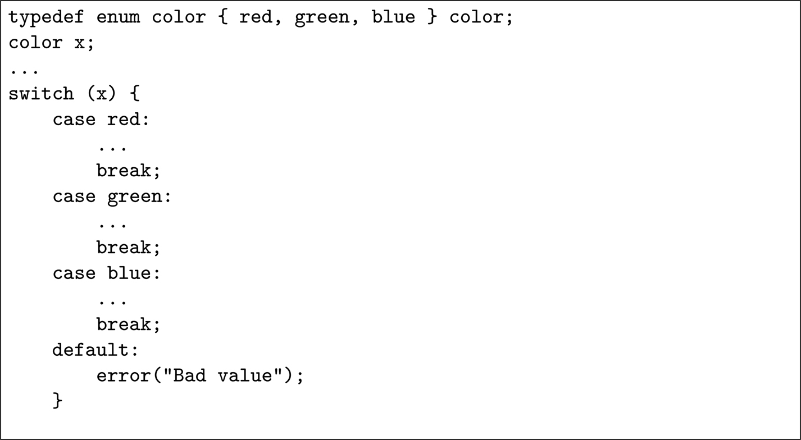
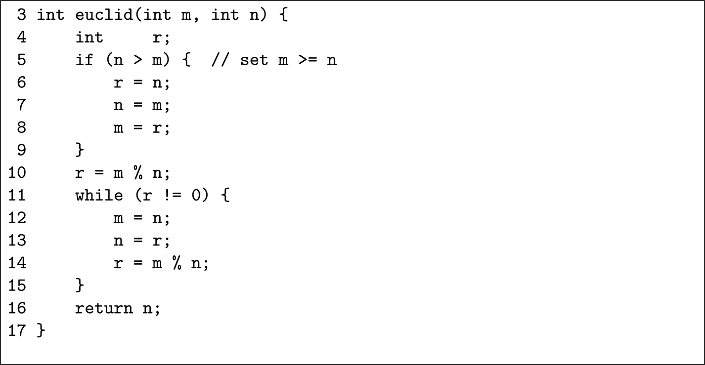
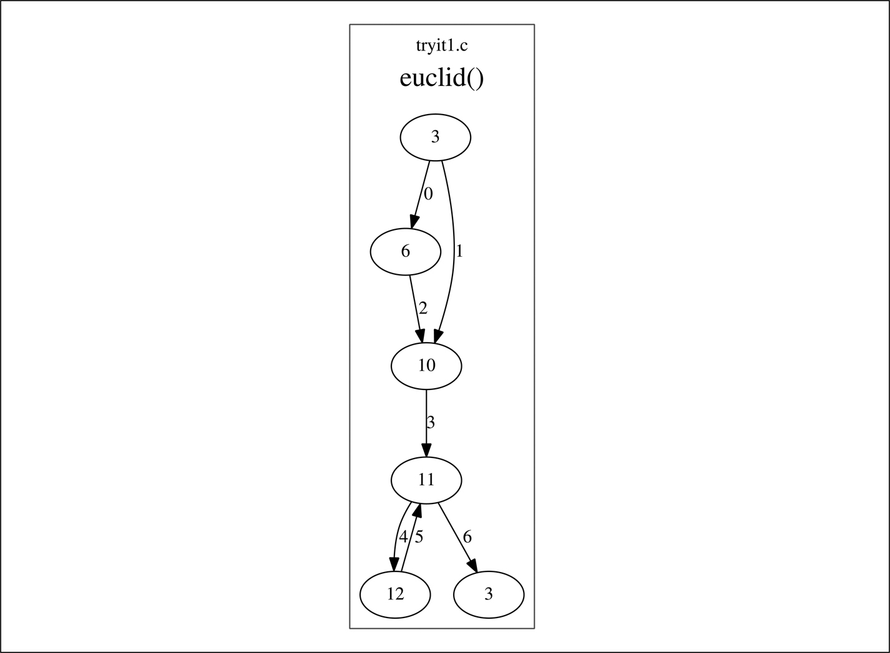

<a id="p263"></a>

<a id="chapter20"></a>

# 20 Code coverage metric

DOI: [10.1201/9781003598145-20](https://doi.org/10.1201/9781003598145-20)

Chương này mô tả một số thách thức gắn với việc thu thập code coverage metric. Nói một cách đại khái, một coverage metric là thước đo phần code chương trình đã được thực thi (được bao phủ) bao nhiêu trong quá trình kiểm thử.

## 20.1 Code coverage testing

Một vấn đề gây khổ sở cho mọi dạng kiểm thử là quyết định khi nào dừng — khi nào việc kiểm thử là đủ? Một cách đánh giá điều này là đặt một mục tiêu (chẳng hạn 100%) rồi đo bao nhiêu phần trăm code đã được thực thi ít nhất một lần trong quá trình kiểm thử. Khi đạt mục tiêu, việc kiểm thử có thể dừng.

Tôi đã cố ý dùng một thuật ngữ mơ hồ trong đoạn trước: “code.” Thuật ngữ này chỉ các dòng trong source code (ví dụ, C hoặc C++), các dòng của source code đã qua tiền xử lý, hay các câu lệnh trong object code đã biên dịch? Chúng ta sẽ quay lại câu hỏi quan trọng này sau.

Lý lẽ biện minh cho việc thu thập code coverage metric dựa trên ba giả định:

1. Việc các dòng code được thực thi lần đầu tiên trong một sản phẩm safety-critical ngoài thực địa có khả năng nguy hiểm; mọi code đều nên đã được thực thi ít nhất một lần trong phòng thí nghiệm trong quá trình kiểm thử.
2. Code coverage metric cho biết chất lượng của các test case: nếu thực thi mọi test case chỉ chạy qua, chẳng hạn, 38% các hàm trong hệ thống, thì điều đó có thể chỉ ra rằng các test case chưa thỏa đáng.
3. **Code** coverage metric cung cấp một ước lượng về **fault** coverage: nếu 100% code đã được thực thi trong quá trình kiểm thử, thì có khả năng hầu hết các fault đã được phát hiện.

Giả định thứ nhất không thể bác bỏ, giả định thứ hai hợp lý, nhưng giả định thứ ba rất đáng ngờ — xem [Mục 20.5](#sec20_5).

<a id="p264"></a>

## 20.2 <a id="p264"></a>Giai đoạn kiểm thử

Mặc dù đạt được mức coverage cao trong module testing white-box<a id="fn20_120b"></a>[<sup>1</sup>](#fn20_1) dễ hơn so với trong integration testing black-box, việc thiếu hụt coverage trong integration testing có thể chỉ ra sự chưa đầy đủ của các integration test case. Ví dụ, nếu một nhánh cụ thể, chỉ được đi vào khi cạn kiệt memory, không được đi vào trong integration test, thì đây có thể là một dấu hiệu cho thấy nên thêm integration testing để bao phủ điều kiện low-memory.

## 20.3 Các loại code coverage

### 20.3.1 Entry point coverage

Đây là dạng coverage ít nghiêm ngặt nhất, đo tỷ lệ các hàm đã được đi vào ít nhất một lần trong quá trình kiểm thử. Nó không đo bao nhiêu phần trăm số dòng trong mỗi hàm đã được thực thi: chỉ đơn giản là hàm đã được đi vào và thoát ra. Sẽ là không hợp lý nếu xuất xưởng một sản phẩm phần mềm để dùng trong một ứng dụng safety-critical mà chưa đạt 100% entry point coverage.

### 20.3.2 Statement coverage

Statement coverage đo tỷ lệ các câu lệnh đã được thực thi ít nhất một lần trong quá trình kiểm thử. Khó có khả năng đạt được 100% statement coverage, chủ yếu vì defensive coding.

Ví dụ, hãy xét đoạn code C trong <a id="b20fig20_1"></a>[Hình 20.1](#fig20_1). Một mệnh đề `default` đã được đưa vào câu lệnh switch, mặc dù các mệnh đề `case` đã bao quát hết. Đây là defensive coding tốt, phòng trường hợp một lập trình viên thêm một màu vào `enum` sau này và quên cập nhật câu lệnh `switch` này. Thực tế, nó được tiêu chuẩn MISRA-C 2012 yêu cầu. Tuy nhiên, mệnh đề default không bao giờ có thể được đi tới trong quá trình kiểm thử.

<a id="fig20_1"></a>



*Hình 20.1: Một câu lệnh switch của C[⏎](#b20fig20_1)*

### 20.3.3 Branch coverage hay decision coverage

Branch coverage được định nghĩa kém, cả trong các tiêu chuẩn lẫn trong tài liệu. Đối với một câu lệnh rẽ nhánh đơn giản có dạng

```
if (x > 7) { .... }
```

có thể đạt 100% branch coverage bằng cách chạy các test mà điều kiện đúng ít nhất một lần và sai ít nhất một lần.

<a id="fn20_1"></a>

[<sup>1</sup>](#fn20_120b)Kiểm thử “White-box” được thực hiện khi biết module được hiện thực thế nào; kiểm thử “black-box” được thực hiện khi chỉ biết giao diện bên ngoài của hàm.

<a id="p265"></a>Với một điều kiện phức tạp hơn, những gì cần để đạt 100% branch coverage được định nghĩa kém rõ ràng hơn. Hãy xét câu lệnh điều kiện sau:

```
if ((x > 7) || (y < 23)) { ..... }
```

Một số tài liệu chỉ ra rằng chỉ cần làm cho toàn bộ điều kiện phức hợp đúng ít nhất một lần và sai ít nhất một lần. Vì vậy, hai test case, (x=8, y=45) và (x=3, y=45), là đủ để đạt 100% branch coverage. Tuy nhiên, điều này không chứng tỏ được vai trò của *y* trong điều kiện, vì nó không thay đổi trong các test case.

Công cụ open-source phổ biến `gcov` đo coverage, bao gồm branch coverage, trên code được biên dịch với các tùy chọn đặc biệt để ép compiler chèn các instruction statistics-gathering cần thiết. Cách nó đếm các nhánh phức tạp hơn metric Boolean đơn giản did-branch/didn't-branch này.

### 20.3.4 MC/DC coverage

MC/DC<a id="fn20_220b"></a>[<sup>2</sup>](#fn20_2) là viết tắt của “modified condition/decision coverage”, và đây là điều kiện nghiêm ngặt nhất trong các điều kiện coverage cơ bản. Các phần của thuật ngữ có thể được xây dựng dần như sau.

<a id="fn20_2"></a>

[<sup>2</sup>](#fn20_220b)Mặc dù thuật ngữ này thường được đọc là “em-see, dee-see,” sẽ chính xác hơn nếu đọc là “em, see-dee, see.”

*Decision coverage.* Như đã mô tả ở trên, đây đơn giản là branch coverage.

*Condition/decision coverage.*

Đây là sự kết hợp của entry point coverage, branch coverage đơn giản, và một yêu cầu rằng mọi điều kiện Boolean cơ sở trong mọi điều kiện rẽ nhánh đều đã đúng và đã sai ít nhất một lần. Trong ví dụ ở trên về câu lệnh `if` <a id="p266"></a>phức hợp, việc *y* giữ nguyên không đổi sẽ không còn thỏa đáng. Tuy nhiên, hai test case vẫn đủ: (x=8, y=10) (cả hai đúng) và (x=3, y=35) (cả hai sai).

*Modified condition/decision coverage.*

Loại này bao gồm mọi thứ trong condition/decision coverage, và thêm yêu cầu bổ sung rằng mỗi điều kiện Boolean cơ sở phải được chứng tỏ là ảnh hưởng đến việc rẽ nhánh, trong khi mọi điều kiện khác được giữ không đổi. Giờ, hai test case không còn đủ để kiểm thử câu lệnh `if` phức hợp ở trên. Chúng ta phải chứng tỏ rằng, với *x* được giữ không đổi, giá trị của *y* có thể ảnh hưởng đến kết quả, và *ngược lại*. Đối với ví dụ này, sẽ cần 3 test case để thỏa mãn các điều kiện MC/DC: (x=12, y=24 → True), (x=3, y=24 → False) và (x=3, y=22 → True).

Để so sánh các test case cần thiết cho branch coverage và MC/DC coverage, hãy xét câu lệnh `if`:

```
if ( (x == 7) && ((y == 8) || (z == 23)) ) { .... }
```

Chỉ cần 2 test case cho branch coverage đơn giản: (x=4, y=8, z=23) và (x=7, y=8, z=23).

Các giá trị của *y* và *z* phần lớn không quan trọng miễn là ít nhất một trong số chúng đúng.

Đối với MC/DC coverage, có thể nghĩ rằng cần ${2}^{3} = 8$ test case, nhưng không phải vậy. Hãy xét 4 test case:

| Test case | x | y | z | x == 7 | y == 8 | z == 23 | Kết quả |
|---|---|---|---|---|---|---|---|
| 1 | 7 | 8 | 25 | True | True | False | True |
| 2 | 8 | 8 | 25 | False | True | False | False |
| 3 | 7 | 9 | 25 | True | False | False | False |
| 4 | 7 | 9 | 23 | True | False | True | True |

Nhìn chung, cần tối đa 2*n* test case cho MC/DC coverage. Kết quả tổng thể của câu lệnh điều kiện phức hợp đã đúng ít nhất một lần và sai ít nhất một lần, nên branch coverage đơn giản là 100%. Mỗi biểu thức Boolean cơ sở trong ba biểu thức đều đã đúng và đều đã sai. Ngoài ra, mỗi biểu thức đã được thay đổi trong khi giữ hai biểu thức kia không đổi và đã được chứng tỏ là ảnh hưởng đến kết quả của điều kiện phức hợp.

Tài liệu tham khảo [<a id="b20refbib20_1"></a>[1](#refbib20_1)] của Sergiy Vilkomir và Jonathan Bowen chỉ ra rằng có thể không phải lúc nào cũng tìm được test case để tạo ra 100% MC/DC coverage. Bài báo đó đưa ra ví dụ

```
if ((x > 20) && (y < 60)) || ((x > 40) && (y < 80)) ...
```

trong đó không thể làm cho $( y < 80 )$ sai trong khi làm cho $( y < 60 )$ đúng.

Tôi đã trình bày một phiên bản hơi đơn giản hóa của kiểm thử MC/DC ở đây. Tài liệu tham khảo [<a id="b20refbib20_2"></a>[2](#refbib20_2)] mô tả ba loại kiểm thử MC/DC khác nhau.

<a id="p267"></a>

### 20.3.5 <a id="p267"></a>RC/DC coverage

Reinforced Condition/Decision Coverage được mô tả trong tài liệu tham khảo [[1](#refbib20_1)]. Nó bao gồm MC/DC nhưng thêm yêu cầu rằng, ngoài MC/DC coverage, phải thực thi các test case chứng tỏ rằng điều kiện phức hợp tổng thể có thể giữ nguyên không đổi khi giá trị đúng sai của mỗi điều kiện con thay đổi, trong khi giữ mọi điều kiện con khác không đổi.

Lấy ví dụ đã xét cho MC/DC ở trên:

```
if ( (x == 7) && ((y == 8) || (z == 23)) ) { .... }
```

để đạt 100% RC/DC coverage, sẽ cần thêm các test như sau:

| Test case | x | y | z | x == 7 | y == 8 | z == 23 | Kết quả |
|---|---|---|---|---|---|---|---|
| 1 | 8 | 8 | 25 | False | True | False | False |
| 2 | 8 | 8 | 23 | False | True | True | False |
| 3 | 8 | 9 | 25 | False | False | False | False |
| 4 | 7 | 9 | 25 | True | False | False | False |

Với các test case này, kết quả của điều kiện phức tạp đã được giữ không đổi (False) trong khi mỗi sub-condition đã được thay đổi giá trị trong khi giữ các sub-conditions khác không đổi.

### 20.3.6 Data flow coverage

Tài liệu tham khảo [<a id="b20refbib20_3"></a>[3](#refbib20_3)] của Ting Su *et al.* mô tả lịch sử của Data Flow testing kể từ khi nó được P. M. Herman đề xuất lần đầu năm 1976.

Dynamic data flow testing bắt đầu bằng việc xây dựng một data flow diagram cho mỗi biến: nó được định nghĩa ở đâu, nó là một phần của phép tính ở đâu, nó quyết định kết quả của một câu lệnh điều kiện ở đâu và nó ra khỏi phạm vi ở đâu? Chỉ riêng bước này đã có thể nhận diện code sai, như một biến chưa được khởi tạo, hoặc một biến được khởi tạo nhưng không bao giờ được dùng, hoặc một biến được cấp phát trên heap nhưng không bao giờ được giải phóng.

Sau đó các test case được nghĩ ra để bao phủ từng đường đi trong đồ thị bằng một kỹ thuật như basis path coverage như được mô tả trong mục tiếp theo.

<a id="sec20_3_7"></a>

### 20.3.7 Basis path coverage

Luồng điều khiển qua một chương trình có thể được biểu diễn dưới dạng một đồ thị, trong đó mỗi node biểu diễn một điểm quyết định (ví dụ, câu lệnh `if`) và mỗi cung biểu diễn một chuỗi instruction không có rẽ nhánh.

Ví dụ, hàm C trong <a id="b20fig20_2"></a>[Hình 20.2](#fig20_2) tính ước chung lớn nhất (GCD) của hai số nguyên dương lớn hơn không bằng thuật toán Euclid (tôi đã thêm số dòng cho tiện).

<a id="fig20_2"></a>



*Hình 20.2: Một chương trình tính GCD của hai số nguyên[⏎](#b20fig20_2)*

Hàm này có thể được biểu diễn dưới dạng một đồ thị, như được thể hiện trong <a id="b20fig20_3"></a>[Hình 20.3](#fig20_3). Các con số trong các node của đồ thị biểu diễn số dòng trong chương trình, và các con số trên các cung là để tiện cho phần mô tả bên dưới. Có thể thấy <a id="p268"></a>từ đồ thị rằng điểm quyết định đầu tiên là có đi tới dòng 6 hay dòng 10 (tùy theo câu lệnh `if` ở dòng 5).

<a id="fig20_3"></a>



*Hình 20.3: Đồ thị luồng cho chương trình mẫu.[⏎](#b20fig20_3)*

Chính từ một đồ thị như vậy mà McCabe cyclomatic complexity của một chương trình được tính. Thước đo này được đặt theo tên Thomas McCabe, người đầu tiên đề xuất nó trong tài liệu tham khảo [<a id="b20refbib20_4"></a>[4](#refbib20_4)]. McCabe complexity được tính bằng

$$\begin{array}{l} M = E - N + 2 P \end{array} \tag{20.1}$$

trong đó *E* là số cạnh (cung) trong đồ thị ($E = 7$ trong [Hình 20.3](#fig20_3)), *N* là số node<a id="fn20_320b"></a>[<sup>3</sup>](#fn20_3) ($N = 6$) và *P* là số phần rời nhau của đồ thị ($P = 1$). Độ phức tạp của chương trình trong [Hình 20.3](#fig20_3) là $7 - 6 + 2 = 3$. Các coding standard và design standard thường yêu cầu mọi hàm có độ phức tạp không lớn hơn 10, nhưng điều này có thể thay đổi giữa các dự án. Như tài liệu tham khảo [<a id="b20refbib20_5"></a>[5](#refbib20_5)] nói:

> *Giới hạn ban đầu là 10 như McCabe đề xuất có bằng chứng ủng hộ đáng kể, nhưng các giới hạn cao tới 15 cũng đã được dùng thành công. Các giới hạn trên 10 nên được dành cho những dự án có một số lợi thế vận hành so với các dự án điển hình, ví dụ đội ngũ có kinh nghiệm, thiết kế hình thức, một ngôn ngữ lập trình hiện đại, lập trình có cấu trúc, code walkthrough và một kế hoạch kiểm thử toàn diện. Nói cách khác, một tổ chức có thể chọn một giới hạn độ phức tạp lớn hơn 10, nhưng chỉ khi nó chắc chắn rằng mình biết mình đang làm gì và sẵn lòng dành thêm nỗ lực kiểm thử mà các module phức tạp hơn đòi hỏi.*

Ngoài việc là đầu vào để ước lượng độ phức tạp, đồ thị luồng còn cung cấp định nghĩa của “basis” path coverage. McCabe cyclomatic complexity của chương trình không chỉ là $E - N + 2 P$, nó còn là số test case sẽ cần để thực hiện 100% basis path coverage.

Một “cơ sở” (basis) cho một không gian vector là một tập các vector mà không vector nào có thể thu được bằng cách lấy tổ hợp tuyến tính của các vector khác. Hầu hết các công cụ sinh basis path đều che giấu toán học khỏi người dùng, nhưng nếu bạn quan tâm, hãy xem Phụ lục D.2. Để sinh test case, các vector là các đường đi tiềm năng qua chương trình:

| Đường đi | Vector: các cung được bao phủ | Cung |  |  |  |  |  |  |
|---|---|---|---|---|---|---|---|---|
|  | 0 | 1 | 2 | 3 | 4 | 5 | 6 |  |
| Path A | 0 | 1 | 0 | 1 | 0 | 0 | 1 | $1 \to 3 \to 6$ |
| Path B | 1 | 0 | 1 | 1 | 0 | 0 | 1 | $0 \to 2 \to 3 \to 6$ |
| Path C | 0 | 1 | 0 | 1 | 1 | 1 | 1 | $1 \to 3 \to 4 \to 5 \to 6$ |
| Path D | 1 | 0 | 1 | 1 | 2 | 2 | 1 | $0 \to 2 \to 3 \to 4 \to 5 \to 4 \to 5 \to 6$ |

Vì vậy, path A $( 1 \to 3 \to 6 )$ có thể được biểu diễn bằng vector (0, 1, 0, 1, 0, 0, 1) và path B bằng vector (1, 0, 1, 1, 0, 0, 1).

Do vòng lặp giữa dòng 12 đến 14, có thể có một số rất lớn các đường đi qua chương trình này (chỉ bị giới hạn bởi kích thước của một số nguyên trên máy tính thực thi nó), và path D là một đường đi trong đó vòng lặp đã được duyệt qua hai lần.

Tuy nhiên, dễ dàng kiểm tra rằng

$$\begin{array}{l} {D}_{i} = {B}_{i} - 2 \times {A}_{i} + 2 \times {C}_{i} \; \; \; \; \text{for} \; \; \; 0 \le i < 7 \end{array} \tag{20.2}$$

<a id="fn20_3"></a>

[<sup>3</sup>](#fn20_320b)Lưu ý rằng node cho dòng 3 được lặp lại để “khép” đồ thị.

<a id="p270"></a>với mỗi phần tử trong 7 phần tử của các path A đến D. Vì vậy, Path D không độc lập tuyến tính với các path A đến C.<a id="fn20_420b"></a>[<sup>4</sup>](#fn20_4) Thực tế, bất kỳ đường đi nào qua đồ thị trong [Hình 20.3](#fig20_3) đều có thể được biểu diễn như một tổ hợp tuyến tính của các path A, B và C. Vì vậy, ba path A đến C (hoặc, nếu bạn thích, các path A, B và D) tạo thành một cơ sở trong không gian đường đi 7-dimensional, và có thể chọn ba test để chạy qua các đường đi đó nhằm đạt 100% basis path testing.

Basis path coverage đầy đủ ngụ ý branch coverage đầy đủ.

### 20.3.8 Path coverage

Đối với bất kỳ chương trình nào trừ chương trình đơn giản nhất, không thể đạt được path coverage đầy đủ. Với đồ thị luồng điều khiển được thể hiện trong [Hình 20.3](#fig20_3) để tính GCD của hai số nguyên, số đường đi tiềm năng chỉ bị giới hạn bởi kích thước của một số nguyên trên máy tính thực thi chương trình. Ví dụ, vòng lặp giữa dòng 11 và 12 được lặp lại 25 lần nếu dùng các giá trị nguyên tố cùng nhau $m = 317811 , n = 196418$.

## 20.4 Coverage và các tiêu chuẩn

Đối với các Safety Integrity Level cao hơn, EN 50716 (Table A.21) rất khuyến nghị một trong các loại sau:

- Branch coverage và Compound Condition coverage; hoặc
- Branch coverage và Data Flow coverage; hoặc
- Path Coverage

được đo trong quá trình kiểm thử module-level. Nó không định nghĩa metric Compound Condition, nhưng có lẽ đó là một tham chiếu đến MC/DC coverage.

IEC 61508-3 (Table B.2) yêu cầu mục tiêu 100% entry point coverage, statement coverage, branch coverage và MC/DC coverage. Nó thừa nhận rằng defensive code thuộc loại được minh họa trong câu lệnh `switch` của code trong [Hình 20.1](#fig20_1) không thể được đi tới, nhưng yêu cầu rằng, đối với mức coverage dưới 100%, “nên đưa ra một lời giải thích phù hợp.”

Table 9 của ISO 26262-6 cũng khuyến nghị thu thập các coverage metric statement, branch và MC/DC. Mặc dù không đặt mức mục tiêu, ISO 26262 có nói *“Không có giá trị mục tiêu hoặc một giá trị mục tiêu thấp cho structural coverage mà không có lý do chính đáng được coi là không đủ.”*

Sự khác biệt giữa IEC 61508 và ISO 26262 nằm ở giai đoạn mà mỗi tiêu chuẩn mong đợi coverage được đo. ISO 26262-6 rõ ràng: Table 9 liên quan đến cấp software unit, và nó nằm trong mục liên quan đến software unit testing. IEC 61508 linh hoạt hơn, chỉ ra rằng các số liệu coverage được thu thập trong module testing hoặc integration testing (hoặc cả hai).<a id="fn20_520b"></a>[<sup>5</sup>](#fn20_5)

<a id="fn20_4"></a>

[<sup>4</sup>](#fn20_420b)Đây là một trong các ví dụ gốc của McCabe — xem tài liệu tham khảo [[5](#refbib20_5)].

<a id="fn20_5"></a>

[<sup>5</sup>](#fn20_520b)Lưu ý rằng các tiêu chuẩn khác nhau dùng các thuật ngữ “module test” (IEC 61508) và “unit test” (ISO 29119, ISO 26262 và IEC 62304) như từ đồng nghĩa.

<a id="p271"></a>IEC 62304 cũng nhắc qua đến code coverage trong Appendix B.5.7, nơi nó chỉ ra rằng đây là một hoạt động được thực hiện trong giai đoạn system testing.

<a id="sec20_5"></a>

## 20.5 Hiệu quả của coverage testing

Khi thực hiện một test, điều chúng ta thực sự muốn là đạt được *fault* coverage cao — tức là, chúng ta muốn thực thi những test làm lộ ra các *fault.* Tuy nhiên, số fault trong code là chưa biết, và vì vậy việc đo mức fault coverage là không thể. Thay vào đó, mức branch coverage hoặc MC/DC coverage được dùng như một sự thay thế cho mức fault coverage, và một câu hỏi hợp lý là, *“Liệu x% branch coverage hay y% MC/DC coverage có tương quan với một mức fault coverage cụ thể không?”*

Câu hỏi này được đề cập trong tài liệu tham khảo [<a id="b20refbib20_6"></a>[6](#refbib20_6)] của Lionel Briand và Dietmar Pfahl và tài liệu tham khảo [<a id="b20refbib20_7"></a>[7](#refbib20_7)] của Yi Wei *et al*. Kết quả của các nghiên cứu đó thật đáng buồn:

> *Kết quả nghiên cứu không ủng hộ giả định về một sự phụ thuộc nhân quả giữa test-coverage và defect-coverage.*

và

> *Những kết quả này … cũng cho thấy branch coverage không phải là một chỉ báo tốt cho hiệu quả của một bộ test.*

lần lượt từ hai bài báo. Một phần, điều này là có thể dự đoán được. Hãy xét chương trình đơn giản

```
int v[100];
void f(int x) {
    if (x > 99) x = 99;
    v[x] = 0;
    return;
    }
```

trong đó lập trình viên đã cố (nhưng thất bại!) phòng ngừa một giá trị input out-of-range. Hai test case đủ để cung cấp 100% statement coverage, branch coverage, MC/DC coverage và basis path coverage: $x = 50$ và $x = 101$. Đáng tiếc là, không test nào trong số này bắt được fault được kích hoạt khi $x = - 4$.

Tôi đã yêu cầu công cụ KLEE (xem [Mục 21.4.3](ch21_static_analysis.vi.md#sec21_4_3)) sinh test case cho đoạn code đó, và nó trả về ba test case: $x = - 7387680$ (làm lộ bug), $x = 2147483644$ (lớn hơn 99) và $x = 97$. Chỉ hai trong số này là thực sự cần thiết cho code coverage đầy đủ, nhưng giá trị âm là một test case hữu ích.

Tài liệu tham khảo [<a id="b20refbib20_8"></a>[8](#refbib20_8)] của Xia Cai và Michael Lyu nói rằng: *“Nhìn chung, mối quan hệ giữa code coverage và việc phát hiện fault rất phức tạp.”* Các kết quả thực nghiệm được mô tả trong bài báo đó chứng tỏ rằng điều này đúng.

<a id="p272"></a>Trước đó tôi đã gợi ý về một vấn đề khác gắn với coverage metric: chúng ta tính cái gì là dòng source code? Chúng ta tính các dòng source code do lập trình viên viết, các dòng source code sau khi tiền xử lý (bởi preprocessor chuẩn hoặc bởi một pre-processor chuyên dụng, như loại chèn các lệnh coded processing — xem [Mục 13.4.2](ch13_replication_and_diversification.vi.md#sec13_4_2)), hay các “dòng” mã máy sau khi biên dịch?

Các compiler tối ưu hóa có thể xóa, re-order và chèn các dòng giữa input nguồn và output assembler của chúng. Những biến đổi này khiến statement coverage và branch coverage khó đo: có lẽ một tập test thực thi 100% các nhánh trong một chương trình nguồn C, nhưng chỉ 40% các nhánh trong code assembler được sinh ra.

Các khái niệm code `inline` và macro của ngôn ngữ C cũng có thể dẫn đến các giá trị coverage không hợp lý. Nếu một đoạn code được khai báo là `inline` có chứa một nhánh, thì nhánh đó có thể được đi vào ở một số chỗ mà code được chèn vào, nhưng không ở những chỗ khác. Nếu công cụ phân tích đo coverage thấy code sau khi inlining đã diễn ra, nó sẽ báo cáo code chưa được bao phủ, mặc dù không có code nào như vậy. Điều tương tự cũng đúng với macro.

<a id="sec20_6"></a>

## 20.6 Đạt được coverage

Có nhiều công cụ để sinh test case có thể cung cấp statement coverage và branch coverage tốt. Một công cụ như vậy là chương trình symbolic execution open-source KLEE được mô tả trong [Mục 21.4](ch21_static_analysis.vi.md#sec21_4). Khi thực hiện symbolic execution, nó thực hiện phân tích cần thiết để xác định các giá trị của các biến cần để dẫn chương trình đi xuống từng đường đi của nó. Khi KLEE được áp dụng cho chương trình tính ước chung lớn nhất ([Hình 20.2](#fig20_2)), trong vài giây trên laptop của tôi, nó sinh ra các test case sau:

- $m = 2147483647 , n = 2147483647$ (GCD = 2147483647).
- $m = 50790404 , n = 54463393$ (GCD = 1).
- $m = 679738981 , n = 340287488$ (GCD = 1).

Lưu ý rằng test case đầu tiên tương ứng với Path A trong bảng ở trang 269, test case thứ hai với Path D (với 18 thay vì 2 lần lặp của vòng lặp quanh dòng 11 và 12, và test case thứ ba với Path C (với 17 lần quanh vòng lặp). Ba test case này tạo thành một cơ sở và vì vậy cung cấp 100% entry point coverage, statement coverage, branch coverage và basis path coverage. Vì bản chất đơn giản của các quyết định, chúng cũng cung cấp 100% MC/DC coverage.

Cần phải nói rằng, mặc dù các test case automatically-generated có thể cung cấp coverage tuyệt vời thuộc nhiều loại, theo kinh nghiệm của tôi những test này hiếm khi tìm ra bug thực sự. Và, dĩ nhiên, các bộ sinh test case tự động không hiểu chương trình được cho là phải làm gì.

Trong output của KLEE ở trên, $m = 50790404 , n = 54463393$ là những giá trị tuyệt vời để đạt path coverage, nhưng KLEE không biết, và vì vậy không thể kiểm tra, rằng kết quả mong đợi là 1. KLEE là một công cụ hữu ích để tạo các test case có coverage tốt, nhưng những test case đó cần được mở rộng thủ công để kiểm tra rằng câu trả lời đúng đang được trả về.

## 20.7 Tóm tắt

Khó có thể lập luận rằng việc một phần của chương trình trong một thiết bị safety-critical được thực thi lần đầu tiên trong môi trường không được kiểm soát của thế giới thực, thay vì trong môi trường có kiểm soát của phòng thí nghiệm kiểm thử, là chấp nhận được. Vì lý do này, phải đạt được một mức coverage nào đó trong quá trình kiểm thử.

Tuy nhiên, code coverage metric thường được coi là một sự thay thế dễ đo cho fault coverage — hữu ích như một mục đích tự thân. Tôi không thấy tuyên bố đó thuyết phục. Thật đáng buồn là các bài báo tôi đã trích dẫn (tài liệu tham khảo [[6](#refbib20_6)], [[7](#refbib20_7)] và [[8](#refbib20_8)]) đều đã hơn một thập kỷ tuổi. Tôi chưa tìm thấy nghiên cứu nào hiện đại hơn.

## Tài liệu tham khảo

<a id="refbib20_1"></a>[1] S. Vilkomir and J. Bowen, “Reinforced Condition/Decision Coverage (RC/DC): A New Criterion for Software Testing,” in *Lecture Notes in Computer Science*, 01 2002.[⏎](#b20refbib20_1)

<a id="refbib20_2"></a>[2] Office of Aviation Research Washington, D.C., USA, “An Investigation of Three Forms of the Modified Condition Decision Coverage (MCDC) Criterion,” 2001. Available from [http://www.tc.faa.gov/its/worldpac/techrpt/ar01-18.pdf](http://www.tc.faa.gov/its/worldpac/techrpt/ar01-18.pdf).[⏎](#b20refbib20_2)

<a id="refbib20_3"></a>[3] T. Su, K. Wu, W. Miao, G. Pu, J. He, Y. Chen, and Z. Su, “A Survey on Data-Flow Testing,” *ACM Comput. Surv.*, vol. 50, Mar. 2017.[⏎](#b20refbib20_3)

<a id="refbib20_4"></a>[4] T. J. McCabe, “A Complexity Measure,” *IEEE Trans. Software Eng.*, vol. 2, no. 4, pp. 308–320, 1976.[⏎](#b20refbib20_4)

<a id="refbib20_5"></a>[5] A. H. Watson and T. J. McCabe, “Structured Testing: A Testing Methodology Using the Cyclomatic Complexity Metric,” 1996.[⏎](#b20refbib20_5)

<a id="refbib20_6"></a>[6] L. Briand and D. Pfahl, “Using simulation for assessing the real impact of test coverage on defect coverage,” in *Software Reliability Engineering, 2000. Proceedings. 10th International Symposium on*, pp. 148–157, IEEE, 1999.[⏎](#b20refbib20_6)

<a id="refbib20_7"></a>[7] Y. Wei, B. Meyer, and M. Oriol, “Is Branch Coverage a Good Measure of Testing Effectiveness?,” in *LASER Summer School* (B. Meyer and M. Nordio, eds.), vol. 7007 of *Lecture Notes in Computer Science*, pp. 194–212, Springer, 2010.[⏎](#b20refbib20_7)

<a id="refbib20_8"></a>[8] X. Cai and M. R. Lyu, “The effect of code coverage on fault detection under different testing profiles,” in *Proceedings of the 1st International Workshop on Advances in Model-Based Testing*, A-MOST ‘05, (New York, NY, USA), pp. 1–7, Association for Computing Machinery, 2005.[⏎](#b20refbib20_8)
