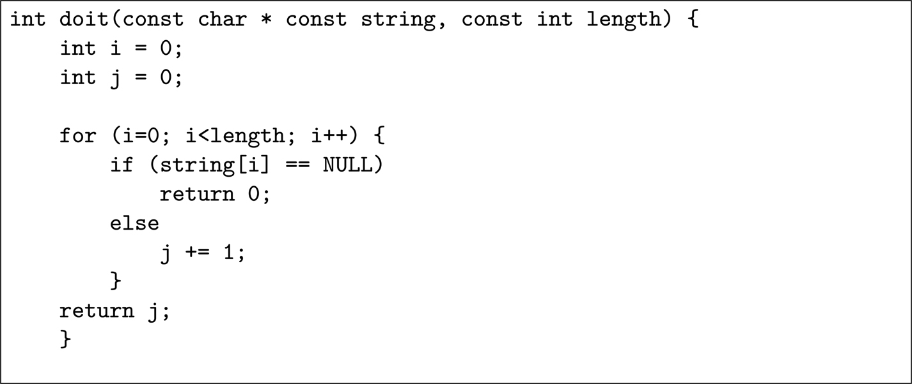
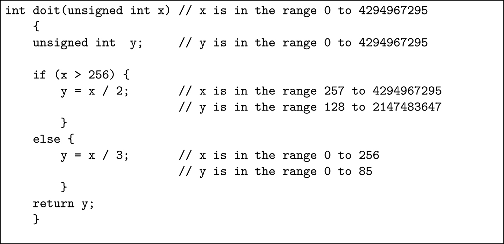

<a id="p275"></a>

<a id="chapter21"></a>

# 21 Phân tích tĩnh

DOI: [10.1201/9781003598145-21](https://doi.org/10.1201/9781003598145-21)

Sẽ thuận tiện nếu chia việc kiểm chứng code thành phân tích động và phân tích tĩnh. Phân tích động, thường được gọi là *kiểm thử*, nghĩa là thực thi code trong khi tìm kiếm các *error* và *failure.* Phân tích tĩnh nghĩa là kiểm tra code để tìm kiếm các *fault*.<a id="fn21_121b"></a>[<sup>1</sup>](#fn21_1) Phân tích tĩnh thực chất là kiểm tra code tự động, trong đó một chương trình thay vì một con người thực hiện việc kiểm tra.

Như tôi đã nói ở nhiều chỗ trong cuốn sách này, kiểm thử động đang ngày càng kém hiệu quả khi độ phức tạp của hệ thống được kiểm thử tăng lên. May mắn là, phân tích tĩnh và kiểm chứng hình thức (xem [Chương 18](ch18_formal_verification.vi.md)) đang mở rộng phạm vi để bù đắp một phần thiếu hụt do kiểm thử động để lại. Một phần, điều này là nhờ năng lực xử lý tăng lên, nhưng chủ yếu là nhờ sự phát triển của các thuật toán tốt hơn.

Symbolic execution của code (xem [Mục 21.4](#sec21_4)) nằm giữa phân tích động và phân tích tĩnh vì nó mô phỏng việc thực thi và, vì nó có thể xử lý nhiều giá trị input đồng thời, nên trong một số trường hợp mạnh hơn kiểm thử động.

## 21.1 Phân tích tĩnh được yêu cầu làm gì

Phân tích tĩnh code phải cân bằng nhiều đòi hỏi (danh sách này dựa trên danh sách trong tài liệu tham khảo [<a id="b21refbib21_1"></a>[1](#refbib21_1)] của Bruno Blanchet *et al.*):

- Nó phải sound, ở chỗ nó tìm ra *mọi* vấn đề trong code. Đây là điều phân biệt phân tích tĩnh với phân tích động — phân tích động không bao giờ có thể vét cạn.
- Nó phải được tự động hóa, đòi hỏi ít hoặc không cần can thiệp thủ công để thực hiện phân tích.
- Nó phải chính xác, tránh false positive (cảnh báo không cần thiết).
- Nó phải có khả năng mở rộng, có thể xử lý các code base rất lớn.
- Nó phải hiệu quả, hạn chế việc dùng memory và thời gian.

<a id="fn21_1"></a>

[<sup>1</sup>](#fn21_121b)Sự phân biệt giữa fault, error và failure được đưa ra ở trang 17.

<a id="p276"></a>Đây là một bộ yêu cầu khó đáp ứng, và hầu hết các công cụ phân tích tĩnh đều thất bại ở các yêu cầu về độ chính xác (chúng tạo ra false positive) và hiệu quả (chúng chạy quá lâu). Cả hai điểm yếu này khiến chúng ở một mức độ nào đó không phù hợp để dùng thường xuyên.

Một lập trình viên đang soạn thảo và biên dịch một chương trình cần nhận được phản hồi từ công cụ phân tích tĩnh trong cùng khoảng thời gian với việc biên dịch. Nếu phân tích tĩnh thêm quá vài giây vào chu kỳ soạn thảo/biên dịch, thì nó sẽ không được lập trình viên ban đầu thực hiện. Thay vào đó, tổ chức sẽ thực hiện nó như một hoạt động batch, có lẽ chạy qua đêm. Khi điều này xảy ra, mối liên kết trực tiếp giữa lập trình viên viết code đáng ngờ và công cụ báo cáo nó bị mất, và việc xem xét output từ phân tích tĩnh trở thành một việc vặt.

Tài liệu tham khảo [<a id="b21refbib21_2"></a>[2](#refbib21_2)] của Benjamin Livshits *et al.* nhấn mạnh vấn đề cân bằng giữa tính sound (tức là tìm ra mọi vấn đề trong source code) với sự xấp xỉ mà các công cụ cần áp dụng đối với ngôn ngữ:

> *Các phân tích thường được kỳ vọng là sound, ở chỗ kết quả của chúng mô hình hóa mọi lần thực thi khả dĩ của chương trình đang được phân tích. Tính sound ngụ ý phân tích tính một over-approximation để vẫn khả thi về tính toán; kết quả phân tích cũng sẽ mô hình hóa những hành vi không thực sự xảy ra trong bất kỳ lần thực thi chương trình nào. Độ chính xác của một phân tích là mức độ mà nó tránh được những kết quả giả như vậy. Người dùng mặc nhiên kỳ vọng các phân tích là sound, và mong muốn các phân tích càng chính xác càng tốt, đồng thời có khả năng mở rộng cho các chương trình lớn.*

Để cung cấp tính sound, hầu hết nếu không nói là mọi công cụ phân tích tĩnh đều phải làm việc với một sự xấp xỉ của ngôn ngữ nguồn — có lẽ không xử lý con trỏ hàm trong C hoặc reflexion trong Java.

## 21.2 Phân tích code tĩnh và các tiêu chuẩn

ISO 26262 rất khuyến nghị việc dùng phân tích tĩnh như một cơ chế để kiểm chứng rằng các coding standard định nghĩa một tập con của ngôn ngữ nguồn đã được tuân theo trong quá trình triển khai (Table 7 của [phần 6](part6_implementation_verification.vi.md)) và như một phương pháp kiểm chứng việc tích hợp phần mềm (Table 10).

IEC 61508 khuyến nghị phân tích tĩnh cho việc kiểm chứng phần mềm trong Table A.9 và B.8 của [phần 3](part3_design_patterns.vi.md) và đưa ra thông tin về kỹ thuật này trong đoạn B.6.3 của [phần 7](part7_appendices.vi.md), nơi nó mô tả khá cổ kính mục đích của kỹ thuật này là *“Để tránh các systematic fault có thể dẫn đến sự đổ vỡ trong hệ thống đang được kiểm thử, hoặc sớm hoặc sau nhiều năm hoạt động.”* Có thể lập luận rằng việc loại trừ cụ thể một hệ thống đã qua giai đoạn đầu, nhưng chưa ở ngoài thực địa nhiều năm, là điều đáng tiếc.

<a id="p277"></a>

## 21.3 <a id="p277"></a>Phân tích code tĩnh

Người ta dễ nghĩ rằng, vì các chương trình được viết bằng một ngôn ngữ hình thức, nên có thể viết một chương trình phân tích tĩnh một chương trình đích và trả lời câu hỏi tổng quát, *“Chương trình này có chứa lỗi runtime không?”*

Đáng tiếc là điều này không thể. Trước hết, không thể đặc tả một chương trình *nên* làm gì. Hãy xét đoạn code C này và tự hỏi liệu nó có chứa fault không:

```
int y = 10;
char x[8];
int z = 7;

strcpy(x, "12345678");
```

Hầu như mọi lập trình viên, và mọi công cụ phân tích tĩnh, sẽ ngay lập tức khẳng định rằng có một fault trong code: một fault của người mới học. Chương trình sao chép 9 byte (chuỗi 8-byte “12345678” và số không kết thúc của nó) vào một trường chỉ rộng 8 byte. Tùy theo cách compiler bố trí stack, hoặc `y` hoặc `z` sẽ bị hỏng.

Điều này đúng, nhưng mục đích của chương trình là cho phép lập trình viên kiểm thử một ứng dụng phát hiện và xử lý việc hỏng stack — chương trình đang làm đúng những gì nó được dự định làm khi cố ý làm hỏng stack. Nếu không có định nghĩa hình thức về những gì chương trình được dự định làm, thì cả con người lẫn chương trình đều không thể xác định liệu nó có đúng hay không, và, nhìn chung, định nghĩa hình thức duy nhất là chính chương trình.

> Giai thoại 33 *Tại Embedded Systems Kongress ở Sindelfingen vào cuối năm 2018, một nhà cung cấp công cụ phân tích tĩnh đã treo giải thưởng cho bất kỳ ai có thể (bằng tay) phát hiện ra một fault trong một đoạn code C hiển thị trên một băng rôn. Một dòng code chia cho* `(x - 10)` *và mọi người đều nhảy vào chỉ ra rằng điều này gây ra lỗi khi x bằng 10. Thực ra, do các câu lệnh điều kiện trong chương trình, không thể đi tới dòng code đó khi x bằng 10. Theo công ty, thực ra không có fault nào trong chương trình và vì vậy họ sẽ không bao giờ phải trao giải.*
>
> *Tôi đã dùng lập luận được mô tả ở trên và nói rằng mục đích của chương trình rõ ràng là để kiểm tra việc tôi xử lý một exception divide-by-zero và bug trong chương trình là nó không chia cho không: một bug chết người trong một chương trình như vậy. Tôi mất một lúc để làm rõ quan điểm của mình, nhưng giờ tôi có một chiếc cốc cà phê mang logo của công ty, được trao làm giải thưởng.*

Tuy nhiên, có một vấn đề cơ bản hơn. Alonzo Church, Kurt Gödel và Alan Turing đã chứng minh rằng không có cơ chế tất định nào có thể được một máy tính thực thi để trả lời câu hỏi liệu mọi chương trình khác có đúng hay không.

<a id="p278"></a>Vì vậy, mọi phân tích tĩnh đều là một sự thỏa hiệp. Nó tìm ra nhiều “false positive”, báo cáo những fault không thực sự tồn tại, và thường không phát hiện được những fault *có* tồn tại. Câu hỏi không phải là liệu phân tích code tĩnh có luôn đúng được không, mà là liệu nó có hữu ích không.

Các mức phân tích tĩnh khác nhau được phân biệt trong các mục dưới đây.

<a id="sec21_3_1"></a>

### 21.3.1 Kiểm tra Syntax-Level

Dạng phân tích tĩnh đơn giản nhất là kiểm tra cú pháp line-by-line theo đặc tả ngôn ngữ và theo các quy tắc viết code cục bộ.

Loại kiểm tra này được thực hiện bởi một compiler hoặc bởi loại công cụ được gọi là “lint.” Các công cụ Lint-like có sẵn cho hầu hết các ngôn ngữ — lint cho C và C++, pylint cho Python, jsl cho Javascript, lint4j cho Java và nhiều lint được tích hợp trong compiler Rust — và có thể được tùy biến để kiểm tra các quy tắc và quy ước viết code cục bộ.

Nhược điểm chính thường được nêu ra cho loại công cụ này là mức độ cao của “false positive” và “true positive” vụn vặt. Điều này không bất ngờ, vì phát hiện fault line-by-line là một bài toán khó giải quyết. Câu lệnh C ở trang 258:

```
unsigned int x = 0;
```

mà rất ít lập trình viên phản đối, lại vi phạm một trong các tiêu chuẩn viết code MISRA C vì nó trộn lẫn các kiểu số (*x* là unsigned, 0 là signed). Vì vậy, câu lệnh này sẽ bị hầu hết các công cụ phân tích tĩnh đánh dấu là có vấn đề, nhưng tôi sẽ xếp nó vào loại true positive vụn vặt. Nhưng còn khai báo liên quan này thì sao?

```
unsigned char y = 255;
```

Để giảm số false positive và positive vụn vặt, một khi mỗi fault được báo cáo đã được kiểm tra và thấy là không hữu ích, phải thực hiện một dạng “grandfathering” nào đó để ngăn fault đó bị báo cáo lại.

Trong tài liệu tham khảo [<a id="b21refbib21_3"></a>[3](#refbib21_3)], Sunghun Kim và Michael Ernst phân tích output của ba công cụ lint-like trên các phiên bản lịch sử của ba chương trình để xem liệu những vấn đề chúng phát hiện có biểu thị các fault thực sự hay không. Tóm lại, họ phát hiện ra rằng chỉ khoảng 9% số cảnh báo do các công cụ lint-like đưa ra chỉ tới code đã bị thay đổi do sửa bug trong một đến bốn năm hoạt động đầu tiên. Điều này ngụ ý rằng 91% số cảnh báo liên quan đến code mà, vì không được sửa, có lẽ đã không gây ra failure ngoài thực địa. Các công cụ phân tích cũng phân mức ưu tiên cho các cảnh báo của chúng, và người ta thấy rằng chỉ từ 3% đến 12% các cảnh báo ưu tiên cao đã được sửa. Điều thú vị cần lưu ý là các tác giả của tài liệu tham khảo [[3](#refbib21_3)], sau khi nhận thấy sự thiếu tương quan này giữa fault và việc sửa, đã tiếp tục dùng một hệ thống dựa trên thông tin lịch sử trong bug database và code repository để cải thiện tỷ lệ trúng của công cụ phân tích tĩnh — khai thác thông tin theo cách tương tự như được đề xuất trong [Chương 16](ch16_software_failure_rates.vi.md).

Tuy nhiên, trong thực tế, nhược điểm chính của phân tích tĩnh syntax-level có lẽ là điều được nêu trong câu trích về người họa sĩ ở trang 258: mặc dù các lỗi cú pháp hiển nhiên phải được sửa, các báo cáo về cách dùng ngôn ngữ mang tính phong cách lại bị coi là <a id="p279"></a>xúc phạm: *“Việc các lập trình viên khác được cảnh báo về cách dùng ngôn ngữ không an toàn là hữu ích, nhưng rõ ràng tôi không cần những cảnh báo như vậy vì tôi là một lập trình viên **thực thụ**!”*

### 21.3.2 Bổ sung ngữ nghĩa cho việc kiểm tra cú pháp

Các công cụ kiểm tra cú pháp “Lint”-like như được mô tả ở trên thường có rất ít kiến thức ngữ nghĩa về ngôn ngữ đang được phân tích. Tuy nhiên, có thể tìm ra những vấn đề sâu hơn nếu công cụ có thể được lập trình theo các khái niệm ngôn ngữ như “type”, “path”, “expression”, “identifier” và “statement”.

Khi đó một chương trình C có thể được quét tìm các mẫu thuộc loại “một biểu thức con trỏ được kiểm tra là NULL rồi bị dereference trước khi được re-assigned” hoặc “một biến được khai báo là unsigned được so sánh để xem nó có nhỏ hơn không hay không.” Loại kiểm tra này hoặc rất khó hoặc không thể thực hiện theo cách thuần túy cú pháp.

Các công cụ như Sparse và Coccinelle có thể xử lý loại kiểm tra ngữ nghĩa này, và có thể đặc biệt hiệu quả trong việc phát hiện các lỗ hổng bảo mật tiềm tàng trong code (buffer overflow, v.v.).

Sparse được viết riêng để phát hiện các vấn đề với code trong Linux kernel, nhưng tôi đã dùng nó thành công trên code hệ điều hành và thư viện khác.

Coccinelle<a id="fn21_221b"></a>[<sup>2</sup>](#fn21_2) là một công cụ rất hữu ích, vì nó không chỉ phát hiện các vi phạm trong code, mà còn có thể được viết script để tạo ra các file *diff* để sửa các vấn đề. Ví dụ, với chương trình trong <a id="b21fig21_1"></a>[Hình 21.1](#fig21_1), Coccinelle, nếu được cung cấp script phù hợp, sẽ tạo ra *diff* sau để sửa vấn đề:

```
-   if (string[i] == NULL)
+   if (string[i] == '\0')
```

<a id="fig21_1"></a>



*Hình 21.1: Một chương trình C có fault.[⏎](#b21fig21_1)*

<a id="fn21_2"></a>

[<sup>2</sup>](#fn21_221b)[http://coccinelle.lip6.fr/](http://coccinelle.lip6.fr/).

Cái khó nằm ở cụm từ “script phù hợp.” Ngôn ngữ dùng để viết script Coccinelle, SmPL, chính xác và well-defined, nhưng có thể cực kỳ <a id="p280"></a>khó viết. Tuy nhiên, đối với các cấu trúc đơn giản thì khá dễ: ví dụ sau được lấy từ website Coccinelle<a id="fn21_321b"></a>[<sup>3</sup>](#fn21_3) và phát hiện cấu trúc vô nghĩa `!x & y` trong ngôn ngữ C, trong đó `y` là một hằng số. Script Coccinelle phát hiện điều này, nhưng cho phép `!x & !y`, vốn có thể có nghĩa, có thể đọc được ngay cả khi không biết SmPL:

```
@@ expression E; constant C; @@
(
  !E & !C
|
- !E & C
+ !(E & C)
)
```

Vì Coccinelle hiểu các khái niệm biểu thức và hằng số, rất đơn giản để định nghĩa một script xóa `!E & C` và thay nó bằng `!(E & C)`, điều mà gần như chắc chắn là ý của lập trình viên.

Một cách dùng khác của các công cụ như Coccinelle là chứng minh một điều phủ định. Ví dụ, IEC 61508-7 yêu cầu hạn chế dùng đệ quy và ISO 26262-6 cấm hoàn toàn đệ quy. Làm thế nào chúng ta có thể chắc chắn rằng mình không dùng đệ quy ở đâu đó trong codebase? Làm thế nào chúng ta có thể chứng tỏ điều này cho một auditor?

Rất khó chứng minh một điều phủ định. Một kỹ thuật là tạo một script cho Coccinelle hoặc một công cụ tương đương, chứng tỏ rằng nó tìm ra được đệ quy, rồi để nó quét toàn bộ codebase của sản phẩm mà không tìm thấy lời gọi đệ quy nào.

> Giai thoại 34 *Đồng nghiệp của tôi, Patrick Lee, từng viết một script Coccinelle để chứng tỏ rằng một codebase lớn không chứa đệ quy. Nó chứng tỏ rằng đệ quy duy nhất trong sản phẩm là tail-recursion. Sau đó anh ấy đã biện minh với auditor của mình việc dùng tail-recursion với lý do nó đáp ứng các yêu cầu của IEC 61508-7: “Nếu dùng đệ quy, độ sâu đệ quy nên được giới hạn để bảo đảm việc kết thúc có thể dự đoán được.” Điều này hiển nhiên đúng với tail-recursion.*

Ngoài các công cụ open-source như Sparse và Coccinelle, còn có nhiều sản phẩm thương mại cung cấp cùng loại phân tích, bao gồm XTRAN và Astrée. Lý thuyết nền tảng của Astrée được đưa ra trong tài liệu tham khảo [[1](#refbib21_1)] của Bruno Blanchet *et al*.

<a id="sec21_3_3"></a>

### 21.3.3 Đánh giá fault density

Một kết quả hữu ích khác từ phân tích tĩnh, không chỉ của bản thân code, mà còn của code repository, là nhận diện các module và hàm nơi có khả năng chứa nhiều fault nhất. Điều này cho phép những vùng đó được xem xét và kiểm chứng sâu hơn.

<a id="fn21_3"></a>

[<sup>3</sup>](#fn21_321b)Bản quyền thuộc về Gilles Muller và Julia Lawall.

<a id="p281"></a>Điều này tương tự với việc khai thác code repository và problem database để ước lượng failure rate của phần mềm mới, như được mô tả trong [Mục 16.5](ch16_software_failure_rates.vi.md#sec16_5) ở trang 191, ngoại trừ mục đích khác — đó là phân tích code hiện có trước khi xuất xưởng thay vì dự đoán failure rate của code chưa được viết. Vì lý do này, số yếu tố được tính đến có thể lớn hơn nhiều.

Nhìn chung, các công cụ tìm kiếm những vùng có khả năng chứa fault tính đến các yếu tố như ngôn ngữ lập trình được dùng, mức lồng điều khiển, variable density index (tỷ lệ giữa mức sử dụng biến và số câu lệnh chương trình), mật độ comment trong code, kích thước module, cyclomatic complexity của module, số biến toàn cục, số lần mỗi module đã bị thay đổi, việc một phần hay toàn bộ code có được nhập từ bên thứ ba hay không (bao gồm open source), tuổi của các module, và số lập trình viên khác nhau đã làm việc trên mỗi module.

Một ví dụ về các yếu tố này (và các yếu tố khác) được dùng để dự đoán rủi ro gắn với việc phát hành một phiên bản mới của một hệ thống phần mềm được đưa ra trong tài liệu tham khảo [<a id="b21refbib21_4"></a>[4](#refbib21_4)] của Audris Mockus và David Weiss.

> Giai thoại 35 *Tôi từng làm việc với một nhà phân tích đã nghiên cứu bài toán nhận diện những module có khả năng chứa nhiều fault nhất. Anh ta luôn sẵn sàng đặt cược một tháng lương rằng anh ta có thể nhận diện những module trong bất kỳ hệ thống mới được phát triển nào sẽ cần nhiều thay đổi nhất trong 12 tháng sau khi sản phẩm phát hành.*
>
> *Mô hình của anh ta tính đến 40 đặc tính của hệ thống phần mềm, và anh ta không hề cố gắng hiểu vì sao lại tồn tại mối tương quan giữa những đặc tính đó và fault density — thực tế một số mối tương quan rất counter-intuitive.*
>
> *Theo tôi biết, chưa ai từng đủ can đảm chấp nhận lời đặt cược của anh ta.*

Có một số dấu hiệu cho thấy các bộ ước lượng được dùng để dự đoán các module fault-prone nhất có thể khác nhau giữa code được phát triển theo quy trình agile và quy trình waterfall — xem, ví dụ, tài liệu tham khảo [<a id="b21refbib21_5"></a>[5](#refbib21_5)] của Thomas Ostrand và Elaine Weyuker. Chắc chắn, trong các quy trình phát triển waterfall, những kỹ thuật này đã có thể dự đoán 20% số module chứa hơn 80% số fault, và điều này giúp tập trung nguồn lực kiểm tra và kiểm thử. Điều này không có nghĩa là kỹ thuật không thể áp dụng cho phát triển agile, chỉ là có lẽ các tiêu chí khác sẽ chiếm ưu thế ở đó.

Có thể thú vị khi biết rằng một số yếu tố mà các lập trình viên “biết” là góp phần gây ra fault trong code, như số biến toàn cục, thực ra có thể không liên quan. Trong tài liệu tham khảo [<a id="b21refbib21_6"></a>[6](#refbib21_6)], Les Hatton báo cáo rằng trong một nghiên cứu ông thực hiện cùng Tim Hopkins trên một code base rất lớn, không có mối quan hệ statistically-significant nào giữa số biến toàn cục và số defect được tìm thấy trong khoảng thời gian 25 năm.

<a id="p282"></a>

### 21.3.4 <a id="p282"></a>Chứng minh tính đúng đắn theo các invariant

Nếu cách tiếp cận *programming by contract* được áp dụng cho việc phát triển code (xem mô tả trong [Mục 2.2.4](ch02_terminology_of_safety.vi.md#sec2_2_4)), thì điều này có thể hỗ trợ phân tích tĩnh.

Một routine tính căn bậc hai của một số dấu phẩy động có thể có một precondition rằng giá trị input không nhỏ hơn không và một postcondition rằng số được trả về, khi bình phương, nằm trong một phạm vi nhất định quanh giá trị input. Các invariant nội bộ cũng có thể được chỉ định. Trong một số ngôn ngữ, ví dụ Ada, Eiffel và D, các điều kiện này được tích hợp vào cú pháp ngôn ngữ; trong các ngôn ngữ khác, như Rust, chúng có thể phải xuất hiện dưới dạng comment có cấu trúc. Khi không thể đưa các điều kiện vào, câu lệnh `assert()` có thể được dùng như một phương án thay thế hạn chế.

Mặc dù các điều kiện này ban đầu được dự định để kiểm tra lúc runtime, tài liệu tham khảo [<a id="b21refbib21_7"></a>[7](#refbib21_7)] của Rafael Ceballos *et al.* chỉ ra rằng chúng có thể được các công cụ phân tích tĩnh khai thác: *“Trong một đoạn code nhất định, liệu routine căn bậc hai có thể bị đưa vào một số âm không?”* Việc dùng các điều kiện runtime để thực hiện phân tích tĩnh chính xác là điều mà prover làm cho tập con SPARK của Ada.

Phân tích tĩnh tận dụng các ràng buộc được đưa vào cho phân tích runtime không hoàn toàn là giao thông one-way; phân tích tĩnh cũng có thể kiểm tra liệu bản thân các ràng buộc có nhất quán hay không và qua đó mang lại giá trị cho việc kiểm tra runtime.

Kỹ thuật này được mô tả trong tài liệu tham khảo [<a id="b21refbib21_8"></a>[8](#refbib21_8)] của David Crocker, tài liệu chứng tỏ cách các precondition và post-conditions có thể được thêm vào một chương trình C++ bằng các định nghĩa macro. Tuy nhiên, Crocker chỉ ra rằng cần thêm công sức để bao quát tính đồng thời và số học dấu phẩy động. Trong trường hợp sau, công cụ phải nhận ra rằng, ngay cả khi $x \ne 0$, không thể giả định rằng $x \times \frac{1.0}{x}$ bằng 1,0.

Một nhược điểm lớn của việc kiểm tra theo contract, dù lúc runtime hay tĩnh, là việc đưa các contract vào code. Điều này rất khó làm một cách hồi tố và thực sự chỉ có thể được lập trình viên ban đầu làm trong khi routine đang được viết. Tuy nhiên, nhiều lập trình viên dị ứng với việc thêm loại code mà, theo họ, là không cần thiết này. Để lách qua sự miễn cưỡng này, nhiều “trợ lý lập trình” tự động, như Daikon (tài liệu tham khảo [<a id="b21refbib21_9"></a>[9](#refbib21_9)]), đã được đề xuất. Tài liệu tham khảo [<a id="b21refbib21_10"></a>[10](#refbib21_10)] của Michael Ernst *et al.* mô tả một kỹ thuật thực thi code một cách động với các input ngẫu nhiên và kiểm tra những giá trị và mối quan hệ giữa các giá trị nào là chung cho mọi lần thực thi — đó có khả năng là các invariant.

<a id="sec21_4"></a>

## 21.4 Symbolic execution

### 21.4.1 Ưu điểm của symbolic execution

Phân tích ký hiệu nằm trên ranh giới giữa phân tích tĩnh và phân tích động. Nó không hoàn toàn là phân tích tĩnh vì code thực sự được thực thi: các phép tính được thực hiện, các file được mở và đọc, v.v. Mặt khác, nó không hoàn toàn là phân tích động (kiểm thử) vì code không được biên dịch đầy đủ và không được thực thi như một module stand-alone với một tập tham số input duy nhất.<a id="p283"></a>

Một trong những nhược điểm của phân tích động (kiểm thử) là mỗi tập biến input đòi hỏi một test case riêng. Như được mô tả trong [Mục 22.3](ch22_integration_and_system_testing.vi.md#sec22_3) về combinatorial testing, điều này thường có thể dẫn đến số lượng test case rất lớn. Trong trường hợp một biến input được định nghĩa là một số nguyên 32-bit, có ${2}^{32} = 4 \; 294 \; 967 \; 296$ giá trị khả dĩ. Ưu điểm của symbolic execution là ngay cả những phạm vi lớn như vậy cũng có thể được xử lý.

Symbolic execution engine có thể được coi là một dạng trình thông dịch đọc và “thực thi” code trong khi theo dõi mọi giá trị khả dĩ mà mỗi biến có thể nhận tại mỗi điểm. Hãy xét đoạn code C trong <a id="b21fig21_2"></a>[Hình 21.2](#fig21_2). Khi phân tích đoạn code này, một test động đòi hỏi một giá trị cụ thể được gán cho `x`, trong khi một phân tích tĩnh sẽ không thể kiểm tra vượt quá tính đúng đắn của các kiểu biến. Một symbolic execution của cùng đoạn code có thể bảo toàn mọi giá trị khả dĩ mà các biến có thể nhận tại mỗi instruction — như được chỉ định trong các comment.

<a id="fig21_2"></a>



*Hình 21.2: Một chương trình C được phân tích qua Symbolic Execution[⏎](#b21fig21_2)*

### 21.4.2 Symbolic execution và các tiêu chuẩn

Table B.8 của IEC 61508-3 có một tham chiếu tường minh đến symbolic execution, mặc dù tham chiếu mà nó đưa ra tới [phần 7](part7_appendices.vi.md) cho thấy ý nghĩa của thuật ngữ như được dùng trong IEC 61508 có phần kém tinh vi hơn công cụ được mô tả bên dưới.

<a id="sec21_4_3"></a>

### 21.4.3 Công cụ symbolic execution KLEE

Tài liệu tham khảo [<a id="b21refbib21_11"></a>[11](#refbib21_11)] của Cristian Cadar và Koushik Sen cung cấp một khảo sát về việc ứng dụng symbolic execution cho đến năm 2013, và Cadar là nhà phát triển và người bảo trì chính của công cụ KLEE<a id="fn21_421b"></a>[<sup>4</sup>](#fn21_4) cho symbolic execution.

Công cụ này thực thi một cách ký hiệu một dạng semi-compiled của chương trình ở dạng mã trung gian `llvm5`, tạo ra các test case để cung cấp code coverage hợp lý, và cũng chỉ ra các lỗi lập trình phổ biến, như dereference một con trỏ có thể là NULL hoặc chạy quá cuối một mảng.

<a id="fn21_4"></a>

[<sup>4</sup>](#fn21_421b)[https://klee.github.io/](https://klee.github.io/)

<a id="fn21_5"></a>

[<sup>5</sup>](#fn21_521b)Xem [http://llvm.org/](http://llvm.org/).

> Giai thoại 36 *Cách đây vài năm, khi lần đầu gặp KLEE, tôi đã viết một đoạn code thực sự tồi để thử nghiệm công cụ, mới mẻ đối với tôi, này. Tôi viết một hàm C nhận hai tham số: một giá trị số nguyên và một chuỗi ký tự. Tôi viết code theo một cách rối rắm để cố đánh lừa KLEE, và cố ý đưa vào một fault. Nếu số nguyên lớn hơn 151 và là bội số của 19, và nếu ký tự cuối cùng trong chuỗi là chữ* `g`, *ký tự áp chót không phải là* `g` *và chữ* `g` *xuất hiện đúng bốn lần trong chuỗi, thì routine của tôi đọc một ký tự vượt quá cuối chuỗi.*
>
> *KLEE đã tìm ra vấn đề và sinh ra một báo cáo lỗi cùng một test case với số nguyên = 118891702 (lớn hơn 151 và là bội số của 19) và chuỗi = “xxxxggxgxxxg”. Đây là kết quả tôi hy vọng có được. Ngoài dự kiến, KLEE còn tìm ra một fault mà tôi không cố ý chèn vào: với một số giá trị nhất định của chuỗi, code của tôi còn đọc một ký tự trước đầu mảng. Tôi đã bị thuyết phục hoàn toàn!*

Với đoạn code khá tầm thường cho `doit()` trong [Hình 21.2](#fig21_2), không có gì ngạc nhiên khi KLEE sinh ra hai test case, một với $x = 0$ và một với $x = 2147483905$. Vì việc tìm kiếm của KLEE có thể không tất định, các giá trị khác có thể được sinh ra nếu nó được thực thi lại. Hai test case này chạy qua cả hai đường đi. Một ví dụ lớn hơn một chút được đưa ra trong phần về coverage ở [Mục 20.6](ch20_code_coverage_metrics.vi.md#sec20_6).

KLEE đặc biệt mạnh vì nó bao gồm một thư viện C và vì vậy có thể xử lý các lời gọi tới các hàm thư viện C thông thường: xử lý file, cấp phát memory, v.v., bao gồm cả việc sinh nội dung của các file được chương trình đang kiểm thử đọc.

Một mối nguy nghiêm trọng mà tôi đã gặp với KLEE là nó thực thi một cách ký hiệu chương trình đang được kiểm thử (phải thừa nhận đây là điều nó được thiết kế để làm!), và khi tìm kiếm, ví dụ, input hữu ích để kiểm thử một routine xóa file, nó sẽ thực sự xóa file; khi tìm input để kiểm thử hàm thư viện `sleep()`, nó rất có thể thực thi `sleep(123456)` và qua đó có vẻ bị treo cứng.

## 21.5 Tóm tắt

Phân tích tĩnh từng bị mang tiếng xấu trong quá khứ vì số lượng false positive và positive true-but-pedantic mà lập trình viên phải lội qua. Như tài liệu tham khảo [[1](#refbib21_1)] chỉ ra, ngay cả một tỷ lệ false positive 5% khi chạy trên vài trăm nghìn dòng code cũng có thể tạo ra đủ cảnh báo để tiêu tốn vài engineer-years phân tích.

Ngoài ra, kết quả của các thí nghiệm được mô tả trong tài liệu tham khảo [[3](#refbib21_3)] dường như cho thấy rằng phân tích syntactic-level thực ra có ít giá trị thực tế.

Tuy nhiên, với việc phân tích động ngày càng kém hữu ích, chúng ta có ít lựa chọn ngoài việc nhấn mạnh hơn vào phân tích tĩnh. May mắn là, các thuật toán được cải tiến đang cung cấp cho chúng ta những công cụ tinh vi hơn có thể cung cấp phân tích cực kỳ hữu ích mà không cần đầu tư quá nhiều thời gian kỹ thuật.

## Tài liệu tham khảo

<a id="refbib21_1"></a>[1] B. Blanchet, P. Cousot, R. Cousot, J. Feret, L. Mauborgne, A. Miné, D. Monniaux, and X. Rival, “A Static Analyzer for Large Safety-Critical Software,” in *Proceedings of the ACM SIGPLAN 2003 Conference on Programming Language Design and Implementation (PLDI'03)*, (San Diego, California, USA), pp. 196–207, ACM Press, June 7–14 2003.[⏎](#b21refbib21_1)

<a id="refbib21_2"></a>[2] B. Livshits, M. Sridharan, Y. Smaragdakis, O. Lhoták, J. N. Amaral, B.-Y. E. Chang, S. Z. Guyer, U. P. Khedker, A. Møller, and D. Vardoulakis, “In Defense of Soundiness: A Manifesto,” *Commun. ACM*, vol. 58, pp. 44–46, Jan. 2015.[⏎](#b21refbib21_2)

<a id="refbib21_3"></a>[3] S. Kim and M. D. Ernst, “Which warnings should I fix first?,” in *ESEC/FSE 2007: Proceedings of the 11th European Software Engineering Conference and the 15th ACM SIGSOFT Symposium on the Foundations of Software Engineering*, (Dubrovnik, Croatia), pp. 45–54, September 5–7, 2007.[⏎](#b21refbib21_3)

<a id="refbib21_4"></a>[4] A. Mockus and D. M. Weiss, “Predicting risk of software changes,” *Bell Labs Technical Journal*, vol. 5, pp. 169–180, 2000.[⏎](#b21refbib21_4)

<a id="refbib21_5"></a>[5] T. J. Ostrand and E. J. Weyuker, “How to measure success of fault prediction models,” in *Fourth international workshop on Software quality assurance: in conjunction with the 6th ESEC/FSE joint meeting*, SOQUA ‘07, (New York, NY, USA), pp. 25–30, ACM, 2007.[⏎](#b21refbib21_5)

<a id="refbib21_6"></a>[6] L. Hatton, “Balancing Safety with Rampant Software Feature-itis,” in *2017 Safety Critical Systems Symposium*, SSS ‘17, Safety-Critical Systems Club, 2017.[⏎](#b21refbib21_6)

<a id="refbib21_7"></a>[7] R. Ceballos, R. M. Gasca, and D. Borrego, “Constraint Satisfaction Techniques for Diagnosing Errors in Design by Contract Software,” in *Proceedings of the 2005 conference on specification and verification of component-based systems*, SAVCBS ‘05, (New York, NY, USA), ACM, 2005.[⏎](#b21refbib21_7)

<a id="refbib21_8"></a>[8] D. Crocker, “Can C++ Be Made as Safe as SPARK?,” in *High Integrity Language Technologies Conference*, 2014.[⏎](#b21refbib21_8)

<a id="refbib21_9"></a>[9] M. D. Ernst, J. H. Perkins, P. J. Guo, S. McCamant, C. Pacheco, M. S. Tschantz, and C. Xiao, “The Daikon system for dynamic detection of likely invariants,” *Science of Computer Programming*, vol. 69, pp. 35–45, Dec. 2007.[⏎](#b21refbib21_9)

<a id="refbib21_10"></a>[10] M. D. Ernst, J. Cockrell, W. G. Griswold, and D. Notkin, “Dynamically Discovering Likely Program Invariants to Support Program Evolution,” *IEEE Transactions on* *Software Engineering*, vol. 27, pp. 99–123, Feb. 2001. A previous version appeared in *ICSE ‘99, Proceedings of the* *21st International Conference on Software Engineering*, pages 213–224, Los Angeles, CA, USA, May 19–21, 1999.[⏎](#b21refbib21_10)

<a id="refbib21_11"></a>[11] C. Cadar and K. Sen, “Symbolic Execution for Software Testing: Three decades later,” *Commun. ACM*, vol. 56, pp. 82–90, Feb. 2013.[⏎](#b21refbib21_11)
