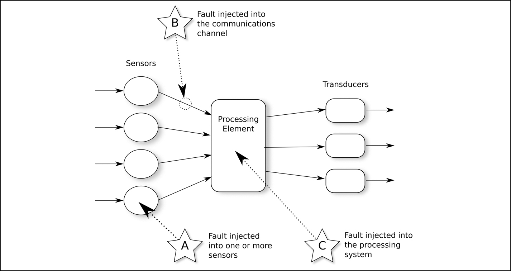
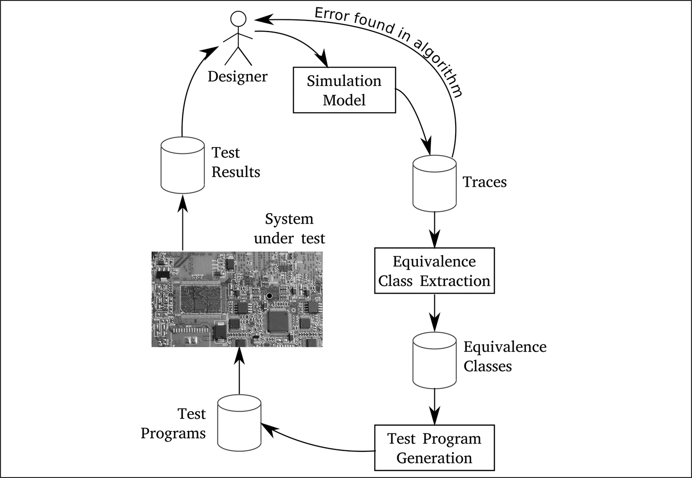
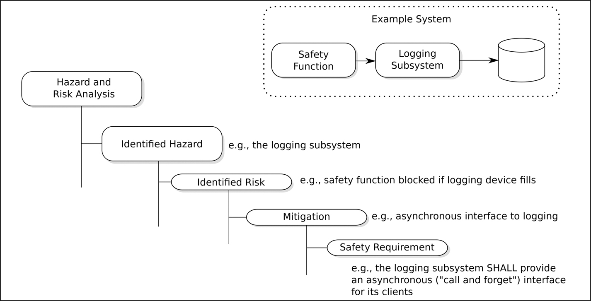

# 22 Kiểm thử tích hợp và kiểm thử hệ thống

DOI: [10.1201/9781003598145-22](https://doi.org/10.1201/9781003598145-22)

> *Ngày nay, một kỹ thuật thông thường là viết một chương trình rồi kiểm thử nó. Nhưng: kiểm thử chương trình có thể là một cách rất hiệu quả để chứng tỏ sự hiện diện của bug, nhưng hoàn toàn không đủ để chứng tỏ sự vắng mặt của chúng.*
>
> Edsger W. Dijkstra

Chương này thảo luận một số trong rất nhiều kỹ thuật được khuyến nghị trong EN 50716, ISO 26262 và IEC 61508 để dùng trong integration testing. Tôi đã chọn mô tả những kỹ thuật mà tôi thấy ít được áp dụng hơn:

*Fault injection testing.*

Xem [Mục 22.1](#sec22_1).

*So sánh Back-to-back giữa một mô hình và code.*

Xem [Mục 22.2](#sec22_2). Vấn đề tạo ra một test oracle tốt cũng được thảo luận trong mục đó.

*Combinatorial Testing*

Hầu hết các chương trình, đặc biệt là những chương trình được điều khiển bởi dữ liệu cấu hình, mang tính tổ hợp cao: thực ra có nhiều chương trình khác nhau và việc kiểm thử vét cạn từng chương trình là không thể. [Mục 22.3](#sec22_3) mô tả một cách chọn test case để cho combinatorial coverage tốt.

*Probabilistic testing.*

Kỹ thuật này được tham chiếu trong IEC 61508-7, nhưng theo nghĩa rất chung. [Mục 22.5](#sec22_5) mô tả một probabilistic test tập trung vào việc tìm fault trong, và cung cấp một tuyên bố thống kê về tính đúng đắn cho, các hệ thống multi-threaded.

*Kiểm thử Requirements-based.*

Xem [Mục 22.6](#sec22_6). Phần này được đưa vào, không phải vì tính bất thường của nó, mà vì những câu hỏi gắn với các yêu cầu trong một hệ thống safety-critical.

*Anomaly detection trong integration testing.*

Anomaly detection được thảo luận chi tiết trong bối cảnh một hệ thống runtime ở [Mục 11.3](ch11_error_detection_and_handling.vi.md#sec11_3). [Mục 22.7](#sec22_7) áp dụng anomaly detection cho kết quả của system testing.

## 22.1 Fault injection testing

### 22.1.1 Vì sao phải tiêm fault?

Để biết sự phân biệt giữa một fault, một error và một failure, xem trang 17. Mục này đề cập đến việc cố ý đưa *fault* hoặc, thông thường hơn, *error* vào một hệ thống. Đây là điều làm nhiều lập trình viên khó chịu: *“Tôi cẩn thận tạo ra thiết kế/code của mình tốt nhất có thể. Tại sao tôi lại cố ý đưa fault vào nó?”*

Vì sao người ta lại tiêm fault là câu hỏi chính, và câu trả lời chính phải là để có thể kiểm tra phản ứng của hệ thống trước các sự kiện bất ngờ. Nếu một cảm biến hỏng và bắt đầu tạo ra dữ liệu ngẫu nhiên, hệ thống có phát hiện điều này, báo cáo và nếu không thì bỏ qua những dữ liệu đó, và xử lý tình huống đúng cách không? Những error như vậy khó kiểm thử, nhưng là then chốt cho việc hệ thống tiếp tục hoạt động an toàn.

Chuyến bay Qantas Flight 72 từ Singapore đến Perth vào ngày 7 tháng Mười năm 2008 đột ngột chúi xuống, ghi nhận gia tốc $- 0 , 8$ g, trước khi các phi công kịp giành lại quyền điều khiển. 12 hành khách và phi hành đoàn bị thương nặng. Báo cáo cuối cùng về sự cố (tài liệu tham khảo [[1](#refbib22_1)]) ghi lại:

> *… máy bay có ba ADIRU [Air Data Inertial Reference Unit] để cung cấp sự dự phòng và khả năng chịu lỗi. Việc dùng trung vị của ba giá trị cho một tham số làm input hệ thống là một thuật toán phổ biến và nhìn chung robust, và EFCS [Electronic Flight Control System] của A330/A340 đã dùng cách tiếp cận này cho hầu hết các tham số. Tuy nhiên, để giải quyết các vấn đề khí động học gắn với vị trí của ba cảm biến AOA [Angle of Attack], FCPC [Flight Control Primary Computer] dựa input hệ thống trên giá trị trung bình của AOA 1 và AOA 2.* …
>
> *Thuật toán nhìn chung rất hiệu quả, và có thể xử lý gần như mọi tình huống khả dĩ liên quan đến dữ liệu AOA sai do một ADIRU cung cấp.* …
>
> *Tuy nhiên, thuật toán AOA không thể quản lý hiệu quả một kịch bản có nhiều đỉnh nhọn sao cho một đỉnh kích hoạt một khoảng thời gian ghi nhớ và một đỉnh khác xuất hiện 1,2 giây sau đó. Vấn đề là, nếu một khoảng thời gian ghi nhớ 1,2-second được kích hoạt, các FCPC chấp nhận các giá trị tiếp theo của AOA 1 và AOA 2 sau khi kết thúc khoảng thời gian ghi nhớ là hợp lệ. Nói cách khác, thuật toán đã không xử lý hiệu quả việc chuyển từ cuối khoảng thời gian ghi nhớ trở lại chế độ hoạt động bình thường khi có một đỉnh dữ liệu thứ hai.* (Section 5.2.1 của tài liệu tham khảo [[1](#refbib22_1)])

Tóm lại, các ADIRU nhân ba đã đưa ra thông tin mâu thuẫn. Hệ thống xử lý chính đã được lập trình để xử lý điều này nói chung, nhưng tổ hợp điều kiện cụ thể xảy ra trong lần này đã không được lường trước. Với fault injection testing, cố ý tạo ra các giá trị ngẫu nhiên, sai từ các ADIRU, vấn đề này đã có thể được tìm ra trước khi triển khai thay vì trong khi bay.

Thật trớ trêu là thuật toán đã được thay đổi do một sự cố khác:

> *Thuật toán FCPC của A330/A340 để xử lý dữ liệu AOA đã được thiết kế lại sau khi phát hiện một vấn đề với thuật toán ban đầu trong quá trình bay thử được thực hiện trước khi loại máy bay được chứng nhận. Việc thiết kế lại đã vô tình đưa vào hạn chế thiết kế trong thuật toán ….*

Tài liệu tham khảo [[1](#refbib22_1)] tiếp tục chỉ ra các hạn chế trong cả phân tích failure mode and effects (FMEA) lẫn phân tích fault tree (FTA) đã được thực hiện (xem [Mục 7.4](ch07_foundational_analyses.vi.md#sec7_4)).

Fault injection cũng cung cấp một mức độ tin tưởng vào chất lượng của integration testing. Nếu fault được tiêm vào và không bị kiểm thử phát hiện, có thể các test chưa thỏa đáng.

Fault injection testing cũng đã được đề xuất để ước lượng số Heisenbug còn lại trong hệ thống, mặc dù tôi không bị thuyết phục bởi lập luận này, vốn như sau. Nếu bạn muốn biết số cá trong một cái ao lớn, một kỹ thuật khả dĩ là bắt ngẫu nhiên, chẳng hạn, 20 con cá, đánh dấu chúng theo cách nào đó rồi thả chúng lại. Sau khi để cá được đánh dấu hòa lẫn với những người bạn không được đánh dấu, bắt ngẫu nhiên thêm 30 con. Nếu thấy 9 con trong số này được đánh dấu, thì chúng ta có thể ước lượng có khoảng $N = \frac{30 \times 20}{9} ≈ 67$ con cá trong ao.

Tương tự, nếu chúng ta tiêm *B* bug vào hệ thống, đặc biệt là loại mà source code được thay đổi theo cách thực tế, và integration testing tìm ra *T* bug, trong đó *M* bug là những bug chúng ta đã tiêm vào, thì số bug còn lại có thể được ước lượng vào khoảng $\frac{T \times B}{M}$. Dĩ nhiên, điều này dựa vào việc các bug được tiêm vào là đại diện cho các bug vốn đã có trong code. Đây là một kỹ thuật được khuyến nghị trong các tiêu chuẩn để đo hiệu quả của kiểm thử phần mềm. Nó được gọi là “error seeding” trong các tiêu chuẩn.

Tóm lại, việc tiêm fault hoặc error vào một hệ thống cho phép chúng ta chạy qua code phát hiện và xử lý bất thường, vốn rất khó kiểm thử nếu không làm vậy; nó cho phép chúng ta đánh giá chất lượng của việc kiểm thử và nó cho chúng ta một ước lượng thô về số Heisenbug còn lại trong hệ thống.

### 22.1.2 Fault được tiêm vào đâu?

Hầu hết các hệ thống nhúng có một cấu trúc chung (xem [Hình 22.1](#fig22_1)). Phần tử xử lý đọc input từ một hoặc nhiều cảm biến, bản thân chúng có thể thông minh, thực hiện một dạng tính toán nào đó, và kích hoạt một số bộ chuyển đổi output (đèn, phanh, màn hình hiển thị, v.v.).

*Hình 22.1: Các điểm tiêm fault.[⏎](#b22fig22_1)*

Nếu một cảm biến hoạt động sai và bắt đầu truyền dữ liệu sai, gây hiểu lầm hoặc sai cú pháp tới phần tử xử lý, như đã xảy ra trên chuyến bay Qantas Flight 72, thì điều này phải được phát hiện và xử lý. Nhìn chung, rất khó lường trước chính xác những loại dữ liệu sai nào có thể nhận được, và vì vậy cũng khó tạo ra test case cho phần tử xử lý. Việc hệ thống phát hiện và xử lý dữ liệu sai có thể được kiểm tra bằng cách tiêm fault vào code cảm biến (điểm A trong [Hình 22.1](#fig22_1)).

Điểm tiêm B cũng tương tự — nếu dữ liệu do cảm biến gửi bị hỏng, bị nhân bản, bị re-ordered hoặc bị mất, liệu phần tử xử lý có phát hiện và xử lý điều này không?

Điểm C tinh tế hơn. Các fault được tiêm vào chính phần tử xử lý được thiết kế để gây ra các loại error sẽ phát sinh từ Heisenbug và qua đó kiểm thử khả năng phục hồi của hệ thống: các error phát sinh từ Heisenbug có được phát hiện và xử lý trước khi chúng gây ra failure không?

### 22.1.3 Loại fault nào được tiêm vào?

Khó khăn chính gắn với việc tiêm fault phần mềm là tạo ra các fault nhân tạo có cùng đặc tính với các fault (chưa biết) vốn đã có trong thiết kế hoặc code. Ngược lại, tiêm fault phần cứng tương đối đơn giản — các đường bus hoặc đường địa chỉ khác nhau được kéo xuống thấp hoặc lên cao, hoặc các linh kiện bị short-circuited vào những khoảng thời gian ngẫu nhiên, và hành vi của hệ thống được ghi nhận.

Các fault phần mềm được tiêm vào thường thuộc một hoặc nhiều loại sau.

*Thay đổi ngẫu nhiên source code của một chương trình trước khi nó được biên dịch.*

Ví dụ, điều này có thể biến z = y + x thành z = y - x để biểu diễn loại lỗi mà một lập trình viên con người có thể đã mắc phải.

*Thay đổi ngẫu nhiên object code của một chương trình đã biên dịch.*

Tài liệu tham khảo [[2](#refbib22_2)] của Henrique Madeira *et al.* mô tả một thí nghiệm để xem liệu một công cụ fault-injection software-implemented (SWIFT) có thể mô phỏng loại fault lập trình do các lập trình viên thực đưa vào hay không. Một kết luận là 44% số fault do các lập trình viên thực đưa vào chương trình không thể được mô phỏng bằng cách thao tác object code của chương trình.

*Làm hỏng dữ liệu tĩnh.*

Ví dụ, các liên kết trong một danh sách liên kết có thể bị làm hỏng, qua đó mô phỏng một race hazard[1](#fn22_1) trong code cập nhật danh sách.

*Làm hỏng, nhân bản hoặc loại bỏ thông điệp.*

Việc này kiểm tra xem liệu trong ứng dụng có những giả định ngầm nào về việc chuyển thông điệp đáng tin cậy hay không.

*Thao túng thời gian.*

Ví dụ, bằng cách tiêu thụ nhân tạo các chu kỳ bộ xử lý và ngăn các thread khác chạy.

*Làm hỏng các vị trí memory ngẫu nhiên.*

Việc này mô phỏng một sự kiện thứ cấp từ tác động của tia vũ trụ, để kiểm tra phản ứng của hệ thống đối với các fault memory (DRAM) cứng và mềm. Phản ứng của hệ thống đối với loại fault này ngày càng trở nên quan trọng khi độ rộng đường mạch trong chip giảm và chip trở nên dễ bị ảnh hưởng hơn bởi tia vũ trụ, crosstalk, nhiễu điện từ và lão hóa nhiệt; xem tài liệu tham khảo [[3](#refbib22_3)]. Dạng làm hỏng này có thể thay đổi một bit, một byte, một word, một hàng memory hoặc một cột memory.

### 22.1.4 Fault injection và các tiêu chuẩn

IEC 61508 khuyến nghị fault injection testing (gọi là “fault insertion testing”) chỉ cho việc kiểm chứng phần cứng và để đo hiệu quả của các kiểm thử phần mềm khác, trong khi ISO 26262 khuyến nghị kỹ thuật này cho cả software unit testing (Table 7 của [phần 6](part6_implementation_verification.vi.md)) lẫn software integration testing (Table 10). Chắc chắn, đây là một kỹ thuật đã được dùng rất thành công cho việc kiểm chứng phần mềm.

ISO/PAS 8800 nói rằng fault injection testing có “khả năng áp dụng hạn chế” đối với các hệ thống machine-learning và có thể chỉ áp dụng được cho việc tiêm fault phần cứng.

EN 50716 không nhắc tường minh đến fault injection.

### 22.1.5 ADC, BCI và fault injection

Hai công ty tưởng tượng của chúng ta (xem [Chương 4](ch04_representative_companies.vi.md)) có lẽ sẽ thực hiện phần lớn fault injection testing của mình theo những cách khác nhau.

Đối với Alpha Device Corporation (ADC), công ty sản xuất các thiết bị hoàn chỉnh, các điểm chèn A và B trong [Hình 22.1](#fig22_1) có khả năng hữu ích nhất — hệ thống xử lý input bị hỏng, bị thiếu, bị nhân bản hoặc gây hiểu lầm từ các cảm biến của nó tốt đến mức nào?

Đối với hệ điều hành của Beta Component Incorporated (BCI), điểm chèn C có khả năng hữu ích nhất — sự hỏng các cấu trúc dữ liệu nội bộ của hệ điều hành (dù do lỗi phần cứng hay phần mềm gây ra) được phát hiện và xử lý nhanh đến mức nào?

[1](#fn22_122b)Một Heisenbug, trong đó định thời rất cụ thể của hai hoặc nhiều thread thỉnh thoảng gây ra một error.

## 22.2 So sánh Back-to-Back giữa mô hình và code

### 22.2.1 Các tiêu chuẩn

Một mô hình của hệ thống, có thể ở dạng một discrete event simulation ([Mục 17.2](ch17_semi_formal_verification.vi.md#sec17_2)) hoặc một formal model ([Mục 18.6](ch18_formal_verification.vi.md#sec18_6)) có thể là một nguồn test case tuyệt vời. Kỹ thuật thực hiện so sánh back-to-back giữa mô hình và phần hiện thực được khuyến nghị trong Table 7 và 10 của ISO 26262-6 và trong Table B.2 của IEC 61508-3, nơi nó được gọi là *“Test case execution from model-based test case generation.”*

Table A.1 của IEC TS 61508-3-2 xem xét việc sinh test case từ các định nghĩa formal của các yêu cầu an toàn, architecture/thiết kế và Executable Source-Code Level (ESCL). Đặc tả đó cũng nói rằng *“Kiểm thử không phải là một phương pháp có thể cung cấp bảo đảm tại một điểm assurance — theo một câu trích well-known từ năm 1969, nó có thể ‘chứng tỏ sự hiện diện của bug, nhưng không chứng tỏ được sự vắng mặt của chúng.’ ”*

ISO 29119 cũng thảo luận, với sự tán thành, việc sinh test case model-based trong section 4.4.2 của [phần 1](part1_background.vi.md).

### 22.2.2 Ví dụ Back-to-Back

Làm ví dụ, hãy xét công ty tưởng tượng BCI (xem [Chương 4](ch04_representative_companies.vi.md)), công ty đang dự định chứng nhận hệ điều hành của mình. Một thuật toán hệ điều hành bề ngoài đơn giản, nhưng có rất nhiều chỗ tinh tế, là thuật toán được dùng để tránh priority inversion. Thuật toán này có thể làm ví dụ về cách một mô hình có thể được dùng để rút ra test case cho một phần hiện thực thực tế.

Vấn đề priority inversion liên quan đến việc nhiều thread có mức ưu tiên khác nhau cần truy cập cùng một tài nguyên, chẳng hạn một mutex. Giả sử có ba thread: *T*1, *T*2 và *T*3 với mức ưu tiên lần lượt là 10, 20 và 30 (con số càng cao, mức ưu tiên càng lớn). Chuỗi hành động sau trên một bộ xử lý single-core dẫn đến tình huống *T*3 sẵn sàng chạy, nhưng bị chặn vô thời hạn bởi *T*2 có mức ưu tiên thấp hơn:

1. Không có thread nào trong ${T}_{1} , {T}_{2}$ hay *T*3 đang chạy.
2. *T*1 trở nên sẵn sàng chạy và chiếm mutex.
3. *T*3 trở nên sẵn sàng chạy, nhưng không thể lấy được mutex đang bị *T*1 giữ và vì vậy bị tạm dừng. Đây là hành vi dự định: *T*1 đã được viết sao cho nó chỉ giữ mutex trong vài micro giây.
4. *T*2 trở nên sẵn sàng và, vì nó có mức ưu tiên cao hơn *T*1, nó pre-empts thread đó. Thread có mức ưu tiên cao nhất $( {T}_{3} )$ giờ bị chặn, chờ *T*1 kết thúc. Nhưng *T*1 có thể không bao giờ kết thúc vì nó đã bị *T*2 pre-empted.

Chính một bug priority inversion thuộc loại này đã xảy ra với sứ mệnh Mars Pathfinder vào ngày 4 tháng Bảy năm 1997, khi một task truyền thông medium-priority, long-running đã pre-empted một task thu thập dữ liệu thời tiết low-priority đang giữ một mutex mà task bus thông tin ưu tiên cao cần.[2](#fn22_2)

Một cơ chế để tránh priority inversion được gọi là priority inheritance. Với kỹ thuật này, mức ưu tiên của task đang giữ mutex được nâng nhân tạo lên mức cao nhất giữa mức ưu tiên tự nhiên của nó và mức ưu tiên của bất kỳ task nào đang chờ mutex. Trong ví dụ trên, *T*1 lẽ ra sẽ được nâng lên mức ưu tiên của *T*3 ở bước 3. Điều này có nghĩa là nó sẽ tiếp tục chạy, ngay cả sau khi *T*2 trở nên sẵn sàng, và việc *T*3 bị một task ưu tiên thấp hơn treo lại sẽ không xảy ra.

Protocol priority inheritance có vẻ đơn giản, nhưng như nhiều nhà thiết kế đã phát hiện, nó có nhiều chỗ tinh tế, đặc biệt khi mức ưu tiên được hạ xuống sau khi giải phóng mutex và khi một task giữ nhiều mutex.

[Hình 22.2](#fig22_2) minh họa một cách dùng discrete event simulation (xem [Mục 17.2](ch17_semi_formal_verification.vi.md#sec17_2)) để kiểm tra thuật toán được đề xuất, và cũng để tạo ra test case để kiểm tra phần hiện thực, một kỹ thuật tôi đã dùng thành công nhiều lần:

[2](#fn22_222b)Xem, ví dụ, [http://research.microsoft.com/en-us/um/people/mbj/Mars_Pathfinder/Mars_Pathfinder.html](http://research.microsoft.com/en-us/um/people/mbj/Mars_Pathfinder/Mars_Pathfinder.html).

1. *Viết một discrete event simulation* để mô phỏng thuật toán được đề xuất trong một chuỗi dài các điều kiện được sinh ngẫu nhiên với số lượng lớn thread và mutex. Kiểm tra rằng priority inversion không xảy ra; nếu có xảy ra thì hoặc thuật toán chưa được mô phỏng đúng, hoặc bản thân thuật toán sai và phải được sửa. Lưu ý rằng không thể dùng công cụ mô phỏng SimPy cho việc này vì nó không cho phép priority inheritance!

   Mỗi lần mô phỏng tạo ra một file trace liệt kê các sự kiện và thay đổi trạng thái đã xảy ra. Các bước sau dựa vào việc phân tích (tự động) những trace đó.

2. *Phân tích các file trace để nhận diện các lớp tương đương.* Trong trường hợp ví dụ priority inversion, việc này đặc biệt dễ: liệt kê các tổ hợp trạng thái mà mỗi thread và mutex được mô phỏng có thể ở trong đó (ví dụ, thread có thể đang ngủ, bị chặn chờ CPU, bị chặn chờ mutex bởi một thread ưu tiên thấp hơn, …) và dùng mỗi trạng thái phân biệt làm một lớp tương đương.

3. *Sinh test case (chương trình) từ mỗi lớp tương đương.* Trong trường hợp thuật toán priority inheritance, nếu trace mô phỏng nói rằng thread 6 cố chiếm mutex 4 tại thời điểm $T = 15 \; 342$ rồi thôi chờ tại thời điểm $T = 15 \; 368$, thì hành vi tương đương có thể được đưa vào chương trình được sinh ra — nó cố chiếm mutex tại thời điểm $T = 15 \; 342$ với timeout $15 \; 368 - 15 \; 342 = 26$ đơn vị thời gian. Có thể cần thay đổi đơn vị thời gian theo một hệ số, chẳng hạn từ micro giây trong mô phỏng sang mili giây trong test case.

4. *Biên dịch và thực thi các chương trình test được sinh ra.* Đây là các test case. Chúng đã được tạo ra từ một mô hình được tin là biểu diễn một thuật toán đúng, và chúng sẽ bao phủ thỏa đáng phần hiện thực của thuật toán.

5. *Xem xét kết quả test.* Nếu chúng không như mong đợi, thì hoặc test case sai — trong trường hợp đó mô hình sai và phải được cập nhật và vòng lặp được lặp lại — hoặc phần hiện thực sai — trong trường hợp đó mô hình đã làm đúng nhiệm vụ của nó bằng cách tìm ra một bug trong code được hiện thực.

*Hình 22.2: Sinh test từ một mô hình.[⏎](#b22fig22_2)*

Đây chỉ là một ví dụ về việc thực hiện test back-to-back giữa một mô hình và code. Hầu như bất kỳ mô hình (semi-)formal nào cũng có thể được dùng để sinh ra test case tốt.

### 22.2.3 Kiểm thử Back-to-Back có được sử dụng không?

Tài liệu tham khảo [[4](#refbib22_4)] của Robert Binder *et al.* có kết quả của một khảo sát được thực hiện từ mid-June đến đầu tháng Tám năm 2014 để xem liệu kiểm thử back-to-back (được gọi là kiểm thử model-based theo thuật ngữ IEC 61508:2010 trong bài báo) có được dùng trong công nghiệp hay không và, nếu có, liệu các công ty dùng nó có thấy nó hiệu quả không. Đáng tiếc là, mẫu khá nhỏ (100 phản hồi, 86% trong số đó đến từ công nghiệp, trái với giới học thuật và chính phủ, và 40% đến từ phát triển phần mềm nhúng) và self-selected, vì lời mời tham gia được lan truyền trên mạng xã hội như LinkedIn.

Cùng với việc thu thập nhiều dữ liệu thống kê khác nhau, nghiên cứu đã đặt những câu hỏi thẳng thắn về chất lượng kiểm thử, thời gian cần để học các kỹ thuật cần thiết, kiểm thử model-based được dùng trong những giai đoạn kiểm thử nào, v.v. Câu trả lời cho những câu hỏi này được tóm tắt trong tài liệu tham khảo [[4](#refbib22_4)] và nhiều chi tiết hơn được đưa ra trên website đi kèm. Các kết luận chính như sau:

- Hơn 60% người trả lời nói rằng kỳ vọng (cao) của họ về việc làm cho thiết kế test hiệu quả hơn đã được đáp ứng một phần hoặc hoàn toàn.
- 60% người trả lời nói rằng kiểm thử model-based hiệu quả hơn (test tốt hơn) so với bất kỳ kỹ thuật nào họ đã dùng trước đó.
- Kiểm thử Model-based chủ yếu được dùng trong system test, nhưng cũng được áp dụng trong module test, integration test và acceptance test.
- Đại đa số người trả lời nói rằng họ dự định tiếp tục dùng kiểm thử model-based.

### 22.2.4 Mô hình như một test oracle

Có một vấn đề đáng kể gắn với việc sinh test case tự động: vấn đề của cái so-called “test oracle”. Oracle biết phản ứng dự định của hệ thống đang kiểm thử đối với một điều kiện input cụ thể là gì. Tương đối dễ dùng một bộ sinh test case, như KLEE ([Mục 21.4.3](ch21_static_analysis.vi.md#sec21_4_3)), để phân tích code và tạo ra test case cho code coverage và branch coverage tốt. Nhưng nếu không truy cập được đặc tả về những gì chương trình được dự định làm, các công cụ này không thể xác định kết quả của việc chạy test case nên là gì. Với một hàm căn bậc hai, KLEE sẽ tạo ra test case để cung cấp mức code coverage cao, nhưng nó sẽ không chỉ định rằng câu trả lời cho `sqrt(9.0)` là khoảng 3. Lập trình viên con người phải làm nhiệm vụ chẳng ai thèm muốn là xem xét từng test case được sinh tự động và quyết định hệ thống đang kiểm thử nên trả về câu trả lời gì.

Một ưu điểm to lớn của việc thực hiện kiểm chứng back-to-back với một mô hình là bản thân mô hình đóng vai trò test oracle!

Trong ví dụ kiểm thử priority inversion được đưa ra ở mục trước, trace mô phỏng cung cấp đường đi chính xác qua không gian trạng thái mà hệ thống nên đi theo. Điều này trải dài từ “ở cuối test, thread 1 nên đang giữ mutex 4 và 6 với mức ưu tiên 23; thread 2 nên đang giữ mutex 5 và chờ mutex 4 với mức ưu tiên 15; ….” đến một trace đầy đủ của mọi sự kiện trong quá trình test.

Trong trường hợp này, không cần một oracle con người — mô hình biết về những gì nên xảy ra nhiều hơn bất kỳ con người nào.

## 22.3 Combinatorial testing

Mục này đề cập đến câu hỏi, *“Nếu một chương trình nhận nhiều tham số, thì cần những tổ hợp tham số nào để kiểm thử nó thỏa đáng?”*

Công ty hư cấu của chúng ta, Beta Component Incorporated (BCI), như được mô tả trong [Chương 4](ch04_representative_companies.vi.md), sản xuất một hệ điều hành: một chương trình có thể nhận một số tham số command-line khác nhau. Các ví dụ có thể bao gồm:[3](#fn22_3)

[3](#fn22_322b)Chi tiết của các tham số này không quan trọng, tôi đã bịa ra chúng để tạo ra một bài toán tổ hợp.

- Đặt chu kỳ timer interrupt (4 giá trị: $500 \; μ s$, 1ms, 2ms hoặc 10ms).
- Bật kernel pre-emption (Yes/No).
- Chọn file system cần dùng (4 tùy chọn).
- Phát hiện memory alignment fault (Yes/No).
- Dùng software floating point emulation (Yes/No).
- Ngăn bộ xử lý thực sự dừng khi chạy idle thread, để cho phép thoát khỏi trạng thái idle nhanh hơn (Yes/No).
- Tự động chống phân mảnh memory (Yes/No).
- Không khóa, có khóa, hoặc superlock các trang memory (3 giá trị).
- Bật address-space randomization để tăng bảo mật (Yes/No).
- Đặt mức chi tiết debug (5 giá trị).
- Bật tương thích ngược với hệ điều hành trước đó của BCI (Yes/No).

Tổng cộng, có $4 \times 2 \times 4 \times 2 \times 2 \times 2 \times 2 \times 3 \times 2 \times 5 \times 2 = 30 \; 720$ cách khác nhau để cấu hình thành phần này; thực chất có 30 720 phiên bản khác nhau của hệ điều hành. Trong thực tế, phép tính này có thể phức tạp hơn vì một số tổ hợp nhất định có thể không được phép; ví dụ, mức chi tiết 3 có thể chỉ áp dụng được nếu floating point emulation cũng được chọn.

Để kiểm thử thành phần này một cách kỹ lưỡng, BCI cần chạy một bộ regression test trên cả 30 720 tổ hợp tham số input. Một regression test của một hệ điều hành thường mất hàng giờ hoặc thậm chí hàng ngày. Nếu bộ regression của BCI mất 24 giờ để thực thi, mức kiểm thử này sẽ mất khoảng 84 năm để hoàn tất. Dĩ nhiên, trong thực tế, nhiều test sẽ được thực thi song song trên các phần cứng khác nhau, nhưng ngay cả khi có 20 hệ thống như vậy, thời gian kiểm thử vẫn sẽ là hơn 4 năm.

Combinatorial testing, như được mô tả trong rất nhiều bài báo và cuốn sách [[5](#refbib22_5)] của D. Richard Kuhn, Raghu Kacker và Yu Lei, dựa trên một nhận xét quan trọng: khi một chương trình có nhiều tham số, thì các tổ hợp vét cạn của một vài tham số trong số đó có xu hướng phát hiện ra gần như mọi vấn đề. Đây là một nhận xét thực nghiệm chứ không phải lý thuyết và được tài liệu tham khảo [[5](#refbib22_5)] ủng hộ bằng việc so sánh các bug được phát hiện bởi kiểm thử vét cạn và combinatorial testing trên một số chương trình khác nhau.

Hệ điều hành của BCI như được liệt kê ở trên có 11 tham số, và vì vậy một test vét cạn đòi hỏi phải kiểm thử mọi tổ hợp khả dĩ của mọi giá trị khả dĩ của cả 11 tham số. Chúng ta biết rằng điều này sẽ cần 30 720 test.

Chúng ta có thể hỏi sẽ cần bao nhiêu test case để kiểm thử mọi tổ hợp khả dĩ của mọi giá trị khả dĩ của $t \le 11$ tham số (ví dụ, với $t = 3$, sẽ cần bao nhiêu test để bao phủ mọi tổ hợp của mọi bộ 3 tham số?). Đáng tiếc là, không có câu trả lời đã biết cho câu hỏi này, nhưng số test case được biết là có bậc

$$\begin{array}{l} {ν}^{t} \mathrm{log} ( N ) \end{array} \tag{22.1}$$

trong đó *ν* là số biến khả dĩ mà một tham số có thể nhận (trong ví dụ của chúng ta, con số này bị giới hạn bởi mức chi tiết debug là 5), *t* là “độ mạnh” (strength) của việc kiểm thử (mọi tổ hợp của *t* tham số), và *N* là tổng số tham số (11 trong ví dụ).

Mặc dù không có lời giải closed-form cho việc cần bao nhiêu test case, có những nguồn giúp chọn test case và ước lượng sẽ cần bao nhiêu. Cụ thể,

[http://www.public.asu.edu/~ccolbou/src/tabby/catable.html](http://www.public.asu.edu/~ccolbou/src/tabby/catable.html)

cung cấp một danh sách các giá trị tốt nhất cho số test case được biết đến nay. Trong ví dụ của chúng ta, ngay cả khi giả định rằng mọi tham số có thể nhận 5 giá trị, chúng ta đi tới số test case tối đa được liệt kê trong [Bảng 22.1](#tbl22_1).

*Bảng 22.1 Cận trên của số test case $( ν = 5 , N = 11 ) .$[⏎](#b22tbl22_1)*

| Độ mạnh *t* | Cận trên của số test case |
|---|---|
| 2 | 37 |
| 3 | 225 |
| 4 | 1 225 |
| 5 | 5 625 |

[Bảng 22.1](#tbl22_1) có thể được đọc như sau: nếu mỗi tham số trong 11 tham số cấu hình hệ điều hành có 5 giá trị khả dĩ (tổng cộng 48 828 125 test khả dĩ, nếu hệ thống được kiểm thử vét cạn), thì cần 1 225 test case hoặc ít hơn để kiểm thử mọi tổ hợp khả dĩ của mọi bộ 4 tham số trong số đó.

Đây vẫn là những con số test lớn, nhưng chúng lớn hơn nhiều so với những gì thực sự cần, vì hầu hết các tham số của chúng ta là Boolean và vì vậy chỉ nhận 2 giá trị. Tuy nhiên, nếu chúng ta có 20 hệ thống test trong phòng thí nghiệm, ngay cả việc có 1 225 test case cũng giảm thời gian kiểm thử từ bốn năm xuống hai tháng — qua đó chuyển vào phạm vi khả thi.

Có một số công cụ để tìm ước lượng tốt hơn về số test cần thiết và liệt kê các giá trị tham số được dùng cho những test đó. Một công cụ như vậy là ACTS, có thể tải về từ website của NIST tại [http://csrc.nist.gov/groups/SNS/acts/index.html](http://csrc.nist.gov/groups/SNS/acts/index.html).

ACTS không tuyên bố tìm ra số test case nhỏ nhất có thể (con số này chưa biết), nhưng trong thực tế, nó tìm ra các test case hợp lý ít nhất cung cấp được coverage đã chỉ định.

[Bảng 22.2](#tbl22_2) liệt kê số test case tối thiểu do ACTS tìm ra cho các giá trị thực của các tham số command-line của BCI. 1 923 test case cần thiết để bao gồm mọi tổ hợp của mọi giá trị của mọi bộ 6 tham số trong 11 tham số là quá nhiều để đưa vào đây (công cụ ACTS miễn phí — hãy tải về và tự lấy kết quả!), nhưng để tiện, tôi đã đưa hai mươi test case $t = 2$ vào [Bảng 22.3](#tbl22_3); tôi đã viết tắt tiêu đề cột để bảng vừa trang, nhưng chúng khớp với danh sách ở trang 298.

*Bảng 22.2 Số test case thực tế.[⏎](#b22tbl22_2)*

| Độ mạnh $( t )$ | Số test case |
|---|---|
| 2 | 20 |
| 3 | 82 |
| 4 | 260 |
| 5 | 693 |
| 6 | 1 923 |

*Bảng 22.3 Các test case độ mạnh $t = 2$.[⏎](#b22tbl22_3)*

| Test | Tmr | P/E | FS | Aln | SWfpt | Hlt | Defrg | Lck | Rnd | Vrb | B |
|---|---|---|---|---|---|---|---|---|---|---|---|
| 1 | 500 | F | 2 | F | F | F | F | 2 | F | 1 | F |
| 2 | 1ms | T | 3 | T | T | T | T | 3 | T | 1 | T |
| 3 | 2ms | F | 4 | T | F | T | F | 1 | T | 1 | F |
| 4 | 10ms | T | 1 | F | T | F | T | 2 | F | 1 | T |
| 5 | 500 | T | 3 | F | F | T | T | 1 | F | 2 | F |
| 6 | 1ms | F | 4 | T | T | F | F | 2 | T | 2 | T |
| 7 | 2ms | F | 1 | F | F | F | T | 3 | F | 2 | F |
| 8 | 10ms | T | 2 | T | T | T | F | 1 | T | 2 | T |
| 9 | 500 | T | 4 | F | T | F | T | 3 | T | 3 | F |
| 10 | 1ms | F | 1 | T | F | T | F | 1 | F | 3 | T |
| 11 | 2ms | T | 2 | F | T | T | T | 2 | F | 3 | T |
| 12 | 10ms | F | 3 | T | F | F | F | 3 | F | 3 | F |
| 13 | 500 | T | 1 | T | T | F | T | 1 | T | 4 | T |
| 14 | 1ms | F | 2 | F | F | T | F | 3 | F | 4 | F |
| 15 | 2ms | F | 3 | T | F | T | F | 2 | F | 4 | T |
| 16 | 10ms | T | 4 | F | F | F | F | 3 | F | 4 | T |
| 17 | 500 | T | 1 | T | T | F | T | 3 | T | 5 | T |
| 18 | 1ms | F | 2 | F | F | T | F | 1 | F | 5 | F |
| 19 | 2ms | F | 3 | T | T | T | T | 2 | T | 5 | T |
| 20 | 10ms | T | 4 | T | F | T | F | 2 | F | 5 | T |

Với $t = 2$ (tức là mọi tổ hợp khả dĩ của mọi *cặp* tham số), phải có ít nhất $5 \times 4 = 20$ test case và, trong [Bảng 22.3](#tbl22_3), ACTS đã tìm ra một tập đúng 20 test case. Ví dụ, với hai tham số chu kỳ timer và việc dùng floating point emulation:

|  |  |
|---|---|
| test case 1: $500 \; μ$ s với False | test case 9: $500 \; μ$ s với True |
| test case 2: 1ms với True | test case 10: 1ms với False |
| test case 3: 2ms với False | test case 11: 2ms với True |
| test case 4: 10ms với True | test case 12: 10ms với False |

vì vậy mọi tổ hợp của hai tham số đó đều được kiểm thử. Điều này đúng với mọi cặp tham số khác.

Với $t = 3$, phải có ít nhất $5 \times 4 \times 4 = 80$ test case. [Bảng 22.2](#tbl22_2) cho thấy ACTS đã không tìm ra một tập như vậy — nhưng nó đã đến gần với một tập 82 test case.

Trong thực tế, hiếm khi cần đặt $t > 4$, và với $t = 4$, 260 test case, dùng thời gian test ở trên, sẽ mất vài tuần để thực thi. Điều này tốt hơn đáng kể so với bốn năm được ước lượng trước đó.

Bằng việc thực thi 260 điều kiện test do ACTS tìm ra thay vì 30 720 điều kiện test cần cho coverage vét cạn, BCI sẽ cần biện minh cho sự cắt giảm đó. Lập luận có thể dựa trên thực tế là một bộ test đầy đủ là không thực tế, nhưng tập con điều kiện test đã được chọn một cách khoa học để cung cấp coverage tốt. Tập con này tốt hơn bất kỳ tập con nào được chọn ngẫu nhiên. Các kết quả trong tài liệu tham khảo [[5](#refbib22_5)] và các bài báo sau đó có thể được dùng để ủng hộ lập luận này.

Việc kiểm thử số lượng lớn các tổ hợp không chỉ là vấn đề của BCI. Alpha Device Corporation sản xuất các thiết bị, tích hợp hệ điều hành của BCI, được lắp vào ô tô. Giả sử các thiết bị này có thể được lắp vào bất kỳ loại nào trong tám loại ô tô, có thể có tùy chọn memory lớn hoặc nhỏ, có thể được gia cường hoặc không, có thể làm việc với bất kỳ loại nào trong sáu loại màn hình, và có thể chạy trên bất kỳ loại nào trong bốn chip xử lý. Điều đó có nghĩa là ADC có $8 \times 2 \times 2 \times 6 \times 4 = 768$ phiên bản khác nhau của mỗi thiết bị cần kiểm thử. Một lần nữa, combinatorial testing có thể là một công cụ hữu ích: với $t = 2$, ACTS tìm ra một tập 48 test case và, với $t = 3$, nó tìm ra một tập 192 test case. Lợi ích không lớn như với ví dụ của BCI, nhưng có lẽ vẫn đáng có.

Cách tiếp cận chọn test case này đặt ra câu hỏi, *“Vì sao nó hiệu quả?”* Trong bài báo [[6](#refbib22_6)] của tôi, tôi suy đoán rằng nó hiệu quả vì các lập trình viên con người thường không viết các câu lệnh điều kiện (if, while, for) với số lượng lớn điều kiện con. Việc xem xét source code của một hệ điều hành thương mại hiện đại cho thấy 99% câu lệnh điều kiện có 4 điều kiện con trở xuống và 66% chỉ có một điều kiện duy nhất. Câu hỏi là liệu điều này có tiếp tục đúng khi source code được máy tính viết (ví dụ, từ mô hình) thay vì con người hay không.

## 22.4 Stress testing và impulse testing

Stress testing nhìn chung đòi hỏi đặt một tải lớn lên hệ thống đang kiểm thử trong một khoảng thời gian dài. Cá nhân tôi thấy rằng một trong những stress test hiệu quả nhất là để hệ thống hoàn toàn không có tải: tôi thường thấy rằng các hệ thống để chạy qua đêm mà không được cung cấp input nào bị crash trước khi trời sáng. Nhưng tôi chấp nhận rằng đây là một dạng stress testing cực đoan.

Impulse testing xảy ra khi một tải lớn đột ngột được đặt lên hệ thống đang kiểm thử, thường trong một khoảng thời gian ngắn.

Cả hai loại test này đều rất hữu ích trong việc gây ra failure của hệ thống.

## 22.5 Probabilistic testing

IEC 61508-7 mô tả mục đích của “probabilistic testing” là *“Để có được một con số định lượng về các thuộc tính độ tin cậy của phần mềm được khảo sát.”*

Có nhiều dạng kiểm thử như vậy, nhưng dạng được mô tả trong tài liệu tham khảo [[7](#refbib22_7)] của Sebastian Burckhardt *et al.* đặc biệt hữu ích để phát hiện race condition trong các ứng dụng multi-threaded: các Heisenbug. Bằng cách điều khiển nhân tạo bộ lập lịch thread, xác suất một test đơn lẻ được sinh ra theo thuật toán trong bài báo phát hiện được một Heisenbug trong một lần thực thi là

$$\begin{array}{l} \frac{1}{n {k}^{d - 1}} \end{array} \tag{22.2}$$

trong đó:

- *n* là số thread.
- *k* là số “bước” (instruction) trong mỗi thread.
- *d* là “độ sâu” của bug. Đây là thước đo số ràng buộc lập lịch cần thiết để bug (fault) biểu hiện ra.

Lập luận là, đối với nhiều hệ thống, *d* nhỏ ($d = 1$ hoặc 2 đối với các lỗi lập trình phổ biến nhất). Tuy nhiên, chương trình two-threaded trong [Hình 7.4](ch07_foundational_analyses.vi.md#fig7_4) ở trang 79 có $d = 96$: chuỗi sự kiện chính xác phải xảy ra để failure xảy ra rất cụ thể và rất khó xảy ra trong vận hành thực tế (nhưng có thể xảy ra bất cứ lúc nào!). Thật ấn tượng là các formal method được mô tả ở trang 234 và 244 mỗi phương pháp đều tìm ra bug trong [Hình 7.4](ch07_foundational_analyses.vi.md#fig7_4) trong chưa đầy một giây trên laptop của tôi trong khi thực chất không có lượng kiểm thử nào sẽ tìm ra được nó. Ngay cả với ba thread, khi *d* lớn hơn nhiều, TLA+ chỉ mất 20 giây trên laptop của tôi để tìm ra bug.

Tài liệu tham khảo [[7](#refbib22_7)] báo cáo kết quả của việc áp dụng kỹ thuật probabilistic testing cho tám chương trình multi-threaded real-world. Thực tế hơn, các chương trình này có $d ∈ \{ 1 , 2 \}$ thay vì 96 và kết quả cho thấy kỹ thuật này tìm Heisenbug tốt hơn stress testing đơn giản, ngay cả đối với các chương trình có $d = 1$.

Với các giá trị thực tế $d = 2 , n = 4 , k = 1 \; 000$, phương trình 22.2 cho ra $0 , 000 \; 25$, là xác suất một test đơn lẻ được xây dựng theo tài liệu tham khảo [[7](#refbib22_7)] tìm ra một bug. Vì vậy, nếu test đó được thực thi 1 000 lần, xác suất tìm ra một bug sẽ là 22%: cao hơn nhiều so với stress testing.

## 22.6 Kiểm thử Requirements-Based

Cho đến gần đây, kiểm thử requirements-based là cách thông thường để tiến hành một test — liệt kê các yêu cầu mà module, thành phần hoặc hệ thống phải thỏa mãn rồi chuẩn bị và thực thi các test case để chứng tỏ rằng nó thỏa mãn những yêu cầu đó. Đây là một kỹ thuật được khuyến nghị trong ISO 26262.

Điều thú vị là EN 50176 và IEC 61508 không nhắc đến kiểm thử requirements-based trong danh sách các kỹ thuật phân tích động và kiểm thử của chúng.

### 22.6.1 Các yêu cầu an toàn là gì?

Có một số vấn đề với cách tiếp cận kiểm thử requirements-based. Một vấn đề được minh họa trong [Hình 22.3](#fig22_3), hình mở rộng một phần của [Hình 7.1](ch07_foundational_analyses.vi.md#fig7_1) ở trang 72.

*Hình 22.3: Nguồn gốc của các yêu cầu an toàn.[⏎](#b22fig22_3)*

Các yêu cầu an toàn được rút ra từ các mitigation rủi ro. Ví dụ, giả sử một thiết bị cung cấp một safety function phải ghi log các hoạt động của nó. Log là quan trọng, vì nó cung cấp thông tin chẩn đoán nếu một failure xảy ra, nhưng nó không phải là một phần của một thành phần functional safety của hệ thống.

Trong trường hợp này, subsystem ghi log sẽ được nhận diện là một hazard, và một rủi ro gắn với nó có thể là nếu thiết bị ghi log (ví dụ, đĩa hoặc nonvolatile memory) đầy, chức năng ghi log sẽ ngừng chấp nhận thông tin và safety function sẽ ngừng hoạt động trong khi chờ ghi một thông điệp. Một mitigation có thể là giao diện với chức năng ghi log phải bất đồng bộ (“gọi rồi quên”) để safety function sẽ không bị treo ngay cả khi subsystem ghi log ngừng chấp nhận input.

Điều này sẽ dẫn đến một số yêu cầu an toàn, bao gồm yêu cầu trong [Hình 22.3](#fig22_3): *Giao diện với subsystem ghi log MUST là bất đồng bộ.*

Khi đó câu hỏi đặt ra là nhóm kiểm chứng nên kiểm tra gì một khi thiết bị đang trải qua integration testing hoặc system testing. Nếu áp dụng kiểm thử requirements-based, thì câu trả lời rõ ràng — mỗi yêu cầu an toàn được kiểm chứng, bằng kiểm tra hoặc bằng kiểm thử. Trong trường hợp ví dụ ghi log, nhóm kiểm chứng kiểm tra rằng hệ thống ghi log cung cấp một giao diện bất đồng bộ, có lẽ bằng cách kiểm tra thiết kế hoặc code.

Tuy nhiên, sẽ hữu ích hơn nhiều nếu nhóm kiểm chứng nhìn xa hơn về phía sau trong chuỗi ở [Hình 22.3](#fig22_3) và xem yêu cầu an toàn đó đang giảm thiểu rủi ro nào. Trong trường hợp này, nó được đưa vào để ngăn safety function bị khóa bởi một subsystem ghi log bị tắc nghẽn. Khi đó có thể rút ra các test để thiết lập điều kiện đó và kiểm tra điều gì xảy ra. Điều này không chỉ xác nhận rằng hệ thống vẫn an toàn, mà còn ngầm kiểm tra rằng các mitigation là thỏa đáng và đã được hiện thực đúng.

### 22.6.2 Chúng ta có biết tất cả các yêu cầu không?

Một vấn đề khác là các hệ thống chúng ta đang xây dựng đang trở nên phức tạp đến mức việc nhận diện các yêu cầu, ngay cả các yêu cầu an toàn, đang trở nên bất khả thi. Điều này đặc biệt đúng với các accidental system. Với ví dụ về accidental system ở trang 20, có thể lập luận rằng không có tập yêu cầu nào cho radar của con tàu sẽ dẫn đến các test trong điều kiện tín hiệu GPS bị gây nhiễu — phần lớn vì hệ thống đã tiến hóa một cách ngẫu nhiên, và không ai nhận ra rằng nó dựa vào GPS. Bằng cách giới hạn kiểm thử vào việc kiểm chứng các yêu cầu, một rủi ro to lớn đã không bị phát hiện.

### 22.6.3 Yếu tố con người

Một yếu tố khác dẫn đến sự không thỏa đáng của các yêu cầu là việc đưa người dùng con người vào hệ thống. Cho đến vài năm trước, người dùng được coi là một nguồn gây failure hệ thống, chứ không phải là một phần không thể tách rời của bản thân hệ thống. Với người dùng ở bên ngoài, việc định nghĩa các yêu cầu cho hệ thống và kiểm thử theo những yêu cầu đó tương đối dễ dàng.

Gần đây hơn, những người ủng hộ như Nancy Leveson và Sidney Dekker đã định nghĩa lại người vận hành con người như một phần không thể tách rời của hệ thống. Như Dekker nói trong tài liệu tham khảo [[8](#refbib22_8)]:

> *Hệ thống về cơ bản không an toàn. Con người tạo ra sự an toàn trong khi điều hòa nhiều mục tiêu của hệ thống.*

Điều này được phản ánh trong ISO 21448 (Safety of the Intended Functionality), tiêu chuẩn đề cập tường minh đến việc con người sử dụng sai một hệ thống và tạo ra một tình huống không an toàn do phán đoán sai, hiểu sai hành vi của hệ thống hoặc thậm chí cố ý vi phạm.

Một khi chúng ta chấp nhận rằng các hệ thống safety-critical của mình có khả năng, ít nhất một phần, là accidental và rằng những con người không thể dự đoán là một phần của chúng, thì việc định nghĩa các yêu cầu của một hệ thống ngày càng trở nên khó khăn, và vì vậy việc thực hiện kiểm thử requirements-based cũng ngày càng khó khăn.

### 22.6.4 ISO 29119 và kiểm thử Requirements-Based

Phiên bản đầu tiên của ISO 29119 (“Software Testing”) đã thừa nhận vấn đề của kiểm thử requirements-based:

> *Tính thực tế của việc dùng kiểm thử requirements-based highly-dependent vào bối cảnh. … Ngay cả khi các yêu cầu được well-specified, vẫn có nguy cơ các ràng buộc về ngân sách và thời gian có thể có nghĩa là không thể kiểm thử mọi yêu cầu. Khi các yêu cầu được bổ sung thông tin về mức ưu tiên tương đối của chúng, thì điều này có thể được dùng như một phương tiện để ưu tiên hóa việc kiểm thử (trong trường hợp đó có thể dùng một cách tiếp cận risk-based để ưu tiên các yêu cầu có mức ưu tiên cao hơn).*

Hàm ý là, trong thực tế, kiểm thử requirements-based thường trở thành kiểm thử risk-based. Điều thú vị là đoạn văn này đã biến mất trong phiên bản 2022 của ISO 29119.

## 22.7 Anomaly detection trong system testing

System testing tạo ra một lượng dữ liệu khổng lồ, đặc biệt nếu các trace sự kiện được thu thập trong quá trình kiểm thử. Mehdi Zeinali *et al.* của University of Waterloo, Ontario, đã nghiên cứu các phương pháp và công cụ để thực hiện anomaly detection, đặc biệt trong regression[4](#fn22_4) testing — xem tài liệu tham khảo [[9](#refbib22_9)].

Ý tưởng là phân tích dữ liệu trace do hệ thống tạo ra trong khi đang được kiểm thử để xây dựng các mô hình về hành vi “bình thường” của nó. Những mô hình này sau đó có thể được so sánh với hành vi hệ thống được ghi lại trong các test tiếp theo. Ví dụ, nếu tìm thấy một mẫu hình trong dữ liệu trace của 30 test liên tiếp trong vài tuần cho thấy thông điệp *X* luôn được gửi trong vòng 10 mili giây kể từ khi tác nhân kích thích *Y* đến, và mẫu hình này thay đổi trong lần thực thi test thứ 31, thì có thể cần điều tra. Dĩ nhiên, sự thay đổi hành vi này có thể là do những thay đổi được thực hiện trong cấu trúc phần mềm; tuy nhiên, nó cũng có thể chỉ ra rằng đã xảy ra một thay đổi vô tình và sai làm thay đổi hành vi hệ thống.

Kỹ thuật này dựa trên ý tưởng rằng hầu hết các hệ thống nhúng có hành vi lặp lại đặc thù và vì vậy tập các hành vi “bình thường” tự nhiên bị giới hạn ở một kích thước có thể xử lý được.

Các mô hình hành vi được phát hiện sau đó cũng có thể được các runtime monitor online sử dụng — xem tài liệu tham khảo [[10](#refbib22_10)] của Samaneh Navabpour *et al.*

Trong trường hợp hai công ty ví dụ được giới thiệu trong [Chương 4](ch04_representative_companies.vi.md), sẽ thuận tiện nếu Beta Component Incorporated cung cấp cho khách hàng của mình, ADC, một chữ ký (signature) về hành vi đúng của hệ điều hành khi chịu tải. Khi đó ADC có thể bảo đảm rằng không có bất thường nào xảy ra trong hành vi của hệ điều hành trong quá trình kiểm thử thiết bị hoàn chỉnh của mình.

[4](#fn22_422b)Regression testing bao gồm việc chạy lặp đi lặp lại một tập integration test đã được định nghĩa để bảo đảm rằng những thay đổi đối với code để sửa bug hoặc thêm tính năng không ảnh hưởng đến hành vi cơ bản của hệ thống.

## Tài liệu tham khảo

[1] Australian Transport Safety Bureau, “Aviation Occurrence Investigation AO-2008-070,” 2011. Available from [http://www.atsb.gov.au/publications/investigation_reports/2008/aair/ao-2008-070.aspx](http://www.atsb.gov.au/publications/investigation_reports/2008/aair/ao-2008-070.aspx).[⏎](#b22refbib22_1)

[2] H. Madeira, D. Costa, and M. Vieira, “On the Emulation of Software Faults by Software Fault Injection,” in *In Proceedings of the* *International Conference on Dependable Systems and Networks*, pp. 417–426, IEEE Computer Society Press, 2000.[⏎](#b22refbib22_2)

[3] B. Schroeder, E. Pinheiro, and W.-D. Weber, “DRAM errors in the wild: A large-scale field study,” in *Proceedings of the* *eleventh international joint conference on measurement and modeling of computer systems*, SIGMETRICS ‘09, (New York, NY, USA), pp. 193–204, ACM, 2009.[⏎](#b22refbib22_3)

[4] R. V. Binder, B. Legeard, and A. Kramer, “Model-based Testing: Where Does It Stand?,” *Commun. ACM*, vol. 58, pp. 52–56, Jan. 2015.[⏎](#b22refbib22_4)

[5] R. Kuhn, R. N. Kacker, and Y. Lei, *Introduction to Combinatorial Testing*. London: CRC Press, 2013.[⏎](#b22refbib22_5)

[6] C. Hobbs, “Das Paradoxon dynamischer Softwaretests,” in *Proceedings of* *ESE Kongress 2014*, 2014.[⏎](#b22refbib22_6)

[7] S. Burckhardt, P. Kothari, M. Musuvathi, and S. Nagarakatte, “A randomized scheduler with probabilistic guarantees of finding bugs,” in *Proceedings of the Fifteenth International Conference on Architectural Support for Programming Languages and Operating Systems*, ASPLOS XV, (New York, NY, USA), pp. 167–178, Association for Computing Machinery, 2010.[⏎](#b22refbib22_7)

[8] S. Dekker, *The Field Guide to Understanding Human Error*. Ashgate, Aldershot, Hants., rev. ed., 2006.[⏎](#b22refbib22_8)

[9] M. M. Z. Zadeh, M. Salem, N. Kumar, G. Cutulenco, and S. Fischmeister, “SiPTA: Signal Processing for Trace-based Anomaly Detection,” in *Proc. of the Conference on Embedded Software (EMSOFT)*, Oct. 2014.[⏎](#b22refbib22_9)

[10] S. Navabpour, Y. Joshi, C. W. Wallace, S. Berkovich, R. Medhat, B. Bonakdarpour, and S. Fischmeister, “RiTHM: A Tool for Enabling Time-triggered Runtime Verification for C Programs,” in *Proc. of the ACM Symposium on the Foundations of Software Engineering (FSE)*, (St. Petersburg, Russia), 2013.[⏎](#b22refbib22_10)
