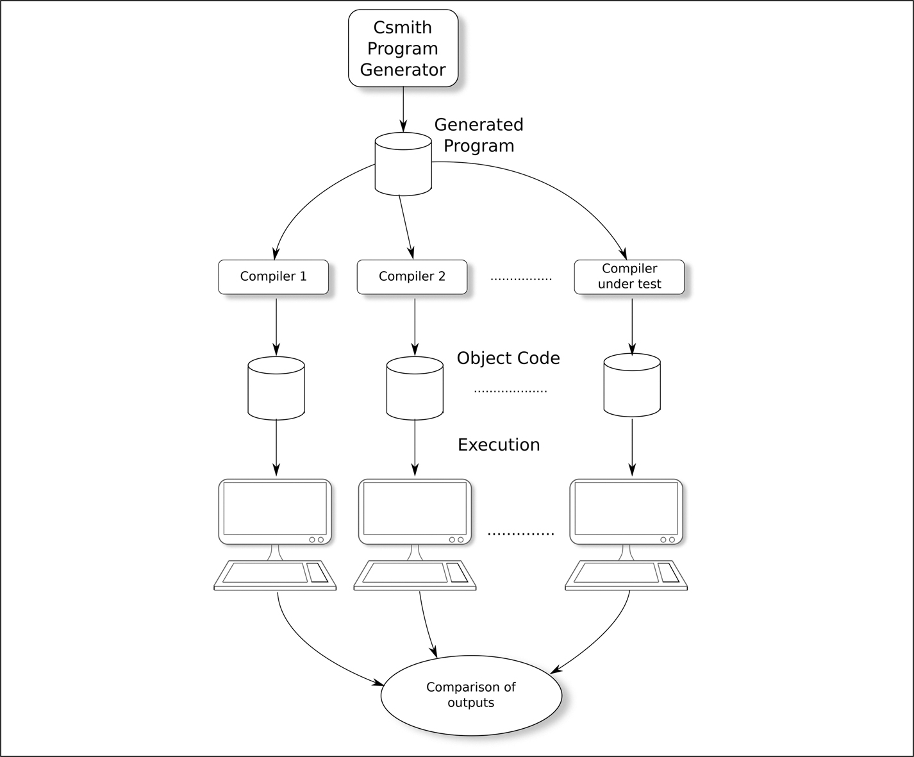
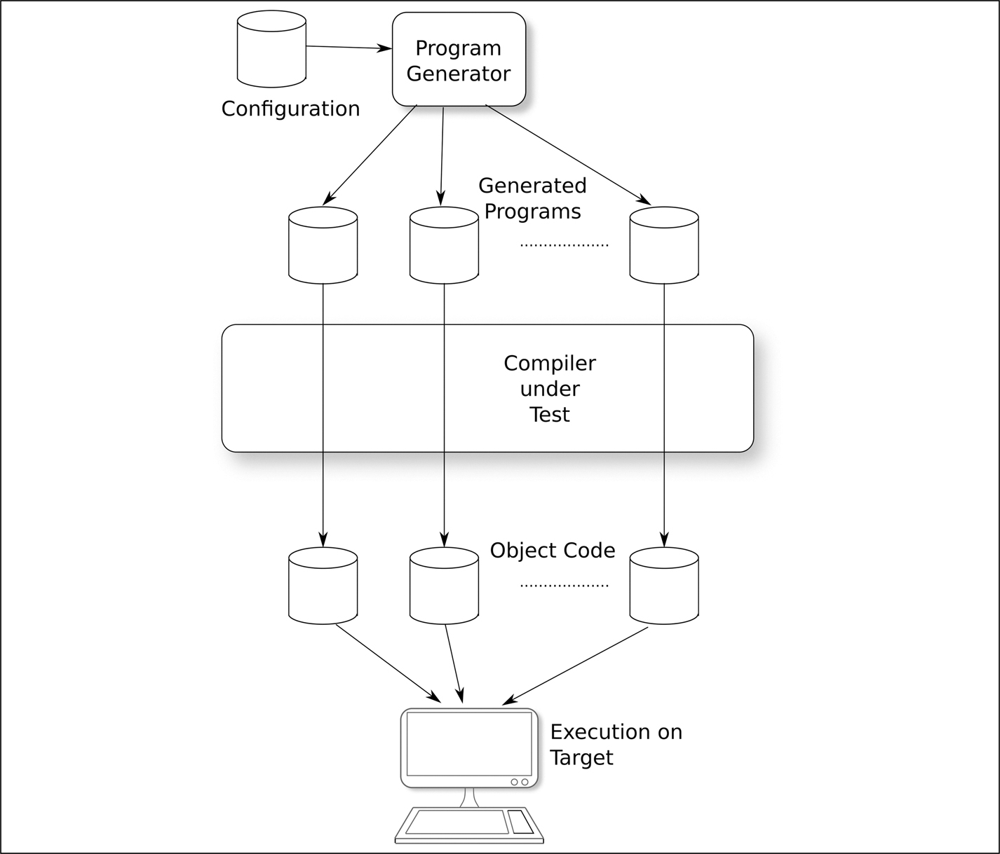
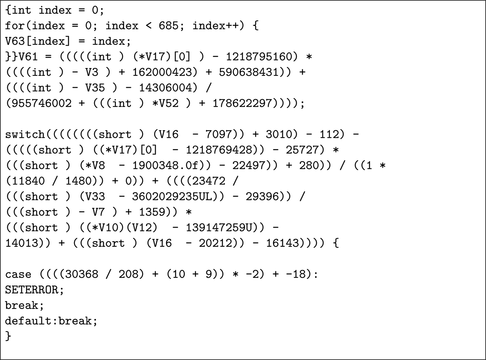
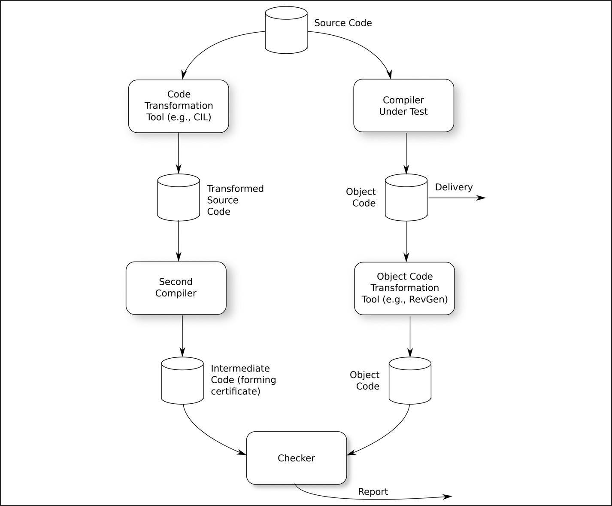
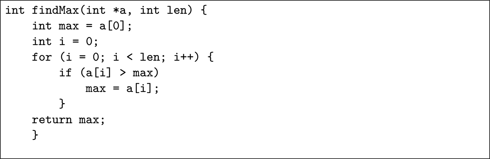

# 23 Các công cụ offline

DOI: [10.1201/9781003598145-23](https://doi.org/10.1201/9781003598145-23)

> *Hãy cho chúng tôi công cụ và chúng tôi sẽ hoàn thành công việc.*
>
> Sir Winston Churchill

Dù thiết kế tốt đến đâu và phần triển khai chính xác đến đâu, tính toàn vẹn của một hệ thống vẫn dựa vào hoạt động đúng của các công cụ được dùng để tạo ra nó. Source code hoàn hảo có thể bị phá hỏng bởi một compiler biến nó thành object code sai. Chương này đề cập đến các công cụ offline: những công cụ được dùng trong quá trình phát triển, nhưng không trở thành một phần của hệ thống được xuất xưởng.

Các tiêu chuẩn mà chúng ta đang xem xét có nhiều điều để nói về cách các công cụ chúng ta chọn để tạo ra sản phẩm cuối cùng phải được phân tích, giám sát và biện minh. Các công cụ này trải dài từ trình soạn thảo mà lập trình viên dùng, qua các công cụ dùng để quản lý source code (ví dụ, Apache Subversion hoặc Git), build hệ thống (ví dụ, GNU Make và compiler), báo cáo vấn đề (ví dụ, Bugzilla), đến công cụ cuối cùng ghi sản phẩm phần mềm vào repository mà từ đó khách hàng sẽ tải nó về. Một sự trục trặc không được nhận ra của bất kỳ công cụ nào trong số này đều có thể dẫn đến việc một sản phẩm kém chất lượng được xuất xưởng.

Đáng tiếc là, loại error này không chỉ là một khả năng lý thuyết. Trong tài liệu tham khảo [[1](#refbib23_1)], Xuejun Yang *et al.* đưa ra một nhận xét đáng buồn rằng:

> *Mọi compiler mà chúng tôi kiểm thử đều bị phát hiện là bị crash và cũng âm thầm sinh ra code sai khi được đưa input hợp lệ.*

Điều này xảy ra không chỉ với code cực kỳ phức tạp, mà còn khi áp dụng một phiên bản “well-proven” của compiler `gcc` cho một chương trình đơn giản như chương trình được thể hiện trong [Hình 23.1](#fig23_1).

*Hình 23.1: Một chương trình C bề ngoài đơn giản.[⏎](#b23fig23_1)*

## 23.1 Phân loại các công cụ offline

Việc phát hiện hành vi sai ở một số công cụ offline quan trọng hơn ở các công cụ khác. Một fault trong trình soạn thảo văn bản ghi “-” mỗi khi lập trình viên gõ “+” sẽ nghiêm trọng, nhưng có lẽ sẽ được nhận ra trước khi gây ra bất kỳ tác hại nào. Một fault khiến compiler sinh ra code output sai khi giá trị kết thúc của một vòng lặp là, chẳng hạn, 627 thì ít có khả năng bị phát hiện hơn, và có thể cực kỳ nguy hiểm đối với số ít chương trình có một vòng lặp như vậy.

ISO 26262-8, IEC 61508-3 và EN 50716 khác nhau về chi tiết, nhưng mỗi tiêu chuẩn đều bắt đầu bằng việc đặt cùng một câu hỏi: *“Nếu công cụ này tạo ra output sai, điều đó có thể có ảnh hưởng gì đến sự an toàn của hệ thống được giao?”* Về cơ bản có ba câu trả lời:

1. Nó sẽ không có ảnh hưởng gì đến phần mềm được giao.

   Ví dụ, một công cụ lập lịch dự án bị lỗi có thể có ảnh hưởng xấu đến ngày giao hệ thống, nhưng sẽ không ảnh hưởng đến phần mềm thực tế được giao.

   ISO 26262 phân loại loại công cụ này là Tool Impact 1 (TI1), EN 50716 phân loại nó là T1, và IEC 61508 phân loại nó là Tool Impact Class 1 (TIC1).

2. Nó sẽ không có ảnh hưởng trực tiếp đến phần mềm được giao, nhưng nó có thể đánh lừa các nhà phát triển khiến họ nghĩ rằng phần mềm có chất lượng cao hơn thực tế.

   Một công cụ formal method được dùng để chứng minh tính đúng đắn của một thuật toán sẽ thuộc loại này: nếu nó có khiếm khuyết, các nhà phát triển có thể nghĩ thuật toán hoàn hảo trong khi thực tế không phải vậy.

   ISO 26262 phân loại loại công cụ này là TI2, IEC 61508 phân loại nó là TIC2 và EN 50716 phân loại nó là T2.

3. Nó sẽ ảnh hưởng trực tiếp đến phần mềm được giao.

   Compiler thuộc loại này: nếu nó âm thầm sinh ra code thực thi sai, thì điều đó có thể ảnh hưởng trực tiếp đến safety function.

   ISO 26262 phân loại loại công cụ này là TI2, IEC 61508 phân loại nó là TIC3 và EN 50716 phân loại nó là T3.

EN 50176 không đặt câu hỏi thứ hai, còn ISO 26262 và IEC 61508 hơi khác nhau ở câu hỏi thứ hai mà chúng đặt ra về công cụ.

ISO 26262 hỏi khả năng một error do công cụ đưa vào sẽ được nhận ra là bao nhiêu và gán một Tool Error Detection level. Nếu *rất* có khả năng error sẽ được nhận ra, thì gán giá trị TD1; nếu việc phát hiện *khá* có khả năng, thì TD2; nếu không thì TD3.

IEC 61508 đặt một câu hỏi thứ hai tương tự, nhưng nhấn mạnh vào các quy trình được thiết lập để phát hiện output sai của công cụ. TD1 có nghĩa là các error có thể được phát hiện trực tiếp trên output của công cụ và có các quy trình được thiết lập để phát hiện chúng. TD2 có nghĩa là các error có thể được phát hiện, không phải từ output trực tiếp của công cụ, mà từ dữ liệu được rút ra từ output đó. Một lần nữa, phải có đủ quy trình được thiết lập để phát hiện error. Nếu không thì áp dụng TD3.

Một khi mỗi công cụ đã được phân loại, mỗi tiêu chuẩn định nghĩa những hành động phải được thực hiện để kiểm tra tính toàn vẹn của nó.

Đối với các công cụ được phân loại là T3, EN 50716 khuyến nghị dùng các công cụ diverse cho cùng một nhiệm vụ và:

- so sánh output của chúng, hoặc
- đưa output từ một công cụ làm input cho công cụ kia, công cụ này sẽ tái dựng lại dữ liệu ban đầu, hoặc
- công cụ thứ hai kiểm chứng output của công cụ thứ nhất.

Cách tiếp cận cuối cùng này là điều tôi khuyến nghị cho compiler trong [Mục 23.4.3](#sec23_4_3) bên dưới.

IEC 61508-3 định nghĩa một *Tool Usage for Safety* (TUS) tối thiểu cho một công cụ có các giá trị TIC và TD cụ thể, nếu nó được dùng trên một hệ thống có một SIL hoặc SC cụ thể: xem [Bảng 23.1](#tbl23_1). Ví dụ, nếu một công cụ TIC2/TD2 được dùng trên phần mềm SC 3, thì TUS phải ít nhất là TUS 2. Sau đó IEC 61508 liệt kê bằng chứng về độ tin cậy của công cụ được (rất) khuyến nghị ở mỗi TUS. Ví dụ, đối với một công cụ TUS 2, rất khuyến nghị phải có một kế hoạch sử dụng công cụ, công cụ phải được ghi lại thành tài liệu, người dùng công cụ phải xác nhận tính phù hợp của nó cho một nhiệm vụ cụ thể, phải cung cấp đào tạo cần thiết cho người dùng công cụ, phải có bằng chứng về việc sử dụng công cụ và các bug tìm thấy trong công cụ phải được quản lý. Một công cụ TUS 5 phải được phát triển theo cùng cách như thể công cụ đó là một phần của phần mềm đang thực thi.

*Bảng 23.1 Phân loại công cụ theo IEC 61508[⏎](#b23tbl23_1)*

| TIC | SIL hoặc SC | TUS tối thiểu cho |  |  |
|---|---|---|---|---|
| TD1 | TD2 | TD3 |  |  |
| 2 | 1 | \- | 1 | 1 |
| 2 | \- | 1 | 1 |  |
| 3 | 1 | 2 | 2 |  |
| 4 | 1 | 2 | 3 |  |
| 3 | 1 | \- | 1 | 1 |
| 2 | \- | 1 | 2 |  |
| 3 | 1 | 2 | 3 |  |
| 4 | 1 | 3 | 4 |  |

## 23.2 Phân loại công cụ của BCI

Hãy xem các nhà phát triển của công ty hư cấu của chúng ta, Beta Component Incorporated (xem [Chương 4](ch04_representative_companies.vi.md)), sẽ nhận diện các công cụ được áp dụng giữa ý tưởng của các nhà thiết kế và sản phẩm xuất xưởng thế nào. Mỗi công cụ này phải được phân loại theo tiêu chuẩn mà sản phẩm sẽ được chứng nhận.

Dưới ánh sáng của câu trích từ tài liệu tham khảo [[1](#refbib23_1)] ở trên, sẽ khó lập luận rằng compiler không phải là TI2 theo ISO 26262 và TIC3 theo IEC 61508. EN 50716 nói cụ thể rằng compiler là T3.

BCI cũng dùng Apache® Subversion®, một repository open-source phổ biến, để duy trì các phiên bản source code, test case và tài liệu của mình. Khi một hệ thống được build, Subversion cung cấp các bản sao của mỗi module nguồn như chúng ở một thời điểm cụ thể. Một bug trong Subversion có thể khiến nó cung cấp sai phiên bản của một module, dẫn đến một hệ thống sai được build. Công cụ này khó phân loại hơn. Theo ISO 26262, nó phải là TI2, nhưng có khả năng error sẽ được nhận ra, đặc biệt nếu số phiên bản được kiểm tra độc lập hoặc việc dùng sai phiên bản dẫn đến lỗi biên dịch hoặc lỗi link. Vì vậy, công cụ này có thể được phân loại là TI2/TD2.

Lưu ý rằng bằng cách định nghĩa việc kiểm tra số phiên bản như một phần của quy trình build, có thể nới lỏng việc phân loại. Trong nhiều trường hợp, việc dùng định nghĩa quy trình như thế này có thể kinh tế để giảm khối lượng công việc chứng nhận công cụ.

Đáng ngạc nhiên là, theo cách phân loại của IEC 61508 và EN 50716, Subversion có thể là T1, vì nó không đóng góp trực tiếp vào code thực thi (như compiler), và cũng không thất bại trong việc phát hiện một code defect (như một tập test case chưa đầy đủ).

Dù BCI đề xuất cách phân loại nào, chúng đều phải được biện minh trong safety case.

Để xem một ví dụ khác về việc hai công ty hư cấu gán phân loại cho các công cụ, xem [Mục 18.10](ch18_formal_verification.vi.md#sec18_10).

## 23.3 Sử dụng công cụ Third-Party

Hầu hết các công cụ phát triển được brought-in từ một nhà cung cấp bên ngoài, thay vì được phát triển trong công ty sử dụng chúng.

Điều này tạo ra những vấn đề đặc biệt vì, trong nhiều trường hợp công cụ thương mại, source code là độc quyền và vì vậy không thể có được. Ngay cả khi có được, việc hiểu và kiểm chứng nó cũng là một công việc khổng lồ.

Nếu một công cụ đã được nhà cung cấp thẩm định phù hợp, thì điều này làm giảm, nhưng không loại bỏ, khối lượng công việc mà người dùng công cụ phải làm, người dùng vẫn có trách nhiệm bảo đảm rằng nó hoạt động đúng và mọi bug đều được phân tích về tác động lên dự án. Nhưng một chứng nhận từ một công ty chứng nhận có uy tín chắc chắn có ích; việc thẩm định như vậy sẽ đòi hỏi nhà cung cấp công cụ báo cáo các bug có thể ảnh hưởng đến an toàn.

Khi dùng các công cụ open-source, có lẽ gánh nặng lớn nhất là kiểm chứng chúng và giao cho một kỹ sư theo dõi các báo cáo bug, tìm kiếm những bug có thể ảnh hưởng đến việc sử dụng an toàn. Vào thời điểm viết sách, có hơn 8 000 bug đang mở được báo cáo đối với compiler C `gcc`. Kỹ sư được giao có lẽ sẽ phải kiểm tra rằng không có bug nào trong số này ảnh hưởng đến sự an toàn của sản phẩm đang được phát triển.

Ngay cả IEC 62304, vốn thường im lặng về các chủ đề kỹ thuật, cũng nói:

> *Nếu failure hoặc kết quả bất ngờ từ SOUP[1](#fn23_1) là [sic] một nguyên nhân tiềm tàng khiến software item góp phần vào một tình huống nguy hiểm, nhà sản xuất tối thiểu phải đánh giá bất kỳ danh sách bất thường nào do nhà cung cấp SOUP item công bố liên quan đến phiên bản SOUP item được dùng trong thiết bị y tế để xác định liệu có bất thường đã biết nào dẫn đến một chuỗi sự kiện có thể gây ra một tình huống nguy hiểm hay không.*

## 23.4 Kiểm chứng compiler

Trong tất cả các quy trình được dùng để tạo ra sản phẩm cuối cùng, quy trình biên dịch (pre-processor, compiler, optimizer, assembler, linker) đặt ra thách thức kiểm chứng lớn nhất. Bất kỳ compiler nào cũng là một phần mềm khổng lồ xử lý việc thao tác rất phức tạp trên một ngôn ngữ nguồn thường được định nghĩa kém: năm 2019, compiler GNU `gcc` gồm hơn 15 triệu dòng code.

Việc kiểm chứng loại công cụ này để chứng tỏ rằng nó luôn tạo ra object code đúng từ *bất kỳ* file nguồn đúng cú pháp nào, và rằng nó không bao giờ tạo ra code từ *bất kỳ* file nguồn sai cú pháp nào là một nhiệm vụ đáng sợ.

Tôi xem xét ba cách tiếp cận ở đây:

1. Phương pháp nhiều compiler được dùng trong tài liệu tham khảo [[1](#refbib23_1)].
2. Phương pháp chương trình được sinh ra như National Physical Laboratory (NPL) ở Anh sử dụng.
3. Phương pháp kiểm chứng *lần biên dịch* thay vì *compiler*, như được mô tả trong tài liệu tham khảo [[2](#refbib23_2)].

Mỗi kỹ thuật này có thể được bổ sung bằng cách lưu giữ hồ sơ tốt về các vấn đề tìm thấy trong compiler. Những vấn đề này liên quan trực tiếp đến cách sử dụng compiler cụ thể của tổ chức phát triển. Bằng chứng như vậy có thể mang lại thêm sự tin tưởng vào compiler, đặc biệt nếu nó cho thấy compiler chưa bao giờ âm thầm (tức là không có cảnh báo) sinh ra code sai.

> Giai thoại 37 *Khi tôi mới bắt đầu lập trình chuyên nghiệp vào những năm 1970, một trong những hành động đầu tiên khi thấy một chương trình không chạy là đổ lỗi cho compiler. Và thường thì compiler đúng là đã sinh ra code sai. Qua nhiều năm, compiler đã trở nên tốt hơn nhiều và một lỗi compiler trong code “non-extreme” giờ là hiếm.*

[1](#fn23_123b)Software of Unknown Provenance

### 23.4.1 Cách tiếp cận nhiều compiler

[Hình 23.2](#fig23_2) minh họa cách tiếp cận được dùng trong tài liệu tham khảo [[1](#refbib23_1)]. Các chương trình C ngẫu nhiên được sinh ra bằng công cụ Csmith[2](#fn23_2). Công cụ này sinh ra các chương trình C trong khi tránh các hành vi undefined và unspecified của ngôn ngữ C.

*Hình 23.2: Cách tiếp cận nhiều compiler.[⏎](#b23fig23_2)*

Mỗi chương trình C được sinh ra sau đó được đưa cho một số compiler C khác nhau, và code thu được được thực thi và kết quả được so sánh. Nếu mọi compiler đều đúng (hoặc sai giống hệt nhau!), thì sẽ không ghi nhận được khác biệt nào. Thực tế, như được nói trong câu trích ở trên, mọi compiler được kiểm thử (bao gồm `gcc` và `llvm`) đều bị crash với input đúng cú pháp và âm thầm sinh ra object code sai.

[2](#fn23_223b)Xem [https://github.com/csmith-project/csmith](https://github.com/csmith-project/csmith)

### 23.4.2 Cách tiếp cận của NPL

Thay vì áp dụng nhiều compiler khác nhau cho cùng một source code, NPL đã tạo ra một công cụ (được gọi là CCST) sinh ra các chương trình C steered-random với các kết quả dự kiến randomly-chosen, định trước. Các chương trình này được biên dịch, dùng compiler đang được kiểm thử, rồi được thực thi trên phần cứng đích, xem [Hình 23.3](#fig23_3). Kết quả khi đó phải như dự kiến lúc chương trình được sinh ra.

*Hình 23.3: Cách tiếp cận của NPL.[⏎](#b23fig23_3)*

Các chương trình được sinh ra, mặc dù ngẫu nhiên, được sinh ra theo cách để thăm dò các giới hạn của đặc tả C — tràn số nguyên, promotion `char` thành số nguyên, v.v. Một mẫu nhỏ xíu của một chương trình như vậy (một câu lệnh `switch` khá phức tạp) được đưa ra trong [Hình 23.4](#fig23_4). Đó là vài dòng từ giữa một chương trình C được sinh ra dài 1 500 dòng mà, khi được tiền xử lý, biên dịch, assemble, link, nạp và thực thi, phải tạo ra một giá trị định trước. Công cụ này đặc biệt giá trị vì nó chạy qua không chỉ front-end syntax-checking của compiler, mà còn cả back-end code-generation, assembler, linker và loader.

*Hình 23.4: Một phần output từ bộ sinh chương trình của NPL[⏎](#b23fig23_4)*

### 23.4.3 Cách tiếp cận kiểm chứng lần biên dịch

Hãy tưởng tượng rằng, trong quá trình thiết kế một sản phẩm safety-critical, bạn cần biết căn bậc hai xấp xỉ của 17. Bạn dùng một máy tính bỏ túi và nó cho bạn biết rằng giá trị đó khoảng $4 , 123 \; 1$. Vì giá trị này sẽ được dùng như một phần của thiết kế một sản phẩm an toàn, bạn muốn xác nhận rằng nó đúng trước khi dùng. Bạn có hai lựa chọn: hoặc bạn có thể bình phương $4 , 123 \; 1$ (tốt nhất là trên một máy tính khác) và kiểm tra rằng nó cho một giá trị gần với 17, hoặc bạn có thể xem xét thuật toán mà máy tính bỏ túi dùng và chứng minh rằng nó sẽ *luôn luôn* cho câu trả lời đúng cho phép tính căn bậc hai. Không ai cân nhắc lựa chọn thứ hai, nhưng đây chính xác là điều chúng ta làm khi cố chứng tỏ tính đúng đắn của một compiler.

> Giai thoại 38[⏎](#b23aned38) *Khi tôi lần đầu dùng công cụ NPL CCST, nó đã tìm ra một bug trong compiler* `gcc` *mà chúng tôi đang dùng chỉ trong vòng một giờ. Chúng tôi đã sửa bug và gửi code lại cho các nhà phát triển* `gcc`. *Hầu như ai cũng thực sự hài lòng: chúng tôi có một công cụ rõ ràng là hoạt động (nó đã tìm ra một bug) và, nếu chúng tôi chạy nó một thời gian mà nó không tìm ra thêm bug nào, thì điều đó sẽ cung cấp bằng chứng rằng compiler đang hoạt động đúng.*
>
> *Tuy nhiên, bug mà công cụ NPL tìm ra là khi* `gcc` *biên dịch code phức tạp đến mức không thể nào do con người viết ra: xem đoạn trích trong [Hình 23.4](#fig23_4). Chúng tôi đã phát hiện ra rằng compiler biên dịch sai code mà con người sẽ không bao giờ viết. Thẳng thắn mà nói, ngay cả code trong [Hình 23.1](#fig23_1) cũng là code sẽ không bao giờ qua được đợt kiểm tra code của chúng tôi vì nó vi phạm MISRA-C 2012, rule 10.4.*
>
> *Đây là điều đã khiến tôi cân nhắc việc kiểm chứng lần biên dịch, thay vì kiểm chứng compiler.*

Để kiểm chứng một compiler, cần phải chứng tỏ rằng nó sinh ra code đúng từ *bất kỳ* input đúng cú pháp nào và, quan trọng hơn, rằng nó từ chối tạo ra code từ *bất kỳ* input sai cú pháp nào. Đây là một nhiệm vụ bất khả thi, và câu hỏi đặt ra là liệu việc kiểm chứng như vậy có thực sự cần thiết không. Thẳng thắn mà nói, nếu compiler sinh ra code sai cho mọi hàm có tên bắt đầu bằng chữ `x`, tôi cũng không quan tâm miễn là code của tôi không chứa hàm nào như vậy.

Như [Giai thoại 38](#aned38) kể lại, các bug mà công cụ NPL tìm thấy trong compiler `gcc` là có thật, nhưng sẽ không bao giờ gây ra error trong code human-written. Khi ngày càng nhiều code được sinh tự động từ mô hình (xem [Mục 18.6](ch18_formal_verification.vi.md#sec18_6)), nhận định này có thể cần được xem xét lại, nhưng, hiện tại, việc kiểm thử compiler đang tìm ra những bug có thật nhưng không liên quan.

Biết rằng chúng ta chỉ quan tâm đến những bug compiler ảnh hưởng đến code của mình, có thể thay việc kiểm chứng *compiler* bằng việc kiểm chứng *lần biên dịch* — việc compiler có luôn đúng hay không là không liên quan; điều quan trọng chỉ là biết liệu nó có đúng đối với lần biên dịch cụ thể *của chúng ta* hay không. Tương tự, việc máy tính bỏ túi chúng ta dùng để tìm căn bậc hai của 17 có luôn đúng hay không là không quan trọng, mà chỉ là liệu nó có đúng trong phép tính cụ thể đó hay không.

Tài liệu tham khảo [[3](#refbib23_3)] không chỉ cung cấp một khảo sát về các kỹ thuật kiểm chứng compiler, mà còn một cách tiếp cận để chứng minh rằng một lần biên dịch cụ thể là đúng. Kỹ thuật là dùng các “certificate” do compiler đang được kiểm thử tạo ra để sinh ra một chứng minh toán học rằng lần biên dịch là đúng. Việc này cần được xử lý rất tinh tế, vì bản thân các certificate, được tạo ra bởi một compiler không đáng tin cậy, không thể được tin cậy. Tài liệu tham khảo [[4](#refbib23_4)] của Kedar Namjoshi và Lenore Zuck đưa ra một số ví dụ về cách một chương trình tổng quát (không chỉ một compiler) có thể tạo ra những certificate này để kiểm tra độc lập. Mặc dù đây gần như chắc chắn là con đường sẽ được đi theo trong tương lai, kỹ thuật này chưa hoàn toàn thực tế 100% đối với các chương trình phức tạp như một compiler C hoặc C++.

Tài liệu tham khảo [[2](#refbib23_2)] và [[5](#refbib23_5)] mà tôi viết cùng Marcus Bortel đề xuất một cách tiếp cận thay thế mà, mặc dù không cung cấp một chứng minh về tính đúng đắn của lần biên dịch, cung cấp một mức độ tin tưởng có thể được chọn sao cho phù hợp với nguồn lực sẵn có.

[Hình 23.5](#fig23_5) minh họa kỹ thuật này. Nó dùng hai compiler, như trong kỹ thuật được minh họa trong [Hình 23.2](#fig23_2), hoạt động trên các phiên bản khác nhau về cú pháp của chương trình (ví dụ, phiên bản chuẩn của chương trình và một phiên bản đã được tiền xử lý bằng một công cụ như CIL — xem tài liệu tham khảo [[6](#refbib23_6)] của George C Necula *et al.*).[3](#fn23_3)

*Hình 23.5: Một cách tiếp cận thực dụng.[⏎](#b23fig23_5)*

Output từ compiler thứ hai là nguồn của các invariant liên quan đến data- hoặc control-flow của chương trình, và output của compiler đang được kiểm thử được kiểm tra để bảo đảm tuân thủ những invariant đó. Bất kỳ việc không đáp ứng một invariant nào cũng chỉ ra rằng một trong các compiler bị lỗi, và cần kiểm tra thủ công để xác định compiler nào.

Ví dụ, với đoạn code trong [Hình 23.6](#fig23_6), symbolic execution, chẳng hạn với KLEE (xem [Mục 21.4.3](ch21_static_analysis.vi.md#sec21_4_3)), có thể rút ra hai invariant phải đúng ở cuối quá trình thực thi:

1. $∀ x \; ( 0 \le x < i ) \to a [ x ] \le m a x$

2. $i \ge l e n$

   

   

   *Hình 23.6: Một chương trình C đơn giản để tìm giá trị lớn nhất trong một mảng[⏎](#b23fig23_6)*

[3](#fn23_323b)CIL có tại [https://cil-project.github.io/cil/](https://cil-project.github.io/cil/)

Invariant thứ hai không liên quan đến một biến quan sát được, nhưng invariant thứ nhất thì có và vì vậy phải đúng trong cả hai bản object code. Điều này có thể được kiểm tra tự động, làm tăng sự tin tưởng vào lần biên dịch.

Kỹ thuật này có ưu điểm là có thể được triển khai dần dần. Có lẽ trong giai đoạn đầu chỉ so sánh các flow graph cơ bản; sau đó có thể thêm các invariant data-flow, rồi các invariant control-flow đầy đủ. Cũng có thể hữu ích nếu tạo test case từ output của compiler thứ hai (ví dụ, dùng KLEE) và dùng chúng với output của compiler đang được kiểm thử. Thực chất, các test đang được sinh ra từ thứ lẽ ra phải là code tương đương, nhưng bất kỳ khác biệt nào do compiler đưa vào đều có thể dẫn đến những test case không thể được thỏa mãn bởi output của compiler đang được kiểm thử.

Kỹ thuật này không cung cấp một *chứng minh*, mà chỉ một mức độ tin tưởng. Tôi sẽ lập luận rằng bất kỳ lượng kiểm thử compiler thực tế nào cũng chỉ cung cấp không hơn một mức độ tin tưởng.

Kiểm chứng lần biên dịch khó áp dụng ở các mức tối ưu hóa compiler cao, nơi luồng điều khiển và luồng dữ liệu có thể bị thay đổi đáng kể. Tuy nhiên, các mức tối ưu hóa compiler cao có thể không phù hợp cho một ứng dụng safety-critical: ISO 26262-8 có nêu cụ thể các cảnh báo về các compiler tối ưu hóa.

## 23.5 Việc kiểm chứng compiler của ADC và BCI

Hai công ty hư cấu của chúng ta (xem [Chương 4](ch04_representative_companies.vi.md)) có những vấn đề hơi khác nhau.

Beta Component Incorporated (BCI) đang tạo ra code hệ điều hành low-level, chủ yếu dùng ngôn ngữ C. Tài liệu tham khảo [[1](#refbib23_1)] nhắc đến loại code như vậy một cách tường minh:

> *Chúng tôi khẳng định rằng Csmith là một công cụ bug-finding hiệu quả một phần vì nó sinh ra các test khám phá những tổ hợp không điển hình của các tính năng ngôn ngữ C. Tuy nhiên, code không điển hình không phải là code không quan trọng; nó chỉ đơn giản là under-represented trong các bộ test compiler cố định. Những nhà phát triển đi ra ngoài các con đường well-tested vốn đại diện cho “vùng an toàn” của một compiler — ví dụ bằng cách viết code kernel hoặc code hệ thống nhúng, dùng các tùy chọn compiler hiếm gặp, hoặc sinh code tự động — có thể gặp bug khá thường xuyên.*

Trong trường hợp này, BCI có thể muốn dùng công cụ NPL (giờ được 61508 Association lưu trữ)[4](#fn23_4) hoặc công cụ YARPgen được mô tả bên dưới để xây dựng một mức độ tin tưởng phù hợp vào compiler của mình. Tuy nhiên, như câu trích ở trên chỉ ra, code kernel là không điển hình — ví dụ, nó chứa nhiều thao tác con trỏ hơn và nhiều phép toán bit hơn nhiều so với những gì được dự kiến trong code ứng dụng. Vì vậy, có thể cần mở rộng các ý tưởng nền tảng của công cụ NPL hoặc YARPgen để đưa vào nhiều cấu trúc như vậy hơn. Đặc biệt, tài liệu tham khảo [[7](#refbib23_7)] của Vsevolod Livinskii *et al.* nói rằng YARPgen không sinh ra các chương trình có phép toán con trỏ hoặc lời gọi hàm.

Các vấn đề của Alpha Device Corporation (ADC) còn tệ hơn. ADC đang viết code ứng dụng higher-level sẽ chạy trên hệ điều hành của BCI. Có đề xuất rằng code higher-level này được viết bằng C++.

Một compiler C cực kỳ khó kiểm chứng; một compiler C++ còn tệ hơn, vì các tính năng bổ sung của ngôn ngữ C++. Dĩ nhiên, compiler C++ ít nhất phải vượt qua mọi test của compiler C, nhưng những test này hầu như chỉ chạm tới bề mặt các tính năng của C++. Các module thư viện C++ cũng sẽ phải được kiểm chứng, bao gồm Standard Template Library (STL) nếu ADC dùng nó.

[4](#fn23_423b)[https://www.61508.org/](https://www.61508.org/).

YARPgen (Yet Another Random Program Generator) là một ứng viên để sinh các chương trình C++ cho việc kiểm tra compiler theo cùng cách mà Csmith đã được dùng ở trên. Tài liệu tham khảo [[7](#refbib23_7)] mô tả công cụ này và báo cáo về số bug compiler C++ mà nó đã phát hiện (vào thời điểm bài báo được công bố năm 2000, con số này là 83 bug `gcc` và 62 bug `llvm`). Bài báo cũng cung cấp code coverage của compiler đạt được với các chương trình YARPgen-generated: một thước đo phần compiler được chạy qua bao nhiêu.

Để xây dựng một lập luận cho safety case biện minh cho việc dùng C++, ADC có ba lựa chọn:

1. *Chứng tỏ tính đúng đắn của compiler và các thư viện.*

   Như đã mô tả ở trên, điều này có khả năng khó khăn, ngay cả khi coding standard của ADC chỉ cho phép một tập con nhỏ của C++. Tuy nhiên, có nhiều sản phẩm thương mại để kiểm tra tính đúng đắn của compiler C++, chủ yếu nhắm vào các công ty sản xuất chính compiler, để chứng tỏ rằng compiler xử lý đúng mọi khía cạnh của tiêu chuẩn C++. Lịch sử các bug được tìm thấy trong những năm trước trong compiler C++ tại ADC sẽ cung cấp thêm bằng chứng về sự robust của nó.

   Một thuộc tính hữu ích của kỹ thuật được mô tả trong tài liệu tham khảo [[5](#refbib23_5)] là nó không phụ thuộc vào ngôn ngữ nguồn — việc code được viết bằng C, C++ hay thậm chí FORTRAN là không liên quan. Đây có thể là một lựa chọn khả dĩ cho ADC, đặc biệt khi các bản phát hành sau của công cụ KLEE (xem [Mục 21.4.3](ch21_static_analysis.vi.md#sec21_4_3)) hỗ trợ C++ cũng như C.

2. *Lập luận rằng việc kiểm chứng post-compilation là đủ để phát hiện bất kỳ code sai nào do compiler sinh ra.*

   Lập luận này nói rằng compiler thực ra là một phần mở rộng của lập trình viên (con người). Lập trình viên con người có thể mắc lỗi, và mục đích của kiểm chứng (kiểm thử động, v.v.) là bắt được những lỗi này. Compiler chỉ đơn giản lấy code của lập trình viên và chuyển nó sang một ngôn ngữ khác, “nguyên cả mụn cóc.” Nếu compiler thêm vài mụn cóc nữa, thì có lẽ chúng cũng không nhiều hơn những gì lập trình viên đã mắc phải nếu code ban đầu được viết bằng assembler. Với mức kiểm chứng sẽ được thực hiện, bất kỳ error nào do compiler đưa vào đều không quan trọng.

   Đây là một lập luận thú vị được EN 50716 ủng hộ:

   > *“Việc dùng một compiler non-trusted có thể được biện minh như sau.*
   >
   > *Object code do compiler tạo ra đã được đưa qua một tổ hợp các test, kiểm tra và phân tích có khả năng bảo đảm tính đúng đắn của code đến mức phù hợp với software integrity level mục tiêu.*
   >
   > *Các kiểm tra và phân tích đã được áp dụng cho object code và được chứng tỏ là có khả năng phát hiện các loại error có thể phát sinh từ một defect trong compiler.”*

   Tuy nhiên, lập luận này phần nào bị suy yếu bởi số lượng hạn chế các trạng thái hệ thống có thể được bao phủ trong kiểm thử động. Dùng kỹ thuật kiểm thử “risk-based” được mô tả trong ISO 29119, có thể tập trung kiểm thử vào những khía cạnh của hệ thống nơi lỗi compiler có thể đã gây ra hoạt động sai. Đây có thể không phải là một lập luận dễ biện minh.

3. *Lập luận rằng architecture hệ thống được thiết kế sao cho code được sinh ra sai sẽ không ảnh hưởng đến sự an toàn của thiết bị.*

   Dùng một kỹ thuật như diverse monitor — xem [Mục 13.7](ch13_replication_and_diversification.vi.md#sec13_7) — có thể thiết kế hệ thống theo cách mà bất kỳ hoạt động có khả năng không an toàn nào của ứng dụng đã biên dịch cũng sẽ bị monitor bắt và vô hiệu hóa. Điều này có lẽ sẽ làm tăng chi phí sản phẩm của ADC, nhưng sẽ giảm chi phí chứng nhận.

Với những rào cản này, thậm chí có thể có lợi nếu ADC xem xét lại việc lựa chọn ngôn ngữ lập trình. Nếu ADC có code cũ viết bằng C++ sẽ được đưa vào thiết bị mới, có thể đáng cân nhắc khả năng cách ly nó trong giai đoạn thiết kế để nó không thể làm tổn hại code khác.

## Tài liệu tham khảo

[1] X. Yang, Y. Chen, E. Eide, and J. Regehr, “Finding and Understanding Bugs in C Compilers,” in *Proceedings of the 2011 ACM SIGPLAN Conference on Programming Language Design and Implementation*, ACM SIGPLAN, ACM, June 2011.[⏎](#b23refbib23_1)

[2] C. Hobbs, “Compiler or Compilation Validation?,” in *2014 Safety Critical Systems Symposium*, SSS ‘14, (Brighton, UK), Safety-Critical Systems Club, 2014.[⏎](#b23refbib23_2)

[3] J. O. Blech and B. Grégoire, “Certifying compilers using higher-order theorem provers as certificate checkers,” *Formal Methods in System Design*, vol. 38, no. 1, pp. 33–61, 2010.[⏎](#b23refbib23_3)

[4] K. S. Namjoshi and L. D. Zuck, “Program correctness through self-certification,” *Commun. ACM*, vol. 68, p. 74–84, Jan. 2025.[⏎](#b23refbib23_4)

[5] C. Hobbs and M. Bortel, “Compiler oder Compilierungs-Validation?,” in *Proceedings of ESE Kongress 2013*, 2013.[⏎](#b23refbib23_5)

[6] G. C. Necula, S. McPeak, S. Rahul, and W. Weimer, “CIL: Intermediate Language and Tools for Analysis and Transformation of C Programs,” in *Proceedings of Conference on Compiler Construction*, Conference on Compiler Construction, 2002.[⏎](#b23refbib23_6)

[7] V. Livinskii, D. Babokin, and J. Regehr, “Random testing for C and C++ compilers with YARPGen,” *Proc. ACM Program. Lang.*, vol. 4, Nov. 2020.[⏎](#b23refbib23_7)
