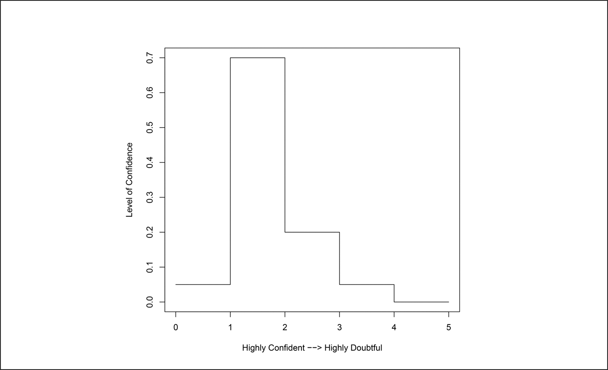
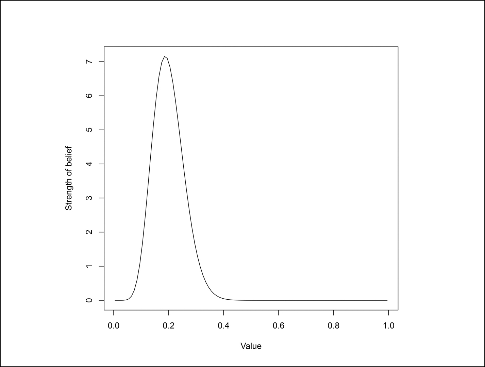
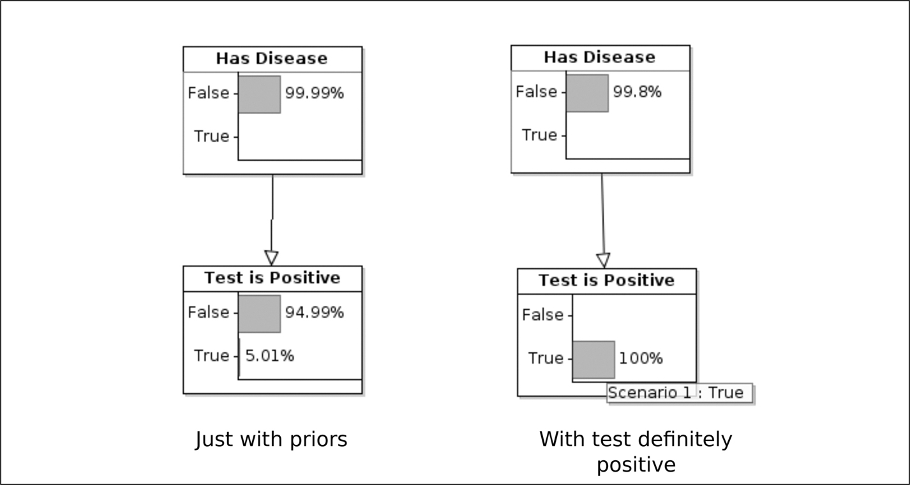
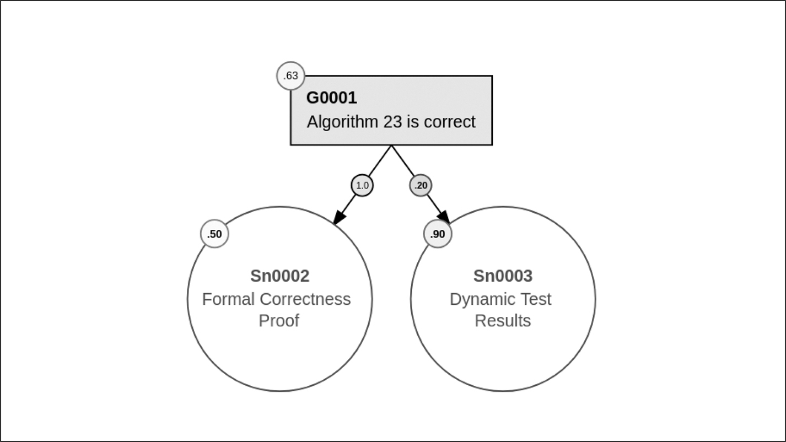
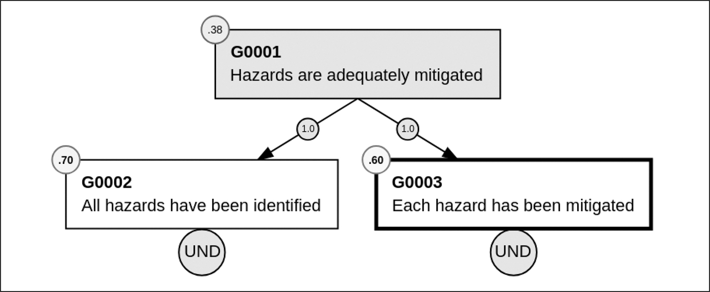

# B Bayesian Belief Network

DOI: [10.1201/9781003598145-26](https://doi.org/10.1201/9781003598145-26)

BBN được mô tả trong nhiều ấn phẩm, ví dụ, tài liệu tham khảo [[1](#refbib26_1)] của Bev Littlewood *et al.* và tài liệu tham khảo [[2](#refbib26_2)] của Norman Fenton và Martin Neil. Tài liệu sau đưa ra các ví dụ về BBN trong cả hai bối cảnh được dùng trong cuốn sách này: để biểu diễn lập luận trong một safety case ([Chương 6](ch06_the_safety_case.vi.md)) và để biểu diễn một fault tree trong một failure analysis ([Chương 15](ch15_the_fault_tree.vi.md)).

Để có một phần giới thiệu rất đơn giản về toàn bộ lĩnh vực thống kê Bayes, xem tài liệu tham khảo [[3](#refbib26_3)] của Mary Cowles.

## B.1 Trường phái tần suất và trường phái Bayes

Mặc dù không thực sự cần thiết phải hiểu sự khác biệt giữa trường phái tần suất (frequentist) và trường phái Bayes để dùng các công cụ cần thiết để xây dựng một BBN, sự hiểu biết như vậy có thể giúp bạn nắm được một số khái niệm Bayes, như xác suất tiên nghiệm.

Hãy xét câu, *“Nếu tôi tung một đồng xu cân đối, khả năng nó rơi xuống ngửa mặt là 0,5.”* Câu này khá ít gây tranh cãi, nhưng nó có nghĩa là gì? Một người theo trường phái tần suất sẽ nói rằng nó có nghĩa là, nếu bạn tung đồng xu 100 lần, sẽ thật đáng ngạc nhiên nếu số lần ngửa rất khác so với $100 \times 0 , 5 = 50$.

Có hai câu hỏi cần đặt ra về cách giải thích này. Câu thứ nhất là “rất khác” có nghĩa là gì? Nếu tôi làm thí nghiệm và được 47 lần ngửa, đó có phải là một sự ngạc nhiên không? Ngạc nhiên đến mức nào? Người theo trường phái tần suất có thể nói rằng xác suất xảy ra 47 lần ngửa là 0,067, nhưng điều đó không giúp ích gì vì đó là một định nghĩa vòng quanh: định nghĩa “xác suất” bằng “xác suất.”

Câu hỏi thứ hai khó hơn. Còn những sự kiện không thể xảy ra nhiều lần thì sao? Câu *“Có 50% khả năng ngày mai sẽ có giông bão ở Ottawa”* có nghĩa là gì? Không thể có 100 ngày mai rồi kiểm tra rằng giông bão đã xảy ra vào khoảng 50 ngày trong số đó.

Với các thiết bị nhúng, chúng ta có thể đang xử lý những xác suất failure mỗi giờ sử dụng thấp đến mức không thể thu thập đủ dữ liệu để đưa ra một lập luận theo trường phái tần suất.

Trái với cách tiếp cận tần suất, người theo trường phái Bayes nghĩ theo mức độ tin tưởng: bạn tin mạnh đến mức nào rằng ngày mai sẽ có giông bão? Dĩ nhiên, nếu bạn là một nhà khí tượng học và có dữ liệu thời tiết hôm nay, bạn có thể có một niềm tin được xác định khá rõ (ví dụ, tin 35% rằng sẽ có giông bão, tin 65% rằng sẽ không có). Nếu bạn không phải là nhà khí tượng học, thì có lẽ điều tốt nhất bạn có thể làm là chọn các giá trị “non-informative” 50%/50% hoặc giả định rằng, vào thời điểm này trong năm, giông bão xảy ra mười ngày một lần và giả định rằng xác suất là 10%/90%.

## B.2 Xác suất tiên nghiệm

Nhà khí tượng học và người non-meteorologist, khi chỉ định mức độ tin tưởng của họ vào việc ngày mai xảy ra giông bão, đang ước lượng các “prior”, tức là “trước khi xem dữ liệu.” Tương tự, một auditor giàu kinh nghiệm hoặc một nhà phát triển mới đến công ty hư cấu của chúng ta, Beta Component Incorporated (xem [Chương 4](ch04_representative_companies.vi.md)), sẽ có thể gán xác suất tiên nghiệm cho mức độ kỹ lưỡng của, chẳng hạn, việc kiểm thử fault-injection của công ty. Chúng ta có thể giả định rằng BCI là một công ty long-established đã cung cấp thành phần cho các thiết bị safety-critical trong một thời gian. Khi đó các xác suất tiên nghiệm được gán có thể là:

|  |  |
|---|---|
| Rất tin tưởng sẽ thấy việc kiểm thử fault-injection kỹ lưỡng | 5% |
| Tin tưởng sẽ thấy việc kiểm thử fault-injection kỹ lưỡng | 70% |
| Trung lập về việc thấy kiểm thử fault-injection kỹ lưỡng | 20% |
| Nghi ngờ sẽ thấy việc kiểm thử fault-injection kỹ lưỡng | 5% |
| Rất nghi ngờ sẽ thấy việc kiểm thử fault-injection kỹ lưỡng | 0% |

Những giá trị này được minh họa bằng đồ họa trong [Hình B.1](ch02_terminology_of_safety.vi.md#fig2_1). Không có hạn chế nào về cách ghi lại phán đoán tiên nghiệm của chuyên gia. Ví dụ, [Hình B.2](ch02_terminology_of_safety.vi.md#fig2_2) thể hiện một dạng liên tục của cùng niềm tin đó (thực ra là một phân phối *β* với các tham số 10 và 40). Trong trường hợp các auditor giàu kinh nghiệm, mức độ tin tưởng của họ có lẽ dựa trên việc đã kiểm tra hàng chục công ty tương tự trước đó.

*Hình B.1: Niềm tin vào việc kiểm thử fault-injection tốt.*

*Hình B.2: Niềm tin tiên nghiệm dạng liên tục.*

Tài liệu tham khảo [[4](#refbib26_4)] của Anthony O'Hagan *et al.* mô tả chi tiết cách kiến thức từ các chuyên gia có thể được ghi lại ở những dạng này và những cạm bẫy khi thu thập kiến thức đó.

Một khi các xác suất tiên nghiệm đã được gán, chúng được đưa, cùng với các quan sát thực tế, vào định lý Bayes.

## B.3 Định lý Bayes

Định lý nổi tiếng của Mục sư Thomas Bayes (tài liệu tham khảo [[5](#refbib26_5)]) thực ra được công bố vài năm sau khi ông qua đời, sau khi được Richard Price bổ sung. Định lý này đơn giản bao nhiêu thì mạnh mẽ bấy nhiêu:

$$\begin{array}{l} P ( A | B ) = \frac{P ( B | A ) \times P ( A )}{P ( B )} \; \; \; \text{if} \; \; \; P ( B ) \ne 0 \end{array} \tag{B.1}$$

$P ( A )$ có nghĩa là xác suất *A* xảy ra, và $P ( A | B )$ có nghĩa là xác suất *A* xảy ra, nếu *B* đã xảy ra.

## B.4 Một ví dụ Bayes

Một căn bệnh cụ thể ảnh hưởng đến 0,01% dân số. Có một xét nghiệm cho căn bệnh này luôn chỉ ra rằng bệnh nhân mắc bệnh, nếu cô ấy mắc bệnh (tức là, nó không có false negative). Đáng tiếc là, nó có tỷ lệ false positive 5%: 5% số lần nó chỉ ra rằng bệnh nhân mắc bệnh trong khi cô ấy không mắc.

Ethel bước vào một phòng khám một cách ngẫu hứng và làm xét nghiệm. Cô ấy có kết quả dương tính. Xác suất cô ấy mắc bệnh là bao nhiêu?

Chúng ta có thể đặt: *A* nghĩa là “Ethel mắc bệnh,” và *B* nghĩa là “Ethel có xét nghiệm dương tính.” Chúng ta muốn tính $P ( A | B )$: xác suất Ethel mắc bệnh, biết rằng cô ấy có xét nghiệm dương tính.

Trong Phương trình B.1, chúng ta cần các giá trị cho:

- $P ( B | A )$. Tức là, xác suất Ethel sẽ có xét nghiệm dương tính biết rằng cô ấy mắc bệnh. $P ( B | A ) = 1$, vì xét nghiệm không bao giờ cho false negative.

- $P ( A )$. Đây là xác suất tiên nghiệm Ethel mắc bệnh trước khi tính đến xét nghiệm. Vì 0,01% dân số mắc bệnh, $P ( A ) = 0 , 0001$.

- $P ( B )$. Đây là xác suất tiên nghiệm có xét nghiệm dương tính. Cứ 10 000 người thì có một người mắc bệnh và vì vậy chắc chắn sẽ có xét nghiệm dương tính, 9 999 người khác trong số 10 000 không mắc bệnh, và họ có 5% khả năng có kết quả dương tính. Vì vậy

  $$P ( B ) = 1 \times \frac{1}{10000} + 0 , 05 \times \frac{9999}{10000} = 0 , 050095$$

Với các giá trị này, chúng ta có thể áp dụng phương trình B.1 để tính:

$$\begin{array}{l} P ( A | B ) = \frac{P ( B | A ) \times P ( A )}{P ( B )} = \frac{1 \times 0 , 0001}{0 , 050095} = 0 , 001996 \end{array} \tag{B.2}$$

Vậy, với kết quả xét nghiệm dương tính của Ethel, chỉ có khoảng 0,2% khả năng cô ấy mắc bệnh. Kết quả này làm nhiều người ngạc nhiên (kể cả bác sĩ!), vì theo một nghĩa nào đó xét nghiệm “chính xác 95%”. Nhưng lý lẽ thì dễ thấy. Hãy xét một nhóm 10 000 người. Trung bình 1 người sẽ mắc bệnh và, trong số 9 999 người còn lại, khoảng 500 người sẽ có kết quả xét nghiệm dương tính mặc dù họ không mắc bệnh. Vậy, trong số 501 người có kết quả dương tính, chỉ 1 người (khoảng 0,2%) sẽ mắc bệnh.

Hầu như không đáng dùng công cụ cho ví dụ đơn giản này, nhưng tôi đã làm vậy, xem [Hình B.3](#figB_3). Hình vẽ bên trái của hình đó chỉ ra tình huống không có thông tin nào về kết quả xét nghiệm của Ethel, nó chỉ giả định các xác suất tiên nghiệm; hình vẽ bên phải cho các xác suất khi có kết quả xét nghiệm dương tính. Đúng như dự kiến, với xét nghiệm dương tính 100%, khả năng Ethel mắc bệnh là khoảng 0,2%. Lưu ý suy luận “ngược”: từ kết quả (một kết quả xét nghiệm dương tính) đến nguyên nhân (Ethel mắc bệnh).

*Hình B.3: Kết quả xét nghiệm của Ethel.[⏎](#bfigB_3)*

## B.5 Các mũi tên trong một BBN có nghĩa là gì?

Trong [Hình B.3](#figB_3), các mũi tên được vẽ từ ô “has disease” tới ô “test is positive”, biểu thị một quan hệ nhân quả: nếu người đó mắc bệnh, điều đó sẽ ảnh hưởng đến việc xét nghiệm có dương tính hay không. Cũng dễ dàng vẽ các mũi tên theo hướng ngược lại, trong trường hợp đó chúng có thể được hiểu là “tăng thêm sức nặng cho niềm tin rằng”: một xét nghiệm dương tính tăng thêm sức nặng cho niềm tin rằng người đó mắc bệnh.

Miễn là cách dùng nhất quán, ý nghĩa thực sự của các mũi tên không quan trọng lắm. Tài liệu tham khảo [[6](#refbib26_6)], mà Martin Lloyd và tôi đã viết, đưa ra một số ý nghĩa khả dĩ cho các mũi tên trong bối cảnh một safety case và mô tả các “idiom” Bayes khác nhau: các idiom definitional, extended evidence, process-product, measurement và induction.

## B.6 Noisy conjunction

Các noisy conjunction (Noisy-OR và Noisy-AND) mang lại sự linh hoạt đáng kể khi dùng một BBN. Câu

$$\begin{array}{l} Y = {x}_{1} \; \; \text{noisy-OR} \; \; {x}_{2} \end{array} \tag{B.3}$$

nói rằng:

- Nói chung, nếu *x*1 hoặc *x*2 đúng, thì *Y* đúng.
- Tuy nhiên, việc *x*1 hoặc *x*2 đúng không *luôn luôn* khiến *Y* đúng — có một xác suất gắn với mỗi cái.
- Ngay cả khi cả *x*1 lẫn *x*2 đều không đúng, *Y* vẫn có thể đúng do một nguyên nhân nào đó chúng ta chưa xem xét. Điều này được gọi là “leakage.”

Một cách hình thức, noisy OR được định nghĩa như sau:

$$\begin{array}{l} P ( Y = \text{true} | {x}_{1} , {x}_{2} , . . . {x}_{n} ) = 1 - ( 1 - k ) \times {\prod}_{i = 1}^{n} ( 1 - {x}_{i} {ν}_{i} ) \end{array} \tag{B.4}$$

trong đó *k* là xác suất leakage, và *νi* là xác suất *Y* đúng nếu *xi* đúng và không có ${x}_{j} , j \ne i$ nào khác đúng (tức là, đó là mức ảnh hưởng mà riêng *xi* có đối với *Y*). Định nghĩa này giả định rằng các *xi* độc lập về mặt nhân quả — tức là nếu một trong số chúng xảy ra, điều đó không làm thay đổi xác suất xảy ra của bất kỳ cái nào khác.

Noisy-OR được minh họa trong [Hình B.4](#figB_4) trong bối cảnh một tuyên bố con từ một safety case (xem [Chương 6](ch06_the_safety_case.vi.md)). Tuyên bố là một thuật toán cụ thể đúng và hai bằng chứng được trình bày để hỗ trợ tuyên bố này:

1. Một chứng minh hình thức về tính đúng đắn. Mức độ tin tưởng của nhà phân tích vào chứng minh đó khá thấp (50%), có lẽ vì nó chưa được review, nhưng, nếu nó đúng, chỉ riêng nó đã đủ để biện minh cho tuyên bố (vì vậy trọng số liên kết là 100%).
2. Một số kết quả kiểm thử động. Ở đây nhà phân tích tin tưởng hơn nhiều rằng bằng chứng là đúng (90%), nhưng, ngay cả khi các test động đều đã được thực thi đúng, thuật toán có đặc điểm sao cho kết quả test chỉ cung cấp một mức hỗ trợ thấp (20%) cho tuyên bố.

*Hình B.4: Ví dụ Noisy-OR.[⏎](#bfigB_4)*

Không thể thấy từ [Hình B.4](#figB_4), nhưng một leakage 0,1 đã được gắn với tuyên bố. Khi đó mức độ tin tưởng vào tuyên bố có thể được tính từ công thức B.4 như sau:

$$\begin{array}{lll} P ( Y | {x}_{1} , {x}_{2} ) & = & 1 - ( 1 - k ) \times {\prod}_{i = 1}^{2} ( 1 - {x}_{i} {ν}_{i} ) \\ & = & 1 - ( 1 - 0 , 1 ) \times ( 1 - 0 , 50 \times 1 , 0 ) \times ( 1 - 0 , 90 \times 0 , 2 ) \\ & = & 0 , 631 \end{array}$$

như được chỉ ra trong [Hình B.4](#figB_4). Vậy, với cấu trúc của lập luận, tôi có thể tin 63% vào niềm tin của mình rằng thuật toán đúng.

Noisy-AND có thể được định nghĩa tương tự bằng

$$\begin{array}{l} P ( Y = \text{true} | {x}_{1} , {x}_{2} , . . . {x}_{n} ) = ( 1 - k ) \times {\prod}_{i = 1}^{n} ( 1 , 0 - ( 1 - {x}_{i} ) {ν}_{i} ) \end{array} \tag{B.5}$$

Noisy-AND có thể được dùng trong một safety case như được minh họa trong [Hình B.5](#figB_5):

- Tuyên bố top-level là mọi hazard đều đã được giảm thiểu thỏa đáng.
- Tuyên bố đó dựa trên hai tuyên bố con: rằng mọi hazard đều đã được nhận diện **và** rằng mỗi hazard đều đã được giảm thiểu. Mỗi tuyên bố con này thường sẽ là một cây con trong lập luận safety case.

*Hình B.5: Ví dụ Noisy-AND.[⏎](#bfigB_5)*

Trong trường hợp này, Noisy-AND, thay vì Noisy-OR, được dùng vì các tuyên bố con G0002 **và** G0003 cần đúng để chứng thực tuyên bố top-level. Một leakage 0,1 được dùng trong [Hình B.5](#figB_5) để nói rằng G0001 có thể sai ngay cả khi cả hai tuyên bố con đều đúng.

Các ví dụ trong [Hình B.4](#figB_4) và [B.5](#figB_5) đều được lấy từ các lập luận safety case. Như [Chương 15](ch15_the_fault_tree.vi.md) mô tả, BBN cũng có thể được dùng để biểu diễn fault tree như được thể hiện trong [Hình 15.4](ch15_the_fault_tree.vi.md#fig15_4) ở trang 181, nơi failure của Subsystem 1 được biểu diễn như một noisy OR với leakage 0,1. Ngay cả khi power supply và các Subsystem 1A và 1B là false 100% (không hỏng), vẫn có 10% khả năng Subsystem 1 đã hỏng.

## Tài liệu tham khảo

[1] B. Littlewood, L. Strigini, D. Wright, and P.-J. Courtois, “Examination of Bayesian Belief Network for Safety Assessment of Nuclear Computer-based Systems,” *DeVa ESPRIT Long Term Research Project No. 20072*, vol. 70, 1998.[⏎](#brefbib26_1)

[2] N. Fenton and M. Neil, *Risk Assessment and Decision Analysis with Bayesian Networks*. CRC Press, second ed., 2018.[⏎](#brefbib26_2)

[3] M. K. Cowles, *Applied Bayesian Statistics*. New York: Springer, 2013.[⏎](#brefbib26_3)

[4] A. O'Hagan, C. E. Buck, A. Daneshkhah, J. R. Eiser, P. H. Garthwaite, D. J. Jenkinson, J. E. Oakley, and T. Rakow, *Uncertain Judgements: Eliciting Experts' Probabilities*. John Wiley & Sons, Ltd, 2006.[⏎](#brefbib26_4)

[5] T. Bayes, “An essay towards solving a problem in the doctrine of chances,” *Phil. Trans. of the Royal Soc. of London*, vol. 53, pp. 370–418, 1763.[⏎](#brefbib26_5)

[6] C. Hobbs and M. Lloyd, “The Application of Bayesian Belief Networks to Assurance Case Preparation,” in *2012 Safety Critical Systems Symposium*, SSS ‘12, (Bristol, UK), Safety-Critical Systems Club, 2012.[⏎](#brefbib26_6)
