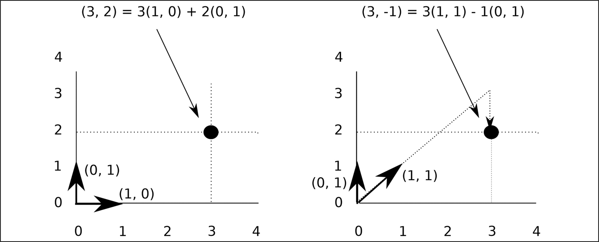
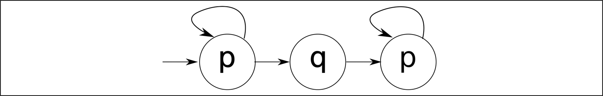

# D Các ký hiệu

DOI: [10.1201/9781003598145-28](https://doi.org/10.1201/9781003598145-28)

> *Tôi thực sự ghét tính toán. Không có sai lầm nào lớn hơn việc gọi số học là một khoa học chính xác. … Nếu bạn nhân một số với một số khác trước khi uống trà, rồi nhân lại sau đó, thì tích sẽ khác nhau. Cũng đáng chú ý là tích Post-tea có nhiều khả năng khớp với phép tính của người khác hơn là kết quả Pre-tea.*
>
> Mrs. La Touche of Harristown

Cuốn sách này dùng rất ít toán học, nhưng đây đó một số ký hiệu toán học đã lọt vào. Phụ lục này mô tả cách dùng những ký hiệu đó.

## D.1 Các ký hiệu chung

Tôi dùng các ký hiệu được liệt kê ở đây mà không giải thích trong văn bản nơi chúng xuất hiện:

| Ký hiệu | Ý nghĩa |
|---|---|
| ∀ | với mỗi |
| ∃ | tồn tại |
| ∈ | là một phần tử của |
| $R$ | tập các số thực |
| ${R}^{n}$ | tập mọi tọa độ trong không gian n-dimensional |
| $a ≫ b$ | *a* lớn hơn *b* rất nhiều |
| $\vec{x}$ | *x* là một vector (một danh sách các số thực) |

Làm ví dụ, hãy xét những điều sau:

- $∀ x ∈ R \; \; \; ∃ \; y ∈ R \; \; \; \text{with} \; \; \; y > x$

  Câu này có thể được đọc là “với mỗi x, là một số thực, tồn tại một y, cũng là một số thực, với y lớn hơn x.” Nói gọn hơn, câu này nói rằng không có số thực lớn nhất.

- $\vec{x} = ( 4 , 5 ) ∈ {R}^{2}$

  *x* là một vector two-dimensional từ gốc tọa độ tới điểm (4, 5) trong không gian two-dimensional (mặt phẳng).

## D.2 Cơ sở vector

Đại số tuyến tính chỉ được dùng ở một chỗ trong cuốn sách này: khi sinh các test case basis path trong [Mục 20.3.7](ch20_code_coverage_metrics.vi.md#sec20_3_7). Tuy nhiên, có thể sẽ thú vị khi hiểu các vector cơ sở xuất hiện thế nào — ví dụ các path A, B và C trong bảng ở trang 269.

Hãy xem [Hình D.1](#figD_1). Ở phía left-hand của hình đó, tôi đã biểu diễn điểm (3, 2) bằng tập vector cơ sở được dùng phổ biến nhất: (1, 0) và (0, 1). Bất kỳ điểm nào trong mặt phẳng two-dimensional đều có thể được biểu diễn như một tổng của hai vector này. Vì vậy, điểm (thực ra là vector) mà chúng ta thường nghĩ là (3, 2) thực ra là

$$\begin{array}{l} ( 3 , 2 ) = 3 \times ( 1 , 0 ) + 2 \times ( 0 , 1 ) \end{array} \tag{D.1}$$

*Hình D.1: Các vector cơ sở khác nhau.[⏎](#bfigD_1)*

Tức là, để tới (3, 2), chúng ta di chuyển 3 vector đơn vị sang phải rồi 2 vector đơn vị lên trên.

Tuy nhiên, (1, 0) và (0, 1), mặc dù tạo thành một cơ sở phổ biến, không phải là cơ sở duy nhất. Phía right-hand của [Hình D.1](#figD_1) thể hiện cùng điểm đó, giờ được đánh nhãn (3, $- 1$). Điều này là vì tôi đã chọn dùng hai vector (1,1) và (0, 1) làm cơ sở. Trong không gian two-dimensional, luôn cần hai vector độc lập để xác định vị trí của một điểm. Thuật ngữ “độc lập” ở đây có nghĩa là một vector không thể được biểu diễn như tổng các bội số của các vector khác. Vì vậy, ở phía right-hand của hình:

$$\begin{array}{l} ( 3 , 2 ) = 3 \times ( 1 , 1 ) - 1 \times ( 0 , 1 ) \end{array} \tag{D.2}$$

và điều này có thể thấy bằng cách hình dung vector (1, 1) được kéo dài 3 lần rồi trừ đi một vector (0, 1). Điều này minh họa rằng không có gì đặc biệt về (1, 0) và (0, 1). Toàn bộ hình học two-dimensional của chúng ta có thể được thực hiện bằng cách biểu diễn mọi điểm như một tổng các bội số của (1, 1) và (0, 1).

Vậy, trong không gian N-dimensional, có thể có tối đa N vector độc lập (tức là không thể được dựng từ các vector khác), và mọi điểm trong không gian có thể được biểu diễn bằng một tổng các bội số của những vector đó. Một tập N vector như vậy được gọi là một cơ sở cho không gian N-dimensional.

Quay lại bảng ở trang 269, các path A đến D mỗi path có vẻ là một vector trong không gian 7-dimensional. Tuy nhiên, đây không phải là một không gian 7-dimensional thực sự, vì một số điểm không thể đạt tới. Các path 0 và 2 không thể xảy ra khi path 1 xảy ra (xem [Hình 20.3](ch20_code_coverage_metrics.vi.md#fig20_3)), và vì vậy không có vector nào bắt đầu bằng (1, 1, 1 …) có thể tồn tại. Thực tế, khi rút gọn, các vector này là 3-dimensional, và các path A, B và C tạo thành một cơ sở: bất kỳ điểm có thể đạt tới nào khác trong không gian (ví dụ, path D) đều có thể được biểu diễn như một tổng các bội số của các path A, B và C: xem Phương trình 20.2.

Lưu ý rằng các path A, B và D cũng tạo thành một cơ sở cho không gian.

Tuyên bố của basis path coverage testing là bất kỳ tập vector cơ sở nào cho control flow graph của một chương trình đều biểu diễn một tập test case hữu ích.

## D.3 Pi và Ip

Việc dùng chữ pi hoa để chỉ phép nhân là well known:

$$\begin{array}{l} {\prod}_{i = 3}^{7} i = 3 \times 4 \times 5 \times 6 \times 7 = 2 \; 520 \end{array} \tag{D.3}$$

Người bạn `ip` của nó (“pi” viết ngược) ít được biết đến hơn, nhưng rất hữu ích trong lý thuyết xác suất:

$$\begin{array}{l} {∐}_{i ∈ \{ 0 , 1 , 0 , 3 , 0 , 7 \}} i = 1 - \{ ( 1 - 0 , 1 ) \times ( 1 - 0 , 3 ) \times ( 1 - 0 , 7 ) \} = 0 , 811 \end{array} \tag{D.4}$$

hoặc, tổng quát hơn,

$$\begin{array}{l} {∐}_{i = 1}^{N} {x}_{i} = 1 - \{ ( 1 - {x}_{1} ) \times ( 1 - {x}_{2} ) \times . . . \times ( 1 - {x}_{N} ) \} \end{array} \tag{D.5}$$

Ký hiệu `ip` có thể được mở rộng thành một ký hiệu infix[1](#fn4_1) cho vector. Với hai vector $\vec{x} = ( {x}_{1} , {x}_{2} , {x}_{3} , . . . {x}_{N} )$ và một vector $\vec{y}$ tương tự, thì

$$\begin{array}{l} \vec{x} ∐ \vec{y} = ( 1 - ( 1 - {x}_{1} ) ( 1 - {y}_{1} ) , 1 - ( 1 - {x}_{2} ) ( 1 - {y}_{2} ) , . . . , 1 - ( 1 - {x}_{N} ) ( 1 - {y}_{N} ) ) \end{array} \tag{D.6}$$

[1](#fn4_1b)“Infix” ở đây có nghĩa là toán tử được đặt giữa các toán hạng của nó. Vì vậy, $a + b$ thay vì $+ ( a , b )$.

## D.4 Structure function

Một hệ thống gồm *N* thành phần có thể được mô tả bằng một vector *N* phần tử, mỗi phần tử biểu diễn trạng thái (1 = đang hoạt động, 0 = đã hỏng) của một thành phần.

Hãy xét hệ thống được thể hiện ở phần trên của [Hình 13.1](ch13_replication_and_diversification.vi.md#fig13_1) ở trang 145. Hệ thống này có ba thành phần, và vì vậy hệ thống có thể được biểu diễn như một vector

$$\vec{x} = ( {x}_{A} , {x}_{B} , {x}_{C} ) ,$$

trong đó ${x}_{A} , {x}_{B}$ và *xC* biểu diễn trạng thái của các thành phần *A,B* và *C*.

Khi đó structure function, $φ ( \vec{x} )$, của hệ thống là một hàm của các *xi*:

$$\begin{array}{l} φ ( \vec{x} ) = \{ \begin{array}{ll} 0 & \text{if system has failed} \\ 1 & \text{if system is functioning} \end{array} \end{array} \tag{D.7}$$

Vì vậy, đối với ví dụ trong [Hình 13.1](ch13_replication_and_diversification.vi.md#fig13_1),

$$\begin{array}{ll} φ ( 1 , 1 , 1 ) & = 1 \\ φ ( 1 , 1 , 0 ) & = 1 \end{array} \tag{D.8}$$

$$\begin{array}{ll} φ ( 1 , 0 , 0 ) & = 0 \\ φ ( 0 , 1 , 1 ) & = 0 \end{array} \tag{D.9}$$

Ví dụ, Phương trình D.8 có nghĩa là khi các thành phần *A* và *B* đang hoạt động đúng, nhưng *C* đã hỏng, thì hệ thống đang hoạt động. Phương trình D.9 có nghĩa là khi thành phần *A* không hoạt động được và các thành phần *B* và *C* đang hoạt động đúng, thì hệ thống đã hỏng.

## D.5 Các thành phần song song và nối tiếp

Với định nghĩa $φ ( \vec{x} )$ ở trên, dễ thấy rằng đối với một tập thành phần mắc nối tiếp (như đèn cây thông Noel), nơi mọi thành phần phải hoạt động đúng để hệ thống hoạt động:

$$\begin{array}{l} φ ( \vec{x} ) = {x}_{1} \times {x}_{2} \times . . . \times {x}_{N} = {\prod}_{i = 1}^{N} {x}_{i} \end{array} \tag{D.10}$$

Đối với các thành phần mắc song song, nơi hệ thống tiếp tục hoạt động cho đến khi mọi thành phần đều hỏng:

$$\begin{array}{l} φ ( \vec{x} ) = 1 - ( 1 - {x}_{1} ) \times ( 1 - {x}_{2} ) \times . . . \times ( 1 - {x}_{N} ) = {∐}_{i = 1}^{N} {x}_{i} \end{array} \tag{D.11}$$

Ký hiệu $φ ( \vec{x} )$ có thể được mở rộng cho các cấu trúc khác rất dễ dàng. Đối với một hệ thống 2oo3 (hai trong ba), nơi bất kỳ hai trong ba thành phần nào cũng phải đang hoạt động để hệ thống hoạt động:

$$\begin{array}{l} φ ( {x}_{1} , {x}_{2} , {x}_{3} ) = {x}_{1} {x}_{2} ∐ {x}_{1} {x}_{3} ∐ {x}_{2} {x}_{3} \end{array} \tag{D.12}$$

## D.6 Temporal logic

### D.6.1 Nhu cầu về temporal logic

Có một số vấn đề với logic thông thường được Aristotle làm cho nổi tiếng. Một trong số đó đã được chính Aristotle ghi nhận. Trong tài liệu tham khảo [[1](#refbib28_1)], ông xem xét các câu, *“Ngày mai sẽ có một sea-battle,”* và câu trái ngược, *“Ngày mai sẽ không có sea-battle nào.”* Ông lưu ý rằng không câu nào trong số này hiện tại là đúng, mặc dù tất yếu hoặc ngày mai sẽ có một sea-battle hoặc không.

Vấn đề này lại được nêu ra trong các công trình của Gottlob Frege và Bertrand Russell vào đầu thế kỷ 20: logic Aristotle không thể xử lý tính đúng hay sai của những câu như, *“Vua nước Pháp hiện tại bị hói.”* Vào thời điểm viết sách, không có Vua nước Pháp nào, và vì vậy có thể nói rằng câu này sai. Nhưng, theo luật bài trung, nếu nó sai, thì câu phủ định của nó, *“Vua nước Pháp hiện tại không bị hói,”* phải đúng. Russell đã giải quyết nghịch lý này với sự chấp nhận rộng rãi, dù không phải phổ quát, trong tài liệu tham khảo [[2](#refbib28_2)].

Quan trọng hơn đối với cuốn sách này là việc logic thông thường không xử lý được các câu time-related. Vì vậy, câu *“Hôm nay là thứ Tư,”* đôi khi đúng (khoảng một phần bảy thời gian) và đôi khi sai.

Cũng có những từ time-related mà logic thông thường không xử lý được: “until”, “always”, “eventually”. Vì vậy, những gì có vẻ là các câu rất đơn giản đối với chúng ta:

- *Luôn luôn* *rốt cuộc* sẽ là thứ Tư.
- Hệ thống giữ relay mở *cho đến khi* pin xả xuống còn 20%.
- Nếu tiến trình X nhận thông điệp Y, nó sẽ *luôn luôn rốt cuộc* gửi thông điệp Z.

không thể được biểu diễn thành các câu logic.

### D.6.2 Linear temporal logic

Temporal logic thêm các toán tử mới vào logic thông thường để xử lý đúng những loại tình huống này, xem [Bảng D.1](#tblD_1). *Linear* temporal logic (LTL), đặc biệt, còn đưa vào khái niệm “next”: *χ*.

*Bảng D.1 Các toán tử của LTL[⏎](#btblD_1)*

| Toán tử | Ý nghĩa | Toán tử | Ý nghĩa |
|---|---|---|---|
| ¬ | not (phủ định) | ∧ | and (và) |
| ∨ | or (hoặc) | → | implies (kéo theo) |
| ↔ | equivalent (tương đương) | □ | always (luôn luôn) |
| ⋄ | eventually (rốt cuộc) | $⋃$ | until (cho đến khi) |
| *χ* | next (tức là, $χ A$ có nghĩa là *A* đúng ở trạng thái tiếp theo) |  |  |

Điều này có nghĩa là phải có khả năng biểu diễn các thời điểm bằng các số nguyên dương và có thể nói rằng một thời điểm ở trước hoặc sau một thời điểm khác.

Với các ký hiệu từ [Bảng D.1](#tblD_1), chúng ta có thể biểu diễn cả thuộc tính safety lẫn thuộc tính liveness của một hệ thống (xem trang 19 để biết giải thích về các thuật ngữ này):

- Một safety property nói rằng hệ thống không bao giờ làm điều gì xấu. Điều này có thể được biểu diễn là $◻ A$: “Luôn luôn đúng rằng *A*.” Nếu *A* là câu, “một điện áp nguy hiểm được phát hiện trong vòng 23ms,” thì $◻ A$ trở thành safety property rằng một điện áp nguy hiểm *luôn luôn* được phát hiện trong vòng 23ms.
- Một liveness property nói rằng hệ thống rốt cuộc sẽ làm điều gì đó tốt: $◻ ⋄ A$. Nếu *A* là “thang máy dừng,” thì $◻ ⋄ A$ là liveness property rằng thang máy luôn luôn rốt cuộc sẽ dừng. Đây là một weak fairness property như được mô tả trong [Mục 2.1.9](ch02_terminology_of_safety.vi.md#sec2_1_9) ở trang 19.

Các ký hiệu này có thể được kết hợp để tạo ra các câu phức tạp hơn. Ví dụ, $⋄ ◻ A$ có nghĩa là *A* rốt cuộc sẽ trở nên đúng rồi giữ nguyên đúng mãi mãi, trong khi $◻ ⋄ A$ có nghĩa là luôn luôn đúng rằng *A* rốt cuộc sẽ đúng. Câu sau đúng với câu ở trên về thứ Tư: *“Luôn luôn đúng rằng rốt cuộc sẽ là thứ Tư.”* Dù chúng ta đang sống vào ngày nào trong tuần, rốt cuộc cũng sẽ là thứ Tư.

Hãy xét chuỗi sự kiện sau cho các điều kiện A, B và C:

| Điều kiện | Thời gian → |  |  |  |  |  |  |  |  |  |  |
|---|---|---|---|---|---|---|---|---|---|---|---|
| 0 | 1 | 2 | 3 | 4 | 5 | 6 | 7 | 8 | 9 |  |  |
| A | T | T | T | T | T | F | F | F | F | F | … |
| B | F | F | F | T | T | F | F | F | F | F | … |
| C | F | F | T | F | F | T | F | F | T | F | … |

Giả sử mẫu hình của C tiếp tục như được thể hiện, có thể thấy rằng tại thời điểm 0:

$$\begin{array}{lll} A ⋃ B & \text{A is true until B is true} \\ ◻ ⋄ C & \text{C is always eventually true} \\ ¬ ◻ A & \text{A is not always true} & \end{array} \tag{D.13}$$

$$\begin{array}{lll} ⋄ ¬ A & \text{A is eventually not true} & \end{array} \tag{D.14}$$

Hai biểu thức trong D.13 và D.14 tương đương về mặt logic, cả hai đều nói *“có một thời điểm trong tương lai khi A không đúng.”*

Như với bất kỳ ngôn ngữ nào, có những idiom trong LTL đáng học. Büchi Store như được mô tả trong tài liệu tham khảo [[3](#refbib28_3)] của Yih-Kuen Tsay *et al.* cung cấp một repository mở gồm các idiom hữu ích.

### D.6.3 Temporal logic phi tuyến

LTL chỉ là một trong các cách diễn đạt temporal logic khả dĩ. Computation Tree Logic (CTL) là một cách khác và cho phép rẽ nhánh — nó không còn tuyến tính nữa. Với CTL, có thể biểu diễn những câu như sau:

- Trên mọi đường đi (từ đây) có một thời điểm nào đó khi X đúng.
- Có ít nhất một đường đi (từ đây) trên đó Y luôn luôn đúng.

Tuy nhiên, có những câu có thể được biểu diễn trong LTL nhưng không thể trong CTL. Một ví dụ là câu LTL $⋄ ◻ p$ (*p* rốt cuộc sẽ trở nên đúng rồi giữ nguyên đúng mãi mãi, trong mọi tương lai khả dĩ). Các chuyển trạng thái được thể hiện trong [Hình D.2](#figD_2) thỏa mãn câu LTL nhưng không thể được biểu diễn trong CTL.

*Hình D.2: Một hệ thống thỏa mãn $⋄ ◻ p$.[⏎](#bfigD_2)*

Một ưu điểm của CTL so với LTL là model checking nhìn chung có độ phức tạp thời gian đa thức, trong khi LTL nhìn chung có độ phức tạp hàm mũ.

Cả CTL lẫn LTL đều là tập con của một hệ ký hiệu lớn hơn được gọi là CTL\*, và mọi thứ có thể được biểu diễn trong CTL hoặc LTL đều có thể được biểu diễn trong CTL\*. Tuy nhiên, có thể khó viết bằng CTL\* vì độ phức tạp biểu đạt của nó.

## Tài liệu tham khảo

[1] Aristotle, “On Interpretation,” 350 BCE.[⏎](#brefbib28_1)

[2] B. Russell, “On Denoting,” *Mind*, vol. 14, 1905.[⏎](#brefbib28_2)

[3] Y.-K. Tsay, M.-H. Tsai, J.-S. Chang, Y.-W. Chang, and C.-S. Liu, “Büchi Store: an open repository of *ω*-automata,” *International Journal on Software Tools for Technology Transfer*, vol. 15, no. 2, pp. 109–123, 2013.[⏎](#brefbib28_3)
