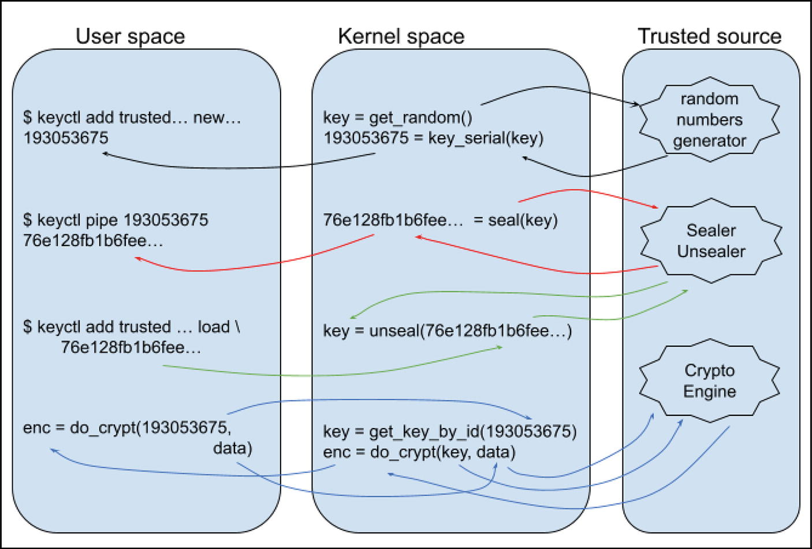
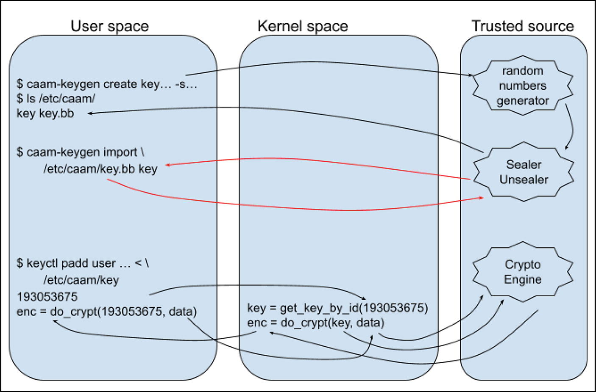
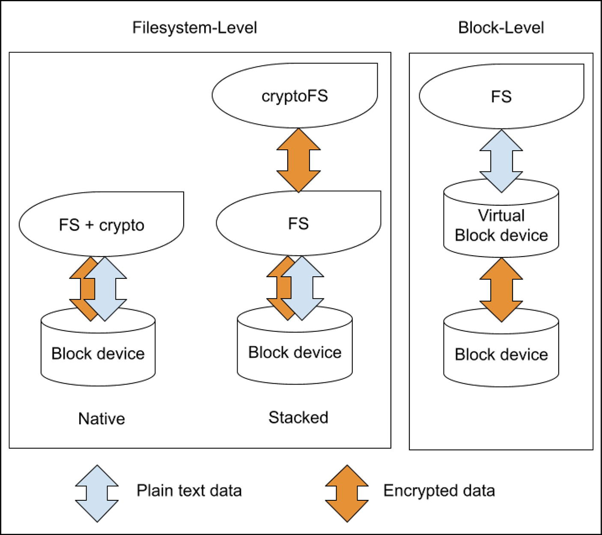

# 1. Mật mã học trong Linux

Rodolfo Giometti

LUCCA, Italy

Linux kernel tích hợp một **cryptographic subsystem** mạnh mẽ và linh hoạt. Subsystem này cung cấp một bộ đầy đủ các primitive và thuật toán mật mã, đóng vai trò một lớp bảo mật nền tảng cho toàn bộ hệ thống. Bằng cách hiện thực các chức năng này trực tiếp bên trong kernel, Linux bảo đảm rằng các thao tác mật mã quan trọng, chẳng hạn như mã hóa dữ liệu, hashing an toàn, v.v., được thực hiện với tăng tốc phần cứng (nếu có) và luôn sẵn sàng cho các thành phần khác nhau của kernel cũng như các ứng dụng user-space. Điều này rất quan trọng để bảo vệ mọi thứ, từ truyền thông mạng và filesystem cho đến tính toàn vẹn của hệ thống.

Gắn chặt với cryptographic subsystem là **kernel keyring**, đóng vai trò một kho lưu trữ an toàn cho các cryptographic key, cho phép quản lý và chia sẻ các key này một cách an toàn giữa các tiến trình và module của kernel với các tiến trình user-space.

Trước khi xem chi tiết các thành phần này, chúng ta cần giới thiệu một số khái niệm mật mã cơ bản để có chung một nền kiến thức cơ bản về một số thuật ngữ.

## 1.1 Signature key và encryption key

Trong mật mã học, việc sử dụng **signature key** hay **encryption key** nhằm hai mục đích khác nhau. Loại thứ nhất được dùng để bảo đảm tính xác thực và tính toàn vẹn; nghĩa là, mục tiêu là xác minh ai đã gửi dữ liệu và dữ liệu không bị thay đổi kể từ khi được ký. Còn loại thứ hai được dùng để bảo đảm tính bảo mật, nên mục tiêu là làm cho dữ liệu không thể đọc được đối với bất kỳ ai ngoại trừ người nhận dự kiến.

Để tạo một chữ ký số, chúng ta phải dùng một cặp key bất đối xứng, còn đối với mã hóa, chúng ta có thể dùng *mã hóa bất đối xứng* hoặc *mã hóa đối xứng*.

> Như người đọc có thể suy ra, đối với mã hóa bất đối xứng, chúng ta phải dùng một cặp key bất đối xứng, còn đối với mã hóa đối xứng, chúng ta phải dùng một key đối xứng.

Tuy nhiên, vì vấn đề tốc độ, mọi CPU đều dùng mã hóa đối xứng để bảo vệ code của chúng, nên từ giờ cho đến cuối cuốn sách này, chúng ta sẽ chỉ dùng mã hóa đối xứng.

Trong mật mã học có vô số phương pháp ký và mã hóa; tuy nhiên, cho mục đích của chúng ta, đối với mã hóa, chúng ta sẽ dùng **Advanced Encryption Standard–Cipher Block Chaining (AES-CBC)**.

> *Cipher Block Chaining (CBC)* là một chế độ hoạt động (mode of operation) dành cho block cipher. Nó khắc phục một điểm yếu của các block cipher đơn giản, trong đó các khối plain text giống hệt nhau sẽ tạo ra các khối ciphertext giống hệt nhau, còn trong CBC, mỗi khối plain text được XOR với khối ciphertext trước đó trước khi được mã hóa.

> Nói một cách đơn giản, AES-256 cung cấp khả năng *xáo trộn* mạnh mẽ. Đó là lý do nó là một trong những thuật toán mã hóa được sử dụng rộng rãi nhất.

Còn đối với chữ ký, chúng ta sẽ dùng **Elliptic Curve Digital Signature Algorithm (ECDSA)** dựa trên **Elliptic Curve Cryptography (ECC)**, vốn mang lại hiệu quả cao hơn và kích thước key nhỏ hơn so với các thuật toán chữ ký khác (chẳng hạn như RSA, thuật toán thay vào đó dựa trên độ khó của việc phân tích các số lớn ra thừa số), kết hợp với **SHA-256** (**Secure Hash Algorithm 256-bit**), một hàm hash mật mã tạo ra một giá trị hash 256-bit duy nhất, fixed-size (hàm hashing cần thiết để có được một biểu diễn duy nhất của file, trên đó chữ ký thực sự được tính).

> Mặc dù chúng ta sẽ chỉ tập trung thảo luận về các thuật toán này, người đọc vẫn có thể dùng các thuật toán khác với một chút công sức.

Thông thường, trên các hệ thống Linux-based, các thuật toán này có thể được dùng thông qua công cụ **OpenSSL** ([https://github.com/openssl/openssl](https://github.com/openssl/openssl)). Ví dụ, để mã hóa một file, chúng ta có thể dùng lệnh sau:

```
$ echo "Very secret message" | \
    openssl enc -aes-256-cbc -e \
    -K 0123456789abcdef0123456789abcdef0123456789abcdef0123456789abcdef \
    -iv 0123456789abcdef0123456789abcdef > /tmp/secret.enc
$ hexdump -v /tmp/secret.enc
0000000 a1e7 1fa6 ad8c 1825 c4ba 599d 7629 f3f2
0000010 fa9f f0f0 4c73 5f35 8fe4 d5ac 7b3f 9960
0000020
$ cat /tmp/secret.enc | \
    openssl enc -aes-256-cbc -d \
    -K 0123456789abcdef0123456789abcdef0123456789abcdef0123456789abcdef \
    -iv 0123456789abcdef0123456789abcdef
Very secret message
```

Trong ví dụ, chuỗi `Very secret message` đã được mã hóa bằng thuật toán AES-CBC 256 bit (`aes-256-cbc`) và bằng cách dùng encryption key cùng initial vector được chỉ định lần lượt qua các tham số tùy chọn `-K` và `-iv`.

> Lưu ý rằng ở lần chạy `openssl` thứ nhất, chúng ta dùng tham số tùy chọn `-e` để thực hiện *mã hóa*, còn ở lệnh thứ hai, chúng ta dùng tham số tùy chọn `-d` để thực hiện *giải mã*.

Một ví dụ khác là cách dùng OpenSSL để hash một file:

```
$ echo "My name is Rodolfo Giometti" > /tmp/id.txt
$ openssl dgst -sha256 /tmp/id.txt
SHA2-256(/tmp/id.txt)= 5e2ea0c72053ce80c13549b2c6e3365098d5bc61015b39908
c787090f70189d9
```

Nếu chúng ta sửa file một chút, output của hàm hash thay đổi, cho ra một giá trị rất khác:

```
$ echo "My name is Rodolfo Gionetti" > /tmp/id.txt
$ openssl dgst -sha256 /tmp/id.txt
SHA2-256(/tmp/id.txt)= c7d8444dc37a87269735d52c0f39c5181689e9a68b786eed7
09f42b24318eb56
```

Đây là một đặc điểm riêng của mọi hàm hashing, đó là: *nếu input thay đổi dù chỉ một bit, output phải thay đổi hoàn toàn*.

OpenSSL cũng có thể được dùng để lấy các giá trị ngẫu nhiên như dưới đây:

```
$ openssl rand 32 | od -tx1
0000000 23 83 28 06 e3 b8 14 21 5a 95 8a b7 37 a8 28 e1
0000020 26 cf 28 e5 24 8d 0d 92 a6 f5 a6 a9 c6 83 22 b2
0000040
$ openssl rand 32 | od -tx1
0000000 95 2d b0 9b 2e 5f 11 21 a6 90 50 ad ef fe 44 d2
0000020 9e 15 26 08 17 58 0b 60 6a 38 66 ca 77 ac 1a 3c
0000040
```

Bộ công cụ OpenSSL thực sự là một package tuyệt vời cho các ứng dụng crypto, nhưng chúng ta sẽ thấy rằng để giải quyết những vấn đề bảo mật cụ thể, đặc biệt là những vấn đề hardware-related, chúng ta có thể cần đến các công cụ khác. Thực tế, với các lệnh mã hóa/giải mã ở trên, chúng ta phải chỉ định key trên dòng lệnh (hoặc từ một file), điều này làm lộ key cho bất kỳ ai có quyền truy cập root filesystem (dĩ nhiên là với đúng đặc quyền).

Trong cuốn sách này, chúng ta sẽ thấy nhiều cách để ngăn key bị đọc ngay cả khi một tiến trình có quyền root!

## 1.2 Linux Crypto API

Linux Crypto API là một framework mật mã được tích hợp sẵn trong Linux, cung cấp một interface nhất quán để kernel sử dụng nhiều loại thuật toán và chức năng mật mã khác nhau. Hơn nữa, nó cung cấp một interface thống nhất cho các thuật toán khác nhau theo cách mà một kernel module hoặc ứng dụng user-space có thể yêu cầu một thuật toán như AES-CBC hoặc SHA256 mà không cần biết chi tiết hiện thực của nó.

Ví dụ, chúng ta có thể xem danh sách tất cả các thuật toán có sẵn trên một hệ thống iMX8-based bằng cách xem file ảo `/proc/crypto`, như dưới đây (output này được lấy trên một hệ thống iMX8-based):

```
# cat /proc/crypto
...
name         : tk(cbc(aes))
driver       : tk-cbc-aes-caam
module       : kernel
priority     : 3000
refcnt       : 2
selftest     : passed
internal     : no
type         : skcipher
async        : yes
blocksize    : 16
min keysize  : 36
max keysize  : 164
ivsize       : 16
chunksize    : 16
walksize     : 16

name         : cbc(aes)
driver       : cbc-aes-caam
module       : kernel
priority     : 3000
refcnt       : 1
selftest     : passed
internal     : no
type         : skcipher
async        : yes
blocksize    : 16
min keysize  : 16
max keysize  : 32
ivsize       : 16
chunksize    : 16
walksize     : 16
...
name         : cbc(aes)
driver       : cbc-aes-ce
module       : kernel
priority     : 300
refcnt       : 1
selftest     : passed
internal     : no
type         : skcipher
async        : no
blocksize    : 16
min keysize  : 16
max keysize  : 32
ivsize       : 16
chunksize    : 16
walksize     : 16
...
```

File này hiển thị tên của tất cả các thuật toán (nhãn `name`), loại của chúng (nhãn `type`, trong ví dụ của chúng ta loại `skcipher` có nghĩa là *symmetric key ciphers*), và các chi tiết khác như

- `name`: Tên chung (generic name) của cipher, là đối tượng của cơ chế lựa chọn priority-based (xem bên dưới). Tên này có thể được dùng bởi các lời gọi API cấp phát cipher (mọi tên được liệt kê ở trên đều là ví dụ về các tên chung như vậy).

- `driver`: Tên duy nhất của cipher. Ngay cả tên này cũng có thể được dùng bởi các lời gọi API cấp phát cipher.

- `module`: Kernel module cung cấp hiện thực của cipher (hoặc `kernel` đối với các cipher được link tĩnh).

- `priority`: Giá trị độ ưu tiên của hiện thực cipher (xem bên dưới).

- `refcnt`: Số đếm tham chiếu của cipher tương ứng, tức là số lượng consumer hiện tại của cipher này.

- `selftest`: Cho biết cipher đã vượt qua self-test hay chưa.

- `blocksize`: Kích thước block của cipher, tính bằng byte.

- `min keysize`/`max keysize`: Kích thước key tối thiểu/tối đa, tính bằng byte.

- `ivsize`: Kích thước của initial vector (IV), tính bằng byte.

- `seedsize`: Kích thước cần thiết của dữ liệu seed cho bộ sinh số ngẫu nhiên.

- `digestsize`: Kích thước output của message digest đối với các thuật toán hashing.

  > Xem file `Documentation/crypto/architecture.rst` trong source của Linux kernel để có danh sách đầy đủ.

Cơ chế lựa chọn priority-based là một cách để chọn hiện thực tốt nhất hiện có cho một thuật toán được yêu cầu. Khi chúng ta yêu cầu một tên thuật toán chung, kernel tự động chọn hiện thực có độ ưu tiên cao nhất.

Trong nội dung ở trên của file `/proc/crypto`, chúng ta có thể thấy hai thuật toán có cùng tên `cbc(aes)`; tuy nhiên, một thuật toán có các thuộc tính sau:

```
name         : cbc(aes)
driver       : cbc-aes-caam
module       : kernel
priority     : 3000
```

Còn thuật toán kia có:

```
name         : cbc(aes)
driver       : cbc-aes-ce
module       : kernel
priority     : 300
```

Như chúng ta có thể thấy, đây là hai hiện thực khác nhau của cùng một thuật toán AES-CBC, do mỗi hiện thực có driver riêng; tuy nhiên, hiện thực thứ nhất có độ ưu tiên cao hơn, là 3000. Trong kịch bản này, nếu chúng ta yêu cầu thuật toán `cbc(aes)`, kernel sẽ dùng hiện thực có độ ưu tiên cao hơn, trong ví dụ của chúng ta là hiện thực do driver `cbc-aes-caam` cung cấp (nếu nhiều hiện thực có cùng độ ưu tiên cao nhất, hành vi của kernel thường là chọn tùy ý một trong số đó).

> Chúng ta sẽ giải thích CAAM là gì ở phần sau của mục này, vì nó sẽ được dùng để giải thích nhiều giải pháp mật mã khác nhau và thú vị. Tạm thời, người đọc nên coi nó như một hiện thực thuật toán thay thế bên trong kernel.

Để ghi đè cơ chế lựa chọn priority-based này, chúng ta phải yêu cầu tên duy nhất (tức là tên driver) thay vì tên chung; kernel sẽ dùng hiện thực cụ thể đó bất kể độ ưu tiên của nó. Trong ví dụ của chúng ta, chúng ta phải yêu cầu `cbc-aes-ce` để chọn hiện thực còn lại (chúng ta sẽ đưa ra một ví dụ về cơ chế này ở phần sau của mục này).

Mọi thuật toán mật mã được liệt kê trong `/proc/crypto` đều có thể được dùng bên trong kernel cho các tác vụ đặc biệt (không được trình bày trong cuốn sách này) hoặc trong user space bằng cách dùng interface **AF_ALG socket**. Interface này cho phép developer giao tiếp trực tiếp với lớp crypto bên dưới (software hoặc hardware, tùy theo độ ưu tiên của từng hiện thực). Trong manpage của system call `socket()` (`man 2 socket`), chúng ta có thể đọc được thông tin sau:

```
SOCKET(2)      Linux Programmer's Manual     SOCKET(2)

NAME
       socket - create an endpoint for communication

SYNOPSIS
       #include <sys/types.h>          /* See NOTES */
       #include <sys/socket.h>

       int socket(int domain, int type, int protocol);

DESCRIPTION
       socket()  creates  an  endpoint for communication
       and returns a file descriptor that refers to that
       endpoint.   The  file  descriptor  returned by a
       successful call will be the lowest-numbered file
       descriptor not currently open for the process.

       The domain argument specifies a communication
       domain; this  selects the protocol family which
       will be used for communication.
       These families are defined in <sys/socket.h>.  The
       formats currently understood by the Linux kernel
       include:

       Name         Purpose                       Man page
       AF_UNIX      Local communication           unix(7)
...
       AF_ALG       Interface to kernel crypto API
...
```

Dựa trên thông tin này, một ví dụ cơ bản về cách định nghĩa một socket thuộc loại này được trình bày dưới đây:

```
static int set_afalg_socket(..., char *key, size_t key_len)
{
        int s;
        struct sockaddr_alg sa = {
                .salg_family = AF_ALG,
                .salg_type = "skcipher",
                .salg_name = "cbc(aes)",
        };
        int ret;

        ret = socket(AF_ALG, SOCK_SEQPACKET, 0);
        if (ret < 0)
                ("socket(AF_ALG): %m");
        s = ret;

        ret = bind(s, (struct sockaddr *) &sa, sizeof(sa));
        if (ret < 0)
                fatal("bind(): %m");

        ret = setsockopt(s, SOL_ALG, ALG_SET_KEY, key, key_len);
        if (ret < 0)
                fatal("setsockopt(ALG_SET_KEY): %m");

        ret = accept(s, NULL, 0);
        if (ret < 0)
                fatal("accept(): %m");
        close(s);

        return ret;
}
```

Mọi thứ đều được định nghĩa bên trong structure `sockaddr_alg` ở trên: trong `salg_family`, chúng ta chỉ định họ giao thức (là `AF_ALG`), và trong `salg_type`, chúng ta thiết lập logic cần dùng từ kernel (trong ví dụ của chúng ta, chúng ta đặt `skcipher` để bật logic symmetric cipher). Nhưng, như đã thấy ở trên, chúng ta cũng có thể chỉ định các loại khác, chẳng hạn như `hash` cho logic hash, `rng` cho bộ sinh số ngẫu nhiên, v.v. (thông tin thêm về cơ chế này có thể được tìm thấy tại [https://www.kernel.org/doc/html/v6.11/crypto/userspace-if.html](https://www.kernel.org/doc/html/v6.11/crypto/userspace-if.html)).

Để sử dụng API này, chúng ta có thể dùng OpenSSL với tùy chọn `-engine afalg` như dưới đây:

```
$ echo "Very secret message" | \
   openssl enc -engine afalg -aes-256-cbc -e \
   -K 0123456789abcdef0123456789abcdef0123456789abcdef0123456789abcdef \
   -iv 0123456789abcdef0123456789abcdef > /dev/null
Engine "afalg" set.
```

Nếu không gặp lỗi nào, việc mã hóa đã được thực hiện bên trong kernel. Để xác minh điều đó (nếu chúng ta không tin vào thông điệp `Engine "afalg" set.`), chúng ta có thể dùng lệnh `strace` như dưới đây:

```
$ echo "Very secret message" | \
   strace openssl enc -engine afalg -aes-256-cbc -e \
   -K 0123456789abcdef0123456789abcdef0123456789abcdef0123456789abcdef \
   -iv 0123456789abcdef0123456789abcdef > /dev/null
...
socket(AF_ALG, SOCK_SEQPACKET, 0)       = 3
bind(3, {sa_family=AF_ALG, salg_type="skcipher", salg_feat=0, salg_mask=0, salg_name="cbc(aes)"}, 88) = 0
accept(3, NULL, NULL)                   = 4
setsockopt(3, SOL_ALG, ALG_SET_KEY, "\1#Eg\211\253\315\357\1#Eg\211\253\31
5\357\1#Eg\211\253\315\357\1#Eg\211\253\315\357", 32) = 0
io_setup(1, [0x77ab6c99f000])           = 0
newfstatat(0, "", {st_mode=S_IFIFO|0600, st_size=0, ...}, AT_EMPTY_PATH) = 0
read(0, "Very secret message\n", 8192)  = 20
read(0, "", 4096)                       = 0
sendmsg(4, {msg_name=NULL, msg_namelen=0, msg_iov=[{iov_base="Very secret mess", iov_len=16}], msg_iovlen=1, msg_control=[{cmsg_len=20, cmsg_level=SOL_ALG, cmsg_type=0x3}, {cmsg_len=36, cmsg_level=SOL_ALG, cmsg_type=0x2}], msg_controllen=64, msg_flags=MSG_MORE}, 0) = 16
...
```

Ở trên, chúng ta có thể thấy:

- Lời gọi `socket()` với domain `AF_ALG`
- Lời gọi `bind()` với `sa_family` được đặt thành `AF_ALG`, `salg_type` được đặt thành `skcipher`, và `salg_name` bằng `cbc(aes)` để thiết lập thuật toán mã hóa
- Lời gọi `setsockopt()` với `ALG_SET_KEY` để thiết lập encryption key
- Lời gọi `sendmsg()` được dùng để gửi dữ liệu cần mã hóa tới kernel

Lúc này người đọc nên lưu ý rằng trong trường hợp này, chúng ta thực hiện nhiều system call làm giảm tốc độ mã hóa. Để ước lượng đúng tốc độ mã hóa, chúng ta có thể làm một phép thử đơn giản như sau. Trước tiên, chúng ta tạo một file lớn:

```
$ dd if=/dev/zero of=/tmp/dummyfile.bin bs=1M count=1000
```

Sau đó, chúng ta có thể dùng lệnh `time` để đo tốc độ mã hóa khi mọi thứ diễn ra hoàn toàn trong user space, như dưới đây:

```
$ time openssl enc -aes-256-cbc -pbkdf2 \
    -k "dummy_passphrase" -in /tmp/dummyfile.bin \
    -out /tmp/dummyfile.bin.enc

real    0m2,881s
user    0m1,036s
sys     0m1,842s
```

Sau đó, chúng ta có thể lặp lại phép đo khi kernel crypto API được sử dụng:

```
$ time openssl enc -engine afalg -aes-256-cbc -pbkdf2 \
    -k "dummy_passphrase" -in /tmp/dummyfile.bin \
    -out /tmp/dummyfile.bin.enc
Engine "afalg" set.

real    0m4,250s
user    0m0,232s
sys     0m3,988s
```

Dễ thấy rằng khi chúng ta chọn engine *afalg*, (thường) giảm xuống do có rất nhiều system call mà chúng ta cần để chuyển dữ liệu qua lại với kernel.

Tuy nhiên, trong cuốn sách này, vấn đề thực sự không tập trung vào *tốc độ* mà là vào *bảo mật*! Thực tế, mục tiêu chính của chúng ta là có được một hệ thống an toàn (nếu hệ thống còn nhanh nữa thì càng tốt, nhưng đó không phải là yêu cầu bắt buộc)! Để đạt được mục tiêu này, chúng ta phải giới thiệu một công cụ khác mặc định sử dụng crypto API để thực hiện các hoạt động mật mã và có bổ sung khả năng quản lý Linux keyring. Công cụ này có tên là **crypto-afalg** và có thể được tải về tại [https://github.com/giometti/crypto-afalg](https://github.com/giometti/crypto-afalg).

Ưu điểm của việc dùng công cụ này là khi dùng nó, chúng ta có thể chỉ định encryption key theo nhiều cách. Nếu xem thông điệp hướng dẫn sử dụng, chúng ta thấy output sau:

```
$ crypto-afalg -h
usage: crypto-afalg [ -d|--debug ] [ -h|--help ] [--version] [ --force-d
river <name> ] <command> ...
  <command> can be:
    encrypt <algo> <opts> : encrypt data
    decrypt <algo> <opts> : decrypt data
    hash <algo> <opts>    : compute data hash
```

Đối với subcommand `decrypt`, chúng ta có thông tin sau:

```
$ crypto-afalg decrypt -h
to see available algos use:
        crypto-afalg decrypt
to check a kernel algo use:
        crypto-afalg decrypt check-kalgo <kname>
to get help use:
        crypto-afalg decrypt help|-h|--help
normal usage:
        crypto-afalg decrypt <algo> <KEY> <IV> | <PASS> [ <SALT> ] [ -i|--iterations <val> ]
where <KEY> can be one of:
    -K|--key <val>          : hex value key
    -k|--keyfile <name>     : key from file
    -S|--keyserial <val>    : key from keyring
where <IV> can be one of:
    -V|--iv <str>           : iv
    -v|--ivfile <name>      : iv from file
where <PASS> can be one of:
    -P|--pass <str>         : passkey
    -p|--passfile <name>    : passkey from file
where <SALT> can be one of:
    -T|--salt <str>         : salt
    -t|--saltfile <name>    : salt from file
NOTE: keyring key can be:
      - a simple serial number, or
      - a symbolic name as [<keyring>,]<type>,<name>
```

Trong output ở trên, chúng ta thấy rằng bằng cách dùng tham số tùy chọn `-S`, chúng ta có thể chỉ định một key bằng serial number của nó trong Linux keyring. Và đây là một tính năng then chốt đối với bảo mật, vì nó cho phép chúng ta chỉ định một key được giữ trong kernel!

Để hiểu rõ câu vừa rồi, chúng ta cần đọc tiếp sang phần kế tiếp của cuốn sách này; tạm thời, hãy cùng xem một số ví dụ sử dụng đơn giản của công cụ này.

Chúng ta có thể dùng `crypto-afalg` để giải mã dữ liệu:

```
$ echo "Very secret message" | \
   openssl enc -aes-256-cbc -e \
   -K 0123456789abcdef0123456789abcdef0123456789abcdef0123456789abcdef \
   -iv 0123456789abcdef0123456789abcdef > /tmp/secret.enc
$ hexdump -v /tmp/secret.enc
0000000 a1e7 1fa6 ad8c 1825 c4ba 599d 7629 f3f2
0000010 fa9f f0f0 4c73 5f35 8fe4 d5ac 7b3f 9960
0000020
$ cat /tmp/secret.enc | crypto-afalg \
   -K 0123456789abcdef0123456789abcdef0123456789abcdef0123456789abcdef \
   -V 0123456789abcdef0123456789abcdef decrypt aes-256-cbc
Very secret message
```

Hoặc chúng ta có thể dùng nó để hash một file:

```
$ echo "My name is Rodolfo Giometti" > /tmp/id.txt
$ openssl dgst -sha256 < /tmp/id.txt
SHA2-256(stdin)= 5e2ea0c72053ce80c13549b2c6e3365098d5bc61015b39908c78709
0f70189d9
$ crypto-afalg hash sha-256 < /tmp/id.txt
5e2ea0c72053ce80c13549b2c6e3365098d5bc61015b39908c787090f70189d9
```

Công cụ này (phần lớn) tương thích với dữ liệu output của lệnh `openssl`, và nó được thiết kế để dùng Linux crypto API cho mọi thao tác mật mã và dùng Linux keyring để quản lý các key.

> Trong trường hợp chúng ta gặp lỗi sau:
>
> ```
> crypto-afalg: socket(AF_ALG): Address family not supported by protocol
> ```

> chúng ta nên kiểm tra xem các thiết lập cấu hình kernel sau có được bật hay không:
>
> ```
> CONFIG_CRYPTO_USER=y
> CONFIG_CRYPTO_USER_API=y
> CONFIG_CRYPTO_USER_API_HASH=y
> CONFIG_CRYPTO_USER_API_SKCIPHER=y
> ```

Trước khi kết thúc phần này, hãy nhớ lại những gì chúng ta đã thấy ở trên trong file `/proc/crypto`:

```
name         : tk(cbc(aes))
driver       : tk-cbc-aes-caam
...
min keysize  : 36
max keysize  : 164
ivsize       : 16
...
```

Còn đối với thuật toán thứ hai, chúng ta có các giá trị:

```
name         : cbc(aes)
driver       : cbc-aes-caam
...
min keysize  : 16
max keysize  : 32
ivsize       : 16
...
```

Người đọc nên để ý trong output ở trên rằng chúng ta có hai hiện thực AES-ECB khác nhau được hỗ trợ bởi CAAM (**Cryptographic Acceleration and Assurance Module**, có trên nhiều thiết bị i.MX-based của NXP): một hiện thực tên là `ecb(aes)` và hiện thực kia tên là `tk(ecb(aes))`.

Điều then chốt ở đây là chúng ta có cùng một thuật toán AES-CBC, nhưng nó làm việc trên các key khác nhau! Chữ *khác nhau* ở đây có nghĩa là gì sẽ rõ hơn ở phần sau, khi chúng ta làm một số ví dụ; lúc này người đọc nên ghi nhớ sự khác biệt thú vị này, vốn không có trong OpenSSL.

## 1.3 Linux Key-Management Facility

**Linux Key-Management Facility**, còn được gọi là **Linux Kernel Key Retention Service** hoặc **Linux Keyring**, là một thành phần cốt lõi của Linux, chủ yếu là một cách để các thành phần khác nhau của kernel lưu giữ hoặc cache dữ liệu bảo mật, authentication key, encryption key và các dữ liệu khác trong kernel.

Như được nêu trong manpage của keyrings (`man 7 keyrings`), các system call, một thư viện và một số tiện ích user-space được cung cấp để cho phép truy cập facility này:

```
KEYRINGS(7)            Linux Programmer's Manual           KEYRINGS(7)

NAME
       keyrings - in-kernel key management and retention facility

DESCRIPTION
       The  Linux key-management facility is primarily a way 
       for various kernel components to retain or cache 
       security data, authentication keys, encryption keys, and other data in the kernel.

       System call interfaces are provided so that user-space
       programs can manage those objects and also use the
       facility for their own purposes; see add_key(2), request_key(2), and keyctl(2).

       A library and some user-space utilities are provided
       to allow access to the facility. See keyctl(1), 
       keyctl(3), and keyutils(7) for more information.
...
```

Tất cả các công cụ này có thể được dùng theo nhiều cách và để giải quyết nhiều vấn đề, nhưng từ góc nhìn của chúng ta, mục đích chính của chúng là cho phép các chương trình user-space lưu trữ, truy xuất và sử dụng cryptographic key một cách an toàn và có kiểm soát.

> Người đọc tò mò có thể xem tài liệu của kernel trong thư mục `Documentation/security/keys`, hoặc trên Internet tại [https://docs.kernel.org/security/keys/](https://docs.kernel.org/security/keys/)).

Như được nêu trong các man page ở trên, một trong những lệnh quan trọng nhất để quản lý các key của Linux là `keyctl`, vốn có rất nhiều subcommand:

```
# keyctl
Format:
  keyctl --version
  keyctl add [-x] <type> <desc> <data> <keyring>
  keyctl chgrp <key> <gid>
  keyctl chown <key> <uid>
  keyctl clear <keyring>
  keyctl describe <keyring>
 ...
  keyctl padd [-x] <type> <desc> <keyring>
 ...
  keyctl read <key>
 ...
```

Ví dụ, các subcommand `add` và `padd` được dùng để thêm một key mới với loại và mô tả `<desc>` được chỉ định. Key này được khởi tạo với dữ liệu đã cho và được gắn vào *keyring* được chỉ định.

> Trong cuốn sách này, *keyring* là gì sẽ không được giải thích chi tiết; tuy nhiên, chúng ta có thể nói rằng nó chỉ đơn giản là một key đặc biệt chứa danh sách các key khác mà những thực thể khác nhau có thể tham chiếu tới, giống hệt như thư mục và file!

Với lệnh `keyctl`, chúng ta có thể dùng các descriptor đặc biệt `@u` và `@s` (cùng các descriptor khác) để tham chiếu tới những keyring cụ thể: bằng cách dùng `@u`, chúng ta tham chiếu tới *user keyring*, còn bằng cách dùng `@s`, chúng ta tham chiếu tới *session keyring*.

Trong hệ thống Linux keyring, các định danh đặc biệt này được các công cụ dòng lệnh như `keyctl` dùng để tham chiếu tới những keyring cụ thể, được định nghĩa sẵn, mà không cần biết serial number của chúng (hãy nhớ rằng một keyring chỉ là một key chứa các key khác).

**Session keyring** gắn với phiên đăng nhập của người dùng, nên nó được tạo ra khi chúng ta đăng nhập và thường bị hủy khi chúng ta đăng xuất. Nó được thiết kế cho những key cần có sẵn trong suốt thời gian phiên làm việc của người dùng (ví dụ các authentication token tạm thời hoặc các key được dùng bởi những ứng dụng được khởi chạy trong phiên đó), và nó được kế thừa bởi mọi tiến trình được fork từ login shell, khiến nó trở thành một nơi tiện lợi cho một phiên đơn lẻ.

Mặt khác, **user keyring** là một kho lưu trữ key lâu dài hơn; thực tế, nó gắn với một user ID (UID) cụ thể và tồn tại chừng nào ID này còn hoạt động trong kernel. Điều này có nghĩa là nó có thể tồn tại lâu hơn một phiên đăng nhập riêng lẻ. Keyring này dành cho các key long-term cần có sẵn cho bất kỳ tiến trình nào chạy dưới danh nghĩa người dùng đó qua các phiên đăng nhập khác nhau. Ví dụ, một key được dùng bởi một dịch vụ chạy nền hoặc một job `cron` sẽ là ứng viên phù hợp cho user keyring.

Người đọc có thể hình dung session keyring (`@s`) như chiếc ví của họ trong một ngày, còn user keyring (`@u`) thì giống một hộp ký gửi an toàn lâu dài dành cho một r. hơn.

> Trong các phần tiếp theo, ngay khi chúng ta dùng một lệnh `keyctl` mới, mọi thứ sẽ trở nên rõ ràng hơn.

Bây giờ là lúc xem xét một số loại key khác nhau mà chúng ta có thể dùng trong hệ thống Linux-based của mình. Chúng tôi sẽ trình bày các key tiêu chuẩn (những key được tạo qua `keyctl`) và các key non-standard, vốn dù là vendor-specific nhưng cho phép đạt được mức bảo mật rất cao (đó là lý do chúng được trình bày ở đây).

### 1.3.1 Plain text key

Loại key này được gọi là *plain text* vì nó được giữ trong kernel ở dạng plain text (tức là ở dạng không được mã hóa). Điều này nhằm phân biệt chúng với các loại key tiếp theo, vốn được mã hóa (hay niêm phong) thay vào đó. Tuy nhiên, đây chỉ là một quy ước của cuốn sách này; trong tài liệu của kernel, chúng chỉ được gọi là các key *user* và *logon*.

#### User key

Loại key **user** có một phần mô tả (description) và một payload là các khối dữ liệu tùy ý (blob). Chúng có thể được tạo, cập nhật và đọc bởi các ứng dụng user-space và không nhằm mục đích được các dịch vụ của kernel sử dụng. Thực tế, như được nêu trong manpage (`man 7 keyrings`), chúng ta có:

```
  "user"  This is a general-purpose key type. The key is 
          kept entirely within kernel memory. The payload
          may be read and updated by user-space applications.

          The payload for keys of this type is a blob of 
          arbitrary data of up to 32,767 bytes.

          The description may be any valid string, though it is
          preferred that it start with a colon-delimited prefix
          representing the service to which the key is of
          interest (for instance "afs:mykey").
```

Vì vậy, để thêm một user key mới tên là `userkey` vào user keyring với dữ liệu được chỉ định, chúng ta có thể làm như sau:

```
$ keyctl add user userkey "key_data" @u
311176563
```

Biến thể `padd` của lệnh này đọc dữ liệu từ stdin thay vì lấy từ dòng lệnh, nhưng hai lệnh này là tương đương:

```
$ echo -n "key_data" | keyctl padd user userkey @u
311176563
```

Để liệt kê mọi key trong một keyring, chúng ta có thể dùng subcommand `list`, như dưới đây đối với user keyring:

```
$ keyctl list @u
1 key in keyring:
311176563: --alswrv  1000  1000 user: userkey
```

Còn để xem mọi key (và keyring) mà chúng ta có quyền truy cập, chúng ta có thể dùng subcommand `show`:

```
$ keyctl show
Session Keyring
 886145736 --alswrv   1000  1000  keyring: _ses
 821465338 --alswrv   1000 65534   \_ keyring: _uid.1000
 311176563 --alswrv   1000  1000       \_ user: userkey
```

Ở cột đầu tiên là serial number của key (con số duy nhất do kernel gán để định danh key), còn hai cột cuối là **key type** (`user`) và tên hay **description** của nó (`userkey`). Hai con số `1000` là **UID** (User ID) và **GID** (Group ID) của chủ sở hữu key (đối với keyring `_uid.1000`, group ID là `65534`). Trong trường hợp này, cả hai đều là `1000`, tức là người dùng:

```
$ id -nu 1000
giometti
```

Cuối cùng, chuỗi `--alswrv` xác định các quyền được cấp cho key. Mỗi chữ cái đại diện cho một thao tác cụ thể:

- `a` (alter): Cấp quyền thay đổi các thuộc tính của key, chẳng hạn như thời gian hết hạn hoặc các quyền của nó. Đây được xem là một quyền quản trị.
- `l` (link): Cấp quyền tạo một liên kết từ một keyring khác tới key này.
- `s` (search): Cấp quyền tìm thấy key khi tìm kiếm trong một keyring. Nếu không có quyền này, một người dùng có thể thậm chí không định vị được key.
- `w` (write): Cấp quyền thay đổi hoặc cập nhật payload của key (dữ liệu thực sự trong key).
- `r` (read): Cấp quyền đọc payload của key.
- `v` (view): Đây là quyền cơ bản nhất, nó cấp quyền xem metadata của key, chẳng hạn như loại và mô tả của key.

Tất cả các quyền này đều áp dụng cho người dùng đã tạo ra key; tuy nhiên, tương tự như quyền file của UNIX, chúng ta có các thực thể khác có thể truy cập một key: group, other và possessor. Các quyền này có thể được xem bằng subcommand describe:

```
$ keyctl describe 311176563
311176563: alswrv-----v------------  1000  1000 user: userkey
```

Chuỗi `alswrv` được lặp lại bốn lần để chỉ định lần lượt các quyền của *possessor*, *user*, *group* và *others*. Vì vậy, trong ví dụ trên, *possessor* có toàn quyền truy cập, còn user chỉ có quyền *view*, trong khi group và others hoàn toàn không có quyền truy cập.

Trong khi khái niệm *user*, *group* và *other* có thể là điều mọi người dùng UNIX đều biết, khái niệm *possessor* lại là một thứ khá lạ lẫm và đặc thù của hệ thống quản lý key trong Linux. Đây là một cơ chế kiểm soát truy cập kernel-level, chứ không phải một thuộc tính user-level mà chúng ta có thể truy vấn trực tiếp.

Phạm vi của cuốn sách này không phải là giải thích chi tiết cơ chế này, và người đọc tò mò có thể tìm thêm thông tin trong file `Documentation/security/keys/core.rst` trong source của Linux, nhưng để cho đầy đủ, chúng ta có thể nói rằng possessor là một tiến trình có một liên kết có thể tìm kiếm được tới key từ một trong các keyring của nó.

Chỉ để đưa ra một ví dụ về điều này, chúng ta có thể xét trường hợp sau trên Yocto Scarthgap:

```
# echo -n "key_data" | keyctl padd user userkey @u
827367125
```

Key `userkey` đã được tạo trong user keyring, nhưng khi chúng ta thử đọc lại payload của key, chúng ta gặp lỗi sau:

```
# keyctl pipe 827367125
keyctl_read_alloc: Required key not available
```

Lý do là chúng ta không phải là possessor của key! Thực tế, nếu chúng ta dùng subcommand `show` (subcommand này, theo mặc định, hiển thị đệ quy những keyring mà một tiến trình đăng ký và những key cùng keyring mà chúng chứa), chúng ta nhận được output sau:

```
# keyctl show
Session Keyring
 266575291 --alswrv      0     0  keyring: _ses
 823416424 ----s-rv      0     0   \_ user: invocation_id
```

Key không có ở đây; nó nằm trong user keyring:

```
# keyctl show @u
Keyring
1008686124 --alswrv      0 65534  keyring: _uid.0
 827367125 --alswrv      0     0   \_ user: userkey
```

Và cách duy nhất để truy cập nó là liên kết user keyring vào session keyring như dưới đây:

```
# keyctl link @u @s
# keyctl show
Session Keyring
 266575291 --alswrv      0     0  keyring: _ses
 823416424 ----s-rv      0     0   \_ user: invocation_id
1008686124 --alswrv      0 65534   \_ keyring: _uid.0
 827367125 --alswrv      0     0       \_ user: userkey
```

Bây giờ chúng ta là possessor của key, và chúng ta có thể lấy lại payload của nó:

```
# keyctl pipe 827367125
key_data
```

> Thao tác liên kết các keyring `@u` và `@s` là một mẹo được dùng rộng rãi trong cuốn sách này, và nó sẽ rõ ràng hơn ở phần sau khi chúng ta đi đến các ví dụ sử dụng thực tế.

#### Logon key

Một **logon** key, giống như loại user key, có payload là một khối dữ liệu tùy ý, nhưng mặt khác, nó được dùng làm nơi lưu trữ những bí mật chỉ có thể được truy cập từ kernel space! Từ góc nhìn của user space, đây là các key write-only, nên các chương trình user-space không thể đọc lại chúng được nữa.

Một điểm khác biệt nữa giữa một key *logon* và một key *user* là phần mô tả có thể tùy ý nhưng phải có tiền tố là một chuỗi có độ dài non-zero mô tả subclass của key. Subclass được ngăn cách với phần còn lại của mô tả bằng một ký tự dấu hai chấm (:).

> Lưu ý rằng việc thêm tiền tố cho loại user key được khuyến nghị nhưng không bị bắt buộc.

Thực tế, nếu chúng ta thử tạo một logon key mới, chúng ta sẽ gặp lỗi như dưới đây:

```
$ echo -n "key_data" | keyctl padd logon logonkey @u
add_key: Invalid argument
```

Lệnh đúng là:

```
$ echo -n "key_data" | keyctl padd logon logonkey: @u
779318636
```

Hoặc:

```
$ echo -n "key_data" | keyctl padd logon logonkey:testing @u
676851583
```

Nếu xem user keyring của mình, chúng ta sẽ nhận được output sau:

```
$ keyctl list @u
3 keys in keyring:
447352331: --alswrv  1000  1000 user: userkey
676851583: --alsw-v  1000  1000 logon: logonkey:testing
779318636: --alsw-v  1000  1000 logon: logonkey:
```

Bây giờ, ví dụ, nếu chúng ta thử đọc key tên là `logonkey:`, chúng ta sẽ nhận được kết quả sau:

```
$ keyctl pipe 779318636
keyctl_read_alloc: Operation not supported
```

Lưu ý rằng điều này không chỉ vì chúng ta có cờ quyền đọc (`r`); thực tế, nếu chúng ta thử thêm cờ này bằng subcommand `setperm`:

```
$ keyctl setperm 779318636 0x003f0000
$ keyctl list @u
3 keys in keyring:
447352331: --alswrv  1000  1000 user: userkey
676851583: --alsw-v  1000  1000 logon: logonkey:testing
779318636: --alswrv  1000  1000 logon: logonkey:
```

Kết quả cuối cùng vẫn như cũ:

```
$ keyctl pipe 779318636
keyctl_read_alloc: Operation not supported
```

Để hiểu rõ hơn các cờ quyền của key (và cách biểu diễn hexadecimal của chúng), chúng ta cũng có thể xem manpage của `keyctl` (`man 1 keyctl`) ở phần nói về subcommand `setperm`, như dưới đây:

Thiết lập mặt nạ quyền trên một key

```
    keyctl setperm <key> <mask>
```

Lệnh này thay đổi mặt nạ kiểm soát quyền trên một key. Mặt nạ có thể được chỉ định dưới dạng số hex nếu nó bắt đầu bằng “0x”, số bát phân nếu nó bắt đầu bằng “0”, hoặc số thập phân trong các trường hợp khác.

Các số hex là tổ hợp của:

```
  Possessor  UID      GID        Other     Permission  Granted
  ========   =======  ========   ========  ====
  01000000   00010000  00000100  00000001  View
  02000000   00020000  00000200  00000002  Read
  04000000   00040000  00000400  00000004  Write
  08000000   00080000  00000800  00000008  Search
  10000000   00100000  00001000  00000010  Link
  20000000   00200000  00002000  00000020  Set Attribute
  3f000000   003f0000  00003f00  0000003f  All
```

View cho phép xem loại, mô tả và các tham số khác của một key.

Read cho phép đọc payload (hoặc danh sách keyring) nếu loại key hỗ trợ.

Write cho phép sửa đổi hoặc cập nhật payload (hoặc danh sách keyring).

Search trên một key cho phép tìm thấy key đó khi một keyring mà nó

được liên kết tới được tìm kiếm. Link cho phép một key được liên kết tới một keyring.

Bây giờ, để đưa ra một ví dụ đơn giản về cách chúng ta có thể dùng logon key theo một cách rất hữu ích về mặt bảo mật, chúng ta có thể thử giải mã thông điệp rất bí mật vừa được mã hóa ở phần trước.

Trước tiên, chúng ta phải chuyển encryption key từ dạng chuỗi sang dữ liệu binary; để làm vậy, chúng ta có thể dùng chương trình đơn giản sau:

```
$ printf "$(echo 0123456789abcdef0123456789abcdef0123456789abcdef0123456
789
abcdef | sed 's/\(..\)/\\x\1/g')" > /tmp/key.bin
$ hexdump -v /tmp/key.bin
0000000 2301 6745 ab89 efcd 2301 6745 ab89 efcd
0000010 2301 6745 ab89 efcd 2301 6745 ab89 efcd
0000020
```

> Một cách khác để làm điều trên là dùng lệnh `xxd` như dưới đây:
>
> ```
> $ echo 0123456789abcdef0123456789abcdef0123456789abcdef0123456789abcdef | \
>     xxd -r -p > /tmp/key.bin
> $ hexdump -v /tmp/key.bin
> 0000000 2301 6745 ab89 efcd 2301 6745 ab89 efcd
> 0000010 2301 6745 ab89 efcd 2301 6745 ab89 efcd
> 0000020
> ```

> Tuy nhiên, lệnh `xxd` có sẵn trên mọi hệ thống; đó là lý do chúng tôi đã dùng các lệnh `print`/`sed`, vốn thực ra gần như luôn có mặt.

Bây giờ chúng ta đặt encryption key vào một logon key:

```
$ keyctl padd logon cypher: @s < /tmp/key.bin
591970105
```

Từ thời điểm này cho đến khi hệ thống khởi động lại, key chỉ có thể được truy cập từ kernel! Tuy nhiên, như đã thấy ở phần “Linux Crypto API” ở trên, chúng ta có thể yêu cầu kernel dùng nó thay cho chúng ta thông qua chương trình `crypto-afal`, chương trình này dùng interface crypto API, như dưới đây:

```
$ cat /tmp/secret.enc | crypto-afalg decrypt aes-256-cbc \
    -S 591970105 -V 0123456789abcdef0123456789abcdef
Very secret message
```

> Lưu ý rằng lệnh `crypto-afalg` cũng hỗ trợ khả năng chỉ định tên của key thay vì serial number của nó:
>
> ```
> $ cat /tmp/secret.enc | crypto-afalg decrypt aes-256-cbc \
>     -S @s,logon,cypher: -V 0123456789abcdef0123456789abcdef
> Very secret message
> ```

> Cũng lưu ý rằng switch này chỉ có sẵn nếu `ALG_SET_KEY_BY_KEY_SERIAL` được định nghĩa, điều này đòi hỏi ít nhất phiên bản kernel 6.2.

Cách hoạt động sau cùng này an toàn hơn vì nếu chúng ta định nghĩa logon key trong một môi trường an toàn (và chúng ta sẽ thấy điều này có nghĩa là gì trong phần “A/B Schema” ở Chương [3](ch03_real_implementations.vi.md)), các thao tác mã hóa và giải mã tiếp theo không cần chỉ định key trên dòng lệnh hoặc từ filesystem nữa!

### 1.3.2 Sealed key

Khi dùng thuật ngữ *sealed*, chúng tôi muốn nói đến những key được tạo ra trong kernel, còn user space chỉ nhìn thấy, lưu trữ và nạp các blob đã được mã hóa. So với các plain text key đã thấy ở trên, đối với những key này, mọi blob user-level đều được hiển thị và nạp ở dạng ASCII hex cho tiện và được xác minh tính toàn vẹn, mang lại một cải thiện lớn cho bảo mật của hệ thống!

Hơn nữa, những key này tồn tại lâu dài qua các lần khởi động lại, không giống các logon key vốn biến mất khi khởi động lại (đặc điểm sau cùng này sẽ rõ hơn ở phần “Linux Transparent Encryption” sau đây).

#### Trusted key

Trusted key được gọi theo cách này (tức là *trusted*) vì chúng đòi hỏi phải có sẵn một **trusted source** (xem bên dưới) để được tạo ra và được bọc (wrap) nhằm tăng cường bảo mật.

Cả trusted key và encrypted key đều được lưu trong kernel ở dạng đã mã hóa. Tuy nhiên, đối với trusted key, quá trình niêm phong dựa vào một trusted source, còn đối với encrypted key, quá trình niêm phong dựa vào một trusted key (còn được gọi là *master key*).

Một điểm khác biệt (nhỏ) nữa giữa hai loại key này là trusted key là các số ngẫu nhiên, còn encrypted key có thể là số ngẫu nhiên hoặc số user-defined, và vì encrypted key không phụ thuộc vào một trust source cho bước seal/unseal, chúng thường nhanh hơn khi được dùng để mã hóa/giải mã.

Tại thời điểm viết cuốn sách này, các trusted source hiện có là

- *TPM*: Key được tạo ra bên trong **Trusted Platform Module**. Đây là một chip chuyên dụng được thiết kế để tăng cường bảo mật bằng cách lưu trữ an toàn các cryptographic key, nên độ mạnh của các số ngẫu nhiên có thể khác nhau giữa các nhà sản xuất thiết bị.

- *TEE hoặc OP-TEE*: **Open Portable Trusted Execution Environment** là một Trusted Execution Environment (TEE) mã nguồn mở dựa trên công nghệ Arm TrustZone. Các số ngẫu nhiên có thể được tạo bằng hardware hoặc software, và chúng có thể được seed qua nhiều nguồn entropy.

- *CAAM*: **Cryptographic Acceleration and Assurance Module** (có trong nhiều CPU i.MX của NXP) là phần cứng tăng tốc mật mã, hiện thực các thuật toán mã hóa khối, hashing và xác thực, một bộ điều khiển memory an toàn, và một bộ sinh số ngẫu nhiên bằng phần cứng có thể được dùng để tạo trusted key của chúng ta.

  > Lưu ý rằng module này cũng hiện thực các cryptographic key hardware-backed riêng, có thể được gọi là *CAAM key*. Phần cứng này là engine cơ bản cho các secure key được trình bày ở phần tiếp theo.

- *DCP*: Data Co-Processor là một bộ tăng tốc crypto của nhiều SoC i.MX khác nhau; bản thân thiết bị phần cứng này không cung cấp một interface RNG chuyên dụng, nên RNG mặc định của kernel được sử dụng.

> Các nguồn này phải được bật trong cấu hình kernel thông qua các mục:
>
> ```
> CONFIG_TRUSTED_KEYS_TPM
> CONFIG_TRUSTED_KEYS_TEE
> CONFIG_TRUSTED_KEYS_CAAM
> CONFIG_TRUSTED_KEYS_DCP
> ```

Kernel chọn thiết bị đầu tiên có sẵn, hoặc chúng ta có thể ghi đè điều này bằng cách chỉ định `trusted.source=tpm` cho TPM, `trusted.source=tee` cho OP-TEE, v.v.

> Mỗi thiết bị crypto có RNG (Random Number Generator) riêng và trusted key được tạo ra bằng cách dùng các thiết bị như vậy; tuy nhiên, bằng cách chỉ định `trusted.rng=kernel` trên kernel command line, chúng ta có thể ghi đè RNG được dùng bằng random number pool của kernel.

Để tạo một trusted key (thường được gọi là KMK, viết tắt của *Kernel Master Key* hoặc đơn giản là *Master Key*), chúng ta có thể dùng lệnh sau:

```
$  add trusted trustedkey "new 32" @s
837965936
$ keyctl show
Session Keyring
 881546418 --alswrv      0     0  keyring: _ses
 340681727 ----s-rv      0     0   \_ user: invocation_id
 837965936 --alswrv      0     0   \_ trusted: trustedkey
```

> Trong trường hợp trusted source là TPM, lệnh tạo key thay đổi một chút, và nó phải được viết như dưới đây:
>
> ```
> $ keyctl add trusted tpmtrustedkey \
>              "new 32 keyhandle=<handle> keyauth=<auth_val>" @s
> ```

> trong đó `keyhandle` là một giá trị hexadecimal dạng ASCII của một key handler tồn tại lâu dài, còn `keyauth` là một giá trị hexadecimal dạng ASCII dùng để niêm phong key (xem phần tiếp theo để có một ví dụ với TPM làm trusted source).

> Lưu ý rằng ở đây, key được thêm vào session keyring (`@s`) để nó có sẵn cho mọi dịch vụ của kernel, chứ không chỉ cho phiên làm việc của một người dùng; tuy nhiên, nếu muốn gắn key với người dùng, chúng ta có thể dùng user keyring `@u` (xem phần ở trên khi chúng ta nói về possessor của key và việc truy cập key).

Nếu không gặp lỗi nào, nghĩa là loại key này có thể được tạo ra trên hệ thống của chúng ta, chúng ta có thể yêu cầu kernel đọc key bằng lệnh sau:

```
$ keyctl pipe 837965936 > /tmp/trustedkey.blob
```

Bây giờ, nếu xem những gì đã được lưu trong file `trustedkey.blob`, chúng ta có thể thấy rằng nó không phải là thứ có thể dùng được as-is, vì key `trustedkey` đã được bọc (wrap):

```
$ cat /tmp/trustedkey.blob
76e128fb1b6feece33d2fd6f20c46612caffea17d59fc97ddefe68c0703e2d7d531fe5d7
aa9897e60e1d0ad923a7db4eff22999e04b27dc8a7304f6a3bbdbc9ad8af7420c0fb433f
```

> Lưu ý rằng key được trả về dưới dạng các giá trị hexadecimal ASCII chứ không phải dưới dạng các giá trị binary thô.

Ở dạng đặc biệt này, key rõ ràng không phải là một key dài 32 byte; nó là một key đã được bọc, và sau đó nó chỉ có thể được khôi phục về dạng 32 byte ở cấp kernel bằng cách dùng thiết bị trusted.

Đặc điểm đặc biệt này cho phép loại key này định nghĩa các secure key có thể tồn tại qua các lần khởi động lại. Thực tế, sau khi file đã bọc được đặt trên thiết bị lưu trữ, chúng ta có thể khởi động lại hệ thống một cách an toàn rồi lấy lại key để dùng tiếp bằng lệnh sau:

```
$ keyctl add trusted trustedkey "load $(cat trustedkey.blob)" @s
193053675
$ keyctl show
Session Keyring
 805257004 --alswrv      0     0  keyring: _ses
 971013422 ----s-rv      0     0   \_ user: invocation_id
 193053675 --alswrv      0     0   \_ trusted: trustedkey
```

> Hãy chắc chắn lưu dữ liệu blob của key vào một vị trí lưu trữ lâu dài trước khi khởi động lại! Trong ví dụ của chúng ta, chúng tôi đã chuyển file vào thư mục home của root.

Trước khi kết thúc phần này, chúng ta nên ghi nhớ cách một trusted key được tạo ra.

Khi một trusted key mới được tạo bằng lệnh:

```
$ keyctl add trusted ... new ...
```

Trong kernel, các byte ngẫu nhiên được tạo ra bằng bộ sinh số ngẫu nhiên của trusted source (hoặc thông qua một bộ sinh của kernel). Key nằm lại trong kernel ở dạng không mã hóa, và nó được làm rối (obfuscate) thành một blob khi user space dùng lệnh:

```
$ keyctl pipe ...
```

Mặt khác, khi user space thực hiện lệnh:

```
$ keyctl add trusted ... load ...
```

Blob được giải mã bằng cách dùng lại trusted source (xem Hình 1-1).



*Hình 1-1* Quản lý trusted key

Theo cách này, mọi trusted key:

- Không hiển thị ra bên ngoài kernel
- Dạng đã niêm phong của nó (hiển thị trong user space) được bảo vệ bằng phần cứng
- Tương thích với mọi crypto engine

#### Encrypted key

Bây giờ chúng ta đã có trusted key, chúng ta có thể tạo một **encrypted key**, tức là một key đối xứng được mã hóa bằng trusted key `trustedkey` đã định nghĩa ở trên:

```
$ keyctl add encrypted encryptedkey "new trusted:trustedkey 32" @s
369059404
```

Một lần nữa, nếu chúng ta thử đọc key vừa tạo, một blob mới được tạo ra.

```
$ keyctl pipe 369059404 > /tmp/encryptedkey.blob
$ cat /tmp/encryptedkey.blob
default trusted:trustedkey 32 5f389cc214159656f32e169a65faa036007b3fcce4
8d0fbc79d39a157d842ae22ae404a66b591045d1d4cce2a1a25d31f1f2357ef5f7e995d5
289d90ae2147dbc4bd437752595235812e56e5a1cea52dd0
```

Lưu ý rằng, lần này, bên trong blob có một tham chiếu rõ ràng tới master key được dùng để niêm phong encrypted key. Và cũng rõ ràng quy trình đúng cần chạy để khôi phục một encrypted key sau khi khởi động lại là gì:

```
$ keyctl add trusted trustedkey "load $(cat trustedkey.blob)" @s
245971746
$ keyctl add encrypted encryptedkey "load $(cat encryptedkey.blob)" @s
23711605
```

Ở bước đầu tiên, chúng ta nạp lại master key (trusted key), rồi sau đó chúng ta có thể nạp lại encrypted key.

> Một lần nữa, hãy chắc chắn lưu dữ liệu blob của key vào một vị trí lưu trữ lâu dài trước khi khởi động lại!

Đến đây, những ưu điểm thực sự của các loại key này trở nên rõ ràng nếu chúng ta xét rằng mình có thể mã hóa hoặc giải mã dữ liệu bằng một key *không bao giờ* đi vào user space! Thực tế, bằng cách dùng công cụ `crypto-afalg`, chúng ta có thể làm như sau:

```
$ echo "Very secret message" | crypto-afalg encrypt aes-256-cbc \
              -S @s,encrypted,encryptedkey \
              -V 0123456789abcdef0123456789abcdef > message.enc
$ od -v -t x1 < message.enc
0000000 bb 74 80 53 58 35 1c 66  a6 f6 e3 4a 71 d6 9d 90
0000020 22 57 39 53 11 ab 47 45  e6 68 eb e6 a4 e2 86 3f
0000040
```

Bây giờ chúng ta có thể khởi động lại hệ thống, và để khôi phục thông điệp, chúng ta có thể làm như dưới đây:

```
$ keyctl add trusted trustedkey "load $(cat trustedkey.blob)" @s
793560228
$ keyctl add encrypted encryptedkey "load $(cat encryptedkey.blob)" @s
369345434
$ crypto-afalg decrypt aes-256-cbc \
    -S @s,encrypted,encryptedkey \
    -V 0123456789abcdef0123456789abcdef < message.enc
Very secret message
```

Lưu ý rằng vì trusted key gắn với phần cứng, nên thông điệp chỉ có thể được giải mã trên chính hệ thống đã mã hóa nó!

> Encrypted key cũng rất hữu ích khi được dùng với filesystem eCryptfs; tuy nhiên, những khía cạnh này được đề cập trong cuốn sách này, và người đọc tò mò có thể tìm thêm thông tin trong file `Documentation/security/keys/ecryptfs.rst` trong source của Linux.

Trước khi kết thúc phần này, chúng ta nên dành vài lời về một đặc điểm riêng của encrypted key so với trusted key; đó là khả năng định nghĩa chúng thông qua dữ liệu đã giải mã user-provided.

Ví dụ, chúng ta có thể định nghĩa một key user-defined như dưới đây:

```
$ userdefkey=$(dd if=/dev/urandom bs=1 count=32 status=none | \
        hexdump -v -e '/1 "%02x"')
$ echo $userdefkey
6bfd52e7c2b6407b9ce67b1c2f9141e41334a9313ab69a280571e92df69df586
$ keyctl add encrypted encuserkey \
             "new default trusted:trustedkey 32 $userdefkey" @s
940228585
```

> Trong trường hợp lệnh trả về lỗi sau:
>
> ```
> add_key: Invalid argument
> ```

> Và trong các thông điệp của kernel, chúng ta thấy cảnh báo tiếp theo:
>
> ```
> trusted_key: encrypted key: instantiation of keys using provided decrypted data is disabled since CONFIG_USER_DECRYPTED_DATA is set to false
> ```

> Khi đó, chúng ta phải đặt trong cấu hình kernel:
>
> ```
> CONFIG_USER_DECRYPTED_DATA=y
> ```

> Hơn nữa, lưu ý rằng định dạng `default` là tùy chọn, và nó được dùng mặc định nếu bị bỏ qua. Thực tế, lệnh này tương đương với:
>
> ```
> $ keyctl add encrypted evm "new user:kmk 32 $userdefkey" @s
> ```

Nếu mọi thứ hoạt động tốt, encrypted key mới của chúng ta được tạo ra:

```
$ keyctl show
Session Keyring
1050563941 --alswrv      0     0  keyring: _ses
 792764000 ----s-rv      0     0   \_ user: invocation_id
 940228585 --alswrv      0     0   \_ encrypted: encuserkey
 255067523 --alswrv      0     0   \_ trusted: trustedkey
```

Nếu chúng ta thử đọc nó, chúng ta nhận được dữ liệu đã niêm phong như thường lệ;

```
$ keyctl print 940228585
default trusted:trustedkey 32 c397132ba92477eee9432df1738b6bbc002652b157
f9f27bc1c9d81fd227081e17f86d5cbb37e07922aed7cf8a1e2361110c3c7592640848d0
c2cd94fa5453deea2dc279e366212c9d841e7e378b3962e3
```

Nhưng nếu chúng ta dùng nó để thực hiện, ví dụ, một thao tác giải mã, chúng ta sẽ nhận được kết quả như dưới đây:

```
$ echo "Very secret message" | openssl enc -aes-256-cbc -e \
    -K $userdefkey -iv 0123456789abcdef0123456789abcdef \
    > message.enc
$ hexdump -v message.enc
000000  e7d5 8d4e a444 4c62 dee7 9032 4423 b534
000010  b29c a211 365b c499 4bd1 95e2 c03e ad7a
000020
```

Và rồi giải mã bằng encrypted key vừa tạo:

```
$ crypto-afalg decrypt aes-256-cbc -S @s,encrypted,encuserkey \
    -V 0123456789abcdef0123456789abcdef < message.enc
Very secret message
```

### 1.3.3 Các key Vendor-Specific

Ở phần trước, chúng tôi đã trình bày các trusted key, tức là các key được tạo ra bên trong một trusted source mà chúng ta có thể dùng để niêm phong các encrypted key. Tuy nhiên, tùy theo sự hỗ trợ của từng vendor CPU cụ thể đối với Linux, chúng ta có thể có thêm các loại key khác cho những mục đích sử dụng khác nhau.

Ví dụ, như đã thấy ở trên, nhiều CPU thuộc họ iMX có CAAM, là một thiết bị phần cứng có thể thực hiện nhiều hoạt động crypto. NXP cung cấp các công cụ non-standard cho phép developer tạo key bằng CAAM (dĩ nhiên, các vendor CPU khác có thể cung cấp các phương pháp tương tự, và những gì chúng tôi sắp trình bày ở đây có thể được điều chỉnh cho những trường hợp cụ thể đó với chút ít công sức).

Từ repository của NXP tại [https://github.com/nxp-imx/keyctl_caam](https://github.com/nxp-imx/keyctl_caam), chúng ta có thể lấy tiện ích `caam-keygen`, cho phép chúng ta dùng CAAM để tạo key theo một cách rất an toàn. Thực tế, như đã nói trước đó, CAAM có thể tự tạo dữ liệu ngẫu nhiên và tự mã hóa/giải mã dữ liệu, nên sẽ là điều đáng mong muốn khi thực hiện mọi thao tác bên trong CAAM, theo cách mà key được tạo ra và được niêm phong/mở niêm phong ngay bên trong chính CAAM. Lưu ý rằng hành vi này khác với hành vi của trusted key (xem phần “Trusted key”); thực tế, trong trường hợp này, key nằm bên trong CAAM, còn dạng đã niêm phong của nó có sẵn trong kernel hoặc user space!

Khái niệm sau cùng này sẽ được giải thích rõ hơn ở phần sau; tạm thời, hãy xem cách chúng ta có thể tạo và dùng những key đặc biệt này.

Thông điệp hướng dẫn sử dụng của `caam-keygen` được trình bày dưới đây:

```
$ caam-keygen -h
CAAM keygen usage: caam-keygen [options]
Options:
create <key_name> <key_enc> <key_mode> <key_val> <text_type>
        <key_name> the name of the file that will contain the black key.
           A file with the same name, but with .bb extension, 
           will contain the black blob.
        <key_enc> can be ecb or ccm
        <key_mode> can be -s or -t.
           -s generate a black key from random with the size
              given in the next argument
           -t generate a black key from a plaintext given in
              the next argument
        <key_val> the size or the plaintext based on the previous
        argument (<key_mode>)
        <text_type> can be -h or -p (default argument is -p)
           -h generate a black key from the hex text that is
              provided in previous argument
           -p generate a black key from the plain text that is
              provided in previous argument
import <blob_name> <key_name>
        <blob_name> the absolute path of the file that contains the blob
        <key_name> the name of the file that will contain the black key.
...
```

Vì vậy, để tạo một key, chúng ta có thể dùng subcommand `create`, trong đó

- `key_name` là tên của file sẽ chứa key (một file có cùng tên nhưng có phần mở rộng `.bb` cũng được tạo ra và sẽ chứa *key blob*. Key blob là gì sẽ được giải thích ngay bên dưới đoạn này).
- `key_enc` là một chuỗi có thể được đặt thành `ecb` hoặc `ccm`, và nó chỉ định thuật toán AES nào sẽ được dùng để niêm phong key (`ecb` là cho AES-ECB và `ccm` là cho AES-CCM. Trong khi mã hóa AES-ECB nhằm phục vụ giải mã nhanh, mã hóa AES-CCM được dùng để đạt mức bảo đảm cao).
- `key_mode` có thể được đặt thành `-s` hoặc `-t`; với giá trị thứ nhất, một key ngẫu nhiên được tạo ra với kích thước cho trong `key_val`, còn với giá trị thứ hai, một key được tạo ra từ một plain text cho trong `key_val` (vì vậy `key_val` có thể là kích thước hoặc plain text tùy theo tham số `mode`).
- `text_type` có thể là `-h` hoặc `-p` (tham số mặc định là `-p`) và cho biết loại của tham số trước đó `key_val` khi chúng ta tạo một key từ plain text. Với `-p`, chúng ta nên coi `key_val` là plain text, còn với `-h`, chúng ta nên coi `key_val` là văn bản hexadecimal (xem bên dưới để có một ví dụ).

Trước hết, chúng ta nên nhấn mạnh rằng những key này không power-cycle safe. Đó là lý do chúng ta cần key blob. Khi chúng ta tạo một key, hệ thống trả về cho chúng ta key và blob key tương ứng, là phương tiện để bảo vệ dữ liệu key của chúng ta qua các chu kỳ tắt/bật nguồn của hệ thống.

Tuy nhiên, đã đến lúc làm một ví dụ để hiểu rõ hơn các khái niệm này. Hãy bắt đầu bằng việc tạo một key từ plain text ở dạng hexadecimal:

```
$ caam-keygen create caamkey ecb -t \
     0123456789abcdef0123456789abcdef0123456789abcdef0123456789abcdef -h
```

Nếu mọi thứ diễn ra tốt đẹp, hai file mới được tạo ra trong thư mục `/etc/caam`: key thực sự (file `caamkey`) và file key blob (file `caamkey.bb`):

```
$ ls -l /etc/caam/
total 12
-rw-r--r-- 1 root root  52 Mar  5 16:04 caamkey
-rw-r--r-- 1 root root 112 Mar  5 16:04 caamkey.bb
-rw-r--r-- 1 root root  36 Jan  1  1970 rootfs.key
```

> Thực ra, theo mặc định, các file key được tạo trong `/data/caam`, nhưng source của chúng tôi đã được sửa đổi, và giá trị mặc định này đã được chuyển thành `/etc/caam`.

Như đã nói ở trên, chúng ta cần hai file này vì file `caamkey` là file chứa key mà chúng ta có thể dùng cho đến khi hệ thống khởi động lại, còn file thứ hai là file chúng ta phải dùng qua các lần khởi động lại để khôi phục giá trị thực sự của key.

Thực tế, nếu chúng ta thử dùng file `caamkey` để mã hóa hoặc giải mã dữ liệu sau khi khởi động lại, chúng ta sẽ thất bại! Quy trình đúng là tạo lại key từ file `caamkey.bb` bằng subcommand `import` như dưới đây:

```
$ caam-keygen import /etc/caam/caamkey.bb caamkey-regen
$ ls -l /etc/caam/
total 16
-rw-r--r-- 1 root root  52 Mar  5 16:04 caamkey
-rw-r--r-- 1 root root  52 Mar  5 16:06 caamkey-regen
-rw-r--r-- 1 root root 112 Mar  5 16:04 caamkey.bb
-rw-r--r-- 1 root root  36 Jan  1  1970 rootfs.key
```

Tuy nhiên, để giải thích rõ hơn những gì chúng tôi đang nói, hãy xem cách chúng ta có thể dùng các file key vừa tạo. Nếu nhớ lại những gì đã thấy ở phần “Linux Crypto API”, thì đây chính là lúc thuật toán crypto `tk(cbc(aes))` được giới thiệu ở đó phát huy vai trò cùng với tiện ích `crypto-afalg`.

Khi hỏi `crypto-afalg` về mọi thuật toán symmetric cipher được hỗ trợ, chúng ta nhận được danh sách sau:

```
$ crypto-afalg decrypt
crypto-afalg:   name          kernel-name  block(B)  key/iv(B)
crypto-afalg: - aes-128-cbc   cbc(aes)          16   16/16
crypto-afalg: - aes-256-cbc   cbc(aes)          16   32/16
crypto-afalg: - caam(aes-256-cbc)  tk(cbc(aes)) 16   52/16
crypto-afalg:   NOTE: 'x' means 'not available'
```

Bằng cách chỉ định tên `caam(aes-256-cbc)`, chúng ta yêu cầu công cụ dùng thuật toán `tk(cbc(aes))`, vốn đòi hỏi một key dài 52 byte. Đây chính xác là độ dài của file `caamkey` vừa được tạo. Thực tế, chúng ta có thể mã hóa rồi giải mã dữ liệu bằng cách làm như dưới đây:

```
$ keyctl padd user caamkey @s < /etc/caam/caamkey
571751497
```

Lệnh ở trên nạp CAAM key vào một user key (lưu ý rằng chúng ta cũng có thể dùng một logon key, nhưng vì payload đã được niêm phong, nên dù key có thể đọc được thì điều đó cũng hoàn toàn không phải là vấn đề). Sau đó, để mã hóa, chúng ta dùng lệnh dưới đây:

```
$ echo "Very secret message" | \
        crypto-afalg encrypt 'caam(aes-256-cbc)' -S 571751497 \
            -V 0123456789abcdef0123456789abcdef > message.enc
$ hexdump -v message.enc
0000000 a1e7 1fa6 ad8c 1825 c4ba 599d 7629 f3f2
0000010 fa9f f0f0 4c73 5f35 8fe4 d5ac 7b3f 9960
0000020
```

> Lưu ý rằng chúng tôi đã dùng dấu nháy đơn để ngăn bash mở rộng chuỗi `caam(aes-256-cbc)` vì chuỗi này có dấu ngoặc đơn. Thực tế, nếu không có dấu nháy đơn, chúng ta sẽ nhận được thông điệp lỗi:
>
> ```
> -sh: syntax error near unexpected token `('
> ```

Sau đó, để giải mã thông điệp, chúng ta có thể dùng thao tác ngược lại với OpenSSL:

```
$ openssl enc -d -aes-256-cbc \
   -K 0123456789abcdef0123456789abcdef0123456789abcdef0123456789abcdef \
   -iv 0123456789a
bcdef0123456789abcdef < message.enc
Very secret message
```

Một cách dùng thú vị khác của key này, tương tự như cách dùng với các trusted key đã trình bày ở trên, là khả năng tạo ra một key ngẫu nhiên bằng dòng lệnh sau:

```
$ caam-keygen create caamkey ecb -s 32
```

Bây giờ, bên trong file `caamkey`, một key 256-bit mới được lưu, và chỉ có CAAM biết key này! Đây là một tình huống tương tự như với trusted key; tuy nhiên, có một điểm khác biệt then chốt! Trong khi một trusted key được lưu ở dạng chưa niêm phong trong kernel, một CAAM key được lưu ở dạng chưa niêm phong trong CAAM. Khi được chuyển vào kernel, nó được niêm phong (xem Hình 1-2).



*Hình 1-2* Quản lý CAAM key

Người đọc nên lưu ý rằng trong Hình 1-1 và 1-2, biến `key` trong kernel không chứa cùng một loại dữ liệu; thực tế, ở đây nó chứa một key đã niêm phong, còn trong trường hợp trusted key, `key` chứa một key ở dạng plain text (dù được kernel bảo vệ).

## 1.4 Linux Transparent Encryption

Transparent encryption trong Linux là một phương pháp bảo vệ dữ liệu trên một thiết bị lưu trữ với sự trợ giúp của kernel. Thực tế, việc mã hóa và giải mã diễn ra tự động và on-the-fly. Vì vậy, dữ liệu luôn được mã hóa khi ở trạng thái lưu trữ (trên đĩa) nhưng hiện ra dưới dạng plain text đối với hệ điều hành đang chạy và người dùng của nó khi được truy cập. Cách tiếp cận này cho phép các ứng dụng user-space làm việc như thể mọi thứ đều ở dạng plain text.

Các dạng transparent encryption phổ biến và vững chắc nhất trong Linux dựa trên hai cách tiếp cận khác nhau: mã hóa block-level và mã hóa filesystem-level.



*Hình 1-3* Transparent encryption của Linux theo kiểu filesystem-level so với block-level

### 1.4.1 Mã hóa Filesystem-Level

Mã hóa filesystem-level hoạt động ở cấp cao hơn so với mã hóa block-level, và nó được thiết kế để kiểm soát chi tiết hơn (ý chúng tôi là có thể mã hóa một số file hoặc thư mục thay vì toàn bộ file trong filesystem). Trong một hệ thống Linux-based, nó có thể được xử lý theo hai cách: dưới dạng một **stacked filesystem** hoặc dưới dạng một **native filesystem**.

Một stacked encryption filesystem hoạt động bên trên một filesystem có sẵn. Lớp trên mã hóa và giải mã dữ liệu ngay tức thì khi dữ liệu được ghi vào và đọc ra từ filesystem lớp dưới, còn filesystem lớp dưới nhìn thấy các file *bình thường*, nhưng nội dung của chúng đã được mã hóa.

Mặt khác, native filesystem encryption diễn ra ngay trong chính filesystem, không cần một lớp trên. Điều này có nghĩa là bản thân filesystem phải hỗ trợ mã hóa; ví dụ, các filesystem EXT4, F2FS và UBIFS hỗ trợ native encryption. Cách tiếp cận sau hiện phổ biến hơn cách tiếp cận trước, vì nó thường memory-efficient hơn do không có filesystem stack, và nó không (nhất thiết) đòi hỏi quyền root để thiết lập. Ví dụ về các stacked filesystem có eCryptfs, vốn là một kernel module, hoặc EncFS ([https://github.com/vgough/encfs](https://github.com/vgough/encfs)) và gocryptfs ([https://github.com/rfjakob/gocryptfs](https://github.com/rfjakob/gocryptfs)), cả hai đều dựa trên FUSE (không được đề cập trong cuốn sách này).

> **Filesystem in Userspace (FUSE)** là một interface software cho Linux (và các hệ thống Unix-like) cho phép người dùng non-privileged tạo filesystem của riêng họ trong user space. Điều này đạt được bằng cách chạy code filesystem trong user space, trong khi module FUSE chỉ cung cấp một cầu nối tới các interface thực sự của kernel.

eCryptfs hiện không còn được phát triển tích cực, nên không nên dùng nó trong các hệ thống production. Các stacked encryption filesystem khác dùng FUSE có thể hợp lý nếu filesystem của chúng ta không hỗ trợ native encryption hoặc chúng ta không muốn sửa đổi kernel.

#### Dùng eCryptfs

Để đưa ra một ví dụ sử dụng loại filesystem này, chúng ta có thể xét ví dụ tiếp theo với eCryptfs, vốn dù không được khuyến nghị cho production nhưng vẫn thú vị vì chúng ta có thể dùng encrypted key để bảo vệ các file của mình.

Trước tiên, chúng ta phải tạo một master key (có thể là user key hoặc trusted key—dĩ nhiên trusted key có mức bảo vệ cao hơn):

```
$ keyctl add trusted fstkey "new 32" @s | \
        xargs keyctl pipe | tee fstkey.blob
0004b3991ed970df14bd2aca04db02d6ea22ecf7dd0524eb7fde28b0e84a8b5a16045dde
ff781da6e86cdf4197f77758712656e5252aa32ffb61d1628821272ce3887b9ab852fdd5
92b242415513fe2c
```

Sau đó, chúng ta tạo một encrypted key tên là `abcd100020009900` có độ dài 64 byte với định dạng `ecryptfs` và lưu nó bằng trusted key `fst` đã được nạp trước đó:

```
$ keyctl add encrypted abcd100020009900 \
        "new ecryptfs trusted:fstkey 64" @s | \
        xargs keyctl pipe | tee fsekey.blob
ecryptfs trusted:fstkey 64 8d41ac6caabda58e275999fd6e0cce5e00e061d4fa29f
3728b92bb7c9090a2c42daab90bcc6393294e27844c65c4f93d94a429c8054786e033f62
90b27684feb20e56c56831f19b1e4bdb369bf7c1b07bc625b171d04889155b297b1d0688c59d5682c3f5ccfae767d8ee1fff1a50335f8
```

> Lưu ý rằng tên của encrypted key phải gồm 16 ký tự hexadecimal; nếu không, subcommand `keyctl add_key` sẽ thất bại với thông điệp lỗi:
>
> ```
> add_key: Invalid argument
> ```

> Và trong các thông điệp của kernel, chúng ta sẽ thấy cảnh báo sau:
>
> ```
> [  110.789884] trusted_key: encrypted_key: key description must be 16 hexadecimal characters long
> ```

Bây giờ mọi key cần thiết đều đã sẵn sàng:

```
$ keyctl show
Session Keyring
 350504721 --alswrv      0     0  keyring: _ses
 965075033 ----s-rv      0     0   \_ user: invocation_id
 700290522 --alswrv      0     0   \_ encrypted: abcd100020009900
1012394983 --alswrv      0     0   \_ trusted: fstkey
```

Chúng ta đã sẵn sàng mount một filesystem eCryptfs dùng encrypted key `abcd100020009900` vừa tạo vào thư mục `/data/secret`. Để làm vậy, chúng ta cần các lệnh sau:

```
$ mkdir /data/secret
$ mount -i -t ecryptfs -oecryptfs_sig=abcd100020009900,\
ecryptfs_cipher=aes,ecryptfs_key_bytes=32 \
        /data/secret/ /data/secret/
```

> Lưu ý rằng cú pháp chuẩn của lệnh `mount` đòi hỏi hai đường dẫn:
>
> ```
> # mount -t <type> <device> <mount_point>
> ```

> Trong ngữ cảnh của eCryptfs, chúng ta có một dạng khác (còn được gọi là *stacked form*):
>
> ```
> # mount -t ecryptfs <lower_directory> <upper_directory>
> ```

> `<lower_directory>`, tức lần xuất hiện thứ nhất của `/data/secret/`, đóng vai trò nguồn hay thư mục lớp dưới (thiết bị được mount). Đây là thư mục có sẵn trên filesystem bên dưới (Ext4 trong ví dụ của chúng ta) chứa các file đã được mã hóa. Đây là nơi eCryptfs đọc và ghi ciphertext. `<upper_directory>`, tức lần xuất hiện thứ hai của `/data/secret/`, đóng vai trò đích hay mount point (vị trí nơi thiết bị được mount). Đây là thư mục mà qua đó chúng ta có thể truy cập các file đã được giải mã.

> Khi mount thành công, eCryptfs chặn mọi truy cập tới đường dẫn này và xử lý việc giải mã/mã hóa ngay tức thì.

> Trong ví dụ của chúng ta, bằng cách dùng cùng một đường dẫn cho cả thư mục mount point lớp dưới và lớp trên, chúng ta đang thực hiện một *in-place mount*: nghĩa là, trước khi mount, dữ liệu đã mã hóa không thể đọc được; còn sau khi mount, khung nhìn đã giải mã được phủ lên trên, che đi các file mã hóa thô bên dưới và khiến dữ liệu hoàn toàn có thể đọc và sử dụng được.

Bây giờ chúng ta có thể dùng thư mục vừa tạo như bình thường:

```
$ echo 'Very secret data' > /data/secret/message
$ ls -l /data/secret/
total 12
-rw-r--r-- 1 root root 17 Mar  5 16:53 message
$ cat /data/secret/message
Very secret data
```

Điều này đúng cho đến khi chúng ta unmount filesystem đã mã hóa:

```
$ umount /data/secret/
Could not unlink the key(s) from your keying. Please use `keyctl unlink`
 if you wish to remove the key(s). Proceeding with umount.
```

Bây giờ, nếu chúng ta thử đọc bên trong `/data/secret`, dữ liệu bên dưới bị phơi bày:

```
# ls -l /data/secret/
total 12
-rw-r--r-- 1 root root 12288 Mar  5 16:53 message
# hexdump -v /data/secret/message | head
-5
0000000 0000 0000 0000 1100 9fe3 7e65 1edf 8bd2
0000010 0003 0200 0000 0010 0200 2d8c 0904 0103
0000020 0000 0000 0000 0000 8360 fa3b 0c5d 58de
0000030 f62a fc1f bb08 8897 58c1 f0dd 433a c153
0000040 110a 4967 0a82 18b9 edc8 6216 5f08 4f43
```

Trong trường hợp chúng ta khởi động lại, để mount lại filesystem đã mã hóa nhằm có thể truy cập các bí mật của mình, chúng ta phải (như đã trình bày ở trên):

```
$ keyctl add trusted fstkey \
        "load $(cat fstkey.blob)" @s
878125141
$ keyctl add encrypted abcd100020009900 \
        "load $(cat fsekey.blob)" @s
330303616
```

Rồi mount lại:

```
$ mount -i -t ecryptfs -oecryptfs_sig=abcd100020009900,\
ecryptfs_cipher=aes,ecryptfs_key_bytes=32 \
        /data/secret/ /data/secret/
```

Bây giờ mọi bí mật lại có thể truy cập được:

```
$ cat /data/secret/message
Very secret data
```

Để có thêm thông tin về filesystem này, một điểm khởi đầu tốt là file `Documentation/security/keys/ecryptfs.rst` trong source của kernel.

#### Dùng fscrypt

Về mã hóa filesystem-level kiểu native, chúng tôi đã nói ở trên rằng chúng ta phải dùng một filesystem hỗ trợ cơ chế này. Một trong những filesystem đó là EXT4, một trong những filesystem được dùng nhiều nhất, vì vậy hãy xem một ví dụ đơn giản với filesystem này.

Để quản lý mã hóa filesystem-level kiểu native, chúng ta có thể dùng công cụ `fscrypt`; thông điệp hướng dẫn sử dụng của nó được trình bày dưới đây:

```
$ fscrypt -h
fscrypt: flag: help requested

Usage:
  fscrypt COMMAND [arguments] [options]

Commands:
  setup     - perform global setup or filesystem setup
  encrypt   - enable filesystem encryption for a directory
  unlock    - unlock an encrypted directory
  lock      - lock an encrypted directory
  purge     - Remove a filesystem's keys
  status    - print the global, filesystem, or file status
  metadata  - [ADVANCED] manipulate the policy or protector metadata

Options:
  --verbose         Prints additional debug messages to
                    standard output.

  --quiet           Prints nothing to standard output except
                    for errors. Selects the default for any
                    options that would normally show a prompt.

  --help            Prints help screen for commands and
                    subcommands.

  --version         Prints version information.
```

Trước khi bắt đầu các thao tác, chúng ta phải chạy lệnh `fscrypt setup`. Lệnh này chuẩn bị filesystem cho native encryption; trong ví dụ của chúng ta, chúng ta phải làm như dưới đây (để đơn giản, chúng ta chạy mọi lệnh với tư cách root):

```
# fscrypt setup
Defaulting to policy_version 2 because kernel supports it.
Customizing passphrase hashing difficulty for this system...
Created global config file at "/etc/fscrypt.conf".
Allow users other than root to create fscrypt metadata on the root
filesystem? (See https://github.com/google/fscrypt#setting-up-fscrypt-on-a-filesystem) [y/N]
Metadata directories created at "/.fscrypt", writable by root only.
# fscrypt setup /data/
Allow users other than root to create fscrypt metadata on this
filesystem? (See https://github.com/google/fscrypt#setting-up-fscrypt-on-a-filesystem) [y/N]
Metadata directories created at "/data/.fscrypt", writable by root only.
```

Lệnh thứ nhất cần thiết để tạo file cấu hình toàn cục tại `/etc/fscrypt.conf`, còn lệnh thứ hai dùng để thiết lập mountpoint `/data`.

Trong ví dụ trước, chúng tôi đã nhấn phím ENTER cho mọi câu hỏi để chọn câu trả lời mặc định.

> Lưu ý rằng chúng ta có thể gặp thông điệp lỗi sau:
>
> ```
> # fscrypt encrypt /data/
> [ERROR] fscrypt encrypt: encryption not enabled on filesystem /data (/dev/mmcblk2p5).
>
> To enable encryption support on this filesystem, run as privileged user:
>
> # tune2fs -O encrypt "/dev/mmcblk2p5"
> ```

> Trong trường hợp này, `fscrypt` gợi ý cho chúng ta cách khắc phục; tuy nhiên, chúng ta cũng nên bảo đảm rằng kernel có `CONFIG_FS_ENCRYPTION=y`, ví dụ, bằng cách dùng lệnh dưới đây, lệnh này đọc các thiết lập cấu hình của kernel hiện tại:
>
> ```
> # zgrep CONFIG_FS_ENCRYPTION /proc/config.gz
> CONFIG_FS_ENCRYPTION=y
> ```

> Tuy nhiên, chúng ta có thể dùng subcommand `fscrypt status` để xem mount point nào trong số các mount point có sẵn có thể được dùng với mã hóa filesystem-level:
>
> ```
> # fscrypt status
> filesystems supporting encryption: 1
> filesystems with fscrypt metadata: 2
>
> MOUNTPOINT  DEVICE          FILESYSTEM  ENCRYPTION    FSCRYPT
> /           /dev/dm-0       ext4        not enabled   Yes
> /boot       /dev/mmcblk2p1  ext4        not enabled   No
> /data       /dev/mmcblk2p5  ext4        supported     Yes
> /factory    /dev/mmcblk2p2  ext4        not enabled   No
> ```

> Nếu chúng ta thử chạy `fscrypt setup` trên `/data`, chúng ta sẽ nhận được thông điệp lỗi sau, báo cho chúng ta biết rằng filesystem đã được thiết lập rồi:
>
> ```
> # fscrypt setup /data/
> [ERROR] fscrypt setup: filesystem /data is already setup for use with fscrypt
> ```

Sau đó, chúng ta có thể đi tiếp bằng cách tạo thư mục mã hóa mới trong `/data/secret`:

```
# mkdir /data/secret/
# fscrypt encrypt /data/secret/
The following protector sources are available:
1 - Your login passphrase (pam_passphrase)
2 - A custom passphrase (custom_passphrase)
3 - A raw 256-bit key (raw_key)
Enter the source number for the new protector [2 - custom_passphrase]:
Enter a name for the new protector: my_passphrase
Enter custom passphrase for protector "my_passphrase":
Confirm passphrase:
"/data/secret/" is now encrypted, unlocked, and ready for use.
```

Trong ví dụ trên, chúng tôi đã dùng một passphrase tùy chỉnh để bảo vệ các bí mật của mình, nhưng chúng ta cũng có thể dùng một raw key hoặc thậm chí là passphrase đăng nhập của mình.

> Tính năng tiện lợi nhất của fscrypt rõ ràng là khả năng tích hợp với PAM (Pluggable Authentication Modules) để tự động mở khóa. Điều này cho phép hệ thống dùng mật khẩu đăng nhập của người dùng để mở khóa thư mục đã mã hóa ngay khi chúng ta đăng nhập, loại bỏ nhu cầu phải nhập một passphrase thứ hai, riêng biệt.

> Tuy nhiên, chủ đề này nằm ngoài phạm vi của cuốn sách này, nên chúng tôi để người đọc tự tìm hiểu cách bật tính năng này.

Bây giờ chúng ta có thể đặt mọi file bí mật vào thư mục của mình, và chúng ta có thể xác minh rằng mọi thứ hoạt động bình thường:

```
# echo 'Very secret data' > /data/secret/message
[ 1188.343167] fscrypt: AES-256-CTS-CBC using implementation "cts-cbc-aes-ce"
[ 1188.350141] fscrypt: AES-256-XTS using implementation "xts-aes-ce"
# ls -l /data/secret/
total 4
-rw-r--r-- 1 root root 17 Mar  5 15:33 message
# cat /data/secret/message
Very secret data
```

Bằng cách dùng subcommand `status`, chúng ta cũng có thể kiểm tra trạng thái và thông tin của thư mục:

```
# fscrypt status /data/secret/
"/data/secret/" is encrypted with fscrypt.

Policy:   210a162753f56ed370168972fd0e2892
Options:  padding:32 contents:AES_256_XTS filenames:AES_256_CTS policy_version:2
Unlocked: Yes

Protected with 1 protector:
PROTECTOR         LINKED  DESCRIPTION
3339aec226ce34fe  No      custom protector "my_passphrase"
```

Khi đã xong việc, chúng ta muốn khóa và bảo vệ các bí mật của mình; chúng ta có thể dùng subcommand `lock` để báo cho kernel biết rằng dữ liệu phải được khóa.

```
# fscrypt lock /data/secret/
"/data/secret/" is now locked.
```

Kể từ thời điểm này, mọi dữ liệu đều bị khóa, và chúng ta có thể xác minh điều đó bằng cách thử xem lại thư mục `/data/secret`:

```
# ls -l /data/secret/
total 4
-rw-r--r-- 1 root root 17 Mar  5 15:33 PplT7iszahTMmVzke6PmndUPMsvJL1mNeFWAh9XgAXyStEJqE03jOQ
# hexdump -v /data/secret/PplT7iszahTMmVzke6PmndUPMsvJL1mNeFWAh9XgAXyStEJqE03jOQ
hexdump: /data/secret/PplT7iszahTMmVzke6PmndUPMsvJL1mNeFWAh9XgAXyStEJqE0
3jOQ: Required key not available
hexdump: all input file arguments failed
```

Như chúng ta có thể thấy trong output ở trên, không chỉ mọi file đều đã bị mã hóa, mà nếu chúng ta thử đọc nội dung của chúng, chúng ta còn nhận được một lỗi!

Để mở khóa lại thư mục `/data/secret`, hoặc sau một lần khởi động lại, chúng ta phải dùng subcommand `unlock` và nhập lại passphrase của mình:

```
# fscrypt unlock /data/secret/
Enter custom passphrase for protector "my_passphrase":
"/data/secret/" is now unlocked and ready for use.
# cat /data/secret/message
Very secret data
```

Trong ví dụ trên, chúng ta đã không dùng Linux keyring như trong các ví dụ trước để quản lý các encryption key; lý do là công cụ `fscrypt` không cung cấp một interface để làm điều đó trực tiếp. Nói chính xác hơn, `fscrypt` dùng các *filesystem-level keyring* để làm việc của nó. Thực tế, filesystem-level keyring được đưa vào chính là để xử lý native encryption của `fscrypt`; thay vì là một cơ sở dữ liệu general-purpose, đây là một API chuyên biệt (dựa trên lệnh `ioctl` `FS_IOC_ADD_ENCRYPTION_KEY`—xem file `include/uapi/linux/fscrypt.h` trong source của Linux), liên kết một key trực tiếp với một phân vùng đĩa cụ thể.

> Các filesystem-level keyring và những chủ đề liên quan không được đề cập trong cuốn sách này vì, dù rất thú vị đối với bảo mật hệ thống nói chung, chúng có rất ít ảnh hưởng tới Secure Boot.

Để cho đầy đủ, chúng tôi trình bày ngắn gọn một cách cũ (legacy) để dùng một encryption key mã hóa một thư mục. Người đọc muốn dùng nó trong hệ thống của mình cần biết rằng mẹo này phải được dùng cẩn thận, nếu không họ có thể gặp phải những hệ quả bất lợi!

Để dùng Linux keyring, chúng ta có thể dùng các lệnh `FS_IOC_SET_ENCRYPTION_POLICY` và `FS_IOC_GET_ENCRYPTION_POLICY` (nằm trong cùng file với `FS_IOC_ADD_ENCRYPTION_KEY`) như được làm trong chương trình nhỏ `fscrypt_v1`(có thể tải về từ [https://github.com/giometti/fscrypt_v1](https://github.com/giometti/fscrypt_v1)).

Sau khi tải về và biên dịch (những việc dễ dàng dành cho người đọc), chúng ta có thể dùng nó như được trình bày trong thông điệp hướng dẫn sử dụng:

```
$ fscrypt_v1
usage: fscrypt_v1 <dir>
```

Thư mục cần mã hóa phải nằm trong một filesystem hỗ trợ mã hóa như trong ví dụ `fscrypt` ở trên, vì vậy chúng ta có thể dùng thư mục mới `/data/secret_v1` như dưới đây:

```
$ mkdir /data/secret_v1
```

Bây giờ chúng ta phải tạo key của mình:

```
$ dd if=/dev/urandom bs=64 count=1 > fscryptkey.data
```

Sau đó, chúng ta có thể thực hiện việc mã hóa bằng cách truyền key cho công cụ `fscrypt_v1` qua luồng stdin:

```
$ fscrypt_v1 /data/secret_v1 < fscryptkey.data
Policy v1 successfully applied to /data/secret_v1 with key 'fscrypt:3c08
d8d67ccccc1f' (ID: 910697476) successfully added to session keyring
```

> Lưu ý rằng chúng ta chạy công cụ thì kernel báo:
>
> ```
> [ 2076.776746] fscrypt_v1 (pid 800) is setting deprecated v1 encryption
> policy; recommend upgrading to v2.
> ```

> Lý do là, như đã nói, chế độ hoạt động này là legacy, và không nên dùng nó trong môi trường production!

Bây giờ, một logon key mới tên là `fscrypt:3c08d8d67ccccc1f` sẽ được thêm vào session keyring của chúng ta:

```
$ keyctl show
Session Keyring
 967757655 --alswrv      0     0  keyring: _ses
 481010371 ----s-rv      0     0   \_ user: invocation_id
 910697476 --alsw-v      0     0   \_ logon: fscrypt:3c08d8d67ccccc1f
```

Hoàn hảo! Bây giờ mọi thứ đã sẵn sàng và hoạt động, và chúng ta có thể bắt đầu thêm các file bí mật mới:

```
$ echo "secret message" > /data/secret_v1/message
$ ls /data/secret_v1/
message
$ cat /data/secret_v1/message
secret message
```

> Lưu ý rằng, ngay cả trong trường hợp này, kernel cũng in ra thông tin tương tự như ở trên, khi chúng ta dùng policy fscrypt mới:
>
> ```
> [ 2623.893635] fscrypt: AES-256-CTS-CBC using implementation "cts-cbc-aes-ce"
> [ 2623.900690] fscrypt: AES-256-XTS using implementation "xts-aes-ce"
> ```

Bây giờ, để xác minh rằng file không thể truy cập được khi việc mã hóa bị vô hiệu hóa, chúng ta phải xóa logon key và xả cache như dưới đây:

```
$ keyctl unlink 910697476 @s
$ sync && echo 3 > /proc/sys/vm/drop_caches
```

> Ở đây, chúng ta có thể thấy một trong những lý do khiến cách tiếp cận này bị thay thế. Nói đơn giản, ngay cả sau khi chúng ta yêu cầu keyring xóa một key, filesystem vẫn không quên ngay dữ liệu, vì Linux kernel được thiết kế để nhanh nhất có thể bằng cách cache mọi thứ trong RAM. Và hai lệnh cuối cùng chính là *tiêu chuẩn vàng* để bảo đảm một thư mục đã mã hóa thực sự bị khóa và không thể truy cập.

Đến đây, nếu thử đọc dữ liệu, chúng ta sẽ không đọc được:

```
$ ls /data/secret_v1/
IKENUQoj8qIDnLDZKCYHq0ONALqsp2n5dwo9kQB4I0myXu48ScZfng
```

Để truy cập lại các bí mật của mình, chúng ta phải chạy lại công cụ `fscrypt_v1` như ở trên.

### 1.4.2 Mã hóa Block-Level

Ngược lại, **block-level encryption** hoạt động ở cấp thấp hơn, tức là ở cấp block device, và nó được dùng để có được mã hóa đĩa trong suốt trên Linux. Một khi một block device đã mã hóa (và là thiết bị ảo) được tạo ra, chúng ta có thể đặt một filesystem lên nó giống như với một block device bình thường (xem Hình 1-3).

Chỉ để đưa ra một hình dung về những gì chúng ta đang nói đến, dưới đây chúng tôi trình bày các lệnh cần thiết để tạo loại block device này.

Trước hết, chúng ta phải tạo một key:

```
$ openssl rand 32 > blockdev.key
$ BLOCKDEV_KEYHEX=$(cat blockdev.key | hexdump -v -e '/1 "%02x"')
$ echo $BLOCKDEV_KEYHEX
eb03925f0f31b70ecce1f220a26d33dfee1e8ccccdc0832b81176b158f530cab
```

Sau đó, chúng ta cần một block device thật để mã hóa. Chúng ta có thể dùng một USB key, hoặc bất kỳ ổ đĩa nào có sẵn, hoặc một phân vùng của chúng; tuy nhiên, vì không có thiết bị nào để hy sinh, chúng tôi quyết định dùng một loop device.

> Một **loop device** (hay thiết bị *loopback*) trong Linux là một thiết bị pseudo-block cho phép một file thông thường được xử lý như thể nó là một thiết bị lưu trữ vật lý (như một ổ cứng hoặc một phân vùng). Đây là một sự trừu tượng hóa của kernel, về bản chất tạo ra một vòng lặp ngược từ lớp filesystem tới dữ liệu chứa trong file.

> Một điểm khởi đầu tốt để có thêm thông tin về các thiết bị này và cách dùng chúng là manpage `man 4 loop`.

Vì vậy, hãy tạo một file rỗng:

```
$ dd if=/dev/zero of=blockdev.bin bs=1M count=16
```

Rồi kết nối một loop device với nó bằng lệnh `losetup`:

```
$ BLOCKDEV=$(losetup -f --show blockdev.bin)
[12041.483652] loop0: detected capacity change from 0 to 32768
$ echo $BLOCKDEV
/dev/loop0
```

Tuyệt vời! Bây giờ chúng ta có thể dùng block device vừa tạo `/dev/loop0`!

> Hai lưu ý:
>
> 1) Kể từ thời điểm này, một số lệnh có thể đòi hỏi quyền root, tùy theo thiết lập hệ thống của người đọc. Người đọc tự quyết định nên dùng người dùng root hay dùng lệnh `sudo`.
> 2) Loop device có thể có tên khác; ví dụ, `/dev/loop1`, `/dev/loop37`, v.v. Đó là hành vi bình thường.

Bây giờ chúng ta cần một số thông tin về block device, đặc biệt là chúng ta cần biết tổng độ dài đĩa tính theo sector 512-byte. Để làm vậy, chúng ta có thể dùng lệnh `blockdev` như dưới đây:

```
$ SECTORS=$(blockdev --getsz /dev/loop0)
$ echo $SECTORS
32768
```

Bây giờ chúng ta có thể định nghĩa thiết bị đã mã hóa bằng lệnh `dmsetup`:

```
$ dmsetup create cryptdev --table \
    "0 $SECTORS crypt aes-cbc-plain $BLOCKDEV_KEYHEX 0 $BLOCKDEV 0"
```

Lệnh ở trên tạo thiết bị `cryptdev` bằng các tham số được chỉ định trong bảng (tham số của `--table`); mỗi tham số, theo thứ tự xuất hiện, có nghĩa là

- `0`: Sector bắt đầu, nơi việc mã hóa bắt đầu.
- `$SECTORS`: Như đã nói ở trên, tổng độ dài đĩa tính theo sector 512-byte.
- `crypt`: Loại target của dòng lệnh. Trong trường hợp của chúng ta, nó cố định là `crypt`, nghĩa là mã hóa thông qua `dm-crypt`.
- `aes-cbc-plain`: Đây là một chuỗi ghép; nghĩa là, `-plain` là một hậu tố chỉ định rằng initial vector (IV) là phiên bản 32-bit little-endian của số sector, được đệm thêm các số không nếu cần. Đây là một cách để có mã hóa khác nhau cho các sector chứa cùng dữ liệu và để tăng tốc các thao tác mã hóa/giải mã. Lý do là hệ thống không cần đọc các vector từ metadata được lưu ở đâu đó trên đĩa.

Như vậy, `aes-cbc` là tên kernel thực sự của thuật toán mã hóa sẽ được dùng.

- `$BLOCKDEV_KEYHEX`: Đây là encryption key của chúng ta.

- `0`: Offset tính theo sector, nơi các initial vector được lưu hoặc nơi các tham số cần thiết để tạo initial vector nằm. Vì chúng ta đang dùng `-plain`, nó phải được đặt thành 0.

- `$BLOCKDEV`: Tên của block device cần mã hóa (tức là mapped device).

- `0`: Offset bắt đầu trên mapped device.

  > Các tham số tùy chọn khác có thể theo sau, nhưng chúng nằm ngoài phạm vi của cuốn sách này. Người đọc tò mò có thể xem manpage của `dmsetup` (`man 8 dmsetup`).

Nếu mọi thứ hoạt động tốt, chúng ta sẽ không gặp lỗi nào, và một mục mới sẽ xuất hiện trong thư mục `/dev/mapper`, như dưới đây:

```
$ ls /dev/mapper/
control  cryptdev  root
```

> `root` là một mapped device đã có sẵn trong hệ thống của chúng ta, còn `control` là một character device được `dmsetp` và các công cụ cùng loại dùng để giao tiếp với kernel nhằm quản lý mọi mapped device.

> Trên hầu hết các hệ thống, những file này được `udev` tạo tự động; tuy nhiên, ở phần sau của mục này, chúng tôi sẽ trình bày cách tạo các thiết bị này bằng tay.

OK, block device vừa tạo `/dev/mapper/cryptdev` giờ có thể được format như thường lệ:

```
$ mkfs.ext4 /dev/mapper/cryptdev
mke2fs 1.47.0 (5-Feb-2023)
Creating filesystem with 16384 1k blocks and 4096 inodes
Filesystem UUID: 587b0cc6-74a9-49eb-af2e-be350bc7bc6f
Superblock backups stored on blocks:
        8193

Allocating group tables: done
Writing inode tables: done
Creating journal (1024 blocks): done
Writing superblocks and filesystem accounting information: done
```

Rồi được mount:

```
$ mount /dev/mapper/cryptdev /mnt/
[12649.467885] EXT4-fs (dm-1): mounted filesystem 587b0cc6-74a9-49eb-af2
e-be350bc7bc6f r/w with ordered data mode. Quota mode: none.
```

Chúng ta cũng có thể thêm một file văn bản:

```
$ echo 'Very secret data' > /mnt/file
$ ls /mnt/
file  lost+found
$ cat /mnt/file
Very secret data
```

Mọi thứ hoạt động như thường lệ, nhưng điểm khác biệt là bất cứ thứ gì được ghi vào `/dev/mapper/cryptdev` đều được mã hóa ngay tức thì rồi lưu vào `/dev/loop0`, và ngược lại, bất cứ thứ gì chúng ta thử đọc từ `/dev/mapper/cryptdev` trước tiên được đọc từ `/dev/loop0` rồi được giải mã ngay tức thì.

Để xác minh điều này, chúng ta có thể thử xem kernel đã lưu những gì vào hai thiết bị. Vì vậy, hãy unmount `/dev/mapper/cryptdev` để chắc chắn nó được đóng đúng cách:

```
$ umount /mnt/
[12684.146255] EXT4-fs (dm-1): unmounting filesystem 587b0cc6-74a9-49eb-af2e-be350bc7bc6f.
```

Sau đó, hãy thử tìm xem chuỗi `Very secret data` đã được lưu ở đâu trong thiết bị `/dev/mapper/cryptdev`:

```
$ hexdump -Cv /dev/mapper/cryptdev
...
00980400  56 65 72 79 20 73 65 63  72 65 74 20 64 61 74 61  |Very secret data|
...
```

Vì đây là thiết bị plain text, chúng ta có thể dễ dàng tìm thấy dữ liệu của mình. Mặt khác, trong thiết bị `/dev/loop0`, sector tương ứng đã được mã hóa! Thực tế, chúng ta có kết quả sau:

```
$ hexdump -C /dev/loop0
...
009803f0  00 00 00 00 00 00 00 00  00 00 00 00 00 00 00 00  |................|
00980400  88 57 4c 87 b5 2d 05 ac  96 0b 8f 70 a2 79 3f cd  |.WL..-.....p.y?.|
00980410  14 43 da 27 6a ad fc 6b  5a 84 1a fc 87 42 cc c6  |.C.'j..kZ....B..|
...
```

Điều này thực sự hấp dẫn, nhưng một người đọc tinh ý hẳn đã nhận ra rằng ví dụ ở trên có một vấn đề bảo mật: encryption key có thể đọc được! Để giải quyết vấn đề này, chúng ta có thể dùng một trusted key (hoặc encrypted key), như được trình bày ở phần tiếp theo.

#### Dùng trusted key

Để có một root filesystem đã mã hóa rất an toàn, chúng ta có thể dùng một trusted key để mã hóa đĩa; thực tế, như đã thấy ở phần “Trusted key”, chúng ta có thể yêu cầu kernel chọn giúp chúng ta một key ngẫu nhiên bằng lệnh sau:

```
$ keyctl add trusted fskey "new 32" @s | xargs keyctl pipe > fskey.blob
$ cat fskey.blob
e794dae5e72cf9130ba19c746277e1f2836d3d2e103a0d7a47457fc6b790322afe37bfc2
26c4466b20976cd7d9284f17d4ac439a9543a9565c51a68daa40746ef4ee40ae23f899d1
```

Theo cách này, chúng ta không biết giá trị của key, và chúng ta không có cách nào lấy được nó ngay cả khi là người dùng root! Không chỉ vậy, key này chỉ hợp lệ khi được dùng bởi chính CPU đã tạo ra nó.

> Cách tiếp cận này chắc chắn có những ưu điểm, nhưng nó cũng có nhược điểm là nếu CPU đã tạo ra key bị hỏng, toàn bộ nội dung đĩa sẽ mất vĩnh viễn, không thể khôi phục; hơn nữa, không thể tạo ra một image của root filesystem phù hợp cho mọi hệ thống mà chúng ta muốn sản xuất (hãy nghĩ, ví dụ, tới trường hợp sản xuất hàng loạt một hệ thống—xem phần “Sản xuất một hệ thống mới (Factory-Reset)” trong Chương [2](ch02_what_secure_boot_is_and_what_it_is_not.vi.md)).

Bây giờ, để làm một ví dụ thực tế, chúng ta có thể dùng lại một loop device:

```
$ dd if=/dev/zero of=blockdev.bin bs=1M count=32
$ losetup /dev/loop0 blockdev.bin
```

Sau đó, bằng cách dùng lại lệnh `dmsetup` với cách chỉ định key phù hợp, chúng ta có thể tạo block device đã mã hóa của mình:

```
$ dmsetup create cryptdev --table \
"0 $SECTORS crypt capi:cbc(aes)-plain :32:trusted:fskey 0 /dev/loop0 0"
```

> Lưu ý rằng lần này chúng tôi đã dùng trực tiếp thiết bị `/dev/loop0` thay vì yêu cầu kernel chọn giúp một thiết bị, còn biến `SECTORS` đã được đặt theo cùng cách như ở phần trước, thông qua lệnh `blockdev`.

> Cũng lưu ý rằng, trong trường hợp lệnh ở trên bị treo, như dưới đây khi được chạy với tham số tùy chọn `-vvv` để tăng mức độ chi tiết của thông tin:
>
> ```
> $ dmsetup create -vvv cryptdev --table ...
> ...
> ...
> dm create cryptdev  [ opencount flush ]   [16384] (*1)
> dm cryptdev   (253:2) [ opencount flush ]   [16384] (*1)
> dm resume cryptdev  [ opencount flush ]   [16384] (*1)
> encdisk: Stacking NODE_ADD (253,2) 0:0 0600 [trust_udev]
> Timestamp:       0.003179250 seconds
> Udev cookie 0xd4da4ac (semid 1) decremented to 1
> Udev cookie 0xd4da4ac (semid 1) waiting for zero
> ```

> Ở đây, lệnh sẽ chờ zero mãi mãi, vì vậy chúng ta có thể dùng tham số tùy chọn `--noudevsync` để tránh mọi sự đồng bộ hóa với `udev` (đó là điều `dmsetup` làm theo mặc định):
>
> ```
> $ dmsetup create --noudevsync cryptdev --table ...
> ```

> Bây giờ lệnh sẽ chạy đúng, nhưng chúng ta phải tự tạo node `cryptdev` trong `/dev/mapper` bằng subcommand `mknodes`, như dưới đây:
>
> ```
> $ dmsetup mknodes cryptdev
> ```

Lần này, mục trong bảng đã được thay đổi ở hai chỗ quan trọng:

1) `capi:cbc(aes)-plain`: Tiền tố `capi` được dùng để báo cho `dmsetup` dùng cú pháp gốc của Crypto API của kernel để chỉ định thuật toán và chế độ.
2) `:32:trusted:fskey`: Chỉ định rằng `dmsetup` phải dùng trusted key `fskey` dài 32 byte. Người đọc nên để ý dấu hai chấm (:) trước số 32; điều này là thiết yếu để chỉ ra một key của kernel keyring thay vì một chuỗi hex 64-character dành cho một raw key.

Nếu mọi thứ hoạt động tốt, thiết bị `cryptdev` của chúng ta sẽ có sẵn trong thư mục `/dev/mapper`:

```
$ ls -l /dev/mapper/
total 0
crw------- 1 root root  10, 236 Aug 23 17:35 control
brw------- 1 root root 253,   1 Aug 23 17:39 cryptdev
brw------- 1 root root 253,   0 Aug 23 17:35 root
```

Bây giờ chúng ta có thể format block device mới như ở trên rồi mount nó để có thể ghi file vào bên trong:

```
$ mkfs.ext4 /dev/mapper/cryptdev
mke2fs 1.47.0 (5-Feb-2023)
Creating filesystem with 32768 1k blocks and 8192 inodes
...
$ mount -t ext4 /dev/mapper/cryptdev /mnt/
[  290.498177] EXT4-fs (dm-1): mounted filesystem 8fa094eb-dcd5-4edf-b34
0-f09d88b7cef0 r/w with ordered data mode. Quota mode: none.
$ echo "Very secret data" > /mnt/file.txt
$ umount /mnt/
[  333.982766] EXT4-fs (dm-1): unmounting filesystem 8fa094eb-dcd5-4edf-b340-f09d88b7cef0.
```

Mọi dữ liệu giờ đã được mã hóa và lưu đúng cách. Đến đây, sau một lần khởi động lại, để mount lại thiết bị đã mã hóa, chúng ta phải nạp trusted key như đã giải thích ở phần “Dùng trusted key”:

```
$ keyctl add trusted fskey "load $(cat fskey.blob)" @s
1021482817
$ losetup /dev/loop0 cryptdev.img
[  100.237944] loop0: detected capacity change from 0 to 65536
$ SECTORS=$(blockdev --getsz /dev/loop0)
$ dmsetup create cryptdev --table \
"0 $SECTORS crypt capi:cbc(aes)-plain :32:trusted:fskey 0 /dev/loop0 0"
$ mount -t ext4 /dev/mapper/cryptdev /mnt/
[  146.135810] EXT4-fs (dm-1): mounted filesystem 09e2b78b-4db6-4eb2-897
6-04204fa3a2b7 r/w with ordered data mode. Quota mode: none.
$ cat /mnt/file.txt
Very secret data
```

Cơ chế này thực sự an toàn nhờ sự trợ giúp của kernel, vốn là thành phần duy nhất biết encryption key; tuy nhiên, đây cũng là nhược điểm chính của nó trong trường hợp chúng ta cần tạo một image ready-to-flash của toàn bộ hệ thống (hãy nghĩ tới giai đoạn sản xuất, chẳng hạn). Để giải quyết vấn đề này (nếu có thể gọi đó là một *vấn đề*), chúng ta có thể dùng một logon key (xem phần “Logon key”), trong đó chúng ta có thể chỉ định payload của key, nhưng hãy chắc chắn định nghĩa key trong một môi trường an toàn hơn root filesystem (ví dụ, bên trong một initramfs, như chúng ta sẽ thấy ở phần “A/B Schema” trong Chương [3](ch03_real_implementations.vi.md)).

#### Dùng key Vendor-Specific

Như đã giải thích ở phần “Các key Vendor-Specific”, các giải pháp vendor-specific có thể hấp dẫn và an toàn hơn các giải pháp tiêu chuẩn. Trong kịch bản này, hãy xem cách chúng ta có thể dùng các key CAAM-generated để tạo một block device đã mã hóa.

Mẹo ở đây là dùng một logon key, trong đó chúng ta đặt key CAAM-generated theo cách mà kernel sẽ lấy key đó và chuyển nó nguyên trạng cho CAAM. Trước hết, chúng ta phải tạo CAAM key như đã thấy ở phần “Các key Vendor-Specific”:

```
$ caam-keygen create caamkey ecb -s 16
$ ls -l /etc/caam/
total 12
-rw-r--r-- 1 root root 36 Aug 23 15:57 caamkey
-rw-r--r-- 1 root root 96 Aug 23 15:57 caamkey.bb
```

Sau đó, chúng ta phải đặt key cần chuyển cho CAAM vào một logon key:

```
$ keyctl padd logon caamkey: @s < /etc/caam/caamkey
1043299630
```

Và, dĩ nhiên, lệnh `dmsetup` phải được sửa đổi để chỉ định các tham số phù hợp nhằm hỗ trợ key đặc biệt này:

```
$ dmsetup create root --table \
"0 $SECTORS crypt capi:tk(cbc(aes))-plain :36:logon:caamkey: 0 /dev/loop0 0"
```

Như ở trên, mục trong bảng đã được thay đổi ở hai chỗ quan trọng:

1) `capi:tk(cbc(aes))-plain`: Vì chúng ta đang dùng một CAAM key, chúng ta phải chỉ định thuật toán crypto `tk(cbc(aes))` để chắc chắn key được quản lý đúng cách.
2) `:36:logon:caamkey:` Như đã nhấn mạnh ở phần “Logon key”, phần mô tả của logon key phải có tiền tố là một chuỗi có độ dài non-zero mô tả subclass của key. Vì vậy, hãy nhớ dấu hai chấm cuối cùng! Ngoài ra, key đặc biệt này dài 36 byte, nên giá trị này phải được ghi là `:36`.

> Lưu ý rằng nếu vì lý do nào đó chúng ta cần biết encryption (ví dụ, để tạo một image root filesystem pre-built cho sản xuất), chúng ta có thể tạo một CAAM key well-known bằng tham số tùy chọn `-t` (như đã thấy ở phần “Các key Vendor-Specific”). Ví dụ:
>
> ```
> $ caam-keygen create caamkey ecb -t 0123456789abcdef0123456789abcdef -h
> ```

Cách tiếp cận này thực sự giống với các cách đã trình bày ở trên, nhưng có mức bảo mật cao hơn nhờ các CAAM key.

## 1.5 Tóm tắt

Trong chương này, chúng tôi đã giới thiệu các thành phần nền tảng của mật mã học trong Linux, bắt đầu với **Linux Crypto API** và **kernel keyring** để quản lý key an toàn.

Chúng tôi đã trình bày chi tiết **AF_ALG socket interface**, cho phép các ứng dụng user-space truy cập trực tiếp lớp crypto của kernel, kèm theo các ví dụ sử dụng nó với OpenSSL. Sau đó, công cụ **crypto-afalg** được giới thiệu như một giải pháp an toàn hơn, tích hợp crypto API với việc quản lý Linux keyring.

Cuối cùng, chúng tôi đã trình bày **Linux Transparent Encryption** (được dùng để mã hóa dữ liệu một cách trong suốt cho các tiến trình user-space).

Bây giờ khi các khái niệm này đã rõ ràng, chúng ta có thể chuyển sang chương tiếp theo để khám phá chi tiết Secure Boot là gì (và KHÔNG phải là gì).
