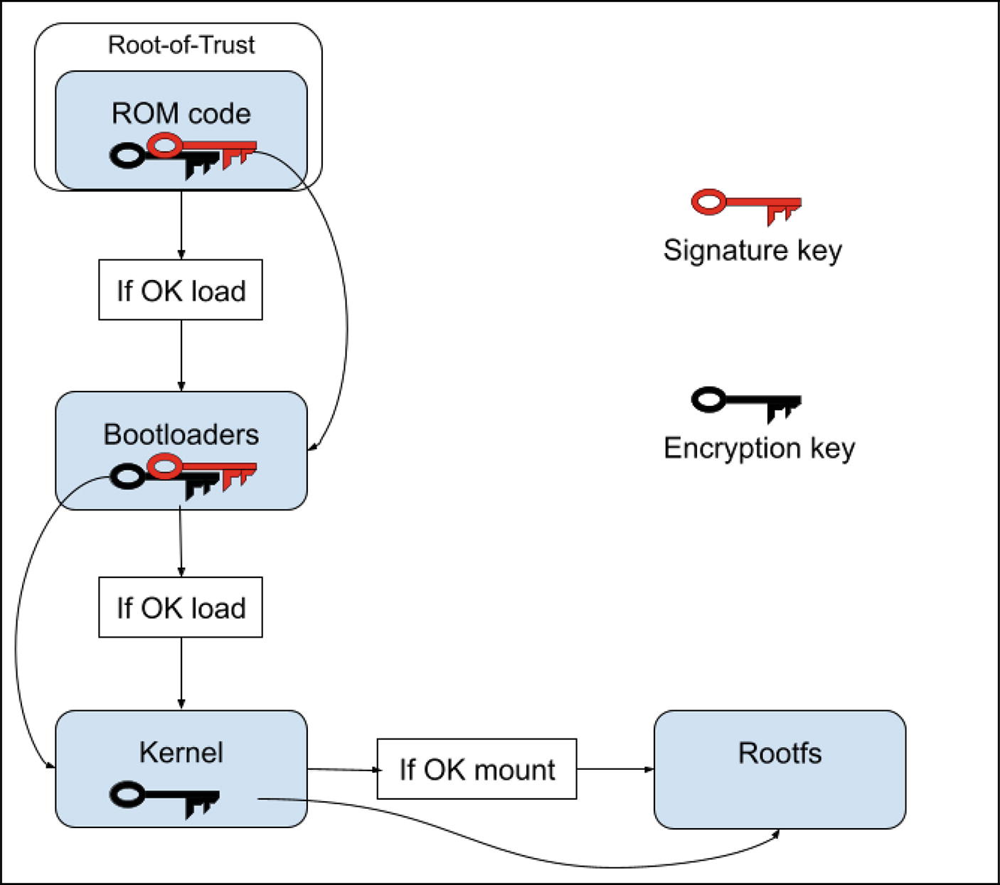
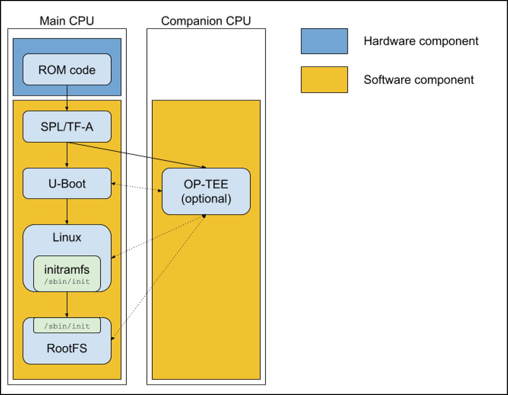
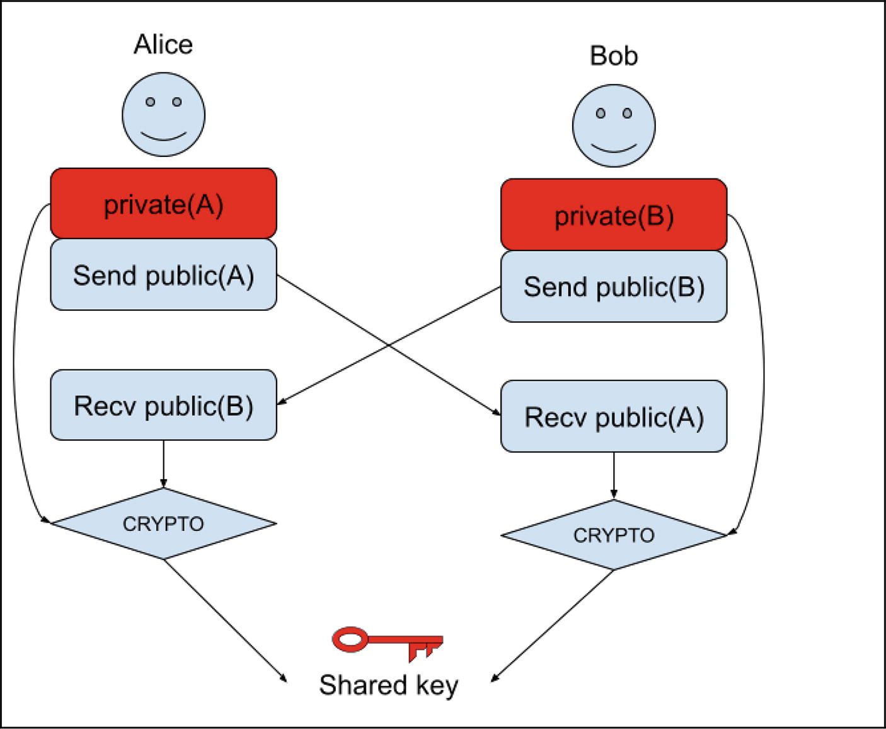
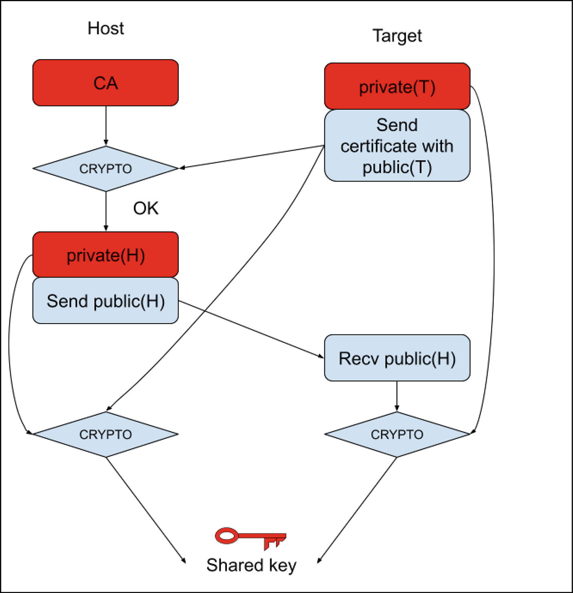
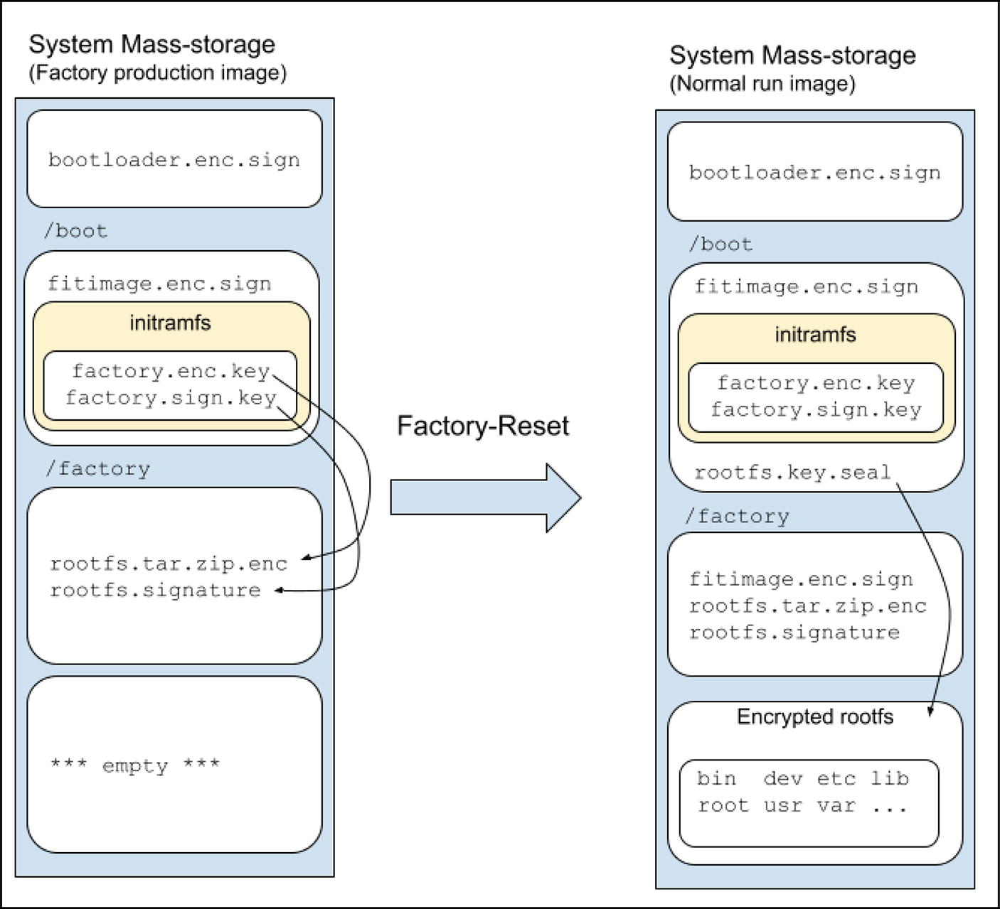
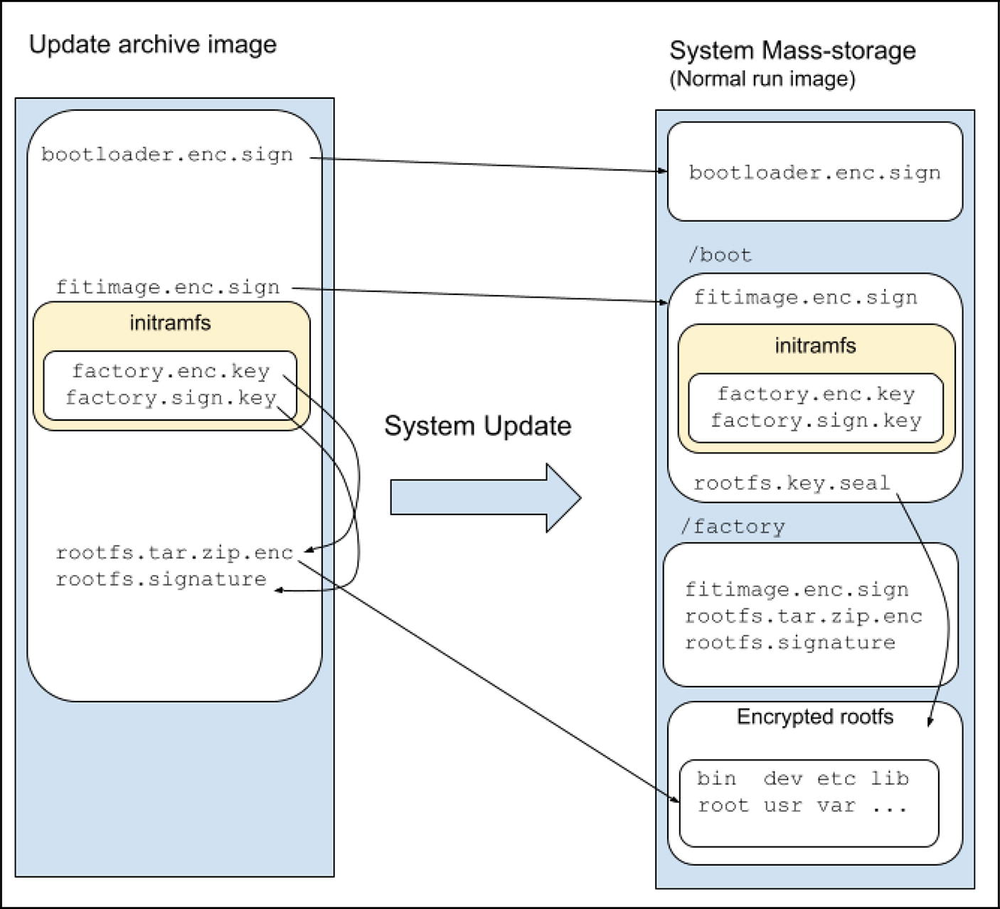

# 2. Secure Boot là gì (và KHÔNG phải là gì)

Rodolfo Giometti

LUCCA, Italy

**Secure Boot** là một tập hợp các quy tắc và cơ chế được thiết kế để bảo đảm rằng chỉ những software đáng tin cậy và đã được xác thực mới có thể chạy trong quá trình boot của một máy tính. Nó đóng vai trò một *người gác cổng*, ngăn không cho code trái phép hoặc độc hại được nạp và thực thi trước khi *hệ điều hành an toàn* thậm chí kịp khởi động. Secure Boot cũng có thể bảo đảm rằng mọi thành phần (hoặc ít nhất là những thành phần quan trọng chính) của các thành phần boot đều được mã hóa, nên nội dung của chúng cũng không thể đọc được.

> Với cụm từ *hệ điều hành an toàn,* chúng tôi muốn nói đến code mà chúng ta muốn hệ thống của mình chạy.

Trước khi có Secure Boot, các hệ thống thường dùng các bootloader tiêu chuẩn, vốn cung cấp rất ít khả năng bảo vệ trước malware có thể lây nhiễm hoặc thậm chí thay thế bootloader hoặc kernel (hoặc chỉ rootfs). Những malware như vậy có thể giành quyền kiểm soát sâu đối với hệ thống, khiến việc phát hiện và loại bỏ chúng trở nên rất khó khăn.

Hơn nữa, đã có những trường hợp software bị trích xuất từ một hệ thống hợp pháp rồi được thực thi trên phần cứng nhân bản!

Secure Boot nhằm giải quyết điều này bằng cách tạo ra một **Chain-of-Trust** ngay từ lúc máy tính được cấp nguồn, bằng cách khóa software với phần cứng theo cách mà chỉ software hợp pháp mới có thể được thực thi trên phần cứng hợp pháp và ngược lại.

Tóm lại, chúng ta có thể nói rằng Secure Boot là

- *Một cơ chế ngăn software trái phép chạy trên hệ thống*. Điều này đặc biệt đúng đối với các bootloader (và software đi kèm như OP-TEE), kernel, và, với một số khác biệt, các chương trình user-space.
- *Một cơ chế ngăn việc nhân bản một hệ thống bằng cách trích xuất software hợp pháp và chạy nó trên phần cứng nhân bản*.
- *Một cơ chế ngăn việc truy cập trái phép vào các bí mật của hệ thống khi hệ thống ở trạng thái power-off.*

Trong kịch bản này, Secure Boot là một tính năng bảo mật mạnh mẽ, nhưng cũng không thể thiếu việc hiểu rõ những gì nó không được thiết kế để làm! Thực tế, nó được thiết kế chỉ để bảo vệ quá trình boot bằng cách xác minh tính toàn vẹn của software trước khi hệ điều hành được nạp hoàn toàn. Nhiệm vụ của nó là xác minh tính toàn vẹn và tính xác thực của các thành phần boot cho đến khi rootfs đã mã hóa được mount. *Một khi hệ điều hành đã hoạt động, nhiệm vụ của Secure Boot đã hoàn thành*.

Vì vậy, một khi hệ thống đã hoạt động, nó không bảo vệ trước malware lây nhiễm vào hệ thống, chẳng hạn như virus, ransomware, spyware hoặc các cuộc tấn công phishing. Hơn nữa, nó không bảo vệ trước DDoS, Man-in-the-Middle hay bất kỳ cuộc tấn công mạng nào khác. Vì vậy, việc dùng Secure Boot không loại bỏ nhu cầu dùng firewall, cẩn thận với những gì chúng ta tải về và chạy trên hệ thống, và sao lưu dữ liệu của mình.

Hơn nữa, chúng ta nên xét rằng một khi rootfs đã mã hóa được mount, từ góc nhìn của các tiến trình, nó là một rootfs bình thường (không có mã hóa), vì vậy việc mã hóa rootfs là một biện pháp bảo vệ hiệu quả khi hệ thống ở trạng thái powered-off!

Secure Boot là một người bảo vệ rất chuyên biệt, đứng ngay ở lối vào quá trình boot của máy tính chúng ta. Nhiệm vụ của nó là bảo đảm rằng chỉ những vị khách được mời và đã được xác minh (software boot đã được ký) mới được phép vào hệ thống, ngăn các thực thể trái phép hoặc độc hại lọt vào trước khi bất cứ thứ gì khác khởi động.

**Nó là một lớp bảo mật nền tảng, không phải một bộ giải pháp bảo mật toàn diện!**

## 2.1 Chain-of-Trust

Chúng ta đã thấy ở trên rằng Secure Boot dựa trên khái niệm **Chain-of-Trust**; cơ chế đặc biệt này dựa vào chữ ký mật mã và mã hóa. Mỗi phần software boot, từ các bootloader (và software đi kèm của chúng), kernel đến rootfs, đều phải được ký số và mã hóa bằng một số private key. Thành phần đầu tiên, thành phần nền tảng, là thành phần được tin cậy theo mặc định, và nó được gọi là **Root-of-Trust**. Root of Trust không thể được xác minh bởi bất cứ thứ gì khác trong hệ thống; tính an toàn của nó được giả định vì nó được bảo vệ về mặt vật lý hoặc logic. Thông thường, đây là ROM code được ghi cố định (fuse) vào chip.

Hình 2-1 cố gắng giải thích những gì chúng tôi sắp mô tả.



*Hình 2-1* Chain-of-Trust

Khi hệ thống khởi động, ROM code kiểm tra chữ ký số của phần software boot đầu tiên mà nó nạp (đó là một bootloader và, có thể, một hoặc nhiều software đi kèm chuyên về các thuật toán mật mã, thường là OP-TEE—xem bên dưới). Nếu chữ ký của software boot ban đầu hợp lệ và khớp với một key trong chip (key này thường được giữ trong các FUSE—hay nói chung là memory non-volatile—trong chip), ROM code cho phép nó được giải mã rồi thực thi. Sau đó, đến lượt bootloader xác minh chữ ký của thành phần tiếp theo trong chuỗi boot (trong trường hợp của chúng ta là kernel), có thể lại nhờ đến sự trợ giúp của software đi kèm, và nếu mọi thứ đều ổn, nó giải mã kernel rồi thực thi kernel.

Ở bước cuối cùng, kernel dùng một encryption key để mount rootfs thực sự. Người đọc nên để ý rằng ở bước cuối này, bảo mật chỉ được bảo đảm bởi encryption key, vì không thể có một rootfs được ký!

> Lý do chúng ta không thể có một rootfs được ký xuất phát từ thực tế là quy trình ký không hiệu quả bằng quy trình mã hóa. Như đã thấy ở phần “Mã hóa Block-Level” trong Chương [1](ch01_linux_cryptography.vi.md), một đĩa đã mã hóa được triển khai bằng cách mã hóa từng block riêng lẻ, và thao tác này không thể thực hiện được đối với việc ký.

> Để giải quyết vấn đề này, developer có thể cân nhắc dùng các cơ chế khác ngăn việc thực thi tất cả những file chương trình được ký đúng cách, chẳng hạn như Linux Integrity Measurement Architecture (IMA) tại [`https://sourceforge.net/p/linux-ima/wiki/Home/`](https://sourceforge.net/p/linux-ima/wiki/Home/), vốn không được đề cập trong cuốn sách này.

Ở mỗi giai đoạn, các key có thể thay đổi, và trong trường hợp này, Chain-of-Trust vững chắc hơn; tuy nhiên, cơ chế này vẫn được coi là vững chắc ngay cả trong trường hợp chúng ta quyết định dùng cùng các key ở mọi giai đoạn.

Một cải tiến mà chúng ta có thể áp dụng cho Chain-of-Trust là **tamper detection**. Nói cách khác, nếu một chữ ký không hợp lệ (hoặc bị thiếu) hoặc phần cứng đã bị can thiệp (ví dụ, bằng cách mở vỏ máy nơi nó được lắp đặt), Secure Boot sẽ ngăn hệ thống boot và thường cảnh báo người dùng.

> Xem Phụ lục A, “Ghi chú về phát hiện can thiệp (Tamper Detection)”, để có thêm thông tin về cơ chế này.

## 2.2 Chuỗi boot

Chuỗi boot của Linux là một quá trình phức tạp nhưng hấp dẫn, một điệu nhảy được dàn dựng cẩn thận giữa software và phần cứng để đưa hệ điều hành của chúng ta vào hoạt động. Mặc dù có thể có những biến thể tùy theo phần cứng được dùng và bootloader hoặc hệ thống init cụ thể, hình tiếp theo trình bày một cái nhìn tổng quan chung về các giai đoạn điển hình, và các phần sau đây mô tả ngắn gọn từng giai đoạn.

Trước hết, chúng ta nên ghi nhớ rằng Hình 2-2 tập trung vào các hệ thống ARM-based; thực tế, với TF-A, chúng tôi muốn nói đến **ARM Trusted Firmware**, còn **OP-TEE** là một thành phần software gắn chặt với architecture ARM và *TrustZone security extensions* (xem phần sau của mục này để có thêm thông tin về các thành phần này). Tuy nhiên, với một vài thay đổi nhỏ, có thể coi nó là một cái nhìn tổng quan chung về chuỗi boot của một hệ thống Linux bất kỳ.



*Hình 2-2* Chuỗi boot của một hệ thống Linux-based điển hình

Ở thời điểm power-on, ROM boot code khởi động, và sau khi thực hiện một số bước khởi tạo, nó nạp bootloader (hoặc prebootloader, tùy theo đặc điểm cụ thể của hệ thống) từ một thiết bị lưu trữ rồi thực thi nó.

Vì ROM code là tập hợp các instruction, chương trình hoặc dữ liệu được pre-programmed hay ghi cố định vào một chip ROM, nó không thể thay đổi, và vì vậy nó là thành phần duy nhất được coi là *an toàn* (ít nhất là từ góc nhìn của Secure Boot).

Tình hình thay đổi khi chúng ta xét các thành phần khác cần được bảo vệ để có được một hệ thống an toàn.

### 2.2.1 Boot

Các hệ thống hiện đại dùng dynamic RAM (DRAM), vốn chưa sẵn sàng để sử dụng vào lúc power-on. Nó ở trạng thái thô chưa được khởi tạo, và CPU không thể đơn giản nạp chương trình vào đó hoặc thực thi code từ đó cho đến khi bộ điều khiển DRAM được cấu hình và bản thân các chip DRAM được thiết lập đúng cách (timing, tần số refresh, mức điện áp, v.v.). Đó là lý do chúng ta cần một thứ như **prebootloader** để khởi tạo DRAM (và các phần cứng thiết yếu khác) để code lớn hơn, phức tạp hơn (trong ví dụ của chúng ta là bootloader thực sự, nhưng trên một số hệ thống thậm chí là cả kernel!) có thể được nạp vào và thực thi từ đó.

Mặt khác, nếu hệ thống của chúng ta có sẵn một DRAM có thể dùng được, ROM boot có thể nạp và thực thi bootloader, rồi bootloader này (sau khi thực hiện các thiết lập quan trọng khác cho việc boot) đảm nhận việc nạp kernel từ một thiết bị lưu trữ rồi thực thi kernel.

Trong trường hợp của chúng ta, bootloader là U-Boot và prebootloader là **Secondary Program Loader** (**SPL**), nhưng điều này có thể khác đi… thực tế, các hệ thống hiện đại dùng thêm các thành phần khác được thực thi ở bước này. Chúng tôi đang nói đến **ARM Trusted Firmware** (thường được gọi là **ATF** hoặc, phổ biến hơn, **TF-A**) và **Open Portable Trusted Execution Environment** (**OP-TEE**).

OP-TEE (dành cho ARM Cortex-A) được thiết kế chủ yếu để chạy như một thành phần đi kèm với một Linux kernel non-secure, sử dụng công nghệ ARM TrustZone. Mục đích chính của OP-TEE là cho phép xử lý an toàn đối với các ứng dụng và dữ liệu quan trọng trên thiết bị. Nó cho phép developer xây dựng các *Trusted Application* (TA) chạy hoàn toàn bên trong Secure World, bảo vệ chúng trước malware hoặc các lỗ hổng trong hệ điều hành của Normal World.

Để giải thích ngắn gọn rõ hơn, chúng ta có thể nói rằng một Trusted Execution Environment (TEE) là một môi trường an toàn, được cô lập, chạy song song với một Rich Execution Environment (REE), vốn thường là một hệ điều hành bình thường như một bản phân phối Linux-based như Ubuntu hoặc Debian (hoặc Android, Windows, v.v.). Công nghệ phần cứng ARM TrustZone chia một bộ xử lý vật lý duy nhất thành hai *thế giới* được cô lập:

- *Secure World*: Đây là nơi TEE OP-TEE chạy. Nó được bảo vệ cao độ bằng các cơ chế phần cứng, bảo đảm rằng code và dữ liệu bên trong nó được giữ bí mật và được duy trì tính toàn vẹn, ngay cả khi thế giới bình thường bị xâm phạm.
- *Normal World*: Đây là nơi Linux chạy. Nó có toàn quyền truy cập hầu hết tài nguyên của hệ thống nhưng không thể trực tiếp truy cập hoặc can thiệp vào tài nguyên của Secure World.

Sự cô lập này đạt được thông qua việc phân tách memory hardware-enforced, các register được bảo vệ, và các điểm vào/ra được kiểm soát (thông qua Secure Monitor, thường được triển khai bởi ARM Trusted Firmware). Rất phổ biến trường hợp OP-TEE chạy trên một CPU khác bên trong cùng một chip (xem [`https://optee.readthedocs.io/en/latest/`](https://optee.readthedocs.io/en/latest/) để có thêm thông tin chi tiết).

Các thuật ngữ ARM Trusted Firmware (ATF) và Trusted Firmware-A (TF-A) thực sự có thể dùng thay thế cho nhau, và chúng đều chỉ một phần firmware quan trọng dành cho các architecture ARMv8-A và ARMv9-A. Vai trò chính của nó là thiết lập và duy trì một Trusted Execution Environment (TEE) bằng cách chạy ở mức đặc quyền cao nhất, đóng vai trò một **secure monitor** (xem [`https://trustedfirmware-a.readthedocs.io/en/latest/`](https://trustedfirmware-a.readthedocs.io/en/latest/) để có thêm thông tin chi tiết).

Từ góc nhìn của chúng ta, có thể nói rằng mục tiêu chính của TF-A là nạp U-Boot và (tùy chọn) OP-TEE rồi thực thi chúng. Trong khi OP-TEE sống trong thế giới an toàn của nó, U-Boot, trong thế giới bình thường, thực hiện các thiết lập của mình rồi nạp và thực thi kernel, có thể nhờ OP-TEE trợ giúp về mặt mật mã.

Ví dụ, trên một máy iMX8, chúng ta có thể nhận được các thông điệp sau:

```
U-Boot SPL 2024.04-imx_v2024.04_6.6.36-2.1.0+g476cc38e7e+p0 (Aug 07 2025 - 07:48:44 +0000)
DDRINFO: start DRAM init
DDRINFO: DRAM rate 4000MTS
DDRINFO:ddrphy calibration done
DDRINFO: ddrmix config done
SEC0:  RNG instantiated
Normal Boot
Trying to boot from BOOTROM
Boot Stage: Primary boot
image offset 0x8000, pagesize 0x200, ivt offset 0x0

Authenticate image from DDR location 0x401fadc0...
NOTICE:  Do not release JR0 to NS as it can be used by HAB
NOTICE:  BL31: v2.10.0  (release):automotive-15.0.0_1.1.0
NOTICE:  BL31: Built : 08:52:12, Nov  4 2024
...
```

Phần này liên quan đến prebootloader SPL. Người đọc nên để ý thông điệp sau:

```
Authenticate image from DDR location 0x401fadc0...
```

Một khi ROM code đã kiểm tra SPL, đến lượt SPL kiểm tra các image U-Boot và OP-TEE (các image tiếp theo sẽ được nạp) trước khi tiếp tục. Sau đó, mọi dòng có tiền tố `NOTICE` đều đến từ OP-TEE, rồi quá trình boot tiếp tục với các thông điệp sau từ bootloader thực sự:

```
...
U-Boot 2024.04-imx_v2024.04_6.6.36-2.1.0+g476cc38e7e+p0 (Aug 07 2025 - 0 7:48:44 +0000)

CPU:   i.MX8MP[8] rev1.1 1600 MHz (running at 1200 MHz)
CPU:   Industrial temperature grade (-40C to 105C) at 48C
Reset cause: POR
Model: board i.MX8MPlus iCore Plus
DRAM:  4 GiB
optee optee: OP-TEE api uid mismatch
Core:  76 devices, 27 uclasses, devicetree: separate
MMC:   FSL_SDHC: 1, FSL_SDHC: 2
Loading Environment from MMC... OK
In:    serial
Out:   serial
Err:   serial
SEC0:  RNG instantiated
switch to partitions #0, OK
mmc2(part 0) is current device
SOF:   0
flash target is MMC:2
Net:   eth1: ethernet@30bf0000 [PRIME]
Fastboot: Normal
Normal Boot
Hit any key to stop autoboot:  0
starting USB...
Bus usb@38100000: Register 2000140 NbrPorts 2
Starting the controller
USB XHCI 1.10
Bus usb@38200000: Register 2000140 NbrPorts 2
Starting the controller
USB XHCI 1.10
scanning bus usb@38100000 for devices... 1 USB Device(s) found
scanning bus usb@38200000 for devices... 2 USB Device(s) found
       scanning usb for storage devices... 0 Storage Device(s) found

Device 0: unknown device
MMC: no card present
switch to partitions #0, OK
mmc2(part 0) is current device
...
75301040 bytes read in 238 ms (301.7 MiB/s)
Booting from mmc ...
...
```

Các thông điệp này do U-Boot tạo ra, và chúng ta có thể thấy nó cố gắng bật một số interface, tìm cách định vị một kernel image để khởi động.

> Điều thú vị cần lưu ý là trong ví dụ này, bootloader chỉ được ký chứ không được mã hóa. Điều này không phải là vấn đề đối với Secure Boot vì nó không phá vỡ Chain-of-Trust (có chữ ký), và bootloader này không chứa bất kỳ thông tin nhạy cảm nào, nên dù code ở dạng plain text, đó cũng chỉ là code của bootloader chứ không phải chương trình ứng dụng.

> Mặt khác, nếu bootloader chứa một số thông tin nhạy cảm (ví dụ, một encryption key hoặc một mật khẩu), nó phải được bảo vệ bằng cách mã hóa toàn bộ bootloader hoặc ít nhất là bằng cách hash hoặc bọc (wrap) thông tin quan trọng này. Nếu không, Chain-of-Trust sẽ bị phá vỡ!

Khi tìm thấy một fitimage hợp lệ (tức là file chứa kernel image, Device-Tree và các thông tin hữu ích khác cho việc boot), bootloader in ra `Booting from mmc ...` và sau đó:

```
...
Authenticate image from DDR location 0x40400000...

Secure boot enabled

HAB Configuration: 0xcc, HAB State: 0x99
No HAB Events Found!
...
```

Đây là một bước xác thực khác. Thực tế, trước khi thực thi fitimage của kernel, U-Boot kiểm tra chữ ký của nó rồi giải mã nó. Nếu mọi thứ diễn ra tốt đẹp, chúng ta nhận được thông điệp boot quen thuộc, như dưới đây:

```
...
## Loading kernel from FIT Image at 40400000 ...
   Using 'conf-0' configuration
   Verifying Hash Integrity ... OK
   Trying 'kernel' kernel subimage
     Description:  Linux kernel [Image-initramfs-imx8mp-icore.bin]
     Created:      2025-08-22  16:30:12 UTC
     Type:         Kernel Image
     Compression:  uncompressed
     Data Start:   0x40400124
     Data Size:    75158016 Bytes = 71.7 MiB
     Architecture: AArch64
     OS:           Linux
     Load Address: 0x50000000
     Entry Point:  0x50000000
     Hash algo:    crc32
     Hash value:   87b1934a
   Verifying Hash Integrity ... crc32+ OK
## Loading fdt from FIT Image at 40400000 ...
   Using 'conf-0' configuration
   Verifying Hash Integrity ... OK
   Trying 'fdt-0' fdt subimage
     Description:  Flattened Device Tree [imx8mp-icore.dtb]
     Created:      2025-08-22  16:30:12 UTC
     Type:         Flat Device Tree
     Compression:  uncompressed
     Data Start:   0x44bad420
     Data Size:    62818 Bytes = 61.3 KiB
     Architecture: AArch64
     Load Address: 0x45000000
     Hash algo:    crc32
     Hash value:   e66a2c9e
   Verifying Hash Integrity ... crc32+ OK
   Loading fdt from 0x44bad420 to 0x45000000
   Booting using the fdt blob at 0x45000000
Working FDT set to 45000000
   Loading Kernel Image to 50000000
   Using Device Tree in place at 0000000045000000, end 0000000045012561
Working FDT set to 45000000

Starting kernel ...
...
```

Một fitimage hợp lệ giờ đã được thực thi, và sau thông điệp `Starting kernel ...`, CPU đang thực thi code Linux.

### 2.2.2 Khởi động kernel

Một khi kernel khởi động, nó thiết lập mọi thành phần và thiết bị của hệ thống, rồi thực hiện hai bước cuối cùng: mount root filesystem (rootfs) rồi thực thi tiến trình `init` (trên các hệ thống hiện đại, thường là **Systemd**).

Trong trường hợp của chúng ta, kernel là Linux, và các thông điệp boot tiếp tục như dưới đây:

```
...
[    0.000000] Booting Linux on physical CPU 0x0000000000 [0x410fd034]
[    0.000000] Linux version 6.6.52-gebea7e7c2b53 (oe-user@oe-host) (aarch64-poky-linux-gcc (GCC) 13.3.0, GNU ld (GNU Binutils) 2.42.0.20240723)
 #1 SMP PREEMPT Fri Aug 22 15:04:30 UTC 2025
[    0.000000] KASLR disabled due to lack of seed
[    0.000000] Machine model: board i.Core i.MX8M Plus
...
[    0.000000] Kernel command line: console=ttymxc1,115200 device=/dev/mmcblk2 root=/dev/mmcblk2p4 rootwait rw initramfs_normal boot_schema=a_b root_name=root_b
[    0.000000] Unknown kernel command line parameters "initramfs_normal device=/dev/mmcblk2 boot_schema=a_b root_name=root_b", will be passed to user space.
...
```

Thông thường, bootloader trao đổi một số thông tin với kernel bằng cách dùng thứ so-called **kernel command line**. Người đọc nên hình dung như thể bootloader chạy kernel bằng cách thực thi nó từ một dòng lệnh giả định. Nhìn vào output ở trên, giống như có ai đó đã gõ lệnh dưới đây trên dòng lệnh của bootloader:

```
uboot> fitimage console=ttymxc1,115200 device=/dev/mmcblk2 root=/dev/mmcblk2p4 rootwait rw initramfs_normal boot_schema=a_b root_name=root_b
```

Theo cách này, kernel phân tích dòng lệnh và thu thập thông tin về cách tiếp tục quá trình boot.

> Ý nghĩa của các thiết lập ở trên sẽ được giải thích chi tiết ở phần sau của cuốn sách này. Ngoài ra, người đọc có thể tham khảo phần “Sửa dòng lệnh kernel” trong Phụ lục B để xem cách bảo vệ thông tin này.

### 2.2.3 Đi vào root filesystem

Root filesystem, viết tắt là *rootfs*, là thư mục highest-level trong cây phân cấp filesystem của Linux (và các hệ Unix-like). Nó được ký hiệu bằng một dấu gạch chéo duy nhất (/) và là trung tâm của toàn bộ hệ điều hành Linux của bạn. Mọi file và thư mục khác trên hệ thống của chúng ta, dù nằm trên cùng một đĩa vật lý hay trên một đĩa khác, đều được mount (hay kết nối) một cách logic bên dưới root filesystem.

Rootfs thường nằm trên một thiết bị lưu trữ, và kernel có thể mount nó trực tiếp, nhưng các hệ điều hành hiện đại (dựa trên Linux) thích thực hiện một bước trung gian trước khi thực sự mount rootfs *cuối cùng* này; tức là, chúng dùng một initial RAM filesystem (thường được gọi là **initramfs**).

Initramfs là một root filesystem nhỏ, tạm thời, in-memory mà Linux kernel dùng trong các giai đoạn boot sớm, trước khi root filesystem thực sự (filesystem chứa toàn bộ hệ điều hành của chúng ta) có thể được mount. Hãy hình dung nó như một mini-operating system nhỏ, self-contained, có mục đích duy nhất là giúp hệ điều hành chính khởi động. Nó có thể nằm trên một thiết bị lưu trữ, nhưng khá phổ biến là nó được đóng gói ngay bên trong kernel.

Initramfs hữu ích khi phải hoàn thành những tác vụ đặc biệt trước khi mount rootfs thực sự; ví dụ, nếu rootfs được lưu trên một hệ thống RAID hoặc trong trường hợp chúng ta phải cập nhật toàn bộ rootfs trước khi thực thi nó; nói đơn giản, trong mọi trường hợp mà rootfs thực sự không thể được kernel truy cập trực tiếp.

Một khi initramfs đã thực hiện mọi bước cần thiết để lấy được rootfs thực sự, tiến trình init trong initramfs chạy lệnh `switch_root` để chuyển sang root filesystem *thực sự*, chứa hệ điều hành thực sự (hay đầy đủ) và tiến trình `init` thực sự.

Để giải thích ngắn gọn khái niệm này, chúng ta có thể nói rằng một khi rootfs thực sự đã được lấy về rồi mount vào thư mục `real_rootfs`, chúng ta có thể *nhảy* vào đó và thực thi tiến trình `/sbin/init` của nó bằng các lệnh sau:

```
exec switch_root /real_rootfs /sbin/init
```

Lệnh này thực sự thực hiện việc chuyển đổi giữa root hiện tại (bên trong initramfs) và root thực sự (bên trong root filesystem thực sự, hay đầy đủ). Chúng ta có thể có thêm thông tin bằng cách đọc manpage của nó (`man 8 switch_root`):

```
SWITCH_ROOT(8)           System Administration          SWITCH_ROOT(8)

NAME
       switch_root - switch to another filesystem as the root of the mount tree

SYNOPSIS
       switch_root [-hV]

       switch_root newroot init [arg...]

DESCRIPTION
       switch_root moves already mounted /proc, /dev, /sys and /run to newroot and makes newroot the new root filesystem and starts init process.

       WARNING: switch_root removes recursively all files and
       directories on the current root filesystem.
...
```

Người đọc nên lưu ý kỹ thực tế rằng (như đã nêu ở trên) `switch_root` xóa đệ quy mọi file và thư mục trên root filesystem hiện tại. Đây là một bước quan trọng để cô lập root cũ; tức là, initramfs (root cũ) sẽ trở nên không thể truy cập đối với hệ thống đang boot mới, và nó có thể được unmount tùy chọn và sẽ đơn giản biến mất khi vùng memory đó được thu hồi. Điều này rất quan trọng vì initramfs đã chiếm RAM, và nội dung của nó không còn cần thiết nữa, nhưng ngoài ra nó còn có thể chứa những thông tin mà chúng ta không muốn chia sẻ với rootfs thực sự!

Trước khi kết thúc phần này, chúng ta nên nhấn mạnh hai khái niệm quan trọng:

1) Người đọc không nên nhầm lẫn lệnh `switch_root` với lệnh `chroot`; chúng là hai lệnh hoàn toàn khác nhau! Lệnh thứ nhất là một thao tác system-wide, làm thay đổi sâu sắc môi trường nền tảng của hệ thống, được thiết kế riêng để quá trình boot chuyển từ một root tạm thời sang root lâu dài. Nó cũng thay đổi root filesystem cho *toàn bộ kernel đang chạy* và xử lý việc di dời/cô lập root filesystem cũ.

   Trong khi đó, `chroot` chỉ thay đổi thư mục root *cho một tiến trình cụ thể và các tiến trình con của nó, nó* thường được dùng cho các môi trường cô lập (ví dụ, build software, sửa chữa một hệ thống bị hỏng, các network daemon, v.v.) mà không ảnh hưởng đến các tiến trình đang chạy khác. Khi dùng nó, root filesystem thực sự của kernel cho toàn hệ thống vẫn không thay đổi, và nó không liên quan đến việc di chuyển root cũ hay dọn dẹp root cũ.

2) Lệnh `switch_root` được shell thực thi với từ khóa `exec`. Đây là một bước thiết yếu! Thực tế, `exec <cmd>` trong một shell Unix-like (như Bash) thay thế tiến trình shell hiện tại bằng lệnh được chỉ định, mà không tạo ra một tiến trình mới. Khi chúng ta chạy `<cmd>`, shell fork một tiến trình mới rồi chờ lệnh hoàn thành, còn khi chúng ta chạy `exec <cmd>`, bản thân shell biến thành `<cmd>`! Tiến trình shell (và PID của nó) được thay thế bằng image của lệnh `<cmd>`. Không có tiến trình mới nào được tạo ra, và shell không bao giờ tiếp tục chạy lại!

   Trong tình huống này, khá rõ ràng vì sao hành vi này thực sự quan trọng; thực tế, chúng ta phải chắc chắn rằng tiến trình init bên trong root filesystem thực sự có PID 1 (như một tiến trình `init` well-functioning cần có).

Dưới đây là một ví dụ về những gì kernel in ra trong bước này:

```
...
[    3.521508] Freeing unused kernel memory: 43456K
[    3.526221] Run /init as init process
...
[    3.644601] EXT4-fs (mmcblk2p1): mounted filesystem f2bfad6c-b3c9-4037-962a-a9065f7cc929 r/w with ordered data mode. Quota mode: none.
[    3.670644] EXT4-fs (mmcblk2p1): unmounting filesystem f2bfad6c-b3c9-4037-962a-a9065f7cc929.
937875274
222247019
init: checking rootfs on /dev/mapper/root...
e2fsck 1.47.0 (5-Feb-2023)
root: clean, 17913/256000 files, 228590/1024000 blocks
init: mounting rootfs on /dev/mapper/root...
[    3.801532] EXT4-fs (dm-0): mounted filesystem e021413f-2f93-4471-844
3-e0f5704b1f07 r/w with ordered data mode. Quota mode: none.
init: entering rootfs on /dev/mapper/root...
...
```

Như chúng ta có thể thấy, kernel khởi động `init`, rồi đến lượt nó mount rootfs trên `/dev/mapper/root`. Đây không phải là một block device thông thường (như `/dev/sda1`, `/dev/mmcblk2` hoặc `/dev/mtd5`), mà là một block device đặc biệt thực hiện việc mã hóa root filesystem.

> Cách triển khai nó sẽ được giải thích chi tiết trong Chương [3](ch03_real_implementations.vi.md).

Sau đó, quá trình boot tiếp tục như thường lệ, và `init` trong initramfs được thay thế bằng tiến trình init thực sự, trong ví dụ của chúng ta là `systemd`:

```
...
[    4.319682] systemd[1]: systemd 255.18^ running in system mode (+PAM-AUDIT -SELINUX -APPARMOR +IMA -SMACK +SECCOMP -GCRYPT -GNUTLS -OPENSSL+ACL +BLKID -CURL -ELFUTILS -FIDO2 -IDN2 -IDN -IPTC +KMOD -LIBCRYPTSETUP +LIBFDISK -PCRE2 -PWQUALITY -P11KIT -QRENCODE -TPM2 -BZIP2 -LZ4 -XZ -ZL IB +ZSTD -BPF_FRAMEWORK +XKBCOMMON +UTMP +SYSVINIT default-hierarchy=uni fied)
[    4.351695] systemd[1]: Detected architecture arm64.

Welcome to BNDL Distro with XWayland 6.6-scarthgap (scarthgap)!
...
```

Sau đó, Systemd khởi động mọi thành phần cần thiết, và quá trình boot kết thúc:

```
...
[  OK  ] Started Session c1 of User root.
[   11.643582] weston[392]: memfd_create() called without MFD_EXEC or MFD_NOEXEC_SEAL set [  OK  ] Started Weston, a Wayland compositor, as a system service.
[   13.536964] i2c 1-004c: deferred probe pending

BNDL Distro with XWayland 6.6-scarthgap imx8mp-icore-devel ttymxc1

imx8mp-icore-devel login:
...
```

> Lưu ý rằng, để đơn giản, chúng tôi đã trình bày ở trên dấu nhắc console, nhưng dĩ nhiên hệ thống có thể khởi động với giao diện đồ họa (`Weston`).

Trước khi kết thúc phần này, chúng tôi nhấn mạnh một lần nữa rằng Chain-of-Trust bảo đảm ở mỗi giai đoạn, software đúng được thực thi, nhưng đối với root filesystem, điều này đúng cho filesystem xét như một tổng thể chứ không phải cho từng chương trình trong đó! Thực tế, Chain-of-Trust có thể dừng lại nếu rootfs không được mã hóa đúng cách, nhưng một khi việc mount đã được thực hiện, từ góc nhìn của các tiến trình, filesystem ở dạng plain text, và khi đó không ai kiểm tra tính hợp lệ của từng chương trình, bắt đầu từ tiến trình `/sbin/init`.

## 2.3 Sản xuất một hệ thống mới (Factory-Reset)

Cho đến giờ, chúng ta đã xét một hệ thống đang chạy ở trạng thái bình thường: các chương trình chính đang hoạt động, mọi cấu hình đều có hiệu lực, và mọi thứ hoạt động như vẫn thường.

Tuy nhiên, mọi hệ thống đều có một giai đoạn sản xuất tại nhà máy; tức là quy trình quan trọng đòi hỏi thiết bị chuyên dụng và tuân theo một trình tự cụ thể để bảo đảm software đúng được nạp và board hoạt động được. Thông thường, bước này còn được gọi là **firmware programming** hay flashing.

Khi một board đã được lắp ráp đầy đủ các linh kiện, nó là một tấm bảng trắng, và một firmware (software điều khiển phần cứng) phải được nạp vào memory non-volatile của board (đối với các hệ thống Linux-based, loại memory này thường là flash memory).

Lập trình một hệ thống trắng không phải là một nhiệm vụ khó, nhưng khi có Secure Boot tham gia, chúng ta phải chú ý đến một số khía cạnh!

Trước hết, chúng ta nên xét rằng mọi firmware image phải được ký đúng cách và (lý tưởng là) được mã hóa. Chỉ những dữ liệu không nhạy cảm mới có thể ở dạng plain text hoặc không được ký. Sau đó, chúng ta cũng phải lập trình để CPU đi vào trạng thái secure của nó, và rồi signature key phù hợp cùng (lý tưởng là) encryption key cũng phải được ghi cố định (fuse) vào chính CPU.

Tất cả các best practice này thường được gọi chung là **Software Secure Provisionin**g (SSP).

### 2.3.1 Sản xuất trong môi trường In-House

Nếu giai đoạn sản xuất tại nhà máy được thực hiện in-house, chúng ta có thể dùng một quy trình sản xuất đơn giản hóa, và một quy trình điển hình có thể gồm các bước sau:

1) CPU thực hiện một lần boot bình thường và nạp (qua interface serial hoặc USB) một đoạn code ban đầu. Thông thường, một bản release U-Boot đặc biệt được cấu hình phù hợp để thực thi mọi lệnh cần thiết ở giai đoạn này.
2) Đoạn code ban đầu ghi các key cần thiết vào các FUSE và kiểm tra rằng mọi thứ đều ổn.
3) Nếu ổn, đoạn code ghi bản release firmware ban đầu vào flash memory rồi khởi động lại.
4) Bây giờ CPU chạy ở trạng thái secure và nạp bootloader an toàn, và quá trình boot với Chain-of-Trust bắt đầu.

> Các bước ở trên có thể thay đổi một chút tùy theo CPU cụ thể được dùng; tuy nhiên, những gì được trình bày ở đây là rất phổ biến.

Về bước 1, chúng ta có thể lưu ý rằng mình có thể dùng một bootloader chưa được ký vì chính chúng ta là người thực sự thực hiện bước này, và chúng ta có thể giả định rằng không có software độc hại nào được dùng. Tuy nhiên, bước 2 tế nhị hơn một chút; thực tế, trong bước này có một số key quan trọng tham gia.

Ví dụ, hãy xét encryption key của các bootloader và kernel. Ngay cả khi chúng ta ở trong một môi trường (tương đối) an toàn, khả năng encryption key bị lộ trên kênh truyền thông là có rủi ro (ví dụ, các bus serial có thể dễ dàng bị đọc bằng các thiết bị đo rẻ tiền). Trong tình huống này, chúng ta có thể hình dung việc triển khai một **Key-Agreement Protocol** mật mã cụ thể bên trong bootloader để nó có thể trao đổi dữ liệu ở dạng an toàn với một server từ xa quản lý việc sản xuất tại nhà máy.

Một giao thức có thể dùng là giao thức trao đổi Diffie–Hellman, cho phép hai bên, vốn không biết gì trước về nhau, thiết lập một shared secret key qua một kênh truyền thông vốn không an toàn (xem Hình 2-3).



*Hình 2-3* Cách giao thức trao đổi Diffie–Hellman hoạt động

Một khi dữ liệu nhạy cảm đã được truyền và được ghi cố định đúng cách vào hệ thống mới (bước 3), chúng ta có thể khởi động lại an toàn ở chế độ secure (bước 4), và mọi thứ có thể tiếp diễn mà không gặp vấn đề gì.

Quy trình này có thể dễ dàng được triển khai trên hầu hết mọi CPU, trong khi điểm then chốt là không có software hay phần cứng độc hại nào được dùng để đánh cắp bí mật trong quá trình lập trình các FUSE.

### 2.3.2 Sản xuất trong môi trường Third-Party

Mặt khác, nếu chúng ta quyết định sản xuất hệ thống của mình tại một nhà máy third-party, các giả định đưa ra ở phần trước (đặc biệt là giả định về bước đầu tiên) không còn đúng. Thực tế, ngay cả khi chúng ta dùng một giao thức KPP để bảo vệ việc trao đổi key, chúng ta không có gì bảo đảm về việc đoạn code ban đầu nào được thực thi ở bước 1 nói trên! Hơn nữa, ngay cả khi có được một mức bảo đảm nào đó rằng đoạn code ban đầu không độc hại, chúng ta cũng không có gì bảo đảm rằng software đó thực ra được thực thi trên phần cứng độc hại!

Hãy xét kịch bản này: chúng ta đã quyết định thuê ngoài việc sản xuất board cho một nhà cung cấp third-party, và để bảo đảm software ban đầu đúng là thứ chúng ta muốn, chúng ta đã cung cấp cho công ty này một phần cứng đặc biệt có khả năng đưa code của chúng ta vào lúc boot cho mọi hệ thống mới mà họ sản xuất. Sau khi làm xong việc này, cũng dùng chính hệ thống đó, chúng ta bắt đầu giao tiếp với thiết bị mới cần lập trình rồi gửi cho nó các key mà nó cần ghi vào các fuse.

Được thôi, nhưng ai có thể bảo đảm với chúng ta rằng chúng ta thực sự đang giao tiếp với một thiết bị mới chứ không phải với một phần cứng độc hại đang bắt chước giao thức truyền thông chỉ để đánh cắp các key của chúng ta?

Lựa chọn duy nhất là dùng một hệ thống xác thực bên trong ROM code! Thực tế, ROM code được coi là an toàn theo mặc định, và bằng cách dùng một chứng chỉ đặc biệt do vendor CPU cung cấp, chúng ta có thể chắc chắn rằng mình đang thực sự giao tiếp với một hệ thống chính hãng.

> Thực ra, điều này không hoàn toàn đúng. Thực tế, có những trường hợp chúng ta có thể giải quyết vấn đề bằng cách thực hiện một pre-phase, trong đó chúng ta dùng một bootloader đã được ký để ghi các FUSE. Nhưng đây không phải là một giải pháp tổng quát, nằm ngoài phạm vi của cuốn sách này.

Trong kịch bản này, một giai đoạn sản xuất điển hình có thể gồm các bước sau:

1) CPU đích thực hiện một lần boot được bảo vệ, và ROM code gửi chứng chỉ của nó chứa public key.
2) Một khi máy host đã xác minh chứng chỉ với một Certificate Authority cụ thể (thường là một public key của vendor CPU), nó trả lời thiết bị đích bằng public key của mình.
3) Bây giờ kênh an toàn có thể được tạo ra bằng cách dùng shared key vừa được tạo, và máy host có thể gửi an toàn các key cần thiết tới ROM code của thiết bị đích, rồi đến lượt ROM code tiến hành lập trình các FUSE.
4) Khi đã hoàn tất, CPU đích có thể khởi động lại ở trạng thái secure, và việc sản xuất tại nhà máy có thể tiếp tục mà không có bất kỳ lo ngại nào.



*Hình 2-4* Primitive key-agreement protocol trong ROM code

Lưu ý rằng quy trình trong Hình 2-4 rất giống với quy trình ở phần trước, nhưng nó đòi hỏi sự hỗ trợ cụ thể từ CPU, và không phải CPU nào cũng làm được.

### 2.3.3 Root filesystem ban đầu

Khi bàn về Chain-of-Trust, chúng tôi đã nói rằng mọi image phải được ký đúng cách và (lý tưởng là) được mã hóa. Chúng ta cũng có thể hình dung việc tạo ra một flash image dạng binary trong đó mọi thứ đều đã sẵn sàng, có thể được ghi đơn giản vào thiết bị lưu trữ của hệ thống; tuy nhiên, một vấn đề có thể phát sinh khi chúng ta phải tạo rootfs đã mã hóa.

Chúng ta đã thấy ở phần “Mã hóa Block-Level” trong Chương [1](ch01_linux_cryptography.vi.md) rằng rootfs thường được mã hóa bằng một key ngẫu nhiên, vốn thường cũng không được developer biết đến! Vì vậy, rõ ràng là chúng ta không thể build sẵn một image hợp lệ cho nó. Hơn nữa, ngay cả khi chúng ta biết rõ encryption key, vẫn còn khó khăn là trên một số CPU, key này thường được niêm phong, và thao tác này tạo ra các binary khác nhau cho mỗi CPU (vì thao tác niêm phong phụ thuộc vào một master key duy nhất của mỗi CPU).

Để giải quyết vấn đề này, cách tốt nhất là cung cấp một root filesystem ban đầu dưới dạng một archive đơn giản (thường là một file TAR nén), và trong lần boot đầu tiên, hệ thống tự động tạo rootfs đã mã hóa rồi sao chép mọi file vào đó. Trong kịch bản này, encryption key của rootfs ban đầu này có thể được lưu ở dạng an toàn bên trong kernel image (ví dụ, trong initramfs của một fitimage đã mã hóa—xem Hình 2-5).



*Hình 2-5* Quá trình factory-reset

Như chúng ta có thể thấy trong hình ở trên, thông thường bên trong flash image dùng cho sản xuất tại nhà máy, chúng ta có

- Một image bootloader (một hoặc nhiều bootloader) đã được ký và (lý tưởng là) được mã hóa. Image này thường không được đặt trong một phân vùng, mà được ghi tại một số offset cụ thể trong đĩa lưu trữ.
- Một image fitimage vừa được ký vừa được mã hóa. Image này chứa kernel, và đến lượt kernel nhúng initramfs, nơi đặt encryption key (`factory.enc.key`) và public signature key (`rootfs.sign.key`) dành cho rootfs xuất xưởng.
- Một image rootfs dưới dạng một archive TAR, vừa được ký vừa được mã hóa, chứa các file rootfs sẽ được cài đặt vào phân vùng rootfs đã mã hóa trong tương lai. Trong hình, image archive đã nén và được ký này được đặt tên là `rootfs.tar.zip.enc`, còn với `rootfs.signature`, chúng tôi chỉ chữ ký số tương ứng; tuy nhiên, chúng ta có thể dùng một file duy nhất trong đó chữ ký được nối vào cuối (trong trường hợp này, chúng ta có thể đặt tên file là `rootfs.tar.zip.enc.sign`).

Bootloader nạp, kiểm tra rồi thực thi fitimage. Kernel bên trong fitimage khởi động và thực thi tiến trình `init` trong initramfs được nhúng, tiến trình này kiểm tra chữ ký của rootfs và, nếu thành công, giải mã và cài đặt các file rootfs vào một phân vùng rootfs đã mã hóa mới được tạo.

Bây giờ hẳn đã rõ vì sao việc fitimage phải được mã hóa là điều then chốt; lý do là encryption key cần thiết để giải mã archive TAR thường được đặt trong initramfs.

Key dùng để tạo rootfs đã mã hóa được lưu, ở dạng đã niêm phong, trong phân vùng `/factory` (hoặc bất kỳ phân vùng plain text nào khác) để được dùng ở mỗi lần hệ thống boot. Lưu ý rằng việc tạo rồi niêm phong key này không phải là vấn đề, vì mọi thao tác đều được thực hiện bởi chính CPU thực sự sử dụng chúng chứ không phải trên một máy host chung chung.

## 2.4 Cập nhật hệ thống (System-Update)

Mọi ứng dụng embedded đều nên tính đến một cách thích hợp để tự cập nhật. Và việc cập nhật trong một hệ thống có Secure Boot kéo theo việc chúng ta phải cân nhắc một số biện pháp phòng ngừa (dù ít khắt khe hơn so với trong factory-reset).

Trước hết, mọi firmware image phải được ký và mã hóa đúng cách bằng đúng các key, nếu không việc cập nhật có thể thất bại hoặc, tệ hơn, hệ thống sẽ bị treo! Một bản cập nhật điển hình có thể là một archive gồm image bootloader (`bootloader.enc.sign`, nếu cần), image fitimage (`fitimage.enc.sign`) và rootfs dưới dạng một archive TAR nén (một lần nữa dưới dạng hai file riêng biệt: `rootfs.tar.zip.enc` là image archive đã nén và được ký, và `rootfs.signature` là chữ ký số của rootfs). Hình 2-6 trình bày cấu hình này.



*Hình 2-6* Quá trình system-update

Để cập nhật rootfs, chúng ta phải truy cập được encryption key dùng để mã hóa archive TAR của rootfs và (trong một số trường hợp) cả encryption key dùng để mã hóa rootfs đang chạy, nơi các file này phải được cài đặt. Việc truy cập key thứ hai, tức là key dùng để mã hóa rootfs đang chạy, không phải là vấn đề vì nó ở dạng đã niêm phong trong thư mục `/boot`; tế nhị hơn một chút là vấn đề làm thế nào để truy cập encryption key của archive TAR rootfs theo cách mà key không bị lộ trong filesystem.

Khó khăn này liên quan đến cách chúng ta quyết định triển khai hệ thống, và mọi thứ sẽ rõ ràng hơn ở phần sau của cuốn sách này, khi chúng tôi trình bày các schema boot khác nhau mà hệ thống của chúng ta có thể có.

Tạm thời, người đọc nên ghi nhớ rằng key này phải được quản lý đúng cách để ngăn việc truy cập không mong muốn.

## 2.5 Tóm tắt

Trong chương này, chúng ta đã thấy **Secure Boot** là gì thông qua việc giới thiệu khái niệm **Chain-of-Trust** và giải thích chi tiết chuỗi boot.

Chúng tôi đã trình bày chi tiết chuỗi boot của Linux, tập trung vào các hệ thống ARM-based và vai trò của các thành phần như SPL, U-Boot, **ARM Trusted Firmware (TF-A)** đóng vai trò secure monitor, và **Open Portable Trusted Execution Environment (OP-TEE)** để cô lập Secure World. Chúng tôi cũng đã giới thiệu những điều chúng ta cần ghi nhớ khi muốn sản xuất một hệ thống được bảo mật (in-house hoặc tại một nhà máy third-party) hoặc khi phân phối một bản cập nhật hệ thống, nhằm ngăn khả năng Chain-of-Trust bị phá hỏng hoặc các bí mật của hệ thống bị khai thác. Bây giờ chúng ta đã sẵn sàng chuyển sang chương tiếp theo, nơi chúng tôi sẽ trình bày cách một bản triển khai thực tế hoạt động, để hiểu rõ hơn cách chúng ta có thể triển khai mọi khái niệm của Secure Boot trong hệ thống của mình.
