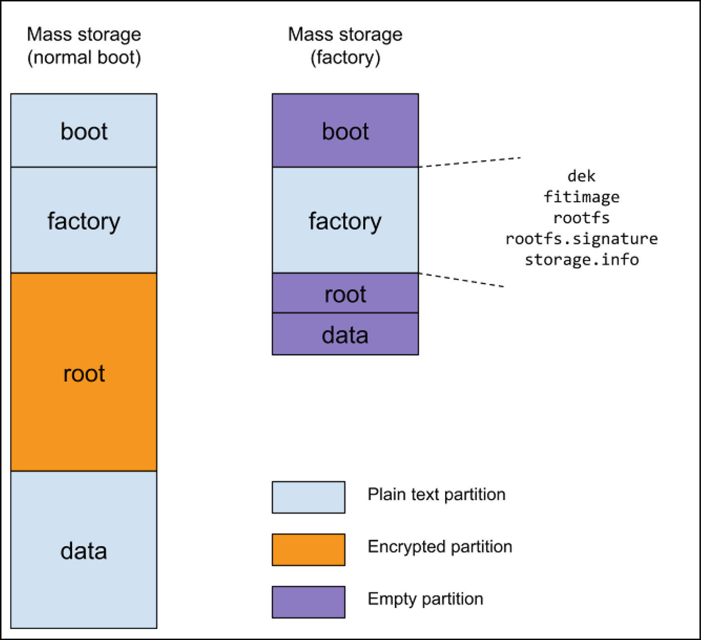
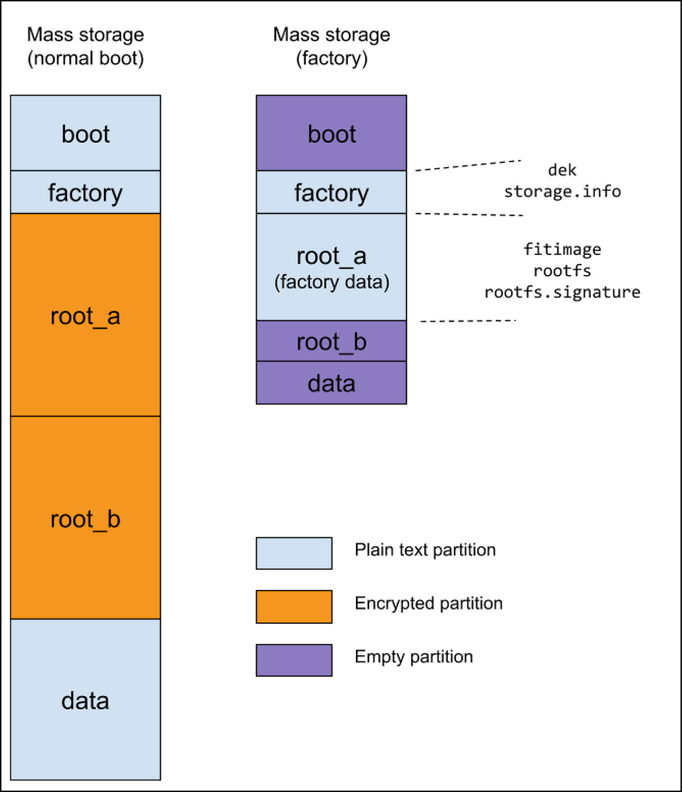

# 3. Các hiện thực thực tế

Rodolfo Giometti

LUCCA, Italy

Các hệ điều hành Linux-based có thể được cài đặt trên những hệ thống cực kỳ đa dạng, bắt đầu từ một máy PC để bàn (hoặc laptop) bình thường, qua smartphone, điểm truy cập WiFi, smart TV, hay ở những vị trí rất bất ngờ như tàu hỏa, tủ điện hoặc thiết bị y tế. Ở những thiết bị kể sau, chúng ta phải chắc chắn rằng hệ thống có thể được khôi phục và cập nhật một cách đáng tin cậy mà không cần bất kỳ sự can thiệp nào của người dùng (hoặc ít nhất là với rất ít hỗ trợ chuyên môn). Để đạt được điều này, mọi thành phần của hệ thống phải được đặt cẩn thận trên thiết bị lưu trữ (hoặc các thiết bị lưu trữ) của hệ thống nhằm bảo đảm việc khôi phục hoặc cập nhật đáng tin cậy và an toàn.

Ở phần trước, chúng tôi đã trình bày mọi thành phần boot, và ở đây chúng ta có thể xem cách tổ chức chúng trong hệ thống. Tại thời điểm viết cuốn sách này, thiết bị lưu trữ được dùng nhiều nhất là eMMC, dù chúng ta vẫn có thể gặp các thiết bị trang bị NOR hoặc NAND, hoặc kết hợp chúng (NOR + eMMC hoặc NAND + eMMC).

> Thuật ngữ eMMC là viết tắt của **embedded MultiMediaCard**. Về cơ bản, nó là một loại flash memory NAND dùng để lưu trữ trong các thiết bị di động và hệ thống embedded. Điểm khác biệt so với flash NAND thô là nó còn tích hợp một bộ điều khiển và một interface vào cùng một package, khiến nó trở thành một giải pháp lưu trữ gọn nhẹ và hiệu quả mà, từ point-of-view của người dùng cuối, nó giống hệt một ổ cứng.

Linux gán cho eMMC một tên thiết bị thường theo mẫu `/dev/mmcblkX`, trong đó `X` là một con số định danh thiết bị cụ thể. Ví dụ, dưới đây là các thông điệp boot từ một thiết bị thực tế được trang bị eMMC:

```
[    1.951701] mmc2: SDHCI controller on 30b60000.mmc [30b60000.mmc] using ADMA
[    2.045162] mmc2: new HS400 Enhanced strobe MMC card at address 0001
[    2.056698] mmcblk2: mmc2:0001 AJTD4R 14.6 GiB
[    2.072162]  mmcblk2: p1 p2 p3 p4 p5 p6
[    2.087359] mmcblk2boot0: mmc2:0001 AJTD4R 4.00 MiB
[    2.094348] mmcblk2boot1: mmc2:0001 AJTD4R 4.00 MiB
[    2.109907] mmcblk2rpmb: mmc2:0001 AJTD4R 4.00 MiB, chardev (235:0)
```

Trong các thông điệp ở trên, chúng ta có thể để ý rằng, giống như các thiết bị lưu trữ khác, một eMMC có thể được chia thành các phân vùng (`p1`, `p2`, v.v.), tất cả đều được biểu diễn như các block device riêng biệt với tên như `/dev/mmcblk2p1`, `/dev/mmcblk2p2`, và cứ thế.

> Lưu ý rằng chữ `p` theo sau là một con số chỉ số thứ tự phân vùng, điều này khá khác với cách định danh phân vùng của ổ cứng, chẳng hạn như `/dev/sdb1`, `/dev/sdb2`, v.v.

Tuy nhiên, ngoài những khía cạnh chung này, chúng ta cũng nên để ý các thiết bị có tên `mmcblk2boot0` và `mmcblk2boot1`; những thiết bị này là các vùng boot đặc biệt của eMMC. Chúng thường được dùng để lưu bootloader và các firmware khác cần thiết để khởi động hệ thống, và chúng đặc biệt vì được bảo đảm là đáng tin cậy hơn các vùng thông thường.

Một lưu ý cuối cùng, thiết bị `mmcblk2rpmb` là *Replay-Protected Memory Block (RPMB)*, một vùng an toàn khác dùng để lưu trữ dữ liệu nhạy cảm, chẳng hạn như encryption key, một cách an toàn thông qua mã hóa.

> Vùng an toàn RPMB không được đề cập trong cuốn sách này, và người đọc tò mò có thể tìm thêm thông tin về cách sử dụng nó, ví dụ, với OP-TEE tại [`https://optee.readthedocs.io/en/3.16.0/architecture/secure_storage.html`](https://optee.readthedocs.io/en/3.16.0/architecture/secure_storage.html).

Một khi hệ thống đã hoạt động, eMMC đóng vai trò như một ổ cứng bình thường, và chúng ta có thể lấy một số thông tin về cách phân vùng của nó bằng lệnh `lsblk` như dưới đây:

```
# lsblk /dev/mmcblk2
NAME         MAJ:MIN  RM  SIZE   RO TYPE MOUNTPOINTS
mmcblk2      179:0    0   14.6G  0  disk
|-mmcblk2p1  179:1    0   256M   0  part /boot
|-mmcblk2p2  179:2    0     8M   0  part /factory
|-mmcblk2p3  179:3    0   3.9G   0  part
|-mmcblk2p4  179:4    0   3.9G   0  part
| `-root     253:0    0   3.9G   0  dm   /
|-mmcblk2p5  179:5    0  1000M   0  part /data
`-mmcblk2p6  179:6    0   3.9G   0  part
```

> Một người đọc tinh ý chắc chắn đã nhận ra rằng rootfs, được đánh dấu bằng ký tự gạch chéo (/), không được mount trên một phân vùng thô, mà thay vào đó được mount trên phân vùng đặc biệt `root`, vốn được kết nối với `mmcblk2p4`. Chúng tôi sẽ giải thích rõ hơn điều này ở phần sau của cuốn sách; tạm thời, điều quan trọng cần biết là cấu hình như vậy là do có một đĩa được mã hóa bằng cơ chế `dm-crypt` (xem phần “Mã hóa Block-Level” trong Chương [1](ch01_linux_cryptography.vi.md)).

Trong output ở trên, chúng ta thấy một số phân vùng; tuy nhiên, đối với một hệ thống hoạt động đầy đủ, các phân vùng cần thiết là

- Một phân vùng *boot*, thường được mount trên `/boot`, chứa các kernel image (chúng ta sẽ thấy rằng thực ra nó chứa một phiên bản đặc biệt của kernel image: fitimage).
- Một phân vùng *factory*, thường được mount trên `/factory`, chứa các thông tin quan trọng từ nhà sản xuất (thường là một số thông tin hệ thống và, có thể, một hệ điều hành xuất xưởng hoàn chỉnh dùng để khôi phục hệ thống về “trạng thái xuất xưởng”).
- Một phân vùng *root*, thường được mount trên `/root`, chứa rootfs. Như đã thấy ở phần trước, đây là một phân vùng được mã hóa, và trong một số trường hợp (xem hai phần tiếp theo), nó có thể được tách thành hai (hoặc nhiều hơn) phân vùng có tên `root_a` và `root_b`.
- Một phân vùng *data*, thường được mount trên `/data`, có thể chứa các bản sao lưu và thông tin hữu ích khác cho hệ thống, nhưng với mục tiêu chính là chứa dữ liệu cập nhật. Thực tế, trong quá trình cập nhật hệ thống, các image kernel và rootfs mới được lấy từ phân vùng này.

Trong danh sách trên, phân vùng duy nhất được mã hóa là `/root`, còn các phân vùng khác ở dạng plain text. Điều này hoàn toàn không phải là vấn đề, vì trong các phân vùng boot và factory, mọi image kernel và rootfs đều được mã hóa, còn trong `/data`, chúng ta nên cẩn thận mã hóa mọi file nhạy cảm nằm trong số các binary cập nhật.

Được rồi, bây giờ chúng ta có thể xem chi tiết một số schema hiện thực secure boot khả thi, mỗi schema có ưu và nhược điểm riêng.

## 3.1 Rescue Schema

Factory schema là một cách boot hệ thống, trong đó chúng ta cần một cách đáng tin cậy để khôi phục trạng thái xuất xưởng. Trong kịch bản này, một khi kernel khởi động, nó nạp initramfs, và chương trình `init` sẽ thấy kịch bản phân vùng sau trên thiết bị lưu trữ:

- Một phân vùng `boot`

- Một phân vùng `factory`

- Một phân vùng `root`

  

  *Hình 3-1* Một cấu hình thiết bị lưu trữ điển hình cho rescue schema trong giai đoạn boot bình thường và giai đoạn factory-reset

Một ví dụ thực tế của cấu hình này được trình bày dưới đây:

```
# lsblk -o NAME,SIZE,TYPE,LABEL,MOUNTPOINTS /dev/mmcblk2
NAME         SIZE  TYPE  LABEL   MOUNTPOINTS
mmcblk2      14.6G disk
|-mmcblk2p1  128M  part  boot     /boot
|-mmcblk2p2  500M  part  factory  /factory
|-mmcblk2p3  3.9G  part
| `-root     3.9G  dm    root     /
`-mmcblk2p4 10G   part  data     /data
```

Bên trong phân vùng `boot` (được mount trên thư mục cùng tên), chúng ta có nội dung sau:

```
# ls /boot/
fitimage  lost+found  rootfs.key.bb
```

trong đó file `fitimage` là kernel cùng với DTB và initramfs, còn file `rootfs.key.bb` chứa encryption key (ở dạng đã bọc) dùng để giải mã rootfs được lưu trong phân vùng `mmcblk0p3` (key này đã được tạo bằng caam-keygen như mô tả ở phần “Dùng key Vendor-Specific” trong Chương [1](ch01_linux_cryptography.vi.md)).

Còn trong phân vùng `factory` (được mount trên thư mục cùng tên), chúng ta có nội dung sau:

```
# ls /factory/
dek           fitimage  rootfs     rootfs.signature
storage.info
```

Thư mục này được dựng lên trong quá trình sản xuất tại nhà máy. File `fitimage` (kernel, DTB và initramfs), còn hai file tên là `rootfs` và `rootfs.signature` rõ ràng là rootfs xuất xưởng (ở dạng đã mã hóa) và chữ ký của nó.

File `storage.info` là một file văn bản đơn giản chứa một số thông tin hệ thống, như dưới đây:

```
# cat /factory/storage.info
boot:1:8M:+128M:ext4
factory:0:0:+500M:ext4
root:0:0:+4000M:ext4
data:0:0:0:ext4
```

Những dữ liệu này được dùng trong quá trình factory-reset để dựng lại hệ thống về trạng thái xuất xưởng.

Để cho đầy đủ, chúng ta có thể nói rằng cú pháp ở trên có nghĩa là

- Trường thứ nhất là tên của phân vùng (bắt buộc).
- Trường thứ hai là số thứ tự của phân vùng (`0` nghĩa là do hệ thống quyết định).
- Trường thứ ba là offset bắt đầu của phân vùng (`0` nghĩa là điểm kết thúc của phân vùng trước đó).
- Trường thứ tư là kích thước của phân vùng (`0` nghĩa là kéo dài đến cuối thiết bị).
- Trường thứ năm là loại filesystem sẽ được dùng trên phân vùng.

> Một lưu ý về file `dek`: file này chứa encryption key chính của hệ thống nhưng mang tính vendor-specific. Thực tế, các ví dụ ở trên đến từ một hệ thống được bảo mật hiện thực trên một máy iMX8-based, và dòng CPU này dùng một cách đặc biệt để lưu encryption key chính: đó là một file đã được bọc, trong trường hợp này.

> Các hệ thống khác chỉ đơn giản lưu key này trong một vùng được bảo vệ (thường là một số fuse được bảo vệ), nên trên những hệ thống này, file này hoàn toàn không có.

> Xem phần “Cách tiếp cận lai (Hybrid)” trong Chương [4](ch04_final_considerations.vi.md) để xem file này có thể được tạo ra như thế nào.

Trước khi kết thúc phần này, chúng ta nên dành vài lời để giải thích Hình 3-1. Trong quá trình hoạt động bình thường, thiết bị lưu trữ được phân vùng như đã thấy ở trên và như được nêu trong file `storage.info`; tuy nhiên, khi hệ thống được dựng lên tại nhà máy của nó, thiết bị lưu trữ có thể được tổ chức lại để thu gọn image của nó.

Thực tế, việc có một image nhỏ hơn cho phép khởi tạo nhanh hơn, vì lượng dữ liệu cần truyền vào thiết bị lưu trữ ít hơn; điều này cho phép giảm thời gian sản xuất per-piece.

Vì mọi dữ liệu trong giai đoạn này đều là tĩnh, tức là tồn tại ở trạng thái *đóng băng*, chúng ta có thể đặt mọi file cần thiết cho việc sản xuất tại nhà máy vào phân vùng factory, để các phân vùng khác trống. Điều này cho phép chúng ta định nghĩa một số phân vùng nhỏ hơn so với những gì được nêu trong file `storage.info`.

Thay đổi một bảng phân vùng là một việc dễ dàng (chúng ta sẽ dùng lệnh `sgdisk` để làm việc đó—xem bên dưới), nhưng nếu muốn làm việc đó mà không mất dữ liệu, chúng ta phải cẩn thận không di chuyển vị trí của những phân vùng chứa dữ liệu này. Trong rescue schema, mọi dữ liệu ban đầu được đặt vào phân vùng factory, còn các phân vùng khác trống; tuy nhiên, vì boot là phân vùng đầu tiên và chúng ta không muốn di chuyển dữ liệu vào phân vùng factory, hai phân vùng đầu tiên này phải được định nghĩa ngay từ đầu với kích thước đúng của chúng.

Mặt khác, sẽ không có vấn đề gì nếu chúng ta định nghĩa các phân vùng root và data nhỏ nhất có thể. Vì vậy, khi thiết bị lưu trữ được khởi tạo, cách phân vùng thực tế trông như dưới đây:

```
Device         Start     End Sectors  Size Type
/dev/loop9p1   16384  278527  262144  128M Linux filesystem
/dev/loop9p2  278528 1302527 1024000  500M Linux filesystem
/dev/loop9p3 1302528 1304575    2048    1M Linux filesystem
/dev/loop9p4 1304576 1306623    2048    1M Linux filesystem
```

Các dòng ở trên là output của lệnh `fdisk -l`, trong đó chúng ta có thể thấy rằng hai phân vùng đầu tiên (boot và factory) có kích thước đúng của chúng, còn hai phân vùng còn lại (root và data) chỉ dài 1 MB.

> Tên thiết bị chỉ tới loop device `/dev/loop9`, vì chúng tôi đã dùng một loop device để lấy thông tin này thay vì đọc trực tiếp trên thiết bị đích.

Trong quá trình factory-reset, hai phân vùng cuối này sẽ được thay đổi và định nghĩa lại theo kích thước cuối cùng của chúng (xem phần “Thực hiện Factory-Reset” bên dưới, nơi chúng tôi giải thích chi tiết các bước này).

### 3.1.1 Thực hiện một lần boot bình thường

Trong một lần boot bình thường, bootloader (U-Boot) khởi động, rồi nó phát hiện phân vùng boot thực sự là phân vùng nào:

```
...
Running bootcmd [normal] on mmc2...
switch to partitions #0, OK
mmc2(part 0) is current device
Schema: Rescue
...
```

Sau đó, nó nạp file fitimage từ phân vùng này rồi thực thi kernel với dòng lệnh như được thể hiện trong các thông điệp boot của kernel dưới đây:

```
[    0.000000] Kernel command line: console=ttymxc1,115200 device=/dev/mmcblk2 root=/dev/mmcblk2p3 rootwait rw initramfs_normal boot_schema=rescue root_name=root
[    0.000000] Unknown kernel command line parameters "initramfs_normal device=/dev/mmcblk2 boot_schema=rescue root_name=root", will be passed to user space.
```

Tham số chỉ định việc thực hiện một lần boot bình thường là `initramfs_normal`, còn biến `boot_schema` cho biết hệ thống của chúng ta dùng rescue schema.

Metacode U-Boot tạo ra output ở trên sẽ được trình bày dưới đây, chia thành nhiều phần để giải thích chi tiết hơn từng bước.

> Chúng tôi nói *U-Boot metacode* vì ý chúng tôi là đang dùng một phiên bản đơn giản hóa của code scripting U-Boot thực tế để dễ đọc hơn và để hiểu rõ hơn những gì U-Boot thực sự làm.

Dưới đây là các thiết lập ban đầu:

```
schema=rescue
bootname=boot
rootname=root
image=fitimage
bootmode=normal
```

Theo cách này, theo mặc định, chúng ta đang nói với U-Boot rằng mình muốn khởi động một hệ thống ở chế độ boot bình thường (`bootmode=normal`), dùng rescue schema (`schema=rescue`), và boot một kernel image tên là *fitimage* (`image=fitimage`), nằm trong phân vùng boot (`bootname=boot`), kernel này phải mount làm root filesystem bất cứ thứ gì được tìm thấy trong một phân vùng tên là *root* (`rootname=root`).

Sau đó, code tiếp tục như dưới đây, trong đó chúng ta in ra một số thông tin và thực hiện một số kiểm tra hợp lệ:

```
...
echo Running bootcmd [${bootmode}] on mmc${mmcdev}...
mmc dev ${mmcdev}
echo -n "Schema: "
if test ${schema} = rescue ; then
        echo Rescue
elif test ${schema} = a_b ; then
        echo A/B [selector=${ab_selector}]
else
        panic "### PANIC ### Unknow booting schema '${schema}'"
fi
...
```

> Lưu ý rằng thiết bị lưu trữ dùng để boot mặc định được chỉ định bởi biến `mmcdev`; tuy nhiên, điều này có thể thay đổi.

Bây giờ chúng ta nên kiểm tra biến `bootmode`, và trong trường hợp boot bình thường theo rescue schema, về cơ bản chúng ta không làm gì khác so với mặc định:

```
...
if test ${bootmode} = normal ; then
        if test ${schema} = a_b ; then
                ...
        fi;
elif test ${bootmode} = factory ; then
        ...
elif test ${bootmode} = update; then
        ...
else
        panic "### PANIC ### Unknown bootmode ${bootmode}"
fi
...
```

> Phần code cho A/B schema đã được lược bỏ để dễ đọc hơn; nó sẽ được đưa trở lại ở phần “Thực hiện một lần boot bình thường” ở phần sau của chương.

Bây giờ khi mọi biến đã được thiết lập, chúng ta nên chuyển `bootname` và `rootname` thành các giá trị số tương ứng của chúng:

```
...
part number mmc ${mmcdev} $bootname bootpart
part number mmc ${mmcdev} $rootname rootpart
...
```

Trong trường hợp của chúng ta, `bootpart` là 2 và `rootpart` được đặt thành 3. Vì vậy, ở bước cuối cùng, chúng ta phải thiết lập đúng biến `bootargs`:

```
...
echo Booting from mmc ...; " \
setenv bootargs '... console=${console} \
     device=/dev/mmcblk${mmcdev} root=/dev/mmcblk${mmcdev}p${rootpart} \
     initramfs_${bootmode} boot_schema=${schema} root_name=${rootname}'
bootm ...
```

Theo cách này, kernel command line có các thiết lập liên quan sau (như đã thể hiện trong các thông điệp của kernel ở trên):

```
device=/dev/mmcblk2
root=/dev/mmcblk2p3
initramfs_normal
boot_schema=rescue
root_name=root
```

OK, bây giờ kernel khởi động và thực thi chương trình `/sbin/init` trong initramfs, rồi đến lượt chương trình này đọc encryption key từ file `rootfs.key.bb` rồi mount rootfs đã mã hóa thông qua cơ chế `dm-crypt`.

Lưu ý rằng kernel cũng truyền cho user space các tham số đặc biệt khác (`device`, `boot_schema` và `root_name`) mà chúng ta có thể dùng để thiết lập và chạy đúng các ứng dụng của mình.

Một cách hiện thực khả thi cho code bên trong chương trình `init` có thể được thực hiện theo các bước sau:

1) Mount phân vùng boot vào thư mục `/boot`, và nạp encryption key của root filesystem:

   ```
   ...
   rootdev=$(get_cmdline_value root)
   init=$(get_cmdline_value init)
   schema=$(get_cmdline_value boot_schema)

   mkdir_if_not_exist /boot
   bootdev=$(get_device_by_label $device boot)
   [ -z "$bootdev" ] && fatal "cannot detect boot partition"

   mount $bootdev /boot || fatal "cannot mount boot partition"
   caam-keygen import /boot/rootfs.key.bb rootfs.key || \
                   fatal "cannot get rootfs's key!"
   umount /boot
   ...
   ```

   Trong đoạn code này, hàm `get_device_by_label()` được dùng để phát hiện phân vùng nào có tên *root* hay *boot*, schema boot nào đang được dùng, và một chương trình `init` khả dĩ để thực thi thay cho `/sbin/init` mặc định (xem phần “Sửa dòng lệnh kernel” trong Phụ lục B để có một số lưu ý bảo mật về chủ đề này); một khi tìm thấy, mọi tên đều được lưu trong các biến tương ứng, và `bootdev` được dùng trong lệnh `mount` để mount phân vùng vào thư mục `/boot`.

   Bây giờ, bằng cách dùng lệnh `caam-keygen import`, chúng ta nạp encryption key vào file `/etc/caam/rootfs.key` (như mô tả ở phần “Dùng key Vendor-Specific” trong Chương [1](ch01_linux_cryptography.vi.md)).

   > Lưu ý rằng đây là một thao tác vendor-specific; thực tế, CPU của chúng ta có thiết bị CAAM, trong khi một CPU khác có thể cần dùng một cách tiếp cận khác, chẳng hạn một trusted key, như đã nêu ở phần “Dùng trusted key” trong Chương [1](ch01_linux_cryptography.vi.md).

2) Lưu encryption key của root filesystem vào kernel keyring để được dùng với cơ chế device-mapper:

   ```
   sh -c "keyctl new_session ; \
          keyctl padd logon logkey: @s < /etc/caam/rootfs.key ; \
   dmsetup create root --table \"0 $(get_blockdev_size
   ${rootdev}) crypt capi:tk(cbc(aes))-plain :36:logon:logkey: 0 
   ${rootdev}0\""
   dmsetup mknodes root
   rootdev="/dev/mapper/root"
   ```

   Chuỗi lệnh được truyền làm tham số cho `sh -c` chỉ nhằm tránh các vấn đề về quyền truy cập key (xem phần “User key” trong Chương [1](ch01_linux_cryptography.vi.md)) và để tự động gỡ liên kết key khi session biến mất; ngoài ra, lệnh `dmsetup mknodes` nhằm buộc tạo block device `/dev/mapper/root`, còn điều quan trọng là lệnh `dmsetup create root`. Đây là cốt lõi của việc mã hóa root filesystem!

   > Người đọc nên lưu ý rằng, một lần nữa, chúng tôi đã dùng một cú pháp vendor-specific vì đối với CAAM, kích thước key là 36 byte.

   Tuy nhiên, cuối cùng, nếu mọi thứ diễn ra tốt đẹp, root device mới là `/dev/mapper/root`, đó là lý do biến `rootdev` được đặt như vậy.

3) Mount root filesystem đã mã hóa:

   ```
   info "checking rootfs on $rootdev..."
   fsck.ext4 -y $rootdev
   info "mounting rootfs on $rootdev..."
   mkdir -p $ROOT_DIR
   wait_for_blockdev $rootdev || fatal "no block device!"
   mount $rootdev $ROOT_DIR || fatal "cannot mount real rootfs!"
   ```

   Lời gọi lệnh `fsck.ext4` được dùng để kiểm tra root filesystem trước khi mount nó (phòng trường hợp có một số lỗi có thể khắc phục cần được sửa). Sau đó, chúng ta tạo một thư mục phù hợp để mount root filesystem vào, sẵn sàng cho việc chuyển root (trong ví dụ của chúng ta, biến `ROOT_DIR` được đặt thành `/mnt/root`), rồi chúng ta thực hiện việc mount.

   > Hàm lệnh `wait_for_blockdev` chỉ được dùng để chờ kernel probe đúng cách block device nơi root filesystem được lưu. Thực tế, kernel có thể cần thời gian để phát hiện thiết bị này, và tại thời điểm này, nó vẫn chưa sẵn sàng để được mount.

4) Đi vào root filesystem thực sự hoặc treo hệ thống trong trường hợp có lỗi:

   ```
   info "entering rootfs on $rootdev..."
   move_mountpoint /dev /proc /sys /tmp
   [ -f /etc/fw_env.config ] && \
           cp --parents /etc/fw_env.config $ROOT_DIR
   if [ "$schema" == a_b ] ; then
           ...
   fi
   cp --parents /etc/rootfs.sign.key $ROOT_DIR
   cp --parents /etc/caam/rootfs.key $ROOT_DIR
   exec switch_root -c /dev/console $ROOT_DIR ${init:-/sbin/init}

   # Something goes wrong? Time to die...
   fatal "System hangs!"
   ```

   Như đã thấy ở phần “Đi vào root filesystem” trong Chương [2](ch02_what_secure_boot_is_and_what_it_is_not.vi.md), lệnh `switch_root` được dùng để chuyển sang một filesystem khác làm root của cây mount, và với dòng lệnh dưới đây:

   ```
   exec switch_root -c /dev/console $ROOT_DIR ${init:-/sbin/init}
   ```

chúng ta chỉ định ba điều quan trọng:

1. Thiết bị `/dev/console` làm console bằng cách dùng tham số tùy chọn `-c`

2. Root mới là root được chỉ định bởi biến `ROOT_DIR`

3. Tiến trình init là tiến trình được chỉ định bởi biến `init`, hoặc `/sbin/init` nếu biến này không được định nghĩa

   Người đọc nên lưu ý rằng chúng ta dùng lệnh `exec` để thay thế image của tiến trình init hiện tại bằng image mới.

   Hàm `move_mountpoint` được dùng để di chuyển các filesystem ảo được chỉ định sang root mới trước khi thực sự hoán đổi, còn hàm `fatal` cuối cùng cần thiết để dừng hệ thống nếu mọi thứ đi sai hướng.

   OK, đây là các bước cần thiết để dùng một root filesystem đã mã hóa; tuy nhiên, chúng ta phải dành vài lời cho các dòng sau của bước cuối cùng:

   ```
   if [ "$schema" == a_b ] ; then
           ...
   fi
   cp --parents /etc/rootfs.sign.key $ROOT_DIR
   ```

   Trước hết, lệnh `cp` được dùng để lưu signature key của root filesystem; lý do là sau khi `switch_root` được thực thi, thông tin này sẽ bị mất, và chúng ta cần nó để có thể kiểm tra root filesystem trong quá trình cập nhật! Điều này sẽ rõ hơn ở phần “Thực hiện System-Update” bên dưới.

   Sau đó, phần code bị lược bỏ khỏi mệnh đề `if` là đặc thù cho A/B schema, và nó sẽ được giải thích ở phần riêng “Thực hiện một lần boot bình thường” ở phần sau của chương.

   Để đưa ra một ví dụ thực tế, dưới đây là các thông điệp từ hệ thống của chúng ta trong giai đoạn boot theo rescue schema:

   ```
   ...
   [    3.328646] Run /init as init process
   init: factory_reset: subprocess 02-factory-reset.sh not enabled! Skipped
   init: system_update: subprocess 10-system-update.sh not enabled! Skipped
   [    3.445469] EXT4-fs (mmcblk2p1): mounted filesystem 423db953-4c4d-43e 4-894d-038330336763 r/w with ordered data mode. Quota mode: none.
   [    3.470190] EXT4-fs (mmcblk2p1): unmounting filesystem 423db953-4c4d-43e4-894d-038330336763.
   795247130
   661245316
   init: checking rootfs on /dev/mapper/root...
   e2fsck 1.47.0 (5-Feb-2023)
   root: clean, 22554/256000 files, 261472/1024000 blocks
   init: mounting rootfs on /dev/mapper/root...
   [    3.611417] EXT4-fs (dm-0): mounted filesystem 61a92dea-a1cf-4abf-97a2-442b065121c2 r/w with ordered data mode. Quota mode: none.
   ...
   [    4.148259] systemd[1]: Detected architecture arm64.

   Welcome to BNDL Distro with XWayland 6.6-scarthgap (scarthgap)!
   ...
   ```

   Sau khi tiến trình init đã được khởi động và chế độ boot bình thường đã được phát hiện (hệ thống bỏ qua các thủ tục `factory_reset` và `system_update`), nó nạp encryption key vào keyring, rồi block device đã mã hóa `/dev/mapper/root` được tạo ra, được kiểm tra, và cuối cùng được mount làm root filesystem thực sự. Đến đây, hệ thống có thể thực hiện một lần boot bình thường bằng cách thực thi các ứng dụng chính.

### 3.1.2 Thực hiện Factory-Reset

Khi chúng ta yêu cầu thực hiện factory-reset bằng cách đặt `bootmode=factory`, U-Boot khởi động và phát hiện phân vùng factory thực sự là phân vùng nào:

```
...
Running bootcmd [factory] on mmc2...
switch to partitions #0, OK
mmc2(part 0) is current device
Schema: Rescue
...
```

> Việc đặt `bootmode=factory` có thể được thực hiện trong U-Boot theo nhiều cách: ví dụ, bằng một đường GPIO chuyên dụng, hoặc trực tiếp qua serial console, hoặc từ một hệ thống đang chạy bằng tiện ích `fw_setenv` (xem `man 8 fw_setenv`—trong Yocto, chương trình này thường nằm trong package `libubootenv-bin`).

Sau đó, nó nạp file fitimage từ phân vùng này rồi thực thi kernel trong đó với dòng lệnh sau:

```
...
[    0.000000] Kernel command line: console=ttymxc1,115200 device=/dev/m
mcblk2 root=/dev/mmcblk2p3 rootwait rw initramfs_factory boot_schema=rescue root_name=root
[    0.000000] Unknown kernel command line parameters "initramfs_factory device=/dev/mmcblk2 boot_schema=rescue root_name=root", will be passed to user space.
...
```

Tham số chỉ định việc thực hiện boot factory-reset là `initramfs_factory`, và giờ metacode U-Boot trông như sau:

```
...
if test ${bootmode} = normal ; then
...
elif test ${bootmode} = factory ; then
        setenv bootname factory
        if test ${schema} = a_b ; then
                ...
        fi
elif test ${bootmode} = update; then
        ...
else
        panic "### PANIC ### Unknown bootmode ${bootmode}"
fi
part number mmc ${mmcdev} $bootname bootpart
part number mmc ${mmcdev} $rootname rootpart
...
```

Mọi thứ khá giống với lần boot bình thường, nhưng giờ biến `bootpart` trỏ tới `factory`. Theo cách này, chúng ta nói với U-Boot: “Này, hãy boot bằng các file trong phân vùng *factory* thay vì các file trong phân vùng *boot*.”

> Như ở trên, phần code liên quan đến A/B schema đã được lược bỏ để dễ đọc hơn. Nó sẽ được minh họa ở phần tương ứng bên dưới.

Một lần nữa, kernel khởi động và thực thi chương trình `/sbin/init` trong initramfs, rồi đến lượt chương trình này đọc thông tin bên trong nó rồi thiết lập đúng các phân vùng boot và root cho lần boot bình thường được mô tả ở trên.

Trong giai đoạn này, hệ thống tạo ra encryption key của root filesystem, key này được lưu vào file `rootfs.key.bb` nằm trong phân vùng boot, và sẽ được dùng trong mọi lần boot bình thường như đã giải thích ở phần trước.

Lưu ý rằng kernel cũng truyền cho user space một số tham số (`device`, `boot_schema` và `root_name`) mà chúng ta có thể dùng để thiết lập và chạy đúng các ứng dụng của mình tùy theo điều kiện boot hiện tại.

Một cách hiện thực khả thi cho code bên trong chương trình `init` có thể được thực hiện theo các bước sau:

1) Khởi tạo một số biến sẽ được dùng về sau và di chuyển dữ liệu GTP về cuối đĩa bằng tiện ích `sgdisk`:

   ```
   ...
   local device=$(get_cmdline_value device)
   local schema=$(get_cmdline_value boot_schema)
   local root_name=$(get_cmdline_value root_name)
   local fit_label="fitimage"
   local factpath="/factory"

   sgdisk -e $device
   ...
   ```

   Bước sau cùng này phải được thực hiện để thiết lập đúng thiết bị lưu trữ của hệ thống với một bảng phân vùng hợp lệ. Hãy ghi nhớ rằng image mà chúng ta đã tạo trên máy host không có thông tin như vậy!

   Các biến `device`, `schema` và `root_name` được trích xuất từ dữ liệu do kernel truyền vào, nên trong ví dụ này chúng lần lượt được đặt thành `/dev/mmcblk2`, `rescue` và `root`.

2) Mount phân vùng factory vào thư mục `/factory` để có thể đọc các thông tin hệ thống cơ bản (ví dụ, file `storage.info`):

   ```
   ...
   local factpart=$(get_device_by_label $device factory)
   [ -z "$factpart" ] && \
           fatal "cannot detect factory partition"
   info "mounting factory on $factpart..."
   mkdir_if_not_exist /factory
   mount -o ro $factpart /factory || \
                   fatal "cannot read factory partition"

   if [ "$schema" == a_b ] ; then
           ...
   fi
   ...
   ```

   > Một lần nữa, trong giai đoạn này, chúng ta nên thực hiện thêm các bước trong trường hợp hệ thống của chúng ta dùng A/B schema; tuy nhiên, những khía cạnh này sẽ được giải thích chi tiết ở phần riêng bên dưới.

3) Kiểm tra xem mọi thứ đã sẵn sàng chưa rồi xác minh chữ ký của root filesystem xuất xưởng:

   ```
   ...
   [ -f "$factpath/fitimage" ] || fatal "no fitimage in $factpath!"
   [ -f "/factory/dek" ]       || warn "no DEK in /factory!"
   [ -f "$factpath/rootfs" ]   || fatal "no rootfs in $factpath!"
   [ -f "$factpath/rootfs.signature" ] || \
                   fatal "no rootfs signature in $factpath!"

   openssl dgst -verify /etc/rootfs.sign.key -sha256 \
           -signature $factpath/rootfs.signature \
           -binary $factpath/rootfs || \
                   fatal "invalid rootfs signature"
   ...
   ```

   Người đọc tinh ý hẳn đã nhận ra rằng trong khi các file `fitimage`, `rootfs` và `rootfs.signature` là bắt buộc để tiếp tục thủ tục factory-reset, file `dek` là tùy chọn. Đây là một lưu ý quan trọng vì, khi làm như vậy, chúng ta cho phép thực thi factory-reset thành công ngay cả trên những hệ thống không có file này, tức là trên các hệ thống non-secured!

   Trong quá trình phát triển, hành vi này có thể rất hữu ích vì nó cho phép developer thực thi code của mình ngay cả trên các hệ thống non-secured, nhưng mặt khác, nó có thể làm giảm bảo mật của hệ thống…

4) Đặt lại phân vùng boot về các thiết lập xuất xưởng:

   ```
   ...
   local bootdev=$(storage_info_get_device_by_label $device boot)
   local bootfstype=$(storage_info_get_fstype_by_label boot)
   info "repopulating boot on $bootdev [$bootfstype]..."
   mkfs.${bootfstype} -q -F -L boot -I 256 $bootdev
   mkdir_if_not_exist /boot
   mount $bootdev /boot
   cp $factpath/fitimage /boot/$fit_label || \
                           fatal "cannot copy $fit_label in /boot"
   [ -f /factory/dek ] && \
                   cat /factory/dek >> /boot/$fit_label
   ...
   ```

   Trước tiên, chúng ta phát hiện thiết bị lưu trữ nào sẽ chứa phân vùng boot và loại filesystem chúng ta nên tạo trên đó, rồi chúng ta dùng lệnh `mkfs` để làm việc đó. Nếu mọi thứ diễn ra tốt đẹp, chúng ta có thể sao chép file fitimage từ phân vùng factory sang phân vùng boot.

   > Lưu ý một lần nữa rằng file `dek` được xử lý riêng; vì chúng tôi đã quyết định coi nó là tùy chọn, cho phép một hệ thống non-secured thực thi thủ tục factory-reset, chúng ta chỉ nối nó vào fitimage trong trường hợp nó có mặt (người đọc nên lưu ý rằng trong ví dụ của chúng ta, file `dek` được nối vào cuối, nhưng nó sẽ được xử lý khác trên các hệ thống khác).

   Khi làm như vậy, thủ tục factory-reset chuẩn bị phân vùng boot cho lần boot bình thường bằng cách thêm fitimage của nó vào phân vùng boot.

5) Tạo encryption key của root filesystem và lưu nó vào phân vùng boot:

   ```
   ...
   info "generating rootfs private key..."
   caam-keygen create rootfs.key ecb -s 16 || \
                           fatal "cannot generate rootfs private key"
   cp /etc/caam/rootfs.key.bb /boot/rootfs.key.bb || \
                           fatal "cannot add rootfs key!!"

   umount /boot
   ...
   ```

   Như đã thấy ở phần “Mã hóa Block-Level” trong Chương [1](ch01_linux_cryptography.vi.md), chúng ta tạo encryption key của root filesystem cho CAAM (hoặc bất kỳ cơ chế nào mà chúng ta có thể dùng để mã hóa đĩa), rồi lưu nó vào phân vùng boot.

   Khi bước này hoàn tất, chúng ta có thể unmount phân vùng boot một cách an toàn.

6) Dựng lại bảng phân vùng cho thiết bị lưu trữ, chú ý không đụng tới các phân vùng boot và factory! Bước này cần thiết vì chúng ta đã dùng mẹo để có một disk image nhỏ hơn như đã giải thích ở trên, nhưng giờ đã đến lúc dựng bảng phân vùng thực sự, và hàm `storage_info_rebuild_partition_table` chịu trách nhiệm làm việc này:

   ```
   ...
   storage_info_rebuild_partition_table $device
   ...
   ```

7) Tạo root filesystem đã mã hóa rồi nạp lại dữ liệu cho nó:

   ```
   ...
   local rootdev=$(storage_info_get_device_by_label $device $root_name)
   local rootfstype=$(storage_info_get_fstype_by_label $root_name)

   info "formatting $root_name on $rootdev with cipher..."
   sh -c "keyctl new_session ; \
          keyctl padd logon logkey: @s < /etc/caam/rootfs.key ; \
          dmsetup create root --table \"0 $(get_blockdev_size ${rootdev}) crypt capi:tk(cbc(aes))-plain :36:logon:logkey: 0 ${rootdev}0\"" dmsetup mknodes root rootdev="/dev/mapper/root"

   mkfs.${rootfstype} -q -F -L root -I 256 $rootdev
   mkdir_if_not_exist /mnt
   mount -t ${rootfstype} $rootdev /mnt
   info "repopulating $root_name on $rootdev [$rootfstype]..."
   openssl enc -d -in $factpath/rootfs -aes-256-cbc \
                   -K $(cat /etc/rootfs.key) \
                   -iv $(cat /etc/rootfs.iv) | \
           tar xJf - -C /mnt || \
           fatal "cannot create rootfs partition"
   ...
   ```

   Bước này là cốt lõi của thủ tục factory-reset.

   Một khi root device đã được phát hiện (cùng với loại root filesystem), chúng ta định nghĩa thiết bị đã mã hóa bằng `dmsetup` (điều này có thể khác đối với những thiết bị không có CAAM, chúng có thể dùng một trusted key). Lưu ý rằng biến `rootdev` lúc đầu trỏ tới root device thực sự (tức là phân vùng root), rồi cuối cùng trỏ tới thiết bị đã mã hóa (`/dev/mapper/root`).

   Bây giờ chúng ta mount thiết bị mới vào thư mục `/mnt`, và nạp lại cho root filesystem mọi file cần thiết. Lưu ý rằng chúng ta cung cấp cho `openssl` encryption key và initial vector thay vì dùng một passphrase. Lý do là đối với A/B schema, chúng ta cần cấu hình này để có thể lưu encryption key một cách an toàn (xem phần “A/B Schema”).

8) Xóa sạch mọi phân vùng nhưng không đụng tới:
   - Phân vùng factory, vì nó chứa các thông tin hệ thống quan trọng
   - Phân vùng boot, vì ở một bước trước nó đã được nạp các file cần thiết cho lần boot bình thường
   - Phân vùng root, vì nó vừa mới được tạo

   Hàm dưới đây làm việc này:

   ```
   ...
   storage_info_wipe_partitions $device
   ...
   ```

   Trong ví dụ của chúng ta, phân vùng duy nhất bị ảnh hưởng bởi bước này chỉ là data, nhưng điều này có thể khác nếu chúng ta có các phân vùng khác.

9) Hoàn thiện root filesystem vừa được tạo lại:

   ```
   ...
   info "finalizing the rootfs..."
   storage_info_fix_fstab_entry $device /mnt

   umount /factory
   if [ "$schema" == a_b ] ; then
           ...
   fi
   umount /mnt
   dmsetup remove root
   ...
   ```

   Trước khi kết thúc, chúng ta phải thực hiện một số việc sửa chữa và dọn dẹp.

   Trước hết, chúng ta nên sửa các mục trong file `/etc/fstab`; thực tế, trong quá trình dựng root filesystem, file `fstab` thường được tạo ra như sau:

   ```
   /dev/root                  /        auto  defaults 1  1
   proc                       /proc    proc  defaults 0  0
   ...
   /dev/disk/by-label/boot    /boot    auto  noatime  0  0
   /dev/disk/by-label/factory /factory auto  ro       0  0
   /dev/disk/by-label/data    /data    auto  noatime  0  2
   ```

   Nhưng việc dùng label để trỏ tới các phân vùng có thể error-prone, nên chúng tôi thích thay mỗi label bằng giá trị UUID duy nhất của phân vùng như sau:

   ```
   /dev/root                                   /         auto  ...
   proc                                        /proc     proc  ...
   ...
   UUID="423db953-4c4d-43e4-894d-038330336763" /boot     auto  ...
   UUID="3d3575ac-378e-420a-bb21-10043a692501" /factory  auto  ...
   UUID="949820ce-e177-415c-9369-0ceb1eaeaf26" /data     auto  ...
   ```

   > **Cảnh báo** Trong output ở trên, mỗi dòng đã bị cắt bớt vì lý do giới hạn không gian.

   Hàm `storage_info_fix_fstab_entry` làm công việc ở trên.

   Sau đó, chúng ta có thể unmount an toàn phân vùng factory và root filesystem tạm thời khỏi thư mục `/mnt`, rồi xóa mapped block device. Bước sau cùng này cần thiết vì khi việc cập nhật kết thúc, hệ thống sẽ tiếp tục thực hiện một lần boot bình thường, và lần boot đó sẽ mount lại root filesystem như đã giải thích ở trên.

   Một lần nữa, trong trường hợp A/B schema, thủ tục sẽ thực hiện thêm một số bước, sẽ được giải thích ở phần “Thực hiện Factory-Reset” ở phần sau của chương.

10) Đến đây, việc cập nhật gần như đã hoàn tất; việc duy nhất còn lại là báo cho bootloader biết rằng lần boot tiếp theo phải được thực hiện như một lần boot bình thường:

    ```
    ...
    bundle-set-bootmode.sh normal
    info "done!"
    ```

    Trong ví dụ trên, script `bundle-set-bootmode.sh` được dùng để ghi vào environment của bootloader.

Để đưa ra một ví dụ thực tế, dưới đây là các thông điệp từ hệ thống của chúng ta trong thủ tục factory-reset theo rescue schema.

> Vì output dưới đây khá dài, chúng tôi đã chia nó thành nhiều đoạn để có thể giải thích từng bước ngay khi chúng xuất hiện trong listing.

Tiến trình init khởi động, và một yêu cầu factory-reset đã được phát hiện:

```
...
[    4.107226] Run /init as init process
[    5.178438]  mmcblk2: p1 p2 p3 p4
The operation has completed successfully.
init: factory_reset: mounting factory on /dev/mmcblk2p2...
[    5.220900] EXT4-fs (mmcblk2p2): mounted filesystem 3d3575ac-378e-420 a-bb21-10043a692501 ro with ordered data mode. Quota mode: none.
...
```

Phân vùng factory đã được mount, nên chúng ta có thể đi tiếp và dựng phân vùng boot:

```
...
Verified OK
init: factory_reset: repopulating boot on /dev/mmcblk2p1 [ext4]...
[    6.549019] EXT4-fs (mmcblk2p1): mounted filesystem 423db953-4c4d-43e 4-894d-038330336763 r/w with ordered data mode. Quota mode: none.
init: factory_reset: generating rootfs private key...
[    8.574019] EXT4-fs (mmcblk2p1): unmounting filesystem 423db953-4c4d-43e4-894d-038330336763.
...
```

Khi phân vùng boot đã được tạo và encryption key của root filesystem đã được thêm vào, phân vùng boot có thể được unmount một cách an toàn. Sau đó, chúng ta đi tiếp với việc dựng lại bảng phân vùng cho thiết bị lưu trữ hiện tại (`/dev/mmcblk2` trong ví dụ của chúng ta):

```
...
init: factory_reset: deleting partition #3 root on /dev/mmcblk2...
Warning: The kernel is still using the old partition table.
The new table will be used at the next reboot or after you
run partprobe(8) or kpartx(8)
The operation has completed successfully.
init: factory_reset: deleting partition #4 data on /dev/mmcblk2...
Warning: The kernel is still using the old partition table.
The new table will be used at the next reboot or after you
run partprobe(8) or kpartx(8)
The operation has completed successfully.
init: factory_reset: creating partition #3 root [ext4@0:+4000M]...
Warning: The kernel is still using the old partition table.
The new table will be used at the next reboot or after you
run partprobe(8) or kpartx(8)
The operation has completed successfully.
init: factory_reset: creating partition #4 data [ext4@0:0]...
Warning: The kernel is still using the old partition table.
The new table will be used at the next reboot or after you
run partprobe(8) or kpartx(8)
The operation has completed successfully.
...
```

Bây giờ root filesystem đã mã hóa phải được format rồi nạp lại dữ liệu:

```
...
init: factory_reset: formatting root on /dev/mmcblk2p3 with cipher...
637478479
111261603
[   14.557174] EXT4-fs (dm-0): mounted filesystem 61a92dea-a1cf-4abf-97a2-442b065121c2 r/w with ordered data mode. Quota mode: none.
init: factory_reset: repopulating root on /dev/mapper/root [ext4]...
...
```

Một khi root filesystem đã sẵn sàng, chúng ta có thể làm một số việc phụ:

```
...
init: factory_reset: resizing partition #4 data...
init: factory_reset: wiping partition data on /dev/mmcblk2p4 [ext4]...
...
```

Theo yêu cầu của file `storage.info`, phân vùng data phải được thay đổi kích thước cho đến cuối thiết bị lưu trữ (xem phần “Rescue Schema” ở trên, nơi chúng tôi đã giải thích ý nghĩa các trường của `storage.info`). Sau khi thay đổi kích thước, phân vùng data cũng bị xóa sạch.

Sau đó, ở bước cuối cùng, mọi tài nguyên đã được yêu cầu cho factory-reset, mà giờ không còn cần nữa, đều được giải phóng:

```
...
init: factory_reset: finalizing the rootfs...
[   72.168253] EXT4-fs (mmcblk2p2): unmounting filesystem 3d3575ac-378e-420a-bb21-10043a692501.
[   77.496446] EXT4-fs (dm-0): unmounting filesystem 61a92dea-a1cf-4abf-97a2-442b065121c2.
init: factory_reset: done!
...
```

Bây giờ factory-update đã hoàn tất, và hệ thống có thể thực hiện một lần boot bình thường:

```
...
init: system_update: subprocess 10-system-update.sh not enabled! Skipped
[   77.654069] EXT4-fs (mmcblk2p1): mounted filesystem 423db953-4c4d-43e 4-894d-038330336763 r/w with ordered data mode. Quota mode: none.
[   77.678611] EXT4-fs (mmcblk2p1): unmounting filesystem 423db953-4c4d-43e4-894d-038330336763.
1045733860
12428042
init: checking rootfs on /dev/mapper/root...
e2fsck 1.47.0 (5-Feb-2023)
root: clean, 22517/256000 files, 261329/1024000 blocks
init: mounting rootfs on /dev/mapper/root...
[   77.812900] EXT4-fs (dm-0): mounted filesystem 61a92dea-a1cf-4abf-97a2-442b065121c2 r/w with ordered data mode. Quota mode: none.
init: entering rootfs on /dev/mapper/root...
...
[   78.351867] systemd[1]: Detected architecture arm64.

Welcome to BNDL Distro with XWayland 6.6-scarthgap (scarthgap)!
...
```

Nếu nhớ lại những gì đã được trình bày ở phần trước “Thực hiện một lần boot bình thường”, chúng ta có thể xác minh rằng một lần boot bình thường thực sự đã được thực hiện.

### 3.1.3 Thực hiện System-Update

Khi chúng ta yêu cầu thực hiện system-update bằng cách đặt `bootmode=update`, U-Boot khởi động và các thông điệp thay đổi như dưới đây:

```
...
Running bootcmd [update] on mmc2...
switch to partitions #0, OK
mmc2(part 0) is current device
Schema: Rescue
...
```

U-Boot khởi động, cố gắng định vị thư mục chứa các file cập nhật, nạp file fitimage từ đó, rồi thực thi kernel trong đó với dòng lệnh sau:

```
...
[    0.000000] Kernel command line: console=ttymxc1,115200 device=/dev/mmcblk2 root=/dev/mmcblk2p3 rootwait rw initramfs_update boot_schema=rescue root_name=root
[    0.000000] Unknown kernel command line parameters "initramfs_update device=/dev/mmcblk2 boot_schema=rescue root_name=root", will be passed to user space.
...
```

Tham số chỉ định việc thực hiện một lần boot bình thường là `initramfs_update`, và giờ metacode U-Boot hiện thực các bước này trông như sau:

```
...
if test ${bootmode} = normal ; then
        ...
elif test ${bootmode} = factory ; then
        ...
elif test ${bootmode} = update; then
        setenv bootname data
        setenv image update/fitimage
        if test ${schema} = a_b ; then
                panic "### PANIC ### Cannot update (A/B schema)!"
        fi
else
        panic "### PANIC ### Unknown bootmode ${bootmode}"
fi
part number mmc ${mmcdev} $bootname bootpart
part number mmc ${mmcdev} $rootname rootpart
...
```

Bây giờ `bootname` trỏ tới phân vùng data, và file image được đặt thành `update/fitimage`; điều này có nghĩa là U-Boot giờ mong đợi tìm thấy một file fitimage hợp lệ trong thư mục `/data/update` (như được giải thích bên dưới).

> Lưu ý rằng đây chỉ là một quy ước; dĩ nhiên chúng ta có thể dùng một thư mục khác. Tuy nhiên, điều then chốt là cả U-Boot lẫn user space phải thống nhất về cùng một vị trí!

> Cũng lưu ý rằng chế độ boot này không hợp lệ trong trường hợp A/B schema. Thực tế, như chúng ta sẽ thấy ở phần sau của cuốn sách, thủ tục system-update cho schema này được thực hiện hoàn toàn trong user space.

Trong kịch bản này, kernel khởi động và thực thi chương trình `/sbin/init` trong initramfs (vốn đã là phiên bản được cập nhật), rồi đến lượt chương trình này đọc thông tin bên trong nó rồi cập nhật đúng cách các file trong phân vùng boot và cập nhật mọi file vào root (lưu ý rằng, trong trường hợp này, có thể cần sao lưu một số file cấu hình hoặc dữ liệu—xem bên dưới).

Vì tất cả những cân nhắc ở trên, rõ ràng là lần này cần có cả các bước chuẩn bị trước lẫn các bước sau trước khi bắt đầu việc cập nhật thực sự. Thực tế, người dùng phải cung cấp các file cập nhật trước khi bắt đầu cập nhật, và họ cũng nên cân nhắc lưu lại những file quan trọng phải có mặt trong hệ thống sau khi cập nhật!

Hãy xem cách chúng ta có thể giải quyết những vấn đề này.

Về các file cập nhật, trong ví dụ của chúng ta, chúng được lưu trong một file tên là `root-image_imx8mp-icore_v0.90.bundle` nằm trong thư mục `/data`.

Lưu ý rằng việc file cập nhật nằm ở đâu không quan trọng; điều quan trọng là các file cập nhật sẽ được đặt ở đâu, và để làm việc này, một công cụ phù hợp là công cụ được trình bày dưới đây:

```
# bundle-update.sh /data/root-image_imx8mp-icore_v0.90.bundle
bundle-update.sh: extracting bundle file in /data/update...
bundle-update.sh: bootmode is now set to "update". So, just reboot to do the updating!
```

Theo mặc định trong ví dụ của chúng ta, mọi file cập nhật được lưu trong thư mục `/data/update`, thư mục này trông như sau:

```
# ls -l /data/update/
total 254288
-rw-r--r-- 1 root root       256 Mar  5  2025 root-image-imx8mp-icore.rootfs.tar.xz.signature
-rw-r--r-- 1 root root 185674448 Mar  5  2025 root-image-imx8mp-icore.rootfs.tar.xz.signed.bin
lrwxrwxrwx 1 root root        42 Mar  5  2025 fitimage -> fitimage-imx8mp-icore.bin.signed.bin
-rw-r--r-- 1 root root  74707032 Mar  5  2025 fitimage-imx8mp-icore.bin.signed.bin
lrwxrwxrwx 1 root root        59 Mar  5  2025 rootfs -> root-image-imx8mp-icore.rootfs.tar.xz.signed.bin
lrwxrwxrwx 1 root root        58 Mar  5  2025 rootfs.signature -> root-image-imx8mp-icore.rootfs.tar.xz.signature
```

Ngoài các symbolic link, mọi file đều giống với những gì chúng ta có thể thấy trong thư mục factory, tức là fitimage (kernel với initramfs được nhúng và file device tree) và archive root filesystem cùng chữ ký của nó.

> Lưu ý rằng file `dek` không có mặt vì nó đã được `bundle-update.sh` nối vào fitimage (như được trình bày bên dưới). Tuy nhiên, đây là một trường hợp vendor-specific, vì đối với các hệ thống không dùng nó, thư mục `/data/update` theo mặc định sẽ trông như ở trên.

Một cách hiện thực khả thi cho phần cốt lõi của `bundle-update.sh` được trình bày dưới đây:

```
...
UPDATE_DIR="/data/update"
...
[ $# -lt 1 ] && usage
blob=$1
dir=$UPDATE_DIR
[ $# -ge 2 ] && dir=$2
...
if [ $schema == a_b ] ; then
        ...
else
        if [ ! -e $dir ] ; then
                mkdir $dir || fatal "cannot create directory $dir"
        fi
        [ -d $dir ] || fatal "invalid target directory $dir"

        # Get fitimage and roots images from the bundle archive
        info "extracting bundle file in $dir..."
        blob_extract_and_link $blob $BUNDLE_FIT_IMG $dir fitimage
        if [ $BUNDLE_KIND == "secured" ] ; then
                cat /factory/dek >> $dir/fitimage || \
                        fatal "cannot append dek file to fitimage"
        fi
        blob_extract_and_rename $blob $BUNDLE_ROOTFS_IMG \
                                            $dir rootfs
        blob_extract_and_rename $blob $BUNDLE_ROOTFS_SIGN \
                                            $dir rootfs.signature

        fw_setenv bootmode "update" || fatal "cannot set the bootmode!"
        info "bootmode set to \"update\". Reboot to complete the update"
fi

exit 0
```

> Một lần nữa, phần code cho A/B schema đã được lược bỏ để dễ đọc hơn, và nó sẽ được giải thích chi tiết ở phần riêng bên dưới.

> Tuy nhiên, ở đây có thể có một rủi ro bảo mật! Thực tế, trong ví dụ này, nếu kẻ tấn công đưa cho chúng ta một update bundle không hợp lệ, chúng ta có thể cố cài đặt nó, gây ra treo hệ thống vì hệ thống không thể nạp fitimage! Trong tình huống này, chúng ta có thể khôi phục bằng cách chỉ dẫn bootloader sao cho nó cố thực hiện một lần boot bình thường trong tình huống đó; ngoài ra, chúng ta nên kiểm tra chữ ký của cả fitimage lẫn root filesystem trước khi cài đặt chúng (đây chỉ là một lý do nữa giải thích vì sao mọi file nhạy cảm đều nên được mã hóa rồi mới ký, chứ không phải ngược lại!).

Nhiệm vụ của công cụ ở trên chỉ là chuẩn bị thư mục `/data/update` với mọi file cần thiết để thực hiện một lần boot đúng cách với các file mới này. Thực tế, dễ thấy nó hoạt động thế nào: biến `UPDATE_DIR` được khởi tạo với đường dẫn well-known `/data/update/`, và một khi chúng ta cung cấp file chứa các bản cập nhật, nó dùng hàm `blob_extract_and_link` để cài đặt đúng cách các file này. Ở bước cuối cùng, nó báo cho bootloader thực thi thủ tục system-update ở lần boot tiếp theo bằng cách đặt `bootmode` thành giá trị `update`.

Bây giờ, trong lần khởi động hệ thống kế tiếp, bootloader nạp `fitimage` mới (như đã giải thích ở trên), rồi thủ tục system-update bắt đầu. Một cách hiện thực khả thi cho code bên trong chương trình `init` có thể được thực hiện theo các bước sau:

1) Đặt một số biến về giá trị mặc định của chúng:

   ```
   ...
   local device=$(get_cmdline_value device)
   local UPDATE_DIR="/data/update"
   ...
   ```

2) Sau đó, chúng ta đặt biến `bootmode` thành *normal-boot*. Lý do là, trong trường hợp có lỗi, chúng ta chỉ cần khởi động lại hệ thống để thực hiện một lần boot bình thường và khôi phục tình hình:

   ```
   ...
   bundle-set-bootmode.sh normal
   ...
   ```

3) Sau đó, chúng ta thử mount phân vùng factory vào thư mục cùng tên:

   ```
   ...
   local factpart=$(get_device_by_label $device factory)
   [ -z "$factpart" ] && \
           fatal "cannot detect factory partition"

   info "mounting factory on $factpart..."
   mkdir_if_not_exist /factory
   mount -o ro $factpart /factory || \
           fatal "cannot read factory partition"
   ...
   ```

   > Lưu ý rằng, trong trường hợp có lỗi, chúng ta treo hệ thống bằng lệnh `fatal`. Điều này không bắt buộc, và chúng ta có thể đơn giản khởi động lại (bằng lệnh `restart` như bên dưới), nhưng chúng tôi thích làm vậy hơn vì việc không thể mount thư mục factory không chỉ là một lỗi *bình thường*; đó là một vấn đề lớn! Thực tế, thư mục đó chứa các thông tin hệ thống thiết yếu mà chúng ta cần để thực hiện cập nhật hoặc thậm chí factory-reset.

4) Sau đó, chúng ta thử mount phân vùng data vào thư mục cùng tên rồi xác minh rằng thư mục `update` tồn tại:

   ```
   ...
   local datadev=$(storage_info_get_device_by_label $device data)
   local datafstype=$(storage_info_get_fstype_by_label data)
   info "looking for update directory on $datadev [$datafstype]..."
   mkdir_if_not_exist /data
   mount -o ro $datadev /data || \
           restart "cannot mount data partition"
   [ -d $UPDATE_DIR ] || \
           restart "no $UPDATE directory! Abort"
   ...
   ```

5) Một khi đường dẫn `/data/update` đã có sẵn, chúng ta có thể đi tiếp và kiểm tra xem mọi thứ đã sẵn sàng chưa:

   ```
   ...
   [ -f "$UPDATE_DIR/fitimage" ] || \
           restart "no fitimage in $UPDATE_DIR!"
   [ -f "/factory/dek" ] || warn "no DEK in /factory!"
   [ -f "$UPDATE_DIR/rootfs" ] || \
           restart "no rootfs in $UPDATE_DIR!"
   [ -f "$UPDATE_DIR/rootfs.signature" ] || \
           restart "no rootfs signature in $UPDATE_DIR!"
   ...
   ```

   > Ngay cả trong trường hợp này, việc thiếu file `dek` cũng không bị coi là một lỗi nghiêm trọng, để có thể thực thi cả các image non-secured.

6) Sau đó, chúng ta phải kiểm tra chữ ký của root filesystem trước khi cài đặt:

   ```
   ...
   openssl dgst -verify /etc/rootfs.sign.key -sha256 \
           -signature $UPDATE_DIR/rootfs.signature \
           -binary $UPDATE_DIR/rootfs || \
                   restart "invalid rootfs signature"
   ...
   ```

7) Bây giờ chúng ta đi vào một vùng nguy hiểm. Thực tế, sau thời điểm này, chúng ta không thể thực hiện một lần reset đơn giản để khôi phục hệ thống! Thủ tục cập nhật **phải** tiếp tục, nếu không hệ thống sẽ hỏng (đây là tình huống kinh điển khi chúng ta cập nhật một thiết bị tiêu dùng và nhận được thông điệp: `System is updating.` **`Please do not power off`**).

   Trong kịch bản này, chúng ta phải chắc chắn rằng một lần factory reset sẽ được thực hiện ở lần khởi động lại tiếp theo nếu thủ tục không kết thúc đúng cách:

   ```
   ...
   bundle-set-bootmode.sh factory
   ...
   ```

   Sau đó, chúng ta dựng lại phân vùng boot, thêm file `fitimage` (và `dek`) mới:

   ```
   ...
   local bootdev=$(storage_info_get_device_by_label $device boot)
   local bootfstype=$(storage_info_get_fstype_by_label boot)
   info "repopulating boot on $bootdev [$bootfstype]..."
   mkfs.${bootfstype} -q -F -L boot -I 256 $bootdev
   mkdir_if_not_exist /boot
   mount $bootdev /boot || fatal "cannot mount boot partition"
   cp $UPDATE_DIR/fitimage /boot/fitimage
   [ -f /factory/dek ] && \
           cat /factory/dek >> /boot/fitimage
   ...
   ```

8) Sau đó, chúng ta tạo một encryption key mới cho root filesystem theo cùng cách như đã làm trong factory-reset, lưu file `rootfs.key.bb` vào phân vùng boot:

   ```
   ...
   info "generating rootfs private key..."
   caam-keygen create rootfs.key ecb -s 16 || \
                   fatal "cannot generate rootfs private key"
   cp /etc/caam/rootfs.key.bb /boot/rootfs.key.bb || \
                   fatal "cannot add rootfs key!"
   ...
   ```

   > Cũng như đối với factory-reset, chúng tôi nhấn mạnh rằng bước này mang tính vendor-specific, và nó có thể được thay thế bằng cách dùng một trusted key.

9) Bây giờ phân vùng boot đã được tạo lại, nên chúng ta có thể unmount nó một cách an toàn:

   ```
   ...
   umount /boot
   rmdir /boot
   ...
   ```

10) Bước tiếp theo là dựng lại root filesystem vào phân vùng đã mã hóa của nó như thường lệ, nhưng dùng các file cập nhật:

    ```
    ...
    local rootdev=$(storage_info_get_device_by_label $device root)
    local rootfstype=$(storage_info_get_fstype_by_label root)

    info "formatting $rootdev with cipher..."
    sh -c "keyctl new_session ; \
           keyctl padd logon logkey: @s < /etc/caam/rootfs.key ; \
           dmsetup create root --table \"0 $(get_blockdev_size ${rootdev}) crypt capi:tk(cbc(aes))-plain :36:logon:logkey: 0 $rootdev 0\
    ""
    dmsetup mknodes root
    rootdev="/dev/mapper/root"
    mkfs.${rootfstype} -q -F -L root -I 256 $rootdev
    mkdir_if_not_exist /mnt
    mount -t ${rootfstype} $rootdev /mnt
    info "repopulating root on $rootdev [$rootfstype]..."
    openssl enc -d -in $UPDATE_DIR/rootfs -aes-256-cbc \
                    -K $(cat /etc/rootfs.key) \
                    -iv $(cat /etc/rootfs.iv) | \
            tar xJf - -C /mnt || \
                    fatal "cannot create rootfs partition"
    ...
    ```

11) Bây giờ việc cập nhật gần như đã kết thúc, nên chúng ta có thể unmount phân vùng data:

    ```
    ...
    umount /data
    rmdir /data
    ...
    ```

12) Và, cũng như đối với factory-update, chúng ta sửa file `/etc/fstab` (xem bước 9 ở phần trước “Thực hiện Factory-Reset”):

    ```
    ...
    info "finalizing the rootfs..."
    storage_info_fix_fstab_entry $device /mnt
    ...
    ```

13) Bây giờ chúng ta có thể unmount an toàn phân vùng factory và rootfs tạm thời, rồi xóa mapped block device, và ở bước cuối cùng, chúng ta phải báo cho bootloader biết rằng giờ nó có thể thực hiện lại một lần boot bình thường một cách an toàn:

    ```
    ...
    umount /factory
    umount /mnt
    dmsetup remove root

    bundle-set-bootmode.sh normal

    info "done!"
    ```

Để đưa ra một ví dụ thực tế, hãy xem các bước cần thiết để thực hiện đúng cách một lần system-update.

Trước hết, chúng ta phải cài đặt mọi file cập nhật cần thiết bằng công cụ `bundle-update.sh`:

```
$ bundle-update.sh /data/root-image-imx8mp-icore_v0.90.bundle
bundle-update.sh: extracting bundle file in /data/update...
bundle-update.sh: bootmode set to “update”. Reboot to complete the update
```

Sau đó, chúng ta có thể cân nhắc sao lưu một số file quan trọng để có thể cài đặt lại chúng khi việc cập nhật kết thúc.

> Lưu ý rằng bước này không cần thiết nếu không có thiết lập đặc biệt nào được thực hiện trong phân vùng root.

Để làm vậy, chúng ta có một công cụ chuyên dụng:

```
$ bundle-backup.sh -L create
bundle-backup.sh: stopping service systemd-networkd.service...
Stopping 'systemd-networkd.service', but its triggering units are still active:
systemd-networkd.socket
bundle-backup.sh: creating /data/imx8mp-icore-20250305194125.backup from files list /etc/bundle/backup.conf
etc/systemd/network/50-eth0.network
etc/ssh/
etc/ssh/moduli
etc/ssh/ssh_host_ecdsa_key.pub
etc/ssh/sshd_config
...
etc/ssh/ssh_config
bundle-backup.sh: setting "latest" link to /data/backup/imx8mp-icore-202 50305194125.backup...
bundle-backup.sh: setting "restore_after_update" link to /data/backup/imx8mp-icore-20250305194125.backup...
bundle-backup.sh: starting service systemd-networkd.service...
bundle-backup.sh: done
```

Công cụ này rất đơn giản: nó đọc một danh sách các file cần sao lưu từ file `/etc/bundle/backup.conf` và tạo một archive trong thư mục `/data/backup/`. Lưu ý rằng vì thủ tục system-update không đụng tới phân vùng data, các file này có thể được khôi phục một khi việc cập nhật kết thúc.

Bằng cách dùng tham số tùy chọn `-L`, chúng ta báo cho công cụ tạo một symbolic link tên là `latest` trong thư mục backup, link này sẽ được một service phù hợp dùng để khôi phục mọi file đã được sao lưu (xem ví dụ bên dưới).

OK, bây giờ chúng ta có thể khởi động lại một cách an toàn, và các thông điệp boot của hệ thống sẽ trông như dưới đây:

```
...
[    3.411674] Run /init as init process
init: factory_reset: subprocess 02-factory-reset.sh not enabled! Skipped
init: resize_partitions: subprocess 05-resize-partitions.sh not enabled! Skipped
init: system_update: mounting factory on /dev/mmcblk2p2...
...
```

Ở đây, một yêu cầu system-update đã được phát hiện, và thủ tục bắt đầu.

```
...
[    3.552387] EXT4-fs (mmcblk2p2): mounted filesystem 3d3575ac-378e-420 a-bb21-10043a692501 ro with ordered data mode. Quota mode: none.
init: system_update: looking for update directory on /dev/mmcblk2p4 [ext4]...
[    3.646031] EXT4-fs (mmcblk2p4): orphan cleanup on readonly fs
[    3.654263] EXT4-fs (mmcblk2p4): mounted filesystem 207ffdb7-9686-4f1
e-b240-db5404bcdfe9 ro with ordered data mode. Quota mode: none.
Verified OK
...
```

Chữ ký của file cập nhật đã được xác minh, và sau đó phân vùng boot được nạp lại với file fitimage (và các file khác) mới:

```
...
init: system_update: repopulating boot on /dev/mmcblk2p1 [ext4]...
/dev/mmcblk2p1 contains a ext4 file system labelled 'boot'
        last mounted on /boot on Wed Mar  5 15:13:32 2025
[    4.676448] EXT4-fs (mmcblk2p1): mounted filesystem 43c03375-7b37-418 a-8cf3-220767455e0c r/w with ordered data mode. Quota mode: none.
...
```

Sau đó một key mới cho root filesystem được tạo ra và phân vùng root được nạp lại:

```
...
init: system_update: generating rootfs private key...
[    6.779482] EXT4-fs (mmcblk2p1): unmounting filesystem 43c03375-7b37-418a-8cf3-220767455e0c.
init: system_update: formatting /dev/mmcblk2p3 with cipher...
1048667175
324543032
[    8.652250] EXT4-fs (dm-0): mounted filesystem 5f4de69e-4f22-4969-977f-ca190e5ef660 r/w with ordered data mode. Quota mode: none.
init: system_update: repopulating root on /dev/mapper/root [ext4]...
[   57.825977] EXT4-fs (mmcblk2p4): unmounting filesystem 207ffdb7-9686-4f1e-b240-db5404bcdfe9.
init: system_update: finalizing the rootfs...
[   59.089106] EXT4-fs (mmcblk2p2): unmounting filesystem 3d3575ac-378e-420a-bb21-10043a692501.
[   64.338410] EXT4-fs (dm-0): unmounting filesystem 5f4de69e-4f22-4969-977f-ca190e5ef660.
init: system_update: done!
...
```

Tuyệt! Thủ tục system-update giờ đã kết thúc, và một lần boot bình thường, với các file mới, có thể bắt đầu:

```
...
[   64.444400] EXT4-fs (mmcblk2p1): mounted filesystem 43c03375-7b37-418a-8cf3-220767455e0c r/w with ordered data mode. Quota mode: none.
[   64.469375] EXT4-fs (mmcblk2p1): unmounting filesystem 43c03375-7b37-418a-8cf3-220767455e0c.
498901129
284519802
init: checking rootfs on /dev/mapper/root...
e2fsck 1.47.0 (5-Feb-2023)
root: clean, 22517/256000 files, 261328/1024000 blocks
init: mounting rootfs on /dev/mapper/root...
[   64.606252] EXT4-fs (dm-0): mounted filesystem 5f4de69e-4f22-4969-977f-ca190e5ef660 r/w with ordered data mode. Quota mode: none.
init: entering rootfs on /dev/mapper/root...
...
[   65.148090] systemd[1]: Detected architecture arm64.

Welcome to BNDL Distro with XWayland 6.6-scarthgap (scarthgap)!
...
```

Tiếp tục theo dõi các thông điệp boot, chúng ta cũng thấy thông điệp sau:

```
...
        Starting Bundle backup restore...
...
```

Đây là service khôi phục mà chúng ta đã nói ở trên, chịu trách nhiệm khôi phục bản sao lưu mới nhất (tức là bản thu được với tham số tùy chọn `-L` cho lệnh `bundle-backup.sh` ở trên).

Để thấy rằng mọi thứ thực sự đã diễn ra tốt đẹp, chúng ta có thể dùng lệnh `systemctl` như được trình bày dưới đây:

```
$ systemctl status -l --no-pager bundle-backup
* bundle-backup.service - Bundle backup restore
     Loaded: loaded (8;;file://imx8mp-icore-devel/usr/lib/systemd/
system/bundle-backup.service/usr/lib/systemd/system/bundle-backup.service8;;; enabled; preset: enabled)
     Active: active (exited) since Wed 2025-03-05 15:13:37 UTC; 1min 59s ago
    Process: 499 ExecStart=/usr/sbin/bundle-backup.sh restore --link-restore (code=exited, status=0/SUCCESS)
    Process: 616 ExecStartPost=rm /data/backup/restore_after_update (code=exited, status=0/SUCCESS)
   Main PID: 499 (code=exited, status=0/SUCCESS)
        CPU: 223ms

...
Mar 05 15:13:36 imx8mp-icore-devel bundle-backup.sh[499]: bundle-backup.
sh: starting service systemd-networkd.service...
Mar 05 15:13:37 imx8mp-icore-devel bundle-backup.sh[499]: bundle-backup.
sh: done
Mar 05 15:13:37 imx8mp-icore-devel bundle-backup.sh[499]:
Mar 05 15:13:37 imx8mp-icore-devel systemd[1]: Finished Bundle backup restore.
```

Đến đây, chúng ta có thể dễ dàng xác minh rằng hệ thống đã được cập nhật như yêu cầu.

## 3.2 A/B Schema

A/B schema là một cách để boot hệ thống luân phiên từ hai phân vùng. Theo cách này, chúng ta có thể cập nhật hệ thống trong khi nó đang chạy.

Thực tế, như đã thấy, trong rescue schema, để cập nhật hệ thống, chúng ta phải khởi động lại nó, rồi chờ đến khi việc cập nhật kết thúc, và cuối cùng, chúng ta mới có thể chạy bản phát hành mới. Tất cả các bước này được thực hiện cùng lúc trong một chuỗi boot duy nhất, và giai đoạn cài đặt có thể mất nhiều phút để hoàn tất, tùy theo kích thước rootfs và tốc độ CPU.

Mặt khác, bằng cách dùng A/B schema, chúng ta có thể thực hiện một lần cập nhật hoàn chỉnh trong khi bản phát hành ứng dụng hiện tại vẫn đang chạy (điều này có thể rất hữu ích khi chúng ta cần một hệ thống always-up). Hành vi này thực sự hữu ích khi hệ thống của chúng ta không thể ngừng hoạt động, thậm chí không thể ngừng để tự cập nhật!

Trong kịch bản này, một khi kernel khởi động, nó nạp initramfs, và sau đó chương trình `init` sẽ thấy kịch bản phân vùng sau trong thiết bị lưu trữ:

- Một phân vùng `boot`

- Một phân vùng `factory`

- Các phân vùng `root_a` và `root_b`

  

  *Hình 3-2* Một cấu hình thiết bị lưu trữ điển hình cho A/B schema trong giai đoạn boot bình thường và giai đoạn factory-reset

Một ví dụ thực tế của cấu hình này được trình bày dưới đây:

```
# lsblk -o NAME,SIZE,TYPE,LABEL,MOUNTPOINTS /dev/mmcblk2
NAME         SIZE TYPE LABEL   MOUNTPOINTS
mmcblk2     14.6G disk
|-mmcblk2p1  256M part boot    /boot
|-mmcblk2p2    8M part factory /factory
|-mmcblk2p3  3.9G part root_a
|-mmcblk2p4  3.9G part root_b
| `-root     3.9G dm   root    /
`-mmcblk2p5  6.5G part data    /data
```

So với rescue schema, chúng ta có thể nhận thấy rằng phân vùng factory có thể rất nhỏ (trong ví dụ trên, nó chỉ có 8 MB thay vì 500 MB cần thiết cho bản tương ứng của rescue), trong khi kích thước cần cho root filesystem tăng gấp đôi! Vì vậy, việc dùng các thiết bị lưu trữ dung lượng lớn hơn để hỗ trợ kịch bản này là khá phổ biến.

Trong phân vùng `boot` (được mount vào thư mục cùng tên), chúng ta có nội dung sau:

```
# ls /boot/
fitimage_a  fitimage_b  lost+found  rootfs.key.bb
```

trong đó các file `fitimage_a` và `fitimage_b` là kernel cùng DTB và initrmafs, lần lượt cho phần A và phần B, còn file `rootfs.key.bb` chứa encryption key (ở dạng đã được bọc) dùng để giải mã cả hai root filesystem được lưu trong các phân vùng `mmcblk0p3` và `mmcblk0p4`.

> Lưu ý rằng output ở trên là từ một hệ thống đã được cập nhật ít nhất một lần; thực tế, trong lần boot bình thường đầu tiên sau factory-reset, khi chưa có thủ tục system-update nào được thực thi, file `fitimage_a` không có mặt.

Còn trong thư mục của phân vùng `factory` (được mount vào thư mục cùng tên), chúng ta có nội dung sau:

```
# ls /factory/
dek  lost+found  storage.info
```

Giờ đây fitimage factory và các thông tin xác thực của nó đã không còn, trong khi các file `storage.info` và `dek` vẫn như trước: file thứ nhất là một file chứa một số thông tin của hệ thống, còn file thứ hai là file chứa encryption key chính của hệ thống (như trong rescue schema—xem phần trước “Thực hiện một lần boot bình thường”).

File `storage.info` giờ có nội dung sau:

```
# cat /factory/storage.info
boot:1:8M:+256M:ext4
factory:0:0:+8M:ext4
root_a:0:0:+4000M:ext4
root_b:0:0:+4000M:ext4
data:0:0:0:ext4
```

Ý nghĩa của từng trường giống như đối với rescue schema (xem phần “Rescue Schema”) và giờ chúng ta có thể dễ dàng thấy rằng phân vùng factory đã được thu nhỏ còn vài megabyte, trong khi mức sử dụng thiết bị lưu trữ tăng lên do có hai image root filesystem.

Cũng như với rescue schema, việc phân vùng tại nhà máy đã được làm lại để chiếm càng ít mass memory càng tốt. Lần này archive root filesystem được đặt vào phân vùng *root_a*, nên trong quá trình factory reset, hệ thống ban đầu sẽ được cài đặt vào phân vùng *root_b*, và phân vùng *root_a* sẽ được lấp đầy trong lần system-update đầu tiên. Vì vậy, khi thiết bị lưu trữ được khởi tạo, việc phân vùng thực tế trông giống như dưới đây:

```
Device          Start     End Sectors  Size Type
/dev/loop9p1    16384  540671  524288  256M Linux filesystem
/dev/loop9p2   540672  557055   16384    8M Linux filesystem
/dev/loop9p3   557056 1171455  614400  300M Linux filesystem
/dev/loop9p4  1171456 1173503    2048    1M Linux filesystem
/dev/loop9p5  1173504 1175551    2048    1M Linux filesystem
```

Các dòng trên là output của lệnh `fdisk -l`, trong đó chúng ta có thể thấy rằng phân vùng boot đã được tăng gấp đôi vì giờ nó chứa hai file fitimage, phân vùng *factory* chỉ có vài megabyte, và phân vùng *root_a* đủ lớn để chứa archive root filesystem factory. Các phân vùng còn lại (*root_b* và *data*) chỉ dài 1 MB.

> Như ở trên, tên thiết bị trỏ tới loop device `/dev/loop9` thay vì thiết bị lưu trữ thật của target.

Trong quá trình factory-reset, các phân vùng *root_a*, *root_b* và *data* này sẽ được thay đổi và đặt về kích thước cuối cùng của chúng (xem phần “Thực hiện Factory-Reset” bên dưới, nơi chúng tôi giải thích chi tiết các bước này). Điều quan trọng cần lưu ý ở đây là phân vùng *root_a* chỉ được phép mở rộng chứ không được di chuyển! Nếu không, dữ liệu nó chứa có thể bị mất trước khi chúng ta kịp cài đặt hệ thống mới.

### 3.2.1 Thực hiện một lần boot bình thường

Trong một lần boot bình thường, bootloader (U-Boot) khởi động, và sau đó nó phát hiện phân vùng boot thực tế là phân vùng nào:

```
...
Running bootcmd [normal] on mmc2...
switch to partitions #0, OK
mmc2(part 0) is current device
Schema: A/B [selector=b]
...
```

Sau đó nó nạp file `fitimage_b` từ phân vùng đó rồi thực thi kernel với dòng lệnh như được thể hiện trong các thông điệp boot của kernel dưới đây:

```
...
[    0.000000] Kernel command line: console=ttymxc1,115200 device=/dev/mmcblk2 root=/dev/mmcblk2p4 rootwait rw initramfs_normal boot_schema=a_b
root_name=root_b
[    0.000000] Unknown kernel command line parameters "initramfs_normal device=/dev/mmcblk2 boot_schema=a_b root_name=root_b", will be passed to user space.
...
```

Tham số chỉ định việc thực hiện một lần boot bình thường là `initramfs_normal`, trong khi biến `boot_schema` cho biết hệ thống của chúng ta dùng A/B schema.

Như đã làm cho rescue schema ở trên, chúng ta sẽ lại dùng metacode U-Boot để giải thích các bước tạo ra output ở trên.

Lần này các thiết lập ban đầu như sau:

```
schema=a_b
ab_selector=b
bootname=boot
rootname=root
image=fitimage
bootmode=normal
```

Tuy nhiên, giờ chúng ta đang dùng A/B schema, nên các biến `image` và `rootname` được định nghĩa lại như dưới đây:

```
...
if test ${bootmode} = normal ; then
        if test ${schema} = a_b ; then
                setenv image fitimage_${ab_selector}
                setenv rootname root_${ab_selector}
        fi;
elif test ${bootmode} = factory ; then
        ...
elif test ${bootmode} = update; then
        ...
else
        panic \"### PANIC ### Unknow bootmode ${bootmode}
fi
...
```

Vậy environment chuyển thành:

```
schema=a_b
ab_selector=b
bootname=boot
rootname=root_b
image=fitimage_b
bootmode=normal
```

Sau đó, khi U-Boot hỏi số thứ tự phân vùng bằng lệnh `part number`, chúng ta có `bootpart` vẫn là 2, nhưng `rootpart` giờ được đặt thành 4! Vì vậy khi chúng ta thực hiện đoạn code:

```
...
echo Booting from mmc ...; " \
setenv bootargs '... console=${console} \
        device=/dev/mmcblk${mmcdev} root=/dev/mmcblk${mmcdev}p${rootpart} \
        initramfs_${bootmode} boot_schema=${schema} root_name=${rootname}'
bootm
...
```

thì dòng lệnh kernel có các thiết lập liên quan sau (như đã được thể hiện trong các thông điệp kernel ở trên):

```
device=/dev/mmcblk2
root=/dev/mmcblk2p4
initramfs_normal
boot_schema=rescue
root_name=root_b
```

> Lưu ý rằng, sau một lần system-update, các giá trị trên sẽ trở thành
>
> ```
> device=/dev/mmcblk2
> root=/dev/mmcblk2p3
> initramfs_normal
> boot_schema=rescue
> root_name=root_a
> ```

> Xem phần “Thực hiện System-Update” bên dưới.

Lần này, chương trình `init` sẽ làm điều gì đó tương tự như trong rescue schema, nhưng với những khác biệt nhỏ sau:

1) Bước này giống như ở trên: phân vùng boot được mount vào thư mục `/boot`, và encryption key của root filesystem được nạp.

2) Encryption key của root filesystem lại được lưu trong kernel keyring, nhưng với một khác biệt nhỏ: giờ biến `rootdev` trỏ tới `root_b` (hoặc `root_a`) thay vì `root`.

   > Lưu ý rằng chúng tôi đã dùng cùng một key cho *root_a* và *root_b*, nhưng chúng ta có thể hình dung việc dùng các key khác nhau.

   Vì vậy, khi lệnh này được thực thi:

   ```
   dmsetup create root --table \"0 $(get_blockdev_size ${rootdev}) crypt capi:tk(cbc(aes))-plain :36:logon:logkey: 0 ${rootdev} 0\""
   ```

   thì `/dev/mapper/root` được kết nối tới phân vùng `root_b` (hoặc `root_a`) thay vì `root` (xem Hình 3-2).

3) Bước này giống như ở trên: root filesystem đã mã hóa được mount.

4) Sau đó chúng ta lại đi vào root filesystem thật (hoặc treo trong trường hợp có lỗi), nhưng trước khi làm việc này, chúng ta phải thực hiện các bước (bổ sung) sau:

   ```
   ...
   info "entering rootfs on $rootdev..."
   move_mountpoint /dev /proc /sys /tmp
   [ -f /etc/fw_env.config ] && \
         cp --parents /etc/fw_env.config $ROOT_DIR
   if [ "$schema" == a_b ] ; then
         printf "$(cat /etc/rootfs.key | sed 's/\(..\)/\\x\1/g')" | \
                   keyctl padd logon rootfskey:fitimage @u
         cp --parents /etc/rootfs.iv $ROOT_DIR
         cp --parents /etc/caam/rootfs.key $ROOT_DIR
   fi
   cp --parents /etc/rootfs.sign.key $ROOT_DIR
   exec switch_root -c /dev/console $ROOT_DIR ${init:-/sbin/init}
   ...
   ```

   Trong phần “Thực hiện một lần boot bình thường” ở đầu chương, chúng tôi đã thay thế đoạn code trong mệnh đề if vì, đối với rescue schema, nó không được thực thi; tuy nhiên, giờ tình hình đã khác, và chúng ta phải quản lý đúng cách các key của root filesystem. Thực tế, key của archive root filesystem (và IV tương ứng) là cần thiết để có thể giải mã một gói cập nhật, trong khi key của root filesystem thật là cần thiết để có thể mount phân vùng root thay thế (tức là `root_a` hoặc `root_b`).

   > Lưu ý rằng bước cuối cùng này có thể được bỏ qua trong trường hợp chúng ta quyết định mount cả `root_a` lẫn `root_b` trong initramfs; tuy nhiên, chúng tôi thích mount phân vùng root đang hoạt động hiện tại rồi chỉ mount phân vùng thay thế trong lúc cập nhật.

   Để truyền một cách an toàn encryption key của archive root filesystem tới các ứng dụng trong root filesystem thật, chúng ta dùng một logon key, trong khi các initial vector tương ứng (file `rootfs.iv`) và key của root filesystem thật (file `rootfs.key`) có thể đơn giản được sao chép vào root filesystem thật, do thứ nhất không phải là bí mật và thứ hai là một key đã được bọc.

   > Một lần nữa, bạn đọc nên lưu ý rằng trong trường hợp chúng ta không dùng một CPU được trang bị CAAM (hoặc tương đương), chúng ta có thể dùng một logon key khác để làm việc này.

Để minh họa bằng một ví dụ chạy được, dưới đây là các thông điệp từ hệ thống của chúng ta trong giai đoạn boot của A/B schema:

```
...
[    3.959349] Run /init as init process
init: factory_reset: subprocess 02-factory-reset.sh not enabled! Skipped
init: resize_partitions: subprocess 05-resize-partitions.sh not enabled! Skipped
init: system_update: subprocess 10-system-update.sh not enabled! Skipped
[    4.079514] EXT4-fs (mmcblk2p1): recovery complete
[    4.085196] EXT4-fs (mmcblk2p1): mounted filesystem 8ce4dcd5-5c98-4548-9155-9146831e62fd r/w with ordered data mode. Quota mode: none.
[    4.111378] EXT4-fs (mmcblk2p1): unmounting filesystem 8ce4dcd5-5c98-4548-9155-9146831e62fd.
422245814
669613324
init: checking rootfs on /dev/mapper/root...
e2fsck 1.47.0 (5-Feb-2023)
root: clean, 22554/256000 files, 261472/1024000 blocks
init: mounting rootfs on /dev/mapper/root...
[    5.118606] EXT4-fs (dm-0): mounted filesystem 6c744729-47cf-4b96-bd82-9b0a1f25593c r/w with ordered data mode. Quota mode: none.
init: entering rootfs on /dev/mapper/root...
88051060
[    5.577330] systemd[1]: System time before build time, advancing clock.
...
[    5.667853] systemd[1]: Detected architecture arm64.

Welcome to BNDL Distro with XWayland 6.6-scarthgap (scarthgap)!
...
```

Như chúng ta có thể thấy, khi xem lại phần “Thực hiện một lần boot bình thường” ở đầu chương, từ góc nhìn người dùng, cách hoạt động rất giống với rescue schema.

### 3.2.2 Thực hiện Factory-Reset

Khi chúng ta yêu cầu thực hiện factory-reset bằng cách đặt `bootmode=factory`, U-Boot khởi động, và nó phát hiện phân vùng factory thực tế là phân vùng nào:

```
...
Running bootcmd [factory] on mmc2...
switch to partitions #0, OK
mmc2(part 0) is current device
Schema: A/B [selector=b]
...
```

Cũng lưu ý rằng, theo mặc định, phân vùng đang hoạt động là `b`. Điều này là vì, trong quá trình tạo image, chúng tôi đã lưu mọi factory image vào phân vùng *root_a* (như được mô tả trong phần “Rescue Schema”).

Sau đó nó nạp file fitimage từ phân vùng đó rồi thực thi kernel trong đó với dòng lệnh sau:

```
...
[    0.000000] Kernel command line: console=ttymxc1,115200 device=/dev/mmcblk2 root=/dev/mmcblk2p4 rootwait rw initramfs_factory boot_schema=a_b root_name=root_b
[    0.000000] Unknown kernel command line parameters "initramfs_factory device=/dev/mmcblk2 boot_schema=a_b root_name=root_b", will be passed to user space.
...
```

Tham số chỉ định việc thực hiện một lần boot factory-reset là `initramfs_factory`, và giờ metacode U-Boot trông như sau:

```
...
if test ${bootmode} = normal ; then
        ...
elif test ${bootmode} = factory ; then
        setenv bootname factory
        if test ${schema} = a_b ; then
                setenv bootname root_a
                setenv rootname root_b
        fi
elif test ${bootmode} = update; then
        ...
else
        panic \"### PANIC ### Unknow bootmode ${bootmode}
fi
part number mmc ${mmcdev} $bootname bootpart; " \
part number mmc ${mmcdev} $rootname rootpart; " \
...
```

Mẹo ở đây là đặt `bootname` trỏ tới `root_a`, nơi các file factory đã được đặt, và đặt `rootname` trỏ tới `root_b`, nơi root filesystem ban đầu phải được tạo ra. Sau đó mọi thứ hoạt động như trong rescue schema! Thực tế, chương trình `init` sẽ làm điều gì đó tương tự như trong rescue schema, nhưng với những khác biệt nhỏ sau:

1) Các biến ban đầu giờ có các thiết lập sau: `schema` được đặt thành `a_b`, trong khi `device` và `root_name` lần lượt được đặt thành `/dev/mmcblk2` (không đổi) và `root_b`.

2) Phân vùng factory vẫn cần thiết, nên hãy mount nó lại. Tuy nhiên, sau khi mount factory, chúng ta có một số bước bổ sung cần làm:

   ```
           ...
           mkdir_if_not_exist /factory
           mount -o ro $factpart /factory || \
                   fatal "cannot read factory partition"

           if [ "$schema" == a_b ] ; then
                   local rootapart=$(get_device_by_label $device root_a)
                   [ -z "$rootapart" ] && \
                           fatal "cannot detect root_a partition"
                   info "mounting root_a on $rootapart..."
                   mkdir_if_not_exist /root_a
                   mount -o ro $rootapart /root_a || \
                           fatal "cannot read root_a partition"
                   factpath="/root_a"

                   fit_label="fitimage_b"
           fi
           ...
   ```

   Trong rescue schema, mọi file factory đều có mặt trong phân vùng factory, nhưng giờ tình hình đã khác: file archive root filesystem và thông tin xác thực của nó được lưu trong phân vùng *root_a*, nên hãy mount cả phân vùng này.

3) Giờ chúng ta có thể đi tiếp và kiểm tra chữ ký của archive root filesystem như đã làm trước đó (lưu ý rằng, so với rescue schema, giờ biến `factpart` trỏ tới thư mục `/root_a` thay vì `/factory`).

4) Giờ phân vùng boot có thể được tạo và lấp đầy như trước.

5) Root filesystem cũng được tạo.

6) Bảng phân vùng được dựng lại.

7) Và, cuối cùng, thư mục root được nạp lại như trong rescue schema.

8) Giờ chúng ta có thể xóa sạch mọi phân vùng mà không đụng tới các phân vùng *factory*, *boot*, và *root*, vì chúng ta cần chúng để thực hiện một lần boot bình thường.

9) Trong quá trình hoàn thiện root filesystem, chúng ta phải thực hiện thêm một bước, đó là

   ```
           ...
           umount /factory
           if [ "$schema" == a_b ] ; then
                   umount /root_a
           fi
           umount /mnt
           dmsetup remove root
           ...
   ```

   So với rescue schema, giờ chúng ta cũng phải unmount phân vùng *root_a*.

10) Bước cuối cùng lại là việc thông báo cho bootloader rằng ở lần boot tiếp theo chúng ta phải thực hiện một lần boot bình thường.

Để minh họa bằng một ví dụ chạy được, dưới đây là các thông điệp từ hệ thống của chúng ta trong thủ tục factory-reset cho A/B schema.

> Output đã được chia thành nhiều đoạn để có thể giải thích từng bước ngay khi chúng xuất hiện trong listing.

Tiến trình init khởi động, và một yêu cầu factory-reset đã được phát hiện:

```
...
[    4.055525] Run /init as init process
[    5.119419]  mmcblk2: p1 p2 p3 p4 p5
The operation has completed successfully.
init: factory_reset: mounting factory on /dev/mmcblk2p2...
[    5.165376] EXT4-fs (mmcblk2p2): mounted filesystem 3c828c3e-e00b-4f47-a64f-23a82ab25866 ro with ordered data mode. Quota mode: none.
init: factory_reset: mounting root_a on /dev/mmcblk2p3...
[    5.215195] EXT4-fs (mmcblk2p3): mounted filesystem 2bb2cb4d-2f19-4e77-9619-25d3787bc83e ro with ordered data mode. Quota mode: none.
...
```

Ở đây cả hai phân vùng `factory` và `root_a` đều đã được mount, nên chúng ta có thể bắt đầu dựng phân vùng boot:

```
...
Verified OK
init: factory_reset: repopulating boot on /dev/mmcblk2p1 [ext4]...
[    6.559048] EXT4-fs (mmcblk2p1): mounted filesystem 8ce4dcd5-5c98-4548-9155-9146831e62fd r/w with ordered data mode. Quota mode: none.
init: factory_reset: generating rootfs private key...
[    8.608317] EXT4-fs (mmcblk2p1): unmounting filesystem 8ce4dcd5-5c98-4548-9155-9146831e62fd.
...
```

Khi xong, chúng ta dựng lại bảng phân vùng cho thiết bị lưu trữ hiện tại:

```
...
init: factory_reset: deleting partition #3 root_a on /dev/mmcblk2...
Warning: The kernel is still using the old partition table.
The new table will be used at the next reboot or after you
run partprobe(8) or kpartx(8)
The operation has completed successfully.
init: factory_reset: deleting partition #4 root_b on /dev/mmcblk2...
Warning: The kernel is still using the old partition table.
The new table will be used at the next reboot or after you
run partprobe(8) or kpartx(8)
The operation has completed successfully.
init: factory_reset: deleting partition #5 data on /dev/mmcblk2...
Warning: The kernel is still using the old partition table.
The new table will be used at the next reboot or after you
run partprobe(8) or kpartx(8)
The operation has completed successfully.
Error: Partition(s) 3 on /dev/mmcblk2 have been written, but we
have been unable to inform the kernel of the change, probably
because it/they are in use.  As a result, the old partition(s) 
will remain in use.  You should reboot now before making further changes.
```

> Bạn đọc nên lưu ý ở đây rằng hệ thống thông báo cho chúng ta rằng phân vùng 3 (*root_a*) đang được sử dụng, và rồi nó sẽ tiếp tục được sử dụng. Đây chính xác là điều chúng ta muốn, vì phân vùng này chứa mọi file factory mà chúng ta cần để hoàn tất thủ tục factory-update hiện tại!
>
> ```
> init: factory_reset: creating partition #3 root_a [ext4@0:+4000M]...
> Warning: The kernel is still using the old partition table.
> The new table will be used at the next reboot or after you
> run partprobe(8) or kpartx(8)
> The operation has completed successfully.
> init: factory_reset: creating partition #4 root_b [ext4@0:+4000M]...
> Warning: The kernel is still using the old partition table.
> The new table will be used at the next reboot or after you
> run partprobe(8) or kpartx(8)
> The operation has completed successfully.
> init: factory_reset: creating partition #5 data [ext4@0:0]...
> Warning: The kernel is still using the old partition table.
> The new table will be used at the next reboot or after you
> run partprobe(8) or kpartx(8)
> The operation has completed successfully.
> ...
> ```

Giờ root filesystem đã mã hóa trên phân vùng *root_b* phải được format, nạp lại, rồi hoàn thiện như trước:

```
...
init: factory_reset: formatting root_b on /dev/mmcblk2p4 with cipher...
221645835
35784194
[   17.652181] EXT4-fs (dm-0): mounted filesystem 6c744729-47cf-4b96-bd82-9b0a1f25593c r/w with ordered data mode. Quota mode: none.
init: factory_reset: repopulating root_b on /dev/mapper/root [ext4]...
init: factory_reset: resizing partition #5 data...
init: factory_reset: wiping partition data on /dev/mmcblk2p5 [ext4]...
init: factory_reset: finalizing the rootfs...
[   74.699650] EXT4-fs (mmcblk2p2): unmounting filesystem 3c828c3e-e00b-4f47-a64f-23a82ab25866.
[   74.778976] EXT4-fs (mmcblk2p3): unmounting filesystem 2bb2cb4d-2f19-4e77-9619-25d3787bc83e.
[   77.935483] EXT4-fs (dm-0): unmounting filesystem 6c744729-47cf-4b96-bd82-9b0a1f25593c.
init: factory_reset: done!
...
```

Giờ factory-update đã kết thúc, và hệ thống có thể thực hiện một lần boot bình thường, như chúng ta đã có ở trên đối với rescue schema:

```
...
init: resize_partitions: subprocess 05-resize-partitions.sh not enabled! Skipped
init: system_update: subprocess 10-system-update.sh not enabled! Skipped
[   78.089405] EXT4-fs (mmcblk2p1): mounted filesystem 8ce4dcd5-5c98-454
8-9155-9146831e62fd r/w with ordered data mode. Quota mode: none.
[   78.115532] EXT4-fs (mmcblk2p1): unmounting filesystem 8ce4dcd5-5c98-4548-9155-9146831e62fd.
955223378
252785379
init: checking rootfs on /dev/mapper/root...
e2fsck 1.47.0 (5-Feb-2023)
root: clean, 22518/256000 files, 261329/1024000 blocks
init: mounting rootfs on /dev/mapper/root...
[   78.244544] EXT4-fs (dm-0): mounted filesystem 6c744729-47cf-4b96-bd82-9b0a1f25593c r/w with ordered data mode. Quota mode: none.
init: entering rootfs on /dev/mapper/root...
92416251
...
[   78.790343] systemd[1]: Detected architecture arm64.

Welcome to BNDL Distro with XWayland 6.6-scarthgap (scarthgap)!
...
```

Giờ hệ thống đã sẵn sàng để thực hiện một lần boot bình thường.

### 3.2.3 Thực hiện System-Update

So với rescue schema, lần này, thủ tục cập nhật bắt đầu và thực thi hoàn toàn trong user space; bootloader không có nhiệm vụ gì phải làm.

Thực tế, metacode của bootloader trông như sau:

```
...
if test ${bootmode} = normal ; then
        ...
elif test ${bootmode} = factory ; then
        ...
elif test ${bootmode} = update; then
        setenv bootname data;
        setenv image update/fitimage;
        if test ${schema} = a_b ; then
                panic "### PANIC ### Cannot update (A/B schema)!"
        fi
else
        panic "### PANIC ### Unknown bootmode ${bootmode}”
fi
...
```

Trong trường hợp `bootmode` được đặt thành `update` và `schema` là `a_b`, một system panic được tạo ra và hệ thống bị treo.

Điều này là hợp lý vì A/B schema được áp dụng khi hệ thống của chúng ta phải luôn chạy và hoạt động được, ngay cả trong lúc system-update! Trong tình huống này, chúng ta vẫn dùng công cụ `bundle-update.sh`, nhưng lần này chúng ta thực thi phần code cho A/B schema. Phần code liên quan được trình bày dưới đây, được chia thành nhiều đoạn để dễ đọc hơn:

```
...
if [ $schema == a_b ] ; then
        root_name=$(get_cmdline_value root_name)
        if [ "$root_name" == root_a ] ; then
                root_name="root_b"
                fit_label="fitimage_b"
                ab_selector="b"
        elif [ "$root_name" == root_b ] ; then
                root_name="root_a"
                fit_label="fitimage_a"
                ab_selector="a"
        else
                fatal "cannot get alternate partition name!"
        fi
        rootdev=$(get_device_by_label $device $root_name)
        rootfstype=$(storage_info_get_fstype_by_label $root_name)
...
```

Trước hết, chúng ta phải phát hiện phân vùng root hiện tại (`root_a` hoặc `root_b`) rồi suy ra phân vùng thay thế, nơi các file cập nhật phải được cài đặt. Sau đó chúng ta kiểm tra thông tin xác thực của bản cập nhật:

```
...
        blob_extract_and_link $blob $BUNDLE_ROOTFS_SIGN /tmp \
                rootfs.signature || \
                        fatal "cannot get the rootfs signature!"
        info "checking new rootfs signature..."
        blob_extract $blob $BUNDLE_ROOTFS_IMG | \
                openssl dgst -verify /etc/rootfs.sign.key -sha256 \
                        -signature /tmp/rootfs.signature || \
                                fatal "invalid rootfs signature"
...
```

Nếu mọi thứ đều OK, chúng ta có thể tiến hành cài đặt fitimage vào phân vùng boot:

```
...
        info "installing the $fit_label in /boot..."
        blob_extract_and_rename $blob $BUNDLE_FIT_IMG /boot $fit_label || \
                fatal "cannot install the fitimage!"
        if [ $BUNDLE_KIND == "secured" ] ; then
                cat /factory/dek >> /boot/$fit_label || \
                        fatal "cannot append dek file to fitimage"
        fi
...
```

Lưu ý rằng chúng ta đặt fitimage vào `/boot` với một tên phù hợp, tức là `fitimage_a` hoặc `fitimage_b` (tên này được lưu trong `fit_label`) tùy theo phân vùng mà chúng ta sắp cập nhật.

> Như đã giải thích ở trên, file `dek` được xử lý như là tùy chọn, cho phép một hệ thống non-secured thực thi thủ tục system-update.

> Một lần nữa, cũng như với rescue schema, tại thời điểm này chúng ta cũng nên kiểm tra chữ ký của cả fitimage lẫn root filesystem để chắc chắn rằng có thứ gì đó sai đã được cung cấp để cập nhật hệ thống.

Giờ chúng ta phải format rồi mount lại phân vùng root thay thế bằng cách dùng encryption key của root filesystem đã được tạo ra trong quá trình factory-reset (xem ở trên):

```
...
        info "formatting $root_name on $rootdev with cipher..."
        sh -c "keyctl new_session ; \
               keyctl padd logon logkey: @s < /etc/caam/rootfs.key ; \
               dmsetup --noudevsync create $root_name --table \"0 $(get_blockdev_size ${rootdev}) crypt capi:tk(cbc(aes))-plain :36:logon:logkey
: 0 $rootdev 0\""
        dmsetup mknodes $root_name
        rootdev="/dev/mapper/$root_name"
        mkfs.${rootfstype} -q -F -L root -I 256 $rootdev
        mount -t ${rootfstype} $rootdev /mnt
...
```

> Việc mount này không có gì đặc biệt vì encryption key được CAAM bảo vệ. Mặt khác, đối với các hệ thống không có CAAM (hoặc thiết bị tương tự), chúng ta phải chuẩn bị key này được nạp trong một logon key. Điều này sẽ rõ ràng hơn ở bên dưới khi chúng ta xem cách giải mã archive cập nhật root filesystem.

Giờ đến một bước then chốt: chúng ta phải cài đặt các file cập nhật vào phân vùng root filesystem thay thế vừa được format, và để làm vậy, chúng ta phải dùng encryption key cho TAR archive của root filesystem (xem phần “Cập nhật hệ thống (System-Update)” trong Chương [2](ch02_what_secure_boot_is_and_what_it_is_not.vi.md)), key này đối với rescue schema chỉ nằm trong initramfs (file `/etc/rootfs.key`) và không gây ra vấn đề gì cả; nhưng giờ chúng ta cần key này trong root filesystem! Để giải quyết vấn đề, chúng ta nên nhớ lại những gì đã làm ở bước 4 của phần “Thực hiện một lần boot bình thường” thuộc phần “A/B Schema”, nơi chúng ta đã dùng một logon key để lưu một cách an toàn key quan trọng này.

Bằng cách dùng công cụ `crypto-afalg`, giờ chúng ta có thể giải mã một cách an toàn archive root filesystem cập nhật và nạp lại phân vùng root thay thế:

```
...
        info "repopulating $root_name on $rootdev [$rootfstype]..."
        keyctl link @u @s
        blob_extract $blob $BUNDLE_ROOTFS_IMG | \
                crypto-afalg decrypt aes-256-cbc \
                        -S logon,rootfskey:fitimage \
                        -V $(cat /etc/rootfs.iv) | \
                tar xJf - -C /mnt || \
                        fatal "cannot create rootfs partition"
...
```

Sau đó là các bước cuối cùng: chúng ta phải sửa file `/etc/fstab` như đã làm ở trên, rồi chúng ta có thể giải phóng mọi tài nguyên đã dùng:

```
...
        info "finalizing the rootfs..."
        storage_info_fix_fstab_entry $device /mnt

        umount /mnt
        dmsetup --noudevsync remove $root_name

        info "done!"
...
```

Giờ việc cập nhật đã kết thúc, và chúng ta có thể chuẩn bị boot code mới bằng cách chọn đúng giá trị biến `ab_selector` trong environment của bootloader:

```
...
        fw_setenv ab_selector $ab_selector || \
                fatal "cannot set the ab_selector!"
        info "A/B selector is now set to \"$ab_selector\". So, just reboot to run the new release!"
else
...
```

Giờ chúng ta có thể đơn giản thực hiện `reboot` hoặc, trong trường hợp cần chuyển một số file quan trọng từ phân vùng root hiện tại sang phân vùng mới, chúng ta có thể dùng lệnh `bundle-backup.sh` để làm việc này.

Để minh họa bằng một ví dụ chạy được, chúng ta có thể làm như dưới đây:

```
$ bundle-update.sh /data/root-image_imx8mp-icore_v0.90.bundle
bundle-update.sh: checking new rootfs signature...
Verified OK
bundle-update.sh: installing the fitimage_a in /boot...
bundle-update.sh: formatting root_a on /dev/mmcblk2p3 with cipher...
566114035
803897591
[  630.873810] EXT4-fs (dm-1): mounted filesystem e88da94b-c959-47d4-9cb2-11e2340cc69d r/w with ordered data mode. Quota mode: none.
bundle-update.sh: repopulating root_a on /dev/mapper/root_a [ext4]...
bundle-update.sh: finalizing the rootfs...
[  687.705759] EXT4-fs (dm-1): unmounting filesystem e88da94b-c959-47d4-9cb2-11e2340cc69d.
bundle-update.sh: done!
bundle-update.sh: A/B selector is now set to "a". So, just reboot to run the new release!
```

Giờ công cụ hoạt động khác so với phần trước “Thực hiện System-Update” trong chương này; giờ nó thực hiện tất cả các bước trên và thực hiện system-update. Giờ chúng tôi muốn sao chép một số file cấu hình sang hệ thống vừa được cài đặt:

```
$ bundle-backup.sh copy
bundle-backup.sh: stopping service systemd-networkd.service...
Stopping 'systemd-networkd.service', but its triggering units are still
active:
systemd-networkd.socket
bundle-backup.sh: mounting root_a on /dev/mmcblk2p3 with cipher...
555823931
394623216
[ 2113.951425] EXT4-fs (dm-1): mounted filesystem e88da94b-c959-47d4-9cb2-11e2340cc69d r/w with ordered data mode. Quota mode: none.
bundle-backup.sh: copying data from files list /etc/bundle/backup.conf in root_a...
etc/systemd/network/50-eth0.network
...
etc/ssh/ssh_host_rsa_key
etc/ssh/ssh_host_rsa_key.pub
bundle-backup.sh: done!
bundle-backup.sh: starting service systemd-networkd.service...
bundle-backup.sh: done
```

Lưu ý rằng lần này chúng ta đã dùng tham số `copy` để chỉ định rằng chúng ta không quan tâm đến việc tạo một archive sao lưu đơn giản, mà muốn sao chép một số file sang thư mục thay thế.

Giờ chúng ta có thể thực hiện lệnh `reboot` và xác minh rằng phân vùng thay thế giờ là phân vùng hiện tại; thực tế, các thông điệp của bootloader giờ là:

```
...
Running bootcmd [normal] on mmc2...
switch to partitions #0, OK
mmc2(part 0) is current device
Schema: A/B [selector=a]
...
```

Các thông điệp kernel cũng thay đổi:

```
...
[    0.000000] Kernel command line: console=ttymxc1,115200 device=/dev/mmcblk2 root=/dev/mmcblk2p3 rootwait rw initramfs_normal boot_schema=a_b root_name=root_a
[    0.000000] Unknown kernel command line parameters "initramfs_normal device=/dev/mmcblk2 boot_schema=a_b root_name=root_a", will be passed to user space.
...
```

Và bản phát hành mới giờ được thực thi.

## 3.3 Tóm tắt

Chương này đã khám phá việc hiện thực thực tế các hệ điều hành Linux-based đáng tin cậy và an toàn cho nhiều loại thiết bị embedded và công nghiệp khác nhau. Trọng tâm chính được đặt vào việc bảo đảm khôi phục và cập nhật hệ thống một cách đáng tin cậy mà không cần sự can thiệp chuyên biệt của người dùng, điều này đòi hỏi tổ chức cẩn thận các thành phần hệ thống trên thiết bị lưu trữ. Chúng tôi đã đi sâu vào việc phân vùng thiết bị lưu trữ và logic của quá trình boot (cụ thể là rescue schema), vốn là nền tảng để xây dựng các hệ thống embedded Linux mạnh mẽ, an toàn và dễ bảo trì.
