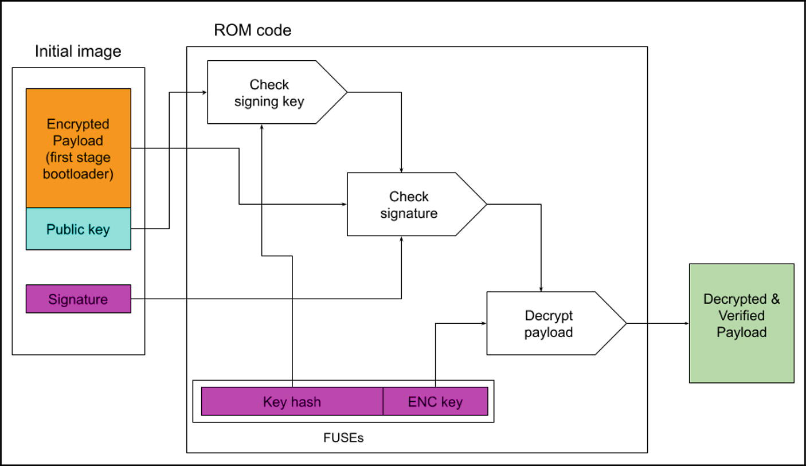
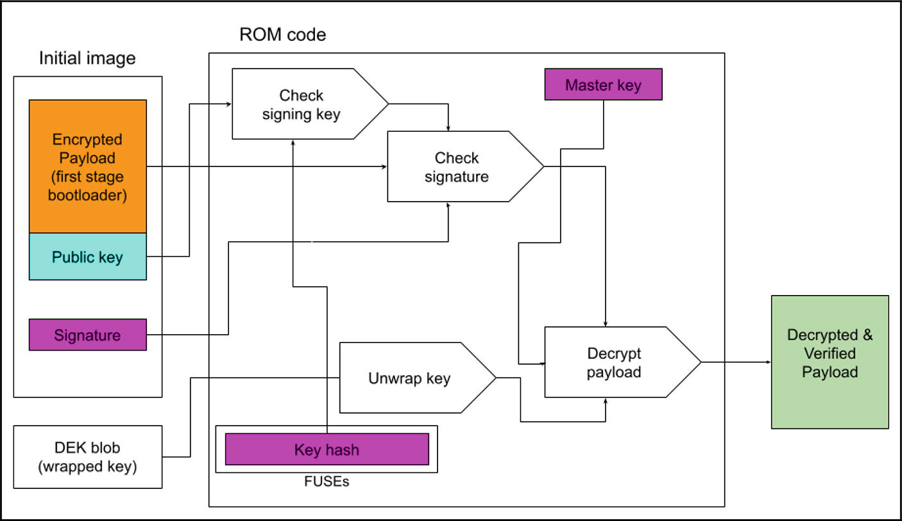
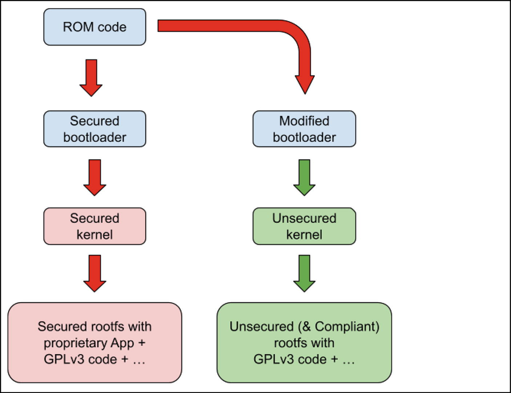

# 4. Những cân nhắc cuối cùng

Rodolfo Giometti

LUCCA, Italy

Trong các chương trước, chúng ta đã thấy Secure Boot hoạt động thế nào và cách chúng ta có thể hiện thực một hệ thống hoạt động được theo hai boot schema khác nhau. Tuy nhiên, trước khi khép lại cuốn sách này, chúng ta nên dành vài lời để đưa ra một số ví dụ thực tế về cách tạo ra các encryption key và signing key một cách hiệu quả, cũng như về một số vấn đề giấy phép mà chúng ta phải cân nhắc khi thiết kế một hệ thống bảo mật.

## 4.1 Tạo key để mã hóa và ký

Trong cuốn sách này, chúng ta đã thấy nhiều kỹ thuật để hiện thực một Chain-of-Trust tốt nhằm chắc chắn rằng Secure Boot được phần cứng và software quản lý đúng cách. Tuy nhiên, chúng ta chưa bao giờ nói về cách thực sự thực hiện việc mã hóa và ký cho từng image cấu thành nên Chain-of-Trust.

Về root filesystem, các thao tác này khá đơn giản; thực tế, như đã thấy trong phần “Thực hiện Factory-Reset” ở Chương [3](ch03_real_implementations.vi.md), chẳng hạn, một root filesystem có thể được mã hóa hoặc ký bằng OpenSSL (hoặc bất kỳ công cụ mã hóa nào khác) trong trường hợp tĩnh, còn đối với trường hợp lúc runtime, block-level encryption là giải pháp (xem phần “Mã hóa Block-Level” trong Chương [1](ch01_linux_cryptography.vi.md)).

Mặt khác, về các bootloader (ATF, U-Boot, v.v.) và fitimage (kernel, DTB, v.v.), chúng ta chưa bao giờ đi vào chi tiết trong các phần đó; vì vậy, giờ là lúc giải thích kỹ hơn một chút về những khía cạnh này.

> Hãy nhớ rằng mỗi nhà cung cấp CPU áp dụng một cách tiếp cận riêng cho các bước này. Vì vậy, các phần sau đây giữ ở mức thảo luận chung. Tuy nhiên, để có ví dụ cụ thể, chúng tôi trình bày hai giải pháp cụ thể có thể dễ dàng được điều chỉnh cho các nền tảng khác.

### 4.1.1 Cách tiếp cận Fuse-Centric

Cách tiếp cận này dựa trên việc mọi bí mật mật mã đều được giữ trong các FUSE được bảo vệ; tức là, cả encryption key lẫn signing public key (hoặc hash của nó, để tiết kiệm chỗ) đều được ghi (fuse) một cách an toàn vào chip.

> Các FUSE được bảo vệ được thiết kế để tăng cường bảo mật bằng cách hạn chế truy cập trực tiếp từ *normal world* (ví dụ, kernel và các ứng dụng của nó). Chỉ *secured world* (như ATF và OPTEE) mới có thể đọc các FUSE này. Do đó, mọi nỗ lực của một Linux OS đã bị xâm nhập nhằm đọc các bí mật lưu trong FUSE vẫn phải đi qua secured world, ngăn chặn việc truy cập trực tiếp vào thông tin nhạy cảm.

Khi secure boot được bật, ROM code được hardcode để nạp image ban đầu (thường chứa các bootloader và OPTEE) và xác minh nó. Như một ví dụ thực tế, chúng ta có thể xem Secure Boot hoạt động thế nào trên họ CPU STM32MP1x (xem [`https://wiki.st.com/stm32mpu/wiki/STM32_MPU_ROM_code_secure_boot`](https://wiki.st.com/stm32mpu/wiki/STM32_MPU_ROM_code_secure_boot)).

Trong architecture này, public key dùng để xác minh chữ ký không được lưu trực tiếp trong FUSE, mà được đóng gói vào image ban đầu, như được thể hiện trong Hình 4-1.



*Hình 4-1* Việc nạp image ban đầu của STM32MP1x

ROM code nạp image ban đầu này rồi, ở bước đầu tiên, kiểm tra public key so với hash được lưu trong FUSE. Nếu hash khớp, thì key được xác thực, và nó có thể được dùng để kiểm tra chữ ký. Nếu chữ ký cũng được xác minh, bước cuối cùng là giải mã payload để lấy code cần thực thi nhằm đi tiếp vào giai đoạn boot.

Để tạo signature key, chúng ta có thể dùng tiện ích `STM32_KeyGen_CLI` của ST, như được trình bày dưới đây:

```
$ STM32_KeyGen_CLI -abs stm32mp13-key/ \
    -pwd azerty azerty azerty azerty azerty azerty azerty azerty -n 8
...
 ------------------------------------------------------------
 Hash of table of Hash of {algorithm + public Key} file generated successfully.
 + Hash Hash:  stm32mp13-key/publicKeysHashHashes.bin
```

trong đó tham số tùy chọn `-n` được dùng để chỉ định số cặp key chúng ta muốn tạo, và `-pwd` chỉ định mật khẩu cho mỗi cặp.

> Họ STM32MP1x hỗ trợ tám cặp key, và trong ví dụ trên, chúng tôi đã dùng tám mật khẩu giống hệt nhau, đặt là `azerty`. Tuy nhiên, khi hiện thực thật, chúng ta nên dùng tám mật khẩu khác nhau!

Đối với encryption key, chúng ta có thể dùng lệnh sau:

```
$ STM32_KeyGen_CLI -rand 16 stm32mp13-key/stm32mp_encryption_key.bin
```

trong đó tham số tùy chọn `-rand` được dùng để tạo dữ liệu ngẫu nhiên (kích thước được chỉ định ở tham số tiếp theo) và lưu kết quả vào một file binary.

Đến đây, trong file `publicKeysHashHashes.bin` là hash của các public key, và trong file `stm32mp_encryption_key.bin` là encryption key. Vì vậy, chúng ta có thể đặt các file này vào một thiết bị lưu trữ (USB key hoặc thẻ SD) rồi nạp chúng vào FUSE bằng thủ tục sau trong U-Boot:

```
STM32MP> stm32key select PKHTH
STM32MP> load mmc 0:1 ${loadaddr} publicKeysHashHashes.bin
STM32MP> md.b ${loadaddr} 20
c2000000: 0b 96 b7 84 a5 56 0e 9c 4c 12 51 0f 4f 3a 47 19  .....V..L.Q.O:G.
c2000010: 76 9d 6e 0b 8b b7 0b 58 a3 48 72 5a 71 75 ef 3b  v.n....X.HrZqu.;
STM32MP> stm32key fuse ${loadaddr}
STM32MP> stm32key read
PKHTH OTP 24: 0b96b784 lock : 50000000
PKHTH OTP 25: a5560e9c lock : 50000000
PKHTH OTP 26: 4c12510f lock : 50000000
PKHTH OTP 27: 4f3a4719 lock : 50000000
PKHTH OTP 28: 769d6e0b lock : 50000000
PKHTH OTP 29: 8bb70b58 lock : 50000000
PKHTH OTP 30: a348725a lock : 50000000
PKHTH OTP 31: 7175ef3b lock : 50000000
```

> Trong ví dụ, chúng tôi đã dùng một thẻ microSD.

Bằng cách dùng lệnh `stm32key select PKHTH`, chúng ta chọn vùng *Public Key Hash Table Hash* trong FUSE, rồi thực hiện việc ghi (burn). Mặt khác, đối với encryption key, chúng ta phải chọn vùng Encrypted Device Master Key trong FUSE rồi thực hiện việc ghi như dưới đây:

```
STM32MP> stm32key select EDMK
STM32MP> load mmc 0:1 ${loadaddr} stm32mp13_encryption_key.bin
STM32MP> md.b ${loadaddr} 10
c2000000: 58 f7 76 94 23 b2 41 d0 5f ee 7d 0c 9b 2a b9 48  X.v.#.A._.}..*.H
STM32MP> stm32key fuse ${loadaddr}
STM32MP> stm32key read
EDMK OTP 92: 58f77694 lock : 40000000
EDMK OTP 93: 23b241d0 lock : 40000000
EDMK OTP 94: 5fee7d0c lock : 40000000
EDMK OTP 95: 9b2ab948 lock : 40000000
```

Giờ mọi bí mật đã vào đúng chỗ, và chúng ta có thể đi tiếp trong việc bảo mật hệ thống của mình.

### 4.1.2 Cách tiếp cận lai (Hybrid)

Cách tiếp cận này khác với cách trước vì, trong trường hợp này, chỉ hash của public key được lưu trong FUSE, còn encryption key được cung cấp một cách an toàn bởi một file đã được bọc lưu trên thiết bị lưu trữ. Vì vậy, về việc kiểm tra chữ ký, không có gì thay đổi so với ví dụ trước, còn đối với việc giải mã, hệ thống trước tiên mở bọc (unwrap) encryption key rồi mới bắt đầu giải mã.

Cơ chế này được họ CPU i.MX của NXP sử dụng, trong đó file đã được bọc bảo vệ encryption key được gọi là *DEK blob* (xem Hình 4-2).



*Hình 4-2* Việc nạp image ban đầu của i.MX

Trong tình huống này, ROM code cũng phải nạp file DEK blob bên cạnh image ban đầu để có thể giải mã đúng cách first-stage bootloader, còn về việc kiểm tra chữ ký, thủ tục tương tự như ở trên.

Việc tạo key có thể được thực hiện bằng một công cụ chuyên dụng của NXP tên là `cst` (có thể tải về tại [`https://www.nxp.com/webapp/sps/download/license.jsp?colCode=IMX_CST_TOOL`](https://www.nxp.com/webapp/sps/download/license.jsp?colCode=IMX_CST_TOOL)). Sau khi tải về và cài đặt, chúng ta phải vào thư mục chính của nó, thư mục này sẽ trông như sau:

```
$ ls
add-ons     Dockerfile.hsm   linux32
BUILD.md    docs             linux64
ca          keys             Makefile
code        LICENSE.bsd3     mingw32
crts        LICENSE.hidapi   Release_Notes.txt
Dockerfile  LICENSE.openssl  Software_Content_Register_CST.txt
```

Rồi tạo một file văn bản tên là `serial` chứa tám chữ số (dùng làm số serial của certificate):

```
$ cd keys
$ echo 1248163E > serial
```

Sau đó là một file văn bản tên là `key_pass.txt`, chứa hai dòng là một mật khẩu được lặp lại hai lần (dùng để bảo vệ các private key được tạo ra:

```
$ echo my_password | tee -a key_pass.txt > key_pass.txt
```

Bây giờ, để tạo các cặp encryption key, chúng ta phải chạy lệnh sau:

```
$ ./ahab_pki_tree.sh
```

Và hoàn thành các câu hỏi tương tác (câu trả lời của chúng tôi được in đậm):

```
...
Key type options (confirm targeted device supports desired key type):
Select the key type (possible values: rsa, rsa-pss, ecc)?: ecc
Enter length for elliptic curve to be used for PKI tree:
Possible values p256, p384, p521:  p384
Enter the digest algorithm to use: sha384
Enter PKI tree duration (years): 99
Do you want the SRK certificates to have the CA flag set? (y/n)?: n
...
```

Sau đó chúng ta phải tạo hash để lưu vào FUSE:

```
$ cd ../crts/
$ ../linux64/bin/srktool -a -d sha256 -s sha384 \
          -t SRK_1_2_3_4_table.bin \
          -e SRK_1_2_3_4_fuse.bin -f 1 -c \
SRK1_sha384_secp384r1_v3_usr_crt.pem,SRK2_sha384_secp384r1_
v3_usr_crt.pem,SRK3_sha384_secp384r1_v3_usr_crt.pem,SRK4_sha384_secp384r1_v3_usr_crt.pem
Number of certificates    = 4
SRK table binary filename = SRK_1_2_3_4_table.bin
SRK Fuse binary filename  = SRK_1_2_3_4_fuse.bin
SRK Fuse binary dump:
SRK HASH[0] = 0x64D18B66
SRK HASH[1] = 0x481850B5
SRK HASH[2] = 0xCE544B4D
SRK HASH[3] = 0xE81E9154
SRK HASH[4] = 0x7D36B464
SRK HASH[5] = 0xD4A0388F
SRK HASH[6] = 0x0DDF24C4
SRK HASH[7] = 0x4BA3F0AC
```

> Xin lưu ý rằng trong các phiên bản mới hơn của công cụ này, một số thuật toán có thể không còn khả dụng; trong trường hợp đó, bạn đọc sẽ cần chọn một thuật toán khác đáp ứng nhu cầu của mình.

Vector `HASH` chứa dữ liệu sẽ được ghi vào FUSE qua U-Boot bằng các lệnh sau:

```
iMX9> fuse prog 16 0 0x64D18B67
iMX9> fuse prog 16 1 0x481850B5
iMX9> fuse prog 16 2 0xCE544B4D
iMX9> fuse prog 16 3 0xE81E9154
iMX9> fuse prog 16 4 0x7D36B464
iMX9> fuse prog 16 5 0xD4A0388F
iMX9> fuse prog 16 6 0x0DDF24C4
iMX9> fuse prog 16 7 0x4BA3F0AC
```

> Lưu ý rằng các lệnh này chỉ hợp lệ cho i.MX93 và i.MX95!

Về encryption key, chúng ta phải tạo nó và lưu vào một file, rồi phải dùng U-Boot để tạo DEK blob.

Trước hết, chúng ta phải tạo encryption key dưới dạng dữ liệu ngẫu nhiên 256-bit:

```
$ openssl rand 32 > dek.bin
```

Sau đó, trong U-Boot, chúng ta phải nạp dữ liệu này vào memory và gọi lệnh chuyên dụng `dek_blob` như dưới đây:

```
iMX9> load mmc 0:1 ${loadaddr} stm32mp13_encryption_key.bin
iMX9> md.b ${loadaddr} 20
81000000: 81 10 ba 8e 3c 9b f2 e6 ae 0b 4b a3 6f 72 53 66  ....<.....K.orSf
81000010: c1 57 c5 7e b7 56 1b 7e be 6e 8b 8a 11 9b 63 3f  .W.~.V.~.n....c?
iMX9> dek_blob ${loadaddr} 0x81001000 256
iMX9> md.b 0x81001000 0x58
81001000: 00 58 00 81 01 20 03 00 ec e5 62 9e 53 84 c5 c5  .X... ....b.S...
81001010: 91 7f d0 38 b1 06 7f cc 1c 6c 2c 98 9e 31 1c 66  ...8.....l,..1.f
81001020: ef e0 b0 ea 96 42 83 18 33 e1 1e 88 bf 0f 1a 41  .....B..3......A
81001030: a6 a3 1f c9 8d 5e 67 94 0b 3a e1 e3 08 80 98 b3  .....^g..:......
81001040: 8d d5 54 ea e1 64 b1 02 b1 52 b8 66 35 4d 24 8e  ..T..d...R.f5M$.
81001050: 5a dd 86 25 19 3c e4 07                    Z..%.<..
```

> Trong ví dụ, chúng tôi đã dùng một thẻ microSD. Cũng lưu ý rằng file DEK blob dài 88 byte.

Giờ dữ liệu này phải được lưu ở đâu đó trong hệ thống, như đã làm, chẳng hạn, trong phần “Rescue Schema” ở Chương [3](ch03_real_implementations.vi.md).

Trước khi kết thúc phần này, chúng ta phải nêu ra một số lưu ý quan trọng:

1) File DEK blob cuối cùng phải được tạo ra khi CPU đã ở secure mode; nếu không, kết quả cuối cùng sẽ không hoạt động. Thực tế, theo thiết kế, khi CPU không ở secure mode, master key là một dummy key, còn ở secure mode, nó nhận giá trị thật của mình.
2) Vì encryption key không được ghi vào FUSE, chúng ta có thể dễ dàng thay đổi nó. Mặt khác, chúng ta phải cung cấp một môi trường an toàn cho việc tạo file DEK blob!

## 4.2 Các vấn đề về giấy phép

Chiến lược hiện thực được chọn cho secure boot đặt ra những thách thức đáng kể liên quan đến các giấy phép mã nguồn mở, cụ thể là **GNU General Public License version 3**, còn được gọi là **GPLv3** cho đơn giản ([`https://www.gnu.org/licenses/gpl-3.0.en.html`](https://www.gnu.org/licenses/gpl-3.0.en.html)), trong đó có nêu rằng

> *“Installation Information” (Thông tin cài đặt) cho một User Product nghĩa là mọi phương pháp, thủ tục, khóa ủy quyền, hoặc thông tin khác cần thiết để cài đặt và thực thi các phiên bản đã sửa đổi của một tác phẩm được bảo hộ trong User Product đó từ một phiên bản đã sửa đổi của Corresponding Source của nó. Thông tin này phải đủ để bảo đảm rằng việc tiếp tục hoạt động của object code đã sửa đổi trong mọi trường hợp không bị ngăn cản hay can thiệp chỉ vì việc sửa đổi đã được thực hiện.* [Section 6—Conveying Non-Source Forms]

Vì mọi hiện thực Secure Boot chỉ chấp nhận các binary manufacturer-signed và không cung cấp một cơ chế đơn giản để người dùng cuối đăng ký các cryptographic key của riêng họ (hoặc cài đặt kernel đã ký của riêng họ), nó có thể bị coi là xung đột!

Một hiện thực hạn chế như vậy có khả năng xung đột với Section 6 của GPLv3 vì nó không cung cấp *Installation Information* cần thiết để người dùng thực hiện quyền sửa đổi của họ

Hoạt động phân phối software theo một giấy phép copyleft (như GPL) trên một sản phẩm phần cứng có dùng các biện pháp bảo mật (như Secure Boot) để ngăn người dùng cuối cài đặt và chạy các phiên bản đã sửa đổi của software đó trên thiết bị được gọi là **Tivoization**. Cái tên này do Richard Stallman (và Free Software Foundation—FSF) đặt ra, liên quan đến việc TiVo dùng software GNU GPL-licensed trên các đầu ghi video kỹ thuật số (DVR) mang thương hiệu TiVo, vốn chủ động chặn software đã sửa đổi theo thiết kế (xem FAQ cụ thể tại [`https://www.gnu.org/licenses/gpl-faq.html.en#Tivoization`](https://www.gnu.org/licenses/gpl-faq.html.en#Tivoization)). Stallman tin rằng hoạt động này tước đi của người dùng một phần quyền tự do mà GNU GPL được thiết kế để bảo vệ. Vì vậy, FSF gọi phần cứng bị tivoize là *proprietary tyrants* (những kẻ bạo chúa độc quyền).

Trong kịch bản này, các developer embedded nên kiểm tra cẩn thận software họ dùng trong hệ thống của mình hoặc cung cấp một cơ chế để tôn trọng GPLv3!

Hiện tại, các thành phần nền tảng như U-Boot, TFA, OP-TEE, và Linux chủ yếu được cấp phép theo GPLv2. Trusted Firmware và OP-TEE (chẳng hạn) được cấp phép theo BSD hoặc MIT, vốn không áp đặt các yêu cầu copyleft và, do đó, không xung đột với một hiện thực Secure Boot hạn chế. Điều này là thiết yếu vì chúng ta có thể dùng chúng trong các hệ thống đã được bảo mật của mình.

Mặt khác, có nhiều ứng dụng user space được phát hành theo GPLv3 hoặc, nói chung, theo các giấy phép hạn chế hơn. Trong kịch bản này, chúng ta có hai lựa chọn chính:

1) Chúng ta có thể quyết định hoàn toàn không dùng các ứng dụng như vậy (hoặc viết lại chúng).
2) Chúng ta phải cung cấp một cách để tuân thủ GPLv3 bằng cách cho phép người dùng cuối **sửa đổi software và re-run nó trên phần cứng**.

Bước cuối cùng này có thể được hiện thực dễ dàng bằng cách thay thế bootloader đã được bảo mật của chúng ta bằng một bootloader khác cho phép nạp một kernel dạng plain text, đến lượt kernel này nạp một root filesystem dạng plain text. Điều then chốt là, nếu hệ thống đã được bảo mật có chứa một ứng dụng độc quyền, thì root filesystem dạng plain text cung cấp cho người dùng này chỉ được chứa các thành phần software GPLv3 và phải loại trừ ứng dụng độc quyền. Sự tách biệt này bảo đảm rằng người dùng cuối sẽ có thể sửa đổi và re-run software GPLv3 được cung cấp trong hệ thống đã được bảo mật, đáp ứng các yêu cầu của Section 6 của GPLv3 mà không làm lộ code độc quyền.

Trong Hình 4-3, cả bootloader đã được bảo mật lẫn bootloader đã sửa đổi đều được nạp dưới Chain-of-Trust, nhưng chỉ ở nhánh bên trái thì Chain-of-Trust mới tiếp tục. Ở nhánh bên phải, chuỗi dừng lại, cho phép người dùng cuối nạp bất cứ thứ gì có trong root filesystem. Mặt khác, ở nhánh bên trái, code độc quyền được Chain-of-trust bảo vệ, còn ở nhánh bên phải, không có gì để bảo vệ.



*Hình 4-3* Từ hệ thống đã được bảo mật đến hệ thống tuân thủ GPLv3

## 4.3 Tóm tắt

Trong chương này, chúng ta đã thấy một số ví dụ đơn giản về cách tạo key để mã hóa và ký các bootloader (và fitimage) cho hai loại CPU cụ thể (mặc dù các ví dụ này không mang tính tổng quát, chúng cho ta một ý niệm về những gì cần làm để bảo vệ hệ thống của mình).

Sau đó chúng tôi đã giới thiệu một số khía cạnh về cách giữ cho hệ thống của chúng ta tuân thủ các yêu cầu của GPLv3 để tránh những cuộc chiến pháp lý tẻ nhạt (và tốn kém).

Đến đây, hẳn đã rõ hơn Secure Boot là gì và các bước cần làm để có được một hệ thống hoạt động.

Chúc bạn vui vẻ!
