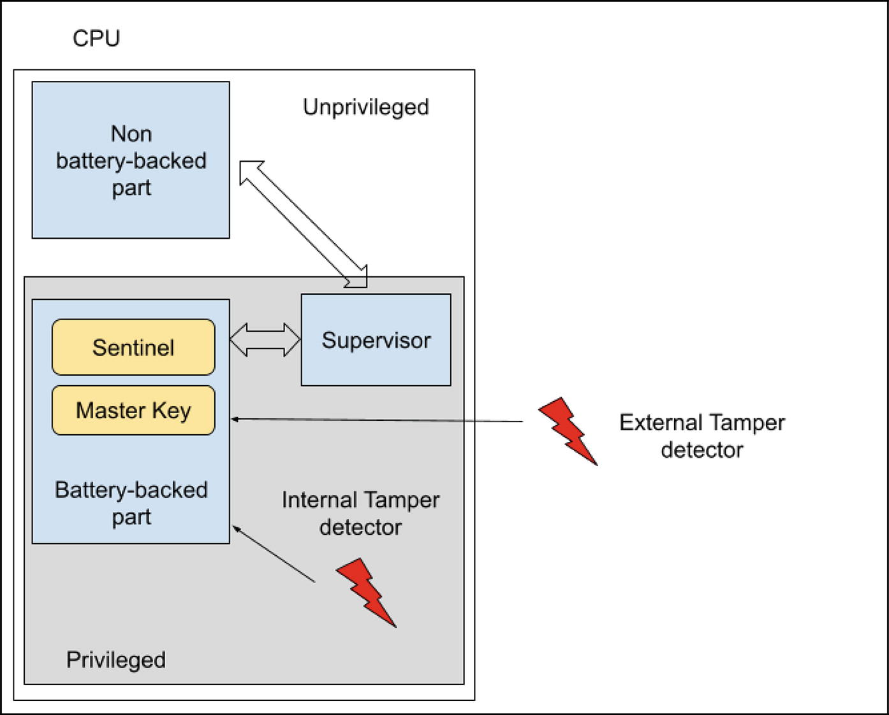

# Phụ lục A: Ghi chú về phát hiện can thiệp (Tamper Detection)

Trong các môi trường high-security, tính toàn vẹn của một hệ thống vượt ra ngoài phạm vi số. Thực tế, một cuộc xâm nhập vật lý thành công, chẳng hạn như mở vỏ máy rồi cắm vào một linh kiện phần cứng độc hại hoặc tháo bỏ một linh kiện có ích, cho phép kẻ tấn công vượt qua nhiều cơ chế kiểm soát software-based truyền thống.

Hãy nghĩ đến các Intelligent Electronic Device (IED), Remote Terminal Unit (RTU), hoặc Distributed Control System (DCS) cho hạ tầng trọng yếu (như lưới điện, mạng lưới khí đốt, và hạ tầng dầu mỏ), các thiết bị life-upport và thiết bị y tế chăm sóc sức khỏe, và các hệ thống đo lường phục vụ tính tiền (ví dụ, công tơ thông minh), nơi việc can thiệp phần cứng có thể dẫn đến những sự cố thảm khốc hoặc gian lận large-scale.

Đó là lý do vì sao các cơ chế phát hiện can thiệp vật lý là thiết yếu để nhận diện những nỗ lực truy cập trái phép này vào vỏ hoặc các linh kiện của hệ thống.

Hầu hết các CPU hiện đại đều cung cấp nhiều cơ chế phát hiện can thiệp, có khả năng báo hiệu cho CPU nếu hệ thống đã bị xâm phạm và, trong trường hợp đó, dừng hệ thống hoặc thực hiện các hành động bảo mật khác.

Việc phát hiện vật lý có thể được chia thành hai loại: **external tamper** (can thiệp bên ngoài, trên vỏ máy/board) và **internal tamper** (can thiệp bên trong, trên chính con chip).

Cơ chế thứ nhất được thiết kế riêng để phát hiện việc mở vỏ máy hoặc việc can thiệp vào các linh kiện trên board, và thường thì bộ xử lý có các chân input chuyên dụng (thường được gọi là *tamper pin*) để phát hiện những nỗ lực này.

> Các tamper pin này được nối với một cảm biến vật lý lắp trên vỏ của hệ thống, chẳng hạn như một công tắc đơn giản mở ra hoặc đóng lại khi vỏ máy bị mở (phương pháp phổ biến nhất). Hoặc các đường dẫn điện mảnh được in trên PCB hoặc bên trong vỏ máy, nơi việc chúng bị đứt hoặc gián đoạn, do một nỗ lực khoan hoặc cưỡng ép xâm nhập gây ra, sẽ kích hoạt báo động

> Ngoài ra, các cảm biến chuyển động hoặc các trigger location-based thường được dùng trong các công tơ và bộ điều khiển đặt cố định tại chỗ để phát hiện việc di chuyển trái phép hoặc việc thiết bị bị dời khỏi vị trí (điều này là vì kẻ tấn công có thể chọn không can thiệp vào vỏ on-site, mà thay vào đó tháo cả thiết bị đi để phân tích trong môi trường phòng thí nghiệm). Trong lĩnh vực hạ tầng trọng yếu (năng lượng, khí đốt, nước), các thiết bị như công tơ thông minh thường được lắp đặt ở những vị trí xa xôi hoặc nơi công cộng dễ tiếp cận, v.v.

> Để kiểm soát trạng thái của các cảm biến này, CPU có thể dùng **passive tamper detection**; tức là, nó giám sát một mức điện áp cố định (và nếu trạng thái thay đổi, ví dụ công tắc mở ra, một báo động được kích hoạt). Ngoài ra, CPU có thể xuất một tín hiệu time-varying (thường là một tín hiệu ngẫu nhiên hoặc chuyển mạch nhanh) trên một chân output và mong đợi nhận lại cùng tín hiệu đó theo thời gian thực trên một chân input, hai chân này được nối thành cặp bằng một dây hoặc đường mạch chạy ngang qua vỏ máy. Cơ chế phát hiện sau này được gọi là **active tamper detection**. Dĩ nhiên, phương pháp này tinh vi hơn và vì thế an toàn hơn.

Mặt khác, việc phát hiện can thiệp bên trong là một tập các cơ chế thường không gắn với vỏ máy mà giám sát môi trường hoạt động ngay sát CPU. Ví dụ, liên tục giám sát các mức điện áp nguồn cấp (một sự sụt giảm hoặc tăng vọt điện áp đột ngột có thể chỉ ra một nỗ lực tấn công vật lý hoặc một nỗ lực ép chip reset), hoặc giám sát nhiệt độ (nhiệt độ quá cao hoặc quá thấp có thể chỉ ra một cuộc tấn công, ví dụ làm đông lạnh chip để thay đổi memory hoặc làm quá nhiệt), hoặc giám sát tần số clock của hệ thống (can thiệp clock là một kỹ thuật tấn công nhằm làm rối loạn hoặc làm chậm bộ xử lý).

Một khi đã phát hiện một truy cập can thiệp, tính năng quan trọng nhất của một hệ thống chống can thiệp tốt là phản ứng của nó, vốn phải tức thì và phá hủy dữ liệu nhạy cảm. Trước hết, một cờ báo động trong một register chuyên dụng (*sentinel*) được đặt; sau đó, phản ứng phổ biến và then chốt nhất là *zeroization* (hay xóa) memory volatile chứa dữ liệu nhạy cảm (thường là các master cryptographic key, để khiến mọi dữ liệu đã mã hóa trở nên không dùng được). Hơn nữa, CPU cũng có thể ép một lần reset hệ thống hoặc tự đưa mình vào trạng thái khóa cho đến khi sự can thiệp được giải quyết (xem bên dưới về việc khôi phục sau can thiệp

Để hiện thực một hệ thống phát hiện can thiệp tốt, các CPU hiện đại thường được chia thành hai vùng chính:

1) Một vùng bình thường được cấp nguồn bình thường
2) Một vùng đặc biệt được battery-backed

> Lưu ý rằng khi chúng tôi nhắc đến phần battery-backed, chúng tôi không nói đến toàn bộ một hệ thống battery-backed mà chỉ một vùng duy nhất của CPU, thường được gọi là **Battery-Backed Secure Module** (hay **Secure Non-Volatile Module** hoặc Storage). Thông thường, vùng này có một pin không phải là pin chính của hệ thống (khi có), và nó được gắn chặt vào bo mạch chính. Chúng ta có thể gọi nó là *tampering battery*, và mục đích duy nhất của nó là giữ cho secure module luôn được cấp nguồn ngay cả khi không có nguồn chính. Điều này là then chốt nếu chúng ta cần phát hiện các truy cập can thiệp trong mọi tình huống; thực tế, bằng cách thiết lập đúng cách register *sentinel*, chúng ta có thể phát hiện liệu pin này đã bị tháo ra hay chưa (xem bên dưới về cách dùng register này).

Vùng battery-backed cũng không thể được normal world (vốn không có đặc quyền) truy cập trực tiếp, mà phải được truy cập thông qua một supervisor có đặc quyền. Ví dụ, trên các hệ thống ARM-based, supervisor có thể là ATF hoặc OP-TEE tùy theo giai đoạn boot cụ thể.

Trong Hình [A-1](ch05_appendix_a_notes_on_tamper_detection.vi.md) là một ví dụ tổng quát về một hệ thống phát hiện can thiệp.



*Hình A-1* Hệ thống phát hiện can thiệp

> Lưu ý rằng mặc dù cả register *sentinel* lẫn register *master key* đều có giá trị mặc định là `0`, trong trường hợp tampering battery bị lỗi, chúng ta không thể dùng register thứ hai thay cho register thứ nhất. Trong hầu hết các trường hợp, register master key là một register write-only.

## A.1 Can thiệp trong quá trình boot

Việc phát hiện can thiệp có thể được dùng để xác minh tính toàn vẹn của Chain-of-Trust trong quá trình boot, nên nó có vai trò quan trọng trong quy trình Secure Boot (nhưng nó cũng có thể được dùng khi hệ thống đang chạy—xem bên dưới). Trong kịch bản này, CPU chạy ở supervisor mode có thể dùng đoạn code sau để quản lý việc phát hiện can thiệp:

```
        ...
        /* Tampering recovery section */
        if (is_tampering_init_forced() ||
            defined(CONFIG_TAMPERING_INIT_FORCED)) {
                setup_tampering_battery_status();
                if (ret)
                        hang("cannot setup battery!");
#if defined(CONFIG_TAMPERING_INIT_FORCED)
                hang("tampering detection initialized. Reset the board");
#endif
                ret = unforce_tampering_init();
                if (ret)
                        hang("cannot unforce tampering init!");
        }

        /* Tampering enable section */
        ret = enable_tamper_detection();
        if (ret)
                hang("cannot enable tamper detection!");

        if (!is_tampering_battery_ok())
                hang("Tampering battery fault! Restart the system");

        /* OK, let's do a normal boot! */
        ...
```

Phần đầu tiên của đoạn code trên (tức là *tampering recovery section*) được dùng để khởi tạo hoặc khôi phục hệ thống. Phần thứ hai (*tampering enable section*) được dùng để thực sự bật tính năng phát hiện can thiệp trong CPU (bằng hàm `enable_tamper_detection()`) rồi kiểm tra trạng thái tampering battery bằng cách kiểm tra register sentinel; trong kịch bản này, hàm `is_tampering_battery_ok()` có thể được hiện thực như dưới đây:

```
static bool is_tampering_battery_ok(void)
{
        uint8_t val = read_register(SNVM_SENTINEL_REG);

        return val == SENTINEL_REGISTER_VALUE;
}
```

Trong tampering recovery section (hoặc trong lúc khởi tạo), sentinel được lập trình như sau:

```
static int setup_tampering_battery_status(void)
{
        return write_register(SNVM_SENTINEL_REG,
                              SENTINEL_REGISTER_VALUE);
}
```

Vì register sentinel được battery-backed, nó giữ giá trị `SENTINEL_REGISTER_VALUE` ngay cả khi nguồn chính bị ngắt, và hệ thống phải được coi là đã bị can thiệp trong trường hợp nó chứa một giá trị khác (hoặc giá trị reset mặc định).

Giờ hẳn đã rõ phần khởi tạo cần để làm gì; nó phải thực thi `setup_tampering_battery_status()`. Tuy nhiên, thao tác này chỉ được thực hiện trong những tình huống đặc biệt:

- Trong quá trình sản xuất tại nhà máy hoặc
- Trong một lần khôi phục sau can thiệp

Trong cả hai trường hợp, thao tác này phải được thực hiện bởi nhân sự chuyên môn và được ủy quyền.

Trong quá trình sản xuất tại nhà máy, chúng ta có thể ép nạp một phiên bản đặc biệt của bootloader có bật define `CONFIG_TAMPERING_INIT_FORCED`. Trong trường hợp này, bootloader khởi động và tự động gọi `setup_tampering_battery_status()` trước khi treo.

Mặt khác, nếu chúng ta muốn hiện thực một thủ tục khôi phục sau can thiệp, chúng ta có thể định nghĩa hàm `is_tampering_init_forced()` sao cho nó trả về *true* nếu việc khôi phục phải bắt đầu. Sau đó, một khi register sentinel đã được lập trình đúng cách, chúng ta có thể kết thúc thủ tục khôi phục bằng hàm `unforce_tampering_init()`.

Có nhiều cách để hiện thực hai hàm này; tuy nhiên, cách đơn giản nhất (và kém an toàn nhất) là dùng một đường GPIO (có thể được nối với một công tắc trên PCB). Trong kịch bản này, hai hàm trông như sau:

```
static bool is_tampering_init_forced(void)
{
        return read_gpio(FORCE_TAMPERING_INIT);
}

static int setup_tampering_battery_status(void)
{
        hang("Release the FORCE_TAMPERING and reboot");
        return 0;
}
```

Trong quá trình hoạt động bình thường, `FORCE_TAMPERING_INIT` được đọc là 0, và phần khởi tạo bị vô hiệu hóa, còn trong một lần khôi phục sau can thiệp hoặc khởi tạo, nó được đọc là 1, và hàm `setup_tampering_battery_status()` được gọi trước khi treo để buộc nhả GPIO.

Một cách tinh vi hơn (và an toàn hơn) để ép khởi tạo tampering có thể là, chẳng hạn, đọc một EEPROM có thể được lập trình qua một (phần cứng bên ngoài) chuyên dụng; trong kịch bản này, các hàm trên có thể trông như sau:

```
static bool is_tampering_init_forced(void)
{
        uint8_t val;
        int ret;

        ret = read_eeprom(FORCE_TAMPERING, &val);
        if (ret)
                return ret;

        return val;
}

static int setup_tampering_battery_status(void)
{
        return write_eeprom(FORCE_TAMPERING, 0);
}
```

Không có một quy tắc cố định nào; điều đó phụ thuộc vào mức bảo mật chúng ta mong muốn cho hệ thống của mình. Ví dụ, một giải pháp cực đoan sẽ là vô hiệu hóa mọi hành động khôi phục bằng cách định nghĩa các hàm trên như dưới đây:

```
static bool is_tampering_init_forced(void)
{
        return false;
}

static int setup_tampering_battery_status(void)
{
        return -EINVAL;
}
```

Trong tình huống này, hành động khả dĩ duy nhất là khởi tạo bằng một bootloader chuyên dụng có bật define `CONFIG_TAMPERING_INIT_FORCED`. Bootloader này chỉ đơn giản khởi động và thực thi đoạn code sau:

```
        setup_tampering_battery_status();
        hang("tampering detection initialized. Reset the board");
```

> Lưu ý rằng bất kỳ ai có software đặc biệt này đều có thể thực hiện việc khôi phục sau can thiệp! Vì vậy, một phiên bản an toàn hơn có thể dùng một giao thức xác thực qua đường serial (hoặc cơ chế giao tiếp khác) để quyết định xem người nắm giữ software có phải là người dùng có đặc quyền hay không trước khi tiến hành khôi phục (ví dụ, bằng cách dùng một giao thức Challenge-Response Authentication).

> Tuy nhiên, những cải tiến này thực sự mang tính system-dependent, và chúng không được đề cập trong cuốn sách này.

## A.2 Can thiệp trong lúc hệ thống đang chạy

Khi hệ thống đã chạy, nhiệm vụ của Secure Boot đã kết thúc; tuy nhiên, để đầy đủ, chúng tôi sẽ trình bày cách việc phát hiện can thiệp có thể hoạt động.

Nếu một sự kiện can thiệp được phát hiện, supervisor có thể ép khởi động lại (trong trường hợp này hãy tham khảo phần trước), hoặc nó có thể gửi một thông báo lên user space (thường qua interface sysfs hoặc một char device). Trong trường hợp sau, chúng ta có thể dùng một system daemon giám sát các sự kiện can thiệp rồi thực hiện một hành động phù hợp, như dừng chương trình chính hoặc xóa một số file, v.v.

Ví dụ, hệ thống dưới đây xuất một số thông tin hữu ích về trạng thái CPU của nó trong interface sysfs:

```
$ ls /sys/devices/soc0
family   power     secured        soc_id     tampered
machine  revision  serial_number  subsystem  uevent
$ cat /sys/devices/soc0/family
Freescale i.MX
$ cat /sys/devices/soc0/soc_id
i.MX8MQ
$ cat /sys/devices/soc0/machine
NXP imx8mq-var-dart SD+LVDS
$ cat /sys/devices/soc0/serial_number
160C89D6D8F804A2
```

Qua interface này, chúng ta có thể dễ dàng biết máy có đang ở secure mode hay không:

```
$ cat /sys/devices/soc0/secured
yes
```

Và, bằng cách dùng cùng interface đó, một ứng dụng user space có thể phát hiện xem máy đã bị can thiệp hay chưa:

```
$ cat /sys/devices/soc0/tampered
no
```

Vì vậy, bằng cách định kỳ giám sát file này, chúng ta có thể thực hiện một hành động khôi phục phù hợp (như thực hiện một lần khởi động lại, việc này sẽ khiến hệ thống bị treo).
