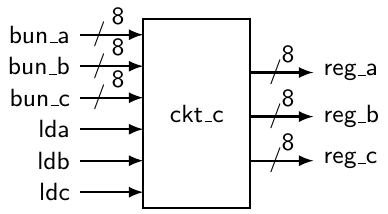
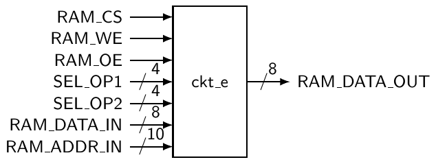
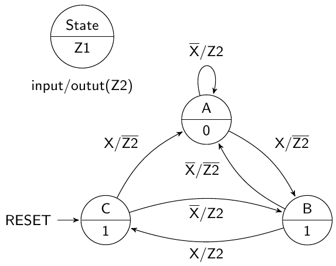
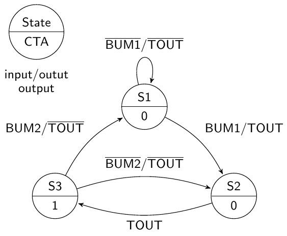
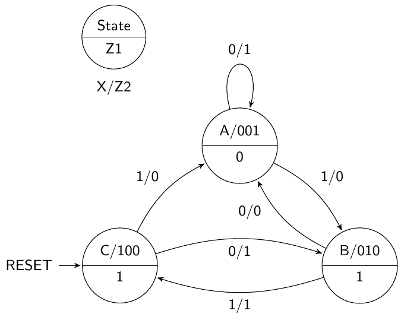
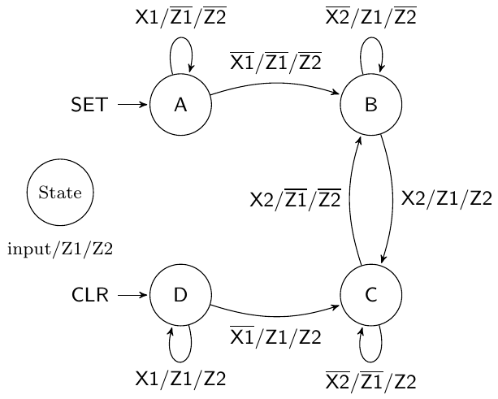
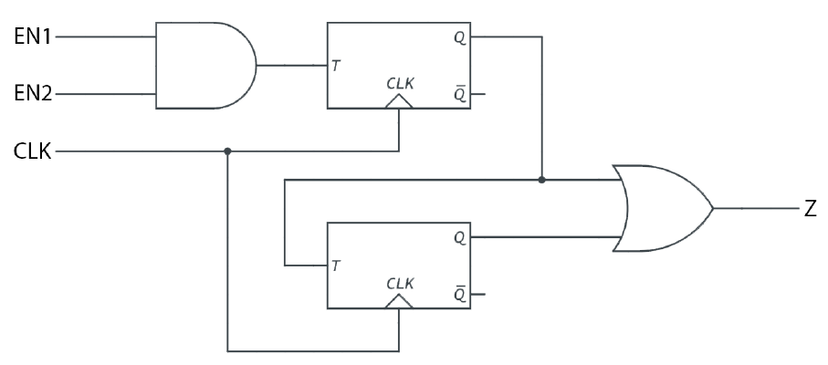
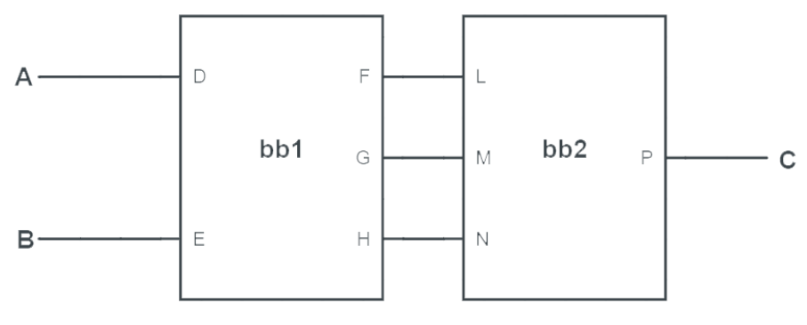

# C Lời giải bài tập

Phần này trình bày lời giải cho tất cả các bài tập được đưa ra trong suốt cuốn sách này.

## Lời giải bài tập cho Chương 3

1. Một bundle là một nhóm các signal có liên quan với nhau. Bundle đôi khi được gọi là bus, nhưng nên dùng từ bundle hơn vì nó tránh được những nhầm lẫn có thể xảy ra.

2. Trong một black-box diagram, bundle thường được thể hiện bằng một dây có một dấu gạch chéo kèm theo con số cho biết số lượng signal tạo nên bundle đó.

3. Vẽ black-box diagram trước khi viết bất kỳ code VHDL nào được xem là thói quen tốt, vì việc này giúp cung cấp một biểu diễn trực quan cho từng component. Ngoài ra, một sơ đồ tổng thể hệ thống tốt và gọn gàng giúp loại bỏ sự nhầm lẫn khi viết code, đặc biệt với các thiết kế lớn, và còn giúp tăng khả năng tái sử dụng code (re-usability).

4. Các black-box drawing đã cho có thể được triển khai bằng code VHDL sau.

a)

```vhdl
ENTITY sys1 IS
    PORT (
        a_in1       :   IN  STD_LOGIC;
        b_in2       :   IN  STD_LOGIC;
        clk         :   IN  STD_LOGIC;
        ctrl_int    :   IN  STD_LOGIC;
        out_b       :   OUT STD_LOGIC);
END sys1;
```

b)

```vhdl
ENTITY sys2 IS
    PORT (
        input_w :   IN  STD_LOGIC;
        a_data  :   IN  STD_LOGIC_VECTOR(7 DOWNTO 0);
        b_data  :   IN  STD_LOGIC_VECTOR(7 DOWNTO 0);
        clk     :   IN  STD_LOGIC;
        dat_4   :   OUT STD_LOGIC_VECTOR(7 DOWNTO 0);
        dat_5   :   OUT STD_LOGIC_VECTOR(2 DOWNTO 0));
END sys2;
```

5. Các black-box drawing biểu diễn code đã cho được trình bày dưới đây.

a)



b)



6. Các lỗi của code đã cho là:

a) Dòng 4 thiếu dấu chấm phẩy. Dấu chấm phẩy ở dòng 5 phải nằm sau dấu ngoặc đơn. Code đúng được trình bày ở đây.

```vhdl
ENTITY ckt_a IS
    PORT (
        J,K :   IN  STD_LOGIC;
        CLK :   IN  STD_LOGIC;
        Q   :   OUT STD_LOGIC);
END ckt_a;
```

b) Dòng 5 phải có dấu chấm phẩy sau hai dấu ngoặc đơn như được trình bày ở đây.

```vhdl
ENTITY ckt_b IS
    PORT (
        mr_fluffy   :   IN  STD_LOGIC_VECTOR(15 DOWNTO 0);
        mux_ctrl    :   IN  STD_LOGIC_VECTOR(3 DOWNTO 0);
        byte_out    :   OUT STD_LOGIC_VECTOR(3 DOWNTO 0));
END ckt_b;
```

## Chương 4

1. a)

```vhdl
LIBRARY IEEE;
USE IEEE.STD_LOGIC_1164.ALL;

ENTITY ckt_a IS
    PORT (
        A,B :   IN  STD_LOGIC;
        F   :   OUT STD_LOGIC);
END ckt_a;

ARCHITECTURE ckt_a_arc OF ckt_a IS
BEGIN
    F <= (NOT A AND B) OR A OR (A AND NOT B);
END ckt_a_arc;
```

b)

```vhdl
LIBRARY IEEE;
USE IEEE.STD_LOGIC_1164.ALL;

ENTITY ckt_b IS
    PORT(
        A,B,C,D :   IN  STD_LOGIC;
        F       :   OUT STD_LOGIC);
END ckt_b;

ARCHITECTURE ckt_b_arc OF ckt_b IS
BEGIN
    F <= (NOT A AND C AND NOT D) OR (NOT B AND C) OR (B AND C AND
        NOT D);
END ckt_b_arc;
```

c)

```vhdl
LIBRARY IEEE;
USE IEEE.STD_LOGIC_1164.ALL;

ENTITY ckt_c IS
    PORT(
        A,B,C,D :   IN  STD_LOGIC;
        F       :   OUT STD_LOGIC);
END ckt_c;

ARCHITECTURE ckt_c_arc OF ckt_c IS
    SIGNAL AND1,AND2,AND3   :   STD_LOGIC;
BEGIN
    AND1 <= NOT A OR B;
    AND2 <= NOT B OR C OR NOT D;
    AND3 <= NOT A OR D;
    F <= AND1 AND AND2 AND AND3;
END ckt_c_arc;
```

d)

```vhdl
LIBRARY IEEE;
USE IEE.STD_LOGIC_1164.ALL;

ENTITY ckt_d IS
    PORT(
        A,B,C,D :   IN  STD_LOGIC;
        F       :   OUT STD_LOGIC);
END ckt_d;

ARCHITECTURE ckt_d_arc OF ckt_d IS
    SIGNAL AND1,AND2    :   STD_LOGIC;
BEGIN
    AND1 <= A OR B OR NOT C OR NOT D;
    AND2 <= A OR B OR NOT C OR D;
    F <= AND1 AND AND2;
END ckt_d_arc;
```

e)

```vhdl
LIBRARY IEEE;
USE IEEE.STD_LOGIC_1164.ALL;

ENTITY ckt_e IS
    PORT(
        A,B,C   :   IN  STD_LOGIC;
        F       :   OUT STD_LOGIC);
END ckt_e;

ARCHITECTURE ckt_e_arc OF ckt_e IS
    SIGNAL AND1,AND2,AND3,AND4  :   STD_LOGIC;
BEGIN
    AND1 <= NOT C OR B OR NOT A;
    AND2 <= C OR B OR NOT A;
    AND3 <= NOT C OR B OR A;
    AND4 <= C OR NOT B OR NOT A;
    F <= AND1 AND AND2 AND AND3 AND AND4;
END ckt_e_arc;
```

f)

```vhdl
LIBRARY IEEE;
USE IEEE.STD_LOGIC_1164.ALL;

ENTITY ckt_f IS
    PORT(
        A,B,C,D :   IN  STD_LOGIC;
        F       :   OUT STD_LOGIC);
END ckt_f;

ARCHITECTURE ckt_f_arc OF ckt_f IS
    SIGNAL OR1,OR2  :   STD_LOGIC;
BEGIN
    OR1 <= NOT A AND NOT B AND NOT C AND D;
    OR2 <= NOT A AND NOT B AND C AND NOT D;
    F <= OR1 OR OR2;
END ckt_f_arc;
```

2. a)

```vhdl
LIBRARY IEEE;
USE IEEE.STD_LOGIC_1164.ALL;

ENTITY ckt_a IS
    PORT(
        A,B,C,D :   IN  STD_LOGIC;
        F       :   OUT STD_LOGIC);
END ckt_a;

ARCHITECTURE ckt_a_conditional OF ckt_a IS
BEGIN
    F <=
        '1' WHEN( A = '0' AND C = '1' AND D = '0' ) ELSE
        '1' WHEN( B = '0' AND C = '1') ELSE
        '1' WHEN( B = '1' AND C = '1' AND D = '0' ) ELSE
        '0';
END ckt_a_conditional;

ARCHITECTURE ckt_a_selected OF ckt_a IS
    SIGNAL ins  :   STD_LOGIC_VECTOR(0 TO 3);
BEGIN
    ins <= A & B & C & D;
    WITH ins SELECT
        F <=
            '1' WHEN "0010"|"0110",
            '1' WHEN "0010"|"0011"|"1010"|"1011",
            '1' WHEN "0110"|"1110",
            '0' WHEN OTHERS;
END ckt_a_selected;
```

b)

```vhdl
LIBRARY IEEE;
USE IEEE.STD_LOGIC_1164.ALL;

ENTITY ckt_b IS
    PORT(
        A,B,C,D :   IN  STD_LOGIC;
        F       :   OUT STD_LOGIC);
END ckt_b;

ARCHITECTURE ckt_b_conditional OF ckt_b IS
BEGIN
    F <=
        '1' WHEN( ( A = '0' OR B = '1') AND ( B = '1' OR C = '1'
            OR D = '0' ) AND ( A = '0' OR D = '1') ) ELSE
        '0';
END ckt_b_conditional;

ARCHITECTURE ckt_b_selected OF ckt_b IS
    SIGNAL ins  :   STD_LOGIC_VECTOR(0 TO 3);
BEGIN
    ins <= A & B & C & D;
    WITH ins SELECT
        F <=
        '1' WHEN "0000"|"0001"|"0010"|"0011"|"0100",
        '1' WHEN "0110"|"0111",
        '1' WHEN "1111",
        '0' WHEN OTHERS;
END ckt_b_selected;
```

c)

```vhdl
LIBRARY IEEE;
USE IEEE.STD_LOGIC_1164.ALL;

ENTITY ckt_c IS
    PORT(
        A,B,C,D :   IN  STD_LOGIC;
        F       :   OUT STD_LOGIC);
END ckt_c;

ARCHITECTURE ckt_c_conditional OF ckt_c IS
BEGIN
    F <=
        '1' WHEN( ( A = '1' OR B = '0' OR C = '0' OR D = '0') AND
            ( A = '1' OR B = '1' OR C = '1' OR D = '0' ) ) ELSE
        '0';
END ckt_c_conditional;

ARCHITECTURE ckt_c_selected OF ckt_c IS
    SIGNAL ins  :   STD_LOGIC_VECTOR(0 TO 3);
BEGIN
    ins <= A & B & C & D;
    WITH ins SELECT
        F <=
            '0' WHEN "0001"|"0011",
            '1' WHEN OTHERS;
END ckt_c_selected;
```

d)

```vhdl
LIBRARY IEEE;
USE IEEE.STD_LOGIC_1164.ALL;

ENTITY ckt_d IS
    PORT(
        A,B,C,D :   IN  STD_LOGIC;
        F       :   OUT STD_LOGIC);
END ckt_d;

ARCHITECTURE ckt_d_conditional OF ckt_d IS
BEGIN
    F <=
        '1' WHEN( ( A = '0' AND B = '0' AND C = '0' AND D = '1')
            OR ( A = '0' AND B = '0' AND C = '1' AND D = '0' ) )
            ELSE
        '0';
END ckt_d_conditional;

ARCHITECTURE ckt_d_selected OF ckt_d IS
    SIGNAL ins  :   STD_LOGIC_VECTOR(0 TO 3);
BEGIN
    ins <= A & B & C & D;
    WITH ins SELECT
        F <=
            '1' WHEN "0001"|"0010",
            '0' WHEN OTHERS;
END ckt_d_selected;
```

3.

```vhdl
LIBRARY IEEE;
USE IEEE.STD_LOGIC_1164.ALL;

ENTITY and8 IS
    PORT(
        in0,in1,in2,in3,in4,in5,in6,in7 :   IN  STD_LOGIC;
        out1                            :   OUT STD_LOGIC);
END and8;

ARCHITECTURE and8_concurrent OF and8 IS
BEGIN
    out1 <= in0 AND in1 AND in2 AND in3 AND in4 AND in5 AND in6
        AND in7;
END and8_concurrent;

ARCHITECTURE and8_conditional OF and8 IS
BEGIN
    out1 <= '1' WHEN (in0 = '1' AND in1 = '1' AND in2 = '1' AND
        in3 = '1' AND in4 = '1' AND in5 = '1' AND in6 = '1' AND
        in7 = '1') ELSE
    '0';
END and8_conditional;

ARCHITECTURE and8_selected OF and8 IS
    SIGNAL ins  :   STD_LOGIC_VECTOR(0 TO 7);
BEGIN
    ins <= in0 & in1 & in2 & in3 & in4 & in5 & in6 & in7;
    WITH ins SELECT
        out1 <=
            '1' WHEN "11111111",
            '0' WHEN OTHERS;
END and8_selected;
```

4.

```vhdl
LIBRARY IEEE;
USE IEEE_STD_LOGIC_1164.ALL;

ENTITY or8 IS
    PORT(
        ins     :   IN  STD_LOGIC_VECTOR(7 DOWNTO 0);
        out1    :   OUT STD_LOGIC);
END or8;

ARCHITECTURE or8_concurrent OF or8 IS
BEGIN
    out1 <= ins(1) OR ins(2) OR ins(3) OR ins(4) OR ins(5) OR ins
        (6) OR ins(7);
END or8_concurrent;

ARCHITECTURE or8_conditional OF or8 IS
BEGIN
    out1 <= '1' WHEN (ins(1) = '1' OR ins(2) = '1' OR ins(3) = '1'
         OR ins(4) = '1' OR ins(5) = '1' OR ins(6) = '1' OR ins(7)
         = '1') ELSE
    '0';
END or8_conditional;

ARCHITECTURE or8_selected OF or8 IS
BEGIN
    WITH ins SELECT
        out1 <=
            '0' WHEN "00000000",
            '1' WHEN OTHERS;
END or8_selected;
```

5.

```vhdl
LIBRARY IEEE;
USE IEEE.STD_LOGIC_1164.ALL;

ENTITY mux8to1 IS
    PORT(
        inputs  :   IN  STD_LOGIC_VECTOR(7 DOWNTO 0);
        sel     :   IN  STD_LOGIC_VECTOR(2 DOWNTO 0);
        output  :   OUT STD_LOGIC);
END mux8to1;

ARCHITECTURE mux8to1_conditional OF mux8to1 IS
BEGIN
    output <=
        inputs(0) WHEN (sel = "000") ELSE
        inputs(1) WHEN (sel = "001") ELSE
        inputs(2) WHEN (sel = "010") ELSE
        inputs(3) WHEN (sel = "011") ELSE
        inputs(4) WHEN (sel = "100") ELSE
        inputs(5) WHEN (sel = "101") ELSE
        inputs(6) WHEN (sel = "110") ELSE
        inputs(7) WHEN (sel = "111") ELSE
        '0';
END mux8to1_conditional;

ARCHITECTURE mux8to1_selected OF mu8to1 IS
BEGIN
    WITH sel SELECT
        output <=
            inputs(0) WHEN "000",
            inputs(1) WHEN "001",
            inputs(2) WHEN "010",
            inputs(3) WHEN "011",
            inputs(4) WHEN "100",
            inputs(5) WHEN "101",
            inputs(6) WHEN "110",
            inputs(7) WHEN "111",
            '0' WHEN OTHERS;
END mux8to1_selected;
```

6.

```vhdl
LIBRARY IEEE;
USE IEEE.STD_LOGIC_1164.ALL;

ENTITY dec3to8_ActiveHigh IS
    PORT (
        inputs  :   IN  STD_LOGIC_VECTOR(2 DOWNTO 0);
        outputs :   OUT STD_LOGIC_VECTOR(0 TO 7));
END dec3to8_ActiveHigh;

ARCHITECTURE dec3to8_ActiveHigh_conditional OF dec3to8_ActiveHigh
    IS
BEGIN
    outputs <=
        "10000000" WHEN (inputs = "000") ELSE
        "01000000" WHEN (inputs = "001") ELSE
        "00100000" WHEN (inputs = "010") ELSE
        "00010000" WHEN (inputs = "011") ELSE
        "00001000" WHEN (inputs = "100") ELSE
        "00000100" WHEN (inputs = "101") ELSE
        "00000010" WHEN (inputs = "110") ELSE
        "00000001" WHEN (inputs = "111") ELSE
        "00000000";
END dec3to8_ActiveHigh_conditional;

ARCHITECTURE dec3to8_ActiveHigh_selected OF dec3to8_ActiveHigh IS
BEGIN
    WITH inputs SELECT
        outputs <=
            "10000000" WHEN "000",
            "01000000" WHEN "001",
            "00100000" WHEN "010",
            "00010000" WHEN "011",
            "00001000" WHEN "100",
            "00000100" WHEN "101",
            "00000010" WHEN "110",
            "00000001" WHEN "111",
            "00000000" WHEN OTHERS;
END dec3to8_ActiveHigh_selected;
```

7.

```vhdl
LIBRARY IEEE;
USE IEEE.STD_LOGIC_1164.ALL;

ENTITY dec3to8_ActiveLow IS
    PORT (
        inputs  :   IN  STD_LOGIC_VECTOR(2 DOWNTO 0);
        outputs :   OUT STD_LOGIC_VECTOR(0 TO 7));
END dec3to8_ActiveLow;

ARCHITECTURE dec3to8_ActiveLow_conditional OF dec3to8_ActiveLow IS
BEGIN
    outputs <=
        "01111111" WHEN (inputs = "000") ELSE
        "10111111" WHEN (inputs = "001") ELSE
        "11011111" WHEN (inputs = "010") ELSE
        "11101111" WHEN (inputs = "011") ELSE
        "11110111" WHEN (inputs = "100") ELSE
        "11111011" WHEN (inputs = "101") ELSE
        "11111101" WHEN (inputs = "110") ELSE
        "11111110" WHEN (inputs = "111") ELSE
        "11111111";
END dec3to8_ActiveLow_conditional;

ARCHITECTURE dec3to8_ActiveLow_selected OF dec3to8_ActiveLow IS
BEGIN
    WITH inputs SELECT
        outputs <=
            "01111111" WHEN "000",
            "10111111" WHEN "001",
            "11011111" WHEN "010",
            "11101111" WHEN "011",
            "11110111" WHEN "100",
            "11111011" WHEN "101",
            "11111101" WHEN "110",
            "11111110" WHEN "111",
            "11111111" WHEN OTHERS;
END dec3to8_ActiveLow_selected;
```

## Chương 5

1. a)

```vhdl
LIBRARY IEEE;
USE IEEE.STD_LOGIC_1164.ALL;

ENTITY ckt_a IS
    PORT(
        A,B :   IN  STD_LOGIC;
        F   :   OUT STD_LOGIC);
END ckt_a;

ARCHITECTURE ckt_a_case OF ckt_a IS
    SIGNAL ins  :   STD_LOGIC_VECTOR(0 TO 1);
BEGIN
    ins <= A & B;
    logic_process: PROCESS(ins)
    BEGIN
        CASE (ins) IS
            WHEN "01" =>
                F   <=  '1';
            WHEN "10" =>
                F   <=  '1';
            WHEN "11" =>
                F   <=  '1';
            WHEN OTHERS =>
                F   <=  '0';
        END CASE;
    END PROCESS logic_process;
END ckt_a_case;

ARCHITECTURE ckt_a_if OF ckt_a IS
BEGIN
    logic_process: PROCESS(A,B)
    BEGIN
        IF (A = '0' AND B = '1') THEN
            F   <=  '1';
        ELSIF (A = '1') THEN
            F   <=  '1';
        ELSE
            F   <=  '0';
        END IF;
    END PROCESS logic_process;
END ckt_a_if;
```

b)

```vhdl
LIBRARY IEEE;
USE IEEE.STD_LOGIC_1164.ALL;

ENTITY ckt_b IS
    PORT(
        A,B,C,D :   IN  STD_LOGIC;
        F       :   OUT STD_LOGIC);
END ckt_b;

ARCHITECTURE ckt_b_case OF ckt_b IS
    SIGNAL ins  :   STD_LOGIC_VECTOR(0 TO 3);
BEGIN
    ins <= A & B & C & D;
    logic_process:  PROCESS(ins)
    BEGIN
        CASE (ins) IS
            WHEN "0010" =>
                F   <=  '1';
            WHEN "0110" =>
                F   <=  '1';
            WHEN "0011" =>
                F   <=  '1';
            WHEN "1010" =>
                F   <=  '1';
            WHEN "1011" =>
                F   <=  '1';
            WHEN "1110" =>
                F   <=  '1';
            WHEN OTHERS =>
                F   <= '0';
        END CASE;
    END PROCESS logic_process;
END ckt_b_case;

ARCHITECTURE ckt_b_if OF ckt_b IS
BEGIN
    logic_process:  PROCESS(A,B,C,D)
    BEGIN
        IF ( A = '0' AND C = '1' AND D = '1' ) THEN
            F   <=  '1';
        ELSIF ( B = '0' AND C = '1' ) THEN
            F   <= '1';
        ELSIF ( B = '1' AND C = '1' AND D = '0' ) THEN
            F   <=  '1';
        ELSE
            F   <=  '0';
        END IF;
    END PROCESS logic_process;
END ckt_b_if;
```

c)

```vhdl
LIBRARY IEEE;
USE IEEE.STD_LOGIC_1164.ALL;

ENTITY ckt_c IS
    PORT(
        A,B,C,D :   IN  STD_LOGIC;
        F       :   OUT STD_LOGIC);
END ckt_c;

ARCHITECTURE ckt_c_case OF ckt_c IS
    SIGNAL ins  :   STD_LOGIC_VECTOR(0 TO 3);
BEGIN
    ins <=  A & B & C & D;
    logic_process:  PROCESS(ins)
    BEGIN
        CASE (ins) IS
            WHEN "0000" =>
                F   <=  '1';
            WHEN "0001" =>
                F   <=  '1';
            WHEN "0010" =>
                F   <=  '1';
            WHEN "0011" =>
                F   <=  '1';
            WHEN "0100" =>
                F   <=  '1';
            WHEN "0110" =>
                F   <=  '1';
            WHEN "0111" =>
                F   <=  '1';
            WHEN "1111" =>
                F   <=  '1';
            WHEN OTHERS =>
                F   <=  '0';
        END CASE;
    END PROCESS logic_process;
END ckt_c_case;

ARCHITECTURE ckt_c_if OF ckt_c IS
BEGIN
    logic_process:  PROCESS(A,B,C,D)
    BEGIN
        IF ( ( A = '0' OR B = '1' ) AND ( B = '0' OR C = '1' OR D
            = '0' ) AND ( A = '0' OR D = '1' ) ) THEN
            F   <=  '1';
        ELSE
            F   <=  '0';
        END IF;
    END PROCESS logic_process;
END ckt_c_if;
```

d)

```vhdl
LIBRARY IEEE;
USE IEEE.STD_LOGIC_1164.ALL;

ENTITY ckt_d IS
    PORT(
        A,B,C,D :   IN  STD_LOGIC;
        F       :   OUT STD_LOGIC);
END ckt_d;

ARCHITECTURE ckt_d_case OF ckt_d IS
    SIGNAL ins  :   STD_LOGIC_VECTOR(0 TO 3);
BEGIN
    ins <=  A & B & C & D;
    logic_process:  PROCESS(ins)
    BEGIN
        CASE (ins) IS
            WHEN "0001" =>
                F   <=  '0';
            WHEN "0011" =>
                F   <=  '0';
            WHEN "0100" =>
                F   <=  '0';
            WHEN "0101" =>
                F   <=  '0';
            WHEN OTHERS =>
                F   <=  '1';
        END CASE;
    END PROCESS logic_process;
END ckt_d_case;

ARCHITECTURE ckt_d_if OF ckt_d IS
BEGIN
    logic_process:  PROCESS(A,B,C,D)
    BEGIN
        IF ( A = '0' AND B = '0' AND C = '0' AND D = '1' ) THEN
            F   <=  '0';
        ELSIF ( A = '1' AND B = '1' AND C = '1' AND D = '1' ) THEN
            F   <=  '0';
        ELSIF ( A = '0' AND B = '1' AND C = '0' AND D = '0' ) THEN
            F   <=  '0';
        ELSIF ( A = '0' AND B = '1' AND C = '0' AND D = '1' ) THEN
            F   <=  '0';
        ELSE
            F   <=  '1';
        END IF;
    END PROCESS logic_process;
END ckt_d_if;
```

e)

```vhdl
LIBRARY IEEE;
USE IEEE.STD_LOGIC_1164.ALL;

ENTITY ckt_e IS
    PORT(
        A,B,C,D :   IN  STD_LOGIC;
        F       :   OUT STD_LOGIC);
END ckt_e;

ARCHITECTURE ckt_e_case OF ckt_e IS
    SIGNAL ins  :   STD_LOGIC_VECTOR(0 TO 3);
BEGIN
    ins <=  A & B & C & D;
    logic_process:  PROCESS(ins)
    BEGIN
        CASE (ins) IS
            WHEN "0001" =>
                F   <=  '1';
            WHEN "0010" =>
                F   <=  '1';
            WHEN OTHERS =>
                F   <=  '0';
        END CASE;
    END PROCESS logic_process;
END ckt_e_case;

ARCHITECTURE ckt_e_if OF ckt_e IS
BEGIN
    logic_process:  PROCESS(A,B,C,D)
    BEGIN
        IF ( A = '0' AND B = '0' AND C = '0' AND D = '1' ) THEN
            F   <=  '1';
        ELSIF ( A = '0' AND B = '0' AND C = '1' AND D = '0' ) THEN
            F   <=  '1';
        ELSE
            F   <=  '0';
        END IF;
    END PROCESS logic_process;
END ckt_e_if;
```

2.

```vhdl
LIBRARY IEEE;
USE IEEE.STD_LOGIC_1164.ALL;

ENTITY Exercise_5_2 IS
    PORT(
        A,B     :   IN  STD_LOGIC_VECTOR(1 DOWNTO 0);
        D       :   IN  STD_LOGIC;
        E_out   :   OUT STD_LOGIC);
END Exercise_5_2;

ARCHITECTURE Exercise_5_2_case OF Exercise_5_2 IS
    SIGNAL  Aout,Bout,Cout,Dout :   STD_LOGIC;
    SIGNAL  Cin                 :   STD_LOGIC_VECTOR(0 TO 1);
    SIGNAL  Ein                 :   STD_LOGIC_VECTOR(0 TO 2);
BEGIN

    Cin <=  B(2) & Dout;
    Ein <=  Aout & Bout & Cout;

    devA:   PROCESS(A)
    BEGIN
        CASE (A) IS
            WHEN "00"|"01"|"10" =>
                Aout    <=  '0';
            WHEN "11" =>
                Aout    <=  '1';
        END CASE;
    END PROCESS devA;

    devB:   PROCESS(B)
    BEGIN
        CASE(B) IS
            WHEN "00" =>
                Bout    <=  '0';
            WHEN "01"|"10"|"11" =>
                Bout    <=  '1';
        END CASE;
    END PROCESS devB;

    devC:   PROCESS(Cin)
    BEGIN
        CASE(Cin) IS
            WHEN "00"|"01"|"10" =>
                Cout    <=  '0';
            WHEN "11" =>
                Cout    <=  '1';
        END CASE;
    END PROCESS devC;

    devD:   PROCESS(D)
    BEGIN
        CASE(D) IS
            WHEN '0' =>
                Dout    <=  '1';
            WHEN '1' =>
                Dout    <=  '0';
        END CASE;
    END PROCESS devD;

    devE:   PROCESS(Ein) IS
    BEGIN
        CASE (Ein) IS
            WHEN "000" =>
                E_out   <=  '0';
            WHEN OTHERS =>
                E_out   <=  '1';
        END CASE;
    END PROCESS devE;

END Exercise_5_2_case;

ARCHITECTURE Exercise_5_2_if OF Exercise_5_2 IS
BEGIN
    logic_process:  PROCESS(A,B,D) IS
    BEGIN
        IF ( A = "11") THEN
            E_out   <=  '1';
        ELSIF ( B = "01"|"10"|"11" ) THEN
            E_out   <=  '1';
        ELSIF ( B(2) = '1' AND D = '0' ) THEN
            E_out   <=  '1';
        ELSE
            E_out   <=  '0';
        END IF;
    END PROCESS logic_process;
END Exercise_5_2_if;
```

3.

```vhdl
LIBRARY IEEE;
USE IEEE.STD_LOGIC_1164.ALL;

ENTITY Exercise_5_3 IS
    PORT(
        A,B     :   IN  STD_LOGIC_VECTOR(1 DOWNTO 0);
        D       :   IN  STD_LOGIC;
        E_out   :   OUT STD_LOGIC);
END Exercise_5_3;

ARCHITECTURE Exercise_5_3_arc OF Exercise_5_3 IS
    SIGNAL Aout,Bout,Cout,Dout  :   STD_LOGIC;
BEGIN
    Aout    <=  A(1) AND A(2);
    Bout    <=  B(1) OR B(2);
    Cout    <=  B(2) AND Dout;
    Dout    <=  NOT D;
    E_out   <=  Aout OR Bout OR Cout;
END Exercise_5_3_arc;
```

4.

```vhdl
LIBRARY IEEE;
USE IEEE.STD_LOGIC_1164.ALL;

ENTITY and8 IS
    PORT(
        ins     :   IN  STD_LOGIC_VECTOR(7 DOWNTO 0);
        out1    :   OUT STD_LOGIC);
END and8;

ARCHITECTURE and8_arc OF and8 IS
BEGIN
    logic_process:  PROCESS(ins)
    BEGIN
        IF ( ins = "11111111" ) THEN
            out1    <=  '1';
        ELSE
            out1    <=  '0';
        END IF;
    END PROCESS logic_process;
END and8_arc;
```

5.

```vhdl
LIBRARY IEEE;
USE IEEE.STD_LOGIC_1164.ALL;

ENTITY or8 IS
    PORT(
        ins     :   IN  STD_LOGIC_VECTOR(7 DOWNTO 0);
        out1    :   OUT STD_LOGIC);
END or8;

ARCHITECTURE or8_arc OF or8 IS
BEGIN
    logic_process:  PROCESS(ins)
    BEGIN
        IF ( ins = "00000000" ) THEN
            out1    <=  '0';
        ELSE
            out1    <=  '1';
        END IF;
    END PROCESS logic_process;
END or8_arc;
```

6.

```vhdl
LIBRARY IEEE;
USE IEEE.STD_LOGIC_1164.ALL;

ENTITY mux8to1 IS
    PORT(
        ins     :   IN  STD_LOGIC_VECTOR(7 DOWNTO 0);
        sel     :   IN  STD_LOGIC_VECTOR(2 DOWNTO 0);
        out1    :   OUT STD_LOGIC);
END mux8to1;
ARCHITECTURE mux8to1_if OF mux8to1 IS
BEGIN
    logic_process:  PROCESS(ins,sel) IS
    BEGIN
        IF ( sel = "000" ) THEN
            out1    <=  ins(0);
        ELSIF ( sel = "001" ) THEN
            out1    <=  ins(1);
        ELSIF ( sel = "010" ) THEN
            out1    <=  ins(2);
        ELSIF ( sel = "011" ) THEN
            out1    <=  ins(3);
        ELSIF ( sel = "100" ) THEN
            out1    <=  ins(4);
        ELSIF ( sel = "101" ) THEN
            out1    <=  ins(5);
        ELSIF ( sel = "110" ) THEN
            out1    <=  ins(6);
        ELSIF ( sel = "111" ) THEN
            out1    <=  ins(7);
        ELSE
            out1    <=  '0';
        END IF;
    END PROCESS logic_process;
END mux8to1_if;

ARCHITECTURE mux8to1_cases OF mux8to1 IS
BEGIN
    logic_process:  PROCESS(ins,sel) IS
    BEGIN
        CASE (sel) IS
            WHEN "000" =>
                out1    <= ins(0);
            WHEN "001" =>
                out1    <= ins(1);
            WHEN "010" =>
                out1    <= ins(2);
            WHEN "011" =>
                out1    <= ins(3);
            WHEN "100" =>
                out1    <= ins(4);
            WHEN "101" =>
                out1    <= ins(5);
            WHEN "110" =>
                out1    <= ins(6);
            WHEN "111" =>
                out1    <= ins(7);
            WHEN OTHERS =>
                out1    <=  '0';
        END CASE;
    END PROCESS logic_process;
END mux8to1_cases;
```

7.

```vhdl
LIBRARY IEEE;
USE IEEE.STD_LOGIC_1164.ALL;

ENTITY dec3to8_ActiveLow IS
    PORT(
        ins     :   IN  STD_LOGIC_VECTOR(2 DOWNTO 0);
        outs    :   OUT STD_LOGIC_VECTOR(7 DOWNTO 0));
END dec3to8_ActiveLow;

ARCHITECTURE dec3to8_ActiveLow_if OF dec3to8_ActiveLow IS
BEGIN
    logic_process:  PROCESS(ins) IS
    BEGIN
        IF ( ins = "000" ) THEN
            outs    <=  "01111111";
        ELSIF ( ins = "001" ) THEN
            outs    <=  "10111111";
        ELSIF ( ins = "010" ) THEN
            outs    <=  "11011111";
        ELSIF ( ins = "011" ) THEN
            outs    <=  "11101111";
        ELSIF ( ins = "100" ) THEN
            outs    <=  "11110111";
        ELSIF ( ins = "101" ) THEN
            outs    <=  "11111011";
        ELSIF ( ins = "110" ) THEN
            outs    <=  "11111101";
        ELSIF ( ins = "111" ) THEN
            outs    <=  "11111110";
        ELSE
            outs    <=  "11111111";
        END IF;
    END PROCESS logic_process;
END dec3to8_ActiveLow_if;

ARCHITECTURE dec3to8_ActiveLow_cases OF dec3to8_ActiveLow IS
BEGIN
    logic_process:  PROCESS(ins) IS
    BEGIN
        CASE (ins) IS
            WHEN "000" =>
                outs    <=  "01111111";
            WHEN "001" =>
                outs    <=  "10111111";
            WHEN "010" =>
                outs    <=  "11011111";
            WHEN "011" =>
                outs    <=  "11101111";
            WHEN "100" =>
                outs    <=  "11110111";
            WHEN "101" =>
                outs    <=  "11111011";
            WHEN "110" =>
                outs    <=  "11111101";
            WHEN "111" =>
                outs    <=  "11111110";
            WHEN OTHERS =>
                outs    <=  "11111111";
        END CASE;
    END PROCESS logic_process;
END dec3to8_ActiveLow_cases;
```

## Chương 7

1.

```vhdl
LIBRARY IEEE;
USE ieee.std_logic_1164.all;

ENTITY dff_1 IS
    PORT(
        S,D,CLK,R   :   IN  STD_LOGIC;
        Q,NOTQ      :   OUT STD_LOGIC);
END dff_1;
ARCHITECTURE dff_1_arc OF dff_1 IS
    SIGNAL q_temp   :   STD_LOGIC;
BEGIN
    dff_process: PROCESS(CLK,S,R) IS
    BEGIN
        IF (S = '0') THEN
            q_temp <= '1';
        ELSIF (R = '0') THEN
            q_temp <= '0';
        ELSIF (RISING_EDGE(CLK)) THEN
            q_temp <= D;
        END IF;
    END PROCESS dff_process;

    Q <= q_temp;
    NOTQ <= NOT q_temp;
END dff_1_arc;
```

2. Xem lời giải của Bài tập 1, vì lời giải đã cho chạy đúng trong cả hai trường hợp.

3.

```vhdl
LIBRARY IEEE;
USE IEEE.STD_LOGIC_1164.ALL;

ENTITY dff_3 IS
    PORT(
        S,D,CLK,R   :   IN  STD_LOGIC;
        Q,NOTQ      :   OUT STD_LOGIC);
END dff_3;

ARCHITECTURE dff_3_arc OF dff_3 IS
    SIGNAL q_temp   :   STD_LOGIC;
BEGIN
    dff_process: PROCESS(CLK,S,R) IS
    BEGIN
        IF (RISING_EDGE(CLK)) THEN
            IF (S = '0') THEN
                q_temp <= '1';
            ELSIF (R = '0') THEN
                q_temp <= '0';
            ELSE
                q_temp <= D;
            END IF;
        END IF;
    END PROCESS dff_process;

    Q <= q_temp;
    NOTQ <= NOT q_temp;
END dff_3_arc;
```

4.

```vhdl
LIBRARY IEEE;
USE IEEE.STD_LOGIC_1164.ALL;

ENTITY dff_4 IS
    PORT(
        S,D,CLK,R   :   IN  STD_LOGIC;
        Q,NOTQ      :   OUT STD_LOGIC);
END dff_4;

ARCHITECTURE dff_4_arc OF dff_4 IS
    SIGNAL q_temp   :   STD_LOGIC;
BEGIN
    dff_process: PROCESS(CLK,S,R) IS
    BEGIN
        IF (S = '0' AND R = '0') THEN
            q_temp <= NOT q_temp;
        ELSIF (S = '0') THEN
            q_temp <= '1';
        ELSIF (R = '0') THEN
            q_temp <= '0';
        ELSIF (RISING_EDGE(CLK)) THEN
            q_temp <= D;
        END IF;
    END PROCESS dff_process;

    Q <= q_temp;
    NOTQ <= NOT q_temp;
END dff_4_arc;
```

5.

```vhdl
LIBRARY IEEE;
USE IEEE.STD_LOGIC_1164.ALL;

ENTITY tff IS
    PORT(
        S,T,CLK,R   :   IN  STD_LOGIC;
        Q,NOTQ      :   OUT STD_LOGIC);
END tff;

ARCHITECTURE tff_equation OF tff IS
    SIGNAL q_temp   :   STD_LOGIC;
BEGIN
    tff_process:    PROCESS(S,R,CLK) IS
    BEGIN
        IF ( S = '0' ) THEN
            q_temp  <=  '1';
        ELSIF ( R = '0' ) THEN
            q_temp  <=  '0';
        ELSIF ( RISING_EDGE(CLK) ) THEN
            q_temp  <=  q_temp XOR T;
        END IF;
    END PROCESS tff_process;

    Q       <=  q_temp;
    NOTQ    <=  NOT q_temp;
END tff_equation;

ARCHITECTURE tff_behavioral OF tff IS
    SIGNAL q_temp   :   STD_LOGIC;
BEGIN
    tff_process:    PROCESS(S,R,CLK) IS
    BEGIN
        IF ( S = '0' ) THEN
            q_temp  <=  '1';
        ELSIF ( R = '0' ) THEN
            q_temp  <=  '0';
        ELSIF ( RISING_EDGE(CLK) AND T = '1' ) THEN
            q_temp  <=  NOT q_temp;
        END IF;
    END PROCESS tff_process;

    Q       <=  q_temp;
    NOTQ    <=  NOT q_temp;
END tff_behavioral;
```

6. Xem architecture thứ hai của lời giải trước (tff_behavioral).

## Chương 8

1.



2.

```vhdl
LIBRARY IEEE;
USE IEEE.STD_LOGIC_1164.ALL;

ENTITY Exercise_8_2 IS
    PORT(
        CLK :   IN  STD_LOGIC;
        X   :   IN  STD_LOGIC_VECTOR(1 TO 2);
        Y   :   OUT STD_LOGIC_VECTOR(1 DOWNTO 0);
        Z   :   OUT STD_LOGIC);
END Exercise_8_2;

ARCHITECTURE Exercise_8_2_arc OF Exercise_8_2 IS
    TYPE STATE_TYPE IS (ST10,ST01,ST11);
    SIGNAL PS,NS    :   STATE_TYPE;
BEGIN
    sync_process:   PROCESS(CLK) IS
    BEGIN
        IF(RISING_EDGE(CLK)) THEN
            PS  <=  NS;
        END IF;
    END PROCESS sync_process;

    comb_process:   PROCESS(X,PS) IS
    BEGIN
        Z   <=  '0';
        CASE (PS) IS
            WHEN ST10 =>
                IF ( X(1) = '0' ) THEN
                    NS  <=  ST10;
                    Z   <=  '0';
                ELSIF ( X(1) = '1' ) THEN
                    NS  <=  ST01;
                    Z   <=  '0';
                END IF;
            WHEN ST01 =>
                IF ( X(2) = '0' ) THEN
                    NS  <=  ST10;
                    Z   <=  '1';
                ELSIF ( X(2) = '1' ) THEN
                    NS  <=  ST11;
                    Z   <=  '0';
                END IF;
            WHEN ST11 =>
                IF ( X(2) = '0' ) THEN
                    NS  <=  ST10;
                    Z   <=  '1';
                ELSIF ( X(2) = '1' ) THEN
                    NS  <=  ST11;
                    Z   <=  '0';
                END IF;
            WHEN OTHERS =>
                NS  <=  ST10;
                Z   <=  '0';
        END CASE;
    END PROCESS comb_process;

        WITH PS SELECT
    Y   <=  "01" WHEN ST01,
            "10" WHEN ST10,
            "11" WHEN ST11,
            "00" WHEN OTHERS;
END Exercise_8_2_arc;
```

3.



4.

```vhdl
LIBRARY IEEE;
USE IEEE.STD_LOGIC_1164.ALL;

ENTITY Exercise_8_4 IS
    PORT(
        CLK :   IN  STD_LOGIC;
        X   :   IN  STD_LOGIC_VECTOR(1 TO 2);
        Z   :   OUT STD_LOGIC_VECTOR(1 TO 2));
END Exercise_8_4;

ARCHITECTURE Exercise_8_4_arc OF Exercise_8_4 IS
    TYPE STATE_TYPE IS (ST00,ST01,ST10);
    SIGNAL PS,NS    :   STATE_TYPE;
BEGIN
    sync_process:   PROCESS(CLK) IS
    BEGIN
        IF(RISING_EDGE(CLK)) THEN
            PS  <=  NS;
        END IF;
    END PROCESS sync_process;

    comb_process:   PROCESS(X,PS) IS
    BEGIN
        Z   <=  "00";
        CASE (PS) IS
            WHEN ST00 =>
                Z(1)    <=  '0';
                IF ( X(1) = '0' ) THEN
                    Z(2)    <=  '0';
                    NS      <=  ST10;
                ELSIF ( X(1) = '1' ) THEN
                    Z(2)    <=  '1';
                    NS      <=  ST01;
                END IF;
            WHEN ST01 =>
                Z(1)    <=  '1';
                IF ( X(2) = '0' ) THEN
                    Z(2)    <=  '1';
                    NS      <=  ST10;
                ELSIF ( X(2) = '1' ) THEN
                    Z(2)    <=  '0';
                    NS      <=  ST00;
                END IF;
            WHEN ST10 =>
                Z(1)    <=  '1';
                IF ( X(1) = '0' ) THEN
                    Z(2)    <=  '1';
                    NS      <=  ST00;
                ELSIF ( X(1) = '1' ) THEN
                    Z(2)    <=  '1';
                    NS      <=  ST01;
                END IF;
            WHEN OTHERS =>
                Z   <=  "00";
                NS  <=  ST00;
        END CASE;
    END PROCESS comb_process;
END Exercise_8_4_arc;
```

5.



6.

```vhdl
LIBRARY IEEE;
USE IEEE.STD_LOGIC_1164.ALL;

ENTITY Exercise_8_6 IS
    PORT(
        CLK,X   :   IN  STD_LOGIC;
        Y       :   OUT STD_LOGIC_VECTOR(1 DOWNTO 0);
        Z       :   OUT STD_LOGIC_VECTOR(1 TO 2));
END Exercise_8_6;

ARCHITECTURE Exercise_8_6_arc OF Exercise_8_6 IS
    TYPE STATE_TYPE IS (ST00,ST01,ST10,ST11);
    SIGNAL PS,NS    :   STATE_TYPE;
BEGIN
    sync_process:   PROCESS(CLK) IS
    BEGIN
        IF(RISING_EDGE(CLK)) THEN
            PS  <=  NS;
        END IF;
    END PROCESS sync_process;

    comb_process:   PROCESS(X,PS) IS
    BEGIN
        Z   <=  "00";
        CASE (PS) IS
            WHEN ST00 =>
                Z(1)    <=  '1';
                IF ( X = '0' ) THEN
                    Z(2)    <=  '0';
                    NS      <=  ST10;
                ELSIF ( X = '1' ) THEN
                    Z(2)    <=  '0';
                    NS      <=  ST00;
                END IF;
            WHEN ST01 =>
                Z(1)    <=  '0';
                IF ( X = '0' ) THEN
                    Z(2)    <=  '0';
                    NS      <=  ST11;
                ELSIF ( X = '1' ) THEN
                    Z(2)    <=  '0';
                    NS      <=  ST01;
                END IF;
            WHEN ST10 =>
                Z(1)    <=  '1';
                IF ( X = '0' ) THEN
                    Z(2)    <=  '0';
                    NS      <=  ST01;
                ELSIF ( X = '1' ) THEN
                    Z(2)    <=  '0';
                    NS      <=  ST00;
                END IF;
            WHEN ST11 =>
                Z(1)    <=  '0';
                IF ( X = '0' ) THEN
                    Z(2)    <=  '1';
                    NS      <=  ST00;
                ELSIF ( x = '1' ) THEN
                    Z(2)    <=  '0';
                    NS      <=  ST01;
                END IF;
            WHEN OTHERS =>
                Z   <=  "00";
                NS  <=  ST00;
        END CASE;
    END PROCESS comb_process;

    WITH PS SELECT
        Y   <=  "00" WHEN ST00,
                "01" WHEN ST01,
                "10" WHEN ST10,
                "11" WHEN ST11,
                "00" WHEN OTHERS;
END Exercise_8_6_arc;
```

7. State machine này thuộc loại Mealy.



8.

```vhdl
LIBRARY IEEE;
USE IEEE.STD_LOGIC_1164.ALL;
ENTITY Exercise_8_8 IS
    PORT(
        CLK,X   :   IN  STD_LOGIC;
        Y       :   OUT STD_LOGIC_VECTOR(2 DOWNTO 0);
        Z       :   OUT STD_LOGIC_VECTOR(1 TO 2));
END Exercise_8_8;

ARCHITECTURE Exercise_8_8_arc OF Exercise_8_8 IS
    TYPE STATE_TYPE IS (ST000,ST001,ST010,ST011,ST100,ST101,ST110,
        ST111);
    SIGNAL PS,NS    :   STATE_TYPE;
BEGIN
    sync_process:   PROCESS(CLK) IS
    BEGIN
        IF(RISING_EDGE(CLK)) THEN
            PS  <=  NS;
        END IF;
    END PROCESS sync_process;

    comb_process:   PROCESS(X,PS) IS
    BEGIN
        Z   <=  "00";
        CASE (PS) IS
            WHEN ST000 =>
                Z   <=  "00";
                IF ( X = '0' ) THEN
                    NS  <=  ST000;
                ELSIF ( X = '1' ) THEN
                    NS  <=  ST001;
                END IF;
            WHEN ST001 =>
                Z   <=  "00";
                IF ( X = '0' ) THEN
                    NS  <=  ST001;
                ELSIF ( X = '1' ) THEN
                    NS  <=  ST010;
                END IF;
            WHEN ST010 =>
                Z   <=  "00";
                IF ( X = '0' ) THEN
                    NS  <=  ST010;
                ELSIF ( X = '1' ) THEN
                    NS  <=  ST011;
                END IF;
            WHEN ST011 =>
                Z   <=  "10";
                IF ( X = '0' ) THEN
                    NS  <=  ST011;
                ELSIF ( X = '1' ) THEN
                    NS  <= ST100;
                END IF;
            WHEN ST100 =>
                Z   <=  "01";
                If ( X = '0' ) THEN
                    NS  <=  ST000;
                ELSIF ( X = '1' ) THEN
                    NS  <=  ST101;
                END IF;
            WHEN ST101 =>
                Z   <=  "11";
                IF ( X = '0' ) THEN
                    NS  <=  ST101;
                ELSIF ( X = '1' ) THEN
                    NS  <=  ST110;
                END IF;
            WHEN ST110 =>
                Z   <=  "11";
                IF ( X = '0' ) THEN
                    NS  <=  ST110;
                ELSIF ( X = '1' ) THEN
                    NS  <=  ST111;
                END IF;
            WHEN ST111 =>
                Z   <=  "11";
                IF ( X = '0' ) THEN
                    NS  <=  ST111;
                ELSIF ( X = '1' ) THEN
                    NS  <=  ST000;
                END IF;
            WHEN OTHERS =>
                Z   <=  "00";
                NS  <=  ST000;
        END CASE;
    END PROCESS comb_process;

        WITH PS SELECT
        Y   <=  "000" WHEN ST000,
                "001" WHEN ST001,
                "010" WHEN ST010,
                "011" WHEN ST011,
                "100" WHEN ST100,
                "101" WHEN ST101,
                "110" WHEN ST110,
                "111" WHEN ST111,
                "000" WHEN OTHERS;
END Exercise_8_8_arc;
```

9.

```vhdl
LIBRARY IEEE;
USE IEEE.STD_LOGIC_1164.ALL;

ENTITY Exercise_8_9 IS
    PORT(
        CLK,X   :   IN  STD_LOGIC;
        Y       :   OUT STD_LOGIC_VECTOR(1 DOWNTO 0);
        Z       :   OUT STD_LOGIC_VECTOR(1 TO 2));
END Exercise_8_9;

ARCHITECTURE Exercise_8_9_arc OF Exercise_8_9 IS
    TYPE STATE_TYPE IS (ST00,ST01,ST10,ST11);
    SIGNAL PS,NS    :   STATE_TYPE;
BEGIN
    sync_process:   PROCESS(CLK) IS
    BEGIN
        IF(RISING_EDGE(CLK)) THEN
            PS  <=  NS;
        END IF;
    END PROCESS sync_process;

    comb_process:   PROCESS(X,PS) IS
    BEGIN
        Z   <=  "00";
        CASE (PS) IS
            WHEN ST00 =>
                Z(1)    <=  '0';
                IF ( X = '0' ) THEN
                    Z(2)    <=  '0';
                    NS      <=  ST00;
                ELSIF ( X = '1' ) THEN
                    Z(2)    <=  '0';
                    NS      <=  ST01;
                END IF;
            WHEN ST01 =>
                Z(1)    <=  '0';
                IF ( X = '0' ) THEN
                    Z(2)    <=  '0';
                    NS      <=  ST00;
                ELSIF ( X = '1' ) THEN
                    Z(2)    <=  '0';
                    NS      <=  ST10;
                END IF;
            WHEN ST10 =>
                Z(1)    <=  '0';
                IF ( X = '0' ) THEN
                    Z(2)    <=  '0';
                    NS      <=  ST00;
                ELSIF ( x = '1' ) THEN
                    Z(2)    <=  '1';
                    NS      <=  ST11;
                END IF;
            WHEN ST11 =>
                Z(1)    <=  '1';
                IF ( X = '0' ) THEN
                    Z(2)    <=  '0';
                    NS      <=  ST00;
                ELSIF ( X = '1' ) THEN
                    Z(2)    <=  '1';
                    NS      <=  ST11;
                END IF;
            WHEN OTHERS =>
                Z   <=  "00";
                NS  <=  ST00;
        END CASE;
    END PROCESS comb_process;

    WITH PS SELECT
        Y   <=  "00" WHEN ST00,
                "01" WHEN ST01,
                "10" WHEN ST10,
                "11" WHEN ST11,
                "00" WHEN OTHERS;
END Exercise_8_9_arc;
```

10.

```vhdl
LIBRARY IEEE;
USE IEEE.STD_LOGIC_1164.ALL;

ENTITY Exercise_8_10 IS
    PORT(
        X,CLK   :   IN  STD_LOGIC;
        Y       :   OUT STD_LOGIC_VECTOR(1 TO 3);
        Z       :   OUT STD_LOGIC);
END Exercise_8_10;

ARCHITECTURE Exercise_8_10_arc OF Exercise_8_10 IS
    TYPE STATE_TYPE IS (ST001,ST010,ST100);
    SIGNAL PS,NS    :   STATE_TYPE;
BEGIN
    sync_process:   PROCESS(CLK) IS
    BEGIN
        IF(RISING_EDGE(CLK)) THEN
            PS  <=  NS;
        END IF;
    END PROCESS sync_process;

    comb_process:   PROCESS(X,PS) IS
    BEGIN
        Z   <=  '0';
        CASE (PS) IS
            WHEN ST100 =>
                Z   <=  '1';
                NS  <=  ST010;
            WHEN ST010 =>
                IF ( X = '0' ) THEN
                    Z   <=  '0';
                    NS  <=  ST100;
                ELSIF ( X = '1' ) THEN
                    Z   <=  '0';
                    NS  <=  ST001;
                END IF;
            WHEN ST001 =>
                Z   <=  '1';
                NS  <=  ST100;
            WHEN OTHERS =>
                Z   <=  '0';
                NS  <=  ST100;
        END CASE;
    END PROCESS comb_process;

    WITH PS SELECT
        Y   <=  "100" WHEN ST100,
                "010" WHEN ST010,
                "001" WHEN ST001,
                "100" WHEN OTHERS;
END Exercise_8_10_arc;
```

11.

```vhdl
LIBRARY IEEE;
USE IEEE.STD_LOGIC_1164.ALL;

ENTITY Exercise_8_10 IS
    PORT(
        X       :   IN  STD_LOGIC_VECTOR(1 TO 2);
        CLK     :   IN  STD_LOGIC;
        Y       :   OUT STD_LOGIC_VECTOR(2 DOWNTO 0);
        Z       :   OUT STD_LOGIC);
END Exercise_8_10;

ARCHITECTURE Exercise_8_10_arc OF Exercise_8_10 IS
    TYPE STATE_TYPE IS (ST001,ST010,ST100);
    SIGNAL PS,NS    :   STATE_TYPE;
BEGIN
    sync_process:   PROCESS(CLK) IS
    BEGIN
        IF(RISING_EDGE(CLK)) THEN
            PS  <=  NS;
        END IF;
    END PROCESS sync_process;

    comb_process:   PROCESS(X,PS) IS
    BEGIN
        Z   <=  '0';
        CASE (PS) IS
            WHEN ST001 =>
                IF ( X(1) = '0' ) THEN
                    Z   <=  '1';
                    NS  <=  ST010;
                ELSIF ( X(1) = '1' ) THEN
                    Z   <=  '1';
                    NS  <=  ST100;
                END IF;
            WHEN ST010 =>
                IF ( X(1) = '0' ) THEN
                    Z   <=  '0';
                    NS  <=  ST100;
                ELSIF ( X(1) = '1' ) THEN
                    Z   <=  '0';
                    NS  <=  ST010;
                END IF;
            WHEN ST100 =>
                IF ( X(2) = '0' ) THEN
                    Z   <=  '0';
                    NS  <=  ST001;
                ELSIF ( X(2) = '1' ) THEN
                    Z   <=  '1';
                    NS  <=  ST100;
                END IF;
            WHEN OTHERS =>
                Z   <=  '0';
                NS  <=  ST100;
        END CASE;
    END PROCESS comb_process;

    WITH PS SELECT
        Y   <=  "100" WHEN ST100,
                "010" WHEN ST010,
                "001" WHEN ST001,
                "100" WHEN OTHERS;
END Exercise_8_10_arc;
```

12.

```vhdl
LIBRARY IEEE;
USE IEEE.STD_LOGIC_1164.ALL;

ENTITY Exercise_8_12 IS
    PORT(
        CLK :   IN  STD_LOGIC;
        X   :   IN  STD_LOGIC_VECTOR(1 TO 2);
        Y   :   OUT STD_LOGIC_VECTOR(2 DOWNTO 1);
        Z   :   OUT STD_LOGIC_VECTOR(1 TO 2));
END Exercise_8_12;

ARCHITECTURE Exercise_8_12_arc OF Exercise_8_12 IS
    TYPE STATE_TYPE IS (ST00,ST01,ST11);
    SIGNAL PS,NS    :   STATE_TYPE;
BEGIN
    sync_process:   PROCESS(CLK) IS
    BEGIN
        IF(RISING_EDGE(CLK)) THEN
            PS  <=  NS;
        END IF;
    END PROCESS sync_process;

    comb_process:   PROCESS(X,PS) IS
    BEGIN
        Z   <=  "00";
        CASE (PS) IS
            WHEN ST00 =>
                Z(2)    <=  '1';
                IF ( X(2) = '0' ) THEN
                    Z(1)    <=  '0';
                    NS      <=  ST11;
                ELSIF ( X(2) = '1' ) THEN
                    Z(1)    <=  '1';
                    NS      <=  ST00;
                END IF;
            WHEN ST01 =>
                Z(2)    <=  '0';
                IF ( X(2) = '0' ) THEN
                    Z(1)    <=  '1';
                    NS      <=  ST00;
                ELSIF ( X(2) = '1' ) THEN
                    Z(1)    <=  '0';
                    NS      <=  ST11;
                END IF;
            WHEN ST11 =>
                Z(2)    <=  '1';
                IF ( X(1) = '0' ) THEN
                    Z(1)    <=  '0';
                    NS      <=  ST11;
                ELSIF ( X(1) = '1' ) THEN
                    Z(1)    <=  '1';
                    NS      <=  ST01;
                END IF;
            WHEN OTHERS =>
                Z   <=  "00";
                NS  <=  ST00;
        END CASE;
    END PROCESS comb_process;

    WITH PS SELECT
        Y   <=  "00" WHEN ST00,
                "01" WHEN ST01,
                "11" WHEN ST11,
                "00" WHEN OTHERS;
END Exercise_8_12_arc;
```

13.

```vhdl
LIBRARY IEEE;
USE IEEE.STD_LOGIC_1164.ALL;

ENTITY Exercise_8_13 IS
    PORT(
        X           :   IN  STD_LOGIC_VECTOR(1 TO 2);
        CLK         :   IN  STD_LOGIC;
        Y           :   OUT STD_LOGIC_VECTOR(3 DOWNTO 1);
        CS,RD       :   OUT STD_LOGIC);
END Exercise_8_13;

ARCHITECTURE Exercise_8_13_arc OF Exercise_8_13 IS
    TYPE STATE_TYPE IS (ST001,ST010,ST100);
    SIGNAL PS,NS    :   STATE_TYPE;
BEGIN
    sync_process:   PROCESS(CLK) IS
    BEGIN
        IF(RISING_EDGE(CLK)) THEN
            PS  <=  NS;
        END IF;
    END PROCESS sync_process;

    comb_process:   PROCESS(X,PS) IS
    BEGIN
        CS  <=  '0';
        RD  <=  '0';
        CASE (PS) IS
            WHEN ST001 =>
                IF ( X(1) = '0' ) THEN
                    CS  <=  '0';
                    RD  <=  '1';
                    NS  <=  ST010;
                ELSIF ( X(1) = '1' ) THEN
                    CS  <=  '1';
                    RD  <=  '0';
                    NS  <=  ST100;
                END IF;
            WHEN ST010 =>
                CS  <=  '1';
                RD  <=  '1';
                NS  <=  ST100;
            WHEN ST100 =>
                IF ( X(2) = '0' ) THEN
                    CS  <=  '0';
                    RD  <=  '0';
                    NS  <=  ST001;
                ELSIF ( X(2) = '1' ) THEN
                    CS  <=  '0';
                    RD  <=  '1';
                    NS  <=  ST100;
                END IF;
            WHEN OTHERS =>
                CS  <=  '0';
                RD  <=  '0';
                NS  <=  ST100;
        END CASE;
    END PROCESS comb_process;

    WITH PS SELECT
        Y   <=  "100" WHEN ST100,
                "010" WHEN ST010,
                "001" WHEN ST001,
                "100" WHEN OTHERS;
END Exercise_8_13_arc;
```

14.

```vhdl
LIBRARY IEEE;
USE IEEE.STD_LOGIC_1164.ALL;

ENTITY Exercise_8_14 IS
    PORT(
        X       :   IN  STD_LOGIC_VECTOR(1 TO 2);
        CLK     :   IN  STD_LOGIC;
        Y       :   OUT STD_LOGIC_VECTOR(3 DOWNTO 1);
        Z       :   OUT STD_LOGIC_VECTOR(1 TO 2));
END Exercise_8_14;

ARCHITECTURE Exercise_8_14_arc OF Exercise_8_14 IS
    TYPE STATE_TYPE IS (ST001,ST010,ST100);
    SIGNAL PS,NS    :   STATE_TYPE;
BEGIN
    sync_process:   PROCESS(CLK) IS
    BEGIN
        IF(RISING_EDGE(CLK)) THEN
            PS  <=  NS;
        END IF;
    END PROCESS sync_process;

    comb_process:   PROCESS(X,PS) IS
    BEGIN
        Z   <=  "00";
        CASE (PS) IS
            WHEN ST001 =>
                Z(1)    <=  '0';
                IF ( X(1) = '0' ) THEN
                    Z(2)    <=  '0';
                    NS  <=  ST100;
                ELSIF ( X(1) = '1' ) THEN
                    Z(2)    <=  '1';
                    NS  <=  ST010;
                END IF;
            WHEN ST010 =>
                Z(1)    <=  '1';
                IF ( X(2) = '0' ) THEN
                    Z(2)    <=  '1';
                    NS  <=  ST100;
                ELSIF ( X(2) = '1' ) THEN
                    Z(2)    <=  '0';
                    NS  <=  ST001;
                END IF;
            WHEN ST100 =>
                Z(1)    <=  '1';
                IF ( X(1) = '0' ) THEN
                    Z(2)    <=  '1';
                    NS  <=  ST001;
                ELSIF ( X(1) = '1' ) THEN
                    Z(2)    <=  '1';
                    NS  <=  ST010;
                END IF;
            WHEN OTHERS =>
                Z   <=  "00";
                NS  <=  ST010;
        END CASE;
    END PROCESS comb_process;

    WITH PS SELECT
        Y   <=  "100" WHEN ST100,
                "010" WHEN ST010,
                "001" WHEN ST001,
                "100" WHEN OTHERS;
END Exercise_8_14_arc;
```

## Chương 9

1.



2.



3. Các component cho bài tập thứ ba như sau.

```vhdl
---------------
--- Big AND ---
---------------

LIBRARY IEEE;
USE IEEE.STD_LOGIC_1164.ALL;

ENTITY big_and IS
    PORT(
        in1,in2 :   IN  STD_LOGIC;
        out1    :   OUT STD_LOGIC);
END big_and;

ARCHITECTURE big_and_arc OF big_and is
BEGIN
    out1    <=  in1 AND in2;
END big_and_arc;

---------------
--- Big NOT ---
---------------

LIBRARY IEEE;
USE IEEE.STD_LOGIC_1164.ALL;

ENTITY big_not IS
    PORT(
        in1     :   IN  STD_LOGIC;
        out1    :   OUT STD_LOGIC);
END big_not;

ARCHITECTURE big_not_arc OF big_not IS
BEGIN
    out1    <=  NOT in1;
END big_not_arc;

--------------
--- Big OR ---
--------------

LIBRARY IEEE;
USE IEEE.STD_LOGIC_1164.ALL;

ENTITY big_or IS
    PORT(
        in1,in2 :   IN  STD_LOGIC;
        out1    :   OUT STD_LOGIC);
END big_or;

ARCHITECTURE big_or_arc OF big_or IS
BEGIN
    out1    <=  in1 OR in2;
END big_or_arc;

----------------------
--- Big 4-Input OR ---
----------------------

LIBRARY IEEE;
USE IEEE.STD_LOGIC_1164.ALL;

ENTITY big_or4 IS
    PORT(
        in1,in2,in3,in4 :   IN  STD_LOGIC;
        out1            :   OUT STD_LOGIC);
END big_or4;

ARCHITECTURE big_or4_arc OF big_or4 IS
BEGIN
    out1    <=  in1 OR in2 OR in3 OR in4;
END big_or4_arc;

-------------------
--- 3:8 Decoder ---
-------------------

LIBRARY IEEE;
USE IEEE.STD_LOGIC_1164.ALL;

ENTITY dec3to8 IS
    PORT(
        ins     :   IN  STD_LOGIC_VECTOR(2 DOWNTO 0);
        outs    :   OUT STD_LOGIC_VECTOR(0 TO 8));
END dec3to8;

ARCHITECTURE dec3to8_arc OF dec3to8 IS
BEGIN
    WITH ins SELECT
        outs    <=  "10000000" WHEN "000",
                    "01000000" WHEN "001",
                    "00100000" WHEN "010",
                    "00010000" WHEN "011",
                    "00001000" WHEN "100",
                    "00000100" WHEN "101",
                    "00000010" WHEN "110",
                    "00000001" WHEN "111",
                    "00000000" WHEN OTHERS;
END dec3to8_arc;
```

a)

```vhdl
LIBRARY IEEE;
USE IEEE.STD_LOGIC_1164.ALL;
ENTITY Exercise_9_3_a IS
    PORT(
        A,B,C   :   IN  STD_LOGIC;
        F       :   OUT STD_LOGIC);
END Exercise_9_3_a;

ARCHITECTURE Exercise_9_3_a_arc OF Exercise_9_3_a IS

    ---------------
    --- Big AND ---
    ---------------

    COMPONENT big_and IS
        PORT(
            in1,in2 :   IN  STD_LOGIC;
            out1    :   OUT STD_LOGIC);
    END COMPONENT big_and;

    ---------------
    --- Big NOT ---
    ---------------

    COMPONENT big_not IS
        PORT(
            in1     :   IN  STD_LOGIC;
            out1    :   OUT STD_LOGIC);
    END COMPONENT big_not;

    --------------
    --- Big OR ---
    --------------

    COMPONENT big_or IS
        PORT(
            in1,in2 :   IN  STD_LOGIC;
            out1    :   OUT STD_LOGIC);
    END COMPONENT big_or;

    ------------------------
    --- Internal Signals ---
    ------------------------

    SIGNAL notA,notB,notC   :   STD_LOGIC;
    SIGNAL and1out,and2out  :   STD_LOGIC;

BEGIN

    Anot:   big_not PORT MAP(
        in1     =>  A,
        out1    =>  notA);

    Bnot:   big_not PORT MAP(
        in1     =>  B,
        out1    =>  notB);

    Cnot:   big_not PORT MAP(
        in1     =>  C,
        out1    =>  notC);

    and1:   big_and PORT MAP(
        in1     =>  A,
        in2     =>  notB,
        out1    =>  and1out);
    and2:   big_and PORT MAP(
        in1     =>  notA,
        in2     =>  notC,
        out1    =>  and2out);

    or1:    big_or PORT MAP(
        in1     =>  and1out,
        in2     =>  and2out,
        out1    =>  F);

END Exercise_9_3_a_arc;
```

b)

```vhdl
LIBRARY IEEE;
USE IEEE.STD_LOGIC_1164.ALL;

ENTITY Exercise_9_3_b IS
    PORT(
        A,B,C   :   IN  STD_LOGIC;
        F       :   OUT STD_LOGIC;
        dec_out :   OUT STD_LOGIC_VECTOR(0 TO 7));
END Exercise_9_3_b;

ARCHITECTURE Exercise_9_3_b_arc OF Exercise_9_3_b IS

    -------------------
    --- 3:8 Decoder ---
    -------------------

    COMPONENT dec3to8 IS
        PORT(
            ins     :   IN  STD_LOGIC_VECTOR(2 DOWNTO 0);
            outs    :   OUT STD_LOGIC_VECTOR(0 TO 8));
    END COMPONENT dec3to8;

    -----------------------
    --- Big 4-Input AND ---
    -----------------------

    COMPONENT big_or4 IS
        PORT(
            in1,in2,in3,in4 :   IN  STD_LOGIC;
            out1            :   OUT STD_LOGIC);
    END COMPONENT big_or4;

    ------------------------
    --- Internal Signals ---
    ------------------------

    SIGNAL out0,out1,out3,out4  :   STD_LOGIC;
    SIGNAL ins                  :   STD_LOGIC_VECTOR(2 DOWNTO 0);

BEGIN

    dec:    dec3to8 PORT MAP(
        ins     =>  ins,
        outs(0) =>  out0,
        outs(1) =>  out1,
        outs(2) =>  dec_out(2),
        outs(3) =>  out3,
        outs(4) =>  out4,
        outs(5) =>  dec_out(5),
        outs(6) =>  dec_out(6),
        outs(7) =>  dec_out(7));

    or4:    big_or4 PORT MAP(
        in1     =>  out0,
        in2     =>  out1,
        in3     =>  out3,
        in4     =>  out4,
        out1    =>  F);

    dec_out(0)  <=  out0;
    dec_out(1)  <=  out1;
    dec_out(3)  <=  out3;
    dec_out(4)  <=  out4;

    ins <=  A & B & C;

END Exercise_9_3_b_arc;
```

c)

```vhdl
LIBRARY IEEE;
USE IEEE.STD_LOGIC_1164.ALL;

ENTITY Exercise_9_3_c IS
    PORT(
        A,B,C   :   IN  STD_LOGIC;
        F       :   OUT STD_LOGIC);
END Exercise_9_3_c;

ARCHITECTURE Exercise_9_3_c_arc OF Exercise_9_3_c IS

    ---------------
    --- Big AND ---
    ---------------

    COMPONENT big_and IS
        PORT(
            in1,in2 :   IN  STD_LOGIC;
            out1    :   OUT STD_LOGIC);
    END COMPONENT big_and;

    ---------------
    --- Big NOT ---
    ---------------

    COMPONENT big_not IS
        PORT(
            in1     :   IN  STD_LOGIC;
            out1    :   OUT STD_LOGIC);
    END COMPONENT big_not;

    --------------
    --- Big OR ---
    --------------

    COMPONENT big_or IS
        PORT(
            in1,in2 :   IN  STD_LOGIC;
            out1    :   OUT STD_LOGIC);
    END COMPONENT big_or;

    ------------------------
    --- Internal Signals ---
    ------------------------

    SIGNAL notB,notC        :   STD_LOGIC;
    SIGNAL and1out,and2out  :   STD_LOGIC;

BEGIN

    Bnot:   big_not PORT MAP(
        in1     =>  B,
        out1    =>  notB);

    Cnot:   big_not PORT MAP(
        in1     =>  C,
        out1    =>  notC);

    and1:   big_and PORT MAP(
        in1     =>  A,
        in2     =>  C,
        out1    =>  and1out);

    and2:   big_and PORT MAP(
        in1     =>  notC,
        in2     =>  notB,
        out1    =>  and2out);

    or1:    big_or PORT MAP(
        in1     =>  and1out,
        in2     =>  and2out,
        out1    =>  F);

END Exercise_9_3_c_arc;
```

d)

```vhdl
LIBRARY IEEE;
USE IEEE.STD_LOGIC_1164.ALL;

ENTITY Exercise_9_3_d IS
    PORT(
        A,B,C   :   IN  STD_LOGIC;
        F       :   OUT STD_LOGIC);
END Exercise_9_3_d;

ARCHITECTURE Exercise_9_3_d_arc OF Exercise_9_3_d IS

    ---------------
    --- Big AND ---
    ---------------

    COMPONENT big_and IS
        PORT(
            in1,in2 :   IN  STD_LOGIC;
            out1    :   OUT STD_LOGIC);
    END COMPONENT big_and;

    ---------------
    --- Big NOT ---
    ---------------

    COMPONENT big_not IS
        PORT(
            in1     :   IN  STD_LOGIC;
            out1    :   OUT STD_LOGIC);
    END COMPONENT big_not;

    --------------
    --- Big OR ---
    --------------

    COMPONENT big_or IS
        PORT(
            in1,in2 :   IN  STD_LOGIC;
            out1    :   OUT STD_LOGIC);
    END COMPONENT big_or;

    ------------------------
    --- Internal Signals ---
    ------------------------

    SIGNAL notA,notC        :   STD_LOGIC;
    SIGNAL and1out,and2out  :   STD_LOGIC;

BEGIN

    Anot:   big_not PORT MAP(
        in1     =>  A,
        out1    =>  notA);

    Cnot:   big_not PORT MAP(
        in1     =>  C,
        out1    =>  notC);

    and1:   big_and PORT MAP(
        in1     =>  notA,
        in2     =>  notC,
        out1    =>  and1out);

    and2:   big_and PORT MAP(
        in1     =>  A,
        in2     =>  B,
        out1    =>  and2out);

    or1:    big_or PORT MAP(
        in1     =>  and1out,
        in2     =>  and2out,
        out1    =>  F);

END Exercise_9_3_d_arc;
```

## Chương 10

Các component dùng trong mỗi bài tập được trình bày như dưới đây.

```vhdl
----------------------
--- 8-bit, 2:1 Mux ---
----------------------
LIBRARY IEEE;
USE IEEE.STD_LOGIC_1164.ALL;

ENTITY mux2i1o8w IS
    PORT(
        in1,in2 :   IN  STD_LOGIC_VECTOR(7 DOWNTO 0);
        sel     :   IN  STD_LOGIC;
        out1    :   OUT STD_LOGIC_VECTOR(7 DOWNTO 0));
END mux2i1o8w;

ARCHITECTURE mux2i1o8w OF mux2i1o8w IS
BEGIN
    WITH sel SELECT
        out1    <=  in1 WHEN '0',
                    in2 WHEN '1',
                    (OTHERS => '0') WHEN OTHERS;
END mux2i1o8w;

----------------------
--- 8-bit, 4:1 Mux ---
----------------------

LIBRARY IEEE;
USE IEEE.STD_LOGIC_1164.ALL;

ENTITY mux4i1o8w IS
    PORT(
        in0,in1,in2,in3 :   IN  STD_LOGIC_VECTOR(7 DOWNTO 0);
        sel             :   IN  STD_LOGIC_VECTOR(1 DOWNTO 0);
        out1            :   OUT STD_LOGIC_VECTOR(7 DOWNTO 0));
END mux4i1o8w;

ARCHITECTURE mux4i1o8w OF mux4i1o8w IS
BEGIN
    WITH sel SELECT
        out1    <=  in0 WHEN "00",
                    in1 WHEN "01",
                    in2 WHEN "10",
                    in3 WHEN "11",
                    (OTHERS => '0') WHEN OTHERS;
END mux4i1o8w;

-------------------
--- 1:2 Decoder ---
-------------------

LIBRARY IEEE;
USE IEEE.STD_LOGIC_1164.ALL;

ENTITY decoder1to2 IS
    PORT(
        in1         :   IN  STD_LOGIC;
        out0,out1   :   OUT STD_LOGIC);
END decoder1to2;

ARCHITECTURE dec1to2 OF decoder1to2 IS
BEGIN
    output_process: PROCESS (in1) IS
    BEGIN
        IF (in1 = '0') THEN
            out0 <= '1';
            out1 <= '0';
        ELSIF (in1 = '1') THEN
            out0 <= '0';
            out1 <= '1';
        ELSE
            out0 <= '0';
            out1 <= '0';
        END IF;
    END PROCESS output_process;
END dec1to2;

----------------------
--- 8-bit Register ---
----------------------

LIBRARY IEEE;
USE IEEE.STD_LOGIC_1164.ALL;

ENTITY reg8 IS
    PORT(
        REG_IN  :   IN  STD_LOGIC_VECTOR(7 DOWNTO 0);
        CLK,LD  :   IN  STD_LOGIC;
        REG_OUT :   OUT STD_LOGIC_VECTOR(7 DOWNTO 0));
END reg8;

ARCHITECTURE reg OF reg8 IS
BEGIN
    load_process: PROCESS(CLK) IS
    BEGIN
        IF (RISING_EDGE(CLK)) THEN
            IF (LD = '1') THEN
                REG_OUT <= REG_IN;
            END IF;
        END IF;
    END PROCESS load_process;
END reg;
```

1.

```vhdl
LIBRARY IEEE;
USE IEEE.STD_LOGIC_1164.ALL;

ENTITY muxreg IS
    PORT(
        A,B         :   IN  STD_LOGIC_VECTOR(7 DOWNTO 0);
        LDA,SEL,CLK :   IN  STD_LOGIC;
        F           :   OUT STD_LOGIC_VECTOR(7 DOWNTO 0));
END muxreg;

ARCHITECTURE muxreg_arc OF muxreg IS

    ----------------------
    --- 8-bit Register ---
    ----------------------

    COMPONENT reg8 IS
        PORT(
            REG_IN  :   IN  STD_LOGIC_VECTOR(7 DOWNTO 0);
            CLK,LD  :   IN  STD_LOGIC;
            REG_OUT :   OUT STD_LOGIC_VECTOR(7 DOWNTO 0));
    END COMPONENT reg8;

    ----------------------
    --- 8-bit, 2:1 Mux ---
    ----------------------
    COMPONENT mux2i1o8w IS
        PORT(
            in1,in2 :   IN  STD_LOGIC_VECTOR(7 DOWNTO 0);
            sel     :   IN  STD_LOGIC;
            out1    :   OUT STD_LOGIC_VECTOR(7 DOWNTO 0));
    END COMPONENT mux2i1o8w;

    SIGNAL muxout   :   STD_LOGIC_VECTOR(7 DOWNTO 0);

BEGIN

    mux:    mux2i1o8w PORT MAP (
                            in1     => A,
                            in2     => B,
                            sel     => SEL,
                            out1    => muxout);

    reg:    reg8 PORT MAP (
                            REG_IN  =>  muxout,
                            CLK     =>  CLK,
                            LD      =>  LDA,
                            REG_OUT =>  F);

END muxreg_arc;
```

2.

```vhdl
LIBRARY IEEE;
USE IEEE.STD_LOGIC_1164.ALL;

ENTITY muxdec2r IS
    PORT(
        X,Y,Z   :   IN  STD_LOGIC_VECTOR(7 DOWNTO 0);
        MS      :   IN  STD_LOGIC_VECTOR(1 DOWNTO 0);
        DS,CLK  :   IN  STD_LOGIC;
        RB,RA   :   OUT STD_LOGIC_VECTOR(7 DOWNTO 0));
END muxdec2r;

ARCHITECTURE muxdec2r OF muxdec2r IS

    ----------------------
    --- 8-bit, 4:1 Mux ---
    ----------------------

    COMPONENT mux4i1o8w IS
        PORT(
        in0,in1,in2,in3 :   IN  STD_LOGIC_VECTOR(7 DOWNTO 0);
            sel             :   IN  STD_LOGIC_VECTOR(1 DOWNTO 0);
            out1            :   OUT STD_LOGIC_VECTOR(7 DOWNTO 0));
    END COMPONENT mux4i1o8w;

    -------------------
    --- 1:2 Decoder ---
    -------------------

    COMPONENT decoder1to2 IS
        PORT(
            in1         :   IN  STD_LOGIC;
            out0,out1   :   OUT STD_LOGIC);
    END COMPONENT decoder1to2;

    ----------------------
    --- 8-bit Register ---
    ----------------------

    COMPONENT reg8 IS
        PORT(
            REG_IN  :   IN  STD_LOGIC_VECTOR(7 DOWNTO 0);
            CLK,LD  :   IN  STD_LOGIC;
            REG_OUT :   OUT STD_LOGIC_VECTOR(7 DOWNTO 0));
    END COMPONENT reg8;

    SIGNAL muxout,regAout,regBout   :   STD_LOGIC_VECTOR(7 DOWNTO
        0);
    SIGNAL decout0,decout1          :   STD_LOGIC;

BEGIN

    mux:    mux4i1o8w PORT MAP (
        in0     =>  regBout,
        in1     =>  Z,
        in2     =>  Y,
        in3     =>  X,
        sel     =>  MS,
        out1    => muxout);

    dec:    decoder1to2 PORT MAP (
        in1     =>  DS,
        out0    =>  decout0,
        out1    =>  decout1);

    regA:   reg8 PORT MAP (
        REG_IN  =>  muxout,
        CLK     =>  CLK,
        LD      =>  decout0,
        REG_OUT =>  regAout);

    regB:   reg8 PORT MAP (
        REG_IN  =>  regAout,
        CLK     =>  CLK,
        LD      =>  decout1,
        REG_OUT =>  regBout);

    RA <= regAout;
    RB <= regBout;

END muxdec2r;
```

3.

```vhdl
LIBRARY IEEE;
USE IEEE.STD_LOGIC_1164.ALL;

ENTITY DualMuxDualReg IS
    PORT(
        X,Y     :   IN  STD_LOGIC_VECTOR(7 DOWNTO 0);
        LDA,LDB :   IN  STD_LOGIC;
        S0,S1   :   IN  STD_LOGIC;
        CLK     :   IN  STD_LOGIC;
        RB      :   OUT STD_LOGIC_VECTOR(7 DOWNTO 0));
END DualMuxDualReg;

ARCHITECTURE DualMuxDualReg_Arc OF DualMuxDualReg IS

    ----------------------
    --- 8-bit Register ---
    ----------------------
    COMPONENT reg8 IS
        PORT(
            REG_IN  :   IN  STD_LOGIC_VECTOR(7 DOWNTO 0);
            CLK,LD  :   IN  STD_LOGIC;
            REG_OUT :   OUT STD_LOGIC_VECTOR(7 DOWNTO 0));
    END COMPONENT reg8;

    -------------------------------
    --- 2-in, 1-out, 8-wide Mux ---
    -------------------------------

    COMPONENT mux2i1o8w IS
        PORT(
            in1,in2 :   IN  STD_LOGIC_VECTOR(7 DOWNTO 0);
            sel     :   IN  STD_LOGIC;
            out1    :   OUT STD_LOGIC_VECTOR(7 DOWNTO 0));
    END COMPONENT mux2i1o8w;

    ------------------------
    --- Internal Signals ---
    ------------------------

    SIGNAL Mux1Out,Mux2Out  :   STD_LOGIC_VECTOR(7 DOWNTO 0);
    SIGNAL RegAOut,RegBOut  :   STD_LOGIC_VECTOR(7 DOWNTO 0);

BEGIN

    mux1:   mux2i1o8w PORT MAP(
        in1     =>  X,
        in2     =>  RegBOut,
        sel     =>  S1,
        out1    =>  Mux1Out);

    regA:   reg8 PORT MAP(
        REG_IN  =>  Mux1Out,
        CLK     =>  CLK,
        LD      =>  LDA,
        REG_OUT =>  RegAOut);

    mux2:   mux2i1o8w PORT MAP(
        in1     =>  RegAOut,
        in2     =>  Y,
        sel     =>  S0,
        out1    =>  Mux2Out);

    regB:   reg8 PORT MAP(
        REG_IN  =>  Mux2Out,
        CLK     =>  CLK,
        LD      =>  LDB,
        REG_OUT =>  RegBOut);

    RB  <=  RegBOut;

END DualMuxDualReg_Arc;
```

4.

```vhdl
LIBRARY IEEE;
USE IEEE.STD_LOGIC_1164.ALL;

ENTITY DualMuxDualReg IS
    PORT(
        LDA,LDB,S0,S1,RD,CLK    :   IN  STD_LOGIC;
        X,Y                     :   IN  STD_LOGIC_VECTOR(7 DOWNTO
            0);
        RA,RB                   :   OUT STD_LOGIC_VECTOR(7 DOWNTO
            0));
END DualMuxDualReg;

ARCHITECTURE DualMuxDualReg_arc OF DualMuxDualReg IS

    ----------------------
    --- 8-bit Register ---
    ----------------------

    COMPONENT reg8 IS
        PORT(
            REG_IN  :   IN  STD_LOGIC_VECTOR(7 DOWNTO 0);
            CLK,LD  :   IN  STD_LOGIC;
            REG_OUT :   OUT STD_LOGIC_VECTOR(7 DOWNTO 0));
    END COMPONENT reg8;

    -------------------------------
    --- 2-in, 1-out, 8-wide Mux ---
    -------------------------------

    COMPONENT mux2i1o8w IS
        PORT(
            in1,in2 :   IN  STD_LOGIC_VECTOR(7 DOWNTO 0);
            sel     :   IN  STD_LOGIC;
            out1    :   OUT STD_LOGIC_VECTOR(7 DOWNTO 0));
    END COMPONENT mux2i1o8w;

    ------------------------
    --- Internal Signals ---
    ------------------------

    SIGNAL Mux1Out,Mux2Out  :   STD_LOGIC_VECTOR(7 DOWNTO 0);
    SIGNAL RegAOut,RegBOut  :   STD_LOGIC_VECTOR(7 DOWNTO 0);
    SIGNAL And1Out,And2Out  :   STD_LOGIC;

BEGIN

    And1Out <=  LDB AND NOT RD;
    AND2Out <=  LDA AND RD;

    mux1:   mux2i1o8w PORT MAP(
        in1     =>  X,
        in2     =>  Y,
        sel     =>  S1,
        out1    =>  Mux1Out);

    mux2:   mux2i1o8w PORT MAP(
        in1     =>  X,
        in2     =>  RegBOut,
        sel     =>  S0,
        out1    =>  Mux2Out);

    regA:   reg8 PORT MAP(
        REG_IN  =>  Mux2Out,
        CLK     =>  CLK,
        LD      =>  And2Out,
        REG_OUT =>  RegAOut);

    regB:   reg8 PORT MAP(
        REG_IN  =>  Mux1Out,
        CLK     =>  CLK,
        LD      =>  And1Out,
        REG_OUT =>  RegBOut);
    RA  <=  RegAOut;
    RB  <=  RegBOut;

END DualMuxDualReg_arc;
```

5.

```vhdl
LIBRARY IEEE;
USE IEEE.STD_LOGIC_1164.ALL;

ENTITY DualRegDecMux IS
    PORT(
        A,B,C       :   IN  STD_LOGIC_VECTOR(7 DOWNTO 0);
        SL1,SL2,CLK :   IN  STD_LOGIC;
        RAX,RBX     :   OUT STD_LOGIC_VECTOR(7 DOWNTO 0));
END DualRegDecMux;

ARCHITECTURE DualRegDecMux_arc OF DualRegDecMux IS

    -------------------
    --- 1:2 Decoder ---
    -------------------

    COMPONENT decoder1to2 IS
        PORT(
            in1         :   IN  STD_LOGIC;
            out0,out1   :   OUT STD_LOGIC);
    END COMPONENT decoder1to2;

    ----------------------
    --- 8-bit Register ---
    ----------------------

    COMPONENT reg8 IS
        PORT(
            REG_IN  :   IN  STD_LOGIC_VECTOR(7 DOWNTO 0);
            CLK,LD  :   IN  STD_LOGIC;
            REG_OUT :   OUT STD_LOGIC_VECTOR(7 DOWNTO 0));
    END COMPONENT reg8;

    -------------------------------
    --- 2-in, 1-out, 8-wide Mux ---
    -------------------------------

    COMPONENT mux2i1o8w IS
        PORT(
            in1,in2 :   IN  STD_LOGIC_VECTOR(7 DOWNTO 0);
            sel     :   IN  STD_LOGIC;
            out1    :   OUT STD_LOGIC_VECTOR(7 DOWNTO 0));
    END COMPONENT mux2i1o8w;

    ------------------------
    --- Internal Signals ---
    ------------------------

    SIGNAL DecOut0,DecOut1  :   STD_LOGIC;
    SIGNAL MuxOut           :   STD_LOGIC_VECTOR(7 DOWNTO 0);

BEGIN

    dec:    decoder1to2 PORT MAP (
        in1     =>  SL1,
        out0    =>  decout0,
        out1    =>  decout1);
    mux:    mux2i1o8w PORT MAP(
        in1     =>  B,
        in2     =>  C,
        sel     =>  SL2,
        out1    =>  MuxOut);

    regA:   reg8 PORT MAP(
        REG_IN  =>  A,
        CLK     =>  CLK,
        LD      =>  DecOut1,
        REG_OUT =>  RAX);

    regB:   reg8 PORT MAP(
        REG_IN  =>  MuxOut,
        CLK     =>  CLK,
        LD      =>  DecOut0,
        REG_OUT =>  RBX);

END DualRegDecMux_arc;
```

6.

```vhdl
LIBRARY IEEE;
USE IEEE.STD_LOGIC_1164.ALL;

ENTITY DualRegMuxDec IS
    PORT(
        A,B,C           :   IN  STD_LOGIC_VECTOR(7 DOWNTO 0);
        SEL1,SEL2,CLK   :   IN  STD_LOGIC;
        RAP,RBP         :   OUT STD_LOGIC_VECTOR(7 DOWNTO 0));
END DualRegMuxDec;

ARCHITECTURE DualRegMuxDec_arc OF DualRegMuxDec IS

    -------------------
    --- 1:2 Decoder ---
    -------------------

    COMPONENT decoder1to2 IS
        PORT(
            in1         :   IN  STD_LOGIC;
            out0,out1   :   OUT STD_LOGIC);
    END COMPONENT decoder1to2;

    ----------------------
    --- 8-bit Register ---
    ----------------------

    COMPONENT reg8 IS
        PORT(
            REG_IN  :   IN  STD_LOGIC_VECTOR(7 DOWNTO 0);
            CLK,LD  :   IN  STD_LOGIC;
            REG_OUT :   OUT STD_LOGIC_VECTOR(7 DOWNTO 0));
    END COMPONENT reg8;

    -------------------------------
    --- 2-in, 1-out, 8-wide Mux ---
    -------------------------------

    COMPONENT mux2i1o8w IS
        PORT(
            in1,in2 :   IN  STD_LOGIC_VECTOR(7 DOWNTO 0);
            sel     :   IN  STD_LOGIC;
            out1    :   OUT STD_LOGIC_VECTOR(7 DOWNTO 0));
    END COMPONENT mux2i1o8w;

    ------------------------
    --- Internal Signals ---
    ------------------------

    SIGNAL DecOut0,DecOut1  :   STD_LOGIC;
    SIGNAL MuxOut           :   STD_LOGIC_VECTOR(7 DOWNTO 0);

BEGIN

    mux:    mux2i1o8w PORT MAP(
        in1     =>  A,
        in2     =>  B,
        sel     =>  SEL1,
        out1    =>  MuxOut);

    dec:    decoder1to2 PORT MAP (
        in1     =>  SEL2,
        out0    =>  decout0,
        out1    =>  decout1);

    regA:   reg8 PORT MAP(
        REG_IN  =>  MuxOut,
        CLK     =>  CLK,
        LD      =>  DecOut1,
        REG_OUT =>  RAP);

    regB:   reg8 PORT MAP(
        REG_IN  =>  C,
        CLK     =>  CLK,
        LD      =>  DecOut0,
        REG_OUT =>  RBP);

END DualRegMuxDec_arc;
```
