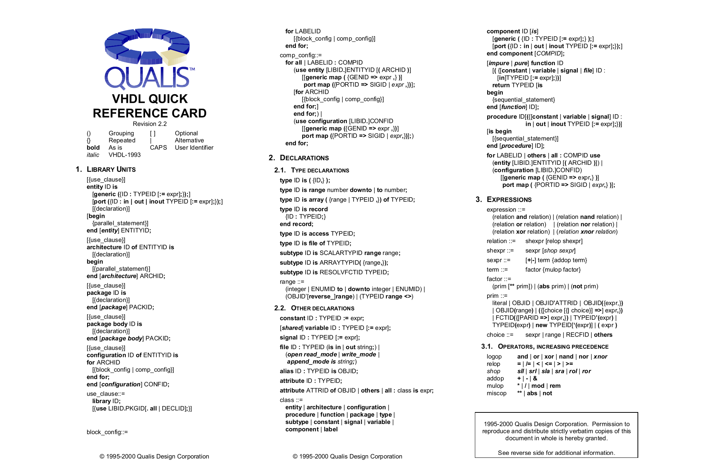
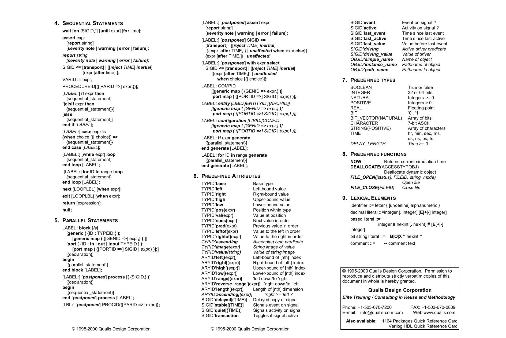
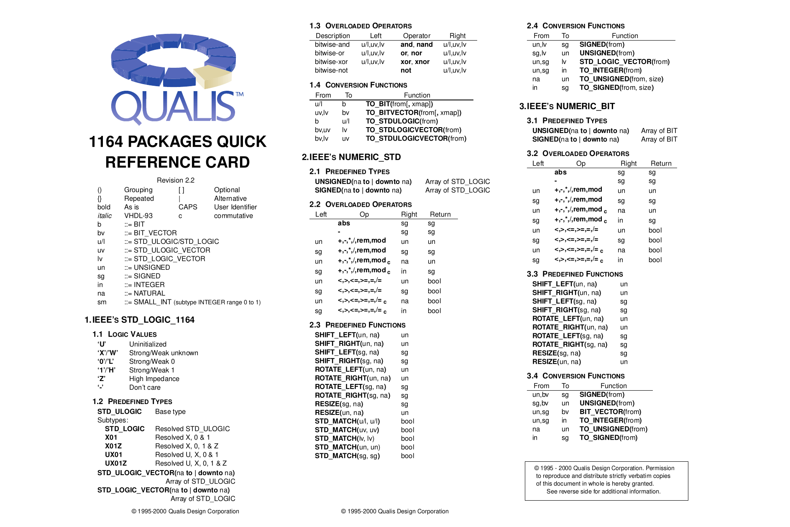
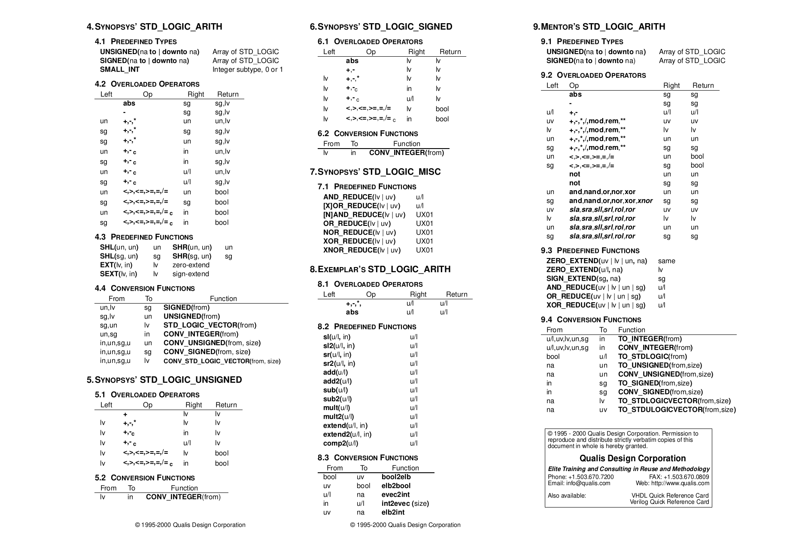

# D Reference card VHDL

Dưới đây bạn có thể tìm thấy hai bộ reference card VHDL rất hữu ích do Qualis Design Corporation thực hiện.

```
http://www.ece.ualberta.ca/˜elliott/cmpe480/refcards/1164qrc.pdf
https://www.isy.liu.se/edu/kurs/TSEA83/kursmaterial/vhdl/vhdlqrc.pdf
```

Link thay thế:

```
https://github.com/fabriziotappero/Free-Range-VHDL-book/tree/master/pics/
ref_cards
```








