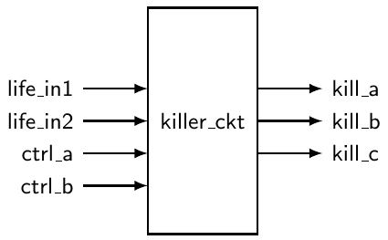
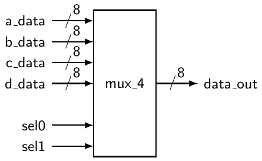
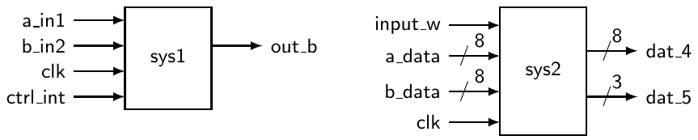

# 3 Các design unit của VHDL

Cách tiếp cận “black-box” cho bất kỳ loại thiết kế nào đều ngụ ý một cấu trúc phân cấp, trong đó mỗi mức khác nhau của hệ phân cấp có lượng chi tiết khác nhau. Trong cách tiếp cận black-box, các đơn vị hoạt động có cùng mục đích được gom lại với nhau và trừu tượng hóa lên một mức cao hơn. Khi đã làm vậy, module được nhắc tới qua biểu diễn black-box vốn đơn giản hơn của nó, thay vì qua chi tiết của mạch điện thực sự thực hiện chức năng đó. Cách tiếp cận này có hai ưu điểm chính. Thứ nhất, nó đơn giản hóa thiết kế xét từ góc độ hệ thống. Xem một sơ đồ mạch gồm các black box được đặt tên thích hợp dễ hiểu hơn nhiều so với nhìn chằm chằm vào một mạch chứa vô số logic gate. Thứ hai, cách tiếp cận black-box cho phép dùng lại code đã viết trước đó.

Không có gì ngạc nhiên khi các mô tả mạch bằng VHDL dựa trên cách tiếp cận black-box. Hai phần chính của bất kỳ thiết kế phân cấp nào là black box và những thứ nằm bên trong black box (tất nhiên những thứ đó có thể là các black box khác). Trong VHDL, black box được gọi là entity và những thứ nằm bên trong nó được gọi là architecture. Vì lý do này, entity và architecture của VHDL liên quan chặt chẽ với nhau. Như bạn có thể hình dung, việc tạo entity tương đối đơn giản, trong khi phần lớn thời gian viết code VHDL được dành để viết architecture cho đúng. Cách tiếp cận của chúng ta ở đây là giới thiệu việc viết code VHDL bằng cách mô tả entity, rồi chuyển sang chi tiết của việc viết architecture. Hy vọng việc quen với entity sẽ giúp bạn học các kỹ thuật mô tả architecture.

## 3.1 Entity

Construct entity của VHDL cung cấp một phương pháp để trừu tượng hóa chức năng của một mô tả mạch lên một mức cao hơn. Nó cung cấp một lớp vỏ bọc đơn giản cho mạch lower-level. Lớp vỏ bọc này thực chất mô tả cách black box giao tiếp với thế giới bên ngoài. Vì VHDL mô tả mạch số, entity chỉ đơn giản liệt kê các input và output khác nhau của mạch bên dưới. Theo thuật ngữ VHDL, black box được mô tả bằng một entity declaration. Cú pháp của entity declaration được trình bày trong Listing 3.1.

Listing 3.1: Entity declaration trong VHDL.

```vhdl
entity my_entity is
port(
     port_name_1 : in    std_logic ;
     port_name_2 : out   std_logic;
     port_name_3 : inout std_logic ); --do not forget the semicolon
end my_entity; -- do not forget this semicolon either
```

my_entity xác định tên của entity. Phần tiếp theo không gì khác hơn là danh sách các signal từ mạch bên dưới mà thế giới bên ngoài có thể dùng, đó là lý do nó thường được gọi là interface specification. port_name_x là một identifier dùng để phân biệt các signal khác nhau. Keyword tiếp theo (keyword in) chỉ định hướng của signal so với entity, trong đó signal có thể đi vào, đi ra hoặc cả hai. Các signal input và output này lần lượt gắn với các keyword in, out và inout[^1]. Keyword tiếp theo (keyword std_logic) chỉ kiểu dữ liệu mà port sẽ xử lý. Có nhiều kiểu dữ liệu trong VHDL nhưng chúng ta sẽ chủ yếu làm việc với kiểu std_logic và các phiên bản dẫn xuất của nó. Thông tin thêm về các kiểu dữ liệu khác nhau của VHDL sẽ được thảo luận sau.

Khi bạn cố viết code VHDL khá phức tạp, bạn sẽ cần chia code của mình thành các file, function và packages constructor khác nhau, những thứ này sẽ giúp bạn xử lý code tốt hơn. Trong tình huống này, phần thân entity sẽ không chỉ chứa các statement định nghĩa port mà nhiều khả năng còn chứa cả những procedure khác. Chúng ta sẽ nói về điều này ở phần sau của sách.

Listing 3.2: Entity declaration VHDL.

```vhdl
------------------------------
--  interface description   --
--  of killer_ckt           --
------------------------------
entity killer_ckt is
port (
   life_in1       : in  std_logic;
   life_in2       : in  std_logic;
   ctrl_a, ctrl_b : in  std_logic;
   kill_a         : out std_logic;
   kill_b, kill_c : out std_logic);
end killer_ckt;
```



Listing 3.2 cho thấy một ví dụ về black box và code VHDL dùng để mô tả nó. Dưới đây là một vài điểm cần lưu ý về code trong Listing 3.2. Phần lớn các điểm này liên quan đến khả năng đọc và khả năng hiểu code VHDL.

• Mỗi tên port là duy nhất và có một mode và một kiểu dữ liệu đi kèm. Đây là yêu cầu bắt buộc.

• VHDL compiler cho phép đặt nhiều tên port trên cùng một dòng. Các tên port được phân cách bằng dấu phẩy. Hãy luôn cố gắng để code dễ đọc.

• Các tên port được căn thẳng hàng phần nào trong một nỗ lực yếu ớt nhằm tăng khả năng đọc. Đây không phải yêu cầu bắt buộc, nhưng bạn nên luôn cố gắng để code dễ đọc. Hãy nhớ rằng compiler bỏ qua khoảng trắng.

• Có kèm một comment cho chúng ta biết entity này làm gì.

• Một sơ đồ black-box của mạch cũng được cung cấp. Một lần nữa, vẽ một dạng sơ đồ nào đó sẽ giúp ích cho bất kỳ code VHDL nào bạn đang viết. Hãy nhớ: đừng sợ, hãy vẽ một bức hình.

Hy vọng là bạn không thấy những entity specification này quá khó. Thực tế, chúng đơn giản đến mức chúng ta sẽ thêm một tình tiết bất ngờ cuối cùng trước khi rời khỏi địa hạt của entity VHDL. Phần lớn những mạch có ý nghĩa hơn mà bạn sẽ thiết kế, phân tích và test đều có nhiều input và output tương tự nhau và liên quan chặt chẽ với nhau. Trong biệt ngữ máy tính, chúng thường được gọi là “bus signal”. Đường bus được tạo từ nhiều hơn một signal, có tên chỉ khác nhau ở một ký tự số. Nói cách khác, mỗi signal riêng lẻ trong bus mang tên bus cộng thêm một con số để phân biệt nó với các signal khác trong bus. Các signal riêng lẻ của bus được gọi là các phần tử của bus. Như bạn có thể hình dung, bus thường được dùng trong mạch số. Đáng tiếc là từ bus cũng chỉ những giao thức truyền dữ liệu đã được thiết lập. Để tránh nhầm nghĩa của từ bus, chúng ta sẽ dùng từ “bundle” để chỉ một tập các signal tương tự nhau và dùng bus để chỉ một giao thức.

Bundle được mô tả dễ dàng trong entity VHDL. Tất cả những gì cần là một kiểu dữ liệu mới và một ký hiệu đặc biệt để chỉ ra khi nào một signal là bundle hay không. Một vài ví dụ được trình bày trong Listing 3.3. Trong các ví dụ này, lưu ý rằng mode giữ nguyên nhưng kiểu đã thay đổi. Kiểu dữ liệu std_logic giờ đã được thay bằng từ std_logic_vector để chỉ ra rằng mỗi tên signal chứa nhiều hơn một signal. Có những cách để tham chiếu đến từng thành viên riêng lẻ của mỗi bundle, nhưng chúng ta sẽ đi vào những chi tiết đó sau.

Như bạn có thể thấy khi xem xét Listing 3.3, có hai phương pháp có thể dùng để mô tả các signal trong một bundle. Hai phương pháp này được thể hiện trong các danh sách đối số theo sau phần khai báo kiểu dữ liệu. Các signal trong bundle có thể được liệt kê theo một trong hai thứ tự, được chỉ định bằng các keyword to và downto. Nếu bạn muốn bit có trọng số lớn nhất của bundle là bit đầu tiên bên trái, bạn dùng keyword downto. Hãy chắc chắn không quên hướng của các signal khi dùng ký hiệu này trong model VHDL của bạn.

Trong black box của Listing 3.3, bạn có thể thấy ký hiệu chính thức cho một bundle. Lưu ý rằng black box dùng ký hiệu slash-and-number. Dấu gạch chéo cắt ngang đường signal cho biết signal đó là một bundle, và con số đi kèm chỉ số lượng signal trong bundle. Điều đáng nói về black box so với Listing 3.3 là các đường input sel1 và sel0 lẽ ra có thể được gộp thành một bundle chứa hai signal.



Listing 3.3: Entity declaration có bundle.

```vhdl
-------------------------------------------------------------
-- Unlike the other examples, this is actually an interface
-- for a MUX that selects one of four bus lines for the output.
-------------------------------------------------------------
entity mux4 is
port (  a_data    : in     std_logic_vector(0 to 7);
        b_data    : in     std_logic_vector(0 to 7);
        c_data    : in     std_logic_vector(0 to 7);
        d_data    : in     std_logic_vector(0 to 7);
        sel1,sel0 : in     std_logic;
        data_out  : out    std_logic_vector(7 downto 0));
end mux4;
```

Kiểu dữ liệu std_logic và kiểu dữ liệu std_logic_vector là những gì IEEE đã chuẩn hóa để biểu diễn các signal số. Thông thường, bạn nên coi các kiểu dữ liệu này nhận giá trị logic 1 hoặc giá trị logic 0. Tuy nhiên, như được quy định trong package std_logic_1164, bản hiện thực của kiểu std_logic (và kiểu std_logic_vector) rộng rãi hơn một chút và gồm 9 giá trị khác nhau, cụ thể là: 0,1,U,X,Z,W,L,H,-.

Kiểu dữ liệu std_logic trở nên dùng được ngay sau phần khai báo library IEEE; use IEEE.std_logic_1164.all; ở đầu code của bạn.

Lý do có tất cả các giá trị này là mong muốn mô hình hóa các driver three-state, các output pull-up và pull-down, trạng thái high impedance và một vài loại input/output khác. Để biết thêm chi tiết, hãy xem IEEE 1164 Standard[^2].

Thay cho kiểu dữ liệu std_logic, người lập trình VHDL đôi khi dùng kiểu dữ liệu bit đơn giản hơn nhiều, chỉ có các giá trị logic 1 và 0.

## 3.2 Các library chuẩn của VHDL

Ngôn ngữ VHDL, cũng như nhiều ngôn ngữ máy tính khác, đã trải qua một quá trình phát triển dài và mạnh mẽ. Trong số những bước chuẩn hóa quan trọng nhất, có thể kể đến việc phát hành package IEEE Standard 1164 cũng như một số chuẩn con giúp mở rộng thêm chức năng của ngôn ngữ. Để tận dụng tính năng hiện thực được chính của VHDL, bạn chỉ cần import hai package library chính như trong các dòng 2∼4 của Listing 3.4.

Listing 3.4: Cách đưa vào các library chuẩn IEEE điển hình.

```vhdl
 1   -- library declaration
 2   library IEEE;
 3   use IEEE.std_logic_1164.all; -- basic IEEE library
 4   use IEEE.numeric_std.all;    -- IEEE library for the unsigned type and
 5                                -- various arithmetic operators
 6
 7   -- WARNING: in general try NOT to use the following libraries
 8   --          because they are not IEEE standard libraries
 9   -- use IEEE.std_logic_arith.all;
10   -- use IEEE.std_logic_unsigned.all;
11   -- use IEEE.std_logic_signed
12
13   -- entity
14   entity my_ent is
15       port ( A,B,C : in  std_logic;
16              F     : out std_logic);
17   end my_ent;
18   -- architecture
19   architecture my_arch of my_ent is
20       signal v1,v2 : std_logic_vector (3 downto 0);
21       signal u1    : unsigned (3 downto 0);
22       signal i1    : integer;
23   begin
24       u1 <= "1101";
25       i1 <= 13;
26       v1 <= std_logic_vector(u1);                         -- = "1101"
27       v2 <= std_logic_vector(to_unsigned(i1, v2'length)); -- = "1101"
28
29   -- "4" could be used instead of "v2'length", but the "length"
30   -- attribute makes life easier if you want to change the size of v2
31
32       F <= NOT (A AND B AND C);
33   end my_arch;
```

Khi đã đưa các package này vào, bạn sẽ có quyền dùng một tập rất lớn các thứ hay ho: nhiều kiểu dữ liệu, các operator được overload, nhiều function chuyển đổi, các function toán học, v.v. Ví dụ, việc đưa vào package numeric_std.all sẽ cho bạn khả năng dùng kiểu dữ liệu unsigned và function to_unsigned như trong Listing 3.4. Để có mô tả chi tiết về những gì các library này chứa, hãy xem Language Templates của công cụ phần mềm synthesis mà bạn ưa thích.

Để biết thêm thông tin về các library chuẩn của VHDL, hãy xem Phụ lục.

## 3.3 Architecture

Entity declaration của VHDL, đã được giới thiệu ở trên, mô tả interface hay biểu diễn bên ngoài của mạch. Architecture mô tả mạch thực sự làm gì. Nói cách khác, architecture của VHDL mô tả bản hiện thực bên trong của entity đi kèm. Như bạn có thể hình dung, mô tả interface bên ngoài của một mạch nói chung dễ hơn nhiều so với mô tả mạch được dự định hoạt động như thế nào. Nhận định này càng trở nên quan trọng hơn khi các mạch bạn mô tả càng phức tạp.

Có thể có bất kỳ số lượng architecture tương đương nào cùng mô tả một entity. Như rồi bạn sẽ phát hiện ra, coding style VHDL dùng bên trong phần thân architecture có ảnh hưởng đáng kể đến cách mạch được synthesize (cách mạch sẽ được hiện thực bên trong một thiết bị silicon thực tế). Điều này cho người lập trình VHDL sự linh hoạt trong việc thiết kế các hệ thống có những đặc điểm tích cực hay tiêu cực cụ thể, như kích thước vật lý nhất định (đo bằng số phần tử số cơ bản cần dùng) hay tốc độ hoạt động.

Vì nhiều lý do khác nhau, chẳng hạn để tạo thuận lợi cho re-usability của code và khả năng kết nối, một architecture có thể được mô hình hóa theo nhiều cách khác nhau. Hiểu các kỹ thuật mô hình hóa khác nhau và hiểu cách dùng chúng là những bước quan trọng đầu tiên trong việc học VHDL.

Một architecture có thể được viết bằng ba kỹ thuật mô hình hóa cộng với bất kỳ tổ hợp nào của ba kỹ thuật này. Đó là model data-flow, model behavioral, model structural và các model hybrid. Các model này sẽ được mô tả xuyên suốt cuốn sách. Listing 3.5 cho xem trước một khối code VHDL đơn giản nhưng hoàn chỉnh trông như thế nào.

## 3.4 Signal assignment và variable assignment

Trong VHDL có nhiều loại object. Trong số những loại được dùng thường xuyên nhất, chúng ta sẽ kể đến loại object signal, loại object variable và loại object constant. Kiểu signal là biểu diễn bằng phần mềm của một sợi dây. Kiểu variable, giống như trong C hay Java, được dùng để lưu thông tin cục bộ. Constant giống như một loại object variable mà giá trị không thể thay đổi. Một object signal có thể thuộc nhiều kiểu khác nhau; ví dụ, chúng ta đã thấy ở trên rằng một object signal có thể có kiểu std_logic hoặc các kiểu khác như integer, kiểu tự định nghĩa, v.v. Điều tương tự cũng áp dụng cho các object variable.

Listing 3.5: Ví dụ về một khối VHDL đơn giản.

```vhdl
 1   ---------------------- FILE: my_sys.vhd ----------------------
 2   -- library declaration
 3   library ieee;
 4   use ieee.std_logic_1164.all;
 5
 6   -- the ENTITY
 7   entity circuit1 is
 8       port (A,B,C : in  std_logic;
 9             F,G   : out std_logic);
10   end circuit1;
11
12   -- the ARCHITECTURE
13   architecture circuit1_arc of circuit1 is
14       signal sig_1 : std_logic;            -- signal definition
15   begin
16       process (a,b,c)
17           variable var_1 : integer;        -- variable definition
18       begin
19           F <= not (A and B and C);        -- signal assignment
20           sig_1 <= A;                      -- another signal assignment
21           var_1 := 34;                     -- variable assignment
22       end process;
23
24       G <= not (A and B);                  -- concurrent assignment
25   end circuit1_arc;
```

Trước khi dùng bất kỳ signal hay variable nào, bắt buộc phải khai báo chúng. Signal được khai báo ở đầu phần thân architecture, ngay trước keyword begin. Variable phải được khai báo bên trong construct process và là cục bộ. Một ví dụ được thể hiện ở dòng 14 và 17 của Listing 3.5.

Như thấy ở dòng 19 và dòng 20 của Listing 3.5, khi bạn muốn gán một giá trị mới cho một object kiểu signal, bạn dùng operator “<=”. Ngược lại, khi bạn muốn gán một giá trị mới cho một object kiểu variable, bạn sẽ dùng operator “:=”, như ở dòng 21.

Điều quan trọng là phải hiểu sự khác biệt giữa variable và signal, cụ thể là khi nào giá trị của chúng thay đổi. Một variable thay đổi giá trị ngay sau khi variable assignment được thực thi. Còn một signal thay đổi giá trị “một lúc nào đó” sau khi biểu thức signal assignment được đánh giá. Điều này có những hệ quả quan trọng đối với các giá trị được cập nhật của variable và signal. Điều này có nghĩa là bạn không bao giờ nên giả định rằng một signal assignment có thể xảy ra tức thì, và nó cũng có nghĩa là bạn có thể tận dụng variable mỗi khi bạn cần hiện thực một counter hoặc lưu giá trị khi đang ở bên trong một process.

Để có thể giới thiệu cách dùng variable, chúng ta đã phải dùng construct process, một construct mà bạn chưa quen. Chúng ta sẽ thấy chi tiết hơn ở phần sau của sách rằng bất cứ khi nào cần một môi trường thực thi non-concurrent, nơi các dòng code được thực thi lần lượt cái này sau cái kia (như trong C hay Java), chúng ta sẽ dùng construct process. Bên trong một process, mọi instruction được thực thi liên tiếp từ trên xuống dưới. Tuy nhiên, bản thân process sẽ được thực thi concurrent với phần còn lại của code (ví dụ instruction ở dòng 24).

Hãy luôn nhớ rằng assignment ở dòng 24 của Listing 3.5 và việc thực thi process không được thực hiện liên tiếp mà thay vào đó là concurrent (tất cả cùng một lúc). Mọi hy vọng rằng việc thực thi dòng 24 sẽ xảy ra trước hoặc sau việc thực thi process sẽ chỉ dẫn đến thất vọng lớn.

Một lưu ý cuối cùng, xin nhắc lại rằng kiểu std_logic chỉ tồn tại nếu bạn khai báo library ieee.std_logic_1164.all như ở dòng 4 của Listing 3.5.

## 3.5 Tóm tắt

• Entity declaration mô tả các input và output của mạch của bạn. Tập signal này thường được gọi là interface của mạch, vì những signal này là thứ mà mạch điện bên ngoài entity dùng để tương tác với mạch của bạn.

• Các signal được mô tả trong entity declaration gồm một mode specifier và một kiểu. Mode specifier có thể là in hoặc out (hoặc, như chúng ta sẽ thấy sau này, thậm chí là inout), còn kiểu là std_logic hoặc std_logic_vector.

• Từ bundle được ưu tiên hơn từ bus khi làm việc với nhiều signal có cùng mục đích. Từ bus có những hàm ý khác không phù hợp với định nghĩa bundle.

• Nhiều signal có cùng mục đích nên được khai báo thành một bundle dùng kiểu std_logic_vector. Những signal được gộp thành bundle như vậy luôn dễ làm việc hơn trong VHDL so với các kiểu scalar như std_logic.

• Architecture mô tả mạch của bạn thực sự làm gì và hành vi của nó là gì. Trong VHDL có thể có nhiều bản hiện thực (model) khác nhau cho cùng một hành vi. Đó là model data-flow, model behavioral, model structural cũng như bất kỳ tổ hợp nào của chúng, thường gọi là model hybrid.

## 3.6 Bài tập

1. Từ bundle chỉ cái gì?

2. Một phương pháp phổ biến để biểu diễn bundle trong sơ đồ black-box là gì?

3. Vì sao luôn vẽ một sơ đồ black-box khi dùng VHDL để mô hình hóa mạch số được xem là một cách tiếp cận tốt?

4. Hãy viết các entity declaration VHDL mô tả các sơ đồ black-box sau:

a) b)



5. Hãy vẽ các sơ đồ black-box được định nghĩa bởi các entity declaration VHDL sau: a)

```vhdl
entity ckt_c is
port (
    bun_a, bun_b, bun_c  : in    std_logic_vector(7 downto 0);
    lda, ldb, ldc        : in    std_logic;
    reg_a, reg_b, reg_c  : out   std_logic_vector(7 downto 0));
end ckt_c;
```

b)

```vhdl
entity ckt_e is
port (
    RAM_CS, RAM_WE, RAM_OE  : in std_logic;
    SEL_OP1, SEL_OP2        : in std_logic_vector(3 downto 0);
    RAM_DATA_IN             : in std_logic_vector(7 downto 0);
    RAM_ADDR_IN             : in std_logic_vector(9 downto 0);
    RAM_DATA_OUT            : out std_logic_vector(7 downto 0));
end ckt_e;
```

6. Hai entity declaration sau chứa hai trong số những lỗi cú pháp phổ biến nhất khi viết VHDL. Đó là những lỗi gì? a)

```vhdl
entity ckt_a is
port (
    J,K : in  std_logic;
    CLK : in  std_logic
    Q   : out std_logic;)
end ckt_a;
```

b)

```vhdl
entity ckt_b is
port (
mr_fluffy   : in  std_logic_vector(15 downto 0);
mux_ctrl    : in  std_logic_vector(3 downto 0);
byte_out    : out std_logic_vector(3 downto 0);
end ckt_b;
```

---

[^1]: Mode dữ liệu inout sẽ được thảo luận ở phần sau của sách.

[^2]: IEEE 1164 Standard: http://en.wikipedia.org/wiki/IEEE_1164
