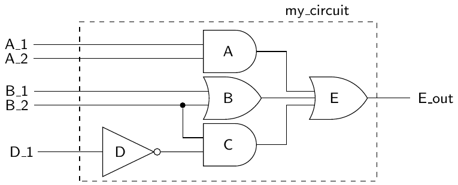
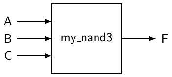
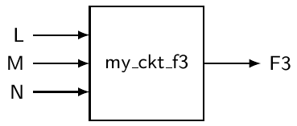
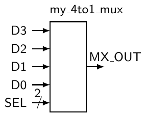
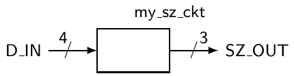

# 4 Mô hình lập trình của VHDL

Chương trước đã giới thiệu ý tưởng về các design unit cơ bản của VHDL: entity và architecture. Phần lớn thời gian được dành để mô tả entity đơn giản vì nó liên quan đến ít thứ hơn nhiều so với architecture. Hãy nhớ, entity declaration được dùng để mô tả interface của một mạch với thế giới bên ngoài. Architecture được dùng để mô tả mạch được dự định hoạt động như thế nào.

Trước khi đi vào chi tiết của việc đặc tả architecture, chúng ta phải lùi lại một chút và nhớ lại điều chúng ta đang cố làm với VHDL là gì. Vì lý do này hay lý do khác, chúng ta đang mô tả một mạch số. Nhận ra điều này là rất quan trọng. Những người lập trình VHDL trẻ có nền tảng lập trình máy tính có xu hướng xem VHDL chỉ là thêm một ngôn ngữ lập trình nữa mà họ muốn hoặc phải học. Dù nhiều sinh viên đại học đã dùng cách tiếp cận này để qua được các môn số cơ bản, đây không phải là một ý hay.

Khi được nhìn nhận đúng, VHDL thể hiện một cách tiếp cận lập trình hoàn toàn khác, trong khi vẫn có nhiều điểm tương đồng với các ngôn ngữ lập trình khác. Điểm tương đồng chính là cả hai đều dùng một ngôn ngữ có cú pháp và rule-based để mô tả một thứ trừu tượng. Nhưng điểm khác biệt là chúng mô tả hai thứ khác nhau. Phần lớn các ngôn ngữ lập trình được dùng để triển khai các chức năng theo cách tuần tự, mỗi lần một instruction. Tuy nhiên VHDL mô tả phần cứng, và vì vậy các instruction được thực thi theo cách concurrent[^1], nghĩa là mọi instruction được thực thi cùng một lúc. Nhận ra thực tế này sẽ giúp bạn thực sự hiểu mô hình lập trình và ngôn ngữ VHDL.

## 4.1 Concurrent statement

Cốt lõi của phần lớn các ngôn ngữ lập trình là các statement tạo nên phần lớn source code đi kèm. Những statement này biểu diễn các lượng hành động hữu hạn cần được thực hiện. Một statement trong một ngôn ngữ lập trình thuật toán như C hay Java biểu diễn một hành động mà processor cần thực hiện. Khi processor hoàn thành một hành động, nó chuyển sang hành động tiếp theo được chỉ định ở đâu đó trong source code đi kèm. Điều này hợp lý và dễ chịu với con người chúng ta vì, cũng giống như processor, chúng ta nói chung chỉ có khả năng làm một việc mỗi lúc. Mô tả này đặt nền móng cho một phương pháp thuật toán, trong đó processor làm rất tốt việc tuân theo một tập quy tắc, về bản chất chính là sự chỉ dẫn do source code cung cấp. Khi các quy tắc có ý nghĩa, processor có thể làm những điều đáng kinh ngạc.

Lập trình VHDL khác biệt đáng kể. Trong khi một processor bước lần lượt qua từng statement trong một tập statement, VHDL có khả năng thực thi một số lượng statement gần như không giới hạn cùng một lúc và theo cách concurrent (nói cách khác, song song). Một lần nữa, điều then chốt cần nhớ ở đây là chúng ta đang thiết kế phần cứng. Tính song song, hay việc các thứ xảy ra concurrent, trong ngữ cảnh phần cứng là một khái niệm đơn giản hơn nhiều so với trong thế giới phần mềm. Nếu bạn đã được giới thiệu chút ít về phần cứng số cơ bản, nhiều khả năng bạn đã vừa quen vừa thoải mái với khái niệm song song, dù không phải trong một ngôn ngữ lập trình.

Hình 4.1 cho thấy một ví dụ đơn giản về một mạch hoạt động song song. Như bạn biết, output của các gate là một hàm của input của gate. Bất cứ lúc nào bất kỳ input nào của gate thay đổi, có khả năng là sau một độ trễ thích hợp, output của gate sẽ thay đổi. Điều này đúng với tất cả các gate trong Hình 4.1 hay trong bất kỳ mạch số nào nói chung. Khi có thay đổi ở input của gate, trạng thái mạch được re-evaluated và output của gate có thể thay đổi theo. Dù mạch trong Hình 4.1 chỉ có vài gate, ý tưởng về hoạt động concurrent của mọi phần tử trong mạch là như nhau ở mọi mạch số, bất kể chúng lớn hay phức tạp đến đâu.



Hình 4.1: Một mạch thông dụng được biết rõ là thực thi các thao tác song song.

Vì phần lớn chúng ta là con người, chúng ta chỉ có khả năng đọc mỗi lần một dòng chữ và theo cách tuần tự. Chúng ta gặp cùng giới hạn đó khi cố viết một đoạn chữ, chưa kể đến việc nhập chữ vào máy tính. Vậy thì làm sao chúng ta dùng chữ để mô tả một mạch vốn mang tính song song? Chúng ta không gặp vấn đề này khi bàn về một thứ vốn tuần tự như lập trình thuật toán thông thường. Khi viết code bằng một ngôn ngữ lập trình thuật toán, nói chung chỉ có một phần tử xử lý cần tập trung vào tại mỗi thời điểm. Mọi thứ ít nhiều nối tiếp nhau theo cách tuần tự, điều này rất khớp với giới hạn cơ bản của chúng ta với tư cách con người.

Mô hình lập trình VHDL được xây dựng xung quanh khái niệm diễn đạt tính song song và tính concurrent bằng các mô tả mạch dạng văn bản. Cốt lõi của lập trình VHDL là concurrent statement. Đây là những statement trông rất giống các statement trong các ngôn ngữ thuật toán nhưng khác biệt đáng kể, vì các statement VHDL, theo định nghĩa, diễn đạt tính concurrent của việc thực thi.

Listing 4.1 cho thấy code triển khai mạch trong Hình 4.1. Code này có bốn concurrent signal assignment statement. Như đã thấy trước đây, construct “<=” là signal assignment operator. Đúng là chúng ta không thể viết bốn statement này cùng một lúc, nhưng chúng ta có thể diễn giải các statement này như những hành động xảy ra concurrent. Hãy luôn nhớ rằng khái niệm concurrency là một khái niệm then chốt trong VHDL. Nếu bạn cảm thấy lối tư duy thuật toán đang len lỏi vào tâm trí mình, hãy cố thoát ra khỏi nó thật nhanh. Concurrent signal assignment được thảo luận chi tiết hơn trong mục tiếp theo.

Listing 4.1: Code VHDL cho mạch trong Hình 4.1.

```vhdl
-- library declaration
library IEEE;
use IEEE.std_logic_1164.all;

-- entity
entity my_circuit is
    port ( A_1,A_2,B_1,B_2,D_1 : in  std_logic;
           E_out               : out std_logic);
end my_circuit;

-- architecture
architecture my_circuit_arc of my_circuit is
    signal A_out, B_out, C_out : std_logic;
begin
    A_out <= A_1 and A_2;
    B_out <= B_1 or B_2;
    C_out <= (not D_1) and B_2;
    E_out <= A_out or B_out or C_out;
end my_circuit_arc;
```

Do bản chất concurrent của các statement VHDL, ba đoạn code dưới đây tương đương 100% với code trong Listing 4.1. Một lần nữa, vì các statement được diễn giải là xảy ra concurrent: thứ tự xuất hiện của các statement này trong source code VHDL của bạn không tạo ra khác biệt gì. Nói chung, mô tả mạch như trong Listing 4.1 sẽ là ý hay hơn, vì nó phần nào phản ánh cách tổ chức tự nhiên của các statement.

Listing 4.2: Code VHDL tương đương cho mạch trong Hình 4.1.

```vhdl
C_out <= (not D_1) and B_2;
A_out <= A_1 and A_2;
B_out <= B_1 or B_2;
E_out <= A_out or B_out or C_out;
```

Listing 4.3: Code VHDL tương đương cho mạch trong Hình 4.1.

```vhdl
A_out <= A_1 and A_2;
E_out <= A_out or B_out or C_out;
B_out <= B_1 or B_2;
C_out <= (not D_1) and B_2;
```

Listing 4.4: Code VHDL tương đương cho mạch trong Hình 4.1.

```vhdl
B_out <= B_1 or B_2;
A_out <= A_1 and A_2;
E_out <= A_out or B_out or C_out;
C_out <= (not D_1) and B_2;
```

## 4.2 Signal assignment operator “<=”

Các ngôn ngữ lập trình thuật toán luôn có một dạng assignment operator nào đó. Trong C hay Java, đó là dấu “=” well-known. Trong những ngôn ngữ này, assignment operator biểu thị việc chuyển dữ liệu từ right-hand side của operator sang left-hand side. VHDL dùng hai ký tự liên tiếp để biểu diễn assignment operator: “<=”. Tổ hợp này được chọn vì nó khác với assignment operator trong phần lớn các ngôn ngữ lập trình thuật toán phổ biến khác. Operator này được gọi chính thức là signal assignment operator để làm nổi bật mục đích thực sự của nó. Signal assignment operator chỉ định một quan hệ giữa các signal. Nói cách khác, signal ở left-hand side của signal assignment operator phụ thuộc vào các signal ở right-hand side của operator.

Với những hiểu biết mới này về VHDL, bạn sẽ có thể hiểu code của Listing 4.1 và quan hệ của nó với sơ đồ mạch trong Hình 4.1. Statement “G <= A AND B;” cho biết giá trị của signal tên G biểu diễn một phép toán logic AND giữa các signal A và B.

Có bốn loại concurrent statement được xem xét trong chương này. Chúng ta đã bàn sơ qua về concurrent signal assignment statement, mà chúng ta sẽ sớm xem xét kỹ hơn và đặt vào ngữ cảnh của một mạch thực tế. Ba loại concurrent statement khác mà chúng ta quan tâm ngay lúc này là process statement, conditional signal assignment và selected signal assignment.

Về bản chất, bốn loại statement này là những công cụ bạn sẽ dùng để triển khai mạch số trong VHDL. Bạn sẽ sớm khám phá ra tính linh hoạt của những statement này. Đáng tiếc là tính linh hoạt này thực tế làm learning curve dốc lên kha khá. Như bạn biết từ kinh nghiệm với các ngôn ngữ lập trình khác, luôn có nhiều cách để làm cùng một việc. Nói cách khác, nhiều đoạn code trông có vẻ khác nhau thực ra có thể cho ra cùng một kết quả. Điều tương tự cũng đúng với code VHDL: nhiều đoạn code VHDL khác nhau đáng kể thực ra có thể tạo ra phần cứng giống hệt nhau. Hãy nhớ điều này khi bạn xem bất kỳ ví dụ nào trong tutorial này. Bất kỳ code VHDL nào dùng để giải một bài toán thì nhiều khả năng cũng chỉ là một trong nhiều lời giải có thể có cho bài toán đó. Một số model VHDL trong tutorial này được trình bày để cho thấy một việc có thể làm theo một cách nhất định, nhưng điều đó không nhất thiết có nghĩa là việc đó chỉ có thể làm theo cách đó.

## 4.3 Concurrent signal assignment statement

Dạng tổng quát của một concurrent signal assignment statement được trình bày trong Listing 4.5. Trong trường hợp này, target là một signal nhận giá trị của expression. Một expression được xác định bởi một constant, bởi một signal, hoặc bởi một tập các operator hoạt động trên các signal khác. Các ví dụ về expression dùng trong code VHDL được trình bày trong các ví dụ tiếp theo.

Listing 4.5: Cú pháp của concurrent signal assignment statement.

```vhdl
<target> <= <expression>;
```

> VÍ DỤ 1. Hãy viết code VHDL triển khai một NAND gate three-input. Ba signal input có tên A, B và C, và tên signal output là F.

LỜI GIẢI. Luôn vẽ sơ đồ của mạch bạn đang thiết kế là một thói quen tốt. Hơn nữa, dù chúng ta có thể vẽ một sơ đồ dùng ký hiệu quen thuộc của NAND gate, chúng ta sẽ chọn giữ sơ đồ ở dạng tổng quát và dùng cách tiếp cận black-box. Hãy nhớ, black box là một trợ giúp tốt khi đến lúc viết entity declaration. Lời giải của Ví dụ 1 có trong Listing 4.6.

Listing 4.6: Lời giải của Ví dụ 1.

```vhdl
 1   -- library declaration
 2   library IEEE;
 3   use IEEE.std_logic_1164.all;
 4   -- entity
 5   entity my_nand3 is
 6       port ( A,B,C : in  std_logic;
 7              F     : out std_logic);
 8   end my_nand3;
 9   -- architecture
10   architecture exa_nand3 of my_nand3 is
11   begin
12       F <= NOT(A AND B AND C);
13   end exa_nand3;
```



Ví dụ này chứa một vài ý tưởng mới đáng được làm rõ thêm.

• Có những header file và library file phải được đưa vào code VHDL của bạn để code compile đúng. Vài dòng code này được liệt kê ở đầu code trong Listing 4.6. Các dòng được liệt kê nhiều hơn mức cần cho ví dụ này, nhưng chúng sẽ cần ở các ví dụ sau. Để tiết kiệm chỗ, những dòng này sẽ được lược bỏ trong một số ví dụ sắp tới.

• Ví dụ này làm nổi bật cách dùng một số logic operator. Các logic operator có trong VHDL là AND, OR, NAND, NOR, XOR và XNOR. Về mặt kỹ thuật, operator NOT không phải là một logic operator nhưng cũng có sẵn. Hơn nữa, các logic operator này được xem là binary operator ở chỗ chúng hoạt động trên hai giá trị xuất hiện ở bên trái và right-hand side của operator. Operator NOT là một unary operator và vì thế nó chỉ hoạt động trên giá trị xuất hiện ở bên phải operator.

• Trong lời giải này, entity chỉ có một architecture đi kèm. Đây là cách làm khá phổ biến trong phần lớn các thiết kế VHDL.

Ví dụ 1 minh họa cách dùng concurrent signal assignment (CSA) statement trong một chương trình VHDL chạy được (xem dòng 12 của Listing 4.6). Nhưng vì chỉ có một CSA statement, khái niệm concurrency chưa lộ rõ ngay. Ý tưởng đằng sau bất kỳ concurrent statement nào trong VHDL là output thay đổi bất cứ lúc nào một trong các signal input thay đổi. Nói cách khác, output F được re-evaluated bất cứ lúc nào một signal trong expression input thay đổi. Đây là một khái niệm then chốt để thực sự hiểu VHDL, nên bạn có thể muốn đọc câu đó thêm vài lần. Ý tưởng về concurrency được minh họa rõ hơn trong Ví dụ 2.

> VÍ DỤ 2. Hãy viết code VHDL triển khai hàm được biểu diễn bởi phương trình logic sau: F3 = $\overline{L}$ · $\overline{M}$ · N + L · M

LỜI GIẢI. Sơ đồ black box và code VHDL đi kèm được trình bày trong Listing 4.7.

Listing 4.7: Lời giải của Ví dụ 2.

```vhdl
-- library declaration
library IEEE;
use IEEE.std_logic_1164.all;
-- entity
entity my_ckt_f3 is
   port ( L,M,N : in  std_logic;
          F3    : out std_logic);
end my_ckt_f3;
-- architecture
architecture f3_2 of my_ckt_f3 is
begin
   F3<=((NOT L)AND(NOT M)AND N)OR(L AND M);
end f3_2;
```



Ví dụ này cho thấy một bản triển khai one-line của phương trình logic đã cho.

Một lời giải khác cho Ví dụ 2 được cung cấp trong Listing 4.8. Ví dụ này thể hiện một khái niệm quan trọng trong VHDL. Lời giải trong Listing 4.8 dùng một số statement đặc biệt để triển khai mạch. Các statement đặc biệt này được dùng để cung cấp thứ thường được gọi là kết quả trung gian. Cách tiếp cận này tương đương với việc khai báo thêm biến trong một ngôn ngữ lập trình thuật toán để dùng lưu kết quả trung gian. Nhu cầu về kết quả trung gian đi kèm với việc khai báo thêm các giá trị signal, thường được gọi là intermediate signal. Lưu ý trong Listing 4.8 rằng việc khai báo intermediate signal giống với các khai báo port trong entity declaration, chỉ khác là thiếu phần chỉ định mode (in, out hoặc inout).

Intermediate signal phải được khai báo bên trong phần thân của architecture vì chúng không có liên kết nào với thế giới bên ngoài và vì thế không xuất hiện trong entity declaration. Lưu ý rằng intermediate signal được khai báo trong phần thân architecture nhưng xuất hiện trước statement begin.

Listing 4.8: Lời giải khác cho Ví dụ 2.

```vhdl
-- library declaration
library IEEE;
use IEEE.std_logic_1164.all;
-- entity
entity my_ckt_f3 is
    port ( L,M,N : in  std_logic;
           F3    : out std_logic);
end my_ckt_f3;
-- architecture
architecture f3_1 of my_ckt_f3 is
    signal A1, A2 : std_logic; -- intermediate signals
begin
    A1 <= ((NOT L) AND (NOT M) AND N);
    A2 <= L AND M;
    F3 <= A1 OR A2;
end f3_1;
```

Dù các architecture f3_2 và f3_1 của Listing 4.7 và Listing 4.8 trông khác nhau, chúng tương đương về chức năng. Lý do là mọi statement đều là concurrent signal assignment statement. Dù architecture f3_1 chứa ba CSA, chúng tương đương về chức năng với CSA trong f3_2 vì mỗi statement trong ba statement đó thực chất được thực thi concurrent.

Dù cách dùng intermediate signal không bắt buộc cho ví dụ này, việc dùng chúng nêu ra một số điểm hay. Thứ nhất, dùng intermediate signal là chuẩn mực trong phần lớn các model VHDL. Việc dùng intermediate signal là tùy chọn trong Listing 4.8 vì ví dụ chỉ mô hình hóa một mạch tương đối đơn giản. Khi mạch trở nên phức tạp hơn, có nhiều trường hợp phải dùng intermediate signal. Thứ hai, intermediate signal là một dạng công cụ mà bạn sẽ thường cần dùng trong các model VHDL của mình. Ý ở đây là bạn đang cố mô tả một mạch số bằng một ngôn ngữ mô tả dạng văn bản: bạn sẽ thường cần dùng intermediate signal để đạt được mục tiêu mô hình hóa mạch. Dùng intermediate signal cho phép bạn mô hình hóa mạch số dễ dàng hơn nhưng không làm phần cứng được tạo ra phức tạp hơn. Khi dùng VHDL, người ta có xu hướng nghĩ rằng vì có nhiều chữ hơn trên trang, mạch bạn đang mô tả và/hoặc phần cứng tạo ra sẽ lớn hơn hoặc phức tạp hơn. Điều này hoàn toàn không đúng. Chủ đề chính của VHDL là bạn nên dùng các công cụ VHDL có trong tay để mô hình hóa mạch theo cách đơn giản nhất có thể. Mạch đơn giản có xác suất được hiểu và được synthesize cao hơn. Nhưng quan trọng nhất là một model VHDL đơn giản không liên quan đến độ dài của code VHDL thực tế.

Trong Ví dụ 2, việc chuyển hàm logic thành các CSA tương đối đơn giản. Việc triển khai các hàm này thành code VHDL dễ đến mức gần như tầm thường. Nhưng xét cho cùng, hàm trong Ví dụ 2 cũng không quá phức tạp. Khi các hàm trở nên phức tạp hơn (nhiều input và output hơn), cách tiếp cận nhập phương trình sẽ trở nên nhàm chán. May mắn là có một vài loại concurrent construct khác có thể giúp việc triển khai dễ dàng hơn.

## 4.4 Conditional signal assignment when

Concurrent signal assignment statement, đã thấy ở trên, gắn một target với một expression. Thuật ngữ conditional signal assignment được dùng để mô tả các statement chỉ có một target nhưng có thể có nhiều hơn một expression đi kèm để gán cho target. Mỗi expression gắn với một điều kiện nhất định. Các điều kiện riêng lẻ được đánh giá tuần tự trong conditional signal assignment statement cho đến khi điều kiện đầu tiên được đánh giá là true. Khi đó, expression đi kèm được đánh giá và gán cho target. Mỗi assignment statement chỉ áp dụng một assignment.

Cú pháp của conditional signal assignment được trình bày trong Listing 4.9. Target trong trường hợp này là tên của một signal. Điều kiện dựa trên trạng thái của một số signal khác trong mạch đã cho. Lưu ý rằng chỉ có một signal assignment operator gắn với conditional signal assignment statement.

Listing 4.9: Cú pháp của conditional signal assignment statement.

```vhdl
<target> <= <expression> when <condition> else
            <expression> when <condition> else
            <expression>;
```

Conditional signal assignment statement có lẽ dễ hiểu nhất trong ngữ cảnh của một mạch. Với ví dụ đầu tiên, chúng ta hãy đơn giản làm lại Ví dụ 2 bằng conditional signal assignment thay vì concurrent signal assignment.

> VÍ DỤ 3. Hãy viết code VHDL triển khai hàm được biểu diễn trong Ví dụ 2. Chỉ dùng conditional signal assignment statement trong code VHDL của bạn.

LỜI GIẢI. Entity declaration không thay đổi so với Ví dụ 2, nên lời giải chỉ cần một mô tả architecture mới. Xét lại cùng phương trình logic của Ví dụ 2, F3 = $\overline{L}$·$\overline{M}$ ·N + L ·M, lời giải của Ví dụ 3 được trình bày trong Listing 4.10.

Listing 4.10: Lời giải của Ví dụ 3.

```vhdl
architecture f3_3 of my_ckt_f3 is
begin
    F3 <= '1' when (L = '0' AND M = '0' AND N = '1') else
          '1' when (L = '1' AND M = '1') else
          '0';
end f3_3;
```

Có một vài điểm thú vị cần lưu ý về lời giải này.

• Nó không cải thiện được bao nhiêu so với code VHDL viết bằng concurrent signal assignment. Thực tế, nó trông kém hiệu quả hơn một chút xét về số lượng instruction.

• Nếu xem kỹ code này, bạn sẽ nhận thấy thực tế có một target và một loạt expression và điều kiện. Các expression đi kèm là các chữ số đơn được bao trong dấu nháy đơn; các điều kiện đi kèm theo sau keyword when. Nói cách khác, chỉ có một signal assignment operator được dùng cho mỗi conditional signal assignment statement.

• Expression cuối cùng trong signal assignment statement là điều kiện catch-all. Nếu không có điều kiện nào liệt kê phía trên expression cuối cùng được đánh giá là true, expression cuối cùng sẽ được gán cho target.

• Lời giải dùng relational operator. Thực tế có sáu relational operator khác nhau trong VHDL. Hai trong số các relational operator phổ biến hơn là “=” và “/=”, lần lượt là operator “bằng” và operator “không bằng”. Operator được thảo luận kỹ hơn trong các mục sau.

Có những cách dùng thông minh hơn cho conditional signal assignment statement. Một trong những cách dùng kinh điển là triển khai một multiplexer (MUX). Ví dụ tiếp theo là một bản triển khai MUX điển hình bằng conditional signal assignment.

> VÍ DỤ 4. Hãy viết code VHDL triển khai một MUX 4:1 dùng một conditional signal assignment statement duy nhất. Các input của MUX là các data input D3, D2, D1, D0 và một control bus two-input SEL. Output duy nhất là MX_OUT.

LỜI GIẢI. Với ví dụ này, chúng ta cần bắt đầu từ đầu. Điều này tất nhiên gồm cả sơ đồ black-box nay đã nổi tiếng và entity statement đi kèm. Phần VHDL của lời giải được trình bày trong Listing 4.11.

Listing 4.11: Lời giải của Ví dụ 4.

```vhdl
-- library declaration
library IEEE;
use IEEE.std_logic_1164.all;
-- entity
entity my_4t1_mux is
    port(D3,D2,D1,D0 : in std_logic;
         SEL : in std_logic_vector(1 downto 0);
         MX_OUT : out std_logic);
end my_4t1_mux;
-- architecture
architecture mux4t1 of my_4t1_mux is
begin
    MX_OUT <= D3 when (SEL = "11") else
              D2 when (SEL = "10") else
              D1 when (SEL = "01") else
              D0 when (SEL = "00") else
              '0';
end mux4t1;
```



Có một vài điều cần lưu ý trong lời giải ở Listing 4.11.

• Lời giải trông khá hiệu quả so với lượng logic lẽ ra cần nếu dùng các CSA statement. Code VHDL trông đẹp và dễ nhìn, những phẩm chất cần thiết cho khả năng đọc.

• Relational operator “=” được dùng cùng với một bundle. Trong trường hợp này, các giá trị trên bundle SEL được truy cập bằng cách dùng dấu nháy kép bao quanh các giá trị được chỉ định. Nói cách khác, dấu nháy đơn được dùng để mô tả giá trị của từng signal riêng lẻ, còn dấu nháy kép được dùng để mô tả các giá trị gắn với nhiều signal, hay bundle.

• Để đầy đủ, chúng ta đã đưa vào mọi điều kiện có thể có của signal SEL cộng với một statement else catch-all. Chúng ta đã có thể đổi dòng chứa ’0’ thành D0 và bỏ dòng gắn với điều kiện SEL “00”. Làm vậy sẽ tương đương về chức năng với lời giải được trình bày nhưng trông sẽ kém ấn tượng hơn hẳn. Nói chung, bạn nên cung cấp rõ ràng mọi lựa chọn trong code và không dựa vào một statement catch-all cho signal assignment mà bạn dự định.

Listing 4.12: Lời giải khác cho Ví dụ 4, truy cập từng signal riêng lẻ.

```vhdl
-----------------------------------------------------------------
-- entity and architecture of 4:1 Multiplexer implemented using
-- conditional signal assignment. The conditions access the
-- individual signals of the SEL bundle in this model.
-----------------------------------------------------------------
-- library declaration
library IEEE;
use IEEE.std_logic_1164.all;
-- entity
entity my_4t1_mux is
    port (D3,D2,D1,D0 : in  std_logic;
          SEL         : in  std_logic_vector(1 downto 0);
          MX_OUT      : out std_logic);
end my_4t1_mux;
-- architecture
architecture mux4t1 of my_4t1_mux is
begin
    MX_OUT <= D3 when (SEL(1) = '1' and SEL(0) ='1') else
              D2 when (SEL(1) = '1' and SEL(0) ='0') else
              D1 when (SEL(1) = '0' and SEL(0) ='1') else
              D0 when (SEL(1) = '0' and SEL(0) ='0') else
              '0';
end mux4t1;
```

Hãy nhớ, conditional signal assignment là một loại concurrent statement. Trong trường hợp này, conditional signal assignment statement được thực thi bất cứ lúc nào có thay đổi ở các signal điều kiện (các signal được liệt kê trong các expression ở right-hand side của signal assignment operator). Điều này giống với concurrent signal assignment statement, nơi statement được thực thi bất cứ lúc nào có thay đổi ở bất kỳ signal nào được liệt kê ở right-hand side của signal assignment operator.

Dù vẫn còn sớm trong cuộc chơi học VHDL, bạn đã tiếp xúc với rất nhiều khái niệm và cú pháp. Conditional signal assignment có lẽ kém trực quan hơn một chút so với concurrent signal assignment. Tuy nhiên có một cách khác để hiểu nó. Nếu bạn nghĩ kỹ, conditional signal assignment statement có chức năng giống với các construct if-else trong các ngôn ngữ lập trình thuật toán. Chúng ta sẽ đề cập thêm về quan hệ này khi bắt đầu nói về sequential statement.

Khái niệm làm việc với bundle rất quan trọng trong VHDL. Nói chung, nếu bạn có thể dùng một bundle thay vì các signal riêng lẻ, bạn nên làm vậy. Bạn sẽ thường cần truy cập từng signal riêng lẻ bên trong một bundle. Khi đó, một cú pháp đặc biệt được dùng (ví dụ SEL(1)). Lưu ý rằng code trong Listing 4.12 tương đương nhưng có lẽ không rõ ràng bằng code trong Listing 4.11. Hãy chắc chắn để ý những điểm giống và khác nhau.

## 4.5 Selected signal assignment with select

Selected signal assignment statement là loại signal assignment thứ ba mà chúng ta sẽ xem xét. Cũng như conditional signal assignment statement, selected signal assignment statement chỉ có một assignment operator. Selected signal assignment statement khác với conditional assignment statement ở chỗ các assignment dựa trên việc đánh giá một expression. Cú pháp của selected signal assignment statement được trình bày trong Listing 4.13.

Listing 4.13: Cú pháp của selected signal assignment statement.

```vhdl
with <choose_expression> select
    target <= <expression> when <choices>,
              <expression> when <choices>;
```

> VÍ DỤ 5. Hãy viết code VHDL triển khai hàm được biểu diễn bởi phương trình logic sau: F3 = $\overline{L}$·$\overline{M}$ ·N + L·M. Chỉ dùng selected signal assignment statement trong code VHDL của bạn.

LỜI GIẢI. Đây lại là thêm một phiên bản nữa của ví dụ my_ckt_f3 lần đầu xuất hiện trong Ví dụ 2. Lời giải được trình bày trong Listing 4.14.

Listing 4.14: Lời giải của Ví dụ 5.

```vhdl
-- yet another solution to the previous example
architecture f3_4 of my_ckt_f3 is
begin
   with ((L ='0' and M ='0' and N ='1') or (L ='1' and M ='1')) select
      F3 <= '1' when '1',
            '0' when '0',
            '0' when others;
end f3_4;
```

Listing 4.15: Lời giải của Ví dụ 6.

```vhdl
-- library declaration
library IEEE;
use IEEE.std_logic_1164.all;
-- entity
entity my_4t1_mux is
    port (D3,D2,D1,D0 : in  std_logic;
          SEL         : in  std_logic_vector(1 downto 0);
          MX_OUT      : out std_logic);
end my_4t1_mux;
-- architecture
architecture mux4t1_2 of my_4t1_mux is
begin
    with SEL select
        MX_OUT <= D3  when "11",
                  D2  when "10",
                  D1  when "01",
                  D0  when "00",
                  '0' when others;
end mux4t1_2;
```

Một điều cần để ý về lời giải trong Listing 4.14 là việc dùng mệnh đề when others làm mục cuối cùng trong selected signal assignment statement. Trên thực tế, mệnh đề ở giữa ’0’ when ’0’ có thể bị bỏ khỏi lời giải mà không làm thay đổi ý nghĩa của statement. Nói chung, đưa mọi trường hợp dự kiến vào selected signal assignment statement rồi theo sau là mệnh đề when others được xem là một thói quen lập trình VHDL tốt.

> VÍ DỤ 6. Hãy viết code VHDL triển khai một MUX 4:1 dùng một selected signal assignment statement duy nhất. Các input của MUX là các data input D3, D2, D1, D0 và một control bus two-input SEL. Output duy nhất là MX_OUT.

LỜI GIẢI. Đây là sự lặp lại của Ví dụ 4, chỉ khác là dùng selected signal assignment operator thay cho conditional signal assignment operator. Lời giải của Ví dụ 6 được trình bày trong Listing 4.15. Sơ đồ black-box cho ví dụ này giống như trước và không được lặp lại ở đây.

Một lần nữa, có một vài điều đáng chú ý trong lời giải của Ví dụ 6, được liệt kê dưới đây.

• Code VHDL có một số điểm tương đồng với lời giải của Ví dụ 5. Hình thức chung là như nhau. Cả hai lời giải cũng dễ nhìn hơn nhiều so với lời giải mà MUX được mô hình hóa chỉ bằng concurrent signal assignment statement.

• Một mệnh đề when others lại được dùng. Trong trường hợp của Ví dụ 6, output được gán giá trị constant ’0’ khi các điều kiện được liệt kê khác của chooser_expression không được thỏa mãn.

• Mạch dùng trong ví dụ này là một MUX 4:1. Trong trường hợp này, mỗi điều kiện của chooser_expression đều được tính đến trong phần thân của selected signal assignment statement. Tuy nhiên, đây không phải là yêu cầu bắt buộc. Yêu cầu duy nhất ở đây là dòng chứa các keyword when others phải xuất hiện ở dòng cuối cùng của statement.

> VÍ DỤ 7. Hãy viết code VHDL triển khai mạch sau. Mạch có một input bundle gồm bốn signal và một output bundle gồm ba signal. Input bundle, D_IN, biểu diễn một số nhị phân 4-bit. Output bundle, SZ_OUT, được dùng để chỉ độ lớn của số input nhị phân 4-bit. Quan hệ giữa input và output được trình bày trong bảng dưới đây. Hãy dùng một selected signal assignment statement trong lời giải.

| khoảng của D_IN | SZ_OUT |
|---|---|
| 0000 → 0011 | 100 |
| 0100 → 1001 | 010 |
| 1010 → 1111 | 001 |
| giá trị không xác định | 000 |

LỜI GIẢI. Đây là một ví dụ về một mạch decoder-type tổng quát. Lời giải của Ví dụ 7 được trình bày trong Listing 4.16.



Listing 4.16: Lời giải của Ví dụ 7.

```vhdl
-------------------------------------------------------------
-- A decoder-type circuit using selected signal assignment --
-------------------------------------------------------------
-- library declaration
library IEEE;
use IEEE.std_logic_1164.all;
-- entity
entity my_sz_ckt is
    port ( D_IN   : in  std_logic_vector(3 downto 0);
           SZ_OUT : out std_logic_vector(2 downto 0));
end my_sz_ckt;
-- architecture
architecture spec_dec of my_sz_ckt is
begin
    with D_IN select
        SZ_OUT <= "100" when "0000"|"0001"|"0010"|"0011",
                  "010" when "0100"|"0101"|"0110"|"0111"|"1000"|"1001",
                  "001" when "1010"|"1011"|"1100"|"1101"|"1110"|"1111",
                  "000" when others;
end spec_dec;
```

Nhận xét duy nhất về lời giải của Ví dụ 7 là thanh dọc được dùng làm ký tự lựa chọn trong phần choices của selected signal assignment statement. Điều này làm tăng khả năng đọc của code, cũng như các construct tương tự trong các ngôn ngữ lập trình thuật toán.

Một lần nữa, selected signal assignment statement là một dạng concurrent statement. Điều này được xác nhận bởi việc chỉ có một signal assignment statement trong phần thân của selected signal assignment statement. Selected signal assignment statement được đánh giá mỗi khi có thay đổi ở chooser_expression được liệt kê ở dòng đầu tiên của selected signal assignment statement. Re-evaluation cũng xảy ra mỗi khi có thay đổi ở một signal điều kiện ở right-hand side của signal assignment operator.

Nhận xét cuối cùng về selected signal assignment giống với nhận xét cuối cùng về conditional signal assignment. Bạn nên nhận ra dạng tổng quát của selected signal assignment statement là giống với các statement switch trong các ngôn ngữ lập trình thuật toán như C và Java. Một lần nữa, quan hệ này sẽ được xem xét sâu hơn nhiều khi chúng ta sẵn sàng nói về sequential statement.

> VÍ DỤ 8. Hãy viết code VHDL triển khai hàm được biểu diễn bởi phương trình logic sau: F3 = $\overline{L}$ · $\overline{M}$ · N + L · M.

LỜI GIẢI. Đây là cùng bài toán đã xem xét trước đây. Vấn đề với các lời giải trước cho ví dụ này là chúng đòi hỏi người dùng phải bằng cách nào đó rút gọn hàm trước khi triển khai nó. Trong thời đại thiết kế mạch số hiện nay, bạn ghi điểm nhiều nhất khi để VHDL synthesizer làm việc đó cho bạn. Hy vọng lời giải cho ví dụ này sẽ giải thoát bạn khỏi việc phải dùng lại Karnaugh map, hay lạy trời đừng, đại số boolean, để rút gọn một hàm. Biểu thức tương đương cho F3(L, M, N) = $\overline{L}$ · $\overline{M}$ · N + L · M và Karnaugh map của nó được trình bày dưới đây. Lời giải của Ví dụ 8 được trình bày trong Listing 4.17.

Listing 4.17: Lời giải của Ví dụ 8.

```vhdl
-- library declaration
library IEEE;
use IEEE.std_logic_1164.all;
-- entity
entity my_ckt_f3 is
    port ( L,M,N : in  std_logic;
           F3    : out std_logic);
end my_ckt_f3;
-- architecture
architecture f3_8 of my_ckt_f3 is
    signal t_sig : std_logic_vector(2 downto 0); -- local bundle
begin
    t_sig <= (L & M & N); -- concatenation operator

    with (t_sig) select
        F3 <= '1' when "001" | "110" | "111",
              '0' when others;
end f3_8;
```

| L | M | N | F3 |
|---|---|---|---|
| 0 | 0 | 0 | 0 |
| 0 | 0 | 1 | 1 |
| 0 | 1 | 0 | 0 |
| 0 | 1 | 1 | 0 |
| 1 | 0 | 0 | 0 |
| 1 | 0 | 1 | 0 |
| 1 | 1 | 0 | 1 |
| 1 | 1 | 1 | 1 |

F3(L, M, N) = ∑(1,6,7)

## 4.6 Process statement

Process statement là loại signal assignment cuối cùng mà chúng ta sẽ xem xét. Tuy nhiên, trước khi làm vậy, chúng ta cần lùi lại vài bước và khám phá một vài nguyên lý và định nghĩa VHDL khác mà chúng ta đã bỏ qua cho đến giờ. Hãy nhớ, có cả nghìn cách để học một thứ. Điều này đặc biệt đúng khi học ngôn ngữ lập trình, nơi thường có nhiều lời giải khác nhau và đa dạng cho cùng một bài toán. Điều này được thể hiện rõ qua nhiều cách tiếp cận khác nhau và đa dạng xuất hiện trong các sách VHDL và trong nhiều tutorial.

Vì vậy, bây giờ chưa phải lúc học về process statement. Chúng ta sẽ làm việc đó ngay sau khi nắm thêm một vài khái niệm VHDL nữa. Bây giờ chỉ cần nhớ rằng process statement là một statement chứa một số instruction nhất định mà, khi process statement được thực thi, chúng được thực thi tuần tự. Nói cách khác, process statement là một công cụ mà bạn có thể dùng bất cứ lúc nào bạn muốn thực thi một số instruction nhất định theo cách tuần tự (instruction này sau instruction kia, từ trên xuống dưới). Tuy nhiên, đừng quên rằng bản thân process statement là một concurrent statement và vì vậy sẽ được thực thi cùng với các concurrent statement khác trong phần thân của architecture nơi nó nằm.

## 4.7 Tóm tắt

• Cặp entity/architecture là mô tả interface và mô tả hành vi về cách một mạch số hoạt động.

• Cân nhắc thiết kế chính trong việc mô hình hóa VHDL phục vụ thực tế là mạch số hoạt động song song. Nói cách khác, các design unit khác nhau trong một thiết kế số xử lý và lưu trữ thông tin độc lập với nhau. Đây là điểm khác biệt chủ yếu giữa VHDL và các ngôn ngữ lập trình máy tính higher-level.

• Các loại signal assignment chủ yếu trong VHDL là: concurrent signal assignment, conditional signal assignment, selected signal assignment và process statement. Mỗi concurrent statement được diễn giải là hoạt động song song (concurrent) với các concurrent statement khác.

• Process statement là một concurrent statement chứa một chuỗi statement sẽ được thực thi theo cách tuần tự, cái này sau cái kia. Người lập trình dùng process statement khi muốn thực thi một số lệnh theo cách tuần tự.

• Phần thân architecture có thể chứa một số hoặc tất cả các concurrent statement đã nêu.

• Các signal được khai báo là output trong entity declaration không thể xuất hiện ở right-hand side của signal assignment operator. Đặc điểm này được ngăn không trở thành vấn đề bằng cách khai báo và dùng intermediate signal. Intermediate signal giống với các signal được khai báo trong entity, chỉ khác là chúng không có mode specifier. Intermediate signal được khai báo bên trong phần thân architecture ngay trước statement begin.

• Nói chung, có nhiều cách tiếp cận để mô hình hóa một mạch số cho trước. Nói cách khác, nhiều loại concurrent statement khác nhau có thể được dùng để mô tả cùng một mạch. Người thiết kế nên cố gắng hướng tới sự rõ ràng trong việc mô hình hóa số và để VHDL synthesizer lo các chi tiết.

## 4.8 Bài tập

1. Với các mô tả hàm sau, hãy viết các model VHDL triển khai những hàm này bằng concurrent signal assignment.

a) F(A, B) = $\overline{A}$B + A + A$\overline{B}$

b) F(A, B, C, D) = $\overline{A}$C$\overline{D}$ + $\overline{B}$C + BC$\overline{D}$

c) F(A, B, C, D) = ($\overline{A}$ + B) · ($\overline{B}$ + C + $\overline{D}$) · ($\overline{A}$ + D)

d) F(A, B, C, D) = ∏(3, 2)

e) F(A, B, C) = ∏(5,1,4,3)

f) F(A, B, C, D) = ∑(1,2)

2. Với các mô tả hàm sau, hãy viết các model VHDL triển khai những hàm này bằng cả conditional signal assignment và selected signal assignment.

a) F(A, B, C, D) = $\overline{A}$C$\overline{D}$ + $\overline{B}$C + BC$\overline{D}$

b) F(A, B, C, D) = ($\overline{A}$ + B) · ($\overline{B}$ + C + $\overline{D}$) · ($\overline{A}$ + D)

c) F(A, B, C, D) = ∏(3,2)

d) F(A, B, C, D) = ∑(1,2)

3. Hãy viết một model VHDL của một AND gate 8-input bằng concurrent signal assignment, conditional signal assignment và selected signal assignment.

4. Hãy viết một model VHDL của một OR gate 8-input bằng concurrent signal assignment, conditional signal assignment và selected signal assignment.

5. Hãy viết một model VHDL của một MUX 8:1 bằng conditional signal assignment và selected signal assignment.

6. Hãy viết một model VHDL của một decoder 3:8 bằng conditional signal assignment và selected signal assignment; coi các output của decoder là active-high.

7. Hãy viết một model VHDL của một decoder 3:8 bằng conditional signal assignment và selected signal assignment; coi các output của decoder là active-low.

---

[^1]: Trong VHDL, cũng có những cách để có được việc thực thi tuần tự.
