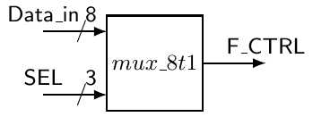
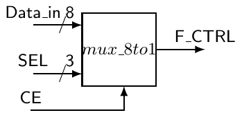
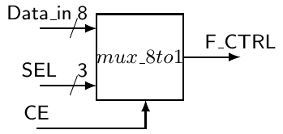
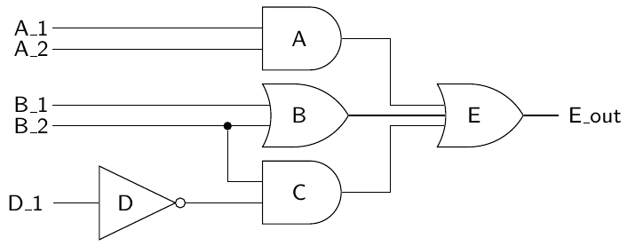

# 5 Các model chuẩn trong architecture VHDL

Như bạn có thể còn nhớ, architecture VHDL mô tả hệ thống VHDL của bạn sẽ hoạt động như thế nào. Phần thân architecture gồm hai phần: phần khai báo và phần begin-end, nơi xuất hiện một tập các signal assignment (concurrent). Đến giờ chúng ta đã học ba loại signal assignment: concurrent signal assignment, conditional signal assignment và selected signal assignment. Chúng ta đã định mô tả một concurrent statement khác, process statement, trước khi bị side-tracked. Bây giờ, chúng ta hãy giới thiệu nhanh một chủ đề mới trước khi đi vào process statement.

Có ba cách tiếp cận khác nhau để viết architecture VHDL. Các cách tiếp cận này được gọi là architecture kiểu data-flow, kiểu structural và kiểu behavioral. Cách tiếp cận chuẩn để học VHDL là giới thiệu riêng từng kiểu architecture này và thiết kế vài mạch dùng kiểu đó. Dù cách tiếp cận này tốt xét từ góc độ giữ mọi thứ đơn giản khi đang đắm mình trong quá trình học, nó cũng phần nào gây hiểu lầm, vì các mạch VHDL phức tạp hơn thường dùng kết hợp cả ba kiểu này. Hãy nhớ thực tế này trong phần thảo luận tiếp theo về các kiểu này. Tuy nhiên, chúng ta sẽ tập trung chủ yếu vào architecture data-flow và behavioral. Structural modeling về bản chất là một phương pháp để kết hợp một tập model VHDL có sẵn. Nói cách khác, structural modeling hỗ trợ việc kết nối các black box với nhau nhưng không có khả năng mô tả các hàm logic dùng để mô hình hóa hoạt động của mạch. Vì lý do này, nó ít là một phương pháp thiết kế mà nhiều hơn là một cách tiếp cận để ghép nối các module đã được thiết kế trước đó.

Lý do chúng ta chọn chen phần thảo luận về các architecture khác nhau vào lúc này là bạn đã phần nào quen với một trong các kiểu đó. Cho đến lúc này, mọi mạch của chúng ta đều được hiện thực bằng kiểu data-flow. Giờ chúng ta đến lúc nói về kiểu architecture behavioral, kiểu chủ yếu xoay quanh một concurrent statement khác gọi là process statement. Nếu điều này có vẻ khó hiểu, phần nào sự khó hiểu sẽ biến mất khi chúng ta bắt đầu làm việc với các mạch thực tế và code VHDL thật.

## 5.1 Architecture kiểu Data-flow

Một architecture kiểu data-flow đặc tả một mạch như một biểu diễn concurrent của dòng dữ liệu đi qua mạch. Trong cách tiếp cận data-flow, mạch được mô tả bằng cách thể hiện quan hệ input và output giữa các thành phần built-in khác nhau của ngôn ngữ VHDL. Các thành phần built-in của VHDL gồm các operator như AND, OR, XOR, v.v. Ba dạng concurrent statement mà chúng ta đã nói đến cho đến giờ (concurrent signal assignment, conditional signal assignment và selected signal assignment) đều là những statement có trong architecture kiểu data-flow. Nói cách khác, nếu bạn chỉ dùng duy nhất concurrent signal assignment statement, conditional signal assignment statement và selected signal assignment statement trong các model VHDL của mình, bạn đã dùng một model data-flow. Nếu bạn re-examine một số ví dụ chúng ta đã làm đến giờ, thực tế bạn có thể phần nào thấy dữ liệu đi qua mạch như thế nào. Nói cách khác, nếu bạn có kiến thức thực hành về logic số, việc hình dung mạch bên dưới dưới dạng các logic gate chuẩn là khá đơn giản. Những signal assignment statement này thực chất mô tả dữ liệu đi như thế nào từ các signal ở right-hand side của assignment operator (“<=”) đến signal ở left-hand side của operator.

Kiểu architecture data-flow có điểm mạnh và điểm yếu của nó. Điều tốt là bạn có thể thấy dòng dữ liệu trong mạch bằng cách xem code VHDL. Các model data-flow cũng cho phép bạn đoán một cách thông minh logic thực tế sẽ trông như thế nào khi bạn quyết định synthesize mạch. Data-flow modeling hoạt động tốt với các mạch nhỏ và tương đối đơn giản. Nhưng khi mạch trở nên phức tạp hơn, chuyển sang các model kiểu behavioral thường có lợi hơn.

## 5.2 Architecture kiểu Behavioral

So với architecture kiểu data-flow, architecture kiểu behavioral không cung cấp chi tiết nào về việc thiết kế được hiện thực trong phần cứng thực tế như thế nào. Code VHDL viết theo kiểu behavioral không nhất thiết phản ánh mạch được hiện thực như thế nào khi nó được synthesize. Thay vào đó, kiểu behavioral mô hình hóa cách các output của mạch sẽ phản ứng với các input của mạch. Trong khi với data-flow modeling bạn phần nào cần có cảm nhận về logic bên dưới trong mạch, các model behavioral cung cấp cho bạn nhiều công cụ để mô tả mạch sẽ hoạt động như thế nào và để các chi tiết hiện thực cho công cụ synthesis. Nói cách khác, data-flow modeling mô tả mạch nên trông như thế nào dưới dạng logic gate, còn behavioral modeling mô tả mạch nên hoạt động như thế nào. Vì những lý do này, behavioral modeling được xem là ở mức trừu tượng mạch cao hơn so với các model data-flow. Chính công cụ VHDL synthesizer quyết định bản hiện thực mạch thực tế. Theo một nghĩa nào đó, modeling kiểu behavioral là cách tiếp cận “black box” tối thượng để thiết kế mạch.

Cốt lõi của architecture kiểu behavioral là process statement. Đây là loại concurrent statement thứ tư mà chúng ta sẽ làm việc. Như bạn sẽ thấy, process statement khác biệt đáng kể với ba concurrent statement kia ở nhiều điểm. Khác biệt chính nằm ở cách process statement tiếp cận concurrency, đây là điểm vướng mắc chủ yếu khi bạn làm việc với concurrent statement mới này.

## 5.3 Process statement

Bản thân process statement là một concurrent statement được xác định bởi label của nó, sensitivity list của nó, một vùng khai báo và một vùng begin-end chứa các instruction được thực thi tuần tự. Một ví dụ về process statement được trình bày trong Listing 5.1.

Điểm chính cần nhớ về process statement là phần thân của nó được tạo thành từ các sequential statement. Khác biệt chính giữa concurrent signal assignment statement và process statement nằm ở những sequential statement này. Nhưng một lần nữa, chúng ta hãy bám vào những điểm giống nhau trước khi đi sâu vào những điểm khác nhau. Process label, như trong Listing 5.1, là tùy chọn nhưng luôn nên được đưa vào để thúc đẩy tính self-description của code VHDL.

Listing 5.1: Cú pháp của process statement.

```vhdl
-- this is my first process
my_label: process(sensitivity_list) is
   <item_declaration>
begin
   <sequential_statements>
end process my_label;
```

Listing 5.2 và 5.3 cho thấy một architecture data-flow và một architecture kiểu behavioral cho cùng một entity XOR. Khác biệt chính giữa hai architecture là sự có mặt của process statement trong code được liệt kê.

Chúng ta hãy nhớ lại rằng concurrent signal assignment statement trong mô tả data-flow hoạt động như sau. Vì nó là một concurrent statement, mỗi khi có thay đổi ở bất kỳ signal nào được liệt kê ở right-hand side của signal assignment operator, signal ở left-hand side của operator sẽ được re-evaluated. Với mô tả architecture behavioral, mỗi khi có thay đổi ở các signal trong process sensitivity list, toàn bộ sequential statement trong process được re-evaluated. Việc đánh giá process statement được điều khiển bởi các signal được đặt trong process sensitivity list. Hai cách tiếp cận này thực chất là như nhau, chỉ khác là cú pháp khác biệt đáng kể.

Vậy đây là chỗ mọi thứ trở nên lạ. Dù cả hai architecture trong 5.2 và 5.3 có signal assignment statement giống hệt nhau (F <= A XOR B;), việc thực thi statement trong architecture kiểu behavioral được điều khiển bởi những signal nào xuất hiện trong process sensitivity list. Statement xuất hiện trong model data-flow được re-evaluated mỗi khi có thay đổi ở signal A hoặc ở signal B. Đây là một khác biệt về chức năng chứ không phải khác biệt về hình thức.

Listing 5.2: Architecture Data-flow.

```vhdl
-- library declaration
library IEEE;
use IEEE.std_logic_1164.all;
-- entity
entity my_xor is
port ( A,B : in  std_logic;
       F   : out std_logic);
end my_xor;
-- architecture
architecture dataflow of my_xor is
begin
    F <= A XOR B;
end dataflow;
--
--
--
```

Listing 5.3: Architecture behavioral.

```vhdl
-- library declaration
library IEEE;
use IEEE.std_logic_1164.all;
-- entity
entity my_xor is
port ( A,B : in  std_logic;
       F   : out std_logic);
end my_xor;
-- architecture
architecture behav of my_xor is
begin
  xor_proc: process(A,B) is
  begin
    F <= A XOR B;
  end process xor_proc;
end behav;
```

Process statement nên được xem là một phương tiện mà người lập trình có trong tay để thực thi một chuỗi sequential statement (tức là theo cách behavioral); đừng bao giờ quên rằng bản thân process statement là một concurrent statement; vì vậy khi bạn đặt hai process bên trong phần thân architecture, việc thực thi của chúng sẽ là concurrent.

Trong Listing 5.4, bạn có thể thấy một process statement hoàn chỉnh trông như thế nào. Hãy nhớ rằng mọi variable được định nghĩa bên trong phần thân process sẽ chỉ nhìn thấy được bên trong chính phần thân process đó. Hơn nữa, hãy để ý rằng statement ở dòng 24 được đặt bên trong phần thân architecture nhưng bên ngoài phần thân process; vì vậy việc thực thi của nó diễn ra concurrent với process statement.

## 5.4 Sequential statement

Giờ khi đã có process statement trong tay, chúng ta có một cách để thực thi một số code theo cách tuần tự.

Bên trong một process, việc thực thi các sequential statement được khởi động khi có thay đổi ở signal chứa trong process sensitivity list. Nói chung, việc thực thi các statement trong phần thân process tiếp tục cho đến khi đến cuối phần thân process. Sự kỳ lạ này gợi ra một tình thế khó xử mang tính triết học: process statement là một concurrent statement, vậy mà nó lại được tạo thành từ các sequential statement. Đây thực sự là một khái niệm khó nắm bắt. Sau nhiều năm suy ngẫm, tôi chỉ mới bắt đầu nắm được thực chất của mâu thuẫn kỳ lạ này.

Chìa khóa để hiểu việc đánh giá tuần tự các statement diễn ra trong một concurrent statement vẫn ẩn trong cách synthesizer diễn giải code VHDL. Và vì những chi tiết ngóc ngách của cách diễn giải này không phải lúc nào cũng lộ rõ ngay, một số chi tiết hiện thực phải được tạm chấp nhận như vậy cho đến khi bạn thực sự cần hiểu đầy đủ quá trình đó. Giải pháp là giữ các process statement của bạn đơn giản nhất có thể. Người ta có xu hướng dùng process statement như một kho chứa một đống sequential statement loosely-related. Dù đúng về cú pháp, code như vậy không intelligible (dễ hiểu) trong ngữ cảnh tạo mạch số. Bạn nên cố gắng giữ các process statement đơn giản. Hãy chia chức năng bạn dự định thành nhiều process statement giao tiếp với nhau thay vì một process statement khổng lồ, phức tạp, kỳ quặc. Hãy nhớ, process statement là concurrent statement: tất cả chúng đều có thể được thực thi concurrent. Hãy cố tận dụng đặc điểm này để đơn giản hóa các mô tả mạch của bạn.

Listing 5.4: Cách dùng process statement.

```vhdl
 1   -- library declaration
 2   library IEEE;
 3   use IEEE.std_logic_1164.all;
 4   -- entity
 5   entity my_system is
 6   port ( A,B,C : in  std_logic;
 7          F,Q   : out std_logic);
 8   end my_system;
 9   -- architecture
10   architecture behav of my_system is
11       signal A1 : std_logic;
12   begin
13       some_proc: process(A,B,C) is
14         variable x,y : integer;
15       begin
16           x:=74;
17           y:=67;
18           A1 <= A and B and C;
19           if x>y then
20               F <= A1 or B;
21           end if;
22       end process some_proc;
23       -- we are outside the process body
24       Q <= not A;
25   end behav;
```

Có ba loại sequential statement mà chúng ta sẽ thảo luận. Loại đầu tiên là signal assignment statement: “<=”. Tuy nhiên chúng ta sẽ không nói quá nhiều về loại đầu tiên vì chúng ta đã làm việc với dạng tương tự của nó trong các model data-flow. Hai loại statement còn lại là if statement và case statement. Điểm hay của tất cả các statement này là bạn đã từng làm việc với chúng trong các ngôn ngữ lập trình thuật toán. Cấu trúc và chức năng của if statement và case statement trong VHDL giống một cách đáng ngạc nhiên. Hãy nhớ điều này khi đọc các mô tả tiếp theo.

### 5.4.1 Signal assignment statement

Kiểu sequential của signal assignment statement tương đương về cú pháp với concurrent signal assignment statement. Một cách nhìn khác là nếu một signal assignment statement xuất hiện bên trong một process thì nó là một sequential statement; nếu không, nó là một concurrent signal assignment statement. Để nhấn mạnh điểm này, signal assignment statement “F<= AXORB;” trong architecture kiểu data-flow của Listing 5.2 là một concurrent signal assignment statement, trong khi cùng statement đó trong architecture kiểu behavioral, Listing 5.3, là một sequential signal assignment statement. Các khác biệt về chức năng đã được đề cập trong phần thảo luận về process statement.

### 5.4.2 if statement

If statement được dùng để tạo ra một nhánh trong luồng thực thi của các sequential statement. Tùy theo các điều kiện được liệt kê trong phần thân của if statement, khi if statement được xử lý, hoặc các instruction gắn với một nhánh được thực thi, hoặc không nhánh nào được thực thi. Dạng tổng quát của if statement được trình bày trong Listing 5.5.

Listing 5.5: Cú pháp của if statement.

```vhdl
if (condition) then
    <statements>
elsif (condition) then
    <statements>
else
    <statements>
end if;
```

Khái niệm if statement hẳn quen thuộc với bạn ở hai khía cạnh. Thứ nhất, hình thức và chức năng của nó giống với các statement thuộc loại if-genre có trong phần lớn các ngôn ngữ lập trình thuật toán. Tuy nhiên, cú pháp có khác một chút. Thứ hai, if statement của VHDL là dạng sequential tương đương với conditional signal assignment statement của VHDL. Hai statement này về bản chất làm cùng một việc, nhưng if statement là một sequential statement nằm bên trong phần thân process, còn conditional signal assignment statement là một dạng concurrent signal assignment.

Một lần nữa, có một vài điều thú vị cần lưu ý về cú pháp được liệt kê của if statement.

• Dấu ngoặc đơn đặt quanh các biểu thức điều kiện là tùy chọn. Trong phần lớn trường hợp nên đưa chúng vào để tăng khả năng đọc của source code VHDL.

• Mỗi statement if-type đều có một keyword then đi kèm. Mệnh đề else cuối cùng không có keyword then đi kèm.

• Như được viết trong Listing 5.5, mệnh đề else là một statement catch-all. Nếu không có điều kiện nào ở trước được đánh giá là true, chuỗi statement gắn với mệnh đề else cuối cùng sẽ được thực thi. Cách if statement được trình bày trong Listing 5.5 bảo đảm ít nhất một trong các chuỗi statement được liệt kê sẽ được thực thi.

• Mệnh đề else cuối cùng là tùy chọn. Không đưa vào mệnh đề else cuối cùng tạo ra khả năng không có chuỗi statement nào gắn với if statement được đánh giá. Điều này có những hệ quả sâu xa mà chúng ta sẽ thảo luận sau.

Giờ chúng ta hãy xem một số ví dụ sẽ giúp chúng ta hiểu rõ hơn cách dùng if statement.

> VÍ DỤ 9. Hãy viết code VHDL dùng một if statement để hiện thực hàm logic sau: F_OUT (A, B, C) = A$\overline{B}$$\overline{C}$+BC

LỜI GIẢI. Dù không được nêu trực tiếp trong mô tả bài toán, code VHDL cho lời giải này phải dùng một architecture behavioral. Lý do là bài toán yêu cầu dùng một if statement. Code VHDL cho lời giải được trình bày trong Listing 5.6. Trong trường hợp này, chúng ta đã chọn bỏ qua sơ đồ black-box vì bài toán tương đối đơn giản và vì thế không thực sự thể hiện được sức mạnh của behavioral modeling.

Listing 5.6: Lời giải của Ví dụ 9.

```vhdl
-- library declaration
library IEEE;
use IEEE.std_logic_1164.all;
-- entity
entity my_ex is
port    (A,B,C : in  std_logic;
         F_OUT : out std_logic);
end my_ex;
-- architecture
architecture silly_example of my_ex is
begin
    proc1: process(A,B,C) is
    begin
        if (A = '1' and B = '0' and C = '0') then
            F_OUT <= '1';
        elsif (B = '1' and C = '1') then
            F_OUT <= '1';
        else
            F_OUT <= '0';
        end if;
    end process proc1;
end silly_example;
```

Đây có lẽ không phải cách tốt nhất để hiện thực một hàm logic, nhưng nó cho thấy một if statement đang hoạt động. Một architecture khác cho lời giải của Ví dụ 9 được trình bày trong Listing 5.7.

Listing 5.7: Lời giải khác cho Ví dụ 9.

```vhdl
-- architecture
architecture bad_example of my_ex_7 is
begin
    proc1: process(A,B,C)
    begin
        if (A='1' and B='0' and C='0') or (B='1' and C='1') then
            F_OUT <= '1';
        else
            F_OUT <= '0';
        end if;
    end process proc1;
end bad_example;
```

Một nhận xét cuối cùng về process statement. Process statement có thể có một label tùy chọn đứng trước. Luôn nên đưa label vào process statement như một dạng self-description. Điều này tất nhiên có nghĩa là label phải có ý nghĩa xét về mặt mô tả mục đích của process statement. Đặt tên label tốt phần nào là một nghệ thuật, nhưng hãy nhớ rằng đặt một cái tên có ý nghĩa cho một process không cố làm quá nhiều thứ sẽ dễ hơn. Một cách dùng if statement thông minh hơn được minh họa trong ví dụ tiếp theo.

> VÍ DỤ 10. Hãy viết code VHDL hiện thực MUX 8:1 dưới đây. Hãy dùng một if statement trong bản hiện thực của bạn.



LỜI GIẢI. Lời giải của Ví dụ 10 được trình bày trong Listing 5.8.

Listing 5.8: Lời giải của Ví dụ 10.

```vhdl
-- library declaration
library IEEE;
use IEEE.std_logic_1164.all;
-- entity
entity mux_8t1 is
    port ( Data_in : in  std_logic_vector (7 downto 0);
               SEL : in  std_logic_vector (2 downto 0);
            F_CTRL : out std_logic);
end mux_8t1;
-- architecture
architecture mux_8t1_arc of mux_8t1 is
begin
   my_mux: process (Data_in,SEL)
   begin
      if    (SEL = "111") then F_CTRL <= Data_in(7);
      elsif (SEL = "110") then F_CTRL <= Data_in(6);
      elsif (SEL = "101") then F_CTRL <= Data_in(5);
      elsif (SEL = "100") then F_CTRL <= Data_in(4);
      elsif (SEL = "011") then F_CTRL <= Data_in(3);
      elsif (SEL = "010") then F_CTRL <= Data_in(2);
      elsif (SEL = "001") then F_CTRL <= Data_in(1);
      elsif (SEL = "000") then F_CTRL <= Data_in(0);
      else  F_CTRL <= '0';
      end if;
   end process my_mux;
end mux_8t1_arc;
```

Lời giải của Ví dụ 10 trong Listing 5.8 dùng một số cú pháp mới. Entity dùng các bundle signal, nhưng architecture đi kèm cần truy cập từng phần tử riêng lẻ của các bundle này. Giải pháp là dùng bus index operator để truy cập các signal bên trong bus. Việc này được thực hiện bằng cách dùng một con số biểu diễn index đặt bên trong dấu ngoặc đơn (ví dụ Data_in(7)). Bus index operator được dùng rộng rãi trong VHDL và đã được nhắc đến trước đây. Lời giải của Ví dụ 10 cho thấy một cách dùng operator này điển hình hơn so với lần nhắc trước.

Một điều khác cần để ý về lời giải trong Ví dụ 10 là mọi tổ hợp có thể có của variable chọn đều được tính đến trong code. Có thể bỏ statement elsif cuối cùng trong code của Listing 5.8 và đặt signal assignment đi kèm vào mệnh đề else. Nhưng làm vậy không được xem là thói quen VHDL tốt và nên tránh bằng mọi giá. Lý do là nó sẽ thay đổi khả năng đọc của code nhưng không làm thay đổi phần cứng mà code tạo ra.

> VÍ DỤ 11. Hãy viết code VHDL hiện thực MUX 8:1 trình bày ở đây. Hãy dùng bao nhiêu if statement mà bạn thấy cần để hiện thực thiết kế của mình. Trong sơ đồ black-box, input CE là một chip enable. Khi CE = ’1’, output hoạt động như MUX của Ví dụ 10. Khi CE là ’0’, output của MUX là ’0’.



LỜI GIẢI. Lời giải của Ví dụ 11 giống một cách lạ lùng với lời giải của Ví dụ 10. Lưu ý rằng trong lời giải này, các if statement có thể được lồng nhau để đạt được nhiều hiệu ứng khác nhau. Lời giải của Ví dụ 11 được trình bày trong Listing 5.9.

Listing 5.9: Lời giải của Ví dụ 11.

```vhdl
-- library declaration
library IEEE;
use IEEE.std_logic_1164.all;
-- entity
entity mux_8to1_ce is
    port ( Data_in : in  std_logic_vector (7 downto 0);
               SEL : in  std_logic_vector (2 downto 0);
                CE : in  std_logic;
            F_CTRL : out std_logic);
end mux_8to1_ce;
-- architecture
architecture mux_8to1_ce_arch of mux_8to1_ce is
begin
   my_mux: process (Data_in,SEL,CE)
   begin
      if (CE = '0') then
          F_CTRL <= '0';
      else
         if    (SEL = "111") then F_CTRL <= Data_in(7);
         elsif (SEL = "110") then F_CTRL <= Data_in(6);
         elsif (SEL = "101") then F_CTRL <= Data_in(5);
         elsif (SEL = "100") then F_CTRL <= Data_in(4);
         elsif (SEL = "011") then F_CTRL <= Data_in(3);
         elsif (SEL = "010") then F_CTRL <= Data_in(2);
         elsif (SEL = "001") then F_CTRL <= Data_in(1);
         elsif (SEL = "000") then F_CTRL <= Data_in(0);
         else  F_CTRL <= '0';
         end if;
      end if;
   end process my_mux;
end mux_8to1_ce_arch;
```

### 5.4.3 case statement

Case statement phần nào giống với if statement ở chỗ một chuỗi statement được thực thi nếu một expression đi kèm là true. Case statement khác với if statement ở chỗ lựa chọn cuối cùng được đưa ra tùy theo giá trị của một expression điều khiển duy nhất. Mỗi lần thực thi case statement chỉ có một tập sequential statement được thực thi. Các statement được thực thi được xác định bởi nhánh when đầu tiên được đánh giá là true. Cú pháp của case statement được trình bày trong Listing 5.10.

Listing 5.10: Cú pháp của case statement.

```vhdl
case (expression) is
    when choices =>
        <sequential statements>
    when choices =>
        <sequential statements>
    when others =>
        <sequential statements>
end case;
```

Một lần nữa, khái niệm case statement hẳn quen thuộc với bạn ở nhiều khía cạnh. Thứ nhất, nói chung nó có thể được xem như một dạng thu gọn của if statement. Tuy nhiên nó không linh hoạt về chức năng bằng, vì lý do đã mô tả ở trên. Thứ hai, case statement giống cả về hình thức lẫn chức năng với case statement hay switch statement trong các ngôn ngữ lập trình thuật toán khác. Và cuối cùng, case statement của VHDL là dạng sequential tương đương với selected signal assignment statement của VHDL. Hai statement này về bản chất có cùng khả năng, nhưng case statement là một sequential statement nằm trong phần thân process, còn selected signal assignment statement là một dạng concurrent signal assignment. Dòng when others không bắt buộc nhưng nên được dùng như một thói quen lập trình tốt.

> VÍ DỤ 12. Hãy viết code VHDL hiện thực hàm sau bằng case statement: F_OUT(A, B, C) = A$\overline{B}$$\overline{C}$ + BC

LỜI GIẢI. Lời giải này thuộc loại không phải cách tốt nhất để hiện thực một mạch bằng VHDL. Tuy nhiên, nó minh họa một tính năng hữu ích khác của VHDL. Phần đầu của lời giải này đòi hỏi chúng ta liệt kê hàm dưới dạng tổng các minterm. Việc này được thực hiện bằng cách nhân product term non-minterm cho trong ví dụ với 1. Trong trường hợp này, 1 tương đương với (A + $\overline{A}$). Phép phân tích này được trình bày như sau:

F_OUT(A, B, C) = A$\overline{B}$$\overline{C}$ + BC

F_OUT(A, B, C) = A$\overline{B}$$\overline{C}$ + BC(A + $\overline{A}$)

F_OUT(A, B, C) = A$\overline{B}$$\overline{C}$ + ABC + $\overline{A}$BC

Lời giải được trình bày trong Listing 5.11. Một đặc điểm thú vị của lời giải này là việc gom ba signal input lại, cho phép dùng case statement trong lời giải. Cách tiếp cận này đòi hỏi khai báo một intermediate signal được đặt tên thích hợp là “ABC”. Một lần nữa, đây có lẽ không phải phương pháp hiệu quả nhất để hiện thực một hàm, nhưng nó làm nổi bật nhu cầu phải tháo vát và sáng tạo khi mô tả hành vi của mạch số.

Listing 5.11: Lời giải của Ví dụ 12.

```vhdl
-- library declaration
library IEEE;
use IEEE.std_logic_1164.all;
-- entity
entity my_example is
port (A,B,C : in  std_logic;
      F_OUT : out std_logic);
end my_example;
-- architecture
architecture my_soln_exam of my_example is
    signal ABC: std_logic_vector(2 downto 0);
begin
    ABC <= A & B & C; -- group signals for case statement
    my_proc: process (ABC)
    begin
        case (ABC) is
        when "100"  => F_OUT <= '1';
        when "011"  => F_OUT <= '1';
        when "111"  => F_OUT <= '1';
        when others => F_OUT <= '0';
        end case;
    end process my_proc;
end my_soln_exam;
```

Một cách tiếp cận tương tự khác cho Ví dụ 12 là dùng tính năng don’t care (được biểu diễn bằng ký hiệu ”-”) có sẵn trong VHDL. Điều này cho phép hiện thực hàm logic mà không phải xử lý lại các input. Như với mọi thứ, nếu bạn phải sửa đổi bài toán trước khi đi đến lời giải, bạn có một khả năng nhất định tạo ra một lỗi mà lẽ ra đã không xuất hiện nếu bạn chọn một cách tiếp cận khéo léo hơn. Một architecture khác cho lời giải của Ví dụ 12 được trình bày trong Listing 5.12. Một nhược điểm có thể có của việc dùng tính năng don’t care trong code VHDL là một số synthesizer và một số simulator không xử lý nó tốt lắm. Tôi sẽ tránh chúng bằng mọi giá và tìm một phương pháp rõ ràng hơn để mô hình hóa các mạch mà tôi đang làm việc.

Listing 5.12: Lời giải khác cho Ví dụ 12.

```vhdl
architecture my_soln_exam2 of my_example is
    signal ABC: std_logic_vector(2 downto 0);
begin
    ABC <= A & B & C; -- group signals for case statement
    my_proc: process (ABC)
    begin
        case (ABC) is
        when "100"  => F_OUT <= '1';
        when "-11"  => F_OUT <= '1';
        when others => F_OUT <= '0';
        end case;
    end process my_proc;
end my_soln_exam2;
```

Một trong những điểm chính cần được nhấn mạnh trong bất kỳ chương trình VHDL nào là khả năng đọc. Trong bài toán tiếp theo, chúng ta sẽ làm lại Ví dụ 11 bằng một case statement thay vì các if statement.

> VÍ DỤ 13. Hãy viết code VHDL hiện thực MUX 8:1 dưới đây. Hãy dùng một case statement trong thiết kế của bạn. Trong sơ đồ black-box dưới đây, input CE là một chip enable. Khi CE = ’1’, output hoạt động như MUX của Ví dụ 10. Khi CE là ’0’, output của MUX là ’0’.



LỜI GIẢI. Lời giải này của Ví dụ 13 được trình bày trong Listing 5.13. Entity declaration được lặp lại dưới đây cho tiện. Lời giải này đặt case statement trong phần thân của một construct if. Nếu bạn chưa để ý, số lượng lời giải có thể có cho một bài toán cho trước tăng lên khi các mạch bạn hiện thực trở nên phức tạp hơn.

Listing 5.13: Lời giải của Ví dụ 13.

```vhdl
-- library declaration
library IEEE;
use IEEE.std_logic_1164.all;
-- entity
entity mux_8to1_ce is
    port ( Data_in : in  std_logic_vector (7 downto 0);
               SEL : in  std_logic_vector (2 downto 0);
                CE : in  std_logic;
            F_CTRL : out std_logic);
end mux_8to1_ce;
-- architecture
architecture my_case_ex of mux_8to1_ce is
begin
   my_mux: process (SEL,Data_in,CE)
   begin
      if (CE = '1') then
         case (SEL) is
            when "000"  =>  F_CTRL <= Data_in(0);
            when "001"  =>  F_CTRL <= Data_in(1);
            when "010"  =>  F_CTRL <= Data_in(2);
            when "011"  =>  F_CTRL <= Data_in(3);
            when "100"  =>  F_CTRL <= Data_in(4);
            when "101"  =>  F_CTRL <= Data_in(5);
            when "110"  =>  F_CTRL <= Data_in(6);
            when "111"  =>  F_CTRL <= Data_in(7);
            when others => F_CTRL <= '0';
         end case;
      else
          F_CTRL <= '0';
      end if;
   end process my_mux;
end my_case_ex;
```

Một điểm rất quan trọng trong lời giải của Ví dụ 13 là thực tế một case statement đã được nhúng vào một if statement. Thuật ngữ kỹ thuật cho kiểu viết code này, như bạn có thể đoán, là nesting. Nesting các sequential statement là điển hình trong các model behavioral và được dùng thường xuyên. Đây thực ra là một trong những đặc điểm làm cho behavioral modeling mạnh hơn nhiều so với data-flow modeling. Thực tế là conditional signal assignment statement và selective signal assignment statement không thể được lồng nhau.

## 5.5 Những lưu ý về sequential statement

Khi bắt đầu làm việc với sequential statement, bạn có xu hướng bắt đầu có cảm giác rằng mình đang lập trình thuật toán bằng một ngôn ngữ higher-level. Lý do là sequential statement có hình thức và cảm giác giống với một số construct lập trình trong các ngôn ngữ higher-level. Mặt xấu của xu hướng này là khi nào và nếu cách tiếp cận viết code VHDL của bạn trở nên giống với cách viết của ngôn ngữ higher-level. Vì điều này rất thường xảy ra với những người đang học VHDL, cần nhắc lại một lần nữa rằng VHDL không phải là lập trình: VHDL là thiết kế phần cứng. Nói chung, bạn không hiện thực thuật toán trong VHDL, bạn đang mô tả phần cứng: đây là một mô hình hoàn toàn khác.

Không hiếm khi thấy nhiều đoạn code VHDL không tốt lắm cố dùng một process statement duy nhất để hiện thực một mạch tương đối phức tạp. Dù code có vẻ như sẽ chạy được xét theo các statement được viết ra, đây là một ảo tưởng dựa trên việc đầu óc bạn đang diễn giải các statement theo kiểu một ngôn ngữ higher-level. Thực tế là VHDL phần nào bí ẩn ở chỗ bạn đang tin tưởng VHDL synthesizer sẽ biết một cách kỳ diệu bạn đang cố mô tả cái gì. Nếu bạn không hiểu những chi tiết ngóc ngách của VHDL ở mức thấp, mạch của bạn sẽ không synthesize đúng. Nhiều khả năng bạn hiểu các model behavioral VHDL đơn giản. Nhưng khi các model trở nên phức tạp, sự hiểu biết của bạn nhanh chóng mờ dần. Giải pháp cho vấn đề này thực sự đơn giản: hãy giữ các model VHDL của bạn đơn giản, đặc biệt là các process statement.

Trong VHDL, cách tiếp cận tốt nhất là giữ các process statement của bạn xoay quanh một chức năng duy nhất và có nhiều process statement giao tiếp với nhau. Cách tiếp cận sai là có một process statement lớn làm mọi thứ cho bạn. Điều kỳ diệu của VHDL là nếu bạn cung cấp code đơn giản cho synthesizer, nhiều khả năng nó sẽ cung cấp cho bạn một mạch chạy được với một bản hiện thực đơn giản và gọn gàng. Nếu bạn cung cấp cho synthesizer code VHDL phức tạp, mạch cuối cùng có thể chạy được và thậm chí có thể hiệu quả cả về tốc độ lẫn diện tích, nhưng có lẽ là không. Khác với các ngôn ngữ higher-level, nơi một lượng code nhỏ thường được chuyển trực tiếp thành code có hiệu quả tương đối cao, hiệu quả của code VHDL có được nhờ việc phân chia code VHDL gọn và đơn giản dựa trên các construct phần cứng bên dưới. Nói cách khác, các model VHDL đơn giản thì tốt hơn, nhưng sự đơn giản nói chung có được nhờ phân chia và mô tả model đúng cách. Vì vậy hãy cố cưỡng lại ham muốn gây ấn tượng với bạn bè bằng model VHDL ngắn nhất thế giới; những người bạn làm phần cứng của bạn sẽ hiểu rõ hơn.

## 5.6 Tóm tắt

Giờ chúng ta hãy ôn lại một số khái niệm quan trọng đã được giới thiệu trong chương này.

• Ba dạng chính của các kiểu modeling VHDL gồm các model data-flow, behavioral và structural.

• Các model behavioral VHDL, theo định nghĩa, dùng process statement.

• Các model data-flow VHDL theo định nghĩa dùng concurrent signal assignment, conditional signal assignment và/hoặc selected signal assignment.

• Process statement là một concurrent statement. Các statement xuất hiện bên trong process statement là sequential statement.

• If statement có sự tương đồng trực tiếp với conditional signal assignment statement dùng trong data-flow modeling.

• Case statement có sự tương đồng trực tiếp với selected signal assignment statement dùng trong data-flow modeling.

• Cả case statement và if statement đều có thể được lồng nhau. Concurrent signal assignment statement, conditional signal assignment statement và selected signal assignment statement không thể được lồng nhau.

• Concurrent statement đơn giản nhất là concurrent signal assignment statement (ví dụ “F<= A;”). Dạng sequential tương đương của nó là sequential signal assignment statement và nó trông giống hệt.

## 5.7 Bài tập: Behavioral modeling

1. Với các hàm sau, hãy viết các model behavioral VHDL hiện thực những hàm này bằng cả case statement và if statement (hai model riêng cho mỗi hàm).

a) F(A, B) = $\overline{A}$B + A + A$\overline{B}$

b) F(A, B, C, D) = $\overline{A}$C$\overline{D}$ + $\overline{B}$C + BC$\overline{D}$

c) F(A, B, C, D) = ($\overline{A}$ + B) · ($\overline{B}$ + C + $\overline{D}$) · ($\overline{A}$ + D)

d) F(A, B, C) = ∏(5,1, 4,3)

e) F(A, B, C, D) = ∑(1,2)

2. Với mạch dưới đây, hãy viết model behavioral VHDL hiện thực nó bằng cả case statement và if statement (hai model riêng).



3. Hãy mô hình hóa mạch trước bằng concurrent signal assignment, conditional signal assignment hoặc selected signal assignment.

4. Hãy viết một model VHDL của một AND gate 8-input bằng một process statement.

5. Hãy viết một model VHDL của một OR gate 8-input bằng một process statement.

6. Hãy viết một model VHDL của một MUX 8:1 bằng một process statement. Hãy đưa vào một model dùng if statement và một model dùng case statement (hai model riêng).

7. Hãy viết một model VHDL của một decoder 3:8 bằng một process statement. Hãy đưa vào một model dùng if statement và một model dùng case statement (hai model riêng). Coi các output là active low.
