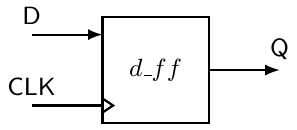
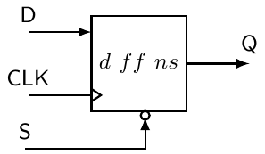
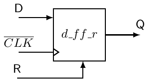
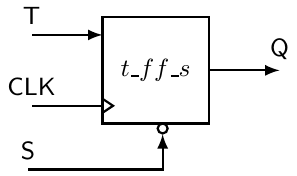
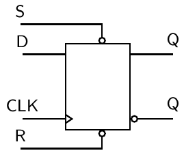
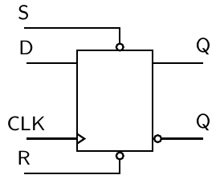
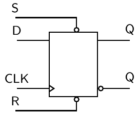
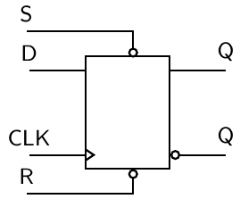
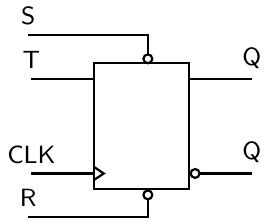
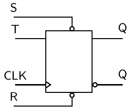

# 7 Dùng VHDL cho mạch tuần tự

Tất cả các mạch chúng ta đã xem xét cho đến giờ đều là mạch logic tổ hợp. Nói cách khác, không mạch nào chúng ta đã xem xét đến giờ thực sự có khả năng lưu trữ thông tin. Mục này trình bày một số phương pháp khác nhau dùng để mô tả mạch tuần tự. Chúng ta giới hạn phần thảo luận ở các model behavioral VHDL cho vài biến thể khác nhau của D flip-flops. Có thể, và trong một số trường hợp còn nên, dùng model data-flow để mô tả các phần tử lưu trữ trong VHDL, nhưng dùng model behavior dễ hơn nhiều.

Một vài cách tiếp cận thiết kế flip-flops trình bày trong mục tiếp theo bao quát gần như mọi chức năng có thể có mà bạn có thể hình dung khi dùng một D flip-flop. Khi đã hiểu những điều cơ bản này, bạn sẽ đi đúng hướng để hiểu cách dùng VHDL thiết kế Finite State Machine (FSM). Cuốn sách này sẽ xem xét FSM trong một chương sau.

## 7.1 Các phần tử lưu trữ đơn giản dùng VHDL

Cách tiếp cận chung để học cách triển khai các phần tử lưu trữ trong digital design là nghiên cứu các tính chất của một cell cross-coupled cơ bản. Cell cross coupled tạo thành thứ được gọi là latch. Khái niệm về một signal clock được thêm vào thiết bị để tăng khả năng điều khiển nó. Cuối cùng, một dạng mạch làm hẹp xung nào đó được thêm vào signal clock để có được flip-flop. Thực chất, flip-flop không gì khác hơn là một thiết bị bit-storage edge-sensitive.

Việc nghiên cứu một bản triển khai VHDL của các phần tử lưu trữ bắt đầu với D flip-flop edge-triggered. Các ví dụ VHDL được trình bày là D flip-flop edge-triggered cơ bản với nhiều chức năng bổ sung khác nhau.

> VÍ DỤ 14. Hãy viết code VHDL mô tả D flip-flop ở bên phải. Hãy dùng một model behavioral trong mô tả của bạn.



LỜI GIẢI. Lời giải của Ví dụ 14 được trình bày trong Listing 7.1. Dưới đây là một vài điều thú vị cần lưu ý về lời giải.

• Phần thân architecture đã cho mô tả phiên bản my_d_ff của entity d_ff.

• Vì ví dụ này yêu cầu dùng một model behavioral, phần thân architecture chủ yếu chứa một process statement. Các statement bên trong process được thực thi tuần tự. Process được thực thi mỗi khi phát hiện có thay đổi ở bất kỳ signal nào trong sensitivity list của process. Trong trường hợp này, các statement bên trong process được thực thi mỗi khi có thay đổi mức logic của signal CLK.

• Construct rising_edge() được dùng trong if statement để chỉ ra rằng các thay đổi ở output của mạch chỉ xảy ra ở cạnh lên của input CLK. Construct rising_edge() thực ra là một ví dụ về một function VHDL đã được định nghĩa trong một trong các library được đưa vào. Cách code VHDL được viết làm cho toàn bộ mạch là đồng bộ; thực tế, các thay đổi ở output của mạch được đồng bộ với cạnh lên của signal clock. Trong trường hợp này, hành động là việc chuyển mức logic ở input D sang output Q.

• Chức năng của rising_edge(CLK) có thể đạt được bằng attribute “event” khá phổ biến của VHDL qua construct:<br>CLK’event and CLK=’1’.<br>Hãy nhớ điều này.

• Process có label dff. Điều này không bắt buộc trong ngôn ngữ VHDL, nhưng việc thêm process label thúc đẩy tính self-describing của code và làm tăng khả năng đọc và khả năng hiểu của nó.

Listing 7.1: Lời giải của Ví dụ 14.

```vhdl
-----------------------------------
-- Model of a simple D Flip-Flop --
-----------------------------------
-- library declaration
library IEEE;
use IEEE.std_logic_1164.all;
-- entity
entity d_ff is
    port ( D, CLK : in  std_logic;
           Q :      out std_logic);
end d_ff;
-- architecture
architecture my_d_ff of d_ff is
begin
    dff:  process(CLK)
    begin
        if (rising_edge(CLK))      then
--or    if (CLK'event and CLK='1') then
            Q <= D;
        end if;
    end process dff;
end my_d_ff;
```

D flip-flop được biết đến và yêu thích nhất nhờ khả năng lưu trữ (lưu, nhớ) một bit duy nhất. Tuy nhiên, cách code VHDL trong Listing 7.1 lưu trữ được một bit thì không hiển nhiên. Khả năng bit-storage trong VHDL được ngụ ý qua cách code VHDL được diễn giải. Khả năng lưu trữ ngụ ý này xuất hiện do không cung cấp một điều kiện chỉ ra điều gì nên xảy ra nếu điều kiện if được liệt kê không được thỏa mãn. Nói cách khác, nếu điều kiện if không được thỏa mãn, thiết bị không thay đổi giá trị của Q và vì vậy nó phải nhớ giá trị hiện tại. Đặc tính nhớ giá trị hiện tại, hay trạng thái, tạo nên phẩm chất lưu trữ bit nổi tiếng của một flip-flop. Nếu bạn chưa chỉ định output nên là gì cho mọi tập điều kiện input có thể có, lựa chọn mà VHDL áp dụng là không thay đổi output hiện tại. Theo định nghĩa, nếu input thay đổi sang một trạng thái chưa được chỉ định, output giữ nguyên không đổi. Trong trường hợp này, output gắn với tập input trước đó có thể được coi là được nhớ. Chính cơ chế này, dù lạ lùng và thú vị đến đâu, được dùng để tạo ra bộ nhớ trong code VHDL.

Xét D flip-flop trong Ví dụ 14, thời điểm duy nhất output được chỉ định là trong khoảng delta time gắn với cạnh lên của clock. Phương pháp điển hình dùng để cung cấp một điều kiện catch-all trong trường hợp điều kiện if không được thỏa mãn là dùng một mệnh đề else. Nói chung, một cách nhanh để biết bạn đã tạo ra một phần tử nhớ hay chưa là tìm xem có mặt một mệnh đề else gắn với if statement hay không.

Hai đoạn trước cực kỳ quan trọng để hiểu VHDL; khái niệm tạo ra bộ nhớ trong VHDL rất quan trọng đối với thiết kế mạch số. Việc thiết kế mạch tuần tự phụ thuộc vào khái niệm này. Phương pháp có phần khó hiểu này mà VHDL dùng để tạo ra các phần tử nhớ là một sản phẩm phụ của behavioral modeling, chỉ dựa trên cách diễn giải source code VHDL. Ngay cả khi bạn chỉ dùng VHDL để thiết kế mạch tổ hợp, nhiều khả năng bạn cũng sẽ phải đối mặt với việc hiểu các khái niệm này. Một trong những cảnh báo kinh điển do VHDL synthesizer tạo ra là thông báo rằng code VHDL của bạn đã tạo ra một latch. Dù đây chỉ là một cảnh báo, nếu bạn không định tạo ra latch, bạn nên cố gắng sửa code VHDL theo cách loại bỏ được cảnh báo này. Giả sử bạn không định tạo ra latch, nguyên nhân vấn đề của bạn là bạn chưa cung cấp tường minh một trạng thái output cho mọi điều kiện input có thể có. Vì thế, mạch của bạn sẽ cần nhớ trạng thái output trước đó để có thể đưa ra output trong trường hợp bạn chưa liệt kê tường minh điều kiện input hiện tại.

> VÍ DỤ 15. Hãy viết code VHDL mô tả D flip-flop ở bên phải. Hãy dùng một model behavioral trong mô tả của bạn. Coi input S là một input đồng bộ active-low, khi được assert sẽ set các output của D flip-flop.



LỜI GIẢI. Lời giải của Ví dụ 15 được trình bày trong Listing 7.2. Có một vài điều đáng chú ý về lời giải này.

• Input S của flip-flop được làm cho đồng bộ bằng cách chỉ cho phép nó tác động đến hoạt động của flip-flop ở cạnh lên của clock hệ thống.

• Ở cạnh lên của clock, input S được ưu tiên hơn input D vì trạng thái của input S được kiểm tra trước khi xem trạng thái của input D. Trong một statement if-else, khi một điều kiện đã được đánh giá là true, không điều kiện nào khác được kiểm tra nữa. Nói cách khác, input D chỉ được chuyển sang output ở cạnh lên của clock và chỉ khi input S không được assert.

Listing 7.2: Lời giải của Ví dụ 15.

```vhdl
------------------------------------------------------------------
-- RET D Flip-flop model with active-low synchronous set input. --
------------------------------------------------------------------
-- library declaration
library IEEE;
use IEEE.std_logic_1164.all;
-- entity
entity d_ff_ns is
    port (  D,S :  in  std_logic;
            CLK :  in  std_logic;
              Q :  out std_logic);
end d_ff_ns;
-- architecture
architecture my_d_ff_ns of d_ff_ns is
begin
   dff:  process (CLK)
   begin
      if (rising_edge(CLK)) then
         if (S = '0') then
            Q <= '1';
         else
            Q <= D;
         end if;
      end if;
   end process dff;
end my_d_ff_ns;
```

> VÍ DỤ 16. Hãy viết code VHDL mô tả D flip-flop ở bên phải. Hãy dùng một model behavioral trong mô tả của bạn. Coi input R là một input bất đồng bộ active-high, khi được assert sẽ reset các output của D flip-flop.



LỜI GIẢI. Lời giải của Ví dụ 16 được trình bày trong Listing 7.3. Có lẽ bạn sẽ thu được nhiều thông tin nhất về input bất đồng bộ và input đồng bộ bằng cách so sánh các lời giải của Ví dụ 15 và Ví dụ 16. Một vài điểm thú vị được liệt kê dưới đây.

• Input reset độc lập với clock và được ưu tiên hơn clock. Việc ưu tiên này được thực hiện bằng cách đặt điều kiện reset làm điều kiện đầu tiên trong if statement. Việc đánh giá các điều kiện khác tiếp tục nếu input R không được đánh giá là ’1’.

• Function falling_edge() được dùng để làm cho D flip-flop là falling-edge-triggered. Một lần nữa, function này được định nghĩa trong một trong các library được đưa vào.

Listing 7.3: Lời giải của Ví dụ 16.

```vhdl
----------------------------------------------------------------------
-- FET D Flip-flop model with active-high asynchronous reset input. --
----------------------------------------------------------------------
-- library declaration
library IEEE;
use IEEE.std_logic_1164.all;
-- entity
entity d_ff_r is
    port (   D,R :  in  std_logic;
             CLK :  in  std_logic;
               Q :  out std_logic);
end d_ff_r;
-- architecture
architecture my_d_ff_r of d_ff_r is
begin
   dff:  process (R,CLK)
   begin
      if (R = '1') then
         Q <= '0';
      elsif (falling_edge(CLK)) then
         Q <= D;
      end if;
   end process dff;
end my_d_ff_r;
```

Các lời giải của Ví dụ 15 và Ví dụ 16 lần lượt thể hiện những gì có thể được xem là các cách tiếp cận VHDL chuẩn để xử lý input đồng bộ và input bất đồng bộ. Dạng tổng quát của các lời giải này thực ra được nhiều tài liệu tham khảo VHDL xem là template cho input đồng bộ và input bất đồng bộ. Như bạn sẽ thấy sau này, các lời giải này tạo nền móng cho việc thiết kế finite state machine bằng VHDL.

> VÍ DỤ 17. Hãy viết code VHDL mô tả T flip-flop ở bên phải. Hãy dùng một model behavioral trong mô tả của bạn. Coi input S là một input bất đồng bộ active-low, khi được assert sẽ set các output của T flip-flop.



LỜI GIẢI. Lời giải của Ví dụ 17 được trình bày trong Listing 7.4. Ví dụ này có một số kỹ thuật rất quan trọng đi kèm, rất đáng được nêu dưới đây.

• Một phẩm chất riêng của D flip-flop được thể hiện trong bản triển khai T flip-flop này. Output của một D flip-flop chỉ phụ thuộc vào input D và không phải là hàm của output hiện tại của flip-flop. Output của một T flip-flop phụ thuộc vào cả input T và output hiện tại của flip-flop. Điều này làm model T flip-flop phức tạp thêm một mức nhất định so với D flip-flop, như được thể hiện trong Listing 7.4. Model T flip-flop trong Listing 7.4 dùng một signal tạm để dùng trạng thái hiện tại của flip-flop làm input. Nói cách khác, vì Q xuất hiện như một port của entity, nó phải được gán một mode specifier, và trong trường hợp này nó đã được gán mode specifier “out”. Vì vậy, các signal được khai báo là output không thể xuất hiện ở right-hand side của signal assignment operator. Cách tiếp cận chuẩn để vượt qua giới hạn có vẻ như vậy trong VHDL là dùng intermediate signal, loại signal này, khác với các port signal, không có mode specification và vì thế có thể được dùng như input hoặc output (có thể xuất hiện ở cả hai phía của signal assignment operator) trong phần thân của architecture. Cách tiếp cận là thao tác với intermediate signal trong phần thân architecture nhưng cũng dùng một concurrent signal assignment statement để gán intermediate signal cho output thích hợp. Lưu ý rằng trong statement then chốt của lời giải trình bày ở 7.4, intermediate signal xuất hiện ở cả hai phía của signal assignment operator. Đây là một cách tiếp cận được dùng rộng rãi trong VHDL: hãy dành thời gian để hiểu và thấm nó. Và cuối cùng về điểm này, có những mode specification khác cho phép bạn một cách tiếp cận khác để vượt qua vấn đề này (cụ thể là dùng mode specification “buffer”), nhưng bạn không bao giờ nên dùng chúng trong VHDL. Cách tiếp cận được trình bày ở đây được xem là một cách dùng VHDL tốt.

• Code này dùng phương trình đặc trưng của T flip-flop trong bản triển khai của nó. Về mặt kỹ thuật, chúng ta đã dùng một phương trình đặc trưng khi triển khai D flip-flop, nhưng vì phương trình đặc trưng của D flip-flop tương đối tầm thường, có thể bạn đã không để ý đến nó.

• Dùng T flip-flops có những lợi thế nhất định trong một số điều kiện, nhưng D flip-flops nói chung là phần tử lưu trữ được ưu tiên chọn khi dùng VHDL. Nếu bạn không có lý do cụ thể để dùng một loại flip-flop nào đó khác D flip-flop, có lẽ bạn không nên làm vậy.

Listing 7.4: Lời giải của Ví dụ 17.

```vhdl
-------------------------------------------------------------------
-- RET T Flip-flop model with active-low asynchronous set input. --
-------------------------------------------------------------------
-- library declaration
library IEEE;
use IEEE.std_logic_1164.all;
-- entity
entity t_ff_s is
    port ( T,S,CLK :  in  std_logic;
                 Q :  out std_logic);
end t_ff_s;
-- entity
architecture my_t_ff_s of t_ff_s is
   signal t_tmp : std_logic; -- intermediate signal declaration
begin
   tff:  process (S,CLK)
   begin
      if (S = '0') then
         t_tmp <= '1';
      elsif (rising_edge(CLK)) then
         t_tmp <= T XOR t_tmp; -- temp output assignment
      end if;
   end process tff;

   Q <= t_tmp; -- final output assignment
end my_t_ff_s;
```

## 7.2 Tạo ra bộ nhớ: Data-flow modeling so với Behavioral modeling

Một phần lớn của digital design liên quan đến mạch tuần tự. Nói chung, phần lớn việc thiết kế mạch tuần tự là đồng bộ các sự kiện với một cạnh clock. Nói cách khác, các thay đổi output chỉ xảy ra ở một cạnh clock. Phần giới thiệu về các phần tử nhớ trong VHDL trình bày ở mục này có thể khiến người đọc nghĩ rằng bộ nhớ trong VHDL chỉ gắn với behavioral modeling, nhưng không phải vậy. Cùng khái niệm tạo ra bộ nhớ cũng đúng với data-flow modeling: không chỉ định tường minh một output cho mọi điều kiện input có thể có sẽ tạo ra một latch (một phần tử lưu trữ). Và nhân tiện nói về điểm này, kiểm tra việc tạo ra phần tử nhớ ngoài ý muốn là một trong những nhiệm vụ của người thiết kế số. Như bạn có thể hình dung, các phần tử nhớ thêm vào một mức độ phức tạp không cần thiết cho mạch được synthesize.

Một cách tiếp cận phổ biến để học cú pháp và cơ chế của các ngôn ngữ máy tính mới là triển khai cùng một tác vụ theo càng nhiều cách khác nhau càng tốt. Cách tiếp cận này tận dụng tính linh hoạt của ngôn ngữ và có thể cho là một cách tiếp cận hợp lệ để học một ngôn ngữ mới. Điều này cũng đúng với VHDL. Nhưng, có lẽ trong VHDL còn hơn các ngôn ngữ khác, có những cách làm cụ thể và những việc này luôn nên được làm theo những cách cụ thể đó. Dù có thể tạo ra flip-flops bằng model data-flow, phần lớn những người am hiểu khi xem code VHDL của bạn sẽ thoạt đầu không rõ chính xác bạn đang làm gì. Xét về việc tạo ra các phần tử nhớ đồng bộ, các phương pháp được trình bày trong mục này đơn giản là phương pháp tối ưu nên chọn. Đây là một lĩnh vực không nên tỏ ra khéo léo.

## 7.3 Những điểm quan trọng

• Các phần tử lưu trữ trong VHDL được tạo ra bằng cách không chỉ định điều kiện output cho mọi điều kiện input có thể có.

• Việc tạo ra phần tử lưu trữ ngoài ý muốn thường được synthesizer liệt kê là latch generation. Một lần nữa, latch được tạo ra khi có một điều kiện input hiện có của mạch không có output specification tương ứng.

• Các phần tử nhớ có thể được tạo ra bởi cả model data-flow và model behavioral.

• Nếu một signal được khai báo trong entity declaration có mode specifier là out, signal đó không thể xuất hiện ở right-hand side của signal assignment operator. Giới hạn này được vượt qua bằng cách dùng intermediate signal cho mọi assignment chức năng và sau đó gán intermediate signal cho signal output bằng một concurrent signal assignment statement.

• Nên tránh dùng mode specification buffer và thay bằng intermediate signal.

## 7.4 Bài tập: Các phần tử nhớ cơ bản



BÀI TẬP 1. Hãy viết một model behavioral VHDL của D flip-flop ở bên phải. Các input S và R là preset và clear bất đồng bộ active low. Giả sử cả hai input S và R sẽ không bao giờ được assert đồng thời.



BÀI TẬP 2. Hãy viết một model behavioral VHDL của D flip-flop ở bên phải. Các input S và R là preset và clear bất đồng bộ active low. Giả sử input S được ưu tiên hơn input R trong trường hợp cả hai được assert đồng thời.



BÀI TẬP 3. Hãy viết một model behavioral VHDL của D flip-flop ở bên phải. Các input S và R là preset và clear đồng bộ. Giả sử cả hai input S và R sẽ không bao giờ được assert đồng thời.



BÀI TẬP 4. Hãy viết một model behavioral VHDL của D flip-flop ở bên phải. Các input S và R là preset và clear bất đồng bộ active low. Nếu cả hai input S và R được assert đồng thời, output của flip-flop sẽ toggle.



BÀI TẬP 5. Hãy viết một model behavioral VHDL của T flip-flop ở bên phải. Các input S và R là preset và clear bất đồng bộ active low. Giả sử cả hai input S và R sẽ không bao giờ được assert đồng thời. Hãy triển khai flip-flop này trước bằng một mô tả dạng phương trình cho các output, rồi bằng một mô tả behavioral cho các output.



BÀI TẬP 6. Hãy viết một model behavioral VHDL của T flip-flop ở bên phải. Các input S và R là preset và clear bất đồng bộ active low. Giả sử cả hai input S và R sẽ không bao giờ được assert đồng thời.
