# 8 Thiết kế finite state machine bằng VHDL

Finite state machine (FSM) là những trừu tượng toán học được dùng để giải một phạm vi rất rộng các bài toán, trong đó có electronic design automation, thiết kế communication protocol, parsing và các ứng dụng kỹ thuật khác. Ở giai đoạn này trong sự nghiệp digital design của bạn, có lẽ bạn đã thiết kế vài state machine trên giấy. Giờ bạn đã đến lúc có thể triển khai và test chúng bằng phần cứng thực tế. Bước đầu tiên trong quá trình này là học cách mô hình hóa FSM bằng VHDL.

Như bạn sẽ thấy trong mục tiếp theo, các thiết kế FSM đơn giản chỉ tiến thêm một bước so với thiết kế mạch tuần tự đã mô tả ở mục trước. Các kỹ thuật bạn học trong mục này sẽ cho phép bạn thiết kế nhanh và dễ dàng những FSM tương đối phức tạp, có thể hữu ích theo nhiều cách.

Sơ đồ khối của một FSM Moore-type chuẩn được trình bày trong Hình 8.1. Sơ đồ này khá điển hình nhưng một số khối trong thiết kế được gọi bằng những tên khác nhau. Next State Decoder là một khối logic tổ hợp dùng các input bên ngoài hiện tại và trạng thái hiện tại để quyết định trạng thái tiếp theo của FSM. Nói cách khác, các input của khối Next State Decoder được giải mã để tạo ra một output biểu diễn trạng thái tiếp theo của FSM. Mạch điện trong Next State Decoder nói chung là các phương trình kích thích (excitation equation) cho các phần tử lưu trữ (flip-flops) trong khối State Register. Trạng thái tiếp theo trở thành trạng thái hiện tại của FSM khi input clock của khối state register trở nên active. Khối state register là một phần tử lưu trữ lưu trạng thái hiện tại của máy. Các input của Output Decoder được dùng để tạo ra các output bên ngoài mong muốn. Các input được giải mã qua logic tổ hợp để tạo ra các output bên ngoài. Vì các output bên ngoài chỉ phụ thuộc vào trạng thái hiện tại của máy, FSM này được phân loại là một FSM Moore-type.

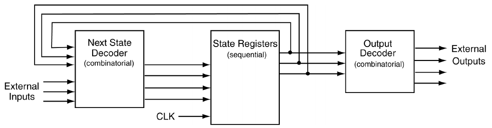

Hình 8.1: Sơ đồ khối của một FSM Moore-type.

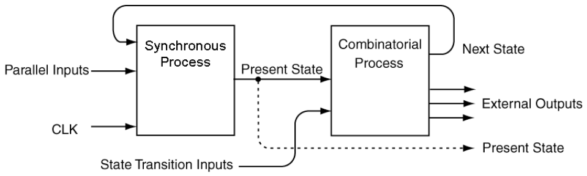

Hình 8.2: Model cho các bản triển khai FSM bằng VHDL.

Model FSM trong Hình 8.1 là model phổ biến nhất để mô tả một FSM Moore-type. Điều này có lẽ là vì sinh viên thường được yêu cầu tạo ra logic tổ hợp cần để triển khai Next State Decoder và Output Decoder; tuy nhiên ở đây chúng ta muốn nghĩ về FSM trong ngữ cảnh VHDL. Sức mạnh thực sự của VHDL bắt đầu lộ ra khi làm việc với FSM. Như bạn sẽ thấy, tính linh hoạt của behavioral modeling VHDL loại bỏ nhu cầu về những bản thiết kế lớn trên giấy với vô số K-maps và vô số phần tử logic tổ hợp.

Có nhiều cách tiếp cận khác nhau được dùng để mô hình hóa FSM trong VHDL. Các cách tiếp cận khác nhau này là kết quả của tính linh hoạt chung của VHDL với tư cách một ngôn ngữ. Những gì chúng ta sẽ mô tả trong mục này có lẽ là cách tiếp cận rõ ràng nhất để triển khai FSM. Sơ đồ khối của cách tiếp cận chúng ta sẽ dùng trong việc triển khai FSM được trình bày trong Hình 8.2.

Dù trông không rõ ràng hơn là bao, bạn sẽ sớm thấy model FSM trong Hình 8.2 là một phương pháp đơn giản để triển khai FSM. Cách tiếp cận chúng ta sẽ dùng chia FSM thành hai process VHDL. Một process, gọi là Synchronous Process, xử lý mọi vấn đề liên quan đến clocking và các điều khiển khác gắn với phần tử lưu trữ. Process kia, Combinatorial Process, xử lý mọi vấn đề gắn với Next State Decoder và Output Decoder của Hình 8.1. Lưu ý rằng cả hai khối trong Hình 8.1 đều chỉ được tạo thành hoàn toàn từ logic tổ hợp.

Một số thuật ngữ mới được dùng để mô tả các signal trong Hình 8.2, như được nêu và mô tả dưới đây:

• Các input có nhãn Parallel Inputs được dùng để biểu thị các input tác động song song lên từng phần tử lưu trữ. Các input này gồm enable, preset, clear, v.v.

• Các input có nhãn State Transition Inputs gồm các input bên ngoài điều khiển các chuyển trạng thái. Các input này cũng gồm các input bên ngoài dùng để giải mã các output bên ngoài Mealy-type.

• Các signal Present State được khối Combinatorial Process dùng cho cả việc giải mã trạng thái tiếp theo lẫn giải mã output. Sơ đồ trong Hình 8.2 cũng cho thấy các variable Present State cũng có thể được cung cấp làm output của FSM nhưng chúng không bắt buộc.

Một nhận xét cuối cùng trước khi bắt đầu. Có nhiều phương pháp khác nhau có thể được dùng để mô tả FSM bằng VHDL. Khi bạn đã hiểu phương pháp trình bày ở đây, việc học bất kỳ kiểu triển khai FSM nào khác tương đối nhẹ nhàng. Thông tin thêm về các coding style FSM khác có thể tìm thấy trong nhiều tài liệu VHDL khác nhau hoặc trên web.

## 8.1 Biểu diễn behavioral của FSM bằng VHDL

> VÍ DỤ 18. Hãy viết code VHDL triển khai FSM ở bên phải.

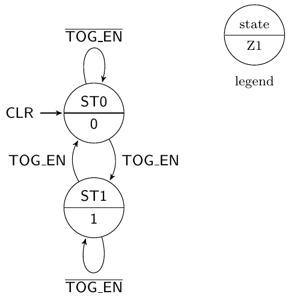

LỜI GIẢI. Bài toán này thể hiện một bản triển khai FSM cơ bản. Việc trình bày sơ đồ black-box rất bổ ích, vì nó giúp viết mô tả entity. Bắt đầu các bài toán FSM bằng việc vẽ một sơ đồ black box là một cách tiếp cận lành mạnh, đặc biệt khi làm việc với FSM. Với các bài toán FSM, nhiều khi việc phân biệt input với output của FSM trở nên khó khăn. Vẽ một sơ đồ giúp giảm bớt vấn đề này. Sơ đồ black box và code cho lời giải của Ví dụ 18 được trình bày trong Listing 8.1.

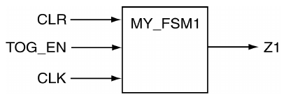

Listing 8.1: Lời giải của Ví dụ 18.

```vhdl
-- library declaration
library IEEE;
use IEEE.std_logic_1164.all;
-- entity
entity my_fsm1 is
    port (  TOG_EN  : in  std_logic;
            CLK,CLR : in  std_logic;
                 Z1 : out std_logic);
end my_fsm1;
-- architecture
architecture fsm1 of my_fsm1 is
   type state_type is (ST0,ST1);
   signal PS,NS : state_type;
begin
   sync_proc: process(CLK,NS,CLR)
   begin
     -- take care of the asynchronous input
     if (CLR = '1') then
        PS <= ST0;
     elsif (rising_edge(CLK)) then
        PS <= NS;
     end if;
   end process sync_proc;

   comb_proc: process(PS,TOG_EN)
   begin
      Z1 <= '0';        -- pre-assign output
      case PS is
         when ST0 =>    -- items regarding state ST0
            Z1 <= '0';  -- Moore output
            if (TOG_EN = '1') then NS <= ST1;
            else  NS <= ST0;
            end if;
         when ST1 =>    -- items regarding state ST1
            Z1 <= '1';  -- Moore output
            if (TOG_EN = '1') then NS <= ST0;
            else  NS <= ST1;
            end if;
         when others => -- the catch-all condition
            Z1 <= '0';  -- arbitrary; it should never
            NS <= ST0;  -- make it to these two statements
      end case;
   end process comb_proc;
end fsm1;
```

Và tất nhiên, lời giải này có nhiều điều đáng lưu ý. Những điều thú vị nhất được liệt kê dưới đây.

• Chúng ta đã khai báo một kiểu VHDL đặc biệt tên state_type để biểu diễn các trạng thái trong FSM này. Đây là một ví dụ về cách dùng enumeration type trong VHDL. Cũng như với enumerated type trong các ngôn ngữ máy tính higher-level khác, có các biểu diễn số bên trong cho các kiểu trạng thái được liệt kê, nhưng chúng ta chỉ làm việc với dạng tương đương symbolic dễ diễn đạt hơn. Trong trường hợp này, kiểu chúng ta đã tạo được gọi là state_type và chúng ta đã khai báo hai variable thuộc kiểu này: PS và NS. Điều then chốt cần lưu ý ở đây là state_type là thứ chúng ta tự tạo ra và không phải là một kiểu VHDL native.

• Synchronous process có hình thức và chức năng giống như các D flip-flops đơn giản mà chúng ta đã xem xét trong mục về mạch tuần tự. Khác biệt duy nhất là chúng ta đã thay D và Q lần lượt bằng PS và NS. Một điều cần lưu ý ở đây là phần tử lưu trữ chỉ gắn với signal PS. Lưu ý rằng PS không được chỉ định cho mọi tổ hợp input có thể có.

• Dù ví dụ này là FSM đơn giản nhất bạn có thể mong đợi, code trông có phần phức tạp. Nhưng nếu xem kỹ, bạn có thể thấy mọi thứ được phân ngăn gọn gàng trong lời giải. Có hai process; synchronous process xử lý reset bất đồng bộ và việc gán trạng thái mới khi clock hệ thống đến. Ngoài ra, combinatorial process xử lý các output không được xử lý trong synchronous process.

• Vì hai process hoạt động concurrent, có thể xem chúng làm việc theo kiểu lock-step. Các thay đổi ở signal NS được tạo ra trong combinatorial process buộc synchronous process phải được đánh giá. Khi các thay đổi thực sự được áp dụng trong synchronous process ở cạnh clock tiếp theo, các thay đổi ở signal PS khiến combinatorial process được đánh giá. Và cứ thế tiếp tục.

• Case statement trong combinatorial process cung cấp một mệnh đề when cho mỗi trạng thái của FSM. Một mệnh đề when others cũng đã được dùng. Các signal assignment thuộc mệnh đề catch-all này là tùy ý vì code thực tế không bao giờ nên đi đến đó. Statement này được cung cấp vì cảm giác đầy đủ và thể hiện thói quen viết code VHDL tốt.

• Moore output chỉ là hàm của trạng thái hiện tại. Điều này được thể hiện qua việc assignment của output Z1 được đánh giá vô điều kiện trong mỗi mệnh đề when của case statement trong combinatorial process. Nói cách khác, variable Z1 nằm bên trong mệnh đề when nhưng bên ngoài if statement trong mệnh đề when đó. Điều này tất nhiên là vì Moore output chỉ là hàm của các trạng thái chứ không phải của các input bên ngoài. Lưu ý rằng chính input bên ngoài điều khiển việc FSM chuyển sang trạng thái nào từ một trạng thái cho trước. Sau này bạn sẽ thấy rằng Mealy output, do bản chất chung của chúng, được gán bên trong if statement.

• Output Z1 được pre-assigned như bước đầu tiên trong combinatorial process. Pre-assigning nó theo cách này sẽ ngăn việc tạo ra latch ngoài ý muốn cho signal Z1. Khi làm việc với FSM, người thiết kế FSM có xu hướng tự nhiên là quên chỉ định một output cho variable Z1 trong mỗi trạng thái. Pre-assigning nó ngăn latch được tạo ra và có thể cho là làm source code gọn gàng hơn. Việc pre-assignment không tạo ra khác biệt gì cho code VHDL, vì nếu có nhiều assignment được thực hiện trong code, chỉ assignment cuối cùng có hiệu lực. Nói cách khác, chỉ assignment cuối cùng được xét khi process kết thúc.

Còn một điều cuối cùng cần lưu ý về Ví dụ 18. Để giữ cho ví dụ đơn giản, chúng ta đã bỏ qua giá trị số của các state variable. Điều này được thể hiện trong sơ đồ black-box của Listing 8.1 qua việc output duy nhất của FSM là signal Z1. Điều này hợp lý nếu chỉ cần một signal để điều khiển một thiết bị hoặc mạch nào khác. State variable được biểu diễn bên trong và cách biểu diễn chính xác của nó không quan trọng, vì state variable không được cung cấp làm output.

Trong một số thiết kế FSM, các state variable được cung cấp làm output. Để minh họa tình huống này, chúng ta sẽ đưa ra một lời giải cho Ví dụ 18 với các state variable làm output. Sơ đồ black-box và code VHDL của lời giải này được trình bày trong Listing 8.2.

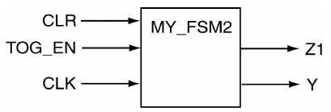

Listing 8.2: Lời giải của Ví dụ 18 có state variable làm output.

```vhdl
-- library declaration
library IEEE;
use IEEE.std_logic_1164.all;
-- entity
entity my_fsm2 is
   port (   TOG_EN : in  std_logic;
           CLK,CLR : in  std_logic;
              Y,Z1 : out std_logic);
end my_fsm2;
-- architecture
architecture fsm2 of my_fsm2 is
   type state_type is (ST0,ST1);
   signal PS,NS : state_type;
begin
   sync_proc: process(CLK,NS,CLR)
   begin
      if (CLR = '1') then
         PS <= ST0;
      elsif (rising_edge(CLK)) then
         PS <= NS;
      end if;
   end process sync_proc;

   comb_proc: process(PS,TOG_EN)
   begin
      Z1 <= '0';
      case PS is
         when ST0 =>        -- items regarding state ST0
            Z1 <= '0';      -- Moore output
            if (TOG_EN = '1') then NS <= ST1;
            else  NS <= ST0;
            end if;
         when ST1 =>        -- items regarding state ST1
            Z1 <= '1';      -- Moore output
            if (TOG_EN = '1') then NS <= ST0;
            else  NS <= ST1;
            end if;
         when others =>     -- the catch-all condition
            Z1 <= '0';      -- arbitrary; it should never
            NS <= ST0;      -- make it to these two statements
      end case;
   end process comb_proc;

   -- assign values representing the state variables
   with PS select
      Y <= '0' when ST0,
           '1' when ST1,
           '0' when others;
end fsm2;
```

Lưu ý rằng code VHDL trong Listing 8.2 chỉ khác code trong Listing 8.1 ở hai chỗ. Chỗ thứ nhất là việc sửa entity declaration để tính đến output state variable Y. Chỗ thứ hai là việc thêm selective signal assignment statement, statement này gán một giá trị cho output state variable Y dựa trên trạng thái của state variable. Selective signal assignment statement được đánh giá mỗi khi phát hiện có thay đổi ở signal PS. Một lần nữa, vì chúng ta đã khai báo một enumeration type cho các state variable, chúng ta không có cách nào biết chính xác synthesizer sẽ quyết định biểu diễn state variable như thế nào. Selective signal assignment statement trong code của Listing 8.2 chỉ làm cho có vẻ như có một state variable và các trạng thái được biểu diễn bằng ’1’ và ’0’. Thực tế, có những phương pháp chúng ta có thể dùng để điều khiển cách các state variable được biểu diễn và chúng ta sẽ sớm xem xét chúng.

Cuối cùng, có ba concurrent statement trong code VHDL ở Listing 8.2: hai process statement và một selective signal assignment statement.

> VÍ DỤ 19. Hãy viết code VHDL triển khai FSM ở bên phải. Coi các state variable là output của FSM.

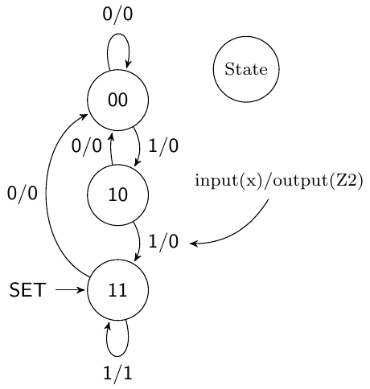

LỜI GIẢI. Sơ đồ trạng thái trong bài toán này cho thấy đây là một FSM three-state với một output bên ngoài Mealy-type và một input bên ngoài. Vì có ba trạng thái, lời giải cần ít nhất hai state variable để xử lý ba trạng thái. Sơ đồ black-box của lời giải được trình bày trong Listing 8.3. Lưu ý rằng hai state variable được xử lý như một bundled signal.

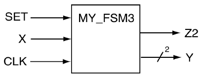

Listing 8.3: Lời giải của Ví dụ 19.

```vhdl
-- library declaration
library IEEE;
use IEEE.std_logic_1164.all;
-- entity
entity my_fsm3 is
    port ( X,CLK,SET : in  std_logic;
                   Y : out std_logic_vector(1 downto 0);
                  Z2 : out std_logic);
end my_fsm3;
-- architecture
architecture fsm3 of my_fsm3 is
   type state_type is (ST0,ST1,ST2);
   signal PS,NS : state_type;
begin
   sync_proc: process(CLK,NS,SET)
   begin
      if (SET = '1') then
         PS <= ST2;
      elsif (rising_edge(CLK)) then
         PS <= NS;
      end if;
   end process sync_proc;

   comb_proc: process(PS,X)
   begin
      Z2 <= '0';           -- pre-assign FSM outputs
      case PS is
         when ST0 =>       -- items regarding state ST0
            Z2 <= '0';     -- Mealy output always 0
            if (X = '0') then NS <= ST0;
            else  NS <= ST1;
            end if;
         when ST1 =>       -- items regarding state ST1
            Z2 <= '0';     -- Mealy output always 0
            if (X = '0') then NS <= ST0;
            else  NS <= ST2;
            end if;
         when ST2 =>       -- items regarding state ST2
            -- Mealy output handled in the if statement
            if (X = '0') then NS <= ST0; Z2 <= '0';
            else  NS <= ST2;  Z2 <= '1';
            end if;
         when others =>    -- the catch all condition
            Z2 <= '1'; NS <= ST0;
      end case;
   end process comb_proc;

   -- faking some state variable outputs
   with PS select
      Y <= "00" when ST0,
           "10" when ST1,
           "11" when ST2,
           "00" when others;
end fsm3;
```

Như thường lệ, có một vài điều thú vị cần chỉ ra về lời giải của Ví dụ 19. Quan trọng nhất là bạn nên để ý những điểm tương đồng giữa lời giải này và lời giải trước.

• FSM có một output Mealy-type. Về bản chất, lời giải xử lý output này như một output Moore-type trong hai mệnh đề when đầu tiên của case statement. Trong mệnh đề when cuối cùng, output Z2 xuất hiện ở cả hai phần của if statement. Việc output Z2 khác nhau trong ngữ cảnh của trạng thái ST2 làm nó trở thành một output Mealy-type và vì vậy là một FSM Mealy-type.

• Khi giả lập các output state variable (nhớ rằng các state variable thực sự được biểu diễn bằng enumeration type), cần hai signal vì sơ đồ trạng thái có nhiều hơn hai trạng thái (và ít hơn năm trạng thái). Lời giải chọn biểu diễn các output này thành một bundle, việc này có tác dụng làm thay đổi đôi chút hình thức của selected signal assignment statement xuất hiện ở cuối mô tả architecture.

> VÍ DỤ 20. Hãy viết code VHDL triển khai FSM ở bên phải. Coi các state variable được liệt kê là output.

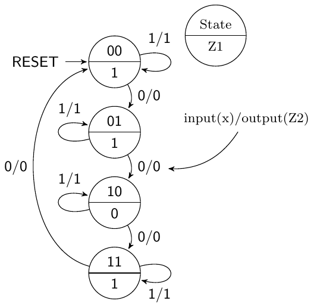

LỜI GIẢI. Sơ đồ trạng thái cho thấy bản triển khai của nó sẽ có bốn trạng thái, một input bên ngoài và hai output bên ngoài. Đây là một FSM hybrid ở chỗ if có chứa cả một output Mealy và một output Moore-type, nhưng trong trường hợp này FSM sẽ được xem là một FSM Mealy-type. Sơ đồ black-box và code VHDL của lời giải được trình bày trong Listing 8.4.

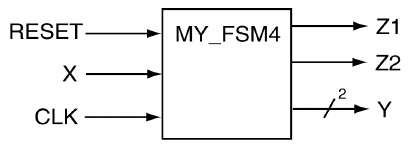

Listing 8.4: Lời giải của Ví dụ 20.

```vhdl
-- library declaration
library IEEE;
use IEEE.std_logic_1164.all;
-- entity
entity my_fsm4 is
    port ( X,CLK,RESET : in  std_logic;
                     Y : out std_logic_vector(1 downto 0);
                 Z1,Z2 : out std_logic);
end my_fsm4;
-- architecture
architecture fsm4 of my_fsm4 is
   type state_type is (ST0,ST1,ST2,ST3);
   signal PS,NS : state_type;
begin
   sync_proc: process(CLK,NS,RESET)
   begin
     if (RESET = '1') then  PS <= ST0;
     elsif (rising_edge(CLK)) then  PS <= NS;
     end if;
   end process sync_proc;

   comb_proc: process(PS,X)
   begin
      -- Z1: the Moore output; Z2: the Mealy output
      Z1 <= '0';   Z2 <= '0'; -- pre-assign the outputs
      case PS is
         when ST0 =>    -- items regarding state ST0
            Z1 <= '1';  -- Moore output
            if (X = '0') then NS <= ST1; Z2 <= '0';
            else  NS <= ST0; Z2 <= '1';
            end if;
         when ST1 =>    -- items regarding state ST1
            Z1 <= '1';  -- Moore output
            if (X = '0') then NS <= ST2; Z2 <= '0';
            else  NS <= ST1; Z2 <= '1';
            end if;
         when ST2 =>    -- items regarding state ST2
            Z1 <= '0';  -- Moore output
            if (X = '0') then NS <= ST3; Z2 <= '0';
            else  NS <= ST2; Z2 <= '1';
            end if;
         when ST3 =>    -- items regarding state ST3
            Z1 <= '1';  -- Moore output
            if (X = '0') then NS <= ST0; Z2 <= '0';
            else  NS <= ST3;  Z2 <= '1';
            end if;
         when others => -- the catch all condition
            Z1 <= '1';  Z2 <= '0';  NS <= ST0;
      end case;
   end process comb_proc;

   with PS select
      Y <= "00" when ST0,
           "01" when ST1,
           "10" when ST2,
           "11" when ST3,
           "00" when others;
end fsm4;
```

Nếu đến giờ bạn vẫn chưa nhận ra, việc triển khai FSM bằng behavioral model VHDL đơn giản một cách đáng kể. Thực tế, tôi hiếm khi viết code một FSM từ đầu; tôi thường chọn lấy một FSM nào đó tôi đã viết trước đây và bắt đầu từ đó. Hãy nhớ rằng kỹ thuật thực sự hiếm khi dựa trên một cuốn sách công thức nấu ăn. Với các bài toán FSM, phần kỹ thuật nằm ở việc test và tạo ra sơ đồ trạng thái. Đừng quá thoải mái với behavioral modeling của FSM; niềm vui thực sự là tạo ra một FSM giải được một bài toán cho trước.

## 8.2 One-Hot encoding cho FSM

Nói thật lòng, có nhiều phương pháp khác nhau có thể dùng để mã hóa state variable[^1]. Nếu dạng chính xác của cách biểu diễn được dùng là quan trọng với bạn, bạn sẽ cần thực hiện các bước cần thiết để điều khiển cách synthesizer biểu diễn các state variable. Có hai cách tiếp cận để điều khiển cách biểu diễn state variable. Cách tiếp cận thứ nhất là để công cụ synthesis lo các chi tiết. Vì mọi FSM chúng ta thấy cho đến giờ đều dùng enumeration type để biểu diễn state variable, synthesizer có thể chọn biểu diễn chúng thực tế bằng một encoding scheme do nó tự chọn. Thực tế là các công cụ nói chung có một tùy chọn để chọn encoding scheme mong muốn. Nhược điểm của cách tiếp cận này là bạn bị mất đi trải nghiệm học tập gắn với việc triển khai code VHDL tạo ra tường minh encoding scheme mong muốn của bạn. Xét cho cùng, bạn có thể có một encoding scheme đặc biệt nào đó cần dùng nhưng không được các công cụ phát triển hỗ trợ. Cách tiếp cận thứ hai để mã hóa state variable là chỉ định chúng trực tiếp trong VHDL. Cách tiếp cận chỉ định state variable trong code VHDL được trình bày trong mục này.

One-hot encoding dùng một bit trong state register cho mỗi trạng thái của FSM. Với một FSM one-hot encoding có 16 trạng thái, cần 16 flip flop. Tuy nhiên chỉ cần bốn flip flop nếu cùng FSM đó được triển khai bằng binary encoding. One-hot encoding đơn giản hóa logic và các kết nối giữa toàn bộ logic. Dù trông khá lãng phí xét về lượng logic sử dụng, one-hot encoding thường cho ra các FSM nhỏ hơn và nhanh hơn.

Cách tiếp cận dùng trong các ví dụ FSM trước là giả vờ như chúng ta đang dùng full encoding cho các state variable của FSM. Cách tiếp cận full encoding tối thiểu hóa số lượng phần tử lưu trữ (flip-flops) dùng để lưu các state variable. Phương trình dạng đóng mô tả số lượng flip-flops cần cho một FSM cho trước như một hàm của số trạng thái được trình bày trong phương trình 8.1. Các ký hiệu bracket-like dùng trong phương trình 8.1 biểu thị một ceiling function[^2]. Bản chất nhị phân được thể hiện qua phương trình này rõ ràng đến mức encoding này thường được gọi là binary encoding.

#(flip_flops) = ⌈log<sub>2</sub>(#states)⌉ (8.1)

Với các FSM one-hot encoded, tại mỗi thời điểm chỉ có một flip-flop được assert. Điều này đòi hỏi mỗi trạng thái riêng biệt được biểu diễn bằng một flip-flop. Vì vậy, trong one-hot encoding, số lượng flip-flops cần để triển khai một FSM bằng số trạng thái trong FSM. Dạng đóng của quan hệ này được trình bày trong phương trình 8.2.

#(flip_flops) = #(states) (8.2)

Câu hỏi tự nhiên nảy sinh là làm sao có thể dùng VHDL để triển khai các FSM one-hot encoded. Nếu bạn muốn kiểm soát hoàn toàn quá trình, bạn sẽ cần giành quyền kiểm soát từ synthesizer. Và vì chúng ta quan tâm đến việc học VHDL, chúng ta cần xem xét quá trình mã hóa tường minh các FSM one-hot.

Cách tiếp cận theo module mà chúng ta dùng để triển khai FSM giúp đẩy nhanh quá trình chuyển đổi từ việc dùng enumeration type sang việc thực sự chỉ định cách các state variable được biểu diễn. Các thay đổi so với cách tiếp cận trước của chúng ta chỉ giới hạn ở cách các output được gán cho state variable và cách các state variable bị buộc phải được biểu diễn bằng những bit pattern nhất định. Vì vậy, các sửa đổi so với cách tiếp cận fully encoded chỉ giới hạn ở entity declaration (bạn sẽ cần nhiều variable hơn để biểu diễn các trạng thái), phần khai báo state variable (bạn sẽ cần khai báo tường minh các bit pattern gắn với mỗi trạng thái) và việc gán state variable cho các output (trong trường hợp này, chúng ta thực sự không giả lập như đã làm trong các ví dụ khác).

> VÍ DỤ 21. Hãy viết code VHDL triển khai FSM ở bên phải. Coi các state variable được liệt kê là output. Hãy dùng one-hot encoding cho các state variable. Bài toán này là Ví dụ 20 làm lại từ đầu nhưng dùng one-hot encoding thực sự cho các state variable.

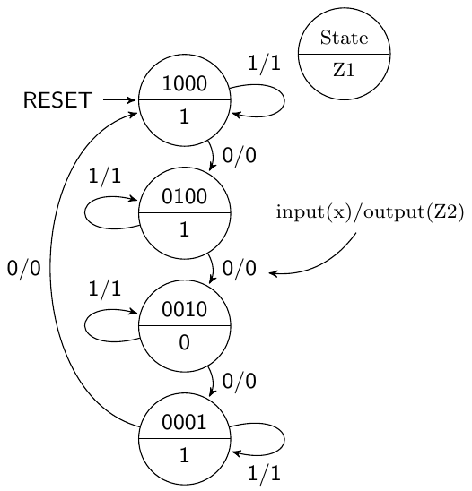

LỜI GIẢI. Sơ đồ trạng thái cho thấy bốn trạng thái, một input bên ngoài X, hai output bên ngoài Z1 và Z2, trong đó output Z2 là một Mealy output. Đây là một Mealy machine cho thấy nên dùng one-hot encoding để mã hóa các state variable. Chúng ta sẽ tiếp cận việc triển khai FSM này từng phần một.

Listing 8.5 cho thấy các sửa đổi cần thiết trong entity declaration để chuyển full encoding dùng trong Ví dụ 20 sang một pseudo one-hot encoding. Listing 8.6 cho thấy các sửa đổi cần thiết đối với assignment output state variable để chuyển từ enumeration type sang một dạng assigned type đặc biệt. Việc buộc các state variable được mã hóa thực sự bằng one-hot encoding đòi hỏi hai dòng code bổ sung này, như được trình bày trong Listing 8.6. Về bản chất, hai dòng code này buộc VHDL synthesizer biểu diễn mỗi trạng thái của FSM bằng phần tử lưu trữ riêng của nó. Nói cách khác, mỗi trạng thái được biểu diễn bằng modifier ”string” như được liệt kê. Điều này buộc bản triển khai FSM phải nhớ bốn bit mỗi trạng thái, về bản chất đòi hỏi bốn flip-flops. Lưu ý trong Listing 8.7 rằng trường hợp mặc định được gán một trạng thái one-hot hợp lệ thay vì trạng thái toàn số không như thường lệ. Bạn rất nên cân nhắc so sánh ba hình này. Lời giải hoàn chỉnh được trình bày trong Listing 8.8

Listing 8.5: Các sửa đổi để chuyển Ví dụ 20 sang one-hot encoding.

```vhdl
-- full encoded approach
entity my_fsm4 is
    port ( X,CLK,RESET : in  std_logic;
                     Y : out std_logic_vector(1 downto 0);
                 Z1,Z2 : out std_logic);
end my_fsm4;
----------------------------------------------------------------------
-- one-hot encoding approach
entity my_fsm4 is
    port ( X,CLK,RESET : in  std_logic;
                     Y : out std_logic_vector(3 downto 0);
                 Z1,Z2 : out std_logic);
end my_fsm4;
```

Listing 8.6: Các sửa đổi để chuyển state variable sang dùng one-hot encoding.

```vhdl
-- the approach for enumeration types
type state_type is (ST0,ST1,ST2,ST3);
signal PS,NS : state_type;
----------------------------------------------------------------------
-- the approach used for explicitly specifying state bit patterns
type state_type is (ST0,ST1,ST2,ST3);
attribute ENUM_ENCODING: STRING;
attribute ENUM_ENCODING of state_type: type is "1000 0100 0010 0001";
signal PS,NS : state_type;
```

Listing 8.7: Các sửa đổi để chuyển output trạng thái sang pseudo one-hot encoding.

```vhdl
-- fake full encoded approach
with PS select
   Y <= "00" when ST0,
        "01" when ST1,
        "10" when ST2,
        "11" when ST3,
        "00" when others;
end fsm4;
----------------------------------------------------------------------
-- one-hot encoded approach
with PS select
   Y <= "1000" when ST0,
        "0100" when ST1,
        "0010" when ST2,
        "0001" when ST3,
        "1000" when others;
end fsm4;
```

Listing 8.8: Lời giải cuối cùng của Ví dụ 21.

```vhdl
-- library declaration
library IEEE;
use IEEE.std_logic_1164.all;
-- entity
entity my_fsm4_oh is
    port ( X,CLK,RESET : in  std_logic;
                     Y : out std_logic_vector(3 downto 0);
                 Z1,Z2 : out std_logic);
end my_fsm4_oh;
-- architeture
architecture fsm4_oh of my_fsm4_oh is
  type state_type is (ST0,ST1,ST2,ST3);
  attribute ENUM_ENCODING: STRING;
  attribute ENUM_ENCODING of state_type: type is "1000 0100 0010 0001";
  signal PS,NS : state_type;
begin
   sync_proc: process(CLK,NS,RESET)
   begin
     if (RESET = '1') then  PS <= ST0;
     elsif (rising_edge(CLK)) then  PS <= NS;
     end if;
   end process sync_proc;

   comb_proc: process(PS,X)
   begin
      -- Z1: the Moore output; Z2: the Mealy output
      Z1 <= '0';   Z2 <= '0'; -- pre-assign the outputs
      case PS is
         when ST0 =>    -- items regarding state ST0
            Z1 <= '1';  -- Moore output
            if (X = '0') then NS <= ST1; Z2 <= '0';
            else  NS <= ST0; Z2 <= '1';
            end if;
         when ST1 =>    -- items regarding state ST1
            Z1 <= '1';  -- Moore output
            if (X = '0') then NS <= ST2; Z2 <= '0';
            else  NS <= ST1; Z2 <= '1';
            end if;
         when ST2 =>    -- items regarding state ST2
            Z1 <= '0';  -- Moore output
            if (X = '0') then NS <= ST3; Z2 <= '0';
            else  NS <= ST2; Z2 <= '1';
            end if;
         when ST3 =>    -- items regarding state ST3
            Z1 <= '1';  -- Moore output
            if (X = '0') then NS <= ST0; Z2 <= '0';
            else  NS <= ST3;  Z2 <= '1';
            end if;
         when others => -- the catch all condition
            Z1 <= '1';  Z2 <= '0';  NS <= ST0;
      end case;
   end process comb_proc;

   -- one-hot encoded approach
   with PS select
      Y <= "1000" when ST0,
           "0100" when ST1,
           "0010" when ST2,
           "0001" when ST3,
           "1000" when others;

end fsm4_oh;
```

## 8.3 Những điểm quan trọng

• Mô hình hóa FSM từ một sơ đồ trạng thái là một quá trình đơn giản khi dùng behavioral modeling VHDL. Quá trình này đơn giản đến mức thường được xem là kiểu rập khuôn (cookie cutter). Phần kỹ thuật thực sự trong việc triển khai FSM nằm ở việc tạo ra sơ đồ trạng thái giải được bài toán đang xét.

• Do tính linh hoạt chung của VHDL, có nhiều cách tiếp cận có thể được dùng để mô hình hóa FSM bằng VHDL. Cách tiếp cận dùng ở đây chỉ trình bày chi tiết một trong các kiểu đó, nhưng nói chung được xem là đơn giản nhất trong tất cả các kiểu.

• Việc mã hóa thực tế các state variable của FSM khi dùng enumeration type được để cho công cụ synthesis quyết định. Nếu muốn một phương pháp mã hóa variable ưu tiên, dùng cách tiếp cận attribute được trình bày chi tiết trong mục này là một lựa chọn đơn giản nhưng khả thi.

## 8.4 Bài tập: Behavioral modeling của FSM

BÀI TẬP 1. Hãy vẽ sơ đồ trạng thái gắn với code VHDL sau. Hãy nhớ cung cấp chú giải và ghi nhãn đầy đủ mọi thứ.

```vhdl
-- library declaration
library IEEE;
use IEEE.std_logic_1164.all;
-- entity
entity fsm is
   port (  X,CLK : in  std_logic;
           RESET : in  std_logic;
           Z1,Z2 : out std_logic;
end fsm;
-- architecture
architecture fsm of fsm is
   type state_type is (A,B,C);
   signal PS,NS : state_type;
begin
   sync_proc: process(CLK,NS,RESET)
   begin
      if (RESET = '0') then PS <= C;
      elsif (rising_edge(CLK)) then PS <= NS;
      end if;
   end process sync_proc;

   comb_proc: process(PS,X)
   begin
      case PS is
         Z1 <= '0';    Z2 <= '0';
         when A =>
            Z1 <= '0';
            if (X='0') then NS<=A; Z2<='1';
            else  NS <= B; Z2 <= '0';
            end if;
         when B =>
            Z1 <= '1';
            if (X='0') then NS<=A; Z2<='0';
            else  NS <= C; Z2 <= '1';
            end if;
         when C =>
            Z1 <= '1';
            if (X='0') then NS<=B; Z2<='1';
            else  NS <= A; Z2 <= '0';
            end if;
         when others =>
            Z1 <= '1'; NS<=A; Z2<='0';
      end case;
   end process comb_proc;
end fsm;
```

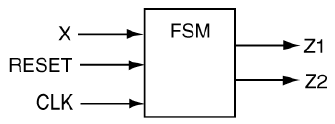

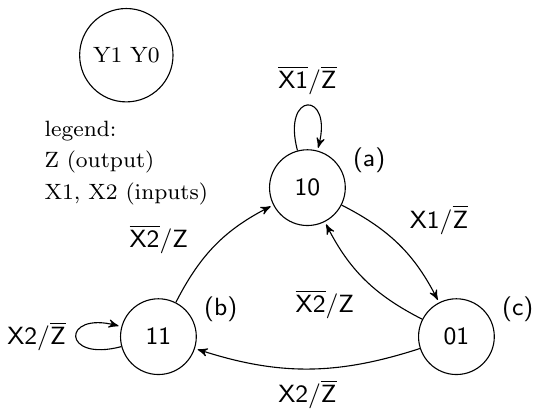

BÀI TẬP 2. Hãy viết một model behavioral VHDL có thể được dùng để triển khai sơ đồ trạng thái như ở bên phải. Các state variable nên được mã hóa như được liệt kê và cũng được cung cấp làm output của FSM.

BÀI TẬP 3. Hãy vẽ sơ đồ trạng thái gắn với code VHDL sau. Hãy nhớ cung cấp chú giải và nhớ ghi nhãn mọi thứ.

```vhdl
-- library declaration
library IEEE;
use IEEE.std_logic_1164.all;
-- entity
entity fsmx is
    Port ( BUM1,BUM2 : in  std_logic;
                 CLK : in   std_logic;
            TOUT,CTA : out std_logic);
end fsmx;
-- architecture
architecture my_fsmx of fsmx is
   type state_type is (S1,S2,S3);
    signal PS,NS : state_type;
begin
   sync_p: process (CLK,NS)
   begin
      if (rising_edge(CLK)) then
         PS <= NS;
      end if;
   end process sync_p;

   comb_p: process (CLK,BUM1,BUM2)
   begin
      case PS is

         when S1 =>
            CTA <= '0';
            if (BUM1 = '0')  then
               TOUT <= '0';
               NS <= S1;
            elsif (BUM1 = '1') then
               TOUT <= '1';
               NS <= S2;
            end if;

         when S2 =>
            CTA <= '0';
            TOUT <= '0';
            NS <= S3;

         when S3 =>
            CTA <= '1';
            TOUT <= '0';
            if (BUM2 = '1')  then
               NS <= S1;
            elsif (BUM2 = '0') then
               NS <= S2;
            end if;

         when others =>   CTA <= '0';
                         TOUT <= '0';
                           NS <= S1;
      end case;
   end process comb_p;
end my_fsmx;
```

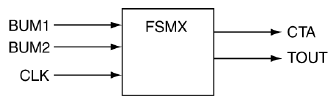

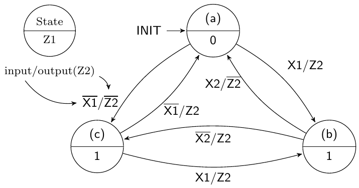

BÀI TẬP 4. Hãy viết code model behavioral VHDL có thể được dùng để triển khai sơ đồ trạng thái ở bên phải.

BÀI TẬP 5. Hãy vẽ sơ đồ trạng thái gắn với code VHDL sau. Coi các output Y là đại diện cho các state variable. Hãy nhớ cung cấp chú giải. Hãy chỉ ra các trạng thái bằng cả state variable lẫn dạng tương đương symbolic của chúng.

```vhdl
-- library declaration
library IEEE;
use IEEE.std_logic_1164.all;
-- entity
entity fsm is
port (     X,CLK : in  std_logic;
           RESET : in  std_logic;
           Z1,Z2 : out std_logic;
               Y : out std_logic_vector(2 downto 0));
end fsm;
-- architecture
architecture my_fsm of fsm is
   type state_type is (A,B,C);
   attribute ENUM_ENCODING: STRING;
   attribute ENUM_ENCODING of state_type: type is "001 010 100";
   signal PS,NS : state_type;
begin

sync_proc: process(CLK,NS,RESET) -- process
   begin
     if (RESET = '0') then PS <= C;
     elsif (rising_edge(CLK)) then PS <= NS;
     end if;
   end process sync_proc;

comb_proc: process(PS,X) -- process
   begin
      case PS is
         when A =>
            Z1 <= '0';
            if (X = '0') then NS <= A; Z2 <= '1';
            else  NS <= B; Z2 <= '0';
            end if;
         when B =>
            Z1 <= '1';
            if (X = '0') then NS <= A; Z2 <= '0';
            else  NS <= C; Z2 <= '1';
            end if;
         when C =>
            Z1 <= '1';
            if (X = '0') then NS <= B; Z2 <= '1';
            else  NS <= A; Z2 <= '0';
            end if;
         when others =>
            Z1 <= '1'; NS <= A; Z2 <= '0';
      end case;
   end process comb_proc;

with PS select
   Y <= "001" when A,
        "010" when B,
        "100" when C,
        "001" when others;
end my_fsm;
```

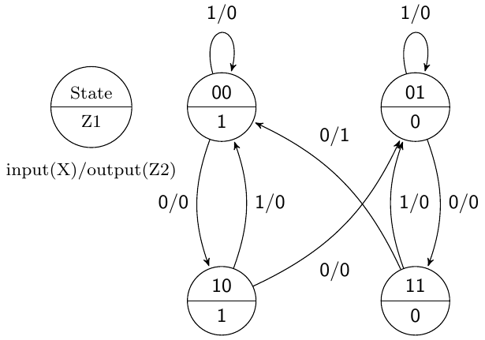

BÀI TẬP 6. Hãy viết code model behavioral VHDL có thể được dùng để triển khai sơ đồ trạng thái ở bên phải. Tất cả các state variable nên được mã hóa như được liệt kê và cũng được cung cấp làm output của FSM.

BÀI TẬP 7. Hãy vẽ sơ đồ trạng thái tương ứng với model VHDL sau và cho biết FSM là một Mealy machine hay một Moore machine. Hãy nhớ ghi nhãn mọi thứ.

```vhdl
-- library declaration
library IEEE;
use IEEE.std_logic_1164.all;
-- entity
entity fsm is
    Port ( CLK,CLR,SET,X1,X2 : in  std_logic;
                       Z1,Z2 : out std_logic);
end fsm;
-- architecture
architecture my_fsm of fsm is
   type state_type is (sA,sB,sC,sD);
   attribute ENUM_ENCODING: STRING;
   attribute ENUM_ENCODING of state_type: type
       is "1000 0100 0010 0001";
   signal PS,NS : state_type;
begin
   sync_p: process (CLK,NS,CLR,SET) -- process
   begin
      if (CLR = '1' and SET = '0') then
         PS <= sA;
      elsif (CLR = '0' and SET = '1') then
         PS <= sD;
      elsif (rising_edge(CLK)) then
         PS <= NS;
      end if;
   end process sync_p;

   comb_p: process (X1,X2,PS) -- process
   begin
      case PS is
         when sA =>
            if ( X1 = '1')  then
               Z1 <= '0'; Z2 <= '0';
               NS <= sA;
            else
               Z1 <= '0'; Z2 <= '0';
               NS <= sB;
            end if;
         when sB =>
            if ( X2 = '1')  then
               Z1 <= '1'; Z2 <= '1';
               NS <= sC;
            else
               Z1 <= '1'; Z2 <= '0';
               NS <= sB;
            end if;
         when sC =>
            if ( X2 = '1')  then
               Z1 <= '0'; Z2 <= '0';
               NS <= sB;
            else
               Z1 <= '0'; Z2 <= '1';
               NS <= sC;
            end if;
         when sD =>
            if ( X1 = '1')  then
               Z1 <= '1'; Z2 <= '1';
               NS <= sD;
            else
               Z1 <= '1'; Z2 <= '1';
               NS <= sC;
            end if;
      end case;
   end process comb_p;
end my_fsm;
```

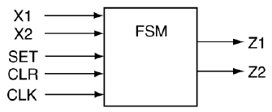

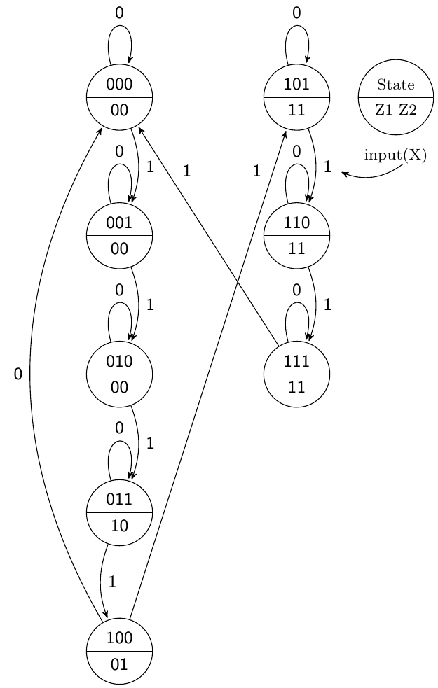

BÀI TẬP 8. Hãy viết code model behavioral VHDL có thể được dùng để triển khai sơ đồ trạng thái ở bên phải. Các state variable nên được mã hóa như được liệt kê và cũng được cung cấp làm output của FSM.

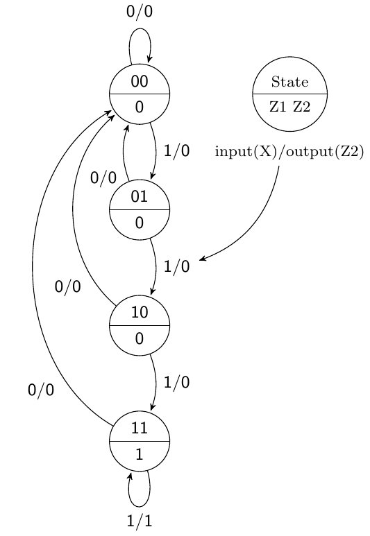

BÀI TẬP 9. Hãy viết code model behavioral VHDL có thể được dùng để triển khai sơ đồ trạng thái ở bên phải. Các state variable nên được mã hóa như được liệt kê và cũng được cung cấp làm output của FSM.

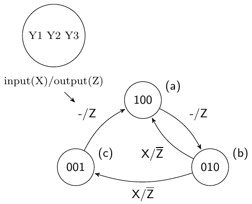

BÀI TẬP 10. Hãy viết code model behavioral VHDL có thể được dùng để triển khai sơ đồ trạng thái ở bên phải. Các state variable nên được mã hóa như được liệt kê và cũng được cung cấp làm output của FSM.

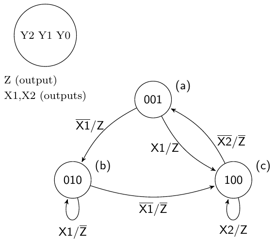

BÀI TẬP 11. Hãy viết code model behavioral VHDL có thể được dùng để triển khai sơ đồ trạng thái ở bên phải. Các state variable nên được mã hóa như được liệt kê và cũng được cung cấp làm output của FSM.

BÀI TẬP 12. Hãy viết code model behavioral VHDL có thể được dùng để triển khai sơ đồ trạng thái ở bên phải. Các state variable nên được mã hóa như được liệt kê và cũng được cung cấp làm output của FSM.

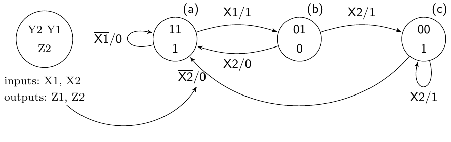

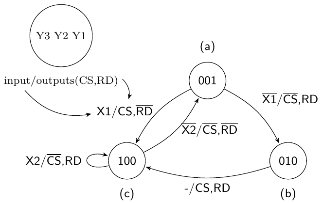

BÀI TẬP 13. Hãy viết code model behavioral VHDL có thể được dùng để triển khai sơ đồ trạng thái ở bên phải. Các state variable nên được mã hóa như được liệt kê và cũng được cung cấp làm output của FSM.

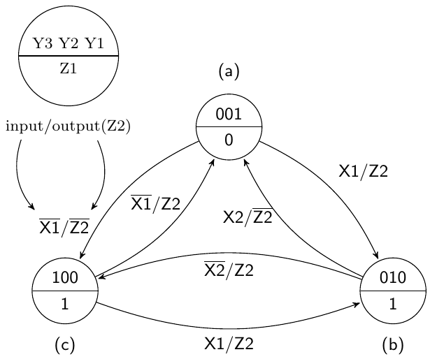

BÀI TẬP 14. Hãy viết code model behavioral VHDL có thể được dùng để triển khai sơ đồ trạng thái ở bên phải. Các state variable nên được mã hóa như được liệt kê và cũng được cung cấp làm output của FSM.

---

[^1]: Trong trường hợp này, encoding là việc gán một pattern 1 và 0 duy nhất cho mỗi trạng thái để chúng không thể bị nhầm với các trạng thái khác.

[^2]: Ceiling function y = ⌈x⌉ gán cho y số integer nhỏ nhất lớn hơn hoặc bằng x.
