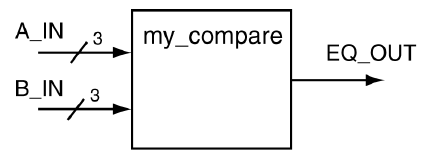
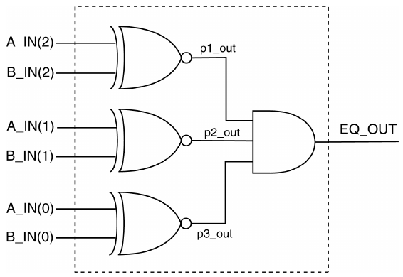
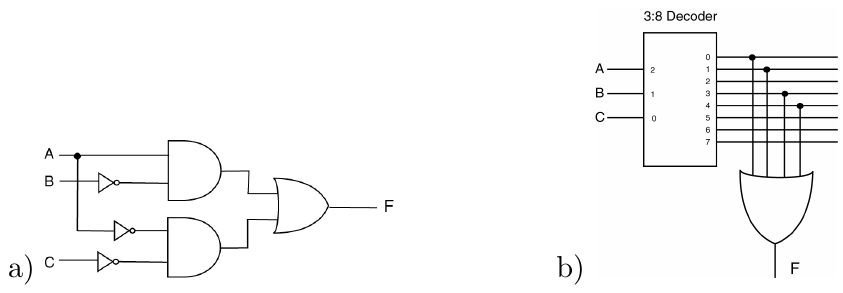
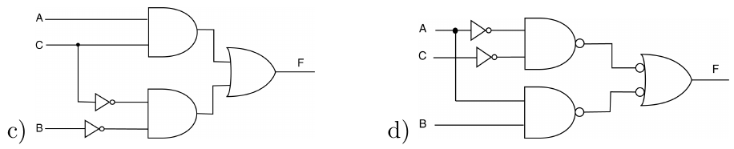

# 9 Structural modeling trong VHDL

Như đã nhắc ở trên, nói chung có ba cách tiếp cận để viết code VHDL: data-flow modeling, behavioral modeling và structural modeling.

Cho đến lúc này, cuốn sách chỉ mới làm việc với các model data-flow và behavioral. Mục này trình bày phần giới thiệu về structural modeling.

Khi các thiết kế số trở nên phức tạp hơn, càng ít khả năng một thiết kế bất kỳ có thể được hiện thực chỉ bằng một trong ba loại model VHDL. Chúng ta đã thấy đặc điểm này khi làm việc với FSM, nơi chúng ta trộn process statement (behavioral modeling) với selective signal assignment statement (data-flow modeling). Kết quả là một model VHDL hybrid. Xét về bản chất, structural modeling cũng là một model VHDL hybrid. Phần lớn các thiết kế phức tạp có thể được xem là model structural, tức là nếu chúng được hiện thực bằng các quy trình viết code đúng đắn.

Việc thiết kế các mạch số phức tạp bằng VHDL nên giống sát với cấu trúc của các chương trình máy tính phức tạp. Nhiều kỹ thuật và thói quen dùng để xây dựng các chương trình máy tính lớn và có cấu trúc tốt viết bằng ngôn ngữ higher-level cũng nên được áp dụng khi dùng VHDL. Cấu trúc chung mà chúng ta đang nói đến là cách tiếp cận viết code theo module vô cùng phổ biến. Thuật ngữ structural modeling là thuật ngữ mà VHDL dùng cho modular design. Cách tiếp cận modular design của VHDL hỗ trợ trực tiếp hierarchical design, thứ về bản chất được dùng khi cố gắng hiểu các thiết kế số phức tạp.

Những lợi ích của modular design đối với VHDL giống với những lợi ích mà modular design hay object-oriented design mang lại cho các ngôn ngữ máy tính higher-level. Modular design thúc đẩy khả năng hiểu bằng cách gói chức năng low-level vào các module. Các module này có thể dễ dàng được dùng lại trong các thiết kế khác, nhờ đó tiết kiệm thời gian cho người thiết kế bằng cách loại bỏ nhu cầu phát minh lại và re-test bánh xe. Cách tiếp cận phân cấp còn vượt ra ngoài code viết ở mức file. Các module VHDL có thể được đặt trong các file và library có tên thích hợp, giống như với các ngôn ngữ higher-level. Hơn nữa, ngoài kia thường có những library chứa các module hữu ích mà chỉ có thể truy cập bằng một cách tiếp cận structural-modeling. Có quyền dùng các library này và thành thạo cách dùng chúng sẽ giúp người khác nhìn nhận bạn như một bậc thầy VHDL.

Sau tất cả những bình luận về các thiết kế phức tạp, chúng ta trình bày một vài ví dụ đơn giản. Dù cách tiếp cận structural thích hợp nhất cho các thiết kế số phức tạp, các ví dụ trình bày trong mục này về bản chất khá đơn giản. Các ví dụ này cho thấy những chi tiết thiết yếu của structural modeling VHDL. Việc nghĩ ra các thiết kế số mà ở đó một cách tiếp cận structural modeling sẽ thích hợp hơn là tùy người thiết kế. Hãy nhớ rằng lần đầu tiếp xúc với structural modeling có thể hơi vất vả. Dù có một số cú pháp mới cần làm quen, khi bạn đã hoàn thành vài thiết kế structural, cú pháp mới này sẽ in sâu vào đầu bạn và việc áp dụng nó khi cần sẽ trở thành bản năng thứ hai.

Ở giai đoạn này trong sự nghiệp lập trình VHDL của bạn, xu hướng là dùng một dạng phần mềm schematic capture nào đó thay vì học cách tiếp cận structural modeling. Thực tế là ngày nay không ai đáng kể dùng phần mềm schematic capture nữa, dù nó vẫn được dạy trong nhiều sách giáo khoa đại học. Phần buồn cười của toàn bộ quá trình này là phần mềm schematic capture là một công cụ cho phép bạn biểu diễn mạch một cách trực quan nhưng cuối cùng lại tạo ra code VHDL (thứ duy nhất synthesizer hiểu được là code VHDL).

## 9.1 Tính module của VHDL với component

Công cụ chính cho tính module trong các ngôn ngữ higher-level như C là function. Trong các ngôn ngữ máy tính khác, tính module tương tự đạt được nhờ dùng method, procedure và subroutine. Cách tiếp cận dùng trong C là 1) đặt tên cho function interface mà bạn định viết (function declaration), 2) viết code cho những gì function sẽ làm (function body), 3) cho chương trình biết function tồn tại và có thể được gọi (prototype) và 4) gọi function từ phần chính của code. Trong VDHL, tính module đạt được nhờ dùng package, component và function. Trong các mục tiếp theo, chúng ta sẽ xem cách dùng component.

Cách tiếp cận để dùng một component trong VHDL là: 1) đặt tên cho module bạn định mô tả (entity), 2) mô tả những gì module sẽ làm (architecture), 3) cho chương trình biết module tồn tại và có thể được dùng (component declaration) và 4) dùng module trong code của bạn (component instantiation, hay mapping). Những điểm tương đồng giữa hai cách tiếp cận này được liệt kê trong Bảng 9.1.

Giờ chúng ta hãy dùng các nguyên tắc này trong một ví dụ thực tế. Cách tiếp cận của chúng ta là mô tả một cách tiếp cận template-type cho thiết kế structural VHDL, dùng một mạch tổ hợp đơn giản và well-known.

> VÍ DỤ 22. Hãy thiết kế một comparator 3-bit dùng structural modeling VHDL. Interface của mạch này được mô tả trong sơ đồ dưới đây.



LỜI GIẢI. Comparator là một trong những mạch tổ hợp kinh điển mà mọi kỹ sư digital design phải tự suy ra vào một lúc nào đó trong sự nghiệp. Lời giải trình bày ở đây hiện thực phiên bản discrete gate của mạch, được trình bày trong Hình 9.1. Một lần nữa, lời giải trình bày ở đây chủ yếu là một ví dụ về model structural VHDL và không phải phương pháp hiệu quả nhất để biểu diễn một comparator bằng VHDL.

| Ngôn ngữ lập trình C | VHDL |
|---|---|
| Mô tả function interface | Entity |
| Mô tả những gì function làm (viết code) | Architecture |
| Cung cấp function prototype cho chương trình chính | Component declaration |
| Gọi function từ chương trình chính | Component instantiation hay mapping |

Bảng 9.1: Những điểm tương đồng giữa module trong C và VHDL.

Cách tiếp cận của lời giải này là mô hình hóa mỗi discrete gate thành một khối riêng. Trong trường hợp này, chúng thực ra chỉ là các gate đơn giản, nhưng các yêu cầu về interface của cách tiếp cận structural VHDL là như nhau bất kể các phần tử mạch là gate đơn giản hay subsystem số phức tạp.

Mạch trong Hình 9.1 chứa một số thông tin bổ sung liên quan đến bản hiện thực structural VHDL của nó. Thứ nhất, đường nét đứt biểu diễn ranh giới của entity VHDL top-level; vì vậy các signal cắt qua ranh giới này phải xuất hiện trong entity declaration của bản hiện thực này. Thứ hai, mỗi signal bên trong đều được đặt một tên. Trong trường hợp này, signal bên trong được định nghĩa là các signal không cắt qua ranh giới entity nét đứt. Đây là một yêu cầu đối với các bản hiện thực structural VHDL, vì những signal này phải được gán cho các sub-modules khác nhau ở bên trong thiết kế (ở đâu đó trong architecture).



Hình 9.1: Bản hiện thực discrete gate của một comparator 3-bit.

Phần đầu tiên của lời giải là cung cấp các bản hiện thực entity và architecture cho từng gate riêng lẻ trong Hình 9.1. Chúng ta cần cung cấp ít nhất một định nghĩa cho một XNOR gate và một AND gate 3-input. Chúng ta chỉ cần cung cấp một định nghĩa XNOR gate, dù thực tế có ba XNOR gate trong sơ đồ. Cách tiếp cận VHDL theo module cho phép chúng ta dùng lại các định nghĩa mạch và chúng ta tận dụng đặc điểm này. Các định nghĩa này được trình bày trong Listing 9.1.

Listing 9.1: Các định nghĩa entity và architecture cho các discrete gate.

```vhdl
----------------------------------
-- Description of XNOR function --
----------------------------------
entity big_xnor is
    Port ( A,B : in  std_logic;
             F : out std_logic);
end big_xnor;

architecture ckt1 of big_xnor is
begin
      F <= not ( (A and (not B)) or ( (not A) and B) );
end ckt1;
-----------------------------------------
-- Description of 3-input AND function --
-----------------------------------------
entity big_and3 is
    Port ( A,B,C : in std_logic;
               F : out std_logic);
end big_and3;

architecture ckt1 of big_and3 is
begin
      F <= ( A and B and C );
end ckt1;
```

Các bản hiện thực trong Listing 9.1 không có chi tiết VHDL nào mới. Thông tin mới nằm ở cách các phần tử mạch liệt kê trong Hình 9.1 được dùng làm component trong một mạch lớn hơn. Các quy trình hiện thực một thiết kế structural VHDL có thể được tóm tắt trong các bước sau. Các bước này giả định rằng entity declaration của các module bên trong đã có sẵn. Bước 1. Tạo entity declaration top-level. Bước 2. Khai báo các design unit lower-level dùng trong thiết kế. Bước 3. Khai báo các signal bên trong cần thiết dùng để nối các design unit. Bước 4. Instantiate các design unit.

Vì vậy, đây là cách bạn tiến hành: Bước Một: Bước đầu tiên trong một bản hiện thực structural giống hệt cách tiếp cận chuẩn mà chúng ta đã dùng để hiện thực các mạch VHDL khác: entity. Entity declaration được suy ra trực tiếp từ hộp nét đứt trong Hình 9.1 và được trình bày trong Listing 9.2. Nói cách khác, các signal cắt các đường nét đứt là những signal mà thế giới bên ngoài biết đến và phải được đưa vào entity declaration. Bước Hai: Bước tiếp theo là khai báo các design unit được dùng trong mạch. Trong biệt ngữ VHDL, declaration là việc làm cho một design unit cụ thể dùng được trong một thiết kế cụ thể. Lưu ý rằng việc khai báo một design unit, theo định nghĩa, biến mạch của bạn thành một thiết kế phân cấp. Việc khai báo một design unit làm cho unit đó có thể được đặt vào hệ phân cấp thiết kế. Design unit về bản chất là các module nằm ở các mức thấp hơn của thiết kế. Với thiết kế của chúng ta, chúng ta cần khai báo hai design unit riêng biệt: XNOR gate và một AND gate 3-input.

Listing 9.2: Entity declaration cho comparator 3-bit.

```vhdl
-----------------------------------------------
-- Interface description of 3-bit comparator --
-----------------------------------------------
entity my_compare is
    Port ( A_IN   : in  std_logic_vector(2 downto 0);
           B_IN   : in  std_logic_vector(2 downto 0);
           EQ_OUT : out std_logic);
end my_compare;
```

Có hai yếu tố liên quan đến việc khai báo một design unit: 1) làm thế nào và, 2) đặt nó ở đâu. Một component declaration có thể được xem là một biến thể của entity declaration tương ứng. Khác biệt là từ entity được thay bằng từ component và từ component cũng phải được theo sau bởi từ end component để kết thúc phần khai báo. Cách tốt nhất để làm việc này là copy, paste và sửa entity declaration gốc. Component declaration thu được được đặt trong phần khai báo architecture, sau dòng architecture và trước dòng begin. Hai component declaration và các entity declaration tương ứng của chúng được trình bày trong listing tiếp theo. Listing 9.3 cho thấy các component declaration như chúng xuất hiện trong code VHDL chạy được. Bước Ba: Bước tiếp theo là khai báo các signal bên trong mà thiết kế của bạn dùng. Các signal bên trong cần cho thiết kế này là các signal không bị đường nét đứt trong Hình 9.1 cắt qua. Ba signal này giống với các biến cục bộ dùng trong các ngôn ngữ lập trình higher-level ở chỗ chúng phải được khai báo trước khi có thể được dùng trong thiết kế. Những signal này thực chất cung cấp một interface giữa các design unit khác nhau được instantiate trong thiết kế cuối cùng. Với thiết kế này, cần ba signal và chúng được dùng làm output của các XNOR gate và làm input của AND gate. Các khai báo signal bên trong như vậy xuất hiện cùng với các component declaration trong phần khai báo architecture, sau dòng architecture và trước dòng begin. Lưu ý rằng việc khai báo intermediate signal giống với việc khai báo signal chứa trong phần thân entity. Khác biệt duy nhất là khai báo intermediate signal không chứa mode specifier. Chúng ta đã từng làm việc với intermediate signal trong các mục khác của cuốn sách này. Các khai báo signal được đưa vào như một phần của lời giải cuối cùng trong Listing 9.3. Bước Bốn: Bước cuối cùng là tạo các instance của các module cần thiết và map các instance của các component khác nhau trong phần thân architecture. Về mặt kỹ thuật, như chữ instantiation ngụ ý, sự xuất hiện của các instance của design unit là phần chính của quá trình instantiation. Trong một số tài liệu, quá trình instantiation gồm cả thứ mà chúng ta gọi là component declaration, nhưng chúng ta đã chọn không làm vậy ở đây. Cách tiếp cận được trình bày ở đây là để declaration chỉ các component declaration trước dòng begin, còn instantiation chỉ việc tạo các instance riêng lẻ sau dòng begin. Vì vậy, quá trình mapping được bao gồm trong định nghĩa component instantiation của chúng ta.

```vhdl
entity big_xnor is
    Port ( A,B : in  std_logic;
             F : out std_logic);
end big_xnor;
```

```vhdl
component big_xnor
   Port ( A,B : in  std_logic;
            F : out std_logic);
end component;
```

```vhdl
entity big_and3 is
    Port ( A,B,C : in  std_logic;
               F : out std_logic);
end big_and3;
```

```vhdl
component big_and3
   Port ( A,B,C : in  std_logic;
              F : out std_logic);
end component;
```

Quá trình mapping cung cấp các yêu cầu interface cho từng component trong thiết kế. Bước mapping này gắn các kết nối bên ngoài của từng component với các signal ở mức tiếp theo phía trên trong hệ phân cấp thiết kế. Mỗi signal gắn với từng component được map tới một signal bên trong hoặc bên ngoài trong thiết kế higher-level. Mỗi mapping riêng lẻ gồm một tên duy nhất cho instance cụ thể đó cũng như tên của entity gốc. Thông tin mapping thực tế theo sau các keyword port map của VHDL. Tất cả thông tin này xuất hiện trong lời giải cuối cùng trình bày ở Listing 9.3.

Một điểm then chốt cần lưu ý trong quá trình instantiation là việc đưa label vào cho mọi design unit được instantiate. Luôn nên dùng label như một phần của design unit instantiation, vì dùng label thích hợp làm tăng khả năng hiểu model VHDL của bạn. Nói cách khác, chọn label đúng cách làm tăng tính self-describing của thiết kế và được xem là một cách tiếp cận lập trình VHDL tốt.

Listing 9.3: Code VHDL cho hệ phân cấp thiết kế của comparator 3-bit.

```vhdl
-- library declaration
library IEEE;
use IEEE.std_logic_1164.all;
-- entity
entity my_compare is
    Port ( A_IN   : in  std_logic_vector(2 downto 0);
           B_IN   : in  std_logic_vector(2 downto 0);
           EQ_OUT : out std_logic);
end my_compare;
-- architecture
architecture ckt1 of my_compare is

   -- XNOR gate --------------------
   component big_xnor is
      Port ( A,B : in  std_logic;
               F : out std_logic);
   end component;

   -- 3-input AND gate -------------
   component big_and3 is
      Port ( A,B,C : in  std_logic;
                 F : out std_logic);
   end component;

   -- intermediate signal declaration
   signal p1_out,p2_out,p3_out : std_logic;

begin
   x1: big_xnor port map (A => A_IN(2),
                          B => B_IN(2),
                          F => p1_out);

   x2: big_xnor port map (A => A_IN(1),
                          B => B_IN(1),
                          F => p2_out);

   x3: big_xnor port map (A => A_IN(0),
                          B => B_IN(0),
                          F => p3_out);

   a1: big_and3 port map (A => p1_out,
                          B => p2_out,
                          C => p3_out,
                          F => EQ_OUT);
end ckt1;
```

Đáng lưu ý là lời giải trong Listing 9.3 không phải cách tiếp cận duy nhất cho quá trình mapping. Cách tiếp cận trong Listing 9.3 dùng thứ được gọi là direct mapping các component. Theo cách này, mỗi signal trong interface của các design unit được liệt kê và được gắn trực tiếp với các signal mà chúng nối tới trong thiết kế higher-level bằng operator =>. Cách tiếp cận này có một số ưu điểm tiềm năng: nó tường minh, đầy đủ, có trật tự và cho phép liệt kê các signal theo bất kỳ thứ tự nào. Nhược điểm duy nhất có thể có của cách tiếp cận này là nó chiếm nhiều chỗ hơn trong source code VHDL của bạn.

Cách tiếp cận thay thế cho mapping là dùng implied mapping. Trong cách tiếp cận này, các kết nối giữa các signal bên ngoài của design unit được gắn với các signal trong design unit theo thứ tự xuất hiện của chúng trong mapping statement. Điều này khác với direct mapping vì thay vào đó chỉ các signal của thiết kế higher-level xuất hiện trong mapping statement. Quan hệ giữa các signal trong design unit và thiết kế higher-level được ngụ ý qua thứ tự của signal như chúng xuất hiện trong component declaration hoặc entity declaration. Cách tiếp cận này dùng ít chỗ hơn trong source code nhưng đòi hỏi các signal phải được đặt đúng thứ tự. Một architecture thay thế nhưng tương đương cho ví dụ trước dùng implied mapping được trình bày trong Listing 9.4.

Để simulate và synthesize thành công thiết kế trong Listing 9.3, code của Listing 9.1 cũng cần được đưa vào project VHDL của bạn. Thói quen bình thường là giữ hai listing trong hai file riêng biệt. Điều tương tự cũng đúng với bản hiện thực của Listing 9.4.

Listing 9.4: Architecture thay thế cho Ví dụ 22 dùng implied mapping.

```vhdl
-- library declaration
library IEEE;
use IEEE.std_logic_1164.all;
-- entity
entity my_compare is
    Port ( A_IN   : in  std_logic_vector(2 downto 0);
           B_IN   : in  std_logic_vector(2 downto 0);
           EQ_OUT : out std_logic);
end my_compare;
-- architecture
architecture ckt2 of my_compare is
   component big_xnor is
      Port ( A,B : in  std_logic;
               F : out std_logic);
   end component;

   component big_and3 is
      Port ( A,B,C : in  std_logic;
                 F : out std_logic);
   end component;
   signal p1_out,p2_out,p3_out : std_logic;

begin
   x1: big_xnor port map (A_IN(2),B_IN(2),p1_out);
   x2: big_xnor port map (A_IN(1),B_IN(1),p2_out);
   x3: big_xnor port map (A_IN(0),B_IN(0),p3_out);
   a1: big_and3 port map (p1_out,p2_out,p3_out,EQ_OUT);
end ckt2;
```

Vì thiết kế này tương đối đơn giản, chúng ta đã có thể bỏ qua một trong những vấn đề thú vị nảy sinh khi dùng structural modeling. Khi làm việc với thiết kế structural, các mức khác nhau của thiết kế thường sẽ chứa cùng một tên signal. Câu hỏi nảy sinh là liệu synthesizer có phân biệt được các tên signal xuyên suốt hệ phân cấp hay không. VHDL synthesizer, giống như compiler của các ngôn ngữ higher-level, có thể xử lý những trường hợp như vậy. Các signal cùng tên được map theo mapping được trình bày trong component instantiation statement. Có lẽ trường hợp phổ biến nhất là với các signal clock. Trong trường hợp này, một component instantiation như trong Listing 9.5 vừa hợp lệ vừa thường thấy trong các thiết kế có clock hệ thống. Không xảy ra xung đột tên vì tên signal ở left-hand side của operator => được hiểu là nằm bên trong component, còn signal ở right-hand side được hiểu là nằm ở mức tiếp theo phía trên trong hệ phân cấp.

Listing 9.5: Ví dụ về cùng một tên signal cắt qua các ranh giới phân cấp.

```vhdl
x5: some_component port map (CLK => CLK,
                              CS => CS);
```

## 9.2 Generic map

Như chúng ta đã thấy ở mục trước, việc dùng keyword component cho phép chúng ta khai báo một module VHDL để instantiate sau này.

Thường người ta muốn viết code mang tính generic. Ví dụ một routine thực hiện một tác vụ nhất định trên một mảng input có kích thước generic. Giả sử chúng ta muốn hiện thực một đoạn code của một parity check routine trả về ’1’ khi mảng input N-size là một số chẵn và ’0’ khi mảng input N-size là một số lẻ. Listing 9.6 cho thấy một bản hiện thực như vậy.

Listing 9.6: Bản hiện thực parity check với kích thước mảng input generic.

```vhdl
 1   -- library declarations
 2   library IEEE;
 3   use IEEE.std_logic_1164.all;
 4   -- entity
 5   entity gen_parity_check is
 6       generic ( n: positive);
 7       port    ( x: in  std_logic_vector(n-1 downto 0);
 8                 y: out std_logic);
 9   end gen_parity_check;
10   -- architecture
11   architecture arch of gen_parity_check is
12       begin
13           process(x)
14               variable temp: std_logic;
15           begin
16               temp:='0';
17               for i in x'range loop
18                   temp := temp XOR x(i);
19               end loop;
20               y <= temp;
21           end process;
22   end arch;
```

Listing 9.7 cho thấy cách code ở trên có thể được khai báo và instantiate trong code của riêng bạn qua phương pháp component đã thấy. Cụ thể, trong Listing 9.7, module parity check generic ở trên được dùng để tạo một module parity check 4-bit.

Để đạt được tính module đã nói, keyword generic đã được dùng bên trong phần entity trong code ở trên và một lần nữa bên trong phần component khi khai báo nó trong code dưới đây. Phần generic được dùng để cho phép bạn điều khiển mọi variable generic.

Hãy để ý cách trong lúc instantiation (xem Listing 9.7, dòng 20), keyword generic map đã được dùng cùng với keyword port map để định nghĩa các variable generic.

Listing 9.7: Dùng generic để tạo một code parity check generic.

```vhdl
 1   -- library declaration
 2   library IEEE;
 3   use IEEE.std_logic_1164.all;
 4   -- entity
 5   entity my_parity_chk is
 6       Port ( input   : in  std_logic_vector(3 downto 0);
 7              output  : out std_logic);
 8   end my_parity_chk;
 9
10   -- architecture
11   architecture arch of my_parity_chk is
12      --------------- component declaration --------------------
13      component gen_parity_check is
14         generic ( N  : positive);
15         port    ( X  : in  std_logic_vector(N-1 downto 0);
16                   Y  : out std_logic);
17      end component;
18   begin
19      -------------- component instantiation -------------------
20      cp1: gen_parity_check generic map (4) port map (input, output);
21   end arch;
```

Một lần nữa, để simulate và synthesize thành công thiết kế trong Listing 9.7, code của Listing 9.6 cũng cần được đưa vào project VHDL của bạn.

## 9.3 Những điểm quan trọng

• Structural modeling trong VHDL hỗ trợ các khái niệm hierarchical design. Khả năng trừu tượng hóa các mạch số lên các mức cao hơn là chìa khóa để hiểu và thiết kế các mạch số phức tạp.

• Digital design dùng schematic capture là một cách tiếp cận lỗi thời: bạn nên cưỡng lại xu hướng và/hoặc chỉ thị dùng nó bằng mọi giá.

• Model structural VHDL hỗ trợ việc dùng lại các design unit. Điều này gồm cả các unit bạn đã thiết kế trước đây cũng như khả năng dùng các library module định nghĩa sẵn.

• Nếu bạn dùng một công cụ phát triển phần mềm FPGA của một trong các hãng FPGA lớn trên thị trường, bạn sẽ có thể dùng các khối số đã được phát triển sẵn khi đã khai báo chúng. Trong trường hợp này, entity declaration không phải là entity declaration của Listing 9.2, mà thay vào đó là một lệnh đưa library vào đơn giản trong code VHDL của bạn, trông như sau:

```
library UNISIM;
use UNISIM.VComponents.all;
```

Mọi khối số có trong library package này đều được mô tả trong tài liệu của công cụ phát triển phần mềm FPGA (ví dụ Xilinx Vivado).

## 9.4 Bài tập: Structural modeling

BÀI TẬP 1. Hãy vẽ một sơ đồ khối của mạch được biểu diễn bởi code VHDL liệt kê dưới đây. Hãy nhớ ghi nhãn đầy đủ cho sơ đồ cuối cùng. BÀI TẬP 2. Hãy vẽ một sơ đồ khối của mạch được biểu diễn bởi code VHDL liệt kê dưới đây. Hãy nhớ ghi nhãn đầy đủ cho sơ đồ cuối cùng. BÀI TẬP 3. Hãy viết các model structural VHDL cho các mạch liệt kê dưới đây.

```vhdl
-- library declaration
library IEEE;
use IEEE.std_logic_1164.all;
-- entity
entity ckt1 is
    Port ( EN1, EN2 : in  std_logic;
                CLK : in  std_logic;
                  Z : out std_logic);
end ckt1;
-- architecture
architecture arch of ckt1 is

    component T_FF
        port ( T,CLK : in  std_logic;
                   Q : out std_logic);
    end component;

    signal t_in, t1_s, t2_s : std_logic;
begin
    t1 : T_FF
    port map (T => t_in,
            CLK => CLK,
              Q => t1_s );
    t2 : T_FF
    port map (T => t1_s,
            CLK => CLK,
              Q => t2_s );

       Z <= t2_s OR t1_s;
    t_in <= EN1 AND EN2;
end arch;
```

```vhdl
-- library declaration
library IEEE;
use IEEE.std_logic_1164.all;
-- entity
entity ckt is
    port ( A,B : in  std_logic;
             C : out std_logic);
end ckt;
-- architecture
architecture my_ckt of ckt is

    component bb1
        port (D,E : in  std_logic;
            F,G,H : out std_logic);
end component;

    component bb2
        port ( L,M,N : in  std_logic;
                   P : out std_logic);
end component;

    signal x1,x2,x3 : std_logic;
begin
    b1: bb1
    port map ( D => A, E => B, F => x1, G => x2, H => x3);

    b2: bb2
    port map ( L => x1, M => x2, N => x3, P => C);

end my_ckt;
```




