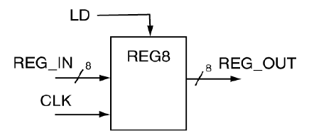
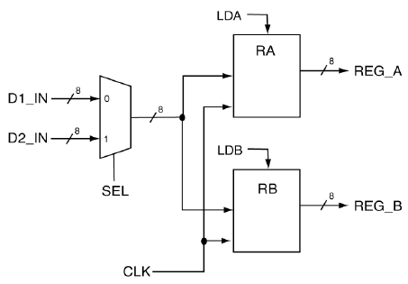
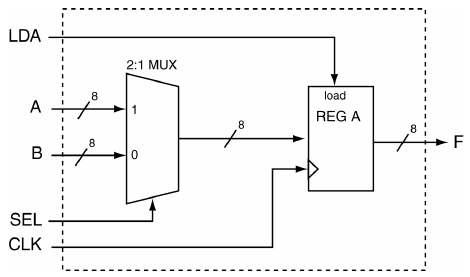
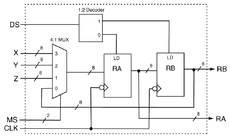
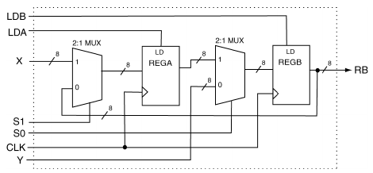
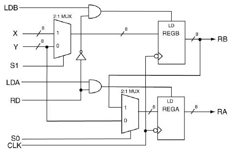
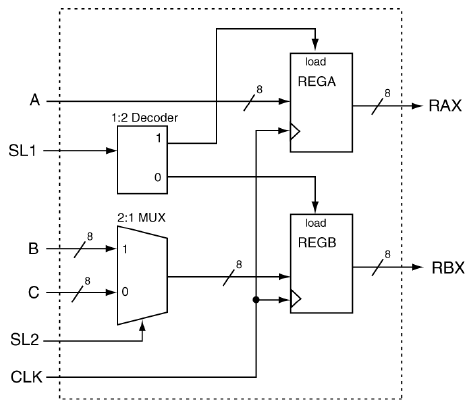
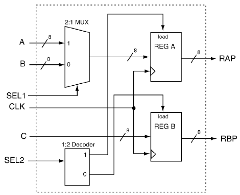

# 10 Register và Register Transfer Level

Khái niệm register trong VHDL và việc dùng nó sau đó trong thiết kế mạch số có lẽ là một trong những khái niệm đơn giản nhất trong VHDL. Một register trong VHDL đơn giản là một phiên bản vector của D flip-flop, trong đó mọi thao tác trên các flip-flops xảy ra đồng thời. “Register transfer level”, hay RTL, là một kiểu thiết kế chủ yếu quan tâm đến việc dữ liệu được chuyển giữa các register khác nhau trong một hệ thống số như thế nào và khi nào. Thiết kế RTL-level thường gắn với các thiết kế ”data-path”, loại thiết kế đòi hỏi điều khiển và định thời cẩn thận dữ liệu được chuyển giữa các register. Các điều khiển gắn với ngay cả những register đơn giản cũng đủ để bảo đảm rằng một entity bên ngoài nào đó có đủ quyền điều khiển đối với ”thứ tự” dữ liệu đi qua mạch gắn với data-path. Trong những trường hợp này, thứ tự đúng của các lần chuyển dữ liệu được điều khiển bởi một FSM.

Việc học thiết kế RTL-level tốt nhất là trong ngữ cảnh của một thiết kế data-path. Việc thiết kế data-paths tốt nhất là trong ngữ cảnh của một mạch số có mục đích nào đó, chẳng hạn một thiết kế arithmetic logic unit. Cả hai chủ đề này đều vượt quá những gì cần nhắc đến ở đây. Tin tốt là sự đơn giản của register cho phép giới thiệu nhanh về vấn đề này. Các bản triển khai mạch lớn để dành cho lúc khác.

> VÍ DỤ 23. Hãy dùng behavioral modeling VHDL để thiết kế register 8-bit có một signal parallel load đồng bộ active high LD. Coi việc load của register được đồng bộ với các cạnh lên của clock.



LỜI GIẢI. Lời giải cho register 8-bit trông giống một cách đáng ngạc nhiên với model của một D flip-flop. Lời giải đầy đủ của Ví dụ 23 được trình bày trong Listing 10.1. Như thường lệ, có một vài điều đáng lưu ý trong lời giải này.

• Lưu ý rằng có một if statement không chứa else tương ứng, đây là thứ tạo ra phần tử nhớ. Trong ví dụ này, có tám phần tử nhớ bit-sized (flip-flops). Trong ví dụ này, các flip flop được coi là D-type flip-flops. Các phần tử lưu trữ gắn với bundle REG_OUT. Việc dùng code VHDL để tạo ra D flip-flops theo cách này dễ dàng đến mức khiến D flip-flops trở thành loại flip-flop được dùng rộng rãi nhất trong digital design.

• Code dùng một bundle signal cho cả input và output. Việc gán bundle cho các bundle khác rất đơn giản trong VHDL, như được thể hiện trong code. Trong nhiều trường hợp, chẳng hạn như trường hợp trong ví dụ này, không cần dùng bundle access operator trong model VHDL.

• Việc gán input cho output dựa trên đặc điểm của cả cạnh clock lẫn trạng thái của signal LD. Cách tiếp cận dùng trong model VHDL ở Listing 10.1 là cung cấp một mệnh đề if riêng cho cả signal LD và signal CLK. Có thể chỉ dùng một if statement bằng cách gắn cả hai điều kiện với một mệnh đề if duy nhất, nhưng điều này không được xem là thói quen lập trình VHDL tốt khi làm việc với các phần tử được đồng bộ. Nói cách khác, bạn nên luôn cố giữ các điều kiện đặc biệt gắn với signal clock tách biệt khỏi mọi điều kiện khác gắn với hành động đang xét. Signal clock phần nào đặc biệt trong thế giới VHDL; bạn nên tập thói quen đối xử nhẹ nhàng với chúng.

• Vì các signal REG_IN và LD được yêu cầu là đồng bộ, chúng không xuất hiện bên trong process sensitivity list.

Listing 10.1: Lời giải của Ví dụ 23.

```vhdl
-- library declaration
library IEEE;
use IEEE.std_logic_1164.all;
-- entity
entity reg8 is
    Port ( REG_IN  :  in std_logic_vector(7 downto 0);
           LD,CLK  :  in std_logic;
           REG_OUT : out std_logic_vector(7 downto 0));
end reg8;
-- architecture
architecture reg8 of reg8 is
begin
   reg: process(CLK)
   begin
      if (rising_edge(CLK)) then
         if (LD = '1') then
            REG_OUT <= REG_IN;
         end if;
      end if;
   end process;
end reg8;
```

Mạch trong ví dụ tiếp theo phức tạp hơn một chút so với phần lớn các ví dụ đã thấy cho đến giờ. Ngoài ra, hãy nhớ rằng có nhiều lời giải khác nhau cho cùng một bài toán. Đây là điều thường gặp trong VHDL; thực tế, nhiều khi không có phương pháp tốt nhất nào để triển khai một mạch cho trước. Các ví dụ tiếp theo về bản chất là cùng một bài toán được giải bằng hai lời giải khác nhau nhưng tương đương về chức năng.

> VÍ DỤ 24. Hãy dùng behavioral modeling VHDL để thiết kế mạch ở bên phải. Coi cả hai signal load là active high. Coi mạch được đồng bộ với cạnh lên của signal clock.


LỜI GIẢI. Mạch trong Ví dụ 24 gồm hai register 8-bit và một MUX 2:1. Đây là một ví dụ về chuyển dữ liệu bus-based, trong đó output của MUX được nối với input của hai register. Mỗi register trong hai register có input điều khiển load độc lập riêng. Lời giải của Ví dụ 24 được trình bày trong Listing 10.2. Và như chúng ta đã quen mong đợi, có một vài điều đáng lưu ý về lời giải này.

• Có ba concurrent statement trong lời giải này: hai model behavioral và một model data-flow.

• Có một process riêng cho mỗi register trong hai register. Dù có thể biểu diễn cả hai register bằng một process, làm vậy sẽ phần nào phức tạp và phần nào khó hiểu. Cách tiếp cận tốt nhất trong VHDL luôn là chia các tác vụ thành các chức năng tách biệt về logic và dùng các kỹ thuật modeling VHDL khác nhau như những công cụ để giữ các tác vụ tách biệt và đơn giản. Thực tế là synthesizer sẽ trở thành bạn của bạn nếu bạn cung cấp cho nó các model đơn giản. Lượng code VHDL mô tả một thiết kế nhất định không quan trọng; độ phức tạp của một model bất kỳ được quyết định bởi đoạn code phức tạp nhất trong model đó. Trong VHDL, đơn giản luôn tốt hơn.

• Mọi signal trong Ví dụ 24 đều có liên kết với bên ngoài, trừ output của MUX. Output của MUX được nối với input của cả hai register. Cách tiếp cận cuối cùng dùng trong lời giải này là điển hình trong VHDL: nhiều process giao tiếp với nhau qua các signal dùng chung. Trong ví dụ này chỉ có một signal dùng chung, nhưng đây là một chương trình khá đơn giản. Cùng model giao tiếp inter-process đó được dùng trong các mạch phức tạp hơn.

• Model cho MUX 2:1 dùng thuật ngữ (others => ’0’). Đây là một thuật ngữ short-hand để gán toàn bộ output bằng ’0’. Phần thực sự hay của instruction này là bạn không cần biết mình cần viết bao nhiêu số 0. Đây là một tính năng hay ở chỗ nếu độ rộng của bundle tương ứng thay đổi, dòng code cụ thể này sẽ không cần sửa.

Listing 10.2: Lời giải của Ví dụ 24.

```vhdl
-- library declaration
library IEEE;
use IEEE.std_logic_1164.all;
-- entity
entity ckt_rtl is
   port (D1_IN,D2_IN : in  std_logic_vector(7 downto 0);
             CLK,SEL : in  std_logic;
             LDA,LDB : in  std_logic;
         REG_A,REG_B : out std_logic_vector(7 downto 0));
end ckt_rtl;
-- architecture
architecture rtl_behavioral of ckt_rtl is
   -- intermediate signal declaration ---------------
   signal s_mux_result : std_logic_vector(7 downto 0);
begin

   ra: process(CLK) -- process
   begin
      if (rising_edge(CLK)) then
         if (LDA = '1') then
            REG_A <= s_mux_result;
         end if;
      end if;
   end process;

   rb: process(CLK) -- process
   begin
      if (rising_edge(CLK)) then
         if (LDB = '1') then
            REG_B <= s_mux_result;
         end if;
      end if;
   end process;

   with SEL select
   s_mux_result <= D1_IN when '1',
                   D2_IN when '0',
                   (others => '0') when others;
end rtl_behavioral;
```

> VÍ DỤ 25. Hãy dùng structural modeling VHDL để thiết kế mạch ở bên phải. Coi cả hai signal load là active high. Coi mạch được đồng bộ với cạnh lên của signal clock.



LỜI GIẢI. Lời giải của Ví dụ 25 được trình bày trong Listing 10.3. Ở đây không có nhiều điều thú vị để lưu ý. Đây là một ví dụ thực tế hơn về model structural so với ví dụ trình bày trong mục về structural modeling. Chỉ có vài điều mới mẻ và tuyệt vời cần lưu ý về lời giải này.

• Điều rất quan trọng cần lưu ý về lời giải trong Listing 10.3 là đừng bị choáng ngợp bởi lượng code khổng lồ được liệt kê. Code có cấu trúc tốt; nếu bạn có thể nhận ra cấu trúc này, bạn sẽ dễ hiểu lời giải hơn. Và tốt hơn nữa, bạn sẽ tiến xa hơn trên con đường tự viết được những đoạn code VHDL tuyệt vời của riêng mình.

• Source code VHDL trong Listing 10.3 được định dạng đẹp. Đặc biệt, code được thụt lề gọn gàng. Code thụt lề đúng cách rất đáng mong muốn ở chỗ nó trình bày thông tin rõ ràng dựa trên thụt lề. Không có gì ngạc nhiên, code được định dạng đúng cách dễ hiểu hơn. Tốt hơn nữa, code good-looking khiến những người có thể biết hoặc không biết rõ hơn nghĩ rằng code của bạn thực sự tốt như vẻ ngoài của nó. Trong thế giới bận rộn này của chúng ta, một cái liếc nhanh gần như là tất cả thời gian mà người ta (sếp và giáo viên) có để dành cho việc xem source code VHDL của bạn.

Listing 10.3: Lời giải của Ví dụ 25 dùng cách tiếp cận structural modeling.

```vhdl
entity mux2t1 is                                    --- ENTITY
   port (  A,B : in  std_logic_vector(7 downto 0);
           SEL : in  std_logic;
         M_OUT : out std_logic_vector(7 downto 0));
end mux2t1;
architecture my_mux of mux2t1 is                    --- ARCHITECTURE
begin
   with SEL select
   M_OUT <= A when '1',
            B when '0',
            (others => '0') when others;
end my_mux;
entity reg8 is                                      --- ENTITY
    Port (  REG_IN : in  std_logic_vector(7 downto 0);
            LD,CLK : in  std_logic;
           REG_OUT : out std_logic_vector(7 downto 0));
end reg8;
architecture reg8 of reg8 is                       --- ARCHITECTURE
begin
   reg: process(CLK)
   begin
      if (rising_edge(CLK)) then
         if (LD = '1') then
            REG_OUT <= REG_IN;
         end if;
      end if;
   end process;
end reg8;
entity ckt_rtl is                                    --- ENTITY
   port (D1_IN,D2_IN : in  std_logic_vector(7 downto 0);
             CLK,SEL : in  std_logic;
             LDA,LDB : in  std_logic;
         REG_A,REG_B : out std_logic_vector(7 downto 0));
end ckt_rtl;
architecture rtl_structural of ckt_rtl is           --- ARCHITECTURE
   -- component declaration
   component mux2t1
      port (  A,B : in  std_logic_vector(7 downto 0);
              SEL : in  std_logic;
            M_OUT : out std_logic_vector(7 downto 0));
   end component;
   component reg8
       Port (  REG_IN : in  std_logic_vector(7 downto 0);
               LD,CLK : in  std_logic;
              REG_OUT : out std_logic_vector(7 downto 0));
   end component;
   -- intermediate signal declaration
   signal s_mux_result : std_logic_vector(7 downto 0);
begin
   ra: reg8
   port map ( REG_IN => s_mux_result,
                  LD => LDA,
                 CLK => CLK,
             REG_OUT => REG_A );
   rb: reg8
   port map ( REG_IN => s_mux_result,
                  LD => LDB,
                 CLK => CLK,
             REG_OUT => REG_B );
   m1: mux2t1
   port map (   A => D1_IN,
                B => D2_IN,
              SEL => SEL,
            M_OUT => s_mux_result);
end rtl_structural;
```

## 10.1 Những điểm quan trọng

• VHDL có thể được dùng để dễ dàng triển khai các mạch ở register transfer level. Các model VHDL tương ứng có thể được triển khai ở dạng structural hoặc dạng hoàn toàn behavioral.

• Các model VHDL RTL level nên cố gắng hướng tới sự đơn giản trong thiết kế. Nếu các model behavioral trong thiết kế RTL trở nên phức tạp, khả năng mạch của bạn chạy đúng giảm đi rất nhiều do việc synthesis mạch phức tạp đó.

## 10.2 Bài tập: Mạch Register Transfer Level



BÀI TẬP 1. Hãy viết một model VHDL có thể được dùng để triển khai mạch sau.



BÀI TẬP 2. Hãy viết một model VHDL có thể được dùng để triển khai mạch sau.



BÀI TẬP 3. Hãy viết một model VHDL có thể được dùng để triển khai mạch sau.



BÀI TẬP 4. Hãy viết một model VHDL có thể được dùng để triển khai mạch sau.



BÀI TẬP 5. Hãy viết một model VHDL có thể được dùng để triển khai mạch sau.



BÀI TẬP 6. Hãy viết một model VHDL có thể được dùng để triển khai mạch sau.
