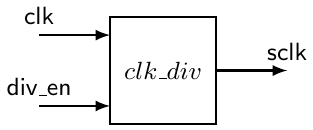

# 11 Data object

Nhiều khái niệm trình bày cho đến giờ đã được giới thiệu một cách ngầm định trong ngữ cảnh các bài toán ví dụ. Theo cách này, có lẽ bạn đã có thể tạo ra code VHDL chất lượng nhưng bị bó buộc phải dùng phong cách VHDL được trình bày trong các ví dụ đó. Trong mục này, chúng ta sẽ trình bày một số chi tiết và lý thuyết nền tảng xoay quanh VHDL, như một cách tiếp cận đi cửa sau để giới thiệu những công cụ cho phép bạn dùng VHDL mô tả hành vi của các mạch số phức tạp hơn.

Để chuyển sang VHDL tinh vi hơn, một điểm khởi đầu tốt là định nghĩa của các object VHDL (ví dụ kiểu dữ liệu). Một object là một thành phần trong VHDL có cả tên (identifier đi kèm) lẫn một kiểu cụ thể. Có bốn loại object và nhiều kiểu dữ liệu khác nhau trong VHDL. Cho đến lúc này, chúng ta mới chỉ dùng data object signal và kiểu dữ liệu std_logic. Hai data object mới và một số kiểu dữ liệu mới được giới thiệu và thảo luận trong mục này.

## 11.1 Các loại data object

Có bốn loại data object trong VHDL: signal, variable, constant và file. Một trong những mục đích của mục này là trình bày một số thông tin nền về variable, thứ sẽ được dùng sau này trong tutorial. Ý tưởng về constant cũng sẽ được nhắc qua, vì nói chung chúng dễ hiểu và dễ dùng một khi đã hiểu các khái niệm signal và variable. Data object file, chỉ dùng duy nhất trong simulation, không được thảo luận trong chương này.

Hãy lưu ý rằng VHDL là một ngôn ngữ rộng lớn, vượt xa phần code VHDL dùng để lập trình một FPGA hay một CPLD. Thực tế, phần VHDL thực sự có thể được chuyển thành một bit-stream FPGA/CPLD được gọi là RTL VHDL và chỉ là một tập con nhỏ của những gì có trong chuẩn VHDL hiện tại. Data object file là một ví dụ về một data object không thể được triển khai trong một thiết bị silicon.

Xin nói thêm bên lề, điều thú vị là cũng có thể compile code VHDL thành một file executable có thể được thực thi, thường cho mục đích simulation, trên bất kỳ PC Intel thông dụng nào. Để biết thêm chi tiết, hãy xem công trình open-source của T. Gingold tại: http://ghdl.free.fr.

## 11.2 Khai báo data object

Điều đầu tiên cần lưu ý về data object là sự giống nhau trong cách khai báo chúng. Dạng khai báo của ba data object mà chúng ta sẽ thảo luận được liệt kê trong Bảng 11.1. Với mỗi khai báo này, font bold-face được dùng để chỉ các keyword VHDL. Dạng khai báo cho object signal hẳn có vẻ quen thuộc, vì chúng ta đã dùng nó rất nhiều cho đến lúc này.

| VHDL data object | Dạng khai báo |
|---|---|
| Signal | signal sig_name : sig_type:=initial_value; |
| Variable | variable var_name : var_type:=initial_value; |
| Constant | constant const_name : const_type:=initial_value; |

Bảng 11.1: Các dạng khai báo data object.

Lưu ý rằng mỗi data object đều có thể được gán giá trị ban đầu một cách tùy chọn. Các khai báo signal thường không có giá trị ban đầu, khác với constant thường có.

Giá trị ban đầu của signal thực tế không thể được các công cụ synthesis triển khai trên silicon nhưng được các công cụ simulation VHDL tính đến. Các khai báo ví dụ cho ba loại data object này được cung cấp trong Bảng 11.2. Các ví dụ này có một số kiểu dữ liệu mới sẽ được thảo luận trong mục tiếp theo.

| Data object | Dạng khai báo |
|---|---|
| Signal | signal sig_var1 : std_logic := ’0’; |
|  | signal tmp_bus : std_logic_vector(3 downto 0):="0011"; |
|  | signal tmp_int : integer range -128 to 127 := 0; |
|  | signal my_int : integer; |
| Variable | variable my_var1, my_var2 : std_logic; |
|  | variable index_a : integer range (0 to 255) := 0; |
|  | variable index_b : integer := -34; |
| Constant | constant sel_val : std_logic_vector(2 downto 0):="001"; |
|  | constant max_cnt : integer := 12; |

Bảng 11.2: Các khai báo ví dụ cho data object signal, variable và constant.

## 11.3 Variable và assignment operator “:=”

Dù variable giống signal, variable không linh hoạt bằng về chức năng vì một số lý do được nêu trong mục này. Variable chỉ có thể được khai báo và dùng bên trong process, function và procedure (function và procedure sẽ không được thảo luận ở đây). Ngụ ý trong nhận định này là bản chất sequential của variable assignment statement, ở chỗ mọi statement xuất hiện trong phần thân của một process đều là sequential. Một trong những lỗi sớm mà người lập trình VHDL mắc phải là cố dùng variable bên ngoài process.

Signal assignment operator, <=, đã được dùng để chuyển giá trị của một signal sang signal khác khi làm việc với data object signal. Khi làm việc với variable, assignment operator := được dùng để chuyển giá trị của một data object variable sang một data object variable khác. Như bạn có thể thấy từ Bảng 11.2, assignment operator này được overload, cho phép nó được dùng để gán giá trị ban đầu cho ba dạng data object được liệt kê.

## 11.4 Signal so với variable

Việc dùng signal và variable có thể phần nào gây nhầm lẫn vì chúng giống nhau. Nói chung, có thể coi một signal biểu diễn một sợi dây hoặc một dạng kết nối vật lý nào đó trong thiết kế. Vì vậy, signal là phương tiện để ghép nối các module VHDL, bao gồm cả các kết nối với thế giới bên ngoài. Xét về simulation mạch, signal có thể được lên lịch để nhận nhiều giá trị tại những thời điểm cụ thể trong simulation. Chi tiết của việc simulate mạch bằng VHDL không được đề cập ở đây, nên nhận định cuối có thể không mang nhiều ý nghĩa với bạn. Khác biệt quan trọng ở đây là có thể lên lịch các event cho signal, còn với variable thì không. Việc gán variable được xem là xảy ra ngay lập tức và không thể có một danh sách các event được lên lịch.

Với các mạch tương đối đơn giản, object signal nói chung là đủ. Khi các thiết kế số của bạn trở nên phức tạp hơn, càng có nhiều khả năng bạn sẽ cần kiểm soát các model của mình nhiều hơn mức signal đơn thuần có thể cung cấp. Đặc điểm chính của signal khiến chúng phần nào bị hạn chế trong các thiết kế phức tạp là khi nào và như thế nào chúng được lên lịch. Cụ thể hơn, các assignment cho signal bên trong một process thực ra chỉ được lên lịch khi chính process đó hoàn tất. Assignment thực sự không được thực hiện cho đến sau khi process kết thúc. Đây là lý do có thể thực hiện nhiều signal assignment cho cùng một signal trong lúc thực thi một process mà không tạo ra bất kỳ loại lỗi synthesis nào. Trong trường hợp có nhiều signal assignment bên trong process, chỉ assignment gần nhất cho signal trong lúc thực thi process được gán. Điều quan trọng ở đây là signal assignment không được thực hiện cho đến sau khi process kết thúc. Vấn đề tiềm ẩn mà bạn có thể gặp là kết quả mới (giá trị mới được gán cho signal) không dùng được bên trong process.

Variable assignment bên trong process thì khác. Khi một variable được gán một giá trị bên trong một process, assignment diễn ra ngay lập tức và giá trị mới được gán có thể được dùng ngay bên trong process. Nói cách khác, variable assignment không được lên lịch như đối với signal. Đây là một khác biệt khổng lồ và có những hệ quả rất quan trọng trong cả lĩnh vực simulation mạch lẫn synthesis.

Không phải lúc nào variable cũng có thể được mô hình hóa như dây trong mạch. Chúng cũng không có khái niệm bộ nhớ vì chúng không thể lưu event. Với tất cả những điều này, bạn có thể tự hỏi đâu là chỗ thích hợp để dùng variable. Câu trả lời là variable chỉ nên được dùng làm bộ đếm lặp trong vòng lặp hoặc làm giá trị tạm khi thực thi một thuật toán thực hiện một dạng tính toán nào đó. Có thể dùng variable bên ngoài những lĩnh vực này, nhưng nên tránh.

Dù các instruction bên trong một process được thực thi liên tiếp, điều này không nên đánh lừa bạn rằng môi trường process giống với một đoạn code C. Hãy nhớ rằng trong khi mỗi dòng code C cần vài chục chu kỳ clock để được thực thi, các instruction VHDL cần rất ít thời gian để được thực thi, ít hơn một chu kỳ clock. Cái giá phải trả cho thời gian thực thi cực nhanh này là mọi signal assignment bên trong một process chỉ diễn ra ở cuối process. Vì vậy, nên giữ cho các process của bạn ngắn và đơn giản.

## 11.5 Các kiểu dữ liệu chuẩn

VHDL không chỉ có nhiều kiểu dữ liệu được định nghĩa sẵn mà còn cho phép bạn định nghĩa kiểu của riêng mình. Tuy nhiên, ở đây chúng ta sẽ chỉ làm việc với vài kiểu được dùng rộng rãi nhất. Trong số các kiểu dữ liệu VHDL phổ biến nhất, chúng tôi muốn nhắc đến các kiểu dữ liệu sau:

bit: Là một enumerated type two-value. Được thay thế bởi kiểu std_logic.<br>bit_vector: Được thay thế bởi kiểu std_logic_vector mạnh hơn.<br>boolean: Như mong đợi, là một enumerated type two-value.<br>boolean vector: Là dạng vector của kiểu boolean.<br>integer: Xem mục Kiểu integer.<br>natural: Là một subtype của integer vì nó là một integer non-negative.<br>positive: Là một subtype của integer vì nó là một integer dương.<br>integer_vector: Là dạng vector của kiểu integer.<br>character: Một enumerated type 256-symbol.<br>string: Là dạng vector của kiểu character.

Trong các mục tiếp theo, một vài kiểu phổ biến và hữu ích khác được giới thiệu.

## 11.6 Kiểu User-Defined

VHDL cho phép bạn định nghĩa kiểu dữ liệu của riêng mình. Một ví dụ điển hình về một kiểu integer tùy biến là:

```
type my_type is range 0 to 100;
constant my_const : my_type := 31;
```

Hiển nhiên có thể định nghĩa những cấu trúc dữ liệu phức tạp hơn. Ví dụ, dùng một kiểu dữ liệu tùy biến là cách làm phổ biến khi bạn muốn triển khai một ROM (read-only memory) trong VHDL.

```vhdl
-- typical custom data type for a 20-byte ROM
type memory is array (0 to 19) of std_logic_vector(7 downto 0);
constant my_rom : memory := (
        1 => "11111111"
        2 => "11110111"
        5 => "11001111"
       12 => "10110101"
       18 => "10001101"
   others => "00000000");
```

## 11.7 Các kiểu thường dùng

Các kiểu đã được giới thiệu trong các chương trước cũng như hai kiểu mới được liệt kê trong Bảng 11.3. Các kiểu std_logic và std_logic_vector đã được dùng rất nhiều cho đến giờ. Các kiểu này phức tạp hơn những gì đã nói trước đây và sẽ được thảo luận thêm trong chương này. Enumerated type đã được dùng trong phần thảo luận trước về finite state machine. Kiểu integer đã được nhắc qua một cách khó hiểu trước đây nhưng sẽ được thảo luận thêm cùng với kiểu boolean trong chương này.

| Kiểu | Ví dụ | Nơi dùng |
|---|---|---|
| std_logic | signal my_sig : std_logic; | mọi ví dụ |
| std_logic_vectors | signal busA : std_logic_vector(3 downto 0); | mọi ví dụ |
| enumerated | type state_type is (ST0,ST1,ST2,ST3); | Ví dụ 18 |
| boolean | variable my_test : boolean := false; | Không có |
| integer | signal iter_cnt : integer := 0; | Ví dụ 26 |

Bảng 11.3: Một số kiểu dữ liệu phổ biến đã được giới thiệu trong các chương trước.

## 11.8 Kiểu integer

Việc dùng kiểu integer giúp ích cho việc thiết kế code VHDL algorithmic-type. Kiểu viết code này cho phép VHDL mô tả hành vi của các mạch số phức tạp. Khi bạn tiến xa trong việc học về số, bạn sẽ sớm thấy mình cần những công cụ mô tả VHDL phức tạp hơn. Các kiểu dữ liệu như integer phần nào đáp ứng mong muốn đó. Mục này xem qua kiểu integer cũng như định nghĩa các kiểu integer user-specified.

Phạm vi của kiểu integer là (-2,147,483,648 đến 2,147,483,647). Những con số này hẳn có vẻ quen thuộc vì chúng biểu diễn phạm vi 32-bit chuẩn của một số có dấu: từ −(2<sup>31</sup>) đến +(2<sup>31</sup> − 1). Các kiểu khác tương tự integer gồm kiểu natural và kiểu positive. Các kiểu này về cơ bản là integer với phạm vi bị dịch. Ví dụ, kiểu natural và kiểu positive lần lượt có phạm vi từ 0 và từ 1 đến toàn bộ phạm vi 31-bit. Các ví dụ về khai báo integer được trình bày trong listing sau.

```vhdl
-- integer declarations
signal   my_int     : integer range 0 to 255 := 0;
variable max_range  : integer := 255;
constant start_addr : integer := 512;
```

Dù có thể chỉ dùng các khai báo integer cơ bản trong code của bạn, như chúng ta đã thấy trước đây, VHDL cho phép bạn định nghĩa các kiểu dữ liệu riêng với các ràng buộc phạm vi riêng. Nên dùng các kiểu đặc biệt này bất cứ khi nào có thể để code dễ đọc hơn. Định nghĩa integer-type tùy biến dùng construct type range và keyword to hoặc keyword downto cho phần định nghĩa. Một số ví dụ về khai báo integer-type được cung cấp trong listing sau.

```vhdl
-- integer type declarations
type scores  is range 0 to 100;
type years   is range -3000 to 3000;
type apples  is range 0 to 15;
type oranges is range 0 to 15;
```

Dù mỗi kiểu được liệt kê trong listing trước về cơ bản đều là integer, chúng vẫn được xem là các kiểu khác nhau và không thể được gán cho nhau. Thêm vào đó, bất kỳ VHDL synthesizer đáng giá nào cũng sẽ kiểm tra phạm vi trên các kiểu integer của bạn. Trong ngữ cảnh các định nghĩa đã trình bày trước đó, mỗi statement trong listing sau đều không hợp lệ.

```vhdl
-- Illegal assignment statements
signal my_score  : scores  := 100;
signal my_apple  : apples  := 0;
signal my_orange : oranges := 0;

my_apple  <= my_orange;  -- different types
my_orange <= 24;         -- out of range
my_score  <= 110;        -- out of range
```

## 11.9 Kiểu signed và unsigned

Kiểu dữ liệu signed và unsigned dùng được khi bạn khai báo package chuẩn IEEE ieee.numeric_std. Hãy lưu ý rằng hai kiểu dữ liệu này cũng được định nghĩa trong package non-standard std_logic_arith. Tuy nhiên, rất không khuyến khích dùng các library non-standard.

Một giá trị signed có phạm vi từ −2<sup>N−1</sup> đến 2<sup>N−1</sup> − 1 và một giá trị unsigned có phạm vi từ 0 đến 2<sup>N</sup> − 1, trong đó N là số bit.

Kiểu signed và unsigned có thể được dùng tiện lợi cho các variable bên trong cũng như cho các port của entity. Ngoài ra, library ieee.numeric_signed và library ieee.numeric_unsigned cung cấp các phép toán số học và chuyển đổi kiểu cho cả hai kiểu.

Kiểu signed và unsigned, theo một nghĩa nào đó, trông giống kiểu std_logic_vector, đặc biệt là ở cách chúng được khai báo, và vì vậy câu hỏi bạn có thể có là:

```
Why would I need to use a signed or unsigned
type in place of a std_logic_vector type?
```

Câu trả lời cho câu hỏi này nằm trong Listing 11.1, cụ thể là ở dòng 17 và dòng 18. Kiểu std_logic_vector không nên được dùng để định nghĩa một signal hay variable numerically meaningful[^1]. Kiểu std_logic_vector chỉ nên được dùng để định nghĩa “túi bit”.

Việc dùng kiểu signed/unsigned là nên làm bất cứ khi nào túi bit của bạn (signal, variable hoặc constant) không còn là “túi” nữa và trở thành các con số kiểu signed, unsigned hoặc thậm chí integer.

Listing 11.1: Dùng kiểu unsigned trong code của bạn.

```vhdl
 1   -- library declaration
 2   library IEEE;
 3       use IEEE.std_logic_1164.all; -- defines std_logic_vector type
 4       use IEEE.numeric_std.all;    -- defines signed and unsigned types
 5   -- entity
 6   entity double_sum is
 7       Port (
 8           in1       : in  std_logic_vector (7 downto 0);
 9           in2       : in  std_logic_vector (7 downto 0);
10           out1      : out std_logic_vector (7 downto 0));
11           unsig_in  : in  unsigned(7 downto 0);
12           unsig_out : out unsigned(7 downto 0));
13       end double_sum;
14   -- architecture
15   architecture arch of sum is
16       begin
17           out1 <= in1 + 1;  -- ILLEGAL OPERATION, 1 is an integer
18           out1 <= in1 + in2;-- ILLEGAL OPERATION, addition is not defined
19           unsig_out <= unsig_in + 1;                  -- legal operation
20           unsig_out <= unsigned(in1) + 1;             -- legal operation
21           out1 <= std_logic_vector(unsigned(in1) + 1);-- legal operation
22       end arch;
```

Một lưu ý cuối cùng, chúng ta nên nhắc rằng việc đưa vào library non-standard std_logic_arith lẽ ra đã có thể cho chúng ta khả năng viết out1 <= in1 + 1; ở dòng 17 của Listing 11.1, làm mọi thứ đơn giản hơn nhiều. Tuy nhiên, một lần nữa, rất không khuyến khích dùng library non-standard.

## 11.10 Kiểu std_logic

Để biểu diễn signal số cho đến giờ trong cuốn sách này, chúng ta đã dùng kiểu std_logic. Tuy nhiên, một trong các kiểu dữ liệu tương tự std_logic, không được dùng cũng không được khuyến nghị trong cuốn sách này, là kiểu bit. Kiểu này chỉ có thể nhận giá trị ’1’ hoặc ’0’. Dù tập giá trị này có vẻ thích hợp để thiết kế mạch số, thực tế nó có phần hạn chế. Nhờ tính linh hoạt và một phạm vi giá trị có thể có đầy đủ hơn, kiểu std_logic được ưu tiên hơn kiểu bit. Kiểu std_logic được định nghĩa trong package VHDL ieee.std_logic_1164 và cung cấp một chuẩn chung mà mọi người lập trình VHDL đều có thể dùng.

Kiểu std_logic được định nghĩa chính thức là một enumerated type. Hai trong các giá trị liệt kê có thể có tất nhiên gồm ’1’ và ’0’. Định nghĩa thực tế được trình bày trong Listing 11.2. Kiểu std_logic là một phiên bản resolved của kiểu std_ulogic. Resolved có nghĩa là, khác với kiểu std_ulogic, khi bạn dùng signal kiểu std_logic, bạn có thể gán nhiều driver cho cùng một signal mà compiler không phàn nàn gì.

Listing 11.2: Khai báo enumerated type std_logic.

```vhdl
type std_logic is  ( 'U', -- uninitialised
                     'X', -- forcing unknown
                     '0', -- forcing 0
                     '1', -- forcing 1
                     'Z', -- high impedance
                     'W', -- weak unknown
                     'L', -- weak 0
                     'H', -- weak 1
                     '-'  -- unspecified (do not care)
                   );
```

Kiểu std_logic dùng kiểu character của VHDL trong định nghĩa của nó. Dù có chín giá trị trong định nghĩa ở Listing 11.2, cuốn sách này chỉ làm việc với ’0’, ’1’, ’Z’ và ’-’. ’Z’ thường được dùng khi làm việc với các cấu trúc bus. Nó cho phép một signal hoặc một tập signal (một bus) có khả năng được điều khiển bởi nhiều nguồn mà không cần tạo ra resolution function. Khi một signal được đưa về trạng thái high-impedance, signal đó không được điều khiển từ nguồn đó và thực chất bị loại khỏi mạch. Cuối cùng, vì các ký tự dùng trong kiểu std_logic là một phần của định nghĩa, chúng phải được dùng đúng như được liệt kê. Hãy lưu ý rằng dùng chữ lower-case sẽ gây ra lỗi.

> VÍ DỤ 26. Hãy thiết kế một mạch clock divider giảm tần số của signal input đi 64 lần. Mạch có hai input như trong sơ đồ. Input div_en cho phép signal clk được chia khi được assert, và output sclk sẽ có tần số bằng 1/64 tần số của signal clk. Khi div_en không được assert, output sclk giữ ở mức thấp. Việc chia tần số reset khi signal div_en được reasserted.



LỜI GIẢI. Như thường lệ với các khái niệm và mạch phức tạp hơn, có một số lượng lời giải dường như vô hạn. Một lời giải dùng một số khái niệm đã thảo luận trong mục này được trình bày trong Listing 11.3. Một số vấn đề quan trọng hơn trong lời giải này được liệt kê dưới đây.

• Khai báo kiểu cho my_count xuất hiện trong phần thân architecture trước statement begin.

• Một constant được dùng cho variable max_count. Điều này cho phép điều chỉnh nhanh tần số clock. Trong ví dụ này, khái niệm này phần nào tầm thường vì variable max_count chỉ được dùng một lần.

• Variable được khai báo trong phần thân process trước dòng begin của process.

Listing 11.3: Lời giải của Ví dụ 26.

```vhdl
 1
 2   -- library declaration
 3   library IEEE;
 4   use IEEE.std_logic_1164.all;
 5   use IEEE.numeric_std.all;
 6
 7   -- entity
 8   entity clk_div is
 9   Port (
10       clk    : in  std_logic;
11       div_en : in  std_logic;
12       sclk   : out std_logic);
13   end clk_div;
14
15   -- architecture
16   architecture my_clk_div of clk_div is
17       type my_count is range 0 to 100;     -- user-defined type
18       constant max_count : my_count := 31; -- user-defined constant
19       signal tmp_sclk : std_logic;         -- intermediate signal
20       begin
21           my_div: process (clk,div_en)
22           variable div_count : my_count := 0;
23           begin
24               if (div_en = '0') then
25                   div_count := 0;
26                   tmp_sclk <= '0';
27               elsif (rising_edge(clk)) then
28                       -- divider enabled
29                       if (div_count = max_count) then
30                           tmp_sclk <= not tmp_sclk;   -- toggle output
31                           div_count := 0;             -- reset count
32                       else
33                           div_count := div_count + 1; -- count
34                       end if;
35               end if;
36           end process my_div;
37           sclk <= tmp_sclk;                          -- final assignment
38   end my_clk_div;
```

Bản triển khai VHDL của frequency divider nhận một signal clock nhất định và tạo ra một signal clock thứ hai có tần số cao hơn hoặc thấp hơn là cách làm khá phổ biến trong VHDL. Một bản triển khai như vậy thường được làm bằng các khối clock management có sẵn trong FPGA fabric, được xây dựng riêng cho mục đích này. Digital Clock Manager (DCM), Mixed Mode Clock Manager (MMCM) hay Phase Locked Loop (PLL) chỉ là một vài ví dụ.

Việc dùng các khối clock management sẽ bảo đảm thiết kế của bạn đáp ứng các yêu cầu timing hoặc các ràng buộc clock phase noise, điều này về lâu dài sẽ giúp công việc của bạn dễ dàng hơn nhiều. Hãy cố nhớ điều này.

## 11.11 Những điểm quan trọng

• Việc dùng kiểu signed/unsigned là nên làm bất cứ khi nào “túi bit” của bạn (signal, variable hoặc constant) không còn là “túi” nữa và trở thành các con số kiểu signed, unsigned hoặc thậm chí integer. Một ví dụ điển hình là variable dùng cho một counter, mà thực sự không có lý do gì để dùng kiểu std_logic_vector cho nó. Xem dòng 17, 22 và 33 của Listing 11.3.

• Library chuẩn IEEE numeric_std là cần thiết khi bạn muốn dùng kiểu signed và/hoặc unsigned. Library chuẩn IEEE numeric_std hầu như luôn được ưu tiên hơn library non-standard std_logic_arith.

• Rất không khuyến khích dùng bất kỳ library Synopsys non-standard nào: std_logic_signed, std_logic_unsigned và std_logic_arith.

• Bạn không thể tăng giá trị một signal kiểu std_logic_vector, bạn cần chuyển nó sang unsigned, signed hoặc integer trước:

```vhdl
library IEEE;
use IEEE.std_logic_1164.all;
use ieee.numeric_std.all

signal val1, val2 : std_logic_vector( 31 downto 0 );
val2 <= val1 + 1;     -- ILLEGAL OPERATION
val2 <= std_logic_vector( unsigned(val1) + 1 );
```

---

[^1]: Signal numerically meaningful: một signal trông và hoạt động như một con số.
