# 2 Tạo một project trong Vivado

## 2.1 Giới thiệu

Vivado là một bộ công cụ thiết kế (design suite) do Xilinx phát triển, chủ yếu được dùng để synthesis và phân tích các thiết kế viết bằng hardware description language (HDL). Đây là một bộ công cụ toàn diện được thiết kế để phát triển các thiết bị field-programmable gate array (FPGA) và system-on-chip (SoC) của Xilinx. Dưới đây là một số tính năng và thành phần chính của Vivado:

1. Design Entry: Hỗ trợ VHDL, Verilog và SystemVerilog để viết và quản lý code thiết kế. Nó cũng cung cấp việc nhập thiết kế bằng block diagram và high-level synthesis (HLS) từ C, C++ và SystemC.

2. Synthesis: Chuyển các mô tả thiết kế high-level thành một biểu diễn gate-level được tối ưu cho FPGA của Xilinx.

3. Implementation: Bao gồm các quá trình như translation, mapping, placing và routing thiết kế lên FPGA.

4. Simulation: Cung cấp các khả năng simulation tích hợp để kiểm chứng tính đúng đắn về chức năng của thiết kế.

5. Analysis and Debugging: Cung cấp nhiều công cụ để phân tích và debug thiết kế, bao gồm timing analysis, power analysis và các công cụ debug on-chip như integrated logic analyzer.

6. Intellectual Property (IP) Integrator: Tạo điều kiện thuận lợi cho việc tích hợp và cấu hình các IP core.

7. Design Environment: Cung cấp một môi trường dựa trên graphical user interface (GUI) cũng như khả năng scripting để tự động hóa bằng Tcl.

8. Device Support: Liên tục được cập nhật để hỗ trợ các thiết bị Xilinx mới nhất, bao gồm các dòng UltraScale, UltraScale+ và Versal mới nhất.

Vivado thay thế ISE Design Suite cũ hơn và mang lại hiệu năng, khả năng được nâng cao, cùng với khả năng hỗ trợ các thiết kế lớn hơn và phức tạp hơn.

## 2.2 Tạo một project

Trong mục này, chúng ta sẽ tạo một project trong Vivado. Chúng ta sẽ đi từng bước và chỉ cho bạn cách tạo một project trong Vivado dùng development board Arty A7. Đây là board chúng ta sẽ dùng để hoàn thành project buttons và LEDs bằng Vivado. Trên board, chúng ta sẽ dùng các pushbutton, được đánh nhãn từ BTN3 đến BTN0, cũng như một switch để enable hoặc disable hoạt động, được đánh nhãn từ SW3 đến SW0. Ngoài ra, chúng ta sẽ dùng bốn LED, được đánh nhãn từ LD7 đến LD4, nằm trên development board Arty A7, như được thể hiện trong Hình 2.1.

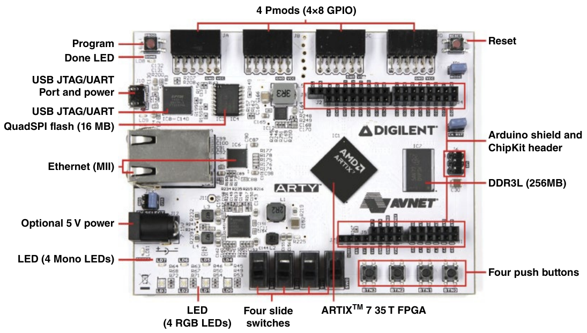

Hình 2.1 Development board Arty A7. Nguồn: Digilent.

Điều chúng ta muốn làm là sau khi tải Vivado HLS 2019.1 về, chúng ta sẽ mở nó lên, và chúng tôi sẽ hướng dẫn bạn qua các bước cần thiết để tạo một project cho buttons và LEDs. Dĩ nhiên, khi bạn mở Vivado, nếu để ý, nếu trước đây bạn đã từng mở các project, bạn sẽ thấy các recent project – đây là tất cả các project khác nhau mà bạn mới mở gần đây. Nó giống như một shortcut nhỏ nhanh gọn tới các project khác nhau mà bạn đã làm trong khoảng một tháng qua. Tiếp theo, từ menu Quick Start, chúng ta muốn click vào Create Project, như được mô tả trong Hình 2.2. Thao tác này sẽ mở New Project Wizard, công cụ sẽ hướng dẫn chúng ta qua mọi thứ cần thiết để tạo project brand-new của mình, như được thể hiện trong Hình 2.3.

Vậy, chúng ta sẽ click vào button Next, và chúng ta muốn đặt tên cho project. Tên có thể là bất cứ gì bạn muốn – chúng ta sẽ gọi nó là Button_LED. Bạn nên đặt một cái tên có ý nghĩa với project bạn đang làm. Sau đó, bạn cần chọn vị trí project và bảo đảm Create project subdirectory được đánh dấu. Ngay bên dưới đó, bạn sẽ thấy vị trí cụ thể nơi project của bạn sẽ được tạo, như được minh họa trong Hình 2.4.

Sau đó, bạn click vào button Next. Bây giờ, chúng ta muốn chọn loại project. Có nhiều loại project khác nhau. Có RTL project, là loại chúng ta sẽ dùng. Bạn cũng có post-synthesis project và I/O planning project. Bạn có thể import một project hoặc tạo một project mới từ ví dụ của Vivado, như được thể hiện trong Hình 2.5.

Tuy nhiên, chúng ta sẽ chọn RTL project cho tất cả các project trong cuốn sách này. Vì vậy, trong cuốn sách này, chúng ta sẽ dùng RTL project. Đây là loại phổ biến nhất – bạn có thể import IP của mình, đặt IP vốn đã là một phần của Vivado, và tạo các VHDL design source của riêng mình, rồi chúng ta sẽ click vào button Next. Thao tác này mở ra một cửa sổ để thêm source, như bạn có thể thấy trong Hình 2.6.

Đây là nơi bạn sẽ chỉ định VHDL hoặc bất kỳ loại design source nào khác. Nếu muốn import chúng, bạn sẽ click vào Add Files, và nó sẽ mở một cửa sổ điều hướng nơi bạn có thể chọn bất kỳ loại design source nào. Nếu xem các loại file mà nó hỗ trợ, có VHDL, Verilog, cũng như các script khác nhau và đủ loại file khác nhau gắn với các project trong Vivado. Tuy nhiên, chúng ta sẽ click Cancel vì sau khi tạo project, chúng tôi sẽ chỉ cho bạn cách tạo một file VHDL brand-new, cũng như cách import các file VHDL. Vậy, hãy click Next. Đây là nơi bạn có thể thêm một constraint file, là nơi bạn định nghĩa các input, output và timing, như được mô tả trong Hình 2.7.

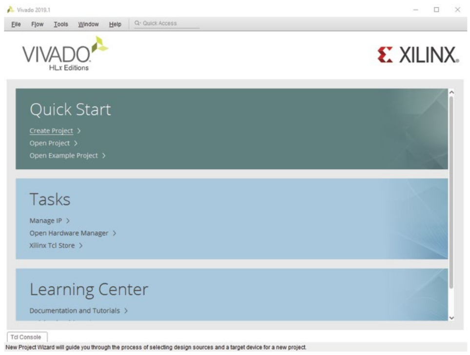

Hình 2.2 Click vào Create Project.

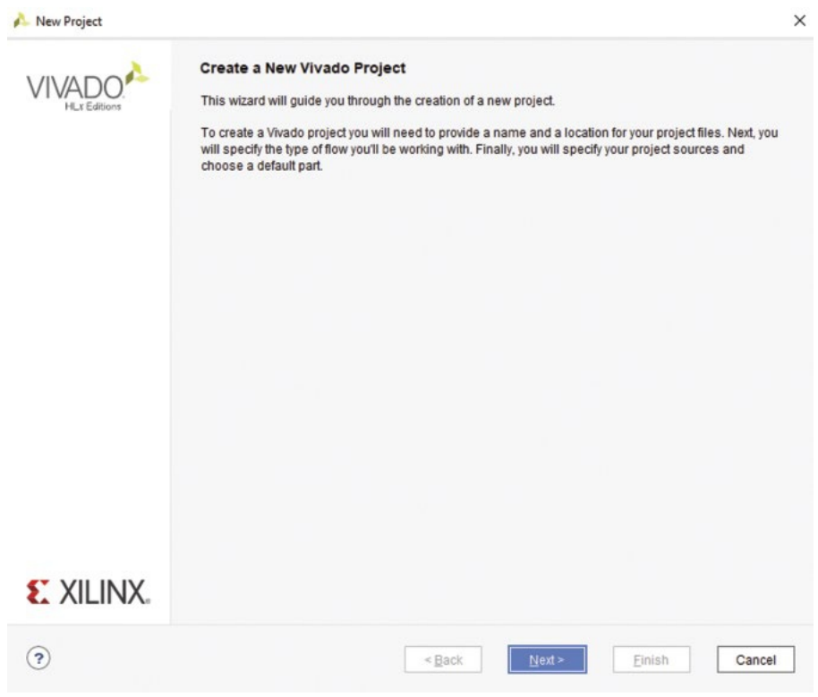

Hình 2.3 New Project wizard.

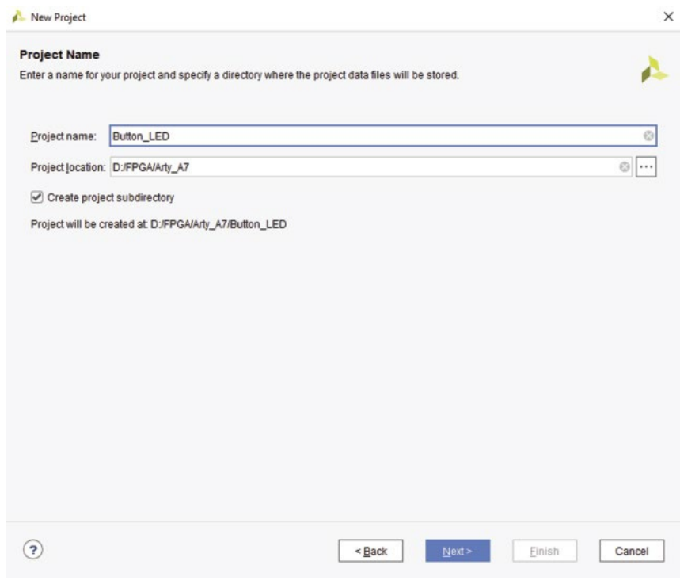

Hình 2.4 Đặt tên cho project.

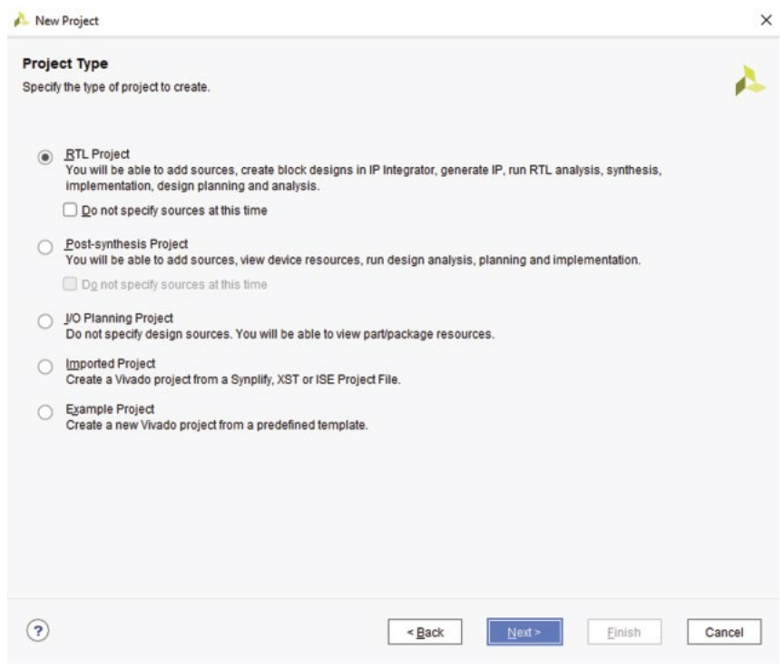

Hình 2.5 Chọn loại project.

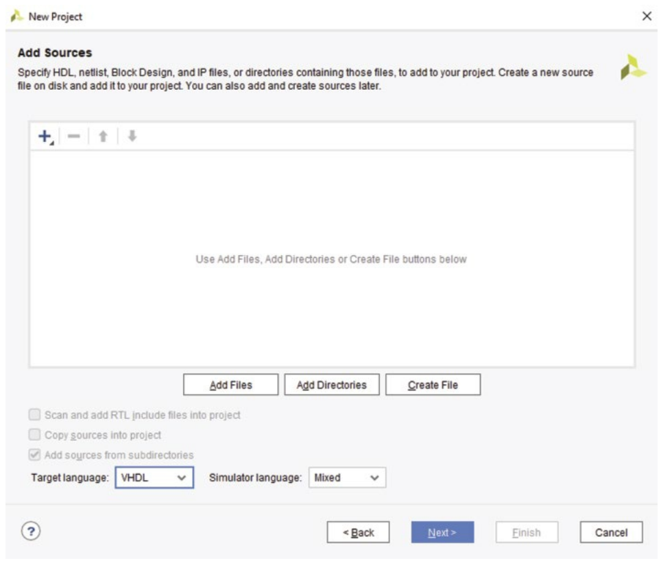

Hình 2.6 Cửa sổ thêm source.

Tuy nhiên, chúng ta sẽ thêm nó sau, và chúng tôi sẽ chỉ cho bạn cách làm điều đó sau khi project được tạo, cũng như cách import constraints file. Nếu bạn đã có sẵn một file và muốn import nó, bạn sẽ click vào Add Files, thao tác này mở ra cửa sổ điều hướng nơi bạn tìm và chọn một constraints file, tức là file .xdc, còn ở đây chúng ta sẽ cancel rồi click vào button Next. Bây giờ, chúng ta cần chỉ định part thực tế mà chúng ta sẽ dùng – đây là con FPGA cụ thể trên development board Arty A7. Nếu click vào đó, bạn sẽ thấy hai tùy chọn khác nhau: Parts hoặc Boards. Nếu click vào Boards, nó hiển thị các board cụ thể mà Vivado hỗ trợ trong bản phát hành cụ thể này. Tuy nhiên, trong trường hợp này, Arty A7 không được hỗ trợ, nên chúng ta phải vào Parts và chọn con FPGA cụ thể. Với Product Category, chúng ta sẽ để là All; với Family, chúng ta cần chọn Artix-7, và với Package, chúng ta chọn csg324. Bạn có thể nhận ra điều này bằng cách xem trên chính board Artix, bạn có thể thấy csg324, hoặc nếu xem trong manual, nó cho bạn biết part number cụ thể mà chúng ta đang tìm, và Speed Grade là −1L, lựa chọn này sẽ lọc các tùy chọn còn lại. Trên Arty A7, chúng ta có một Artix-7 35T, là tùy chọn thứ hai còn lại trong menu Parts. Vì vậy, nếu chọn FPGA đó, nó hiển thị tất cả các thông tin khác nhau của FPGA đó, bao gồm I/O Pin Count, Block RAMs, DSPs, Flip-Flops, gigabit (Gb) transceiver, các I/O block có sẵn, v.v., như được minh họa trong Hình 2.8.

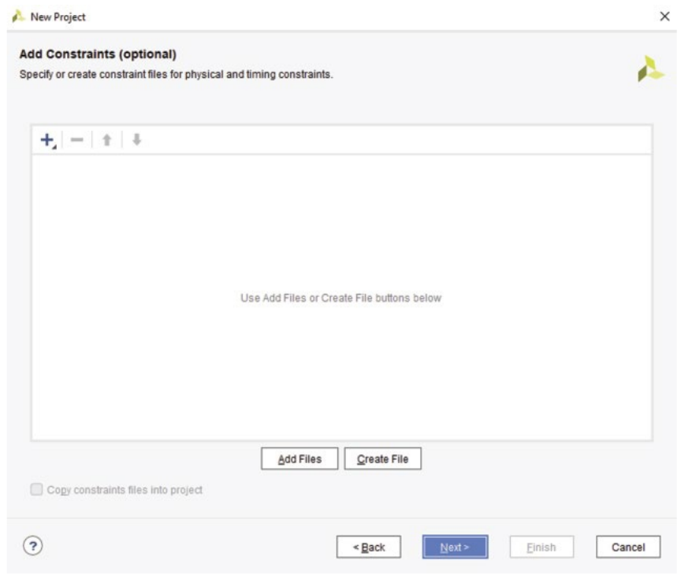

Hình 2.7 Thêm một constraint file.

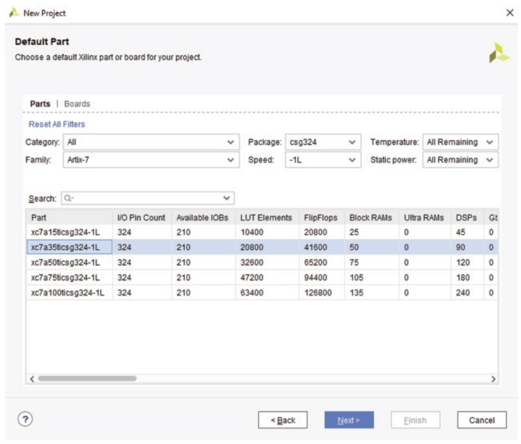

Hình 2.8 Chọn development board Arty A7.

Các phần tử look up table, v.v. Khác biệt lớn giữa các part này là bạn sẽ để ý thấy dòng xc7a bao gồm 15t, 35t, 50t, 75t và 100t. Khác biệt lớn nhất chỉ là số lượng tài nguyên. Con 35t có nhiều hơn con 15t, nhưng ít hơn con 50t, v.v. Ví dụ, bạn có thể thấy DSP, một chỉ số tốt cho thấy FPGA của bạn mạnh đến đâu, có 90 trên Artix-7 loại 35t, nhưng nếu bạn chọn Artix-7 loại 100t, bạn có 240. Nhiều hơn khá nhiều, tuy nhiên nó cũng đắt hơn. Điều này cho bạn một cái nhìn tổng quan nhỏ về số lượng tài nguyên bạn có trên một FPGA cụ thể cho project của mình. Bây giờ, hãy click vào button Next, và thao tác này mở ra New Project Summary, cung cấp cái nhìn tổng quan về project. Chúng ta có một RTL project mới, tên project, và nó đưa ra một cảnh báo nhỏ, nói rằng chúng ta chưa định nghĩa source file nào, và điều đó không sao vì chúng ta sẽ tạo file VHDL thực tế cho project này, như được thể hiện trong Hình 2.9.

Sau đó chúng ta sẽ click vào button Finish, và nó sẽ tạo project tại vị trí chúng ta đã định nghĩa, như được thể hiện trong Hình 2.10. Bạn sẽ để ý thấy rằng trong thư mục Design Sources, chúng ta chưa có file nào, vì vậy chúng ta sẽ cần thêm một file, như được mô tả trong Hình 2.11. Tuy nhiên, khi đi qua các chương, chúng ta sẽ khám phá các thư viện, keyword khác nhau và những thứ khác. Khi đề cập đến các chủ đề này, chúng ta sẽ tạo một file VHDL, hướng dẫn bạn qua quá trình đó, và dùng file đó cho project Button_LED.

Vậy, đó là cách bạn tạo một project bằng Vivado.

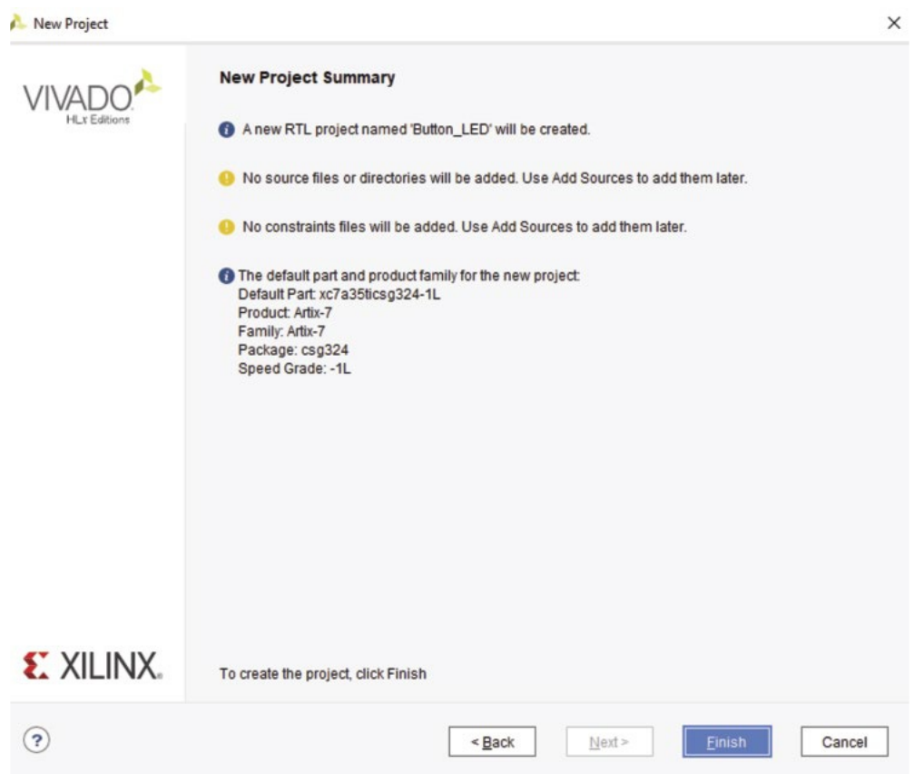

Hình 2.9 Cửa sổ New Project Summary.

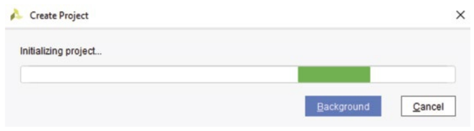

Hình 2.10 Tạo project.

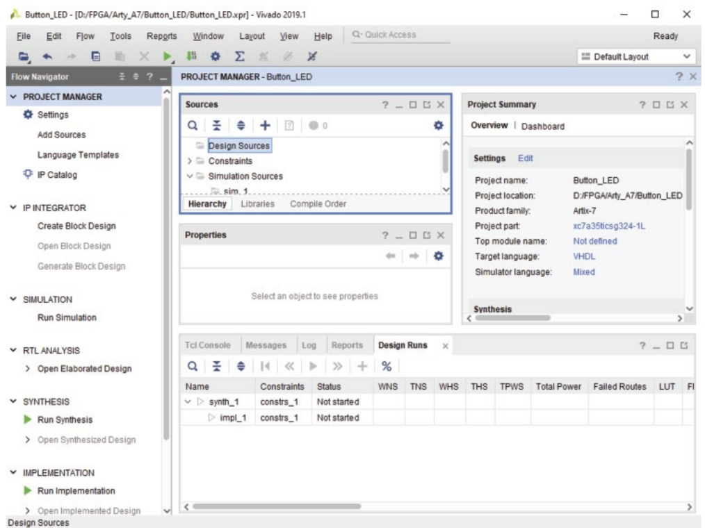

Hình 2.11 Project manager cho project Button_LED.
