# 3 Cấu trúc thiết kế VHDL

## 3.1 Giới thiệu

VHSIC Hardware Description Language (VHDL) là một hardware description language được dùng trong electronic design automation để mô tả hành vi và cấu trúc của các hệ thống điện tử. Cấu trúc thiết kế trong VHDL có tính phân cấp và module hóa, cho phép người thiết kế xây dựng các hệ thống phức tạp bằng cách kết hợp các component nhỏ hơn, có thể tái sử dụng. Các thành phần chính của cấu trúc thiết kế VHDL là entity, architecture, configuration và library/package.

## 3.2 Các keyword của VHDL

Trong mục này, chúng ta sẽ bàn về các keyword và cú pháp của VHDL. Cụ thể, chúng ta sẽ giải thích các cú pháp và keyword VHDL thường dùng. Trong ngôn ngữ VHDL, có rất nhiều keyword và cú pháp khác nhau mà bạn cần để thực hiện những hành động nhất định. Tuy nhiên, chúng ta sẽ chỉ đề cập những cái bạn cần để hoàn thành các project trong cuốn sách này. Keyword đầu tiên chúng ta sẽ đề cập là “comment.” Comment được dùng giống như trong bất kỳ ngôn ngữ lập trình nào khác. Bạn đặt nó trong code thực tế để phần nào dẫn dắt bạn, giải thích điều gì đang xảy ra. Thường thì ở đầu code VHDL, bạn sẽ có một loạt comment giải thích ai đã viết code, phiên bản của nó, hoặc bất kỳ loại ghi chú nào khác. Comment được ký hiệu bằng hai dấu gạch ngang (dash-dash) (--) trong VHDL. Keyword tiếp theo là “library,” được dùng để chỉ định thư viện cụ thể mà bạn sẽ dùng trong VHDL. Các thư viện khác nhau có các package khác nhau, và các package này cung cấp các chức năng khác nhau, chẳng hạn function, data type và các phép toán khác nhau, dù là phép toán logic hay toán học. Nếu bạn là lập trình viên C hoặc lập trình viên kiểu embedded, điều này tương tự một header file hay một file kiểu .h. Chúng ta cũng dùng một keyword được viết đúng như cách đọc của nó, “use,” keyword này làm cho một package có thể được dùng. Như vậy, chúng ta muốn định nghĩa một library và các package mà chúng ta muốn dùng trong library đó, chẳng hạn như code sau.

```
--This is a comment
library IEEE;
use IEEE.STD_LOGIC_1164.all;
```

Keyword tiếp theo là “entity.” Trong VHDL, một entity định nghĩa các input và output của thiết kế. Vì vậy, nếu bạn coi VHDL như một cái vỏ (shell), thì phần bên ngoài đại diện cho entity, còn cấu trúc bên trong được định nghĩa bởi một keyword khác mà chúng ta sẽ đề cập, “architecture.” Như vậy, bạn có entity định nghĩa các input và output, trong khi architecture định nghĩa điều gì đang diễn ra bên trong thiết kế của bạn. Keyword này được định nghĩa bằng cách viết ra “architecture,” chẳng hạn, hãy xem code sau.

```
entity example is
end example
architecture test of example
```

Keyword tiếp theo là “generic,” cho phép bạn truyền một số tham số vào thiết kế mà không thực sự phải định nghĩa chúng là input hay output – đó là một tham số generic. Ví dụ, nếu bạn muốn có một bộ cộng 8-bit, 16-bit, hoặc 32-bit, bạn có thể có một tham số generic mà bạn gọi là kích thước của bộ cộng và gán cho nó một con số, và bạn không phải định nghĩa nó là input hay output; chẳng hạn, hãy xem code sau.

```
entity example is
generic(
);
end example
```

Keyword tiếp theo là “port,” định nghĩa giao diện. Bên trong entity, bạn có một port định nghĩa nó là input (in), output (out), hay input/output (inout), nghĩa là nó có thể là input hoặc output, cho phép dữ liệu được gửi và nhận trên cùng một đường. Keyword tiếp theo là “downto,” được dùng để định nghĩa một phạm vi. Nếu bạn có một data type cụ thể, mà chúng ta sẽ đề cập sau, bạn có thể dùng “downto” để nói rằng, OK, chúng ta có một data type đi từ 31 xuống 0 và nó lấp đầy mọi khoảng ở giữa. Điều đó có nghĩa là bạn có 31, 30, 29, 28, 27 và cứ thế xuống tới 0; chẳng hạn như code sau.

```
entity example is
Port (
     My_input : in std_logic;
     My_Output : out std_logic_vector(31 downto 0);
);
end example
```

Đúng như tên gọi, nếu bạn muốn đi từ 7 xuống 0, hãy dùng keyword “downto”. Các keyword “begin” và “end” được dùng thành một cặp begin–end, xuất hiện gần như khắp nơi trong ngôn ngữ VHDL; khi định nghĩa architecture, bạn dùng một cặp begin–end để chỉ định điểm bắt đầu và kết thúc phần logic của architecture. Tương tự, nếu bạn dùng một if statement, một vòng lặp hoặc bất kỳ loại statement nào khác, bạn sẽ nói, OK, nếu điều này xảy ra lần nữa thì nó sẽ tìm phần end. Như vậy, bạn có cặp begin–end, trái với các ngôn ngữ khác; nếu bạn thường làm việc với C hoặc bất kỳ ngôn ngữ nào khác thuộc loại đó, bạn sẽ có cặp dấu ngoặc nhọn ({}). Thay vào đó, chúng ta có một cặp begin–end trong VHDL. Keyword tiếp theo là “end,” và như đã nói ở trên, bạn có “begin,” và bạn có “end,” và nó chỉ đơn giản chỉ định phần kết thúc của cặp “begin–end”, vốn được dùng theo nhiều cách khác nhau. Keyword tiếp theo ở đây là “map,” được dùng để ánh xạ các tham số. Vì vậy, nếu bạn có nhiều thiết kế bên trong một VHDL, bạn có thể có nhiều file khác nhau, và chúng ta sẽ thực hiện cái mà chúng ta gọi là component instantiation. Đây là nơi bạn ánh xạ một số tham số. Bạn sẽ nói, OK, các input từ một entity top-level được ánh xạ tới các input khác nhau trên các component của tôi, những component mà chúng ta đã instantiate bên trong thiết kế. Chúng ta sẽ đề cập điều này chi tiết hơn nhiều ở phần sau, chỉ cho bạn cách thực hiện component instantiation, cách ánh xạ một số input nhất định tới các input khác của thiết kế khác, và nhiều hơn nữa. Một keyword quan trọng khác là signal assignment, được biểu diễn bằng mũi tên bằng (arrow equals), và nó được gán như một signal assignment. Vì vậy, nếu chúng ta có signal A và signal B, và chúng ta gán A bằng giá trị của B, thì bạn có thể coi nó tương tự như làm việc với một mạch, giống như lấy một sợi dây nối từ A đến B, và B giờ bằng A. Nó giống như nối hai điểm bằng một sợi dây. Do đó, chúng ta đang gán cho signal B giá trị của A, như được thể hiện trong code sau.

```
architecture test of example
begin
-- Put your architecture code/design here
map –- this is used in component instantiations
My_input <= my_Output(1);
A <= B;
end test;
```

Bây giờ, chúng ta sẽ xem project của mình. Chúng ta có project Button_LED, và chúng ta sẽ đi qua và tạo một file VHDL dùng một số keyword để bắt đầu định nghĩa project. Vậy, nếu bạn mở project Button_LED trong Vivado, bạn sẽ phải vào thư mục Design Sources, right click, và chọn tùy chọn Add Sources…, như được thể hiện trong Hình 3.1.

Thao tác này sẽ mở cửa sổ Add Sources, và chúng ta cần bảo đảm đã chọn tùy chọn thứ hai, tùy chọn “Add or create design source”, rồi click Next, như được thể hiện trong Hình 3.2.

Sau đó, trong Hình 3.3, chúng ta cần click vào Create File vì chúng ta sẽ tạo một design file VHDL brand-new. Chúng ta có thể nhấn Add Files và tìm lấy một file VHDL đã tạo trước đó; tuy nhiên, chúng ta sẽ tạo file VHDL mới của riêng mình, vì vậy chúng ta sẽ chọn tùy chọn Create File, như được mô tả trong Hình 3.3.

Trong tùy chọn file type, chúng ta muốn nó là VHDL. Bạn có thể chọn các tùy chọn khác, chẳng hạn Verilog, nhưng chúng ta sẽ chọn VHDL. Chúng ta muốn đặt tên cho file, và chúng ta sẽ gọi nó là BUTTON_LED. Thông thường, tên file không nhất thiết phải trùng với tên entity, nhưng bạn cần đặt một cái tên có ý nghĩa. Vì đây là project Button_LED của chúng ta, chúng ta sẽ gọi nó là BUTTON_LED. Với vị trí file, bạn có thể tạo một vị trí mới, chọn một vị trí có sẵn, hoặc điều hướng tới nơi bạn muốn lưu file đó. Tuy nhiên, chúng tôi luôn thích để chúng nằm cục bộ trong project, như được minh họa trong Hình 3.4.

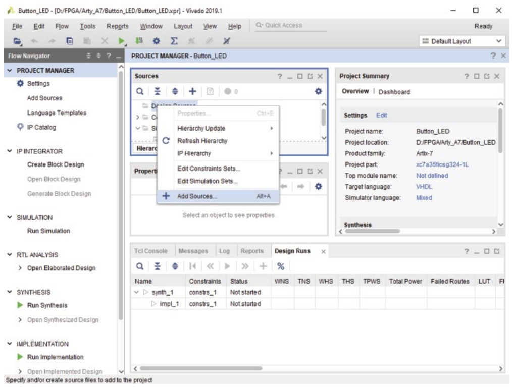

Hình 3.1 Thêm source trong thư mục Design Sources.

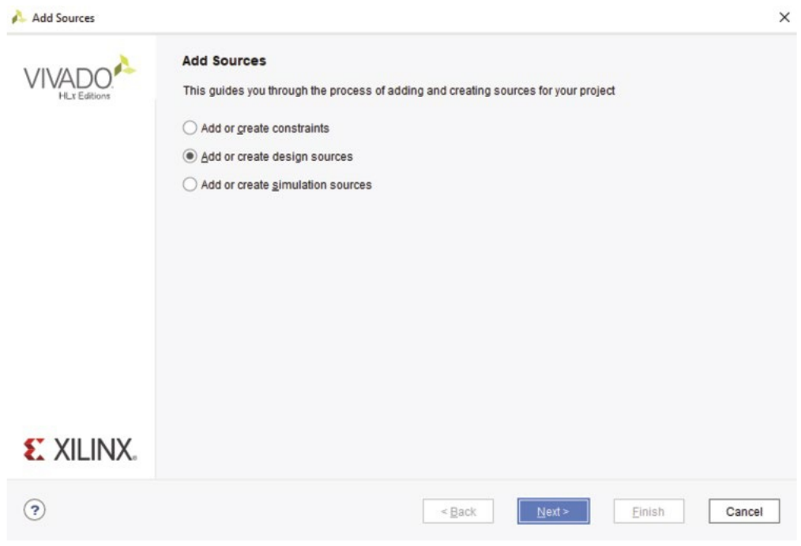

Hình 3.2 Chọn tùy chọn Add or create design sources.

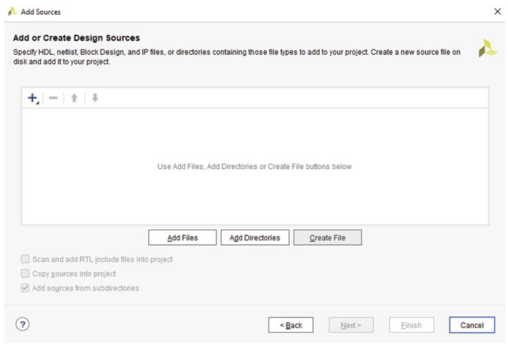

Hình 3.3 Chọn tùy chọn Create File.

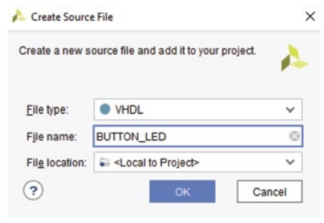

Hình 3.4 Đặt tên file là BUTTON_LED.

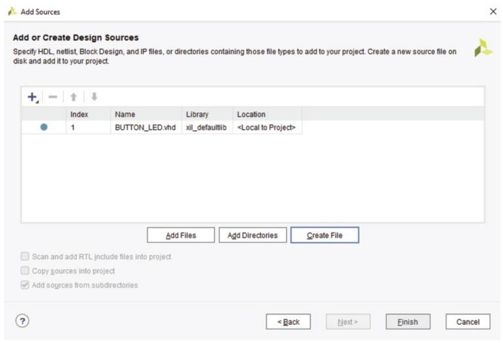

Hình 3.5 Click vào button Finish.

Nhờ vậy, khi bạn tiến hành synthesize và làm mọi việc khác với thiết kế, nó sẽ biết tìm file ở đâu. Vậy, chúng ta sẽ click OK, và điều này chỉ cho biết chúng ta sẽ tạo file BUTTON_LED, rồi chúng ta sẽ click vào button Finish, như được thể hiện trong Hình 3.5. Khi hoàn tất, một pop-up sẽ xuất hiện hỏi, “Do you want to define the module?”

Đây là nơi chúng ta có thể định nghĩa các port cụ thể, chỉ định chúng là input hay output. Tuy nhiên, trong trường hợp này, chúng ta sẽ nhập chúng thủ công sau. Vì vậy, bây giờ chúng ta sẽ click OK và để nguyên như vậy, như được thể hiện trong Hình 3.6.

Khi click vào button OK, cửa sổ Define Module xuất hiện, cho biết định nghĩa module chưa bị thay đổi. Lúc này, chúng ta click Yes, như được mô tả trong Hình 3.7.

Vậy, nếu nhìn vào file BUTTON_LED, nó ghi là behavioral vì đó là architecture của chúng ta, thứ chúng ta sẽ đề cập sau. Nhưng bây giờ, chúng ta double-click vào file BUTTON_LED. Thao tác này sẽ mở file BUTTON_LED thực tế, như được thể hiện trong Hình 3.8. Trong hình này, bạn có thể thấy đã có sẵn một số cú pháp được cung cấp để định nghĩa và đưa cho bạn kiểu mô tả top-level này, và bạn có thể thấy các keyword chúng ta có là các comment.

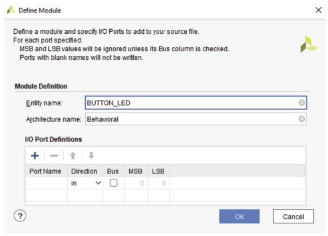

Hình 3.6 Click vào button OK.

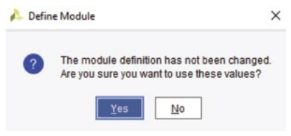

Hình 3.7 Click vào button Yes.

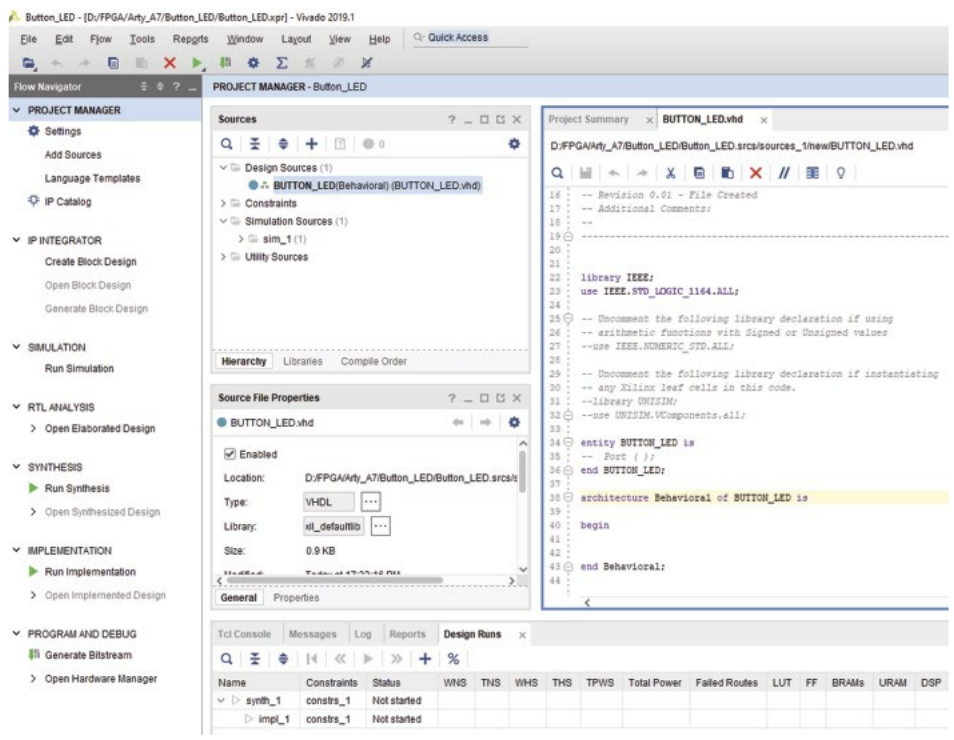

Hình 3.8 Mở file BUTTON_LED thực tế.

Chúng ta có library này, thứ cho chúng ta thư viện IEEE, và chúng ta đang dùng package IEEE standard logic 1164. Nó cho chúng ta một entity tên BUTTON_LED. Chúng ta phải định nghĩa port – các input và output là gì. Sau đó nó cũng định nghĩa architecture cho chúng ta. Vậy, nó cho chúng ta architecture, mà chúng ta gọi là behavioral cho BUTTON_LED, rồi nó ghi begin và end behavioral. Như vậy, đây chỉ là cái vỏ sơ bộ của entity và architecture cho file BUTTON_LED, và đó chỉ là phần điểm qua hay tóm tắt các keyword bạn sẽ thấy trong VHDL. Như bạn có thể thấy, khi tạo file này trong Vivado, bạn có thể thấy rất nhiều keyword trong số này.

## 3.3 Các library của VHDL

Mục này nói về các package và library của VHDL. Trong mục này, chúng tôi sẽ cho bạn biết về một số package hoặc những package được dùng phổ biến nhất trong thư viện IEEE. IEEE là viết tắt của Institute of Electronics and Electrical Engineers, và họ là những người quản lý các package mà chúng ta sẽ dùng trong project, trong từng ngôn ngữ, hoặc trong thư viện IEEE. Có khá nhiều package khác nhau, nhưng chúng ta sẽ đề cập những package phổ biến nhất, cụ thể là những package bạn sẽ cần để hoàn thành tất cả các project trong cuốn sách này. Các library hay package này bao gồm IEEE standard logic 1164, IEEE math real và IEEE numeric standard. Với cái đầu tiên, IEEE 1164, nó có một số tính năng chính. Chúng ta sẽ điểm qua một số tính năng chính của từng library, rồi chúng tôi sẽ chỉ cho bạn nơi để xem toàn bộ các định nghĩa và code thực tế đằng sau library. Các phép toán logic được hỗ trợ trong library standard logic 1164 bao gồm AND, OR, NAND, NOR và tất cả các phép toán cổng logic cơ bản. Vì vậy, dùng package này cho phép chúng ta thực hiện tất cả các phép đại số Boolean cơ bản và các phép toán logic khác nhau. Các data type mà nó hỗ trợ là standard logic và standard logic vector. Đây là những data type phổ biến và cơ bản nhất được dùng trong VHDL, mà chúng ta sẽ đề cập sau trong mục data type. Tính năng quan trọng thứ ba của library standard logic 1164 là các function mà nó hỗ trợ, chẳng hạn rising edge và falling edge. Các function này hoạt động khi bạn có một process. Bạn sẽ dùng function rising edge để kích hoạt process đó ở cạnh lên của một signal, và ngược lại, với function falling edge, khi bạn có một process và gọi falling edge, bạn sẽ kích hoạt process đó ở cạnh xuống của signal đó. Library tiếp theo mà chúng ta sẽ nói qua một chút là library IEEE math real. Một số tính năng chính của library là về cơ bản nó hỗ trợ một số hằng số và phép toán toán học. Chúng ta sẽ không dùng nhiều đến library math real, nhưng các function chủ yếu mà chúng ta sẽ dùng từ đây là function ceiling và function floor. Với function ceiling, bạn đưa cho nó một số, và nó đưa bạn tới số nguyên gần nhất biểu diễn số đó. Function floor làm điều ngược lại: bạn đưa cho nó một số, và nó sẽ cho bạn số nguyên thấp nhất dùng để biểu diễn số đó. Trong library math real, hai loại được hỗ trợ là integer và real, trong đó real là các số floating-point. Tuy nhiên, nếu bạn dùng library math real này, bạn không thể dùng các data type real khi muốn synthesize thiết kế trên FPGA. Vì vậy, khi dùng nó, bạn có thể dùng cho mục đích simulation. Ví dụ, nếu bạn muốn mô phỏng và có một giá trị π, nó sẽ biểu diễn giá trị π được cho dưới dạng một hằng số. Nhưng bạn không thể thực sự synthesize điều đó trong thiết kế. Vì vậy, trong tất cả các thiết kế chúng ta dùng, các function duy nhất chúng ta thực sự dùng từ library này là ceiling và floor. Library hay package tiếp theo mà chúng ta có là numeric standard. Một số tính năng chính của library này là nó hỗ trợ các phép toán logic như lớn hơn, nhỏ hơn, và lớn hơn hoặc bằng. Các data type là unsigned và signed, đây là điểm then chốt. Data type unsigned rất giống standard logic vector, ngoại trừ việc nó cho bạn khả năng thực hiện các phép toán khác nhau, chẳng hạn cộng, trừ, nhân và chia. Bạn vẫn có thể truy cập dữ liệu ở mức bit. Data type signed cho phép bạn biểu diễn số âm. Vì vậy, nếu bạn làm một thứ như counter, bạn có thể đếm từ không và đi xuống âm hoặc đếm lên. Đó là tính năng chính của library numeric standard. Bây giờ, chúng tôi sẽ chỉ cho bạn nơi để tìm thêm các library trên máy tính, và cũng xem kỹ hơn để hiểu mỗi library này cung cấp những gì ở mức chi tiết hơn. Đầu tiên, chúng ta sẽ xem library standard logic 1164, và bạn có thể tìm thấy nó trên website https://standards.ieee. org/downloads/1076/1076.2-1996/std_logic_1164.vhdl. Trong đó, bạn sẽ tìm thấy rất nhiều library hay package khác nhau trong thư viện IEEE mà bạn có thể dùng cho các thiết kế VHDL của mình. Tuy nhiên, như đã đề cập, ba cái này là phổ biến nhất mà chúng ta sẽ dùng. Nhưng nếu truy cập website, bạn sẽ tìm thấy thông tin cần thiết. Khi chúng ta nói sẽ dùng package standard object 1164, nó cho chúng ta biết các data type khác nhau mà chúng ta có. Ở đây, họ đưa cho bạn standard ulogic, giống với standard logic ngoại trừ việc standard logic là một data type resolved. Vì vậy, nếu bạn có nhiều driver trên standard logic, bạn có thể resolve nó thành một giá trị duy nhất, và điều này có nghĩa là, chẳng hạn, trong standard ulogic, chúng ta có nhiều giá trị mà nó có thể nhận. Nó có thể là U, nghĩa là uninitialized. Bạn có thể có X, đại diện cho một giá trị unknown, hoặc logic 0; 1, đại diện cho logic 1; và Z, chỉ high impedance. Ngoài ra, W là weak unknown, L là weak 0, và H là weak 1 – các giá trị này tương tự các mức logic tri-state. Như vậy, bạn có weak 1 hoặc weak 0 và dấu gạch ngang là don’t care, như được minh họa trong Hình 3.9.

Vậy, nếu bạn có một standard ulogic, và nhiều signal cùng drive một output, chẳng hạn, nếu bạn có một signal drive mức không và signal kia drive mức weak high, thì với standard ulogic, nếu bạn dùng Vivado hoặc bất kỳ công cụ thiết kế nào, nó sẽ báo lỗi cho biết bạn có nhiều driver cho signal đó. Còn nếu bạn dùng standard logic, nó sẽ resolve thành một giá trị cụ thể. Ví dụ, nếu bạn ép nó lên 1 và bạn có một weak 0, thì 1 rất có thể sẽ thắng, và signal sẽ bị ép về giá trị đó. Nếu tiếp tục xuống dưới, nó cho bạn thêm một số chi tiết ở đây. Nó đi qua các function, và bạn có thể theo dõi tất cả từ đầu đến cuối, nhưng chúng ta sẽ chỉ lướt qua và chỉ ra những phần quan trọng của file khi bạn xem package, cố gắng xem xét nó và xác định xem bạn có cần nó cho thiết kế hay không. Họ cho bạn các subtype, và điều này cho bạn biết giá trị sẽ được resolve thành gì. Trong trường hợp này, rõ ràng bạn có thể thấy chúng ta có data type standard logic, cũng như standard logic vector, là một mảng các standard logic, như được thể hiện trong Hình 3.10.

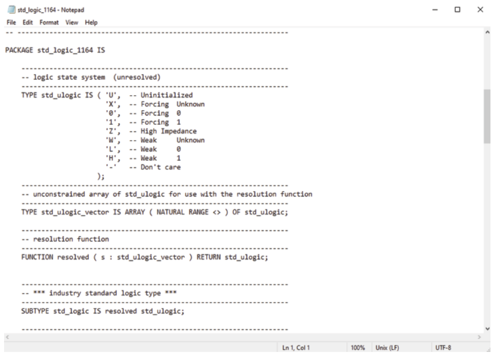

Hình 3.9 Các data type standard ulogic.

Rồi ở đây chúng ta có các phép toán logic mà nó hỗ trợ: “and,” “nand,” và cứ thế xuống tới “xor,” “xnor,” và “not” hay inverter. Ngoài ra, họ cho chúng ta một số function chuyển đổi, vì vậy nếu bạn muốn chuyển sang bit vector hoặc sang standard ulogic, nó cho bạn các function cần gọi để thực hiện các loại chuyển đổi này, như được thể hiện trong Hình 3.11.

Ngoài ra, họ cho bạn các function ở tận cuối, nơi chúng ta có các function phát hiện cạnh, bao gồm rising edge và falling edge, như được thể hiện trong Hình 3.12.

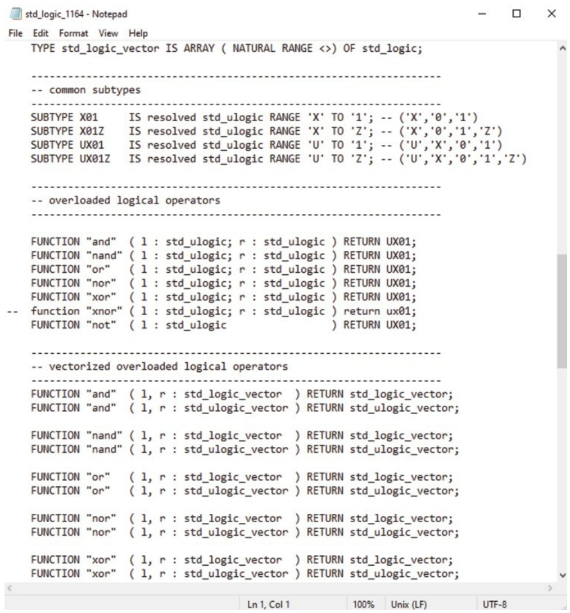

Hình 3.10 Subtype và các data type của function.

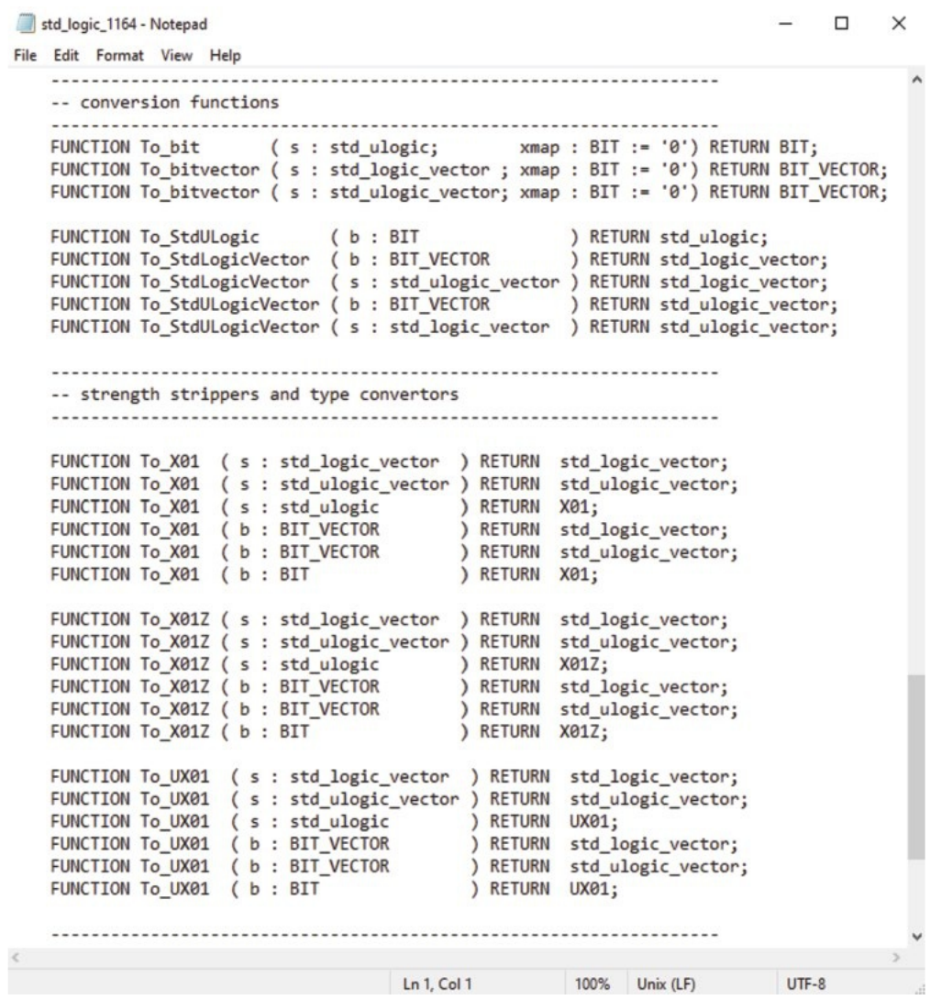

Hình 3.11 Một số function chuyển đổi.

Đây là những function thường dùng trong các thiết kế của chúng ta. Package tiếp theo chúng ta sẽ xem là file IEEE math_real. Nó cho chúng ta một số định nghĩa hằng số, chẳng hạn hằng số toán học MATH_E và hằng số toán học MATH_PI. Bạn không thể dùng “REAL” để synthesis trong FPGA vì nó không phải là một data type có thể synthesize được, như được thể hiện trong Hình 3.13.

Vì vậy, chúng thường được dùng nhất khi bạn muốn mô phỏng một mạch. Bạn sẽ có thể làm điều đó, và đó là lý do nhiều hằng số trong số này sẽ phát huy tác dụng. Việc phổ biến nhất mà chúng ta sẽ dùng library này là các function cụ thể như function ceiling và floor. Function ceiling trả về giá trị nguyên nhỏ nhất dưới dạng một số real, không nhỏ hơn X, như được thể hiện trong Hình 3.14.

Vậy, điều chính chúng ta sẽ làm ở đây là đưa cho nó một giá trị, và nó sẽ trả về giá trị nguyên nhỏ nhất để biểu diễn giá trị đó. Và đó là điểm mấu chốt vì một integer có thể được synthesize bên trong FPGA, nên chúng ta có thể dùng function “ceil.” Bây giờ, xét function “floor,” trả về giá trị nguyên lớn nhất không lớn hơn X. Nếu nhìn vào function “round,” nó làm tròn giá trị tới số nguyên gần nhất. Miễn là nó trả về một integer, chúng ta có thể dùng nó, nhưng nếu nó trả về một số real, thì không thể. Library tiếp theo trong package mà chúng ta sẽ xem là numeric standard, và điểm chính của numeric standard là các data type mà họ định nghĩa, chẳng hạn unsigned và signed, và sau đó chúng ta cũng có các phép toán khác nhau mà họ hỗ trợ, chẳng hạn giá trị tuyệt đối, phép trừ, phép cộng, lại phép trừ, phép nhân, phép chia, cũng như phép lấy dư, phép dịch và modulus, như được thể hiện trong Hình 3.15.

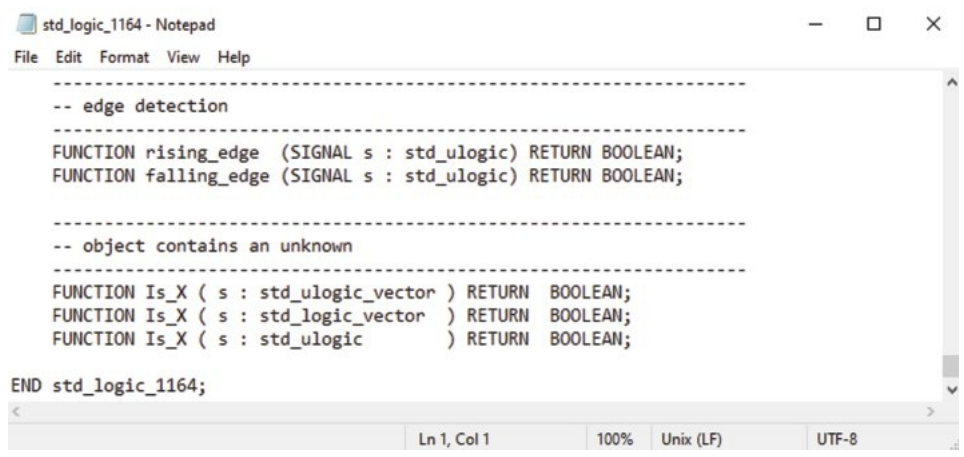

Hình 3.12 Các function phát hiện cạnh.

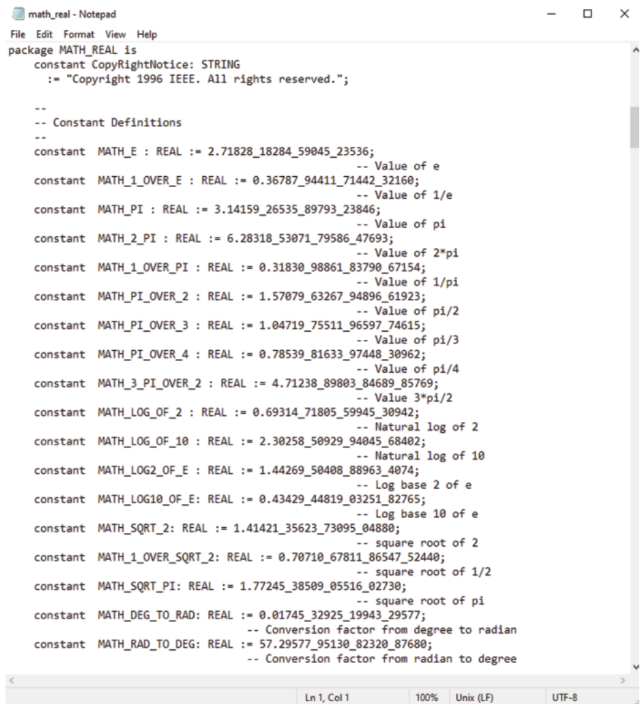

Hình 3.13 Một số định nghĩa hằng số.

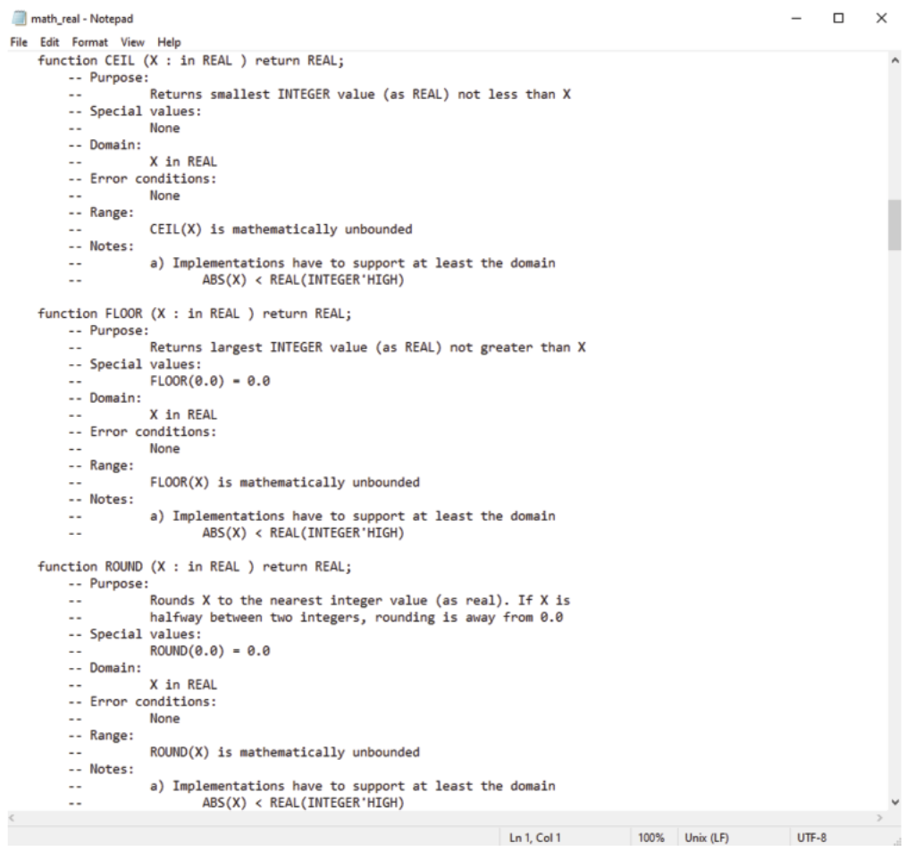

Hình 3.14 Dùng library cho các function cụ thể.

Vậy, điều này cho bạn khả năng kiểm tra xem một signal có lớn hơn signal kế tiếp hay không, điều này quan trọng tùy thuộc vào thiết kế và việc bạn đang làm. Nếu bạn chỉ có standard logic, chẳng hạn nếu bạn chỉ dùng library standard logic 1164, bạn không thể thực hiện phép so sánh lớn hơn hay phép cộng. Vì vậy, nếu muốn thực hiện phép cộng hoặc phép toán kiểu lớn hơn, bạn cần dùng package numeric standard để có thể định nghĩa một data type unsigned và thực hiện phép cộng, phép nhân hoặc bất kỳ loại phép toán số học nào khác mà bạn muốn. Bây giờ, hãy xem project của chúng ta; chẳng hạn ở đây trong Vivado, hãy để ý rằng chúng ta có keyword library, IEEE. Đây là library chúng ta đang dùng, và với project Button_LED, chúng ta chỉ dùng package by IEEE. STD_LOGIC_1164.ALL. Điều này cho chúng ta khả năng tạo các data type standard logic và standard logic vector.

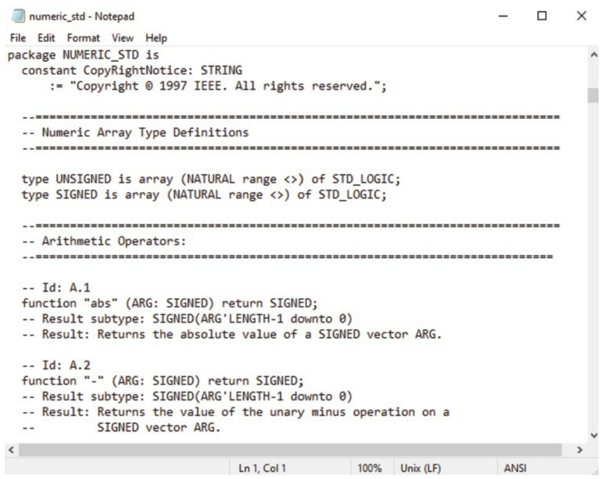

Hình 3.15 Các data type numeric standard.

## 3.4 Entity và architecture trong VHDL

Mục này nói về entity và architecture trong VHDL. Ở đây, chúng ta sẽ giải thích entity và architecture của VHDL là gì. Mỗi thiết kế VHDL cần một entity và một architecture. Ở mức tổng quát, entity định nghĩa cấu trúc tổng thể của thiết kế, bao gồm các input và output của nó. Vì vậy, khi bạn có một thiết kế, bạn có thể nghĩ xem các input và output là gì?

Entity định nghĩa các input và output này. Bên trong entity, bạn định nghĩa nó là input, output hay hai chiều (bidirectional). Đây là ba loại mode. Bạn có thể có input/output hoặc “inout,” là một loại signal hai chiều cho entity của bạn. Khi bạn định nghĩa entity, nó được cấu trúc như sau: bạn có tên, hướng (có thể là “in,” “out,” hoặc “inout”), data type, và tùy chọn, bạn có thể định nghĩa giá trị khởi tạo. Ví dụ, nếu bạn có một output, bạn sẽ định nghĩa tên của nó là C, đặt nó là output, chỉ định data type (mà chúng ta sẽ gọi là standard logic), và cho nó một giá trị khởi tạo, chẳng hạn không (mức logic thấp hay false). Bây giờ, hãy xem ví dụ về entity. Chúng ta sẽ bắt đầu với một ví dụ rất cơ bản là cổng “AND”. Vậy, nếu chúng ta có một cổng “AND”, chúng ta có hai input, A và B, và một output, mà chúng ta sẽ gọi là C. Cổng “AND” đơn giản này có thể được biểu diễn trong VHDL, như được thể hiện trong Hình 3.16.

Entity của chúng ta là các input và output. Vậy, chúng ta biết rằng chúng ta có các input, là A và B, và output, là C, được định nghĩa trong entity. Đây là những gì chúng ta muốn định nghĩa bên trong entity, và làm điều đó như thế nào? Chúng ta sẽ dùng keyword “entity” như được thể hiện trong code sau.

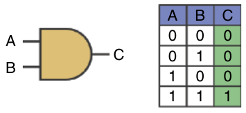

Hình 3.16 Một cổng “AND” rất đơn giản.

```
entity AND_GATE is
Port(
     A : in std_logic;
     B : in std_logic;
     C : out std_logic);
end AND_GATE;
```

Vậy, entity này định nghĩa các input và output của thiết kế. Với input, chúng ta biết có A và B; với output, chúng ta có C. Data type cho chúng ta biết là bit, nên chúng ta biết có hai bit đi vào A và B và một bit đi ra ở C. Phần tiếp theo chúng ta muốn nói đến là architecture của một thiết kế. Trong VHDL, architecture định nghĩa cách thiết kế hoạt động. Vì vậy, trong khi entity định nghĩa các input và output, architecture sẽ định nghĩa và giải thích cách nó thực sự hoạt động. Trong trường hợp cổng AND mà chúng ta đã dùng, chúng ta biết có hai input A và B, và architecture sẽ cho chúng ta biết phải AND logic các input đó để cho ra output C. Ví dụ, trong project Button_LED, architecture sẽ định nghĩa việc nhấn một button, tức là input, điều khiển các LED, tức là output, như thế nào, trong đó architecture cần định nghĩa chúng ta sẽ xử lý các input như thế nào để xác định các output. Vì chúng ta còn có một switch hoặc enable hoặc disable các LED khi button được nhấn, đó là loại việc sẽ diễn ra bên trong architecture. Vậy, giả sử bạn có một thiết kế VHDL rất phức tạp. Gần như toàn bộ code VHDL của bạn sẽ nằm bên trong architecture đó. Đây là nơi chứa logic cốt lõi của thiết kế. Bây giờ, hãy nhìn lại ví dụ cổng AND và định nghĩa architecture của nó. Để làm điều này, chúng ta dùng keyword “architecture,” như được thể hiện trong code sau.

```
Architecture behave of AND_GATE is
begin
    C <= A AND B;
end behave;
```

Vậy, ở đây về cơ bản chúng ta có toàn bộ, gồm entity và architecture của thiết kế cổng AND. Chúng ta có cổng AND, được định nghĩa qua entity, cho biết A và B là input, và C là output. Chúng ta có architecture, định nghĩa chính cổng AND thực tế. Như vậy, entity định nghĩa các input và output, còn architecture nằm bên trong thiết kế, mô tả điều gì thực sự đang xảy ra. Tiếp theo, hãy mở project Button_LED trên máy tính của bạn. Chúng ta sẽ xem xét và thấy rằng chúng ta có entity cho thiết kế, là một entity đã được định nghĩa, và chúng ta đã đặt tên nó là BUTTON_LED. Điều chúng ta muốn làm là bỏ comment phần code port, vì chúng ta cần định nghĩa các port cho thiết kế. Chúng ta sẽ có cái mà chúng ta gọi là Led_Out, vì vậy chúng ta sẽ dùng keyword “out” và chỉ định rằng nó là một output. Sau đó, chúng ta sẽ phải cho nó một data type, và khi đến mục data type, chúng ta sẽ quyết định data type nào hợp lý nhất. Keyword hay entity tiếp theo mà chúng ta muốn mô tả là input. Chúng ta biết mình có một button, vì vậy Button_In sẽ là input, và nó sẽ có kiểu “in”. Đây sẽ là một input. Chúng ta biết mình có một output, là Led_Out, và chúng ta có hai input: Button_In và Enable. Đây là thứ sẽ enable hoặc disable output của các LED, và nó cũng sẽ là input. Lúc này, chúng ta có một số đường gợn sóng cho biết entity của chúng ta chưa được định nghĩa đúng, và đó là vì chúng ta chưa định nghĩa data type. Chúng ta sẽ đến phần đó khi đề cập các data type. Chúng ta sẽ định nghĩa data type cho Led_Out, Button_In và Enable. Điều này định nghĩa entity tới mức chúng ta cần, cũng như hướng của các signal. Với architecture, nó cho chúng ta một architecture tên “Behavioral” của BUTTON_LED, và sau đó nó cho chúng ta “begin” và “end Behavioral.” Ở giữa, chúng ta thêm phần thiết kế thực tế, nơi chúng ta lấy Button_In và Enable và định nghĩa Led_Out phải là gì dựa trên hai input này. Khi đề cập mục đó, chúng ta sẽ đặt nó ở đó trong architecture của thiết kế, như được thể hiện trong Hình 3.17.

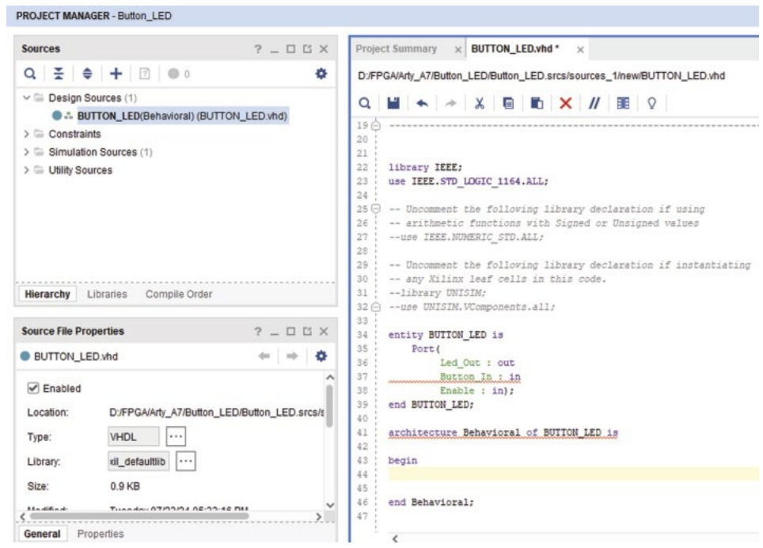

Hình 3.17 Thêm Port vào entity “BUTTON_LED.”

Như vậy, đó là phần đề cập entity và architecture trong cuốn sách này.

## 3.5 Generic trong VHDL

Mục này nói về generic trong VHDL, và chúng ta sẽ giải thích một VHDL generic là gì và chúng ta có thể dùng chúng trong thiết kế như thế nào. VHDL generic cung cấp một cách truyền thông tin vào một entity từ bên ngoài. Bên trong một entity, chúng ta có các input và output. Tuy nhiên, với một generic, bạn không phải định nghĩa nó là input hay output; bạn có thể coi generic như một hằng số. Bạn có thể áp dụng nó từ bên ngoài, đây là một lợi ích rất lớn ở chỗ nó cho phép bạn tùy biến thiết kế theo cách mà bạn có thể sửa một dòng code hay về cơ bản là một giá trị trong generic để thay đổi thiết kế. Chúng ta sẽ dùng generic xuyên suốt các thiết kế, và trong bất kỳ thiết kế tương lai nào bạn làm, rất có thể bạn sẽ dùng chúng. Chúng là một công cụ rất mạnh theo nghĩa cho phép bạn sửa đổi thiết kế hoặc định nghĩa nó *(ghi chú: sách in "defiant"; đúng là "define it")* theo cách rất dễ tùy biến. Ví dụ, hãy xem cách tạo một generic *(ghi chú: sách in "what’s taken and generate a generic", câu bị lỗi chép)*. Nếu chúng ta muốn một thiết kế hiện thực một cổng AND, nhưng có ba input ở mỗi bên, tức là tổng cộng sáu input, chúng ta sẽ định nghĩa hai signal A và B, mỗi signal có ba input. Sau đó chúng ta muốn kết hợp tất cả chúng vào cổng AND, cổng này sẽ cho ra một output duy nhất, như được minh họa trong Hình 3.18.

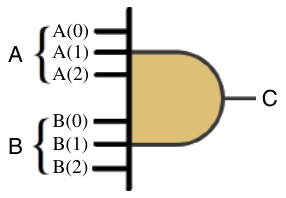

Hình 3.18 Cổng AND six-input.

Vậy, chúng ta sẽ lấy ba input phía trên làm signal A, và ba input phía dưới làm signal B, với C là output. Để định nghĩa điều này, trước hết chúng ta cần bảo đảm định nghĩa generic và entity, cũng như architecture, như được thể hiện trong code sau.

```
entity Example is
Generic(
    Bits : integer := 3);
Port(
     A : in std_logic_vector(Bits-1 downto 0);
     B : in std_logic_vector(Bits-1 downto 0);
     C : out std_logic);
end Example;
architecture behave Example is
begin
   C <= A AND B;
end behave;
```

Code này định nghĩa cổng AND sau, trong đó chúng ta có tổng cộng sáu input: A và B. A có ba input và B có ba input. Bây giờ, nếu chúng ta muốn biến nó thành cổng AND four-input hoặc five-input, thay vì phải sửa bất kỳ đoạn code nào khác, tất cả những gì chúng ta phải làm là thay đổi giá trị generic này. Chúng ta có thể tham chiếu Bits xuyên suốt thiết kế – ví dụ ở đây là trong port – để định nghĩa số lượng input chúng ta có, điều này rất mạnh vì nếu không, khi muốn sửa thiết kế này, chúng ta sẽ phải vào tận port thực tế và sửa ở đây. Điều còn mạnh hơn nữa là khi chúng ta làm những việc như component instantiation, chúng ta có thể truyền generic này vào thiết kế. Bits đến từ một thiết kế higher-level và truyền xuống dần, vì vậy bạn thậm chí không phải sửa đổi gì đối với thiết kế cụ thể này. Đây là một ví dụ về việc dùng generic, và điểm mấu chốt cần lưu ý là chỉ cần thay đổi một dòng này, giá trị generic là 3 này, bạn có thể thay đổi độ rộng input của các signal A và B. Điều này giúp mọi thứ dễ dàng hơn rất nhiều. Trong trường hợp này, đây là một thiết kế rất đơn giản, nhưng khi bạn làm việc với các thiết kế phức tạp có nhiều thứ diễn ra, bạn có thể có nhiều hơn một generic – bạn có thể có hai, ba, bốn hoặc năm. Trong số các generic hiện có, bạn chỉ cần thay đổi ba, bốn hoặc năm giá trị đó và nó thay đổi cách thiết kế của bạn hoạt động. Rất nhiều khi, những thứ phổ biến nhất bạn sẽ thấy trong generic là, chẳng hạn, như Bits. Nếu bạn làm việc với các thiết kế khác nhau, chẳng hạn bus width (số bit dữ liệu được truyền), số bit địa chỉ, clock rate, hoặc output clock rate mong muốn. Vậy, có rất nhiều thứ bạn có thể định nghĩa dưới dạng generic, nhưng đó là một công cụ rất mạnh và là thứ chắc chắn bạn sẽ dùng nhiều khi làm việc với các thiết kế khác nhau trong VHDL. Vậy bây giờ, điều chúng ta muốn làm là mở thiết kế Button_ LED của bạn, và ở đây, chúng ta muốn có một generic mà chúng ta sẽ dùng. Generic mà chúng ta sẽ có sẽ định nghĩa số lượng button chúng ta có, vì với mỗi button, chúng ta muốn có một LED tương ứng với button đó. Vì vậy, thay vì phải thay đổi thủ công về mặt vật lý, chúng ta sẽ dùng một generic. Để làm điều đó, chúng ta phải định nghĩa generic trước khi định nghĩa port, như được thể hiện trong Hình 3.19.

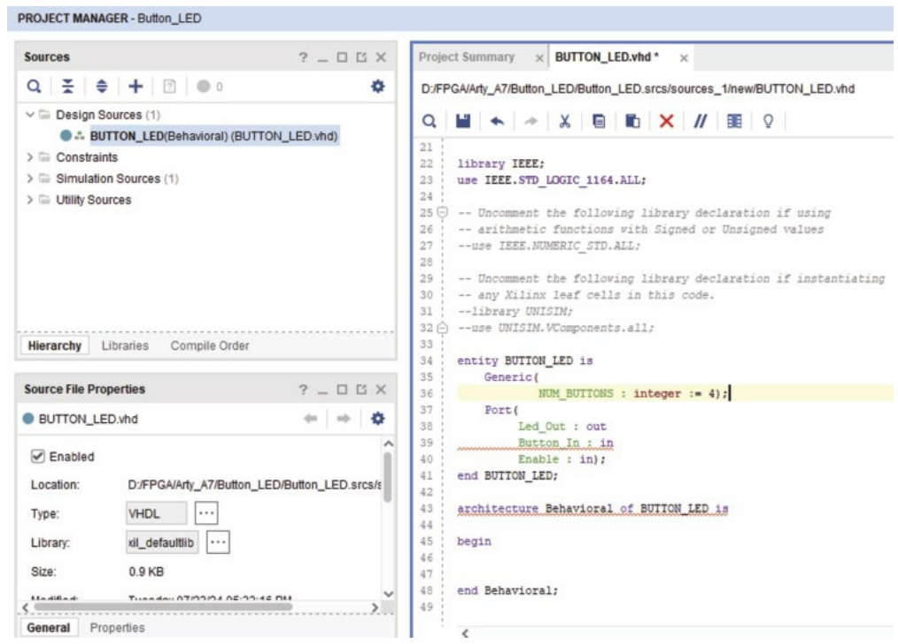

Hình 3.19 Định nghĩa generic “NUM_BUTTONS.”

Trong cuốn sách này, chúng ta làm việc với development board Arty A7, board này có bốn button. Vì vậy, chúng ta sẽ cho nó giá trị 4, và như vậy generic đã được định nghĩa. Bây giờ chúng ta có thể dùng generic NUM_BUTTONS này trong port cũng như trong architecture của thiết kế này. Ở bất kỳ đâu NUM_BUTTONS xuất hiện, nó sẽ được thay bằng giá trị integer là 4, và đó là phần giải thích về generic trong VHDL.
