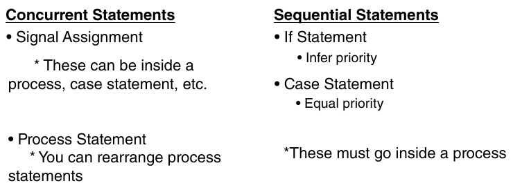

# 4 Các statement và data type của VHDL

## 4.1 Giới thiệu

VHSIC Hardware Description Language (VHDL) được dùng để mô tả các hệ thống số và mixed-signal như field-programmable gate array (FPGA) và ASIC. Dưới đây là tổng quan ngắn gọn về các statement và data type của nó:

Các statement của VHDL bao gồm những mục sau.

1. Entity Declaration: Định nghĩa tên của module và giao diện của nó (các input và output).

```
      entity ModuleName is
          port (
              input1: in std_logic;
              output1: out std_logic
          );
      end ModuleName;
```

2. Architecture Declaration: Mô tả phần hiện thực bên trong của entity.

```
      architecture Behavioral of ModuleName is
          begin
              -- Implementation
      end Behavioral;
```

3. Process Statement: Mô tả hành vi tuần tự. Nó có thể bao gồm signal, variable và các statement như if-else, case, vòng lặp, v.v.

```
      process (clk)
          begin
              if rising_edge(clk) then
                -- Sequential logic
              end if;
      end process;
```

4. Concurrent Statements: Các statement này thực thi đồng thời và bao gồm component instantiation, signal assignment và concurrent procedure call.

```
      output1 <= input1 and input2;
```

5. Component Instantiation: Bao gồm các instance của những module khác bên trong một architecture.

```
      U1: ModuleName port map (
          input1 => signal1,
          output1 => signal2
      );
```

Các data type của VHDL bao gồm những mục sau.

1. Scalar Types (kiểu vô hướng):

• bit: Biểu diễn các giá trị nhị phân (“0”, “1”).

• boolean: Biểu diễn các giá trị logic (‘true’, ‘false’).

• integer: Biểu diễn các số nguyên.

• real: Biểu diễn các số floating-point.

2. Composite Types (kiểu phức hợp):

• array: Biểu diễn tập hợp các phần tử cùng kiểu. type bit_vector is array (0 to 7) of bit;

• record: Biểu diễn tập hợp các phần tử khác kiểu.

```
        type Employee is record
             ID: integer;
             Name: string;
             Salary: real;
        end record;
```

3. Access Types: Con trỏ tới các object được cấp phát động.

4. File Types: Handle cho các thao tác input và output với file.

Các data type chuẩn thường dùng bao gồm những mục sau.

• std_logic: Biểu diễn một kiểu logic multi-valued với các giá trị như “0”, “1”, “Z” (high impedance), và các giá trị khác cho trạng thái unknown và uninitialized.

• std_logic_vector: Biểu diễn một mảng các giá trị “std_logic”, được dùng cho bus và các signal multi-bit.

Các thành phần này cùng nhau tạo nên nền tảng để thiết kế và mô phỏng các hệ thống số bằng VHDL.

## 4.2 Các data type của VHDL

Mục này nói về các data type của VHDL. Trong mục này, chúng ta sẽ đề cập một số kiểu thường dùng, cụ thể là những kiểu chúng ta sẽ dùng cho các project trong cuốn sách này. Chúng bao gồm standard logic, standard logic vector, unsigned so với signed, và data type integer. Kiểu đầu tiên cần đề cập là data type standard logic. Data type standard logic biểu diễn 1 bit dữ liệu. Nó có thể biểu diễn nhiều giá trị: X (unknown), 0 (không hoặc ground), 1 (high hoặc logic một trong hệ thống số), và Z (high impedance hay tri-state). Trạng thái Z thường chỉ được dùng trong các trường hợp liên quan đến signal “inout” hoặc bus dùng chung, nơi nhiều driver có thể truy cập bus, khiến nó chuyển sang trạng thái high-impedance. Một standard logic được biểu diễn bằng keyword “std_logic.” Khi gán giá trị cho một data type standard logic, bạn cần dùng dấu nháy đơn. Ví dụ, nếu bạn có một standard logic có data type A và bạn muốn gán giá trị 1 (high), thì đó sẽ là một dấu nháy đơn, số một, và một dấu nháy đơn (‘1’). Data type tiếp theo cần trình bày là standard logic vector, về cơ bản là một mảng các kiểu standard logic. Vì vậy, nếu bạn có 10 data type standard logic, bạn có thể tạo một standard logic vector, đơn giản là một mảng của chúng. Logic vector đó có thể có kích thước bất kỳ. Bạn chỉ định kích thước khi định nghĩa data type; ví dụ, standard logic vector A được định nghĩa từ 27 xuống 0, cho bạn các bit từ 27 đến 0 – tức 28 data type standard logic riêng lẻ. Keyword cho standard logic vector là std_logic_vector. Bên trong dấu ngoặc đơn, bạn định nghĩa kích thước của standard logic vector, từ bit bắt đầu rồi dùng keyword “downto” với bit kết thúc để cho ra kích thước của vector đó. Khi gán giá trị cho một standard logic vector, bạn dùng dấu nháy kép. Vì vậy, nếu bạn có một standard logic vector với độ rộng là 3 và muốn gán tất cả bằng không, bạn sẽ dùng một phép gán duy nhất với một dấu nháy kép, không, không, không, và dấu nháy kép, và điều đó sẽ định nghĩa cả ba bit trong standard logic vector đó đều bằng không. Giống như standard logic, standard logic vector có thể biểu diễn các giá trị tương tự: X (unknown), 0 (low), 1 (high), và Z (high impedance hay tri-state buffer). Giờ chúng ta đã hiểu các data type standard logic và standard logic vector, hãy xem một số ví dụ sau.

```
-- VHDL Data Type Examples
-- Standard Logic
signal sig_A : std_logic := ‘0’;
signal sig_B : std_logic := ‘1’;
```

Vậy, bây giờ chúng ta có signal A, là một data type standard logic với giá trị không. Chúng ta cũng có signal B, là một data type standard logic với giá trị 1. Bây giờ, chúng ta có thể bắt đầu gán giá trị bằng code sau.

```
sig_A <= ‘1’;
sig_A <= ‘0’;
sig_A <= sig_B;
```

Vậy, đây là những cách khác nhau để biểu diễn standard logic. Bạn có thể gán cho nó 1 hoặc 0, bạn có thể gán cho nó giá trị của một signal khác, signal này phải là standard logic, hoặc bạn cũng có thể gán cho nó một phần tử từ một standard logic vector. Chỉ có điều độ rộng phải khớp. Ví dụ, nếu bạn làm việc với độ rộng là 1, nó phải khớp với giá trị bạn thực sự gán. Data type tiếp theo chúng ta sẽ xem là standard logic vector. Các kiểu này, cùng với standard logic, có lẽ là các data type được dùng phổ biến nhất trong VHDL. Gần như mọi thiết kế bạn làm sẽ có một standard logic hoặc một standard logic vector. Vậy, với một standard logic vector, chúng ta có thể viết code sau.

```
signal sig_C : std_logic_vector(5 downto 0) := “000000”;
```

Chúng ta cũng có thể dùng một keyword khác gọi là “others.” Vậy, chúng ta định nghĩa một standard logic vector khác, và chúng ta sẽ cho nó đi từ 5 xuống 0, đồng thời cho nó giá trị khởi tạo. Chúng ta muốn tất cả các giá trị đều là một, như được thể hiện trong code sau.

```
signal sig_D : std_logic_vector(5 downto 0) := “111111”;
```

Tuy nhiên, thay vào đó, điều chúng ta có thể làm là dùng keyword “others”, như được thể hiện trong code sau.

```
signal sig_D : std_logic_vector(5 downto 0) := (others => ‘1’);
```

Vậy, điều đó sẽ đặt từng bit trong sáu bit của sig_D lên logic high, tức bằng giá trị 1.

Tiếp theo, chúng ta có thể cho sig_C bằng giá trị của sig_D vì cả sig_C và sig_D đều rộng 6 bit, tức độ rộng là 6. Do đó, statement sau là hợp lệ.

```
sig_C <= sig_D;
```

Chúng ta cũng có thể truy cập từng bit riêng lẻ. Ví dụ, bit 3 của sig_C có thể bằng sig_B, như được thể hiện trong code sau.

```
sig_C(3) <= sig_B;
```

Vì sig_B có độ rộng 1 bit, hoặc chúng ta có thể cho nó bằng bit 1 của sig_D, như được thể hiện trong code sau.

```
sig_C(3) <= sig_D(1);
```

Phần tiếp theo chúng ta sẽ xem ở đây là data type unsigned. Một data type unsigned dùng cú pháp unsigned. Chúng rất giống standard logic vector ở chỗ bạn có thể truy cập từng bit riêng lẻ, như chúng ta đã thấy. Khi bạn khởi tạo giá trị hoặc gán giá trị cho chúng, bạn cần dùng dấu nháy kép, rất giống với standard logic vector. Tuy nhiên, khác biệt của data type unsigned là bạn có thể thực hiện phép cộng/trừ, nên bạn có thể lấy một data type unsigned và cộng/trừ một hoặc hai, hoặc bạn có thể lấy hai data type unsigned và cộng/trừ chúng với nhau để được một data type unsigned thứ ba. Với standard logic vector, bạn không có sự tự do đó; bạn không thể thực hiện các phép cộng đơn giản như vậy, nó không cho phép bạn làm điều đó. Vì vậy, đó là một lợi thế của việc dùng data type unsigned. Ngoài ra, chúng chỉ có thể được dùng để biểu diễn số dương. Nếu muốn biểu diễn số âm, bạn phải dùng data type signed. Data type signed cho phép bạn dùng hay biểu diễn số âm. Tuy nhiên, khi biểu diễn số âm trong data type signed, bạn biểu diễn chúng ở dạng bù hai (two’s complement). Vì vậy, nó không đơn giản như việc các bit trực tiếp biểu diễn con số; bạn sẽ lấy một số ở dạng nhị phân và lấy bù hai để được số âm. Chúng tôi sẽ cho bạn xem một ví dụ về cách làm điều đó. Giống như data type unsigned, data type signed cho phép bạn dùng phép cộng/trừ, cũng như phép so sánh lớn hơn hoặc bằng. Ví dụ, bạn có thể dùng chúng trong một if statement để so sánh, điều này khiến nó rất hữu ích. Vì vậy, data type signed có những lợi thế so với data type standard logic vector. Hãy xem một số ví dụ. Đầu tiên, hãy xem data type unsigned, như được thể hiện trong code sau.

```
-- Unsigned
signal sig_E : unsigned(3 downto 0) := (others => ‘0’);
signal sig_F : unsigned(3 downto 0) := “0010”;  -- 2
sig_E <= (others => ‘0’);
sig_E <= sig_F + 1;  -- 3
```

Data type tiếp theo sẽ là data type signed, dùng keyword “signed”, như được thể hiện trong code sau.

```
-- Signed
signal sig_G : signed(3 downto 0) := (others => ‘0’); -- 0
signal sig_H : signed(3 downto 0) := “1011”;  -- -5
sig_G <= (others => ‘0’);
sig_H <= sig_G - 1;  -- -1 = “1111”
```

Như vậy, điều đó phần nào cho bạn thấy cách dùng standard logic, cũng như các data type unsigned và signed trong VHDL. Việc tiếp theo chúng ta sẽ làm là tìm cách biểu diễn chúng trong project Vivado. Giờ chúng ta đã biết standard logic, standard logic vector, và các data type unsigned và signed là gì, hãy xem cách gán chúng trong Vivado. Giờ chúng ta đã mở project, hãy gán các data type cho project trong Vivado. Chúng ta biết rằng chúng ta có các data type standard logic, standard logic vector, unsigned và signed. Vậy, nếu nhìn vào project, chúng ta có số lượng button, được định nghĩa là một integer. Chúng ta cũng có Led_Out, thứ chúng ta cần định nghĩa và gán cho nó một data type. Vậy, chúng ta sẽ cho nó data type standard logic vector, và chúng ta sẽ dùng generic NUM_BUTTONS, như được thể hiện trong code sau.

```
Led_Out : out std_logic_vector(NUM_BUTTONS – 1 downto 0);
```

Vậy, đó là kích thước chúng ta định nghĩa cho Led_Out. Bây giờ, với Button_In, nó sẽ giống hệt Led_Out, nên chúng ta có thể copy từ Led_Out và paste vào Button_In, như được thể hiện trong code sau.

```
Button_In : in std_logic_vector(NUM_BUTTONS – 1 downto 0);
```

Vậy, điều này làm cho Led_Out và Button _In có kích thước giống hệt nhau, đúng như chúng ta muốn, và kích thước đó được định nghĩa bởi generic NUM_BUTTONS. Bây giờ, với Enable, chúng ta cần cho nó một data type, mà chúng ta biết là một bit đơn, được biểu diễn bằng standard logic, như được thể hiện trong code sau.

```
Enable : in std_logic;
```

Điều này định nghĩa entity của chúng ta. Chúng ta đã định nghĩa hoàn chỉnh entity với generic, các port, data type và kích thước cho tất cả các input và output trong project Button_LED.

## 4.3 Integer trong VHDL

Mục này nói về data type integer trong VHDL. Trong mục này, chúng ta sẽ giải thích data type integer và cách nó được dùng trong VHDL. Trong VHDL, cú pháp cho integer đơn giản là “integer,” và mặc định nó là 32 bit, nếu bạn không định nghĩa phạm vi. Chúng tôi sẽ chỉ cho bạn chính xác cách định nghĩa phạm vi cho integer, và integer có thể biểu diễn cả số dương lẫn số âm. Mặc định, integer là 32 bit, nhưng khi bạn định nghĩa phạm vi, bạn có thể có integer 8-bit, 9-bit, hoặc bất kỳ kích thước nào khác. Số bit cần thiết để biểu diễn phạm vi đó là cách bạn sẽ định nghĩa integer của mình. Khi bạn gán giá trị cho một integer, không cần dấu nháy. Tuy nhiên, bạn vẫn cần dùng signal assignment, và khi làm điều đó, bạn gán giá trị mà không có dấu nháy nào. Với integer, bạn có thể thực hiện các phép toán như cộng, trừ và so sánh (lớn hơn, nhỏ hơn), tương tự các data type signed và unsigned. Bây giờ, hãy xem integer thực sự hoạt động thế nào. Với integer, chúng ta sẽ bổ sung vào các ví dụ data type của mình. Đây là code cho data type integer:

```
-- Integers
signal sig_I : integer := 0;
```

Vậy, nếu chúng ta gán giá trị không, nó sẽ là một integer 32-bit với giá trị không. Bây giờ, chúng ta cũng có thể định nghĩa phạm vi. Chúng ta sẽ viết integer range rồi cho nó cận dưới; chúng ta sẽ định nghĩa phạm vi từ 0 đến 255, với giá trị bằng không.

```
signal sig_I : integer range 0 to 255 := 0;
```

Bây giờ, chúng ta có một integer sẽ là 8 bit. Tại sao? Vì phạm vi từ 0 đến 255 cần 8 bit để biểu diễn. Tiếp theo, chúng ta định nghĩa sig_J như sau.

```
signal sig_J : integer range 0 to 255 := 5;
```

Đây cũng là một integer, với cùng phạm vi từ 0 đến 255, chỉ có điều chúng ta sẽ cho nó giá trị khởi tạo là 5. Vậy bây giờ chúng ta có hai integer: sig_I, có giá trị khởi tạo là 0, và sig_J, có giá trị khởi tạo là 5. Bây giờ, chúng ta sẽ gán giá trị cho chúng, như được thể hiện trong code sau.

```
sig_I <= 4;
sig_I <= sig_J + 5; -- 10
```

Như vậy, đây là một ví dụ cho thấy cách bạn có thể dùng data type integer trong VHDL.

## 4.4 Statement When-Else

Mục này nói về statement when-else của VHDL. Trong mục này, chúng ta sẽ giải thích cách dùng statement when-else trong VHDL. Trước hết, statement when-else là gì? Statement when-else được dùng để tạo một conditional signal assignment. Điều này có nghĩa là chúng ta sẽ tạo một signal assignment, nhưng dựa trên một điều kiện cụ thể. Ví dụ, trong project Button_LED, chúng ta sẽ tạo một signal assignment cho các LED dựa trên một điều kiện, và điều kiện đó sẽ là switch Enable. Nếu switch Enable ở trạng thái ON (enabled), chúng ta muốn output của các LED là trạng thái của các button. Nếu switch Enable ở trạng thái OFF (disabled), chúng ta muốn output là không, tức không có LED nào sáng. Vì vậy, toàn bộ ý tưởng đằng sau statement when-else là tạo một conditional signal assignment. Hãy xem cú pháp thực tế của statement when-else, như được thể hiện trong code sau.

```
signal_name <= expression1 when condition1 else expression2
```

Ví dụ, trong project Button_LED, signal_name của chúng ta sẽ là Led_Out, và nó sẽ bằng expression1, tức bằng Button_In. Khi Enable là true (enabled), chúng ta muốn output bằng các button; nếu không, chúng ta muốn nó bằng không. Mở rộng thêm về statement when-else, bạn cũng có thể xử lý nhiều điều kiện. Trong trường hợp đầu tiên, chúng ta chỉ có một điều kiện, nhưng chúng ta cũng có thể dùng nhiều điều kiện. Nếu chúng ta có hai điều kiện, cú pháp sẽ như sau.

```
signal_name <= expression1 when condition1 else
               expression2 when condition2 else
                expression3;
```

Bạn có signal_name bằng expression1 khi condition1 là true, hoặc bằng expression2 khi condition2 là true, hoặc nếu không thì bằng expression3. Vậy, signal_name có thể nhận một trong các khả năng: expression1, expression2 hoặc expression3, dựa trên việc condition1 hay condition2 là true. Nếu condition1 hoặc condition2 là true, bạn sẽ có expression1 hoặc expression2; nếu không, expression3 sẽ được gán cho signal_name.

Với cách bạn có một statement này, bạn có thể thực hiện loại thao tác này. Ví dụ, trong project Button_LED, nơi chúng ta muốn gán output của các LED (Led_Out) dựa trên một button (Button_In), bạn có thể dùng một statement when-else như ở đây, hoặc bạn có thể dùng một if statement hay nhiều loại statement khác để làm điều này. Bạn cũng có thể làm điều đó chỉ bằng logic dùng các cổng AND và cổng OR. Tuy nhiên, đây là một trong những cách bạn có thể làm điều đó chỉ trong một dòng. Vậy, việc tiếp theo chúng ta muốn làm là mở project Button_LED, và chúng ta sẽ gán statement when-else để định nghĩa output LED (Led_Out). Chúng ta đã thiết lập library, định nghĩa entity, và chuẩn bị sẵn các input và output. Architecture đã có sẵn, và giờ chúng ta chỉ cần bắt đầu statement when-else cho nó. Vậy, hãy gán output LED (Led_Out) như code sau.

```
architecture Behavioral of BUTTON_LED is
begin
    -- Set the output of LEDs
    Led_Out <= Button_In when Enable = ‘0’ else (others => ‘0’);
end Behavioral;
```

Vậy, statement này nói rằng khi Enable bằng không, Led_Out sẽ bằng Button_In. Nếu chúng ta nhấn bất kỳ button nào trong bốn button, chúng sẽ ở mức high, và các LED cũng sẽ ở mức high. Mỗi button sẽ được ánh xạ tới LED tương ứng của nó. Bây giờ, nếu Enable ở mức high (hay bằng một), các LED sẽ tự động được reset về không (tắt), bất kể button nào được nhấn. Như vậy, chúng ta đã có thể lấy các signal Button_In và Enable và ánh xạ chúng tới Led_Out chỉ trong một statement duy nhất bằng statement when-else. Vậy, đó là một ví dụ về cách bạn dùng statement when-else trong project Button_LED.

## 4.5 Concurrent statement so với sequential statement

Mục này nói về concurrent statement so với sequential statement. Trong mục này, chúng ta sẽ giải thích sự khác biệt giữa một concurrent statement và một sequential statement trong VHDL. Khi làm việc với VHDL, chúng ta biết rằng mình đang mô tả một mạch phần cứng vật lý, và lợi thế của việc dùng VHDL hoặc thứ gì đó như FPGA là bạn có thể làm nhiều việc song song, do đó có các concurrent statement. Vậy, với các concurrent statement, đây là những thứ hiển nhiên xảy ra cùng lúc. Ví dụ, bạn có thể làm những việc như signal assignment, và chúng có thể nằm bên trong một process, một case statement, hoặc có thể xảy ra bên ngoài process. Một process statement cho phép bạn sắp xếp lại các process statement. Tuy nhiên, bên trong một process, bạn có thể có nhiều thứ khác nhau xảy ra. Bạn có thể đặt một sequential statement bên trong process, hay đúng hơn là các sequential statement này phải nằm bên trong một process. Chúng bao gồm if statement, loại infer priority (suy ra độ ưu tiên), và case statement, loại có độ ưu tiên ngang nhau. Chúng phải nằm bên trong một process. Với các process, bạn có thể sắp xếp lại chúng, và điều đó không quan trọng vì chúng đều có cùng các signal trong sensitivity list. Tất cả chúng sẽ xảy ra đúng cùng một thời điểm, như được thể hiện trong Hình 4.1.

Vậy, hãy xem một số ví dụ. Bạn sẽ thấy một ví dụ về signal assignment và một số process, và chỉ cần xem qua một ít code VHDL. Lưu ý rằng khi xem code này, chúng tôi không mong bạn hiểu mọi thứ diễn ra bên trong nó. Chúng tôi chỉ muốn cho bạn thấy một số construct để bạn có ý niệm về hình dạng thực tế của nó. Vậy, nếu nhìn vào, hãy xem một signal assignment trông như thế nào? Trong trường hợp thiết kế này, chúng ta có một signal, và chúng ta có signal start_proc này, và chúng ta đang thực hiện một signal assignment cho nó, như được thể hiện trong code sau.

```
start_proc <= start_reg(1) and start_reg(0);
```

Vậy, đó là một signal assignment và nó xảy ra đồng thời. Nếu nhìn xuống và thấy data_out như sau, data_out xảy ra đúng cùng thời điểm với start_proc, dù start_proc nằm ở dòng 103 và data_out nằm ở dòng 175.

```
data_out <= data_reg(5 downto 1);
```



Hình 4.1 Concurrent statement so với sequential statement.

Chúng xảy ra chính xác cùng một thời điểm vì chúng là concurrent; chúng xảy ra đồng thời, vì vậy chúng diễn ra cùng lúc. Điều này cũng áp dụng cho các process statement. Ví dụ, chúng ta có number_bits_proc và done_reading_proc, cả hai đều là các process xảy ra cùng lúc, như được thể hiện trong code sau.

```
number_bits_proc : process(clk)
begin
………….
end process number_bits_proc;
done_reading_proc : process(number_bits)
begin
………….
end process done_reading_proc;
```

Tuy nhiên, vì process nhạy với số bit (number_bits) chứ không phải với clock (clk), việc hoán đổi thứ tự các process – bắt đầu done_reading_proc ở dòng 134 và chuyển number_bits_proc xuống dòng 160 – sẽ không ảnh hưởng đến thiết kế; chức năng sẽ vẫn giữ nguyên. Vì vậy, cách chúng ta sắp thứ tự các process statement này không quan trọng; thứ tự không tạo ra khác biệt nào. Chúng ta có thể di chuyển chúng quanh thiết kế, và nó vẫn giữ nguyên y hệt. Thời điểm mà thứ tự thực sự tạo ra khác biệt là khi bạn ở bên trong process. Ví dụ, nếu nhìn vào process start_bit_proc này, nó xảy ra mỗi khi chúng ta có signal clock (clk), và chúng ta kiểm tra if statement ở cạnh lên. Sau đó chúng ta có một statement if, else-if, else. Vậy, đầu tiên, chúng ta kiểm tra statement của mình, có độ ưu tiên thứ nhất; nếu reset bằng không hoặc start_bit_ counter bằng max_start_bit_count trừ một, thì start_bit_counter trở thành không và được gán giá trị không; nếu không, nếu read_start bằng 1, thì điều kiện đó được ưu tiên. Lý do reset có độ ưu tiên thứ nhất là, ví dụ, nếu read_start bằng một và reset bằng không, chúng ta đang xét một lần reset, và nếu đúng như vậy, start_bit_counter được đặt về không, và chúng ta thoát khỏi statement. Vì vậy, ngay khi một trong các điều kiện trong statement được đánh giá là true, bạn lập tức nhảy ra ngoài. Đó là cách độ ưu tiên hoạt động: mục ở top level, tức thứ đầu tiên trong statement, có độ ưu tiên cao nhất. Vì vậy, khi nói về độ ưu tiên, đó là ý của chúng tôi, nghĩa là nếu bạn có một reset có độ ưu tiên cao nhất, bạn sẽ đặt nó về không và chỉ việc nhảy ra khỏi if statement đó, như được thể hiện trong code sau.

```
start_bit_proc : process(clk)
begin
   if(rising_edge(clk)) then
      if((reset = ‘0’) or (start_bit_counter = max_start_bit_counter-1)) then
           start_bit_counter <= 0;
      elseif(read_start = ‘1’) then
           start_bit_counter <= start_bit_counter + 1;
      else
            start_bit_counter <= 0;
      end if;
   end if;
end process start_bit_proc;
```

Nếu chúng ta xem, chẳng hạn, một case statement, xin lưu ý rằng nó không infer priority. Một lý do khác cho điều này là khi bạn có một case statement, bạn phải bảo đảm mỗi case là duy nhất và không thể chồng lấn; bạn không thể có cùng một điều kiện xảy ra hai lần. Ví dụ, chúng ta có case statement này, trong đó state của chúng ta là init_state. Chúng ta không thể ở bất kỳ state nào khác trong số này. Vậy, nếu state của chúng ta là read_start_bit_state, thì chúng ta không thể ở bất kỳ state nào khác trong số này, như được minh họa trong code sau.

```
nxt_state_proc : process (state, start_proc, read_bit, done_reading)
begin
      nxt_state <= state;        read_start <= ‘0’;
      reading <= 0;        data_valid <= ‘0’;
      case state is
            when init_state =>
                 if start_proc = ‘1’ then
                       nxt_state <= read_start_bit_state;
                 else
                       nxt_state <= init_state:
                end if;
           when read_start_bit_state =>
                read_start <= '1';
                if (read_bit = ‘1’) then
                       nxt_state <= read_bits_state;
                else
                       nxt_state <= read_start_bit_state:
               end if;
          when read_bits_state =>
               reading <= ‘1’;
               if (done reading = ‘1’) then
                      nxt_state <= done_state;
              else
                     nxt_state <= read_bits_state;
              end if;
         when done_state =>
              data_valid <= '1';
              if (start_proc = '1') then
                    nxt_state <= read_start_bit_state;
             else
                   nxt state <= init_state;
            end if;
         when others =>
                  nxt_state <= init_state;
     end case;
end process nxt_state_proc;
```

Do đó, cách bạn sắp thứ tự chúng không quan trọng. Chúng ta có thể đặt read_start_ bit_state ở trên cùng và đặt init_state ở tận cuối. Vậy, thứ tự các case trong case statement không quan trọng; nó sẽ không thay đổi cách thiết kế của bạn hoạt động. Tuy nhiên, với if statement, thứ tự lại quan trọng và sẽ tạo ra khác biệt. Ví dụ, nếu chúng ta đổi dòng 120 này, dòng reset bằng không hoặc start_bit_counter bằng max_bit_counter trừ một. Giờ chúng ta hoán đổi nó với read_start bằng một bên trong process start_bit_proc. Khi đó, nếu read_start là một, việc chúng ta có reset hay không không còn quan trọng, vì ngay khi điều kiện đó được đánh giá là true, nó sẽ làm start_bit_counter bằng start_bit_counter cộng một và sẽ không xét đến điều kiện đầu tiên kia. Vì vậy, khi bạn làm việc với if statement, thứ tự là quan trọng. Khi bạn có nhiều điều kiện, bạn kiểm tra theo thứ tự mà bạn đặt từng signal đó. Đó chỉ là tổng quan nhanh về concurrent statement so với sequential statement trong VHDL. Phần giải thích này cho bạn hiểu thiết kế trông như thế nào, cũng như cách bạn có thể di chuyển các process hoặc các phần của nó và vẫn hoạt động y như cũ vì chúng ta vẫn đang mô tả cùng một mạch phần cứng. Chỉ là vấn đề bạn gán signal ở dòng 103 hay dòng 142. Điều đó không quan trọng vì công cụ sẽ đọc toàn bộ phần này rồi tạo phần cứng dựa trên đó. Vì vậy, bất kể thứ tự thế nào, bạn vẫn sẽ gán signal đó. Vậy, dù bạn gán nó ở dòng 103 hay 142, điều đó không quan trọng – chúng ta đang mô tả phần cứng, không phải viết phần mềm. Đó chỉ là tổng quan nhanh về concurrent statement so với sequential statement.
