# 5 Simulation trong Vivado

## 5.1 Giới thiệu

Chương này nói về simulation. Trong mục này, chúng ta sẽ giới thiệu simulation trong Vivado. Trước hết, mục này rốt cuộc nói về điều gì? Chúng ta sẽ giải thích vì sao simulation là cần thiết và dùng các công cụ industry-standard để mô phỏng các thiết kế VHSIC Hardware Description Language (VHDL), cụ thể là công cụ Vivado simulator của Xilinx, vốn đi kèm trong gói Vivado. Qua đó, chúng tôi sẽ giúp bạn hiểu cách chạy các simulation này, điều sẽ hữu ích khi chúng ta đi qua các project khác nhau, và cách kiểm chứng project của bạn có hoạt động đúng hay không. Vậy, khi bạn dùng chúng, chúng tôi sẽ chỉ cho bạn các bước cần thiết. Bạn sẽ làm thiết kế, làm test bench, rồi đặt chúng vào một thư mục. Chúng tôi sẽ chỉ cho bạn chính xác các button cần click và chỗ cần vào để thực sự có được các waveform thể hiện thiết kế của bạn đang được mô phỏng. Vậy, chúng ta sẽ đi qua tất cả những điều đó trong mục về VHDL simulation này. Đây là một điều rất quan trọng – và lý do nó rất quan trọng – là vì nó được dùng để kiểm chứng thiết kế của bạn hoạt động đúng, tương tự như với code thông thường. Nếu bạn làm việc với Visual Studios hoặc bất kỳ loại công cụ nào khác, bạn có thể chèn cái mà họ gọi là breakpoint. Điều này có nghĩa là khi code chạy, nó dừng lại, và bạn có thể thấy các variable khác nhau hoạt động bên trong như thế nào vì bạn thực sự có thể xem các giá trị. Với VHDL, rất khó làm điều đó – hay thực ra là gần như không thể. Bạn lấy thiết kế, biên dịch nó, rồi nạp nó lên development board. Hoặc nó làm đúng như bạn mong đợi, hoặc không. Và nếu nó không làm như bạn mong đợi, thì việc hiểu tại sao trở thành một thách thức. Bạn sẽ nhìn vào thiết kế VHDL của mình và nghĩ rằng mọi thứ đều ổn – nó synthesize được, nó implement được – nhưng bạn vẫn không thể tìm ra chuyện gì đang xảy ra. Đó là lúc các simulation ảo phát huy tác dụng, và chúng rất quan trọng vì giờ đây, thay vì có breakpoint, bạn có thể thấy toàn bộ thiết kế của mình hoạt động. Bạn có thể thấy, OK, khi những input này đi vào thiết kế, các signal của tôi hoạt động thế nào – chúng đang làm gì, và làm vào những thời điểm nào. Bạn có thể thấy tất cả thông tin này trong simulation. Vì vậy, đây là một công cụ rất mạnh, đặc biệt cho việc debug, khắc phục sự cố, hoặc thậm chí tạo tài liệu. Nếu bạn đang phát triển một thiết kế và muốn giải thích cho ai đó thiết kế đó hoạt động thế nào, hoặc nếu bạn cần tạo một test report hay thứ gì đó tương tự, các công cụ simulation này rất tuyệt vì bạn có thể thấy các waveform thể hiện các giá trị một và không, hoặc nếu bạn có một integer, nó hiển thị giá trị integer thực tế. Bạn có thể chụp ảnh nó và đưa vào tài liệu, nói rằng: khi bạn đưa vào input này, đây là output, đây là timing dựa trên simulation của chúng tôi. Lúc đó, nó mang lại cho bạn độ tin cậy cao. Khi đã mô phỏng thiết kế, bạn có được độ tin cậy cao và có thể tiến hành nạp nó lên board FPGA thực tế. Khi bạn làm việc với các thiết kế ít phức tạp hơn – nếu bạn chỉ làm những thứ thật đơn giản – không phải lúc nào bạn cũng cần mô phỏng. Nhưng khi bạn làm việc với các thiết kế rất phức tạp hoặc công phu hơn, các simulation này trở nên giá trị hơn nhiều và time-saving hơn nhiều về lâu dài. Bạn phải đầu tư một chút thời gian để thiết lập simulation, nhưng cuối cùng nó có thể giúp bạn tiết kiệm rất nhiều. Thay vì đi lòng vòng cố tìm hiểu chuyện gì đang xảy ra, bạn có thể đi thẳng vào vấn đề ngay và nói, OK, nó đang làm đúng như chúng ta mong đợi, thực hiện thay đổi, kiểm tra, rồi nạp lên board – xong. Bạn sẽ cần gì để làm điều này? Để thực hiện một simulation thành công, bạn sẽ cần một số thứ. Thứ nhất là thiết kế VHDL đã hoàn chỉnh – bất kể thiết kế của bạn là gì. Nếu bạn làm việc với project Button_LED và project LED nhấp nháy, bạn sẽ cần tất cả các file liên quan – dù là một hay nhiều file. Bạn phải có thiết kế hoàn chỉnh mà bạn muốn mô phỏng. Thứ hai, bạn sẽ cần có một test bench. Test bench là một thiết kế VHDL không thể synthesize được. Mục đích duy nhất của nó là test thiết kế thực tế mà bạn muốn chạy trên board. Điều bạn sẽ làm trong test bench được gọi là component instantiation – bạn sẽ instantiate thiết kế VHDL thực tế bên trong test bench để sau đó có thể áp dụng cái gọi là stimulus. Về cơ bản, đây chỉ là các signal mà bạn xác định khi nào chúng bật, tắt, hoặc chúng sẽ có giá trị gì. Sau đó bạn theo dõi output từ test bench. Trong test bench, bạn có thể làm điều này theo nhiều cách. Bạn có thể tính toán giá trị phải là bao nhiêu và thực hiện so sánh để cho biết bạn có pass hay không, hoặc bạn có thể chỉ áp dụng stimulus và theo dõi output qua các waveform mà bạn sẽ thấy trong Vivado simulator. Vậy, có nhiều cách khác nhau để làm điều đó. Trong mục này, chúng ta sẽ dùng ví dụ về một shift register. Chúng ta sẽ tạo một thiết kế – một shift register – và cũng thiết kế một test bench để test shift register đó. Sau đó chúng ta sẽ thực hiện phần minh họa simulation trong Vivado dùng development board Xilinx Arty A7. Giờ bạn đã hiểu mục này nói về điều gì và chúng ta sẽ làm như thế nào, hãy bắt đầu với việc thiết kế shift register.

## 5.2 Thiết kế shift register

Mục này nói về thiết kế shift register. Trong mục này, chúng ta sẽ giải thích chúng ta muốn shift register cơ bản của mình hoạt động thế nào, cũng như chúng ta sẽ thiết kế và viết code VHDL cho shift register này ra sao. Shift register chúng ta sẽ triển khai là một shift register serial-in và parallel-out tiêu chuẩn, nghĩa là chúng ta sẽ có một đường data input và bốn đường data output. Sau đó chúng ta sẽ dùng processor để phát triển một test bench, test bench này sau đó sẽ được dùng để mô phỏng thiết kế trong Vivado. Vậy, với thiết kế shift register của mình, chúng ta muốn có một architecture serial-in và parallel-out. Hãy vẽ một block diagram cho thấy register này trông đại khái như thế nào. Đôi khi, có một block diagram giúp chúng ta hiểu rõ hơn điều mình đang cố làm. Vậy, chúng ta sẽ có serial-in được định nghĩa bởi một giá trị mà chúng ta sẽ gọi là data_in. Sau đó chúng ta sẽ có một clock và một reset. Cách chúng ta muốn shift register hoạt động là trên data_in, vốn là một standard logic vector đơn – nó sẽ là một bit đơn. Sau đó chúng ta có clock, mà ở mỗi chu kỳ clock sẽ dịch các output. Vì chúng ta có bốn output, chúng ta sẽ đặt nhãn là A, B, C và D. Đây là một shift register parallel-output – A, B, C, D – vì vậy chúng ta muốn gán các nhãn A, B, C và D. Ở mỗi chu kỳ clock, chúng ta muốn liệt kê những gì mình muốn xảy ra – chúng ta muốn A bằng data_in, vì đây là input; B sẽ bằng giá trị của A, vì chúng ta sẽ lấy giá trị ở đây và dịch nó ở mỗi chu kỳ clock; C sẽ bằng giá trị của B; và D sẽ bằng giá trị của C. Khi chúng ta đã dịch giá trị ra ngoài, về cơ bản nó sẽ bị bỏ đi – nó sẽ không đi đâu cả. Vậy, ở mỗi chu kỳ clock, giá trị của data_in sẽ đi vào tại A và dịch dần theo thời gian theo từng lần dịch clock. Tiếp theo, chúng ta muốn xem Hình 5.1. Với những gì đã mô tả, giờ chúng ta có thể tiến hành thiết kế VHDL cho shift register này.

Để làm điều đó, chúng ta sẽ bắt đầu thiết kế shift register 4-bit bằng VHDL dùng behavioral architecture. Điểm mấu chốt cần lưu ý là chúng ta chưa đề cập hết các chủ đề cần thiết để hoàn thành shift register. Vì vậy, sẽ có những phần của thiết kế mà ngay bây giờ bạn có thể chưa hiểu hoàn toàn. Tuy nhiên, chúng tôi sẽ giải thích chúng trong quá trình làm, và khi gặp lại chúng sau này, bạn sẽ hiểu rõ hơn các architecture khác nhau này trong VHDL được dùng như thế nào. Đầu tiên, chúng ta sẽ bắt đầu với các library. Chúng ta dùng thư viện IEEE và các package sau: IEEE.STD_LOGIC_1164.ALL và IEEE.numeric_std.all. Sau đó, chúng ta sẽ định nghĩa entity như được thể hiện trong code sau.

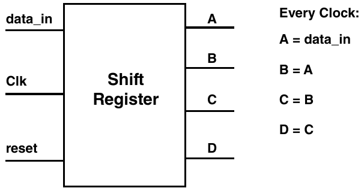

Hình 5.1 Block diagram của shift register 4-bit.

```
-- Libraries
library IEEE;
use IEEE.STD_LOGIC_1164.ALL;
use IEEE.numeric_std.all;
-- Entity Declaration
entity Shift_Reg is
port(
    A : out std_logic;
    B : out std_logic;
    C : out std_logic;
    D : out std_logic;
    data_in : in std_logic;
    reset : in std_logic;
    clk : in std_logic);
end Shift_Reg;
```

Vậy, bây giờ chúng ta định nghĩa architecture như code sau.

```
-- Architecture
architecture behavior of Shift_Reg is
-- Defined Signals
signal A_reg, B_reg : std_logic := ‘0’;
signal C_reg, D_reg : std_logic := ‘0’;
-- Begin Architecture
begin
     -- Signal Assignments
     A <= A_reg;
     B <= B_reg;
     C <= C_reg;
     D <= D_reg;
     -- Process that is used to shift the values
     reg_process: process(clk)
     begin
         if(rising_edge(clk)) then
              if(reset = ‘1’) then
                  A_reg <= ‘0’;
                  B_reg <= ‘0’;
                  C_reg <= ‘0’;
                  D_reg <= ‘0’;
               else
                  A_reg <= data_in;
                  B_reg <= A_reg;
                  C_reg <= B_reg;
                  D_reg <= C_reg;
               end if;
           end if;
       end process reg_process;
end behavior;
```

Như vậy là hoàn thành toàn bộ thiết kế của shift register thực tế. Chúng ta đã khai báo các library, entity nơi chúng ta định nghĩa các output và input. Chúng ta có architecture cho hành vi của shift register, và chúng ta định nghĩa các signal đang dùng. Sau đó chúng ta dùng begin của architecture và các signal assignment, tức là gán các signal. Chúng ta lấy các register và gán giá trị cho các register A, B, C và D, những register này sau đó được nối tới output – output của thiết kế, sản phẩm thực tế của shift register. Tại thời điểm này, chúng ta đã thiết kế hoàn chỉnh shift register. Giờ chúng ta chỉ cần định nghĩa và thiết kế test bench để có thể lấy shift register đó và mô phỏng nó.

## 5.3 Thiết kế test bench cho shift register

Mục này nói về thiết kế test bench cho shift register. Ở đây, chúng ta sẽ đi qua và giải thích điều chúng ta sẽ cố làm với test bench của shift register, rồi tiến hành triển khai và thiết kế nó. Chúng ta sẽ dùng Notepad++, dù bạn có thể dùng bất kỳ trình soạn thảo văn bản nào cho phép lưu file với phần mở rộng .vhd, hoặc bạn cũng có thể dùng mô hình Vivado, cho phép bạn thực sự viết và sửa các thiết kế VHDL. Với thiết kế của chúng ta, chúng ta có shift register, bao gồm input_data clk, reset, và các output A, B, C và D. Trong test bench, chúng ta thực ra không có input hay output nào. Tất cả những gì chúng ta làm là instantiate shift register bên trong thiết kế test bench. Từ đó, chúng ta sẽ phân tích và xem các output – A, B, C và D – trong khi áp dụng stimulus hay dữ liệu vào các signal data_in, clk và reset để xem các output phản hồi thế nào. Nếu nghĩ về nó một cách trực quan, chúng ta có thể hình dung thiết kế test bench chứa các signal A, B, C và D. Chúng ta có thể bao các signal A, B, C và D trong một hộp nhỏ để chỉ ra rằng chúng là các signal được chỉ định của chúng ta. Signal data_in sẽ nối tuần tự tới từng signal – bắt đầu với signal A, rồi tới signal B, v.v. Chúng ta cũng cần định nghĩa stimulus. Với stimulus, chúng ta sẽ tạo các signal tên data_in, clk và reset, và chúng ta sẽ đặt tên chúng giống với các signal trên shift register để dễ theo dõi hơn. Trong block diagram ở Hình 5.2, stimulus được biểu diễn. Vậy, data_in được nối với signal data_in, clk được nối với clk, và reset được nối trực tiếp với signal reset, như được thể hiện trong Hình 5.2.

Vậy, chúng ta sẽ áp dụng giá trị cho stimulus – data_in, clk và reset – và trong khi làm điều đó, chúng ta sẽ quan sát các signal output bên trong simulation. Chúng ta có thể thấy các signal A, B, C và D và bảo đảm chúng làm đúng chính xác những gì chúng ta muốn. Bây giờ, nếu nghĩ về test bench, nó bao trùm toàn bộ thiết kế. Thiết kế ở Hình 5.2 là Shift_Reg của chúng ta, và trong trường hợp này, chúng ta sẽ gọi nó là test_Shift_Reg. Trong test bench, không có input và không có output – nó hoàn toàn self-contained bên trong architecture. Vì vậy, không có gì đi vào hay đi ra. Mọi thứ chúng ta xem đều là bên trong. Tất cả những gì chúng ta làm là áp dụng stimulus bên trong để test thiết kế. Thiết kế đó – Shift_Reg – được instantiate bên trong test bench để áp dụng các giá trị khác nhau này và xem chúng phản hồi thế nào. Giờ chúng ta đã hiểu mục tiêu và có ý tưởng về điều mình muốn làm với shift register, hãy mở trình soạn thảo mà bạn sẽ dùng để sửa thiết kế VHDL. Chúng ta đã hoàn thành thiết kế shift register ở mục trước, vì vậy giờ chúng ta sẽ tập trung vào cách thiết kế test bench. Với test bench, việc đầu tiên chúng ta muốn làm là include một library. Ví dụ, thư viện IEEE, và chúng ta muốn dùng IEEE.STD_LOGIC_1164.ALL và IEEE.numeric_std.all. Tiếp theo, chúng ta có entity. Như đã bàn ở trên, entity là rỗng vì chúng ta không có input hay output nào. Vậy, entity như code sau.

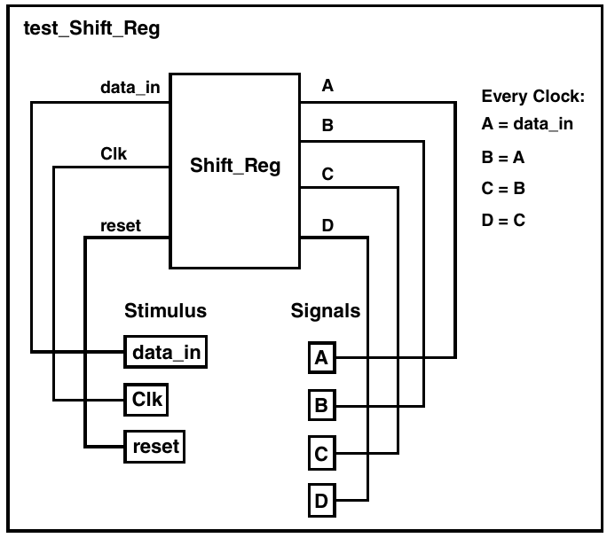

Hình 5.2 Test bench của shift register.

```
-- Libraries
library IEEE;
use IEEE.STD_LOGIC_1164.ALL;
use IEEE.numeric_std.all;
-- Entity Declaration
entity test_Shift_Reg is
end test_Shift_Reg;
```

Vậy, entity là rỗng – không có input hay output nào trong thiết kế. Chúng ta chỉ làm việc với architecture, và đó là nơi chúng ta quan sát các signal để xem chuyện gì đang diễn ra. Trong test bench, không có input hay output nào vì test bench không được synthesize. Bạn không thể thực sự nạp nó lên FPGA; nó chỉ được dùng để mô phỏng và test. Vậy, code architecture sẽ được viết như sau.

```
architecture test of test_Shift_Reg is
component Shift_Reg
port(A: out std_logic;
     B: out std_logic;
      C: out std_logic;
      D: out std_logic;
      data_in: in std_logic;
      reset: in std_logic;
      clk: in std_logic);
end component;
signal data_in: std_logic := ‘0’;
signal reset: std_logic := ‘0’;
signal clk: std_logic := ‘1’;
signal A, B, C, D: std_logic;
begin
    dev_to_test: Shift_Reg
        port map(A, B, C, D, data_in, reset, clk);
    clk_stimulus: process
    begin
        wait for 10 ns;
        clk <= not clk;
    end process clk_stimulus;
    data_stimulus: process
    begin
        wait for 40 ns;
        data_in <= not data_in;
        wait for 150 ns;
    end process data_stimulus;
end test;
```

Đến đây, đó là toàn bộ thiết kế của chúng ta từ đầu đến cuối. Đây là thiết kế test bench top-level của chúng ta. Chúng ta muốn lưu nó với tên test_Shift_Reg. Bạn không bắt buộc phải theo quy ước này, nhưng chúng tôi thích dùng quy ước đặt tên đó để khi đặt mọi thứ vào cùng một thư mục và mô phỏng bằng Vivado, mọi thứ rõ ràng. File thiết kế là Shift_Reg, và bằng cách thêm từ khóa “test” vào phía trước, chúng ta biết đó là test bench cho shift register. Vậy, bạn không bắt buộc phải theo quy ước đặt tên đó, nhưng đó là quy ước chúng tôi thường thích dùng. Như vậy, đó là toàn bộ test bench cho thiết kế shift register.

## 5.4 Giới thiệu công cụ Vivado simulator

Mục này giới thiệu công cụ Vivado simulator. Ở đây, chúng ta sẽ giải thích và giới thiệu ngắn gọn Vivado simulator, một công cụ simulation được tích hợp vào Vivado. Không cần tải công cụ bên ngoài nào; khi bạn tải Vivado với license miễn phí hoặc phiên bản web, simulator đã được kèm theo sẵn. Tất cả những gì bạn phải làm là đưa test bench vào và chạy simulation; tất cả đều nằm trong một gói lớn. Vì vậy, thật tiện khi bạn không phải tải một công cụ riêng hay thứ gì khác. Nó đã có sẵn trong cùng project, nên bạn không phải có hai project riêng biệt. Một trong những điểm hay của Vivado là mọi thứ được tích hợp vào một công cụ duy nhất. Với Vivado simulator, bạn có thể xem các waveform và phân tích các signal hoạt động thế nào trong mối quan hệ với nhau. Ví dụ, khi một signal lên high, bạn có thể thấy khi nào một signal khác lên high hoặc xuống low. Bạn cũng có thể đo chênh lệch thời gian giữa các chuyển mức signal đó. Ngoài ra, bạn có thể lưu ảnh waveform, zoom vào các phần cụ thể, và đặt runtime cho simulation. Một tính năng chúng tôi thực sự thích là khả năng mô phỏng ở các giai đoạn thiết kế khác nhau. Đầu tiên, có behavioral simulation, mô phỏng thiết kế VHDL của bạn. Sau đó, sau khi synthesis, bạn có thể mô phỏng thiết kế đã synthesize cũng như thiết kế đã implement. Thiết kế đã implement của bạn sẽ gần nhất với thiết bị FPGA thực tế mà một simulation có thể đạt được, vì với thiết kế đã implement, nó sẽ biết tất cả các độ trễ cụ thể – từ khi một sự kiện nhất định xảy ra đến khi sự kiện tiếp theo xảy ra – vì nó đã được route trên FPGA. Họ đã có routing được vạch ra, và họ sẽ có ước lượng rất tốt về các timing và độ trễ nhất định. Vì vậy, bạn có thể chạy simulation sau bước đó để kiểm chứng rằng bạn sẽ đáp ứng timing. Vậy, bước đầu tiên là thực hiện simulation kiểu behavioral-type, và điều đó chỉ để kiểm chứng rằng về mặt logic bạn đang làm chính xác điều mình muốn thiết kế làm. Ví dụ, bạn nhấn một button – bạn muốn bảo đảm điều đó làm sáng một LED. Trong trường hợp này, bạn muốn nói, “OK, chúng ta có input A; chúng ta muốn bảo đảm khi input A lên high, output B lên high.” Về mặt behavioral, chúng ta chỉ cần bảo đảm điều đó xảy ra. Còn khi bạn implement và chạy simulation đó, nó sẽ bảo đảm rằng khi chúng ta nhấn A và B lên high, độ trễ thời gian giữa chúng là bao nhiêu – nó có đáp ứng các đặc tả timing không? Nếu bạn chỉ định các timing đó, công cụ sẽ bảo đảm chúng được đáp ứng. Nhưng sau đó bạn có thể mô phỏng và kiểm chứng rằng không có vấn đề gì với những thứ như vậy. Khi bạn làm việc với Vivado simulator, nó chỉ có thể được dùng cho các thiết kế Xilinx. Bạn phải tạo một project Vivado. Bạn có thể chọn một loại thiết bị generic nào đó, làm một thiết kế generic, mô phỏng nó và kiểm chứng nó hoạt động. Sau đó, bạn có thể đem thiết kế đó ra ngoài. Nếu bạn làm việc với các tính năng Xilinx-specific, chẳng hạn bộ nhớ bên trong, bạn nên dùng Vivado vì nó có thể mô phỏng những thứ như vậy. Nó hiểu các initialization file mà bạn có thể đặt vào để nói rằng chúng ta muốn bộ nhớ được khởi tạo với các giá trị này. Vì vậy, khi simulation, chúng ta có thể tính đến chúng, biết rằng chúng có ở đó và chúng ta thực sự sẽ dùng chúng như thế nào. Rất nhiều lúc, chúng ta sẽ dùng công cụ simulator. Ví dụ, chúng ta sẽ dùng nó để mô phỏng thiết kế shift register. Vậy, chúng ta sẽ cần hai file: file thiết kế shift register – thiết kế vật lý thực tế mà chúng ta muốn test – và test bench. Chúng ta sẽ nạp test bench và bảo nó chạy simulation. Nó sẽ mô phỏng thiết kế thực tế mà chúng ta sẽ triển khai. Chúng ta muốn dùng điều này để kiểm chứng rằng các thiết kế hoạt động như mong đợi, đó là mục đích tổng thể chính của việc dùng VHDL simulation. Trong tương lai, bạn có thể dùng điều này dù bạn đang làm việc ở công ty hay làm các project khác ở nhà. Nếu bạn làm việc với các thiết bị Xilinx và dùng công cụ của họ, bạn có thể dùng hiểu biết này để áp dụng các simulation. Simulation shift register là một simulation rất đơn giản và cơ bản, nhưng nó ở đây chỉ để cho bạn những bước đầu tiên trong việc hiểu quá trình simulation và cách chạy một simulation cũng như thiết kế một test bench. Sau đó bạn có thể áp dụng điều này cho các project tương lai hoặc những thứ phức tạp hơn mà bạn có thể đang làm. Vậy giờ bạn đã hiểu công cụ simulator là gì và chúng ta sẽ dùng nó như thế nào. Hãy bắt đầu – bước tiếp theo là chạy một simulation trong Vivado.

## 5.5 Chạy simulation trong Vivado

Mục này nói về việc chạy simulation trong Vivado. Chúng tôi sẽ chỉ cho bạn cách dùng Vivado để mô phỏng một thiết kế – trong trường hợp này là một shift register mà chúng ta đã thiết kế. Chúng ta sẽ dùng một test bench được viết riêng để test shift register này. Khi bạn đã thiết lập project – trong trường hợp này là một project cơ bản với shift register đã được tạo hoặc triển khai – bạn sẽ bắt đầu bằng việc tìm design source file. Trong mục Design Source của Vivado, bạn sẽ thấy một file tên Shift_Reg.vhd. Double-clicking vào file sẽ mở nó và hiển thị thiết kế shift register mà bạn đã thiết kế. Tiếp theo, trong Simulation Sources, bạn cũng sẽ thấy shift register (Shift_Reg). Như được thể hiện trong Hình 5.3, Vivado nhận diện shift register là module top-level cho simulation. Đó là vì hiện tại nó là module duy nhất được định nghĩa cho simulation trong project.

Vậy, điều chúng ta muốn làm là import test bench. Để làm điều đó, chúng ta sẽ chọn Simulation Sources, right-click, và click vào Add Sources. Hãy bảo đảm bạn chọn tùy chọn thứ ba: Add or create simulation sources, như được mô tả trong Hình 5.4.

Sau đó, chúng ta sẽ click Next, và để simulation set được chỉ định ở giá trị mặc định là sim_1. Điều này cho phép bạn chạy các simulation khác nhau, chẳng hạn sim_1, sim_2, v.v. Nhưng với các trường hợp của chúng ta và mọi thứ chúng ta sẽ dùng trong cuốn sách này, chỉ cần một simulation set duy nhất là đủ. Bây giờ, chúng ta sẽ tạo một file VHDL (test_Shift_Reg.vhd), như được minh họa trong Hình 5.5.

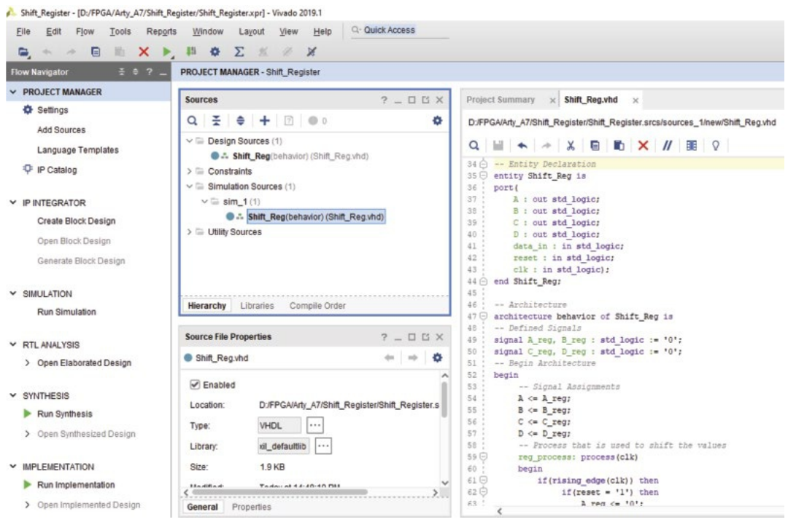

Hình 5.3 Design source và simulation source của shift register.

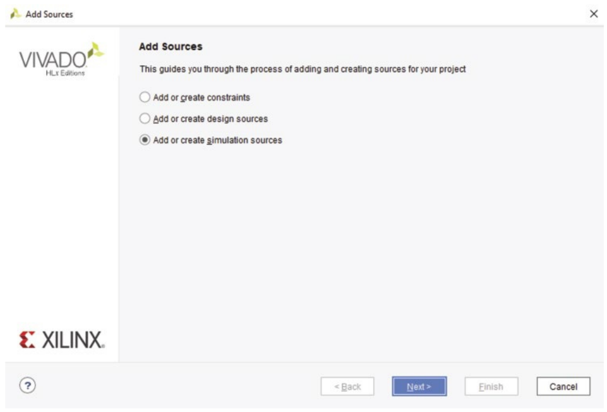

Hình 5.4 Chọn Add or create simulation sources.

Tiếp theo, chúng ta click OK, và trong cửa sổ Define Module, chúng ta đặt tên architecture là “test”, rồi click OK lần nữa, như được thể hiện trong Hình 5.6.

Tiếp theo, chúng ta có thể copy và paste test bench đã thiết kế vào test_Shift_Reg.vhd. Nó sẽ tự động cập nhật, và giờ nó sẽ nhận diện test_Shift_Reg là thiết kế top-level cho shift register, như được thể hiện trong Hình 5.7.

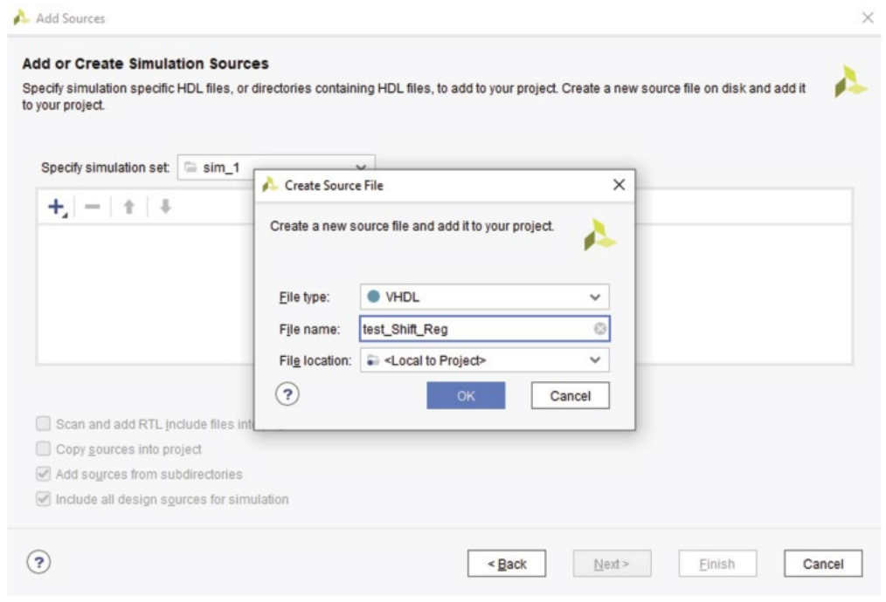

Hình 5.5 Tạo file mới.

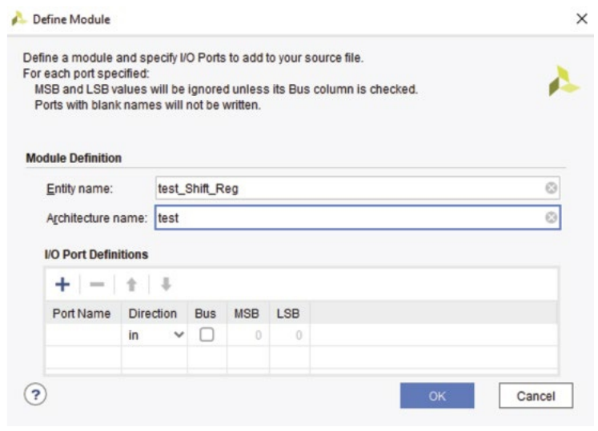

Hình 5.6 Đặt tên architecture là “test”.

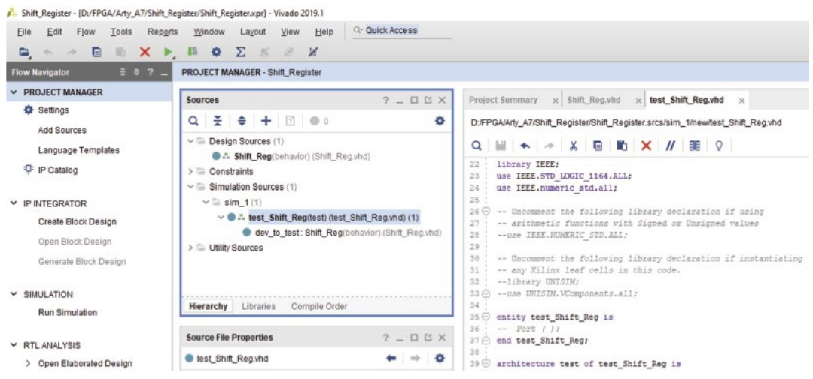

Hình 5.7 Nhận diện test_Shift_Reg.vhd là thiết kế top-level.

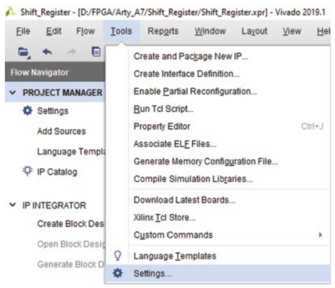

Hình 5.8 Chọn tùy chọn Settings.

Khi mở rộng test_Shift_Reg, bạn sẽ thấy dev_to_test: Shift_Reg. Nếu chúng ta highlight và double-click vào nó, nó sẽ mở dev_to_test trong test (Shift_Reg.vhd). Vậy, đây là thiết kế mà chúng ta thực sự đang test trong test bench. Bước tiếp theo là chạy simulation. Nhưng trước khi làm điều đó, chúng ta sẽ vào Simulation Settings. Thao tác này mở ra một số thiết lập cơ bản cho simulation. Thiết lập target simulator có thể được truy cập bằng cách vào Tools → Settings…, như được mô tả trong Hình 5.8.

Chúng ta sẽ để simulator language là Mixed và giữ simulation set là sim_1. Nếu bạn có các set khác như sim_2 và sim_3, bạn có thể chọn chúng ở đây. Tên top module là test_Shift_Reg này, và nó tự động nhận theo mặc định, chúng ta sẽ để tất cả ở mặc định. Giá trị duy nhất khác mà chúng ta sẽ thay đổi nằm trong tab Simulation. Chúng ta sẽ đặt runtime là 350 ns và click Apply, như được minh họa trong Hình 5.9.

Giờ chúng ta đã sẵn sàng để mô phỏng. Bạn luôn có thể thay đổi thời gian simulation sau đó trong simulator, nên điều này không quá quan trọng, nhưng nó chỉ cho biết bạn muốn lần chạy đầu tiên mô phỏng trong bao lâu. Khi bạn click Run Simulation, bạn sẽ thấy một vài tùy chọn. Vì chúng ta chưa synthesize hay implement thiết kế, chúng ta chỉ có thể chạy Behavioral Simulation, và đó là thứ chúng ta sẽ bắt đầu. Điều này sẽ bảo đảm thiết kế hoạt động như mong đợi trước khi synthesis. Sau đó, bạn có thể chạy post-synthesis simulation sau khi nó synthesize thiết kế và bạn có thể chạy để bảo đảm nó vẫn hoạt động như mong đợi. Cuối cùng, khi implement thiết kế, bạn có thể bảo đảm mình vẫn đáp ứng timing. Vậy, hãy chạy behavioral simulation, như được thể hiện trong Hình 5.10.

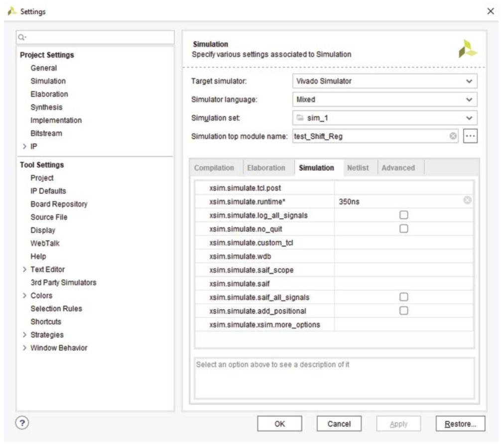

Hình 5.9 Đặt runtime của simulation là 350 ns.

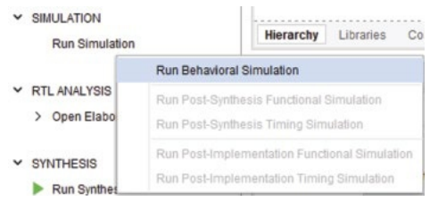

Hình 5.10 Chạy behavioral simulation.

Behavioral simulation mở simulator bên trong Vivado. Vậy chúng ta vẫn ở trong Vivado, nhưng giờ là bên trong công cụ simulation. Trong Hình 5.11, dưới Name, bạn sẽ thấy thiết kế của chúng ta: test_Shift_Reg. Chúng ta đang mô phỏng dev_to_test, và nó hiển thị tất cả các object: data_in, reset, clk, A, B, C và D. Ở phía bên phải, bạn có thể thấy các waveform. Right-click và chọn Full View, như được thể hiện trong Hình 5.11.

Trong Hình 5.12, bạn có thể thấy các waveform của data_in, reset, clock (clk), và các signal output A, B, C và D.

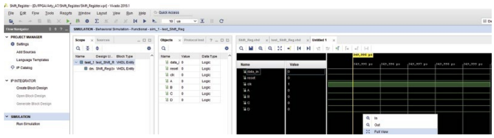

Hình 5.11 Chuyển sang full view.

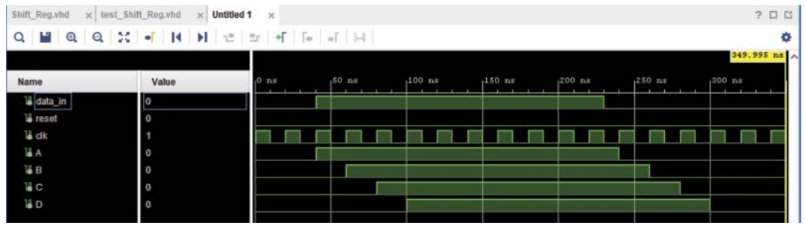

Hình 5.12 Các waveform của input và output.

Đó là tất cả các bước cần thiết để chạy một simulation trong Vivado. Dù bạn làm điều này cho shift register, project Button_LED, project blink LED hay bất kỳ thiết kế tương lai nào, các bước đều giống nhau. Bạn có thiết kế chính, rồi thêm một test bench vào project Vivado để chạy simulation. Lưu ý rằng khi bạn đi qua synthesis, implementation và bitstream generation, file test bench không được đưa vào output cuối cùng. Vì vậy, bạn có thể tiếp tục phát triển thiết kế chính và vẫn dùng test bench để kiểm chứng mọi thứ trong một project duy nhất.

## 5.6 Thao tác với Vivado simulation

Mục này giải thích cách dùng công cụ simulation của Vivado. Công cụ trong Vivado mà chúng ta dùng để mô phỏng là một phần của Vivado, được gọi là Vivado simulator. Trong công cụ này, có rất nhiều tùy chọn, khả năng và tính năng khác nhau. Chúng ta sẽ không đi qua từng cái một, vì việc đó sẽ mất khá nhiều thời gian. Có rất nhiều thứ bạn có thể làm với Vivado simulator. Chúng tôi sẽ chỉ cho bạn, ở mức tổng quát, cách mô phỏng, để xuyên suốt project này bạn có thể dùng công cụ này kiểm chứng rằng các thiết kế của mình hoạt động như mong đợi – trước khi nạp chúng lên FPGA. Khi đã ở trên đó, nó không giống làm việc với phần mềm thông thường nơi bạn có thể tạm dừng, debug hay đặt breakpoint. Bạn không có được những khả năng tương tự như vậy, và không may là khi đã nằm trên FPGA, bạn cũng không có bất kỳ chỉ báo nào như LED hay output UART. Vì vậy, đây là một cách tuyệt vời để test thiết kế trước khi triển khai nó lên FPGA. Để bắt đầu, chúng ta đã biết cách chạy simulation trong Vivado. Bạn đã tạo một project, viết một test bench và khởi chạy simulation. Bây giờ, simulation của bạn đang chạy, như được thể hiện trong Hình 5.12. Bạn có thể lưu cửa sổ simulation và re-open nó sau, nhưng bây giờ, chúng ta cứ để nó chạy. Điều đầu tiên chúng ta xem là cách bạn có thể sắp xếp các cửa sổ hoặc mở rộng khung nhìn thiết kế. Bạn có thể click và kéo các cạnh cửa sổ để làm vùng hiển thị lớn hơn. Việc nhìn thấy mọi thứ rõ ràng là rất hữu ích. Bạn không muốn dồn mọi thứ lại với nhau, vì như vậy sẽ khó đọc các signal và khá khó chịu khi làm việc. Tuy nhiên, đồng thời, khi có nhiều thứ diễn ra và không gian màn hình hạn chế, điều đó có thể khá khó khăn. Một tính năng hay là bạn có thể cho cửa sổ waveform nổi (float). Nếu bạn click vào biểu tượng ở Hình 5.13, nó sẽ lấy waveform thực tế và tách nó ra thành một cửa sổ riêng để bạn có thể click vào Maximize.

Giờ bạn có cửa sổ này chiếm toàn bộ màn hình, điều này thực sự rất tốt, đặc biệt khi bạn làm việc trên laptop, nơi bạn không có nhiều không gian màn hình hay screen real state *(ghi chú: sách in "real state"; đúng là "real estate")* để làm việc. Vậy, ở đây, chúng ta sẽ di chuyển một số thứ. Bạn có thể di chuyển các bảng này, chẳng hạn cột value, và vì tất cả đều là standard logic, chúng sẽ chỉ là một hoặc không. Bạn có thể làm cột đó nhỏ lại vì nó không thực sự quan trọng. Sau đó, chúng ta right-click và chọn Full View, như được mô tả trong Hình 5.14.

Giờ cửa sổ waveform chiếm toàn bộ màn hình, dễ chịu và dễ nhìn hơn nhiều. Giả sử chúng ta đã xem xong và muốn đặt nó trở lại để xem lại mọi thứ khác. Chúng ta chỉ cần quay lại biểu tượng dock này (biểu tượng reverse float), và nó đặt cửa sổ trở lại đúng vị trí mà chúng ta đã kéo nó ra. Đó là một tính năng nhỏ hay khi bạn muốn chụp màn hình hoặc lấy một đoạn trích – dù là cho test report hay khi bạn có câu hỏi hoặc điều gì tương tự. Việc mô phỏng thiết kế, chụp lại waveform và đưa chúng vào tài liệu luôn là điều tuyệt vời. Điều tiếp theo chúng ta muốn xem là cách zoom in. Chúng ta biết rằng nếu right-click trong vùng đó, chúng ta có thể vào Full View, và thao tác đó lấy toàn bộ thời gian simulation – từ 0 đến 350 ns trong trường hợp này – và lấp đầy cửa sổ wave hay không gian màn hình bằng nó. Bây giờ, nếu muốn zoom in, bạn có thể right-click và chọn Zoom In (+). Để zoom out, chỉ cần right-click và chọn zoom out (−). Nếu bạn cứ tiếp tục zoom out, cuối cùng nó sẽ đến mức không hiển thị được nhiều, như được thể hiện trong Hình 5.14. Vậy, hãy quay lại Full View. Nếu muốn zoom vào một khoảng cụ thể, bạn có thể làm điều đó bằng cách click, giữ và kéo chuột. Khi bạn kéo lên, nó zoom out. Nếu bạn kéo xuống hoặc kéo ngược lại, nó zoom in. Vậy, kéo lên để zoom out, và kéo ngược lại để zoom in – chỉ bằng cách click chuột trái và kéo. Và một lần nữa, nếu mọi thứ trở nên lộn xộn, bạn luôn có thể right-click và vào Full View. Bắt đầu từ đó luôn là điều tốt, như được thể hiện lần lượt trong Hình 5.15 và 5.16.


Hình 5.13 Cho cửa sổ waveform nổi (float).

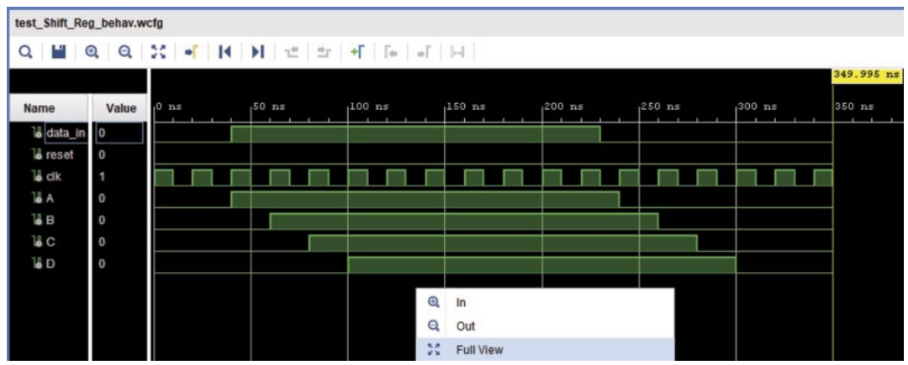

Hình 5.14 Right-clicking và chọn Full View.

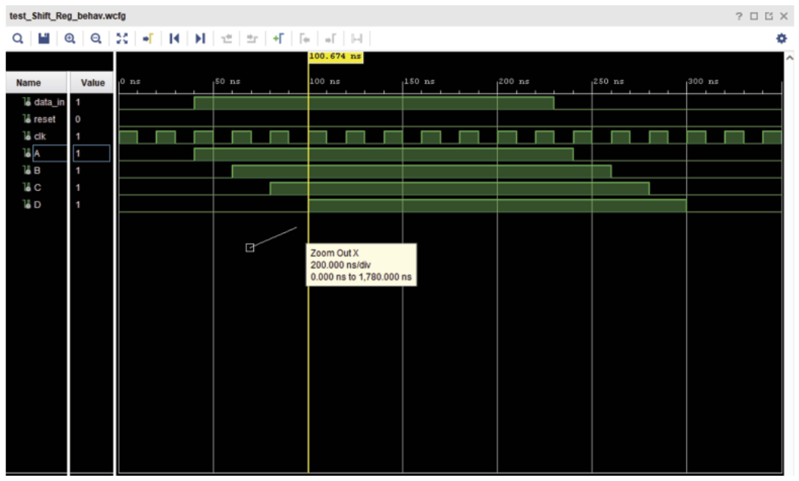

Hình 5.15 Zoom out.

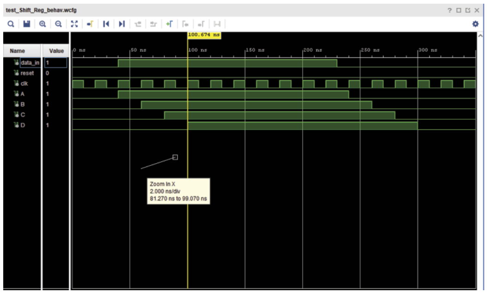

Hình 5.16 Zoom in.

Và nếu bạn muốn zoom vào một đoạn cụ thể – giả sử chúng ta muốn zoom từ 50 ns đến 100 ns – chúng ta dùng chuột và left-click tại 50 ns. Khi kéo, chúng ta muốn kéo thẳng theo phương ngang từ điểm đã chọn. Nếu di chuyển lên hoặc xuống, chúng ta sẽ trượt. Nhưng ngay khi chúng ta kéo ngược lại, nó sẽ zoom in. Tuy nhiên, nếu đi vào ngay chính giữa, bạn sẽ nhận ra điều đó nhờ thấy cửa sổ màu đỏ, như được minh họa trong Hình 5.17.

Vậy, khi làm điều đó, nó zoom khoảng tính từ chỗ chúng ta đã click, và chúng ta sẽ có một biểu tượng nhỏ trên cửa sổ. Trong ví dụ này, chúng ta zoom đại khái từ 50 ns đến 100 ns. Khi làm điều này, chúng ta có thể thấy riêng khoảng giữa 50 ns và một chút sau 100 ns – nó zoom chúng ta vào đúng khoảng cụ thể đó. Bây giờ, giả sử chúng ta muốn xem khoảng từ 60 ns đến 70 ns. Chúng ta có thể click và kéo lần nữa để xác định cửa sổ đỏ đó, và thao tác đó zoom chúng ta vào 60 ns đến 70 ns. Tất cả điều này phụ thuộc vào việc bạn chạy thiết kế trong bao lâu, clock (clk) của bạn chạy nhanh đến đâu, và chính xác điều gì đang xảy ra trong khoảng thời gian đó. Nếu mọi thứ bạn cần thấy đều nằm trong 100 ns, thì chẳng có lý do gì để chạy thiết kế trong 500 ns. Chỉ cần chạy nó trong 100 ns và tập trung vào điều đang xảy ra trong khoảng cụ thể đó. Bây giờ, nếu chúng ta đang cố tìm chính xác điểm mà một điều gì đó xảy ra, nhưng không chắc khi nào nó xảy ra, chúng ta có thể quay lại Full View. Từ đó, chúng ta có thể xem các cạnh cụ thể. Ví dụ, nếu chúng ta chọn một signal – như clock (clk) – ngay khi chọn clock (clk), bạn sẽ thấy đường viền cạnh của signal đó được highlight, như được thể hiện trong Hình 5.18.

Nếu để ý, khi signal ở mức high, phía dưới nó được tô bóng; khi ở mức low, không có tô bóng. Điều này giúp dễ thấy hơn nhiều khi nào một signal ở mức high so với khi nào ở mức low. Bạn có thể nhận ra các chuyển mức đó khá dễ dàng. Tuy nhiên, cũng có các công cụ giúp bạn xác định các chuyển mức. Ở phía trên cùng, có một thanh công cụ nhỏ. Chúng ta biết có thể zoom in bằng cách right-clicking, hoặc có thể click vào các button zoom in hoặc zoom out. Bạn cũng có thể dùng Zoom Fit, Go to Cursor, Go to Time Zero, hoặc Go to Last Time. Đây chỉ là các button shortcut cho phép bạn di chuyển dọc theo dòng thời gian simulation. Bây giờ hãy quay lại Full View và đưa con trỏ tới ngay đây. Chúng ta có các chuyển mức, và chúng ta đang xem chuyển mức tiếp theo. Giả sử chúng ta đang ở clock (clk). Nếu đi tới chuyển mức tiếp theo, nó sẽ đưa chúng ta từ low lên high. Một chuyển mức được định nghĩa là khi signal của bạn thay đổi từ trạng thái này sang trạng thái tiếp theo, và với mỗi signal này, chúng chỉ có trạng thái high hoặc low. Vì vậy, một chuyển mức sẽ là khi bạn đi từ low lên high hoặc từ high xuống low. Bạn có thể tiếp tục click qua các chuyển mức. Trên clock, nó chuyển mức mỗi 10 ns: lên, xuống, lên, xuống. Bây giờ, lấy một signal khác, chẳng hạn A. Chúng ta có thể thấy chuyển mức tiếp theo là từ high xuống low. Nếu đi tới chuyển mức tiếp theo, nó chuyển sang chuyển mức kế tiếp. Chúng ta cũng có thể dùng previous transition để quay lại. Nếu click lần nữa, nó sẽ đưa chúng ta về tận đầu. Khi bạn đến cuối, nó sẽ không đưa bạn đi xa hơn nữa. Vậy, đó là một cách khá hay nếu bạn có một signal mà bạn muốn xem điều gì xảy ra chỉ khi signal đó chuyển mức, khi đó bạn có thể dùng công cụ này để phần nào xác định mình đang ở đâu. Vậy, đó là một cách nhỏ hay để xem các chuyển mức khác nhau. Tiếp theo, chúng ta sẽ xem cách đo thời gian giữa hai sự kiện. Ví dụ, giả sử chúng ta muốn biết chênh lệch thời gian giữa lúc output A lên high và lúc output C lên high. Chúng ta có thể nhìn vào thang đo và ước lượng rằng A lên high vào khoảng 40 ns và C lên high vào khoảng 80 ns, vậy chúng ta có thể tính ra. Nhưng khi bạn làm việc với các signal khác nhau – đặc biệt trong các ứng dụng time-critical – có thể có thứ đang chạy ở hai clock rate khác nhau, hoặc một signal có thể không xảy ra chính xác theo một clock rate. Bạn có thể đang xem một signal bất đồng bộ đi vào, và bạn sẽ muốn kiểm tra timing đó. Vì vậy, đó là một điều hay khi có thể làm được. Để làm điều đó, bạn sẽ muốn lấy marker và chọn cạnh đầu tiên. Ví dụ, chúng ta sẽ chọn signal A. Chúng ta sẽ di chuyển tới chuyển mức đó – giờ A lên high tại 40 ns – và chúng ta sẽ click vào button Add Marker. Thao tác đó sẽ thêm một marker tại chuyển mức A, cho chúng ta một điểm tại 40 ns. Bây giờ, chúng ta sẽ chọn marker, bảo đảm đã chọn con trỏ, và chúng ta muốn chọn C. Vậy giờ chúng ta đang ở signal C và muốn biết thời điểm C lên high. Chúng ta sẽ chọn chuyển mức đó. Điều đó cho chúng ta hai chuyển mức. Tại thời điểm này, chúng ta biết marker thứ nhất ở 40 ns, và marker thứ hai ở 80 ns, như được mô tả trong Hình 5.19.

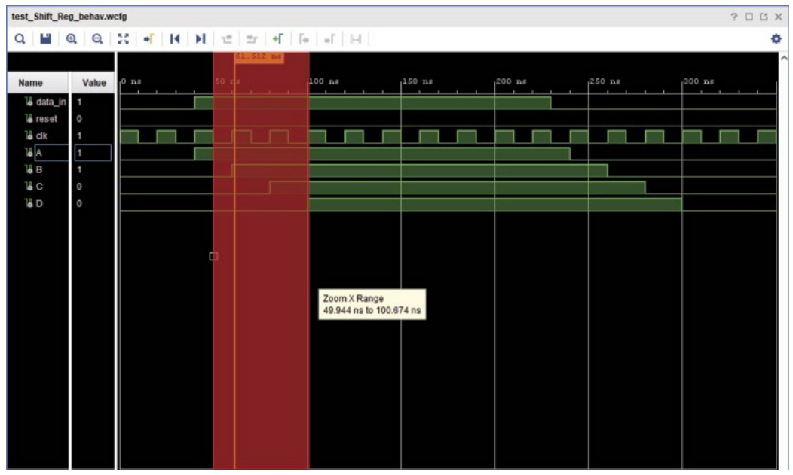

Hình 5.17 Có được cửa sổ đỏ khi zoom một khoảng. Bản màu của hình này có trên trang landing page của sách tại wiley.com.

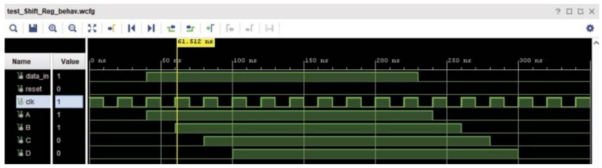

Hình 5.18 Highlight đường viền cạnh của signal clock.

Vậy, chênh lệch giữa chúng là 40 ns. Chúng ta có thể thêm một marker khác và tiếp tục khám phá. Chẳng hạn, giả sử chúng ta muốn thêm một marker ở đây – các marker này đơn giản chỉ ra các điểm thời gian cụ thể. Thời điểm bắt đầu của chúng ta là 40 ns, là marker thứ nhất, và 80 ns là marker thứ hai. Đây là một cách hay để đo thời gian giữa các sự kiện nhất định, như được minh họa trong Hình 5.20.

Nó đòi hỏi bạn làm một chút tính toán, nhưng bạn có thể thấy đó là 40 ns và 80 ns, và điều đó cho bạn biết chênh lệch. Vậy, đó là một chỉ báo nhỏ để nói rằng, OK, điều này xảy ra chính xác vào thời điểm này ngay bây giờ với thiết kế này. Ở đây mọi thứ diễn ra chính xác vào những thời điểm tròn trịa, như 40 ns so với 80 ns. Trong một số thiết kế, bạn sẽ có những thứ mà, chẳng hạn, có thể bắt đầu ở 42.87 ns và cái tiếp theo bắt đầu ở 82.46 ns, nên khi rơi vào trường hợp đó, sẽ tiện hơn nhiều khi có thể thấy marker trên đồ thị, tính toán ngay lập tức, và hiểu xem đó có phải thời điểm bạn mong đợi hay không.

Điều tiếp theo là, nếu bạn có một thiết kế chạy trong thời gian thực sự dài thì sao? Trong trường hợp này, nó chỉ là 350 ns, nên khá ngắn. Nhưng, ví dụ, giả sử tất cả những gì chúng ta quan tâm – nếu có nhiều thứ diễn ra – là điều xảy ra từ không cho đến 100 ns. Đó thực sự là phần duy nhất chúng ta quan tâm, ngay trước khi signal D lên high. Vậy, điều chúng ta sẽ làm trước tiên là restart. Thao tác đó sẽ khởi động lại simulation bằng cách click vào button Restart, như được thể hiện trong Hình 5.21. Giờ chúng ta sẽ không có waveform nào, và chúng ta chỉ muốn xem điều gì xảy ra sau 100 ns.

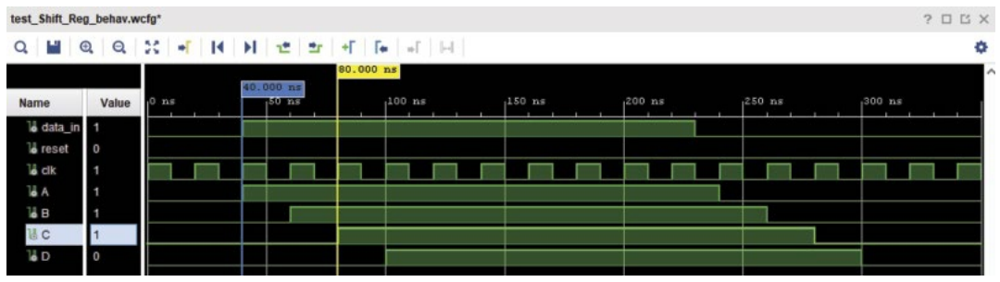

Hình 5.19 Chọn chuyển mức đầu tiên bằng button Add Marker.

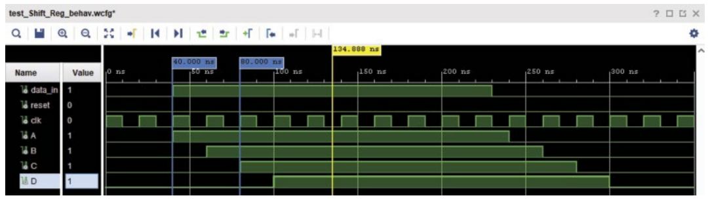

Hình 5.20 Đo thời gian giữa các sự kiện nhất định.

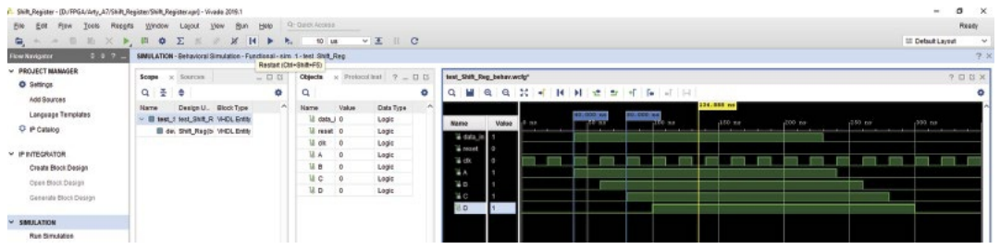

Hình 5.21 Click vào button Restart.

Chúng ta nhập thêm thời gian vào đó, bảo đảm đã chọn đơn vị thời gian – trong trường hợp này là 100 ns – rồi click Run for 100 ns, như được thể hiện trong Hình 5.22. Thao tác này sẽ chạy trong 100 ns.

Vậy, với 100 ns, nó trông như thế này, như được thể hiện trong Hình 5.22. Giờ chúng ta có thể chuyển sang full view để nhìn rõ hơn chuyện gì đang diễn ra, nếu cần, như được mô tả trong Hình 5.23.

Trong trường hợp này, chúng ta thực ra không cần, vì có thể thấy rõ chuyện gì đang diễn ra. Không có quá nhiều signal, nhưng điều này trở nên hữu ích khi bạn xử lý một thiết kế dài. Bạn sẽ để ý thấy rằng một số simulation có thể mất nhiều thời gian để chạy. Vì vậy, nếu bạn có một simulation có thể mất –khoảng 20 phút để chạy – thì hợp lý khi chỉ nói, OK, hãy chạy trong 100 ns và xem liệu chúng ta có quan sát được điều mình cần hay không. Vì vậy, thật tiện khi có thể chạy chỉ trong thời gian ngắn và tìm ra chính xác điều chúng ta cần thấy. Sau đó, bạn có thể thiết kế test bench để test trường hợp cụ thể đó. Khi gặp phải đoạn nhỏ đó, bạn có thể bắt được những loại chi tiết này. Trong trường hợp này, chúng ta đang xem từng signal trong thiết kế. Vậy, nếu nhìn dưới Scope, chúng ta có test_Shift_Reg, và bên trong đó, chúng ta có dev_to_test. Khi chọn dev_to_test, nó hiển thị cho chúng ta tất cả các signal hiện có, như được minh họa trong Hình 5.24.

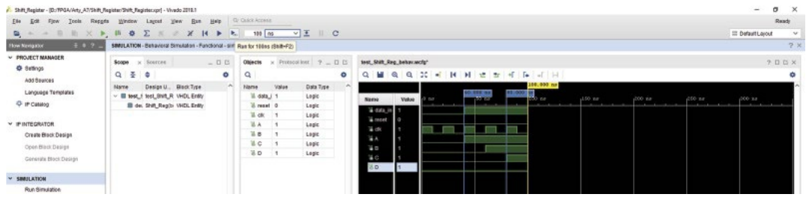

Hình 5.22 Click Run for 100 ns.

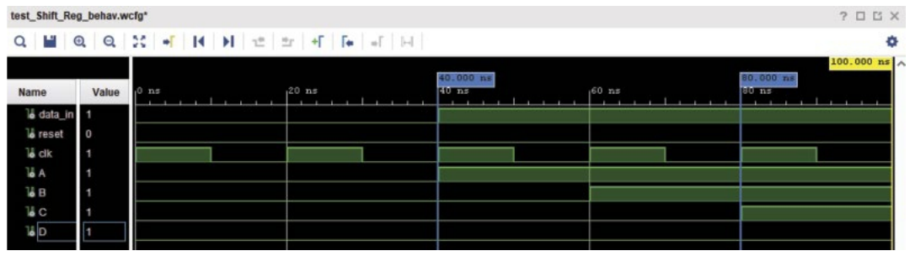

Hình 5.23 Full view cho lần chạy 100 ns.

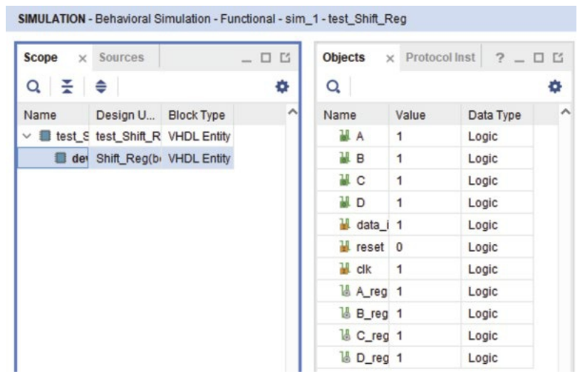

Hình 5.24 Tất cả các signal trong dev_to_test.

Ví dụ, nếu A_reg hiện không có trong cửa sổ waveform, thì chúng ta chỉ có data_in, reset, clock (clk), và các output (A, B, C và D). Vậy, nếu muốn xem A_reg và register đó đang làm gì, chúng ta right-click và chọn Add to Wave Window, như được thể hiện trong Hình 5.25.

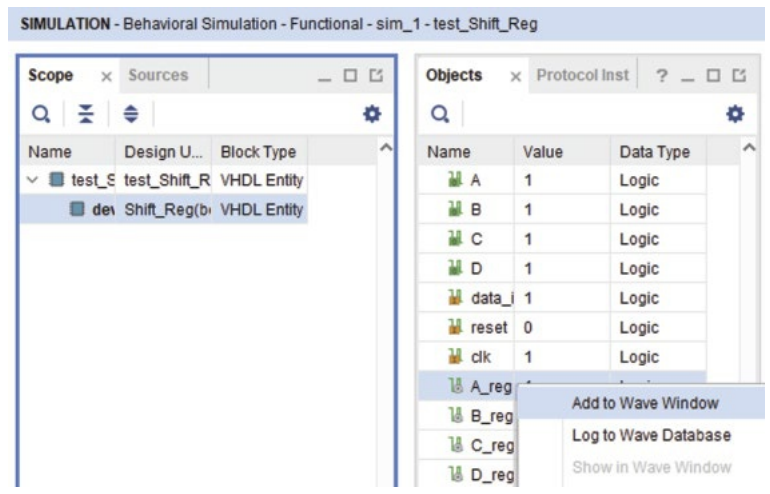

Hình 5.25 Thêm A_reg vào cửa sổ wave.

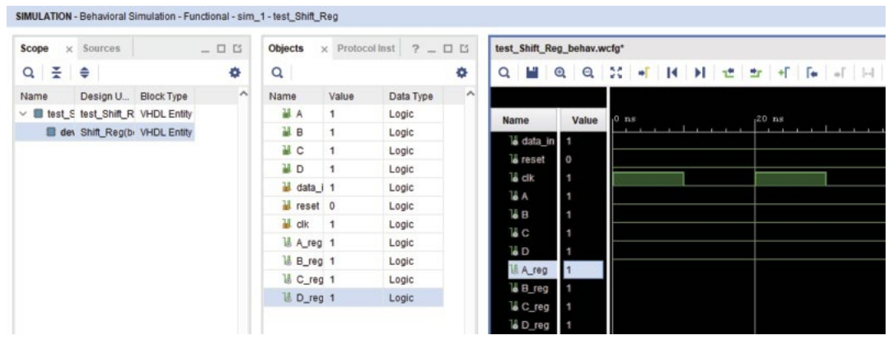

Hình 5.26 Các register đã được thêm vào cửa sổ wave.

Giờ chúng ta đã có A_reg, chúng ta muốn thêm B_reg vào cửa sổ wave, rồi thêm C_reg, và cuối cùng là D_reg. Vậy giờ chúng ta đã đưa A_reg, B_reg, C_reg và D_reg vào cửa sổ wave này, như được thể hiện trong Hình 5.26. Điều này cho phép chúng ta thấy các signal này đang làm gì.

Tuy nhiên, nếu để ý, ngay khi chúng ta thêm chúng vào, chúng không hiển thị giá trị nào vì chúng ta chưa mô phỏng xem các giá trị đó phải là gì. Vậy, chúng ta sẽ restart simulation. Bạn sẽ để ý thấy chúng ta vẫn có A_reg, B_reg, C_reg và D_reg trong cùng cửa sổ. Bây giờ nếu click Run for 100 ns, simulation sẽ tính các giá trị. Bạn sẽ thấy A_reg, B_reg, C_reg và D_reg được tính với các giá trị này, như được mô tả trong Hình 5.27.

Vậy, điều đó khá thú vị. Hãy chạy simulation thêm 100 ns nữa, rồi thêm nữa, cứ thế –giờ chúng ta đã chạy tổng cộng qua từng bước 100 ns. Từ data_in, chúng ta có thể thấy giá trị được dịch ra qua A, B, C và D. Và giờ, chúng ta cũng thấy A_reg, B_reg, C_reg và D_reg. Điều này hữu ích khi bạn có một thiết kế với rất nhiều signal – bạn có thể không muốn có tất cả chúng trong cửa sổ wave. Vì vậy, bạn có thể right-click và dùng thao tác Cut để xóa các signal khỏi cửa sổ wave, như được minh họa trong Hình 5.28.

Vậy hãy làm điều đó. Chỉ cần chọn signal, right-click, và chọn Cut để xóa nó. Về cơ bản, đó là cách bạn có thể lấy các signal có trong thiết kế, đặc biệt là những signal bên trong. Bạn đã có các input và output, nhưng bạn cũng có những signal bên trong mà bạn muốn xem. Việc thêm chúng vào cửa sổ wave rất hữu ích. Ví dụ, nếu bạn có một thiết kế lớn với 50 signal, bạn có thể chỉ quan tâm đến năm signal. Chỉ cần thêm năm signal đó vào cửa sổ wave để xem chúng đang làm gì. Dựa trên các giá trị đó, bạn có thể thêm nhiều signal hơn và chạy lại simulation để tìm ra điều giúp bạn debug và xác định rằng thiết kế của mình đang hoạt động như mong đợi.

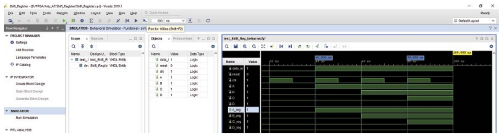

Hình 5.27 Các giá trị đã tính cho A_reg, B_reg, C_reg và D_reg.

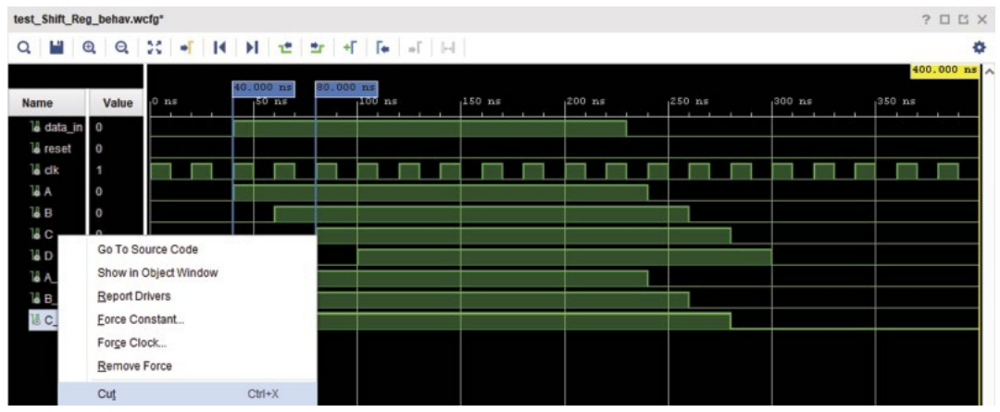

Hình 5.28 Xóa D_reg và C_reg khỏi cửa sổ wave.
