# 6 Project Buttons và LEDs

## 6.1 Giới thiệu

Chương này giới thiệu về các button và LED trên board Arty A7. Trong chương này, chúng ta sẽ giải thích điều mình đang cố làm với project buttons và LEDs. Với project này, chúng ta sẽ xem xét development board Arty A7. Mục tiêu của chúng ta là sử dụng bốn push button trên development board Arty A7, một slide switch, và bốn LED thường trên board. Điều chúng ta muốn làm là dùng một signal enable, signal này sẽ do một trong các slide switch đảm nhận. Khi được enable, việc nhấn một button sẽ làm LED tương ứng sáng lên. Ví dụ, nếu chúng ta nhấn button không (BTN0), là button ở xa nhất về bên phải, chúng ta muốn LD4, LED thường gần nhất phía bên phải, sáng lên. Tương tự, với button một (BTN1), chúng ta muốn LED thứ hai (LD5) sáng lên. Nếu chúng ta nhấn cả bốn button cùng lúc, cả bốn LED sáng lên cùng lúc. Đó là mục tiêu của chương này. Project này sử dụng hai loại input khác nhau: bốn push button, một slide switch, và sau đó là bốn output LED. Nó đóng vai trò như một phần giới thiệu cơ bản về workflow sử dụng các công cụ của Vivado, phát triển một thiết kế VHDL cơ bản, bao gồm entity, architecture, và những điều cơ bản của thiết kế VHDL chuẩn, cũng như quá trình triển khai nó bằng các công cụ, nạp chương trình và chạy nó trên development board Arty A7 này. Đó là phần tổng quan giới thiệu development board cho project buttons và LEDs.

## 6.2 Walk-through toàn bộ thiết kế Buttons và LEDs

Mục này đi qua toàn bộ thiết kế (walk-through). Trong mục này, chúng tôi sẽ chỉ cho bạn chúng ta làm gì và làm như thế nào để có tất cả những thứ này trong project Button_LED, mọi thứ đang làm gì, và tại sao nó có ở đó. Vậy, trong project Button_LED, chúng ta biết rằng mình có các input cụ thể – các button và một enable – và các output, là các LED. Vậy, ngay từ đầu, hãy đi qua thiết kế và giải thích mọi thứ chúng ta có trong thiết kế và tại sao chúng ta có nó, như được thể hiện trong Hình 6.1.

Vậy, ở trên cùng, chúng ta có một số comment mà bạn có thể điền vào để giúp giải thích thiết kế. Bằng cách này, khi xem lại sau, bạn sẽ hiểu được. Ví dụ, có các trường cho tên công ty, tên kỹ sư, tên thiết kế và tên project. Điều quan trọng bạn cần đưa vào đây là một phần mô tả giải thích file này thực sự làm gì. Bằng cách đó, nếu mở nó ra, bạn chỉ cần đọc phần mô tả là hiểu được chuyện gì đang diễn ra. Ngoài ra, còn có revision, hữu ích để theo dõi tất cả các thay đổi đã được thực hiện. Tiếp theo, chúng ta có library và chúng ta đang dùng thư viện IEEE, rất phổ biến, và chúng ta biết rằng tất cả các thiết kế của mình sẽ dùng thư viện này. Từ thư viện IEEE, chúng ta dùng package standard logic 1164, cho chúng ta truy cập các data type standard logic cũng như standard logic vector. Nó cũng cho phép chúng ta thực hiện các biểu thức Boolean khác nhau, chẳng hạn AND, OR, NOR logic và các phép toán logic khác. Bây giờ, chúng ta có entity, mà chúng ta gọi đơn giản là BUTTON_LED. Chúng ta định nghĩa entity với một generic, là NUM_BUTTONS, và giá trị này sẽ thay đổi tùy theo development board được dùng. Với development board Arty A7, NUM_BUTTONS được đặt là 4.

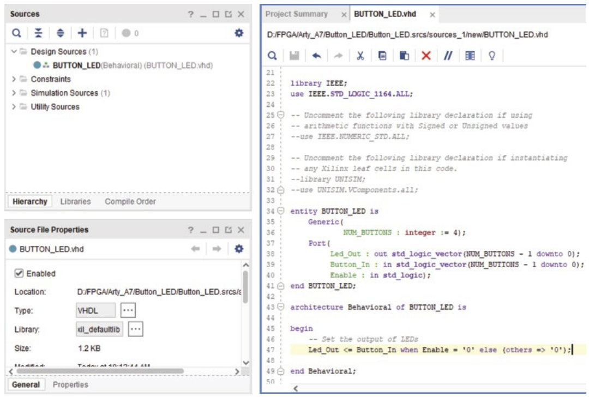

Hình 6.1 Project Button_LED.

Vậy, khi nói chúng ta có bốn button, điều đó có nghĩa là chúng ta có bốn LED output và bốn button input. Chúng ta cũng có Enable, chỉ có một. Enable chỉ là một data type standard logic, trong khi Led_Out và Button_In là các standard logic vector. Điều này định nghĩa entity cho thiết kế project Button_Led của chúng ta. Tiếp theo, chúng ta có architecture, mà chúng ta đặt tên là Behavioral. Architecture Behavioral mô tả entity BUTTON_LED, và sau đó chúng ta có cặp begin– end để mô tả architecture thực tế của những gì đang diễn ra bên trong thiết kế. Với thiết kế này, chúng ta dùng một statement when-else để điều khiển output của các LED. Chúng ta đặt output của LED (Led_Out) khớp với input button (Button_In) khi Enable bằng không; nếu không, output bằng không. Nếu các button có điện trở pull-up mức high, chúng ở mức high theo mặc định. Vì vậy, bạn chỉ cần đảo input của các button, và điều đó được thực hiện đơn giản bằng cách đặt not trước Button_In. Vậy, tất cả những gì statement này làm về cơ bản là quyết định output của các LED, là Button_In hay là không, dựa trên Enable, vốn được nối với một slide switch. Đó là phần tổng quan về thiết kế và phần walk-through đầy đủ từ trên xuống dưới, những gì chúng ta đang cố làm với project Button_LED này, đó là toàn bộ code VHDL cần thiết để project chạy thành công.

## 6.3 Bố trí IO của Button_LED trên Arty A7

Mục này nói về việc bố trí IO của FPGA trong Vivado. Ở đây, chúng tôi sẽ chỉ cho bạn cách bố trí các IO mà chúng ta sẽ dùng cho thiết kế trên development board Arty A7 trong Vivado. Vậy, tại thời điểm này, project của chúng ta đã hoàn tất, chúng ta đã hoàn thành thiết kế VHDL. Bây giờ, chúng ta cần chỉ định các thứ mà chúng ta đã định nghĩa trong entity, cụ thể là Led_Out, Button_In và Enable, nằm ở đâu trên thiết bị FPGA thực tế. Cụ thể, chúng ta cần xác định các chân IO nào được nối với các LED mà chúng ta sẽ dùng. Để làm điều đó, chúng ta cần thêm cái mà chúng ta gọi là constraint file, có phần mở rộng “.xdc.” Vậy, nếu vào Constraints, chúng ta có thể thấy khi mở rộng nó ra, project của chúng ta không có constraint nào. Vì vậy, chúng ta cần right-click rồi click vào Add Sources, như được thể hiện trong Hình 6.2, và bảo đảm bạn chọn lựa chọn đầu tiên, Add or create constraints, rồi click Next, như được mô tả trong Hình 6.3.

Sau đó, bạn click vào “Add Files,” như được minh họa trong Hình 6.4. Lúc này, bạn chỉ cần điều hướng tới constraints file mà chúng tôi đã cung cấp, có tên Arty_A7_Master.xdc. Đây là master constraints file cho development board Arty A7, vì vậy bạn sẽ cần điều hướng tới constraint file này, như được thể hiện trong Hình 6.5.

Vậy, chúng ta click vào button Finish, như được mô tả trong Hình 6.6. Sau khi cập nhật, giờ chúng ta có thể thấy mình có thể mở rộng phần constraints. Nếu double-click vào nó, nó sẽ mở file .xdc, chứa tất cả các IO trên board Arty A7 đã được định nghĩa, và bạn chỉ cần bỏ comment những cái bạn muốn dùng và đổi tên chúng cho phù hợp.

Vậy, ví dụ, nếu vào Button_LED, chúng ta biết mình có Led_Out này, nên chúng ta copy nó, và nó sẽ đi từ 3 xuống 0. Nếu vào Arty A7, chúng ta có các LED thường. Vì vậy, chúng ta chỉ cần thay led bằng Led_Out, và điều đó sẽ ánh xạ Led_Out tới vị trí của nó. Nếu bạn xem cú pháp thực tế của những gì đang diễn ra ở đây, thứ duy nhất chúng ta thay đổi là cái tên. Trước đó, nó là led, và chúng ta chỉ đổi nó thành Led_Out. Vậy, chúng ta có Led_Out từ 0 đến 3, và chúng ta có thể chọn tất cả các dòng đó rồi click Uncomment. Bây giờ, chúng ta có thể thấy các keyword set_property và get_ports đã được highlight, và chúng ta sẽ click Save. Vậy, tại thời điểm này, chúng ta đã ánh xạ Led_Out tới các output thực tế. Bây giờ, Button_In cần được ánh xạ nhanh. Để làm điều này nhanh chóng, chúng ta copy Button_In từ 3 đến 0 trong Button_LED. Giống như đã làm với latest *(ghi chú: sách in "latest"; có lẽ đúng là "LEDs")*, chúng ta muốn thay btn bằng IO mà chúng ta đã chỉ định trong entity. Vậy, chúng ta đổi nó thành Button_In, và chúng ta sẽ làm điều đó cho cả bốn dòng ở đây. Sau đó, một lần nữa, bỏ comment – bạn có thể click vào dòng comment và nhấn backspace. Dấu hashtag là thứ tạo ra comment ở đây. Vậy, hãy click Save. Nếu xem qua phần còn lại của file, bạn có thể thấy chúng ta có các RGB, các switch, clock input, tất cả các header Pmod khác nhau – JA, JB, JC và JD – và giao diện USB to UART, cũng như digital I/O ChipKit. Vậy, tất cả các IO có sẵn trên board đó đều có thể được truy cập qua đây. Họ có tất cả các chân IO cụ thể nối tới giao diện cho Ethernet, quad SPI flash, đo công suất, v.v. Vậy, nếu quay lại thiết kế, giờ chúng ta đã có Led_Out và Button_In, nên chúng ta chỉ cần nối Enable. Nếu chúng ta right-click và copy để chọn, chúng ta muốn Enable được nối với cái gì? Chúng ta biết mình đã chọn một trong các slide switch. Nếu bạn xem schematic, nó cho bạn biết switch không có tên là sw[0]. Vậy, có các switch 0, 1, 2 và 3, và switch 0 (sw[0]) là switch xa nhất về bên phải trên development board Arty A7. Chúng ta sẽ chọn nó để hoàn tất toàn bộ giao diện. Bây giờ, một điểm then chốt cần lưu ý: Enable là một data type standard logic còn Button_In và Led_Out là các standard logic vector. Vì Enable chỉ là một bit đơn, chúng ta không cần chỉ định dấu ngoặc vuông để ghi chỉ số không vì chỉ có một bit. Tuy nhiên, Led_Out và Button_In, là các standard logic vector có bốn phần tử, cần dấu ngoặc vuông để truy cập từng phần tử. Vậy, từ 0 đến 3, bạn cần dùng dấu ngoặc vuông ở đó để nối tới bit cụ thể đó của standard logic vector. Vậy, chúng ta sẽ uncommon *(ghi chú: sách in "uncommon"; đúng là "uncomment")* Enable, như được thể hiện trong Hình 6.7.

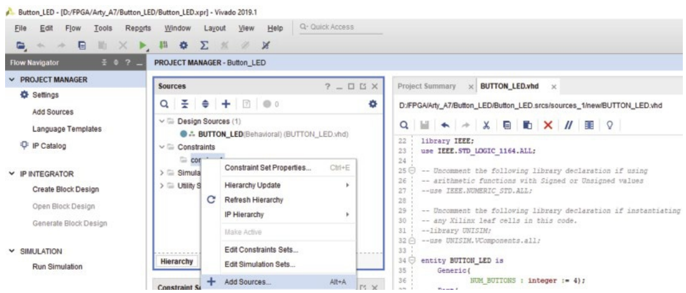

Hình 6.2 Chọn tùy chọn Add Sources….

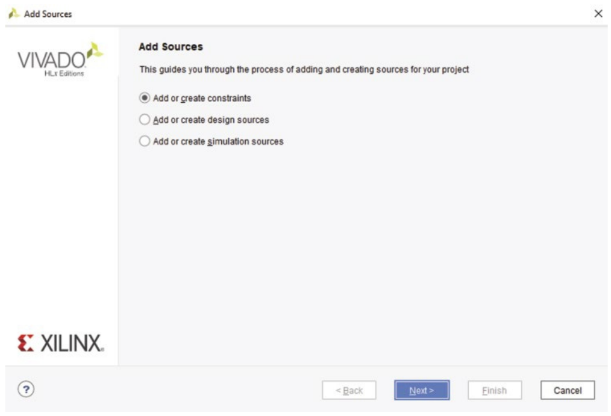

Hình 6.3 Chọn Add or Create Constraints.

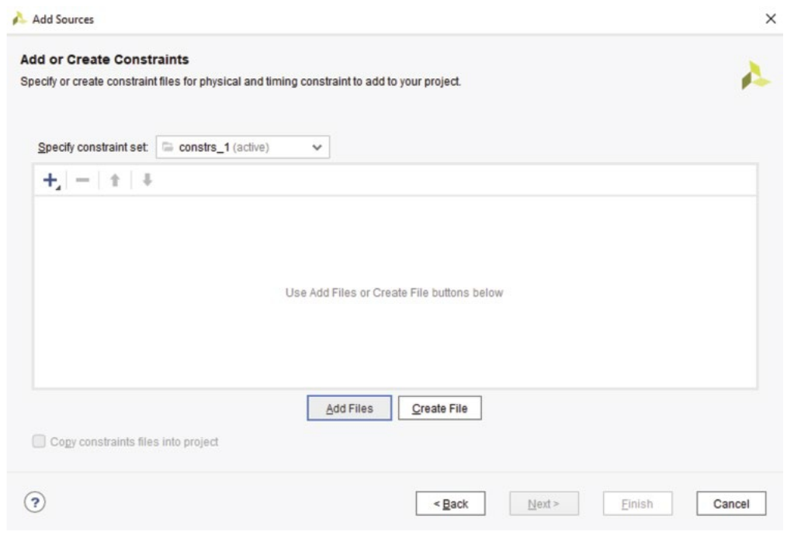

Hình 6.4 Click vào button Add Files.

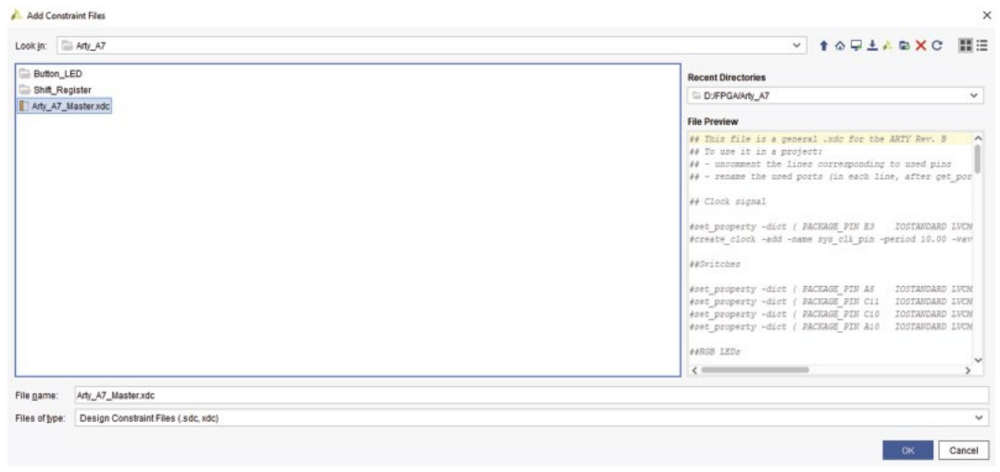

Hình 6.5 Chọn master constraints file cho Arty A7.

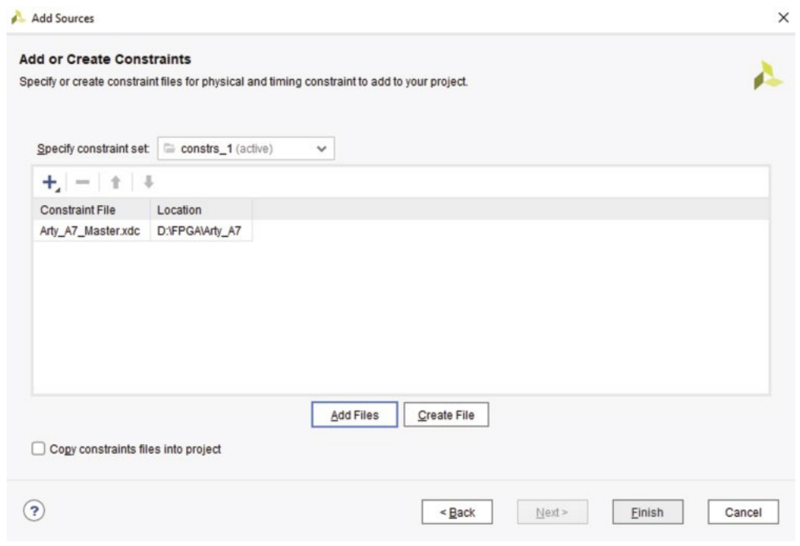

Hình 6.6 Click vào button Finish.

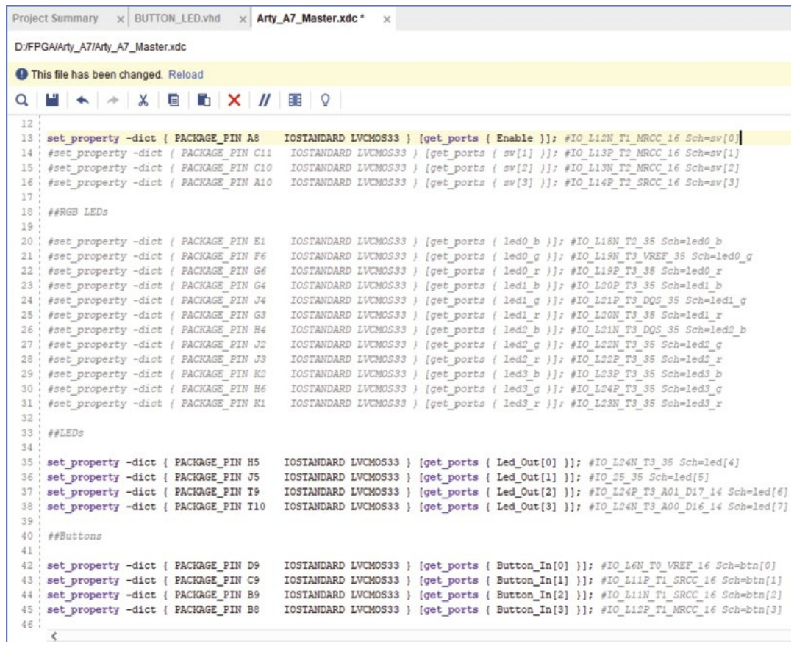

Hình 6.7 Các port đã bỏ comment trong Arty_A7_Master.xdc.

Tại thời điểm này, thiết kế của chúng ta đã sẵn sàng để tạo programming file. Chúng ta đã hoàn thành thiết kế VHDL, và tất cả các input và output đều đã được định nghĩa trong file “.xdc”. Generic không cần được định nghĩa trong file này vì nó không phải input hay output, và nó không được nối với chân cụ thể nào trên FPGA thực tế. Đó là mọi thứ bạn cần làm để ánh xạ hay bố trí IO cho FPGA trong Vivado.

## 6.4 Tạo programming file cho Xilinx

Mục này nói về việc tạo programming file cho Xilinx. Ở đây, chúng tôi sẽ hướng dẫn bạn các bước cần thiết để tạo programming file cho một development board của Xilinx. Programming file của Xilinx là một file .bit hay bit, và file này chứa toàn bộ dữ liệu cấu hình được tạo ra từ thiết kế VHDL, các constraint về vị trí pin-out, timing constraint, và hơn thế nữa. Nó dùng toàn bộ thông tin này để cấu hình FPGA hoạt động chính xác như đã chỉ định. Các bước để tạo file này bắt đầu bằng việc bảo đảm một design file top-level đã được định nghĩa. Trong trường hợp này, design file top-level là một file VHDL. Tuy nhiên, nó cũng có thể là một block design, IP core hoặc bất cứ thứ gì bạn có trong thiết kế top-level. Bạn sẽ nhận ra nó nhờ ba hình vuông – hai màu xanh dương và một màu xanh lá ở trên. Nếu chọn và right-click, bạn có thể dùng set as top-level file. Tuy nhiên, nó đã nhận diện sẵn, Vivado đủ thông minh để biết file top-level. Ngoài ra, bạn cũng sẽ cần có một constraints file trước khi tạo programming file hay file .bit. Chúng ta đã có sẵn một file ở đó, như được thể hiện trong Hình 6.8.

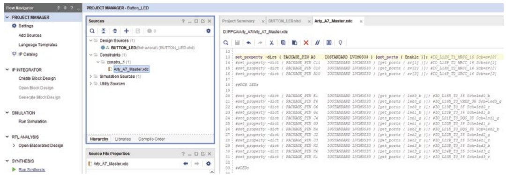

Hình 6.8 Constraints file.

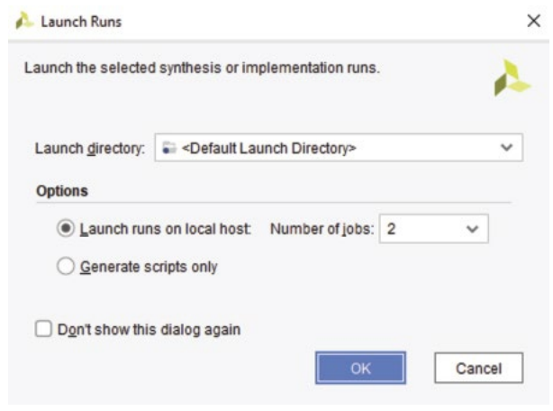

Hình 6.9 Cửa sổ Launch Runs.

Một constraints file chứa các vị trí pin-out, timing constraint, và bất kỳ loại constraint nào khác mà bạn muốn áp dụng cho project. Chúng được định nghĩa trong file .xdc. Vậy, bước đầu tiên là click Run Synthesis, như được thể hiện trong Hình 6.8. Thao tác này sẽ mở ra một cửa sổ nhỏ, như được mô tả trong Hình 6.9. Chỉ cần click OK, vì chúng ta sẽ chạy synthesis.

Synthesis là quá trình phân tích thiết kế VHDL để kiểm chứng rằng bạn có cú pháp đúng và thiết kế có ý nghĩa về mặt logic. Có một số bước liên quan, và bất kể bạn dùng loại công cụ nào, bạn sẽ cần synthesize thiết kế rồi thực hiện fitting hay implementation. Ở bước tiếp theo, nó sẽ hỏi chúng ta có muốn implement thiết kế hay không, như được minh họa trong Hình 6.10.

Giờ synthesis đã hoàn thành thành công, và không có lỗi hay cảnh báo nào, điều này có nghĩa là code VHDL của chúng ta đúng cú pháp, và compiler – hay synthesizer của Vivado – hiểu nó và có thể hiện thực thiết kế VHDL mà chúng ta đã mô tả. Vậy bây giờ, chúng ta muốn chạy implementation. Nó sẽ mở ra một cửa sổ nhỏ, như được mô tả trong Hình 6.9, và chúng ta sẽ click OK vì chúng ta sẽ chạy implementation. Bước này sẽ lấy thiết kế đã synthesize và cố gắng fit nó lên thiết bị thực tế. Bạn có thể có một thiết kế VHDL vượt qua synthesis nhưng chiếm quá nhiều tài nguyên đến mức bạn không thể thực sự fit nó lên development board FPGA. Nếu điều đó xảy ra, bạn sẽ nhận một failure hay lỗi, nói rằng, “Hey, implementation thất bại vì chúng tôi không thể fit nó lên thiết kế đó.” Ví dụ, nó có thể chiếm hơn 100% lookup table hoặc có thể định nghĩa nhiều IO hơn số có sẵn trên FPGA đó, điều này sẽ dẫn đến thất bại ở bước đó. Nếu file .xdc của bạn không định nghĩa bất kỳ IO nào, nó sẽ đưa ra rất nhiều cảnh báo. Nó sẽ chỉ ra rằng dù thiết kế có thể được implement, nó không biết đặt các input hay output ở đâu trên FPGA. Vậy, trong trường hợp này, implementation của chúng ta đã hoàn thành thành công, như được thể hiện trong Hình 6.11.

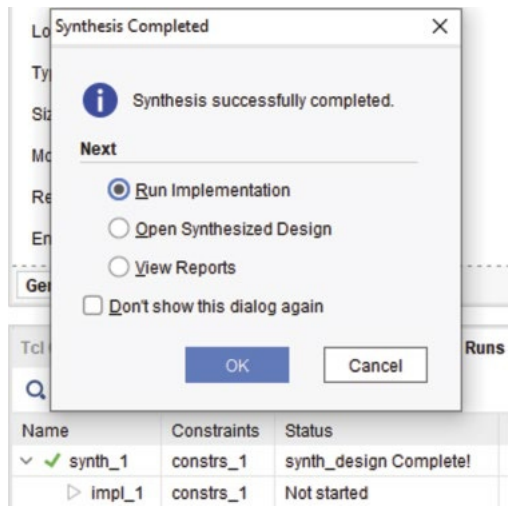

Hình 6.10 Synthesis đã hoàn thành và cửa sổ Run Implementation.

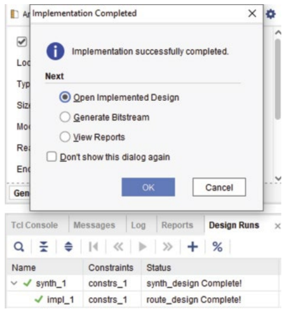

Hình 6.11 Implementation hoàn thành thành công.

Vậy, khi bạn đi qua các bước khác nhau, bạn có thể thấy chúng ta đã vượt qua synthesis mà không có lỗi hay cảnh báo nào và implementation đã hoàn thành thành công. Bước cuối cùng là tạo bitstream.

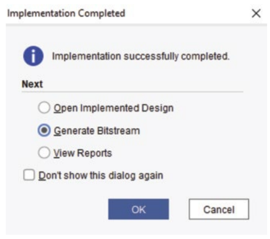

Hình 6.12 Chọn Generate Bitstream.

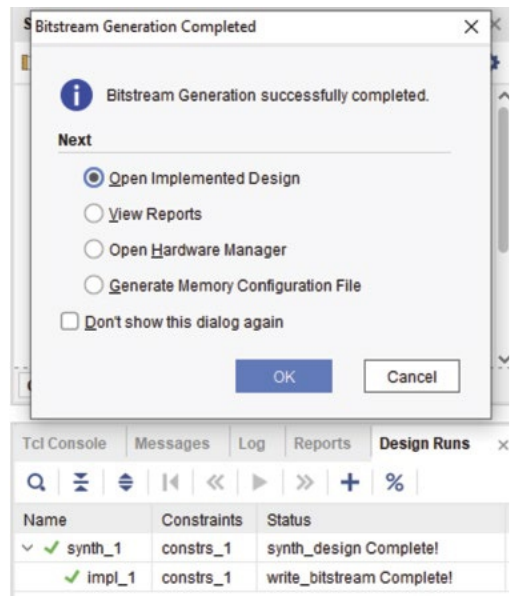

Hình 6.13 Bitstream generation đã hoàn thành.

Click vào Generate Bitstream và chọn OK, như được thể hiện trong Hình 6.12. Quá trình này lấy thiết kế đã synthesize và implement rồi tạo ra file “.bit” hay file bitstream, mà chúng ta sẽ dùng để nạp chương trình cho board hay thiết bị Xilinx thực tế.

Rất nhiều khi, khi bạn làm việc với Code C/C++, người ta có xu hướng tập trung vào số dòng code hoặc lượng bộ nhớ mà nó chiếm. Tuy nhiên, với FPGA, mọi thứ chỉ quy về việc thiết kế dùng bao nhiêu tài nguyên, và điều đó tạo ra khác biệt lớn. Bạn có thể có rất nhiều dòng code hoặc chỉ vài dòng, nhưng điều đó không nhất thiết tạo ra khác biệt lớn. Bây giờ, bitstream generation của chúng ta đã hoàn thành, như được mô tả trong Hình 6.13.

Lúc này, chúng ta sẽ muốn click vào Open Hardware Manager rồi chọn OK, như được minh họa trong Hình 6.14.

Thao tác này mở Hardware Manager, là thứ mà lúc này bạn sẽ dùng để thực sự nạp chương trình cho thiết bị vật lý như được thể hiện trong Hình 6.15.

Cho đến giờ, chúng ta đã chạy synthesis, hoàn thành implementation, rồi tạo bitstream. Nếu nhìn vào phía bên trái giao diện Vivado, bạn sẽ thấy Flow Navigator, thứ phác thảo flow của project. Ở ngay đầu, bạn có thể thấy project settings. Đây là nơi bạn có thể định nghĩa các tham số tùy thuộc vào loại project hoặc một thiết bị cụ thể. Nếu bạn có các constraint cụ thể như clock hoặc bất cứ thứ gì hoàn toàn cụ thể và cần thiết, bạn vào project settings để thiết lập. Đây cũng là nơi chọn chip mà bạn nhắm tới – là Zynq, Artix hay bất kỳ thiết bị nào khác trong dòng Xilinx. Tiếp theo, bạn có Add Sources, nơi bạn có thể thêm các file VHDL hoặc Verilog. Nó cũng phần nào đi kèm với IP catalog, nơi bạn cũng có thể thêm một IP, về cơ bản là một biểu diễn block diagram của VHDL. Vậy, chúng ta có thể tạo một block design, và bạn sẽ thả các IP này vào đó từ IP catalog. Sau đó, từ đó, bạn sẽ tạo một file VHDL trở thành source file top-level. Rồi bạn có thể nối VHDL của riêng mình vào, hoặc bạn có thể lấy VHDL của riêng mình và tạo một IP. Sau đó, bạn sẽ có simulation. Nếu bạn muốn mô phỏng thiết kế, đó sẽ là bước tiếp theo. Sau đó, có RTL analysis. Nếu bạn muốn xem và phân tích thiết kế, nó có thể sẽ cho bạn một số gợi ý về những việc bạn có thể làm tiếp. Điều then chốt bạn cần làm để thực sự nạp chương trình là chạy synthesis, chạy implementation, rồi tạo bitstream. Đó là ba bước then chốt bạn cần làm. Nhưng nếu nhìn vào Flow Navigator, chúng được liệt kê ngay ở đó, và rất dễ để nói, “OK, chạy synthesis, chạy implementation và tạo bitstream.” Sau mỗi bước, họ đưa ra một hộp thoại giúp bạn và hỏi, “Bạn muốn làm gì tiếp theo?” Bạn muốn xem thiết kế hay muốn chạy implementation? OK, giờ implementation đã hoàn tất – bạn muốn xem các cảnh báo hay muốn tạo bitstream? Vậy, chúng ta sẽ đóng hardware manager và quay lại xem các message đã nhận. Nếu click vào messages, nó cho thấy chúng ta có ba cảnh báo. Vậy, chúng ta sẽ bỏ chọn các info message, và nó cho biết chúng ta có ba cảnh báo. Trong Route Design, nó nói rằng không có timing constraint user-specific nào. Timing constraint là cần thiết cho việc timing analysis đúng đắn. Cảnh báo tiếp theo nói rằng không tìm thấy clock user-defined nào trong thiết kế. Đó là vì, với project cụ thể này, chúng ta không có clock nào, và do đó không có timing constraint nào. Và vì tôi đang nhấn một button và xem nó xuất ra LED nhanh đến mức nào, chúng ta không lo lắng, nên chúng ta đã không đặt timing constraint vào file. Tuy nhiên, nếu muốn loại bỏ các cảnh báo này, chúng ta sẽ đặt timing constraint vào file để loại bỏ chúng. Đây chỉ là các cảnh báo, vì vậy việc bạn có cảnh báo không có nghĩa là thiết kế của bạn sẽ không hoạt động. Đây chỉ là những điều Vivado muốn bạn lưu ý. Vậy, đó là các bước cần thiết để tạo programming file hay file .bit cho development board Xilinx của bạn.

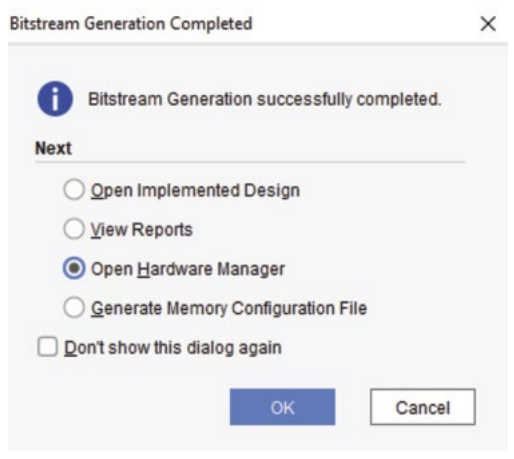

Hình 6.14 Chọn Open Hardware Manager.

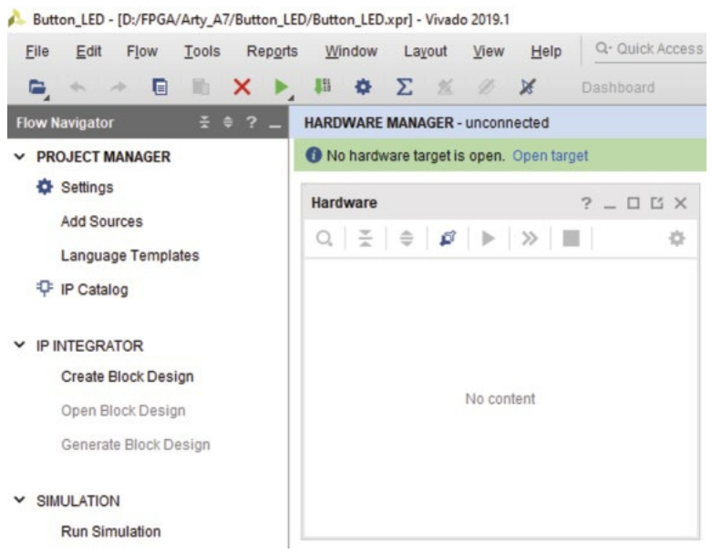

Hình 6.15 Mở Hardware Manager.

## 6.5 Simulation của project Button_LED

Mục này nói về việc chạy simulation trong Vivado. Ở đây, chúng tôi sẽ chỉ cho bạn cách dùng Vivado để mô phỏng project Button_LED. Để làm điều đó, chúng ta sẽ chọn simulation sources, right-click và click vào Add Sources. Hãy bảo đảm bạn chọn tùy chọn thứ ba “Add or create simulation sources,” như được mô tả trong Hình 5.4. Sau đó chúng ta sẽ click Next, và đó là simulation set được chỉ định, mà chúng ta sẽ để mặc định là sim_1. Sau đó, chúng ta sẽ tạo một file VHDL (test_Button_LED.vhd), như được minh họa trong Hình 6.16.

Tiếp theo, chúng ta click vào các button OK và Finish, và trong cửa sổ Define Module, chúng ta đặt tên architecture là “test” rồi click OK, như được thể hiện trong Hình 6.17.

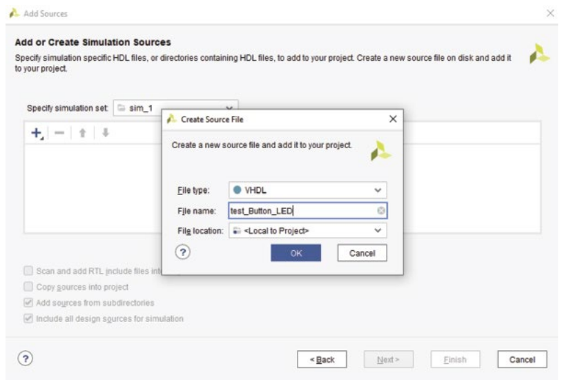

Hình 6.16 Tạo một file mới.

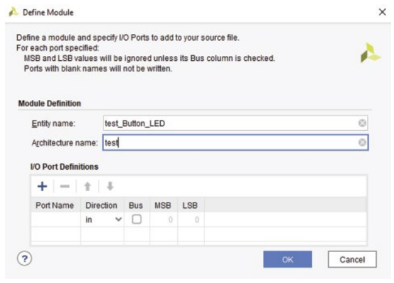

Hình 6.17 Đặt tên architecture là “test.”

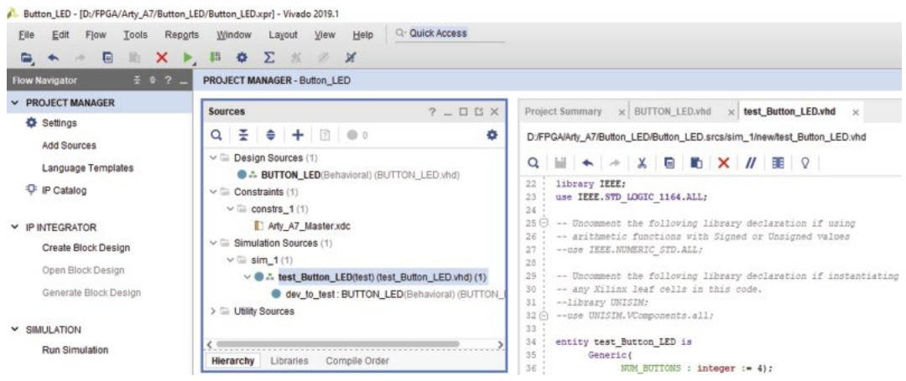

Hình 6.18 test_Button_LED.vhd là thiết kế top-level.

Sau đó, chúng ta có thể copy và paste code test bench đã thiết kế sau đây vào test_Button_LED.vhd. Sau khi cập nhật, nó nhận diện test_Shift_Reg là thiết kế top-level cho shift register của chúng ta *(ghi chú: sách in nguyên câu này từ chương shift register; ở đây đúng là test_Button_LED cho project Button_LED)*, như được thể hiện trong Hình 6.18.

```
library IEEE;
use IEEE.STD_LOGIC_1164.ALL;

entity test_Button_LED is
      Generic(
            NUM_BUTTONS : integer := 4);
--  Port ( );
end test_Button_LED;

architecture test of test_Button_LED is
component Button_LED
port(Led_Out: out std_logic_vector(NUM_BUTTONS - 1 downto 0);
     Button_In : in std_logic_vector(NUM_BUTTONS - 1 downto 0);
     Enable : in std_logic);
end component;
signal Led_Out: std_logic_vector(NUM_BUTTONS - 1 downto 0);
signal Button_In: std_logic_vector(NUM_BUTTONS - 1 downto 0) := (others => '0');
signal Enable: std_logic := '0';

begin
    dev_to_test: Button_LED
        port map(Led_Out, Button_In, Enable);
    data_stimulus: process
    begin
        wait for 10 ns;
        Button_In(0) <= not Button_In(0);
        wait for 10 ns;
        Button_In(1) <= not Button_In(1);
        wait for 10 ns;
        Button_In(2) <= not Button_In(2);
        wait for 10 ns;
        Button_In(3) <= not Button_In(3);
        wait for 50 ns;
        wait for 10 ns;
        Button_In(0) <= not Button_In(0);
        wait for 10 ns;
        Button_In(1) <= not Button_In(1);
        wait for 10 ns;
        Button_In(2) <= not Button_In(2);
        wait for 10 ns;
        Button_In(3) <= not Button_In(3);
        wait for 50 ns;
        wait for 10 ns;
        Button_In(0) <= not Button_In(0);
        wait for 10 ns;
        Button_In(1) <= not Button_In(1);
        wait for 10 ns;
        Button_In(2) <= not Button_In(2);
        wait for 10 ns;
        Button_In(3) <= not Button_In(3);
        wait for 10 ns;
        Enable <= '1';
    end process data_stimulus;
end test;
```

Vậy, bước tiếp theo là chạy simulation. Tuy nhiên, trước khi làm điều đó, chúng ta cần cấu hình simulation settings, mở ra một số thiết lập cơ bản cho simulation. Chúng ta sẽ mở Tools → Settings…, với simulation settings, như được mô tả trong Hình 5.8. Giá trị duy nhất khác mà chúng ta sẽ thay đổi nằm trong tab Simulation. Chúng ta sẽ đặt runtime là 300 ns, rồi click Apply, như được minh họa trong Hình 6.19.

Bây giờ, chúng ta sẽ chọn Run Behavioral Simulation, như được thể hiện trong Hình 5.10. Khi đã vào trong công cụ simulation, như thấy trong Hình 6.20, chúng ta có thể quan sát thấy test_Button_LED đang chạy, mô phỏng dev_to_test. Nó hiển thị tất cả các signal liên quan: Led_Out, Button_In và Enable. Nếu nhìn sang bên phải, chúng ta có thể thấy các waveform. Right-click vào waveform và chọn Full View, như được thể hiện trong Hình 6.20.

Như vậy là hoàn tất tất cả các bước cần thiết để chạy simulation của project Button_LED trong Vivado.

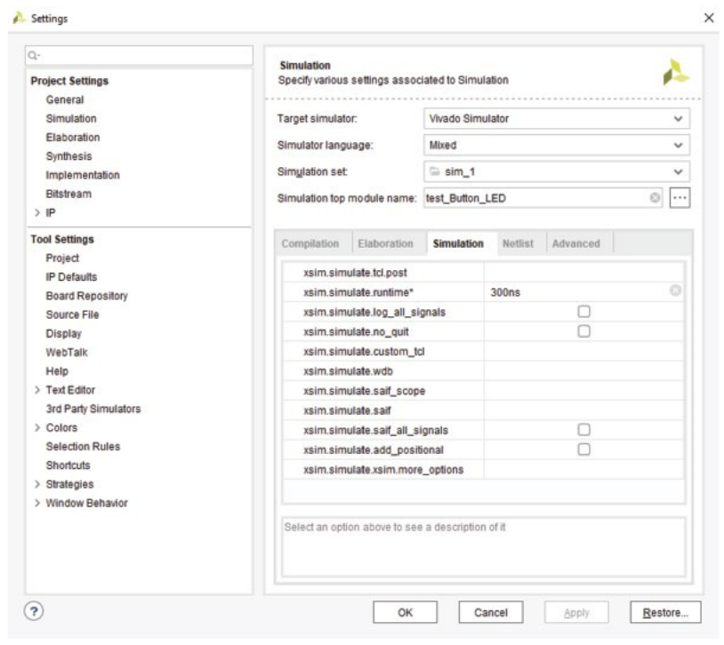

Hình 6.19 Đặt runtime của simulation là 300 ns.

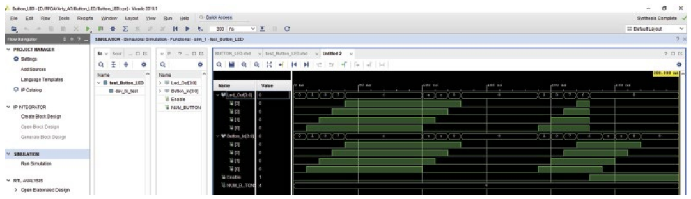

Hình 6.20 Cửa sổ Behavioral Simulation.
