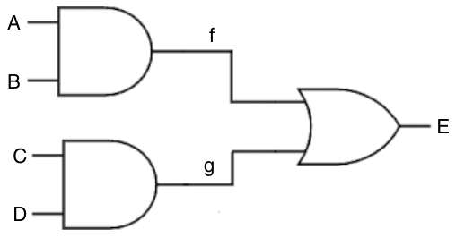
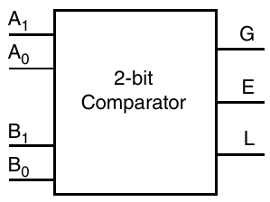
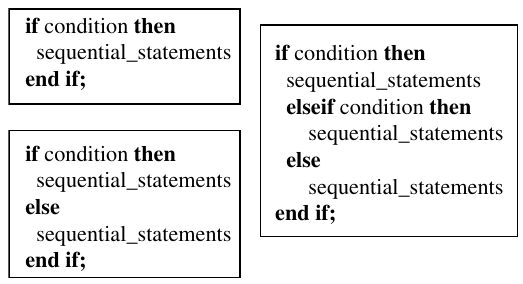
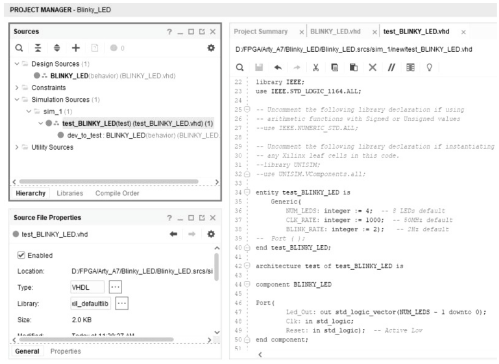
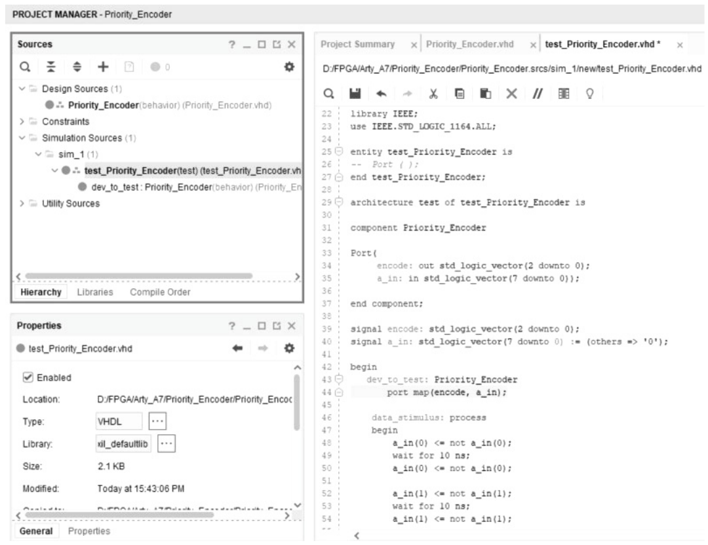
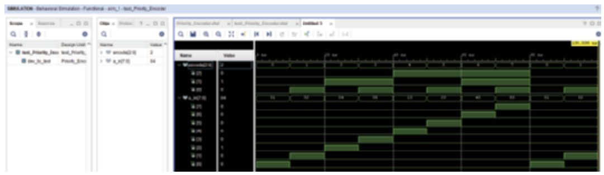
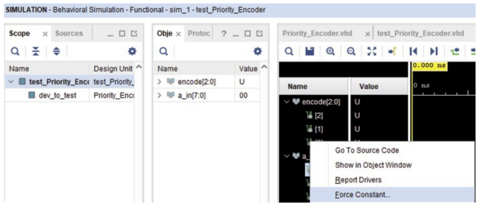
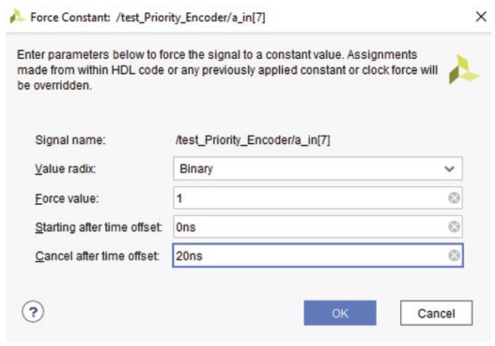
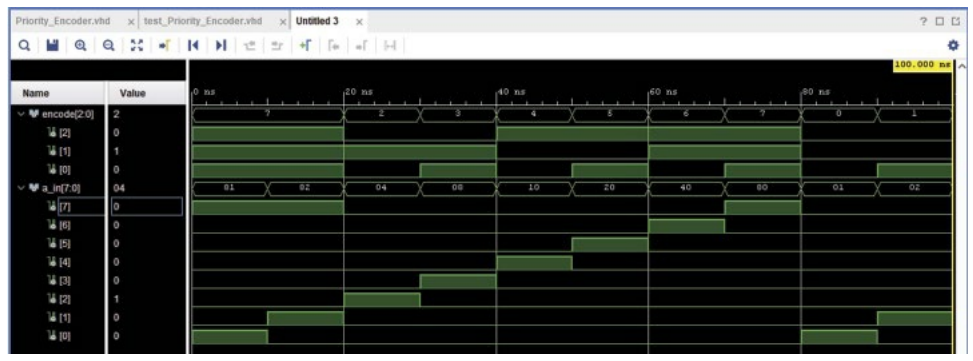
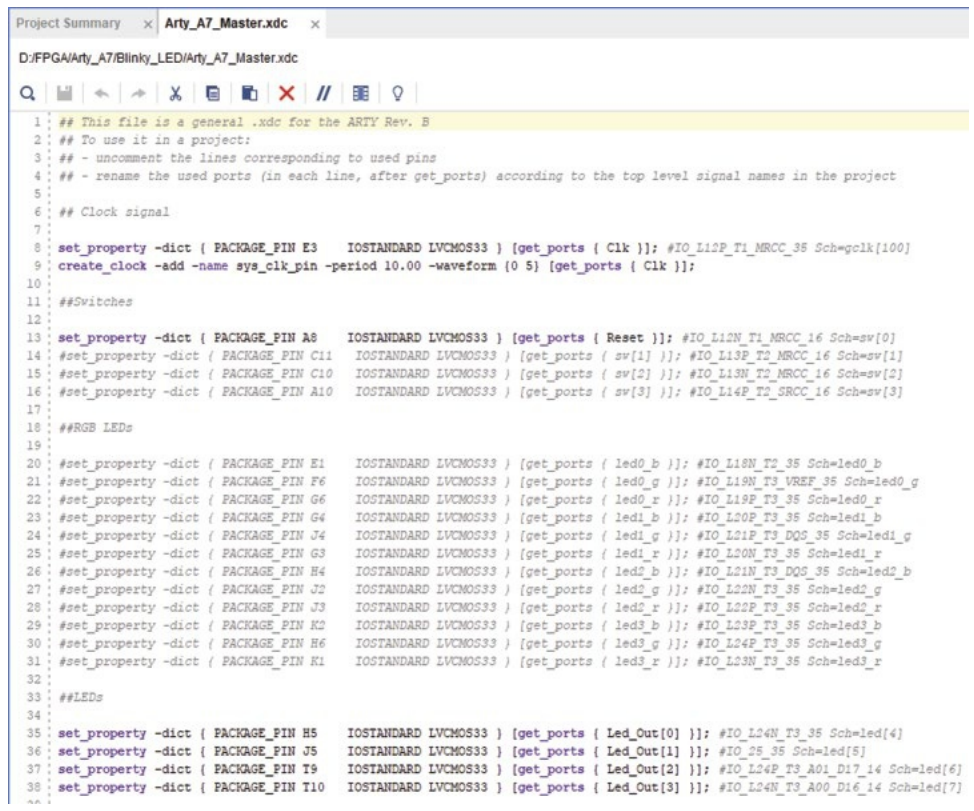

# 7 Project Blinky LEDs

## 7.1 Giới thiệu

Trong chương này, chúng ta sẽ điểm lại một số statement của VHDL, bao gồm constant và signal, VHDL process, VHDL if statement, cũng như một ví dụ về độ ưu tiên của if statement. Cuối cùng, project blinky LEDs được triển khai với development board Arty A7 bằng Vivado.

## 7.2 Constant và signal

Mục này nói về signal và constant. Trong mục này, chúng ta sẽ giải thích signal cũng như constant được dùng thế nào trong VHDL. Một signal hay constant không phải là một data type. Bạn có thể có một constant là integer, standard logic hoặc standard logic vector. Tương tự, bạn có thể có một signal là integer, standard logic hoặc standard logic vector. Như vậy, signal và constant là các loại object trong VHDL mà chúng ta dùng để định nghĩa thiết kế. Đầu tiên, chúng ta sẽ bắt đầu với constant. Điều constant làm được trong ngôn ngữ VHDL là cho bạn khả năng có code được tài liệu hóa tốt hơn. Ví dụ, nếu bạn dùng một baud rate xuyên suốt thiết kế, bạn có thể chỉ cần gõ thẳng giá trị đó. Vậy, nếu bạn chạy ở 9600, tức baud rate 9600 bit mỗi giây, bạn có thể gõ giá trị đó ở mọi chỗ bạn muốn có baud rate. Nhưng nếu bạn dùng một constant, nó giúp code dễ đọc hơn nhiều, khi ở một dòng bạn tính baud rate là bao nhiêu hoặc bạn định nghĩa một constant, chẳng hạn như một integer ứng với một baud rate cụ thể, rồi ở mọi chỗ khác trong code nơi bạn tham chiếu baud rate đó, bạn chỉ cần dùng tên constant. Vậy, điểm lớn của constant – điều then chốt cần biết – là nó cho phép bạn tài liệu hóa code tốt hơn nhiều, và code trông dễ hiểu hơn nhiều. Khi bạn quay lại sau và xem code, bạn sẽ có thể hiểu chuyện gì đang diễn ra rõ ràng hơn. Cú pháp cho constant chỉ là viết ra chữ “constant”. Để định nghĩa nó, bạn viết “constant”, rồi tên constant, một dấu hai chấm, data type của constant, một dấu bằng, và cuối cùng là một dấu chấm phẩy. Chúng tôi sẽ đưa ra một số ví dụ về cách định nghĩa constant. Thứ tiếp theo chúng ta nói đến là signal. Signal khác với constant. Đó là một object mà bạn định nghĩa trong thiết kế. Signal được dùng để nối các phần khác nhau của một thiết kế – bạn có thể coi chúng như các dây nối bên trong. Trong một thiết kế vật lý trên breadboard, bạn dùng dây nối; còn trong VHDL, bạn dùng signal. Ví dụ, entity của một thiết kế có thể được nối với entity của một thiết kế khác bằng signal. Đó là một cách để nối dữ liệu động giữa các thiết kế. Vậy, nếu bạn có hai cổng AND, và output của một cổng AND đi tới input của cổng AND kia, thì đó sẽ là một signal vì đó là dữ liệu động. Giá trị đó liên tục thay đổi dựa trên các input. Keyword để định nghĩa signal chỉ đơn giản là signal. Bạn đặt cho nó một tên signal, theo sau là dấu hai chấm, rồi kiểu signal, có thể là integer (unsigned hoặc signed), standard logic vector, hoặc standard logic. Sau đó bạn có thể tùy chọn gán cho nó một giá trị khởi tạo bằng dấu hai chấm bằng. Nếu bạn không cho nó giá trị khởi tạo, compiler sẽ resolve nó thành một giá trị mặc định hoặc thành bất kỳ giá trị nào bạn chỉ định trong lúc reset, giá trị đó trở thành giá trị khởi tạo của signal. Bây giờ, hãy lấy một ví dụ và đi qua một ví dụ về signal và constant. Thứ đầu tiên chúng ta sẽ xem là một ví dụ về signal. Trước khi làm điều đó, chúng ta sẽ phác thảo một thiết kế số sơ bộ. Nó sẽ gồm hai cổng AND và một cổng OR, như được thể hiện trong Hình 7.1 . Đây chỉ là một thiết kế VHDL rất cơ bản.



Hình 7.1 Thiết kế số với hai cổng AND và một cổng OR.

Vậy, chúng ta có ba cổng logic, và chúng ta biết mình có entity, định nghĩa các input và output. Chúng ta có bốn input, mà chúng ta sẽ gọi là A, B, C và D, và chúng ta sẽ có một output, mà chúng ta sẽ gọi là E. Vậy, entity của chúng ta sẽ định nghĩa bốn input này – A, B, C và D – cũng như output E. Bây giờ, chúng ta có hai signal đi ra từ output của các cổng AND, và chúng đi tới input của cổng OR. Đây là những thứ mà chúng ta gọi là signal, vì các input và output đã được định nghĩa, nhưng các signal bên trong này đang truyền dữ liệu động. Chúng ta sẽ đặt tên các signal này là f và g, và như vậy, đó sẽ là các signal của chúng ta. Từ góc nhìn VHDL, chúng ta có entity, định nghĩa các input trong trường hợp này và một output duy nhất, architecture, định nghĩa hai cổng AND và một cổng OR, và phần bên trong architecture, định nghĩa hai signal f và g. Đây là một ví dụ về cách signal được dùng. Bạn có thể coi chúng như các dây nối bên trong thiết kế logic thực tế. Thứ tiếp theo chúng ta xem là constant – bạn dùng constant như thế nào và tại sao? Có nhiều cách khác nhau để dùng constant. Trong ví dụ này, chúng ta sẽ dùng một comparator. Giả sử chúng ta có một comparator two-bit. Vậy, comparator two-bit phải có bốn input. Chúng ta sẽ có các input A và B, và vì đây là comparator two-bit, A và B đều là hai bit, và chúng ta cần bảo đảm chỉ định rằng chúng là hai bit. Cách comparator hoạt động là nó sẽ so sánh các input A và B và xuất ra lớn hơn, bằng, hoặc nhỏ hơn. Vậy, chúng ta sẽ đặt nhãn chúng là G, E và L, như được thể hiện trong Hình 7.2 .

Vậy, nếu A lớn hơn B, mà ở đây chúng ta sẽ định nghĩa bằng hai bit, thì chúng ta có giá trị một ở output G. Nếu A bằng B, thì chúng ta sẽ có giá trị một ở output E, và nếu A nhỏ hơn B, chúng ta sẽ có giá trị một ở output L. Bây giờ, trong trường hợp này, chúng ta sẽ nói entity của mình chỉ là A và B, cùng với G, E và L. Vậy, trong trường hợp này, chúng ta có B này, là một giá trị bên trong. Với trường hợp cụ thể này, nếu chúng ta làm B thành một signal, chúng ta sẽ phải nối nó cố định vào một thứ khác. Vì vậy, bạn có thể cho nó một giá trị khởi tạo và nó không bao giờ thay đổi, mà trong trường hợp đó, theo định nghĩa, chính là một constant. Vậy, với trường hợp này, nếu muốn làm B thành một constant, chúng ta có thể viết code sau.

```
constant B: std_logic_vector(1 downto 0) := “11”;
```

Vậy, trong trường hợp này, chúng ta biết mình có B, là “11.” Chúng ta đã định nghĩa constant B là một standard logic vector, nên ở bất kỳ đâu chúng ta dùng B trong thiết kế, nó sẽ là một giá trị two-bit “11,” hay 3 trong trường hợp này. Mặt khác, A thay đổi vì nó là một phần của entity. Vậy, giá trị này (A) thay đổi, và nó sẽ luôn được so sánh với constant B, được định nghĩa là “11.” Dựa trên phép so sánh đó, output của chúng ta sẽ là lớn hơn, bằng hoặc nhỏ hơn – đó là một ví dụ về một cách cơ bản để dùng constant trong thiết kế VHDL. Thứ tiếp theo chúng ta sẽ xem là thực sự chọn và xác định những constant và signal mà chúng ta muốn dùng bên trong thiết kế cho project blinky LEDs. Vậy, chúng ta mở project blinky LEDs và thiết kế VHDL BLINKY_LED thực tế, như được mô tả trong code sau.



Hình 7.2 Comparator two-bit.

```
-- Libraries
library IEEE;
use IEEE.STD_LOGIC_1164.ALL;
use IEEE.numeric_std.all;
use IEEE.math_real.all;
-- Entity
entity BLINKY_LED is
    Generic(
        NUM_LEDS: integer := 4;  -- 8 LEDs default
        CLK_RATE: integer := 100000000;  -- 50MHz default
        BLINK_RATE: integer := 2);   -- 2Hz default
    Port(
        Led_Out: out std_logic_vector(NUM_LEDS – 1 downto 0);
        Clk: in std_logic;
        Reset: in std_logic);  -- Active Low
end BLINKY_LED;
-- Architecture
architecture behavior of BLINKY_LED is
begin

end behavior;
```

Chúng ta muốn thiết lập entity, và các library đã được định nghĩa trong các package. Chúng ta đã định nghĩa architecture, ngoại trừ việc thực ra chưa có gì bên trong nó. Để dùng constant và signal bên trong architecture, chúng ta cần định nghĩa chúng trước statement begin. Vậy, trước begin và sau keyword architecture, chúng ta muốn đặt các signal và constant của mình. Việc đầu tiên chúng ta muốn làm là định nghĩa các constant. Chúng ta sẽ bắt đầu bằng việc định nghĩa một constant gọi là maximum value. Nó sẽ được dùng để tính giá trị đếm cần thiết để đạt được blink rate, thứ chúng ta đã định nghĩa trong entity. Chúng ta sẽ tính giá trị đếm này để xác định blink rate từ generic bằng cách lấy clock rate chia cho blink rate, cho ra giá trị tối đa mà chúng ta cần tính, vì chúng ta cần đếm để đạt được blink rate đã chỉ định. Bước tiếp theo là tạo một constant gọi là bit depth, constant này sẽ xác định số bit cần thiết để đếm tới giá trị bất kỳ, vì giá trị đếm của chúng ta sẽ thay đổi, và nó dựa trên clock rate và blink rate, nên số bit cần thiết để đếm cũng sẽ thay đổi, như code sau.

```
-- Architecture
architecture behavior of BLINKY_LED is
constant MAX_VAL: integer := CLK_RATE / BLINK_RATE;
constant BIT_DEPTH: integer := integer(ceil(log2(real(MAX_VAL))));
signal count_reg: unsigned(BIT_DEPTH – 1 downto 0) := (others => ‘0’);
signal led_reg: std_logic_vector(NUM_LEDS – 1 downto 0) := “0000”;
begin

end behavior;
```

Vậy, bit depth đó sẽ cho chúng ta biết cần bao nhiêu bit để đếm tới giá trị tối đa. Thứ tiếp theo chúng ta sẽ cần là một signal, mà chúng ta sẽ gọi là “count_reg”. Nó sẽ được dùng để giữ giá trị đếm thực tế. Khi chúng ta tăng biến đếm, giá trị sẽ được lưu bên trong signal này. Vậy, chúng ta muốn nó là một signal vì nó sẽ liên tục thay đổi. Nếu chúng ta làm nó thành constant, chúng ta không bao giờ có thể thay đổi nó. Vì vậy, cái này phải là signal và chúng ta sẽ cho nó kiểu unsigned. Lý do chúng ta dùng unsigned là nó cho phép chúng ta thực hiện các phép cộng và trừ trên nó. Với standard logic vector, bạn không thể lấy một standard logic vector rồi cộng một vào nó, vì bạn phải tự tay làm điều đó. Vì vậy, kiểu unsigned dễ hơn nhiều cho các loại thao tác đếm, và chúng ta muốn cho nó đi từ bit depth trừ một xuống không, và chúng ta sẽ cho nó giá trị khởi tạo là không. Vì chúng ta không biết depth là bao nhiêu, chúng ta không thể tự gõ ra tất cả các số không. Do đó, chúng ta sẽ phải dùng keyword others, và nó sẽ chọn tất cả các bit mà chúng ta chưa định nghĩa, mà trong trường hợp này là tất cả, và chúng ta sẽ đặt tất cả chúng về giá trị mà chúng ta chỉ định, ở đây là đặt tất cả các giá trị về không. Bây giờ, chúng ta cần thêm một signal nữa, và signal này sẽ là cái mà chúng ta gọi là led_reg hay LED register, sẽ giữ giá trị được xuất ra các LED. Vậy, nó sẽ là một standard logic vector, và chúng ta sẽ cho nó đi từ số LED (NUM_LEDS) trừ một xuống không, và chúng ta sẽ cho nó một giá trị khởi tạo trong trường hợp này, vì chúng ta biết rằng số LED mà chúng ta đã định nghĩa trong trường hợp này là bốn. Nếu bạn có tám, bạn phải đặt tám số không ở đây. Tuy nhiên, trong trường hợp này, chúng ta có bốn LED. Chúng ta cũng có thể dùng keyword others. Nhưng lý do chúng ta chọn ghi các số không là nếu muốn nó toggle theo kiểu khác, thay vì toàn không và toàn một, chúng ta muốn nó là 1010, thì có thể làm điều đó chỉ bằng cách thay đổi định nghĩa signal “led_reg.” Tại thời điểm này, chúng ta có thiết kế blinky LED bốn đèn, và chúng ta đã định nghĩa trong file thiết kế VHDL các constant và signal cần cho project. Lúc này, tất cả những gì chúng ta sẽ làm là cập nhật comment để bao gồm chúng. Nhưng chúng tôi sẽ để việc đó cho bạn, vì bạn có thể thêm bất cứ điều gì hợp lý nhất để giúp bạn quay lại sau và hiểu các constant và signal này thực sự đang làm gì.

## 7.3 VHDL process

Mục này nói về VHDL process. Trong mục này, chúng ta sẽ giải thích process trong VHDL là gì. Trong VHDL, chúng ta có thể dùng các statement logic như cổng AND, cổng OR hoặc bất kỳ loại phép toán nào, và chúng được đánh giá tức thời. Ví dụ, nếu chúng ta có một cổng AND với hai input và một output, bất cứ khi nào một trong các input thay đổi, output thay đổi gần như ngay lập tức. Tuy nhiên, nếu chúng ta muốn một điều gì đó xảy ra vào một thời điểm cụ thể hoặc để phản hồi một sự kiện cụ thể, chẳng hạn một signal thay đổi, chúng ta sẽ dùng một VHDL process. Vậy, điều các process này làm là định nghĩa một phần của thiết kế mà bạn muốn được đánh giá mỗi khi một signal nhất định thay đổi trạng thái. Một VHDL process có nhiều phần. Đầu tiên, có process label, dùng để đặt tên cho process. Khi bạn có nhiều process trong thiết kế, việc đặt label giúp bạn dễ dàng nhận diện từng process. Sau đó, có sensitivity list. Bên trong sensitivity list, bạn đưa vào tất cả các signal mà bạn muốn theo dõi. Bất cứ khi nào chúng thay đổi, bạn đánh giá process. Phổ biến nhất là signal clock được đưa vào sensitivity list. Vậy, bạn muốn process được đánh giá mỗi khi clock thay đổi. Khi clock chuyển từ trạng thái low lên trạng thái high, process được đánh giá; tương tự, nếu clock đi từ high xuống low, bạn sẽ đánh giá lại process, và cũng theo cách đó, bạn có thể đặt bất kỳ loại signal nào vào đó. Ví dụ, nếu bạn có một standard logic vector với tám phần tử, bạn có thể đưa nó vào sensitivity list. Khi bất kỳ phần tử nào trong standard logic vector đó đi từ low lên high hoặc từ high xuống low, bạn sẽ đánh giá process đó, và như vậy lần duy nhất một khối process được đánh giá là khi bất kỳ signal nào trong sensitivity list thay đổi. Cú pháp của một VHDL process statement được minh họa trong Hình 7.3.

```
[process_label:] process (sensitivity_list)
    process_declarations
    begin
    sequential_statements
    end process [process_label];
```

Hình 7.3 Cú pháp của VHDL process statement.

Chúng ta có process label, là tùy chọn. Bạn không bắt buộc phải đặt label – bạn có thể chỉ gọi nó là process. Nhưng nhiều khi, chúng tôi nghĩ tốt nhất là thực sự đặt label cho nó. Nó giúp code dễ đọc hơn, và khi quay lại, bạn có thể thêm comment cho nó. Hơn nữa, label giúp giải thích điều gì đang diễn ra. Vậy, nếu process của bạn đang đếm, thì hợp lý khi đặt tên kiểu count rồi process, để khi quay lại xem qua, bạn có thể nói, “OK, process này đang triển khai một counter.” Tiếp theo, bạn phải có dấu hai chấm rồi keyword process, và sau đó bên trong dấu ngoặc bạn muốn chèn một sensitivity list, nơi bạn đưa vào tất cả các signal mà bạn muốn theo dõi. Bất cứ khi nào bất kỳ signal nào trong sensitivity list đó thay đổi từ high xuống low, bạn sẽ đánh giá mọi thứ bên trong process. Bên dưới đó, bạn có các process declaration. Đây là nơi bạn có thể khai báo variable, signal hoặc constant. Nếu bạn khai báo chúng trong danh sách này, chúng sẽ chỉ được thấy bên trong process thực tế chứ không phải trong toàn bộ thiết kế. Như chúng ta biết từ phần signal và constant, khi đã định nghĩa chúng trước statement begin của architecture, giờ chúng ta có thể đánh giá và dùng chúng bên trong process statement. Sau đó chúng ta có begin, được gọi là phần sequential statement. Sau begin là nơi chúng ta có thể đưa vào các construct như if statement hoặc bất kỳ loại statement nào khác đánh giá output của process phải là gì. Sau đó chúng ta dùng end process, hoàn tất cặp begin–end của VHDL process. Sau đó, bạn đưa process label vào lần nữa để chỉ ra rằng process được định nghĩa trước đó chính thức kết thúc. Khi bạn mở project blinky LED (BLINKY_LED), chúng ta sẽ thêm các process vào project. Chúng ta đã có library và entity được định nghĩa, cũng như architecture. Chúng ta đã định nghĩa các constant và signal sẽ dùng. Bây giờ, chúng ta cần định nghĩa các process. Vậy, bên dưới begin, việc đầu tiên chúng ta sẽ làm là gán giá trị LED output. Do đó, chúng ta sẽ tạo một concurrent statement. Chúng ta sẽ làm điều này bằng cách gán cho Led_Out giá trị của led_reg. Điều này có nghĩa là tại mọi thời điểm, Led_Out, thứ chúng ta đã định nghĩa trong port là output, sẽ phản ánh giá trị của led_reg, thứ chúng ta đã định nghĩa là một signal. Thiết lập này cho phép chúng ta gán giá trị cho led_reg bên trong process, và giá trị đó sẽ tự động được truyền tới Led_Out. Dù chúng ta có thể gán giá trị trực tiếp cho Led_Out, việc dùng led_reg cho chúng ta lợi thế là có thể đọc giá trị của nó. Ngược lại, chúng ta không thể thực sự đọc trực tiếp giá trị của Led_Out, vì nó là một output port. Chúng ta không biết nó là gì, nhưng chúng ta có thể đọc giá trị của led_reg, và bằng cách đọc nó, chúng ta biết cái gì đang ở output. Vậy, với process đầu tiên, chúng ta sẽ tạo một count process. Chúng ta sẽ thêm một ghi chú nhỏ nói rằng process tăng counter ở mỗi cạnh lên của clock. Để bắt đầu, chúng ta sẽ đặt label cho nó – hãy gọi nó là count_proc – theo sau là dấu hai chấm rồi khoảng trắng và chúng ta dùng keyword process. Sau đó, chúng ta sẽ định nghĩa sensitivity list. Trong trường hợp này, chúng ta chỉ quan tâm đến các thay đổi ở cạnh lên của clock input (Clk), được định nghĩa trong các input. Vậy, Clk sẽ là signal duy nhất trong sensitivity list. Với sensitivity list đã hoàn tất, chúng ta sẽ không định nghĩa signal cụ thể nào bên trong process này, nên chúng ta chuyển sang begin và end process. Chúng ta sẽ đặt label cho phần kết thúc process là count_proc, hoàn tất cặp begin–end cho process đầu tiên. Sau đó, bên trong cấu trúc này, chúng ta sẽ định nghĩa điều chúng ta thực sự muốn xảy ra mỗi khi clock toggle. Vậy, đây sẽ là một process đếm, và điều chúng ta muốn làm là tăng count register để xác định khi nào chúng ta đạt tới max value. Process tiếp theo chúng ta muốn định nghĩa về cơ bản sẽ toggle LED output mỗi khi biến đếm đạt tới giá trị tối đa đã tính. Trong process đầu tiên, chúng ta chỉ đơn giản tăng count register. Sau đó, chúng ta sẽ kiểm tra xem count_reg có bằng max value hay không. Khi bằng, chúng ta sẽ toggle led_reg. Vậy, nó sẽ toggle giữa toàn không và toàn một và do đó tạo ra output LED nhấp nháy mà chúng ta mong muốn. Vậy, chúng ta sẽ thêm một comment nói rằng “process that will toggle the output every time the counter reaches the calculated MAX_VAL.” Việc đưa các loại comment như vậy vào là một thói quen tốt để code trông dễ đọc và dễ hiểu hơn. Bây giờ chúng ta muốn định nghĩa process thực tế. Chúng ta sẽ đặt tên cho nó – output_proc – vì nó định nghĩa LED output. Vậy, chúng ta sẽ viết output_proc, và dùng keyword process. Sau đó, chúng ta cần đưa một signal vào sensitivity list. Trong trường hợp này, chúng ta muốn đánh giá process ở mỗi chu kỳ clock, nên chúng ta sẽ đưa signal clock (Clk) vào. Sau đó, chúng ta sẽ dùng cặp begin và end process, kết thúc process với label output_proc. Bên trong process này, chúng ta sẽ kiểm tra xem count_reg có bằng MAX_VAL hay không. Chúng ta sẽ muốn toggle signal led_reg, để tạo hiệu ứng nhấp nháy. Đây là các process được mô tả trong video, và chúng đại diện cho các process mà chúng ta sẽ dùng trong project blinky LED, như được thể hiện trong code sau.

```
-- Architecture
architecture behavior of BLINKY_LED is
constant MAX_VAL: integer := CLK_RATE / BLINK_RATE;
constant BIT_DEPTH: integer := integer(ceil(log2(real(MAX_VALUE))));
signal count_reg: unsigned(BIT_DEPTH – 1 downto 0) := (others => ‘0’);
signal led_reg: std_logic_vector(NUM_LEDS – 1 downto 0) := “0000”;
begin
    -- Assign output LED values
    Led_Out <= led_reg;
    -- Process that increments the counter every rising clock edge
    count_proc: process(Clk)
    begin
    end process count_proc;
    -- Process that will toggle led output every time the counter
    -- reaches the calculated ‘MAX_VAL’
    output_proc: process(Clk)
    begin
    end process output_proc;
end behavior;
```

## 7.4 VHDL if statement

Mục này đề cập đến VHDL if statement và cách dùng chúng trong ngôn ngữ VHDL. VHDL if statement được dùng để thực thi có điều kiện các sequential statement dựa trên việc một điều kiện cho trước được đánh giá là true hay false. Ví dụ, nếu một điều kiện là true, một thao tác nhất định sẽ được thực thi. Nếu nó là false, một thao tác khác sẽ được thực thi. Giống như khi bạn làm việc với C/C++ hay gần như bất kỳ ngôn ngữ lập trình nào, if statement trong VHDL hoạt động y như vậy. Khi bạn làm việc với if statement, điều cần lưu ý là bạn phải đặt nó trong một process. Bạn không thể để statement này nằm tự do trong một architecture, vì về bản chất, if statement tạo thành một loại thao tác tuần tự. Vậy, trong architecture, bạn cần có tất cả các phép gán liên tiếp này, nơi chúng xảy ra đồng thời. Nếu bạn có một loạt cổng AND hay cổng logic, chúng đều xảy ra cùng lúc. Tuy nhiên, với if statement, bạn có if, else và end if, và nó phải xảy ra tuần tự. Vì vậy, bạn cần đặt chúng vào một process – đó là một điểm quan trọng của if statement. Khi bạn làm việc với chúng, các keyword là if, then, elsif và else. Bạn biết đấy, với else if trong if statement, nó được viết là “elsif” – không có chữ “e,” điều này hơi gây nhầm lẫn. Nhưng khi chúng tôi cho bạn xem cú pháp về cách nó thực sự hoạt động trong ngôn ngữ VHDL, bạn sẽ thấy nó, và điều chúng tôi đang nói sẽ dễ hiểu hơn. Bạn có thể kiểm tra với các statement của mình; bạn có thể có nhiều “elsif.” Vậy, bạn có thể có một if … end if, trong đó nếu điều kiện được đánh giá là true, bạn sẽ thực thi theo điều kiện đó, còn nếu không, bạn sẽ bỏ qua nó. Bạn có thể có một if … else, hoặc bạn có thể có một statement if … elsif … else … end if. Bạn có thể có rất nhiều elsif – không có giới hạn về số lượng. Bạn cũng có thể làm các if statement lồng nhau – bạn có thể có một if statement và bên trong statement đó có một if statement khác. Khi bạn làm việc với if statement, chúng infer priority, và điều đó có nghĩa là nếu điều kiện đầu tiên được đánh giá là true, thì điều kiện đó được thực thi và thoát ra khỏi statement đó. Vậy, nếu bạn có ba điều kiện cần kiểm tra và nếu chúng chồng lấn nhau, trong đó điều kiện thứ nhất và thứ ba đều được đánh giá là true, thì điều đó không quan trọng vì nó sẽ thực thi theo điều kiện thứ nhất rồi bỏ qua hai điều kiện tiếp theo. Vì vậy, khi thiết kế logic, hãy đặt điều kiện highest-priority ở trên cùng của if statement – đó là một điều quan trọng cần biết. Hình 7.4 minh họa cú pháp của các construct if-then-end if và if-then-elsif-end if như được dùng trong VHDL.

Vậy, nếu xem cái đầu tiên, chúng ta có if statement, rồi một điều kiện – thứ gì đó phải được đánh giá là true hoặc false. Ví dụ, nếu chúng ta có một data type unsigned, chúng ta có thể nói nếu data type unsigned này lớn hơn hoặc bằng một con số cụ thể, thì thực hiện một sequential statement nơi chúng ta đặt một output hoặc ghi một input, đó là thứ mà chúng ta sẽ đánh giá thành true hoặc false. Tiếp theo, chúng ta có cấu trúc if-then-else. Trong trường hợp này, chúng ta vẫn kiểm tra một điều kiện, nhưng nếu điều kiện đó được đánh giá là false, sequential statement thứ hai bên trong khối else sẽ được thực thi thay thế. Nếu điều kiện được đánh giá là true, thì sequential statement thứ nhất sẽ được thực thi. Bây giờ, nếu bạn có nhiều điều kiện muốn kiểm tra, bạn sẽ cần dùng cấu trúc if-elsif-else-end if. Trong trường hợp này, điều kiện đầu tiên được kiểm tra, và nếu nó được đánh giá là true, sequential statement thứ nhất được thực thi, và chương trình thoát khỏi khối điều kiện – không có điều kiện nào khác được đánh giá. Tuy nhiên, nếu điều kiện đầu tiên được đánh giá là false, nó sẽ kiểm tra điều kiện thứ hai. Nếu điều kiện đó là true, sequential statement của nó sẽ được thực thi. Nếu cả hai điều kiện đầu đều được đánh giá là false, thì statement trong khối else sẽ được thực thi. Cấu trúc này rất giống các if statement được dùng trong hầu hết các ngôn ngữ lập trình, vốn là công cụ phổ biến để điều khiển luồng dựa trên logic. Tiếp theo, hãy mở project blinky LED. Trong project đó, chúng ta sẽ chèn các if statement. Như đã đề cập ở trên, các statement này chỉ có thể được đặt bên trong một khối process. Vậy, bên trong count process, việc đầu tiên chúng ta sẽ làm là bảo đảm thao tác được thực hiện ở cạnh lên của clock, như được thể hiện trong code sau.



Hình 7.4 Cú pháp VHDL if statement.

```
count_proc: process(Clk)
begin
   if rising_edge(Clk) then
   else
   end if;
end process count_proc;
```

Vậy, đây là khối if statement đầu tiên của chúng ta. Nếu có cạnh lên của clock, thì chúng ta muốn thực hiện một thao tác; nếu không, chúng ta muốn thực hiện một thao tác khác. Bây giờ, nếu xem đoạn code đó ở cạnh xuống, chúng ta thực ra không làm gì cả, nên chúng ta sẽ bỏ điều kiện else đó đi. Chúng ta sẽ chỉ có một điều kiện if và end if đơn giản như code sau.

```
count_proc: process(Clk)
begin
   if rising_edge(Clk) then
   end if;
end process count_proc;
```

Vậy, chúng ta có if rising edge clock – chúng ta muốn làm gì? Chúng ta sẽ đưa vào một if statement thứ hai. Thứ đầu tiên chúng ta sẽ kiểm tra là Reset, một input của thiết kế. Nếu Reset bằng không – hay trong trường hợp này, nếu nó bằng mức logic low – thì chúng ta sẽ dùng một phép “or” logic sao cho reset bằng không hoặc count_reg bằng MAX_VAL, thứ chúng ta đã định nghĩa là một constant. Vậy, nếu count register bằng max value hoặc reset bằng không, thì chúng ta muốn thực hiện thao tác sau, như được thể hiện trong code sau.

```
count_proc: process(Clk)
begin
   if rising_edge(Clk) then
      if((Reset = ‘0’) or (count_reg = MAX_VAL)) then
         count_reg <= (others => ‘0’);
      else
         count_reg <= count_reg + 1;
      end if;
   end if;
end process count_proc;
```

Vậy, chúng ta có một if lồng nhau – chúng ta kiểm tra xem có phải cạnh lên của clock không, rồi chúng ta muốn xem Reset có bằng không hoặc count_reg có bằng MAX_VAL hay không. Nếu đúng như vậy, chúng ta muốn thực hiện một thao tác cụ thể – mà trong trường hợp này là cập nhật count_reg. Vì count_reg là data type unsigned, chúng ta có thể thực hiện các phép toán trên nó. Nếu điều kiện là true, chúng ta muốn nó bằng không. Để làm điều này, chúng ta sẽ dùng phép gán others, vì chúng ta không biết kích thước của nó. Kích thước của count_reg được định nghĩa bởi BIT_DEPTH, được suy ra từ MAX_VAL, mà bản thân MAX_VAL phụ thuộc vào CLK_RATE và BLINK_RATE, tất cả đều được truyền vào qua các generic. Vậy, vì chúng ta không biết kích thước của nó, điều đó buộc chúng ta phải dùng statement “others”, statement này sẽ đặt count_reg bằng không. Bây giờ, nếu chúng ta phát hiện một signal clock, và chúng ta không ở trạng thái reset hay enable, và nếu count_reg không bằng MAX_VAL, thì chúng ta muốn tăng count_reg. Điều đó được thực hiện bằng cách gán count_reg bằng chính nó cộng một. Vì count_reg là data type unsigned, chúng ta có thể cộng thêm một. Vậy, về cơ bản điều này tạo ra một counter, trong đó process này sẽ liên tục, không ngừng được đánh giá mỗi khi clock kích hoạt và chúng ta sẽ đếm tăng count_reg cho đến khi nó bằng MAX_VAL, lúc đó chúng ta reset nó. Vậy, count_reg cứ đi từ không đến MAX_VAL lặp đi lặp lại, trừ khi reset đang active, trong trường hợp đó chúng ta ở trạng thái không hay trạng thái reset. Tiếp theo, chúng ta có process thứ hai, là output process (output_proc). Chúng ta muốn làm điều tương tự ở đây –việc đầu tiên là kiểm tra xem có phải cạnh lên của clock không, vì chúng ta muốn làm mọi thứ ở cạnh lên hoặc cạnh xuống (trong trường hợp này, chúng ta dùng cạnh lên). Nếu ở cạnh xuống, chúng ta không muốn làm gì cả. Vì vậy, chúng ta sẽ không dùng điều kiện if-else – chỉ một điều kiện if cho cạnh lên. Bên trong đó, chúng ta sẽ có một if statement thứ hai, kiểm tra xem count_reg có bằng MAX_VAL hay không. Điều kiện này cũng có thể xảy ra trong lúc reset, đó là lý do chúng ta muốn bảo đảm việc này được làm trong một process riêng. Dù chúng ta đã kiểm tra count_reg có bằng MAX_VAL trong process đầu tiên (count_proc), việc đặt logic toggle LED ở đó sẽ khiến các LED toggle mỗi khi chúng ta reset, điều mà chúng ta không muốn. Đó chính xác là điều chúng ta sẽ làm ở đây. Vậy, nếu count_reg bằng MAX_VAL, chúng ta sẽ thực hiện toggle. Chúng ta không đưa else statement vào đây, vì nếu count_reg không bằng MAX_VAL, chúng ta đơn giản là không muốn làm gì cả. Sau đó chúng ta sẽ thụt lề bằng tab và gán LED output. Chúng ta nói rằng led_reg, giá trị được gửi tới các LED thực tế, bằng not led_reg, như được thể hiện trong code sau.

```
output_proc: process(Clk)
begin
   if rising_edge(Clk) then
      if((count_reg = MAX_VAL)) then
         led_reg <= NOT led_reg;
      end if;
   end if;
end process output_proc;
```

Vậy, tất cả những gì nó làm là lấy bất kỳ giá trị nào đang có trong led_reg và đảo nó. Vì chúng ta bắt đầu với toàn không trong led_reg, việc đảo nó sẽ cho ra toàn một. Lý do chúng ta không muốn chỉ định kiểu “set all to zero” hay “set all to one” là vì dùng một statement đảo duy nhất đơn giản và dễ dàng hơn nhiều. Lý do chúng ta có process thứ hai chính xác là điều chúng ta đã bàn ở trên – nếu chúng ta đưa led_reg vào process đầu tiên, count_proc, nơi chúng ta kiểm tra reset có bằng không hoặc count_reg có bằng MAX_VAL hay không, thì mỗi lần reset, chúng ta sẽ toggle các LED, điều mà chúng ta không muốn xảy ra. Vậy, đó là cách bạn dùng if statement trong VHDL và cách chúng ta dùng nó để kiểm tra có điều kiện và làm nhấp nháy các LED cho project blinky LED. Giờ chúng ta có thể copy và paste code test bench đã thiết kế sau đây vào test_BLINKY_LED.vhd. Nó sẽ cập nhật tương ứng, và công cụ sẽ nhận diện test bench đó là test_BLINKY_LED, là thiết kế top-level, như được thể hiện trong Hình 7.5.



Hình 7.5 test_BLINKY_LED.vhd là thiết kế top-level.

```
library IEEE;
use IEEE.STD_LOGIC_1164.ALL;
entity test_BLINKY_LED is
    Generic(
        NUM_LEDS: integer := 4;  -- 8 LEDs default
        CLK_RATE: integer := 1000;  -- 50MHz default
        BLINK_RATE: integer := 2);   -- 2Hz default
--  Port ( );
end test_BLINKY_LED;

architecture test of test_BLINKY_LED is

component BLINKY_LED

Port(
        Led_Out: out std_logic_vector(NUM_LEDS - 1 downto 0);
        Clk: in std_logic;
        Reset: in std_logic);  -- Active Low
end component;
signal Led_Out: std_logic_vector(NUM_LEDS - 1 downto 0);
signal Clk: std_logic := ‘1’;
signal Reset: std_logic := ‘1’;
signal count_reset: integer := 0;
begin
   dev_to_test: BLINKY_LED
        port map(Led_Out, Clk, Reset);
    data_stimulus: process
    begin
        wait for 10 ns;
        Clk <= not Clk;
        count_reset <= count_reset + 1;
        if (count_reset = 100) then
           Reset <= not Reset;
           wait for 10 ns;
           Clk <= not Clk;
           wait for 10 ns;
           Clk <= not Clk;
           wait for 10 ns;
           Clk <= not Clk;
           wait for 10 ns;
           Clk <= not Clk;
           wait for 10 ns;
           Clk <= not Clk;
           Reset <= not Reset;
        end if;
    end process data_stimulus;
end test;
```

## 7.5 Ví dụ về độ ưu tiên của if statement

Mục này nói về ví dụ độ ưu tiên của if statement. Ở đây, chúng ta sẽ minh họa cách một if statement có thể infer priority. Chúng ta sẽ mô phỏng một priority encoder. Cách một priority encoder hoạt động là bạn có một input, và output cho bạn biết bit cao nhất được đặt bằng ‘1’ là bit nào. Ví dụ, nếu input của chúng ta rộng 8 bit, trải từ bit 0 đến bit 7, và bit 7 ở mức high, thì output sẽ là một giá trị 3-bit (từ 2 xuống 0) cho biết bit 7 là bit active cao nhất đang được đặt. Trong trường hợp này, output sẽ là 111 để chỉ ra rằng bit 7 ở mức high. Vì nếu nhìn vào đây, chúng ta có một encode process nơi chúng ta xử lý a_in, và khi signal thay đổi, chúng ta định nghĩa output. Nếu bit thứ bảy ở mức high, output của chúng ta thành bảy (111). Bây giờ, nếu bit thứ bảy và bit thứ sáu đều ở mức high, encode output chỉ ra 111, tức cho bạn biết là bảy. Nó cho bạn biết bit cao nhất hay most significant bit thực sự đang ở mức high. Vậy, ý tưởng đằng sau điều này là nó cho bạn thấy tất cả các điều kiện này đều có thể được đánh giá là true. Nhưng nếu bit thứ bảy ở mức high, đó là bit chúng ta muốn biết. Vậy, cách nó hoạt động là dùng “if”. Nó sẽ kiểm tra xem bit bảy có bằng một không, nếu có thì encode output bằng 111. Sau đó chúng ta sẽ kết thúc if statement này – chúng ta thậm chí không kiểm tra các statement còn lại, như được thể hiện trong code sau.

```
library IEEE;
use IEEE.STD_LOGIC_1164.ALL;

entity Priority_Encoder is
Port(
     encode: out std_logic_vector(2 downto 0);
     a_in: in std_logic_vector(7 downto 0));
end Priority_Encoder;

architecture behavior of Priority_Encoder is

begin
   enc_process: process(a_in)
   begin
       if(a_in(7) = ‘1’) then
           encode <= “111”;
       elsif(a_in(6) = ‘1’) then
           encode <= “110”;
       elsif(a_in(5) = ‘1’) then
           encode <= “101”;
       elsif(a_in(4) = ‘1’) then
           encode <= “100”;
       elsif(a_in(3) = ‘1’) then
           encode <= “011”;
       elsif(a_in(2) = ‘1’) then
           encode <= “010”;
       elsif(a_in(1) = ‘1’) then
           encode <= “001”;
       elsif(a_in(0) = ‘1’) then
           encode <= “000”;
       else
           encode <= (others => ‘X’);
       end if;
    end process enc_process;

end behavior;
```

Vậy, nếu bit thứ bảy bằng không, thì chúng ta kiểm tra bit tiếp theo. Nếu bit thứ sáu ở mức high, chúng ta bỏ qua các bit thứ năm, thứ tư, thứ ba, thứ hai, thứ nhất và thứ không, coi chúng như bằng không. Chúng ta bỏ qua tất cả những bit đó và chỉ nói, “OK, bit thứ sáu ở mức high,” rồi đi tiếp, bỏ qua phần còn lại. Sau đó chúng ta kiểm tra lại: nếu bit thứ sáu xuống low, chúng ta nói, “OK, bit thứ năm ở mức high,” và cứ thế đi xuống theo thứ tự. Chúng ta sẽ mô phỏng điều này để cho thấy nó hoạt động thế nào. Nếu không, nếu chỉ nhìn vào đây, bạn có thể nghĩ rằng nếu cả bảy bit đều ở mức high, mọi điều kiện trong statement này đều sẽ được đánh giá là true, nghĩa là nếu đi qua hết, bạn sẽ nói encode bằng 111. Nhưng giờ, encode của chúng ta bằng 110 – bạn cứ đi xuống theo thứ tự. Nếu tất cả các bit đều ở mức high, encode của bạn sẽ thành không (000), vì statement “elsif” cuối cùng sẽ là cái được đánh giá. Đó là cách nó hoạt động: bạn đánh giá các điều kiện từng cái một, và ngay khi tìm thấy một điều kiện true trong một statement kiểu if-elsif-else, phần còn lại bị bỏ qua. Bạn chỉ thực thi code gắn với điều kiện true đầu tiên. Trong trường hợp này, chúng ta chỉ đặt encode output bằng một giá trị nào đó, và điều đó kết thúc process. Vậy, chúng ta sẽ chạy simulation để cho thấy điều này thực sự trông như thế nào khi được mô phỏng.

Chúng ta có thể copy và paste code test bench sau vào test_Priority_Encoder.vhd, và nó sẽ cập nhật tương ứng. Giờ nó nhận diện test bench là test_Priority_Encoder, là một thiết kế top-level, như được thể hiện trong Hình 7.6.



Hình 7.6 test_Priority_Encoder.vhd là thiết kế top-level.

```
library IEEE;
use IEEE.STD_LOGIC_1164.ALL;

entity test_Priority_Encoder is
--  Port ( );
end test_Priority_Encoder;

architecture test of test_Priority_Encoder is

component Priority_Encoder

Port(
     encode: out std_logic_vector(2 downto 0);
     a_in: in std_logic_vector(7 downto 0));

end component;

signal encode: std_logic_vector(2 downto 0);
signal a_in: std_logic_vector(7 downto 0) := (others => ‘0’);

begin
   dev_to_test: Priority_Encoder
       port map(encode, a_in);
    data_stimulus: process
    begin
        a_in(0) <= not a_in(0);
        wait for 10 ns;
        a_in(0) <= not a_in(0);

        a_in(1) <= not a_in(1);
        wait for 10 ns;
        a_in(1) <= not a_in(1);

        a_in(2) <= not a_in(2);
        wait for 10 ns;
        a_in(2) <= not a_in(2);

        a_in(3) <= not a_in(3);
        wait for 10 ns;
        a_in(3) <= not a_in(3);

        a_in(4) <= not a_in(4);
        wait for 10 ns;
        a_in(4) <= not a_in(4);

        a_in(5) <= not a_in(5);
        wait for 10 ns;
        a_in(5) <= not a_in(5);

        a_in(6) <= not a_in(6);
        wait for 10 ns;
        a_in(6) <= not a_in(6);

        a_in(7) <= not a_in(7);
        wait for 10 ns;
        a_in(7) <= not a_in(7);
    end process data_stimulus;

end test;
```

Chúng ta sẽ right-click vào Full View, rồi zoom vào một vùng cụ thể để nhìn rõ hơn chuyện gì đang diễn ra. Nếu nhìn kỹ hơn, chúng ta có thể thấy data_in, và chúng ta sẽ mở rộng nó để hiển thị các bit thực tế và encode_out. encode_out cho thấy giá trị của bit active cao nhất, như được mô tả trong Hình 7.7.



Hình 7.7 Cửa sổ Behavioral Simulation (phần 1).

Bây giờ, điều chúng ta sẽ làm là restart simulation (Ctrl+Shift+F5). Chúng ta biết mình chỉ cần chạy nó từ không đến khoảng 100 ns. Tiếp theo, chúng ta sẽ đặt bit bảy lên high bằng cách force một hằng số với giá trị nhị phân 1. Chúng ta sẽ hủy force đó sau khoảng 20 ns, như được thể hiện lần lượt trong Hình 7.8 và 7.9.

Chúng ta chỉ force nó lên high trong một khoảng ngắn rồi nói, “OK, giờ hãy chạy nó trong 100 ns.” Sau khi chuyển sang full view, chúng ta có thể thấy encode out được đặt là 7, như được minh họa trong Hình 7.10. Lý do nó là 7 là vì cả bit bảy và bit không giờ đều ở mức high, tức đều bằng một.

Nếu nhìn vào priority encoder, chúng ta có thể thấy cả bit bảy và bit không đều được đặt bằng một. Vậy, cả hai điều kiện đều được đánh giá là true. Tuy nhiên, điều kiện cho bit bảy đứng trước; nói cách khác, nó có độ ưu tiên cao hơn. Vậy, bạn muốn một bit có độ ưu tiên càng cao, bạn càng đặt điều kiện của nó sớm hơn trong if statement. Vậy, bit bảy có độ ưu tiên cao nhất, còn bit sáu có độ ưu tiên cao thứ hai. Vì bit bảy bằng một, output được đặt là bảy, và nó sẽ bỏ qua các bit còn lại. Bit bảy có độ ưu tiên cao nhất, và chúng ta có thể thấy đó chính xác là điều đang diễn ra ở đó. Vậy, bit bảy có độ ưu tiên vì nó ở mức high, và ngay khi chúng ta kéo nó xuống low, bất kỳ bit nào đang ở mức high – trong trường hợp này là bit hai – giờ encode output là hai. Vậy, điều đó cho bạn thấy đây là một ví dụ rất tốt giải thích cách các if statement infer priority. Vậy, trong chính ví dụ này, khi bạn thiết kế một priority encoder, điều này là hợp lý nhất. Một if statement sẽ là cách hợp lý nhất để triển khai điều đó. Nhưng khi bạn làm việc với các thiết kế khác nhau, nếu bạn có các tình huống cụ thể mà bạn nói, “OK, chúng ta muốn bảo đảm rằng có nhiều điều kiện có thể là true. Nhưng nếu điều kiện này là true, thì chúng ta muốn điều này được đánh giá,” thì statement tiếp theo, có độ ưu tiên thấp hơn, nên đặt bên dưới. Vậy, điều kiện đầu tiên bạn kiểm tra, điểm lớn khi bạn làm việc với các statement này, là điều kiện đầu tiên bạn kiểm tra có độ ưu tiên cao nhất, trong trường hợp này là bit bảy. Điều kiện cuối cùng bạn kiểm tra, trong trường hợp này là bit không, có độ ưu tiên thấp nhất, và nó cứ đi theo thứ tự giảm dần: độ ưu tiên cao nhất, cao kế tiếp, và cứ thế xuống tới độ ưu tiên thấp nhất. Và đó là một ví dụ về cách các if statement infer priority.



Hình 7.8 Chọn force constant… cho a_in(7).



Hình 7.9 Cửa sổ Force Constant.



Hình 7.10 Cửa sổ Behavioral Simulation (phần 2).

## 7.6 Bố trí IO cho project Blinky LEDs

Mục này nói về việc bố trí IO trên Arty A7 cho project blinky LEDs. Ở đây, chúng tôi sẽ chỉ cho bạn đặt các IO cụ thể cần cho project blinky LEDs ở đâu và như thế nào để chạy trên board Arty A7. Vậy, chúng ta mở project blinky LEDs cho Arty A7. Chúng ta đã đi qua toàn bộ phần walkthrough thiết kế và hiểu toàn bộ code VHDL cũng như chuyện gì đang diễn ra. Bước tiếp theo là gán các IO. Sau đó chúng ta sẽ chạy synthesis, chạy implementation và tạo bitstream. Hãy gán các IO khác nhau. Nếu bạn mở file Arty_A7_Master.xdc đi kèm, bạn sẽ thấy nó chứa tất cả các IO khác nhau mà bạn có thể làm việc trên development board Arty A7. Hãy double-click để mở nó. Bên trong, bạn sẽ để ý thấy chúng đã được khai báo sẵn – chỉ là đang bị comment. Để dùng bất kỳ cái nào, chúng ta chỉ cần bỏ comment các dòng tương ứng. Ở đầu file master.xdc này, nó cho bạn một chỉ dẫn về những gì cần làm để dùng nó trong project, đó là bỏ comment các dòng tương ứng với các chân này. Trong project blinky LEDs, nếu nhìn vào entity, chúng ta thấy nó có generic – chúng ta không cần ánh xạ generic nào. Chúng ta chỉ có ba signal cần ánh xạ: LED output (Led_Out), clock (Clk) và reset (Reset). LED output là một output được định nghĩa là standard logic vector theo số LED, mà chúng ta đã định nghĩa là bốn trừ một xuống không. Vậy, nếu lấy Led_Out, nó sẽ giảm dần từ ba, hai, một, đến không. Nếu mở file master.xdc và cuộn xuống phần LEDs, chúng ta sẽ thấy ba, hai, một và không, tức bốn LED khác nhau. Bằng cách thay mỗi chỗ có led bằng Led_Out trên cả bốn dòng này, chúng ta thực chất đã gán các signal từ thiết kế tới các LED vật lý thực tế trên board Arty A7. Tiếp theo, chọn cả bốn dòng và click vào button Toggle Line Comments (Ctrl+/). Nếu nhấn lần nữa, nó sẽ comment hay lineout. Khi đã bỏ comment, bạn sẽ thấy set property và get ports được highlight vì trong file .xdc, đây là các keyword cụ thể được nhận diện. Bây giờ, hãy quay lại file BLINKY_LED. vhdfile và xem input tiếp theo, là clock (Clk). Copy signal clock, quay lại file .xdc, và cuộn lên tận đầu. Chúng ta có thể thấy mình có signal clock đó, tức là chúng ta có set property với package pin E3, IOSTANDARD là LVCMOS33 và nó được nối tới clock port ở 100 MHz. Vậy, chúng ta sẽ paste nó vào đó. Thao tác này sẽ đặt property và cho biết chúng ta đang dùng port clk. Chúng ta muốn bỏ comment dòng đó và click Save. Điều này đặt clock input, là 100 MHz, chỉ dựa trên những gì được viết ở đó. Nhưng ngoài ra, nếu xem trong manual, nó sẽ xác nhận rằng clock input cho thiết kế này đi vào ở chân E3 và là 100 MHz. Nếu quay lại project blinky LED, chúng ta còn có reset (Reset). Vậy, chúng ta sẽ copy nó, và với cái này, chúng ta sẽ chỉ nối nó với một slide switch. Vậy, chúng ta quay lại file .xdc. Chúng ta có bốn slide switch, nên có thể chọn từ switch không đến switch ba. Chúng ta sẽ chỉ dùng switch không, và vì chỉ có một, chúng ta không cần dấu ngoặc vuông nữa. Vậy, chúng ta sẽ highlight toàn bộ sw[0] và paste vào. Giờ, thao tác đó sẽ đặt switch không cho reset, và chúng ta sẽ bỏ comment đó. Vậy giờ chúng ta đã ánh xạ xong clock, reset và LED output. Điều khác cần lưu ý là chúng ta đã có set property cho clock (Clk). Chúng ta cũng muốn bỏ comment dòng create_clock, và dòng này sẽ ghi create clock add rồi dash name (-name), vậy chúng ta sẽ có at name clock period 10 waveform [0 5]. Điều chúng ta làm ở đây là định nghĩa clock input để khi chạy thiết kế, nó có thể kiểm chứng rằng chúng ta đáp ứng timing đã chỉ định. Với dòng này, chúng ta có keyword get_ports. Chúng ta muốn copy nó và bảo đảm nó dùng clock (Clk). Vậy, chúng ta sẽ báo cho nó biết chúng ta có một clock, và chúng ta sẽ giữ cái này làm add name. Về cơ bản, chúng ta đang nói với nó, “OK, chúng ta có một clock đi vào trên chân này (E3),” và đó là nơi nó được nối về mặt vật lý. Giờ, khi chạy synthesis và implementation, nó sẽ cho chúng ta biết liệu có đáp ứng được các yêu cầu cụ thể hay không, ở đây chúng ta muốn period là 10 ns và waveform có duty cycle 50 phần trăm ([0 5]). Nếu bạn comment dòng này lại, khi chạy synthesis, có lẽ bạn sẽ chỉ nhận một cảnh báo. Nhưng nếu bạn nhận cảnh báo và nó không đúng, bạn có thể bỏ comment nó. Vậy, đó là mọi thứ cần thiết để thiết lập IO. Chúng ta đã ánh xạ LED output, clock input và signal reset, như được thể hiện trong Hình 7.11. Tại thời điểm này, chúng ta đã sẵn sàng để chạy synthesis, chạy implementation và tạo bitstream.



Hình 7.11 Các port đã bỏ comment trong Arty_A7_Master.xdc.
