# 8 Project LED Brightness

## 8.1 Giới thiệu

Trong chương này, chúng ta sẽ điểm lại các signal được điều chế độ rộng xung (pulse width modulated – PWM) và giải thích signal PWM là gì, vì chúng ta sẽ dùng signal PWM cho project LED brightness. Chúng ta sẽ dùng VHDL để tạo một signal PWM thực tế, và điều đầu tiên chúng ta sẽ giải thích là PWM là viết tắt của gì. Signal PWM, như đã nhắc ở trên, là viết tắt của pulse width modulated signal. Tất cả điều này có nghĩa là bạn có một signal số tiêu chuẩn với giá trị một hoặc không, và điều chúng ta làm là thay đổi duty cycle của signal cụ thể đó. Kỹ thuật này có thể được dùng cho nhiều ứng dụng khác nhau. Ứng dụng mà chúng ta đang tập trung là dùng nó để thay đổi độ sáng của một LED. Trên board Arty A7, chúng ta có các LED thường cũng như một LED RGB (red, green, blue). Chúng ta sẽ gửi các signal PWM này tới LED RGB để thay đổi độ sáng của nó, cho phép chúng ta tạo ra rất nhiều màu khác nhau. Nếu bạn từng làm việc với màu sắc trên máy tính, bạn biết rằng có thể pha các phần khác nhau của đỏ với các phần khác nhau của xanh lá và các phần khác nhau của xanh dương để tạo ra nhiều màu khác nhau. Để có các cường độ khác nhau của đỏ, xanh dương hoặc xanh lá, bạn thay đổi lượng thời gian signal ở mức high so với thời gian nó ở mức low, tức là thay đổi duty cycle của từng signal được gửi tới từng phần tương ứng của LED đó. Một ứng dụng phổ biến khác của PWM là trong servo motor. Trong robot hoặc máy bay RC, bạn sẽ có một servo motor mà bạn gửi tới nó một signal với một duty cycle nhất định, và duty cycle đó tương ứng với một vị trí cụ thể. Ví dụ, nếu bạn có một motor có thể quay 180 độ, bạn có thể định nghĩa không độ là duty cycle 50% và 180 độ là duty cycle 90%. Do đó, bằng cách thay đổi duty cycle giữa 50% và 90%, bạn có thể thay đổi góc giữa không và 180 độ. Bây giờ, chúng ta sẽ xem kỹ hơn một signal PWM thực tế là gì. Hãy ghi lại vài ghi chú về PWM. Để tạo một signal PWM, chúng ta biết rằng đây đơn giản là việc thay đổi duty cycle. Vậy, đây là một điều then chốt cần biết – bằng cách điều chế, chúng ta chỉ đang thay đổi duty cycle. Câu hỏi logic tiếp theo sẽ là: duty cycle là gì? Công thức của duty cycle bằng thời gian bật (t<sub>on</sub>) chia cho thời gian bật (t<sub>on</sub>) cộng thời gian tắt (t<sub>off</sub>), và điều này chỉ tính cho một chu kỳ của signal. Vậy, hãy lấy một signal số bất kỳ lên high trong một khoảng thời gian nhất định, rồi xuống low, rồi lại lên high, và cứ thế, như được thể hiện trong Hình 8.1.

Vậy, chúng ta biết mình có một chu kỳ, tính từ cạnh lên thứ nhất đến cạnh lên thứ hai, và trong chu kỳ này ngay tại đây, chúng ta có thời gian bật, t<sub>on</sub>, về cơ bản là khoảng thời gian signal ở mức high. Vậy, đây là thời gian bật và thời gian tắt của bạn, như bạn có thể thấy trong Hình 8.1. Vậy, ví dụ, nếu lấy signal mà chúng ta đã thể hiện ngay đây, và thời gian bật là 50 ms và thời gian tắt là 50 ms, chúng ta có thể tính duty cycle bằng cách lấy thời gian bật. Vậy, chúng ta biết đó là 50 ms, và chúng ta chia nó cho thời gian bật cộng thời gian tắt. Vậy, duty cycle sẽ bằng 0.5, và duty cycle gần như luôn được biểu diễn dưới dạng phần trăm. Vậy, đó sẽ là duty cycle 50% của signal đó, và điều đó thường thấy ở clock, nơi bạn có một signal ở mức high đúng bằng thời gian ở mức low, tức duty cycle 50%, bạn có một dạng sóng vuông đẹp và đều đặn. Bây giờ, nếu bạn có một signal mà duty cycle thay đổi – ví dụ, giả sử thời gian bật là 70 ms và thời gian tắt là 50 ms – thì chúng ta biết rằng thời gian bật lớn hơn thời gian tắt. Vậy, chúng ta sẽ có duty cycle cao hơn. Dùng cùng công thức đó, duty cycle bằng 0.583. Vì chúng ta biểu diễn nó dưới dạng phần trăm, điều đó bằng duty cycle 58.3%. Vậy, độ rộng này càng lớn, các LED sẽ càng sáng. Trong trường hợp một LED RGB tiêu chuẩn, điều này điều khiển độ sáng. Còn nếu bạn điều khiển một robot, độ rộng này sẽ xác định vị trí của servo hay motor mà bạn đang cố điều khiển. Và đó là phần giới thiệu và giải thích về PWM.

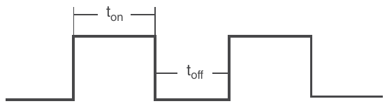

Hình 8.1 Signal PWM.

## 8.2 Thiết kế PWM bằng VHDL

Mục này nói về thiết kế PWM bằng VHDL. Ở đây, chúng ta sẽ xác định cách thiết kế một PWM controller bằng VHDL. Chúng ta đã biết PWM là viết tắt của pulse width modulation, và chúng ta hiểu rằng nó liên quan đến việc thay đổi duty cycle của một signal số tiêu chuẩn, nơi chúng ta có giá trị không và một, và điều đó sẽ thay đổi lượng thời gian signal ở mức high. Vậy, để làm điều này, chúng ta hiểu rằng có hai thành phần: tần số signal và duty cycle. Chúng ta sẽ xuất ra một signal ở một tần số cụ thể, và đó là một điều quan trọng cần nhớ và cần biết. Chúng ta phải định nghĩa tần số và duty cycle, đó là yếu tố then chốt. Dù có thể cố định tần số, chúng ta muốn thiết kế cho phép điều chỉnh duty cycle. Điều này sẽ làm thiết kế linh hoạt hơn và có thể tái sử dụng cho các project khác ngoài việc điều khiển độ sáng LED, cho phép nó được dùng trong nhiều ứng dụng khác nhau. Vậy, để làm điều đó, chúng ta muốn bảo đảm định nghĩa tần số là một generic và duty cycle là một port. Vậy, điều này cho phép chúng ta, khi tạo thiết kế thông qua generic, có thể chỉ định duty cycle on the fly qua port. Điều này cho phép chúng ta đặt tần số là 50 Hz, nhưng duty cycle có thể được thay đổi on the fly xuyên suốt thiết kế. Một điều quan trọng khác cần lưu ý là chúng ta phải định nghĩa entity. Khi định nghĩa entity, chúng ta cần tập trung vào hai phần then chốt: generic và port. Với generic, chúng ta muốn có một tham số bit, và nó sẽ xác định chúng ta dùng bao nhiêu bit để biểu diễn duty cycle. Ví dụ, nếu chúng ta chỉ có một bit để biểu diễn duty cycle, chúng ta sẽ chỉ có thể biểu diễn hai mức: 100% hoặc 0%, vì chúng ta chỉ có 0 và 1. Chúng ta dùng càng nhiều bit, độ phân giải càng cao và độ mịn càng lớn cho cả duty cycle output lẫn clock input. Điều này quan trọng vì nó sẽ định nghĩa tần số input của clock. Ví dụ, trên Arty A7, clock input sẽ là 100 MHz. Clock này được dùng để suy ra tần số output mà chúng ta tạo trong thiết kế. Tần số sẽ chỉ định signal output của chúng ta phải như thế nào. Entity cũng sẽ định nghĩa duty cycle thực tế của signal đó, nhưng đây là tần số thực tế của signal đó. Với entity, chúng ta cần một output: PWM output, là signal output được điều chế độ rộng xung. Đây là một signal standard logic mà duty cycle xác định độ rộng. Độ rộng của signal này sẽ được xác định bởi bit depth. Chúng ta cũng sẽ cần một clock input, là signal clock input được định nghĩa bởi generic tần số clock input. Vậy, bất kỳ tần số nào chúng ta chỉ định ở đây sẽ là tần số của clock đi vào thiết kế. Ngoài ra, chúng ta cần một enable input. Luôn tốt khi có khả năng enable hoặc disable thiết kế. Vậy, chúng ta sẽ làm nó active low, nghĩa là khi chúng ta kéo nó lên high, output sẽ ở mức low và không còn active nữa. Vậy, để dùng thiết kế pulse width modulated này, chúng ta sẽ phải đặt không vào enable để cho phép nó thực sự chạy. Vậy giờ hãy xem chính xác chúng ta sẽ hiện thực điều này như thế nào. Chúng ta sẽ gọi đây là các ghi chú thiết kế PWM, chỉ để phác thảo ý tưởng để chúng ta biết mình thực sự cần làm gì để tạo thiết kế PWM này. Việc đầu tiên chúng ta muốn làm là tạo một khối giải thích điều gì đang diễn ra ở mức tổng quát. Chúng ta sẽ tạo một khối cho thiết kế PWM vì ban đầu chúng ta quan tâm đến các input và output, và sau đó chúng ta sẽ làm cho các input tạo ra output mong muốn. Đây là thiết kế PWM của chúng ta, như được thể hiện trong Hình 8.2.

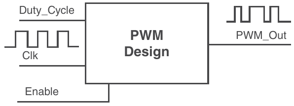

Hình 8.2 Khối thiết kế PWM.

Chúng ta biết rằng một trong những input then chốt mà chúng ta muốn có là duty cycle. Vậy, đây sẽ là một trong các input. Chúng ta sẽ có duty cycle, và chúng ta sẽ có một clock input – clock đi vào development board. Sau đó, chúng ta muốn có một signal enable, cho phép enable hoặc disable thiết kế. Clock sẽ là một signal toggle với tốc độ rất cao. Vậy, nó sẽ trông đại khái như thế này – nhiều khả năng với duty cycle 50% hoặc hơn. Nhưng điều đó không nhất thiết quan trọng. Chúng ta sẽ chỉ xét các cạnh lên hoặc cạnh xuống của signal clock đó. Phần quan trọng của thiết kế là output, sẽ được định nghĩa là PWM_Out. Đó là output của chúng ta, và nó sẽ có duty cycle thay đổi. Vậy, đó là nơi duty cycle sẽ thay đổi on the fly, dựa trên input duty cycle của thiết kế. Lượng thời gian signal ở mức high được xác định bởi giá trị duty cycle mà chúng ta đưa vào. Vậy, điều đó thực sự có nghĩa là gì? Chúng ta sẽ làm điều này xảy ra như thế nào từ duty cycle ở ngay đây? Trước hết, hãy xem một dạng sóng tiêu chuẩn. Nếu chúng ta có một dạng sóng, nó sẽ ở mức high trong một khoảng thời gian nhất định, rồi ở mức low trong một khoảng thời gian nhất định, lặp lại theo chu kỳ. Nếu nhìn vào signal, chúng ta biết nó có một tần số cụ thể. Vì trong generic đã định nghĩa *(ghi chú: sách in "redefined"; có lẽ đúng là "we defined")*, chúng ta muốn có thể đặt tần số output bất kể duty cycle là bao nhiêu. Vậy, chúng ta cần biết khoảng thời gian giữa các cạnh lên. Vậy, từ một cạnh lên đến cạnh lên tiếp theo, chúng ta sẽ có một khoảng thời gian, và chúng ta sẽ gọi nó là max_freq_count. Đây là thứ chúng ta sẽ dùng để xác định tần số của thiết kế PWM. Nó là hằng số và sẽ được tạo ra dựa trên clock input và tần số được định nghĩa trong generic. Vậy, dựa trên tốc độ của clock input và tần số mong muốn, thứ chúng ta sẽ đặt trong generic, chúng ta tính max frequency count này. Điều then chốt tiếp theo là PWM thực tế, hay cụ thể hơn là signal ở mức high trong bao lâu. Vậy, chúng ta sẽ có một counter thứ hai xác định signal ở mức high trong bao lâu. Chúng ta sẽ gọi nó là PWM_count và nó sẽ xác định độ rộng này ngay đây, và nó sẽ giống như ở ngay đó, như được mô tả trong Hình 8.3.

Bây giờ, pwm_count sẽ là một giá trị động có thể thay đổi vì nó được định nghĩa bởi duty cycle. Điều này có nghĩa là: nếu nghĩ về nó, chúng ta sẽ có một signal sẽ bị reset hoặc bị disable ở mức thấp. Sau đó, ngay khi chúng ta enable nó, chúng ta sẽ kéo signal lên high. Chúng ta sẽ có hai process cùng lúc: chúng ta cần theo dõi cả pwm_count lẫn max_ freq_count. Thứ đầu tiên chúng ta sẽ xem là frequency count (max_freq_count). Nó được suy ra bằng cách kéo signal lên high, signal mà chúng ta sẽ gọi là pwm_out, và giờ chúng ta sẽ kéo nó lên high ở đầu max frequency count (max_freq_count). Khi chúng ta lại đạt tới max frequency count, chúng ta sẽ kéo signal đó lên high lần nữa. Nếu chúng ta có duty cycle 100%, signal này sẽ ở mức high suốt toàn bộ thời gian, và dù nó đã ở mức high, chúng ta vẫn sẽ kéo nó lên high thêm một lần với max frequency count. Vậy, count này đơn giản đếm tới max_frequency_count và kích hoạt pwm_out lên high lần nữa. Đồng thời, một process thứ hai đang theo dõi pwm_count. Counter này đếm tăng cho đến khi đạt tới giá trị pwm_count, rồi nó sẽ kéo signal xuống low. Vậy, chúng ta có hai việc ngược nhau đang diễn ra: pwm_count, khi đạt tới, sẽ kéo xuống low, và sau đó signal sẽ ở mức low cho đến khi đạt tới max frequency count (max_freq_count). Đó là lúc nó sẽ kéo pwm_out lên. Nó sẽ kéo lên high, rồi pwm_count sẽ đếm lại và nó sẽ kéo xuống low. Vậy, max_freq_count và pwm_count sẽ bắt đầu cùng lúc. Cả hai đều bắt đầu ở cạnh lên này, và vì thế chúng ta có hai việc ngược nhau đang diễn ra. Bạn có max_freq_count, luôn kéo lên high, và pwm_count, luôn kéo signal output xuống low. Vậy, dựa trên duty cycle, con số càng cao thì duty cycle của bạn càng cao, và giá trị pwm_count này sẽ càng lớn. Khi giá trị pwm_count này đạt tới tận max_freq_count, đó sẽ là duty cycle 100%. Nếu bạn có duty cycle 0%, việc đếm của bạn đơn giản sẽ không xảy ra, và bạn sẽ có một signal luôn ở mức low. Vậy, điều tiếp theo bạn muốn nghĩ đến là: chúng ta sẽ xử lý tất cả những điều này trong VHDL như thế nào? Đây là một điều rất quan trọng cần suy nghĩ. Bạn sẽ có đủ thứ diễn ra. Vậy, chúng ta phải lo về các input, các output, và sau đó chúng ta biết đại khái mình muốn làm gì bên trong architecture. Vậy, việc đầu tiên hãy làm là mở bất kỳ công cụ nào bạn đang dùng – bạn đang làm việc với Vivado – vậy hãy mở nó. Chúng ta sẽ muốn định nghĩa các library. Chúng ta dùng thư viện IEEE, giống như tất cả các thiết kế và project khác. Và chúng ta muốn xác định các package muốn dùng. Chúng ta biết rằng signal output là một bit đơn và dùng standard logic, vì vậy chúng ta biết mình muốn dùng IEEE.STD_LOGIC_1164.ALL. Chúng ta muốn dùng library này để cho phép dùng các data type standard logic và standard logic vector. Chúng ta cũng muốn dùng IEEE.numeric_std.All, và nó sẽ cho phép chúng ta dùng các data type unsigned và signed. Trong trường hợp này, chúng ta muốn dùng unsigned, vì chúng ta đang đếm và muốn thực hiện phép cộng, là một phần then chốt. Nếu bạn chỉ dùng standard logic, rất khó thực hiện phép cộng và so sánh trực tiếp. Vậy giờ chúng ta muốn định nghĩa entity. Chúng ta biết mình sẽ đặt tên cho nó, và chúng ta sẽ gọi nó là PWM. Cái tên đó có vẻ hợp lý nhất. Chúng ta biết mình muốn định nghĩa một generic, và với generic, chúng ta biết mình muốn có BIT_DEPTH. Nó sẽ là data type integer, và theo mặc định, chúng ta sẽ cho nó giá trị “8.” Điều đó cho chúng ta tám bit độ phân giải, một con số khá tiêu chuẩn và phổ biến. Điều đó cho phép bạn đi từ duty cycle 0% đến 100% qua 255 giá trị. Tiếp theo là clock input (INPUT_CLK), và nó được dùng để xác định tần số clock. Đây cũng là một integer, và chúng ta sẽ cho nó giá trị mặc định 50 MHz. Giá trị này sẽ phụ thuộc vào clock – bất kỳ clock nào bạn đang dùng. Với generic cuối cùng, chúng ta sẽ định nghĩa FREQ, là tần số output thực tế mà bạn muốn có. Đây cũng sẽ là một giá trị integer, và chúng ta sẽ cho nó giá trị mặc định 50 Hz để bắt đầu. Sau đó chúng ta muốn định nghĩa port, vậy port của chúng ta nên có các thành phần sau: một PWM output, một duty cycle, một clock và một enabler. Vậy, chúng ta có một PWM output, là standard logic. Chúng ta có một duty cycle input, có độ rộng BIT_DEPTH trừ một xuống không. Chúng ta có clock, là input và là standard logic. Chúng ta cũng có một enable, là thứ chúng ta sẽ dùng để enable hoặc disable thiết kế. Cuối cùng, chúng ta cần đóng entity lại bằng cách dùng keyword như trong code sau.

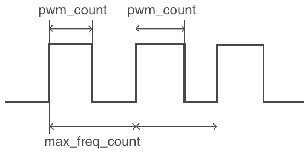

Hình 8.3 Các tham số của signal PWM.

```
-- Libraries
library IEEE;
use IEEE.STD_LOGIC_1164.ALL;
use IEEE.numeric_std.all;
-- Entity
entity PWM is
    Generic(
        BIT_DEPTH: integer := 8;
        INPUT_CLK: integer := 50000000;  -- 50MHz default
        FREQ: integer := 50);   -- 50Hz default
    Port(
        Pwm_Out: out std_logic;
        Duty_Cycle: in std_logic_vector(BIT_DEPTH – 1 downto 0);
        Clk: in std_logic;
        Enable: in std_logic);  -- Active Low
end PWM;
```

Vậy, ở đây chúng ta có phần mở đầu của thiết kế PWM. Chúng ta biết mình muốn làm gì – chúng ta đã định nghĩa các library và package. Ngoài ra, entity đã được định nghĩa, và vì vậy phần cuối cùng là thực sự hiện thực và thiết kế architecture của thiết kế PWM. Chúng ta sẽ hoàn thành thiết kế PWM đã bắt đầu trong mục này. Chúng ta đã bàn về thiết kế và làm rõ điều mình đang cố đạt được. Tại thời điểm này, chúng ta đã có các library và package sẽ dùng. Chúng ta có tất cả các comment, và chúng ta đã định nghĩa entity. Vậy, điều chúng ta cần làm là định nghĩa architecture. Chúng ta đã biết mình đang cố làm gì với architecture, chúng ta chỉ cần định nghĩa nó. Vậy, chúng ta ghi chú để biết architecture bắt đầu ở đâu và dùng keyword architecture. Chúng ta sẽ gọi nó là behavior, một tên phổ biến cho architecture. Tiếp theo, chúng ta định nghĩa các constant sẽ dùng. Constant đầu tiên là max_freq_count, là maximum frequency count. Cho nó là integer và nó sẽ bằng clock input chia cho tần số. Vậy, điều này sẽ cho chúng ta biết cần đếm tới bao nhiêu để tạo ra tần số cụ thể. Chúng ta biết mình đang làm việc với hai thứ ở đây: tần số và PWM hay duty cycle. Vậy, constant tiếp theo chúng ta muốn tạo là pwm_step, cũng là một integer. Nó sẽ bằng maximum frequency count chia cho hai mũ BIT_DEPTH. Điều này cho chúng ta biết kích thước mỗi bước của PWM, dựa trên việc chúng ta lấy maximum frequency count chia cho 2 mũ BIT_DEPTH, tức là chúng ta có bao nhiêu bước riêng lẻ khác nhau bên trong PWM. Vậy, với one-hundredth của một duty cycle, PWM step này giống như mức tối đa mà nó có thể đạt. Vậy, giờ chúng ta muốn định nghĩa các signal: với signal đầu tiên, chúng ta có signal PWM_value, và nó là standard logic. Chúng ta sẽ khởi tạo nó với giá trị không. Với signal thứ hai, chúng ta có cái mà chúng ta gọi là frequency_count, và nó là integer. Nó sẽ có phạm vi từ không đến maximum frequency count. Chúng ta khởi tạo nó với giá trị không. Thứ tiếp theo chúng ta muốn có là signal PWM_count. Chúng ta cũng sẽ cho nó là integer, và nó sẽ có phạm vi từ không đến hai mũ BIT_DEPTH, và chúng ta cũng sẽ khởi tạo nó với giá trị không. Chúng ta cũng muốn có một signal khác gọi là max_PWM_count, và nó cũng sẽ có phạm vi từ không đến hai mũ BIT_DEPTH, và ở signal tiếp theo, chúng ta muốn tạo thêm một signal nữa, và đây là PWM_step_count. Nó là integer, có phạm vi từ không đến max_frequency_count, và chúng ta khởi tạo nó với giá trị không. Vậy giờ chúng ta đã có các constant và signal – tất cả đều đã được định nghĩa. Chúng ta sẽ dùng statement begin, và việc đầu tiên chúng ta muốn làm là có một phép chuyển đổi, trong đó chúng ta sẽ chuyển duty cycle thành maximum_PWM_count. Vậy, để làm điều đó, chúng ta sẽ nói max_PWM_count được gán giá trị bằng cách dùng function to_integer rồi unsigned, và bên trong unsigned chúng ta muốn đặt Duty_Cycle, vậy nó sẽ lấy giá trị của Duty_Cycle và chuyển nó thành integer cho max_PWM_count tiếp theo, vốn là integer. Bây giờ, Duty_Cycle của chúng ta là unsigned vì nó là một standard logic vector, vì nó là input ở đó. Pwm_Out bằng PWM_value. Vậy, PWM_value là một signal mà chúng ta sẽ thay đổi. Để ghi ra PWM output, chúng ta sẽ ghi vào signal PWM_value. Việc tiếp theo chúng ta muốn làm là định nghĩa một process, process này sẽ xuất signal ra ở đúng tần số. Vậy, chúng ta cần một process xuất signal ra ở đúng tần số. Chúng ta sẽ làm toàn bộ việc này trong một process duy nhất vì rốt cuộc chúng ta quan tâm đến Pwm_Out, và chúng ta không muốn có nhiều process cùng drive một signal. Vậy, thay vì có các process freq_counter và PWM riêng biệt, chúng ta sẽ làm mọi thứ trong một process. Chúng ta muốn có nó trong cùng một process vì cả hai đều đang cố drive signal Pwm_Out. Vậy, chúng ta sẽ kết thúc process freq_counter, và chúng ta sẽ làm việc này trong process freq_counter. Bây giờ, bên trong process này, trước hết chúng ta muốn kiểm tra cạnh lên hoặc cạnh xuống. Vậy, chúng ta sẽ chọn rising_edge, và bạn cũng có thể làm điều này ở cạnh xuống. Không có lý do gì đặc biệt; chúng tôi chỉ thích làm ở cạnh lên, và nếu không ở cạnh lên, chúng ta không muốn làm gì cả. Vậy, chúng ta sẽ kết thúc if statement đó, và việc tiếp theo chúng ta cần làm là kiểm tra xem Enable có bằng không hay không. Nếu Enable không bằng không, tức là chúng ta đang bị disable, thì PWM value sẽ bằng không, rồi chúng ta viết end if; vậy việc đầu tiên diễn ra ở đây là chúng ta kiểm tra có đang ở cạnh lên không, và tại cạnh lên của “Clk”, chúng ta kiểm tra để bảo đảm thiết kế đang được enable, và nếu thiết kế không được enable, thì chúng ta sẽ đặt PWM value out về không. Vậy, nếu chúng ta disable nó, signal PWM value sẽ chỉ nằm ở mức low và giữ nguyên như vậy. Vậy, việc tiếp theo chúng ta muốn làm là kiểm tra xem frequency count có nhỏ hơn max frequency count hay không. Vậy, nếu có, chúng ta sẽ phải làm nhiều việc; nếu không, chúng ta sẽ đặt frequency count về không và PWM count về không. Vậy, chúng ta cần kiểm tra xem frequency count có nhỏ hơn max frequency count không; nếu không, thì chúng ta đang lớn hơn hoặc bằng max frequency count. Vậy, chúng ta cần đặt frequency count về không và chúng ta cũng muốn đặt PWM count về không. Vậy, nếu lớn hơn giá trị đó, điều đó có nghĩa là chúng ta cần làm việc khác. Vậy chúng ta cần đặt chúng trở lại không. Bây giờ, bên trong đó, chúng ta muốn kiểm tra xem frequency count có left there *(ghi chú: sách in "left there"; đúng là "less than")* max frequency count. Việc tiếp theo chúng ta muốn làm là – bên trong if statement tiếp theo, nếu frequency count nhỏ hơn max frequency count, chúng ta muốn đặt frequency count bằng frequency count cộng một – chúng ta muốn tăng frequency count đó. Bây giờ chúng ta muốn thực hiện một kiểm tra khác để xem PWM account *(ghi chú: sách in "account"; đúng là "count")* có nhỏ hơn max PWM count hay không. Vậy, nếu PWM count không nhỏ hơn PWM max count, thì chúng ta muốn đặt PWM value về không. Ở đây chúng ta cần có dấu ngoặc vì chúng ta biết đây là data type standard logic. Vậy, với PWM, nếu count nhỏ hơn max PWM count, thì chúng ta muốn đặt PWM value bằng một, và điều đó hợp lý vì nếu PWM count nhỏ hơn max PWM count, chúng ta đang ở mức high. Vậy, chúng ta sẽ đếm xem mình ở mức high trong bao lâu; nếu không thì chúng ta đặt nó xuống low. Điều tiếp theo chúng ta muốn kiểm tra là nếu PWM step count nhỏ hơn PWM step, thì chúng ta muốn thực hiện việc sau, lấy PWM step count và tăng nó. Vậy, chúng ta sẽ nói PWM step count giờ bằng PWM step count cộng một, tức là tăng nó. Nếu không, chúng ta muốn đặt PWM step count về không rồi cũng đặt PWM count về không. Điều đó cho bạn toàn bộ quá trình thiết kế PWM, vậy chúng ta kết thúc behavior để hoàn tất thiết kế. Tại thời điểm này, đây là thiết kế PWM của chúng ta. Chúng ta có entity và architecture, và ở đây chúng ta chỉ kiểm tra nhiều if statement, vì mục tiêu cuối cùng của việc này là xuất ra các giá trị PWM out. Vậy, nó sẽ đánh giá toàn bộ phần xử lý logic if statement này và xác định giá trị của PWM này là gì, thứ mà chúng ta quan tâm. Vậy, chúng ta kiểm tra nếu frequency count nhỏ hơn max frequency count, thì chúng ta tăng frequency count. Nếu PWM count nhỏ hơn max PWM count, thì PWM value giữ ở mức high. Tuy nhiên, nếu không, thì signal xuống low. Chúng ta cũng kiểm tra xem Enable có bị disable hay PWM value có bằng không hay không. Ngoài ra, PWM value về không; nếu PWM count nhỏ hơn max PWM count, thì PWM value xuống low; nó thể hiện điều này ngay ở đó. Cách thiết lập này làm cho PWM value ở mức high và low dựa trên duty cycle, vậy input hay duty cycle sẽ xác định lượng thời gian signal output PWM value ở mức high so với thời gian nó ở mức low. Do đó, code cho thiết kế PWM của chúng ta như sau.

```
-- Architecture
architecture behavior of PWM is
-- Constants
constant max_freq_count: integer := INPUT_CLK / FREQ;
constant pwm_step: integer := max_freq_count / (2**BIT_DEPTH);
-- Signals
signal pwm_value: std_logic := ‘0’;
signal freq_count: integer range 0 to max_freq_count := 0;
signal pwm_count: integer range 0 to 2**BIT_DEPTH := 0;
signal max_pwm_count: integer range 0 to 2**BIT_DEPTH := 0;
signal pwm_step_count: integer range 0 to max_freq_count := 0;
begin
    -- Convert Duty_Cycle to max_pwm_count
    max_pwm_count <= to_integer(unsigned(Duty_Cycle));
    Pwm_Out <= pwm_value;
    -- Process that runs signal out at the correct frequency
    freq_counter: process(Clk)
    begin
       if rising_edge(Clk) then
          if (Enable = ‘0’) then
                if (freq_count < max_freq_count) then
                  freq_count <= freq_count + 1;
                  if (pwm_count < max_pwm_count) then
                     pwm_value <= ‘1’;
                     pwm_count <= pwm_count + 1;
                     if (pwm_step_count < pwm_step) then
                         pwm_step_count <= pwm_step_count + 1;
                     else
                        pwm_step_count <= 0;
                        pwm_count <= 0;
                    end if;
                 else
                    pwm_value <= ‘0’;
                 end if;
              else
                 freq_count <= 0;
                 pwm_count <= 0;
              end if;
            else
               pwm_value <= ‘0’;
            end if;
         end if;
     end process freq_counter;
end behavior;
```

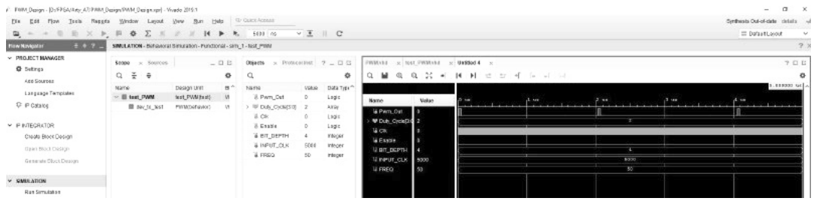

Hình 8.4 Cửa sổ Behavioral Simulation.

Nếu xem simulation, chúng ta đã đặt bit depth (BIT_DEPTH) là 4 và Duty_ Cycle là 2. Vậy, nếu nhìn vào, chúng ta có thể thấy độ phân giải tương ứng với giá trị hai đó. Nếu nhìn vào, chúng ta có thể thấy mình chỉ ở mức high trong một khoảng rất ngắn. Nếu thử zoom vào để xem chuyện gì đang diễn ra ngay tại đó, chúng ta có thể thấy khi đi qua, chúng ta bắt đầu và đang đếm, chúng ta tăng biến đếm cho đến khi đạt tới max frequency count – nó là 12, 13 ngay đó – rồi PWM value xuống low. Vậy, điều này chỉ cho thấy rằng nếu quay lại zoom full, bạn có thể thấy PWM output này liên quan trực tiếp đến input, tức duty cycle. Vậy, với thiết kế của chúng ta, chúng ta sẽ dùng nó để làm mờ một LED, vậy khi chúng ta thay đổi giá trị input duty cycle này, PWM output của signal với duty cycle đó sẽ thay đổi, và chính điều đó – duty cycle – sẽ thay đổi độ sáng của LED. Hoặc, nếu bạn dùng nó để điều khiển một servo motor, nó sẽ thay đổi vị trí của servo cụ thể đó cho motor. Đó là một bước thiết kế PWM cho thấy một ví dụ về cách làm toàn bộ code và simulation của thiết kế, và chúng ta sẽ dùng thiết kế này bên trong project LED brightness. Chúng ta có thể copy và paste code test bench đã thiết kế sau đây vào test_PWM.vhd, và nó sẽ cập nhật, và giờ nó nhận diện test bench đó là test_PWM, là một thiết kế top-level, như được thể hiện trong Hình 8.4.

```
library IEEE;
use IEEE.STD_LOGIC_1164.ALL;
use IEEE.numeric_std.all;
entity test_PWM is
Generic(
        BIT_DEPTH: integer := 4;
        INPUT_CLK: integer := 5000;  -- 50MHz default
        FREQ: integer := 50);   -- 50Hz default
--  Port ( );
end test_PWM;

architecture test of test_PWM is

component PWM
 Port(
        Pwm_Out: out std_logic;
        Duty_Cycle: in std_logic_vector(BIT_DEPTH - 1 downto 0);
        Clk: in std_logic;
        Enable: in std_logic);

end component;

signal Pwm_Out: std_logic;
signal Duty_Cycle: std_logic_vector(BIT_DEPTH - 1 downto 0) := “0010”;
signal Clk: std_logic := ‘1’;
signal Enable: std_logic := ‘0’;

begin
   dev_to_test: PWM
       port map(Pwm_Out, Duty_Cycle, Clk, Enable);

   data_stimulus: process
    begin
        Clk <= not Clk;
        wait for 10 ns;
    end process data_stimulus;
end test;
```

## 8.3 Statement generate trong VHDL

Mục này nói về statement generate trong VHDL; trong bài giảng này, chúng ta sẽ giải thích statement generate được dùng như thế nào trong ngôn ngữ VHDL. Trong trường hợp này, chúng ta sẽ dùng statement generate và một thiết kế cho counter, thứ sẽ được dùng trong project LED brightness, vậy statement generate được dùng cho việc gì trong VHDL? Định nghĩa của nó là một cơ chế để elaboration lặp hoặc có điều kiện một phần của một mô tả. Điều đó nghe có vẻ hơi khó hiểu, nhưng về cơ bản điều nó làm là cho phép bạn đặt một object theo kiểu lặp, nên bạn có thể dùng nó theo hai loại scheme: trong vòng lặp for cũng như trong if statement, và statement generate gồm ba phần chính. Chúng bao gồm một generation scheme, là một if statement hoặc một vòng lặp for, sau đó bạn có phần khai báo và rồi các concur concurrent statement. Vậy, ví dụ, nếu bạn có một thiết kế muốn nhân bản nhiều lần liên tiếp, bạn có thể dùng statement generate để làm điều đó. Nếu bạn có một mạch cần rất nhiều component và chỉ cần copy và paste, vòng lặp for sẽ là một cách để làm điều đó. Nếu bạn muốn có một điều kiện nào đó, trong đó bạn kiểm tra một giá trị, chẳng hạn như trong generic, bạn có một giá trị cho bạn biết sẽ thực hiện thao tác kiểu đồng bộ hay bất đồng bộ; bạn sẽ dùng nó để tạo một if statement. Vậy, chúng ta sẽ đi qua các ví dụ cho cả hai. Thứ tiếp theo chúng ta sẽ xem là cấu trúc của một statement generate. Vậy, cấu trúc của statement generate là phần đầu tiên, nơi bạn có một label, và đây chỉ là bất kỳ cái tên nào bạn muốn đặt. Nó giải thích statement generate này đang làm gì. Đầu tiên, bạn dùng dấu hai chấm rồi bạn sẽ có keyword for cho statement generate và sau đó bạn chỉ định tham số. Có keyword in, theo sau là phạm vi. Sau đó, bạn dùng keyword generate. Rồi bạn có thể đưa vào các khai báo, là tùy chọn. Đó có thể là các signal hoặc constant mà bạn định dùng. Sau đó bạn có statement begin, keyword begin, và rồi các concurrent statement bên dưới begin. Sau đó, bạn có keyword end generate, là một phần của cặp begin và end, và bạn đặt label mà bạn đã dùng để mô tả statement generate. Còn cách khác, nếu bạn dùng generate với một loại điều kiện if, bạn vẫn có cùng label, dấu hai chấm, rồi bạn có keyword if, và bạn đặt điều kiện và keyword generate, và bên dưới đó bạn có các khai báo, là các signal hoặc constant. Nếu bạn dùng chúng thì chúng là tùy chọn, và sau đó bạn cần keyword begin, và bên dưới keyword begin, bạn đặt các concurrent statement, rồi ở cuối là end generate và label mà bạn đã dùng để đặt tên cho statement generate cụ thể đó. Hãy xem một số ví dụ để thấy chúng trông như thế nào. Vậy, ví dụ đầu tiên chúng ta sẽ xem là vòng lặp for. Vậy, nếu chúng ta có một vòng lặp for, đây sẽ là một statement generate dạng vòng lặp for vì chúng ta biết mình có một vòng lặp for, và như vậy, chúng ta sẽ làm với vòng lặp for trước, ví dụ vòng lặp for, và với ví dụ này, chúng ta sẽ nói một điều cơ bản như là nếu chúng ta muốn có nhiều cổng AND. Vậy, ví dụ, giả sử chúng ta có hoặc vẽ ba cổng, nhưng chúng ta biết mình muốn có nhiều cổng như vậy, vậy chúng ta sẽ nói lên tới n – 1, chúng ta sẽ dùng N để mô tả số cổng AND mà chúng ta muốn có 0, 1, …, N – 1. Chúng ta có các input và chúng ta có các output. Vậy, để đặt tất cả các cổng AND này, chúng ta có thể vào VHDL và viết cụ thể phép toán AND logic N lần, hoặc điều chúng ta có thể làm là dùng một statement generate, gọn gàng và dễ dàng hơn nhiều trong VHDL, vì chúng ta có thể làm điều này chỉ trong vài dòng và trong vài dòng đó có thể định nghĩa và mô tả số lượng cổng AND bất kỳ được đặt vào. Ví dụ này chỉ dành cho một cổng AND cho đơn giản, nhưng nó có thể là bất kỳ thiết kế nào. Nó có thể là một thiết kế hoàn chỉnh, chẳng hạn khi chúng ta tạo counter, chúng ta có thể dùng vòng lặp for để đặt AND counters, hay bao nhiêu counter tùy ý. Để làm điều này, chúng ta sẽ đặt generate label, vậy chúng ta sẽ gọi nó là G_label. Sau đó bạn đặt dấu hai chấm và chúng ta sẽ dùng keyword for và chúng ta sẽ viết I in 0 to N generate, rồi chúng ta sẽ đặt cổng AND. Vậy, chúng ta sẽ nói đây là một component instantiation của AND_GATE, và chúng ta sẽ nói đây là AND một số phần port mapping, vậy chúng ta sẽ chỉ port map, chúng ta sẽ không đi vào chi tiết cách thực hiện port mapping, nhưng chúng ta hiểu port map hoạt động thế nào. Vậy, rồi chúng ta dùng statement end generate và dấu chấm phẩy như code sau và cũng được thể hiện trong Hình 8.5.

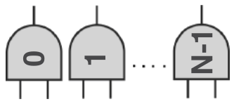

Hình 8.5 N lần cổng AND.

```
G_label: for I in 0 to N generate
    AND_GATE: AND(port map)
end generate;
```

Ở mức tổng quát, chúng ta lặp từ 0 đến N lần, tạo các cổng AND, và lần đầu tiên, chúng ta có cổng AND số không, cổng AND số một, cứ thế lên tới cổng AND số N-1. Vậy, toàn bộ ví dụ ở đây chỉ cho thấy bạn có thể đặt rất nhiều cổng AND khác nhau chỉ bằng ba dòng code đơn giản, trong khi nếu phải viết tay, nếu con số N này là, chẳng hạn, 10 hoặc 12, có thể sẽ cần 10 hoặc 12 dòng code trong thiết kế VHDL so với chỉ làm điều này trong ba dòng. Nếu bạn muốn điều chỉnh số lượng cổng AND được đặt hay bất kỳ thiết kế nào khác, bạn chỉ cần thay đổi giá trị N này, và giá trị N đó có thể là một constant trong thiết kế. Nó có thể là một generic hoặc bất kỳ cách nào bạn quyết định để truyền nó vào thiết kế VHDL. Đây là một con số mà bạn có thể thay đổi để thay đổi số lượng cổng AND mà bạn sẽ tạo trong thiết kế. Vậy, ví dụ tiếp theo chúng ta muốn xem là ví dụ if. Vậy, trong thiết kế, nếu muốn dùng ví dụ if cho generate, chúng ta sẽ gọi đây là ví dụ if; giả sử chúng ta có một thiết kế có thể dùng một JK flip-flop hoặc một D flip-flop. Ví dụ, nếu chúng ta có một thiết kế, đây có thể là bất kỳ loại thiết kế nào, chúng ta có input J, clock và input K, đó chỉ là một JK flip-flop. Chúng ta có output Q và Q-not, và chúng ta cũng có một D-full flop *(ghi chú: tên in sai; đúng là D flip flop)*. Vậy, chúng ta có hai thiết kế khác nhau và đây là input D và clock input. Sau đó chúng ta có các output Q và Q-not. Đó là một D flip-flop, vậy chúng ta có thể làm điều này theo nhiều cách khác nhau. Chúng ta có thể có hai thiết kế khác nhau: một cái dùng JK flip-flop và cái kia dùng D flip-flop và lưu chúng thành hai thiết kế VHDL, hoặc chúng ta có thể có một thiết kế VHDL duy nhất chứa cả tùy chọn JK-flip flop lẫn tùy chọn D flip-flop. Cách chúng ta làm điều đó là dùng một ví dụ generate với cấu hình if. Vậy, nếu muốn làm điều này, chúng ta sẽ có, chẳng hạn, thiết kế của mình, nơi chúng ta có entity và nó có thể là bất cứ thứ gì chúng ta quyết định, hay các input và output, hay bất kể thiết kế của chúng ta là gì, rồi chúng ta có architecture. Bên trong architecture, chúng ta sẽ có hai statement generate kiểm tra xem chúng ta có quyết định định nghĩa JK-flip flop hay D-flip flop hay không. Vậy, ví dụ, chúng ta sẽ có một generic mà chúng ta sẽ khai báo bên trong entity, một giá trị generic, mà chúng ta sẽ gọi là JK và nó là Boolean, vì nó sẽ bằng true hoặc false. Điều chúng ta muốn làm là nếu JK bằng true thì dùng tùy chọn JK-flip flop. Nếu JK bằng false, chúng ta muốn dùng tùy chọn D-flip flop. Để làm điều đó, chúng ta sẽ dùng label. Chúng ta sẽ gọi nó là JK_gen cho generate, dùng dấu hai chấm rồi dùng if JK, tham chiếu tới một generic; nếu JK bằng true, thì chúng ta muốn viết generate, nơi chúng ta sẽ generate, vậy đó là nơi bạn đặt thiết kế JK-flip flop rồi chúng ta sẽ viết end generate và dấu chấm phẩy. Bây giờ, trong cùng architecture, chúng ta sẽ có một label khác mà chúng ta sẽ gọi là D_gen cho phần generate D-flip flop và chúng ta sẽ kiểm tra nếu JK bằng false, thì chúng ta sẽ viết generate phần sau, và bên dưới đó chúng ta sẽ có thiết kế D-flip flop. Chúng ta sẽ đặt end generate, và cả hai thiết kế này đều nằm trong cùng một architecture, cùng một file thiết kế VHDL. Sau đó chúng ta sẽ có phần kết thúc architecture ở đây. Điều đó chỉ để cho bạn thấy tất cả nằm trong một thiết kế. Vậy, chúng dùng chung cùng một entity, chúng ta có cùng architecture hay architecture ở bên trong đây. Chúng ta sẽ có statement generate JK_gen này và chúng ta sẽ có statement generate D_gen kia như code sau và được mô tả trong Hình 8.6.

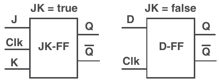

Hình 8.6 Dùng ví dụ if trong statement generate.

```
entity ….
     generic (JK: boolean);
end entity …;
architecture ….
    JK_gen: if JK = true generate
        -- JK flip flop Design here
    end generate …;
    D_gen: if JK = false generate
        -- D flip flop Design here
    end generate …;
end architecture …;
```

Sau đó chúng ta cũng sẽ có các process khác nhau hay các concurrent statement khác nhau để xác định các Q này được xuất ra như thế nào, hoặc nếu chúng ta có tùy chọn JK_gen, chúng ta nối J và K như thế nào, so với nếu chúng ta chọn tùy chọn D_gen, chúng ta nối D như thế nào, và các clock sẽ được nối giống nhau như thế nào. Vậy, điều này cho phép bạn có sự linh hoạt trong một thiết kế duy nhất. Theo cách này, chúng ta sẽ dùng điều này trong một counter để có sự linh hoạt quyết định liệu chúng ta muốn counter thực hiện reset kiểu đồng bộ hay bất đồng bộ. Vậy, đó là một ví dụ cho thấy cách dùng statement generate trong hai ví dụ cấu hình khác nhau.

## 8.4 Thiết kế counter

Mục này nói về thiết kế counter. Ở đây, chúng ta sẽ đề cập cách tạo một counter trong VHDL. Vậy, điều đầu tiên chúng ta cần nghĩ đến là chúng ta đã làm counter trước đây rồi. Vậy, không có gì phức tạp xảy ra với một counter. Về cơ bản bạn chỉ có một signal clock đi vào và bạn đếm signal clock đó. Bây giờ, điều chúng ta muốn làm là làm nhiều hơn thế một chút. Vậy, chúng ta có counter tiêu chuẩn, nhưng chúng ta muốn thêm vài tính năng nữa cho nó. Vậy, có một vài tham số hay đặc tả mà chúng ta muốn có. Cái đầu tiên là chúng ta muốn có thể làm counter đồng bộ hoặc bất đồng bộ đối với reset. Chúng ta sẽ đếm ở cạnh clock, nhưng với reset, chúng ta muốn có loại reset bất đồng bộ hoặc đồng bộ. Một synchronous reset có nghĩa là nếu bạn đang đếm lên, nó sẽ không về không cho đến cạnh lên của clock. Còn một asynchronous reset sẽ về không ngay khi button hay signal reset của bạn được nhấn, và vì vậy chúng ta sẽ nói về cách thiết kế một counter đáp ứng cả hai tùy chọn khác nhau này. Chúng ta muốn có một giá trị đếm tối đa có thể cấu hình. Khi làm việc với counter, một trong những điều then chốt bạn cần làm là hiểu giá trị đếm tối đa của mình là bao nhiêu. Khi làm việc với counter, mục tiêu là tạo ra một độ trễ nào đó, và độ trễ đó sẽ được xác định bởi việc bạn đếm lên cao đến đâu. Vậy, bạn có clock rate input và bạn sẽ đếm tới một giá trị nhất định, tương đương với một độ trễ thời gian nhất định, và tất nhiên chúng ta cũng muốn có thể reset counter; nếu giá trị tối đa là, chẳng hạn, 100, chúng ta muốn có thể, tại bất kỳ thời điểm nào, chẳng hạn khi tới 50, nhấn reset, và cho counter quay về không lần nữa. Vậy, nó cũng có thể được dùng như một watchdog timer, nơi bạn có counter này đếm. Mỗi lần bạn thực hiện một thao tác nhất định để kiểm tra watchdog timer, bạn chỉ cần reset và biết rằng, nếu chúng ta từng hết thời gian hay từng đạt tới giá trị tối đa, chúng ta biết mình có vấn đề. Vậy, chúng ta cần tắt mọi thứ hoặc tạo một cảnh báo như watchdog timer fault. Tất nhiên, điều quan trọng nhất là có một output để chỉ ra rằng đã đạt tới max count. Vậy, chúng ta sẽ có một output bằng không, trong khi chỉ đơn thuần đếm dựa trên clock input đi vào. Khi chúng ta đạt tới giá trị đếm tối đa, output sẽ bật cờ lên high và toggle để nói, “Hey, tôi đã đạt tới max count rồi, giờ hãy bắt đầu lại chu kỳ, đưa biến đếm về không và tiếp tục lần nữa.” Vậy về cơ bản, output sẽ toggle lên high trong một chu kỳ clock, mỗi lần nó đạt tới max count. Bây giờ, điều quan trọng cần nghĩ là để làm điều này, chúng ta sẽ cần tìm ra cách làm việc với generic và entity. Vậy, với generic, chúng ta sẽ có một maximum value, là giá trị đếm tối đa. Chúng ta có một synchronous reset, và nó sẽ xác định liệu chúng ta reset đồng bộ hay bất đồng bộ, và đây sẽ là một giá trị Boolean. Vậy, nó sẽ là true hoặc false để xác định loại reset chúng ta sẽ thực hiện, và đó là điểm then chốt cho thiết kế. Sau đó, entity của chúng ta sẽ chứa ba input và output khác nhau. Vậy, chúng ta có một output, là maximum clock count hay max count, và nó sẽ toggle lên high khi chúng ta đạt tới giá trị tối đa, thứ chúng ta định nghĩa trong generic, rồi chúng ta có clock và reset. Clock là bất kỳ clock input nào bạn đưa vào, nhiều khả năng sẽ là system clock trên board. Vậy, nó sẽ là 100 MHz với development board Arty A7. Reset xác định khi nào chúng ta reset counter, và điều này sẽ liên quan đến synchronous reset. Nếu chúng ta đặt synchronous reset là true, chúng ta muốn reset có hiệu lực ở cạnh lên của clock. Nếu synchronous reset được đặt là false, chúng ta muốn reset có hiệu lực ngay khi chúng ta chạm tới giá trị reset đó.

Vậy, hãy xem xét và đi qua để hiểu thiết kế counter. Với thiết kế counter, để có ý niệm về điều chúng ta muốn làm, hãy gọi đây là thiết kế counter của chúng ta. Điều then chốt ở đây là hiểu synchronous reset so với asynchronous reset. Về việc chỉ ra giá trị tối đa trong một lần đếm, chúng ta biết rằng có thể có một process được đánh giá theo clock và tăng ở mỗi cạnh lên. Vậy, điều chúng ta cần hiểu là: synchronous reset và asynchronous reset xảy ra như thế nào? Đầu tiên, chúng ta sẽ tạo một signal sẽ là clock và chúng ta sẽ cố làm nó có duty cycle 50% và chỉ là một signal clock. Vậy, chúng ta sẽ chỉ vẽ vài xung ở đây để cho thấy signal clock đó trông như thế nào. Chúng ta sẽ cho đây là một signal ổn định không bao giờ thay đổi. Nó đến từ board, từ một bộ dao động bên ngoài, nên chúng ta sẽ không thực sự bao giờ thấy nó thay đổi. Chúng ta sẽ có một signal khác, mà chúng ta sẽ gọi là reset. Vậy, nó sẽ ở mức low, và chúng ta sẽ nói rằng tại một thời điểm nhất định nó sẽ chạm reset. Sau đó chúng ta sẽ ở trạng thái reset một lúc, cho đến khi nó quyết định quay xuống lại và có một reset. Bây giờ điều chúng ta cần làm là định nghĩa các cạnh. Vậy, nếu chúng ta giả định sẽ làm việc với các cạnh lên của clock, chúng ta cũng có thể làm việc với các cạnh xuống của clock. Tuy nhiên, chúng ta sẽ chọn các cạnh lên. Vậy, hãy vẽ những nét gạch đó để chỉ ra rằng đây là các thời điểm mà các cạnh lên này đã xảy ra. Điều then chốt cần lưu ý ngay ở đây là reset đã xảy ra sau cạnh lên của clock. Vậy, có một chút độ trễ ở đó, chưa tới nửa chu kỳ sau cạnh lên, mà chỉ hơi sau đó một chút, reset mới xảy ra, vậy nếu bạn mô phỏng thiết kế, nó sẽ trông đại khái như thế này, như được minh họa trong Hình 8.7.

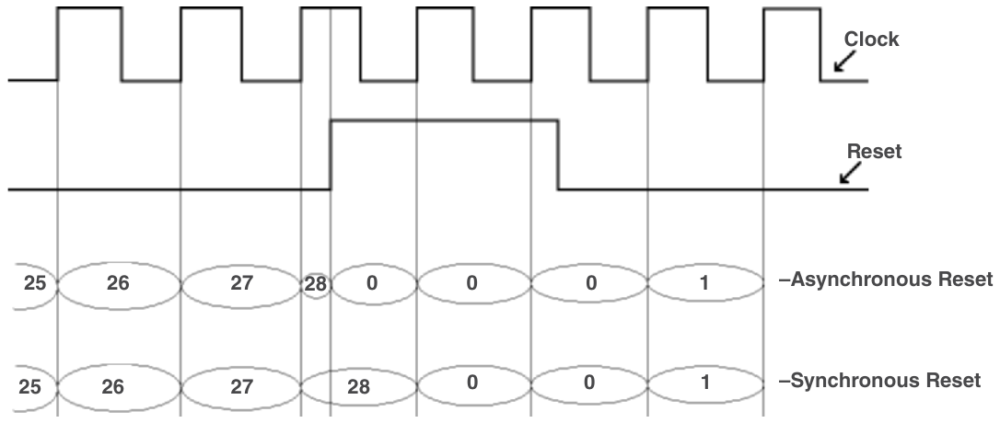

Hình 8.7 Thiết kế counter.

Chúng tôi sẽ đưa cho bạn một đường thẳng gọn gàng thể hiện thiết kế đồng bộ so với bất đồng bộ trông như thế nào, nhưng điều này chỉ để bạn hiểu chúng ta muốn thiết kế làm gì. Vậy, chúng ta sẽ bắt đầu với giá trị clock bất đồng bộ. Vậy, chúng ta bắt đầu với giá trị clock ở 25, và khi signal đếm, vì giá trị account *(ghi chú: sách in "account"; đúng là "count")* của chúng ta không giống standard logic hay logic vector, nó không có mức cao hay thấp mà chỉ đặt giá trị đếm thực tế, vậy nó sẽ đếm, trở thành 26 và nó lại đếm tiếp. Vì đây là một asynchronous reset, chúng ta sẽ có phần kiểm tra reset sau. Chúng ta cũng sẽ có counter đồng bộ, như được thể hiện trong Hình 8.7. Khác biệt chính là với asynchronous reset, bạn theo dõi cả reset lẫn clock, trong khi với synchronous reset, bạn cần có một process chỉ xét clock. Ở mức high, tại cạnh lên của clock, bạn có thể đánh giá signal reset; tuy nhiên, với asynchronous reset, bạn sẽ cần có một process xét clock và reset. Nếu reset thay đổi trạng thái, bạn cần kiểm tra điều đó và xác định xem đó có phải cạnh lên của reset không, và bạn sẽ phải xuống low hay reset biến đếm. Vậy, đó là hai khác biệt lớn nhất; chúng ta sẽ có hai process riêng biệt: một cho bất đồng bộ và một cho đồng bộ. Bây giờ, để hiện thực điều này trong VHDL, thứ then chốt chúng ta sẽ dùng là statement generate, vì chúng ta sẽ có một generate kiểm tra xem bất đồng bộ hay đồng bộ là true. Điều này quay lại giá trị generic synchronous reset. Nếu chúng ta đặt nó là true, chúng ta sẽ generate một counter đồng bộ hay một process chỉ xét clock và đánh giá reset bên trong process đó. Nếu synchronous reset là false, thì chúng ta cần có hai process nơi chúng ta xét hai signal là stimulus: clock và reset. Nếu reset thay đổi trạng thái, chúng ta phải reset ngay lập tức. Vậy, đó đại khái là khác biệt giữa các chu kỳ clock bất đồng bộ và đồng bộ, và đó chính xác là điều chúng ta sẽ hiện thực trong thiết kế counter. Bây giờ, chúng ta sẽ viết code cho counter có thể dùng asynchronous reset hoặc synchronous reset với giá trị tối đa generic mà chúng ta truyền vào, rồi chúng ta sẽ mô phỏng counter chỉ để xem chính xác nó phải làm gì hay nó sẽ làm gì. Vậy, với phần đầu tiên của thiết kế, nếu bạn làm việc với board Xilinx, bạn có thể làm điều này trong Vivado. Vậy, việc đầu tiên chúng ta muốn làm là đặt một số comment ở đầu để phần nào giải thích chuyện gì đang diễn ra, và thứ tiếp theo chúng ta sẽ đặt là các library, và chúng ta sẽ dùng library IEEE, rồi use IEEE.STD_LOGIC_1164.ALL. Điều này sẽ cho phép chúng ta dùng các data type standard logic và standard logic vector cho các output. Chúng ta có một maximum count, vì vậy chúng ta cần có quyền truy cập và dùng data type standard logic. Vậy, chúng ta cần package standard logic 1164 này. Chúng ta cũng include IEEE.math_real.All, và nó sẽ cho phép chúng ta làm những việc cụ thể; ví dụ, khi xác định counter, chúng ta cần biết số bit sẽ dùng. math_real sẽ cho phép chúng ta xác định và dùng đúng số bit cụ thể. Vậy, chúng ta muốn viết use IEEE.numeric_std.all, và việc tiếp theo chúng ta muốn làm là định nghĩa entity, vậy chúng ta sẽ viết entity và chúng ta sẽ gọi nó là keyword COUNTER. Sau đó chúng ta cần định nghĩa generic và port, vậy chúng ta biết mình có một generic. Vậy, với generic, chúng ta muốn có dấu mở ngoặc đơn, và chúng ta xuống dòng tiếp theo và viết MAX_VAL. Chúng tôi thích làm như vậy vì nghĩ rằng nó giúp mọi thứ dễ hơn nếu bạn có một variable hay signal viết all-caps mà, bạn biết đấy, là constant hoặc generic, vì vậy nó sẽ không động và không thay đổi, và sẽ viết integer, và chúng ta sẽ cho nó bằng 2 mũ 30, vậy đây chỉ là một generic MAX_VAL sẽ thay đổi, nên chúng ta chỉ đặt một giá trị nào đó vào đó. Vậy, về cơ bản nó là một counter 30-bit, mà trong trường hợp này khi đi qua project brightness, chúng ta sẽ thay đổi nó dù sao đi nữa. Vậy, các giá trị bạn đặt trong generic không nhất thiết quan trọng nếu sau này bạn sẽ dùng chúng. Chúng sẽ quan trọng nếu bạn không điền chúng vào hoặc nếu bạn đang dùng chúng. Nhưng nếu bạn sẽ dùng chúng trong tình huống kiểu component instantiation, bạn sẽ ghi đè lên các generic đó dù sao đi nữa, và vì vậy chúng ta sẽ đến với generic tiếp theo, là SYNCH_Reset cho synchronous reset, và nó sẽ xác định chúng ta có synchronous reset hay không, và nó sẽ có data type Boolean và chúng ta sẽ cho mặc định là true, và vì vậy chúng ta sẽ đóng ngoặc ở đó, như vậy là hoàn tất generic. Giờ chúng ta muốn có port, vậy hãy dùng keyword port và chúng ta sẽ xuống dòng tiếp theo. Trong phần port, thứ đầu tiên chúng ta sẽ có là Max_Count, là output của chúng ta. Nó là một keyword cho chúng ta biết khi nào đã đạt tới maximum count. Vậy, nó sẽ bật cờ lên high khi maximum count đã được đạt tới. Vậy, một clock (Clk), đây là một input và nó là standard logic, và thứ ba của chúng ta là reset (Reset), và đây là một input và nó cũng là standard logic. Vậy, điều đó cho chúng ta, với generic có maximum value và synchronous reset, và với port có maximum count, clock và reset. Vậy, chúng ta sẽ viết end COUNTER. Vậy, entity counter của chúng ta đã chính thức được định nghĩa. Giờ chúng ta muốn định nghĩa architecture, vậy viết architecture và chúng ta sẽ đặt cho nó tên behavior of COUNTER is, giờ chúng ta cần định nghĩa bất kỳ constant hay signal nào sẽ dùng, vậy chúng ta có một constant. Chúng ta muốn dùng constant ở đây, và chúng ta sẽ gọi nó là bit_depth và chúng ta sẽ cho nó là integer và với constant này, chúng ta sẽ tính và xác định số bit cần thiết dựa trên MAX_VAL. Vậy hiện tại, nó sẽ là 30 vì chúng ta lấy 2 mũ 30. Nhưng max value này có thể thay đổi nên chúng ta không biết nó có còn là 30 hay không. Vậy, chúng ta muốn bảo đảm rằng mình không dùng nhiều bit hơn mức cần thiết, đơn giản vì vấn đề tài nguyên. Vậy, chúng ta sẽ viết integer(ceil(log2(real(MAX_VAL)))). Vậy, điều đó sẽ cho chúng ta số bit cần thiết để đếm tới MAX_VAL, và chúng ta sẽ khai báo một signal, mà chúng ta sẽ gọi là Count_reg, cho count-register, và nó sẽ có data type unsigned, và đó là vì nó sẽ cho chúng ta sự linh hoạt để có thể cộng và trừ trên count-register này. Vậy, chúng ta sẽ cho nó đi từ bit_depth trừ một xuống không, và chúng ta sẽ khởi tạo nó với giá trị không, vậy chúng ta sẽ dùng keyword other’s *(ghi chú: sách in "other’s"; đúng là "others")*, và điều đó sẽ nói rằng bất kể nó lớn đến đâu, vì chúng ta không biết count sẽ có kích thước bao nhiêu cho đến khi nó dựa trên MAX_VAL là bao nhiêu, đó là nơi tất cả các giá trị khác này được suy ra. Vậy, ở phần tiếp theo, chúng ta sẽ dùng statement begin để bắt đầu architecture và, trước khi đặt mọi thứ khác vào đó, hãy viết statement end để không quên nó. Vì chúng tôi nghĩ cách đó dễ hơn, để bạn không quên đặt statement end ở đó. Vậy, việc đầu tiên chúng ta muốn làm là kiểm tra xem có muốn thực hiện synchronous reset hay không. Vậy, nếu chúng ta thực hiện synchronous reset, chúng ta muốn generate một thao tác reset kiểu đồng bộ. Vậy, hãy đặt label cho nó, chúng ta sẽ gọi nó là synch_rst và dấu hai chấm, rồi chúng ta viết if statement. Vậy, nếu SYNCH_Reset bằng true, thì chúng ta sẽ generate phần sau, vậy trước khi đặt mọi thứ vào đó, hãy viết end generate. Vậy, đó là generate process đầu tiên, vậy bên trong đó, chúng ta muốn tạo một process, gọi nó là Count_proc cho một process, là một process sẽ xét clock (Clk). Vậy, vì là synchronous reset, chúng ta chỉ quan tâm đến clock. Vậy, hãy đặt nó vào sensitivity list và chúng ta muốn viết end process. Bên trong count process (Count_proc), chúng ta muốn làm gì? Vậy trước tiên, trước khi làm điều đó, chúng ta đừng quên viết begin và end process; bên trong process, chúng ta muốn kiểm tra đó là cạnh lên của clock. Vậy, if rising edge, và chúng ta xét clock. Vậy, nếu là cạnh lên của clock, thì chúng ta sẽ làm phần sau; nếu là cạnh xuống của clock, chúng ta sẽ không làm gì cả. Vậy, hãy viết một statement end if ngay đó. Nếu là cạnh lên của clock, thì chúng ta muốn làm gì? Chúng ta muốn kiểm tra xem reset có bằng không hoặc count register có đạt tới max value hay không, nếu có thì chúng ta sẽ đặt count register về không. Vậy, chúng ta sẽ viết Reset, và điều này sẽ cho chúng ta active low reset, bằng không, hoặc count register bằng max value, thì chúng ta muốn làm phần sau, và trong trường hợp này, chúng ta sẽ có một else, và end if. Vậy, chúng ta sẽ viết Count_reg, và chúng ta sẽ dùng keyword others để đặt tất cả về không, vậy điều này sẽ đặt count register về không; nếu không, chúng ta muốn lấy count register và cộng một vào nó. Vậy, đây là lý do chúng ta dùng data type unsigned, cho phép chúng ta cộng một vào count register. Vậy giờ chúng ta đã có synch_rst đầu tiên, generic statement đầu tiên được định nghĩa. Chúng ta có synchronous reset, giờ chúng ta cần định nghĩa cái thứ hai, nơi chúng ta sẽ có asynchronous reset. Vậy, chúng ta sẽ cho nó định nghĩa asynchronous reset, label, và bên trong đó, chúng ta sẽ làm lại rất giống những gì đã làm bên trong synchronous reset, chỉ có điều chúng ta muốn có một phép kiểm tra xem Reset có bằng không hay không. Vậy, hãy đặt label, chúng ta gọi nó là asynch_rst và ở đây chúng ta kiểm tra SYNCH_Reset là false, vậy nếu SYNCH_ Reset là false — chỉ một trong hai phần này sẽ được đánh giá — rồi chúng ta viết end generate. Vậy, bên trong đây, chúng ta muốn có một process và chúng ta sẽ lại gọi nó là Count_proc, chỉ có điều chúng ta sẽ có hai signal trong sensitivity list: clock và reset, vậy nếu reset thay đổi trạng thái, chúng ta cũng sẽ đánh giá process này. Vậy, chúng ta dùng begin và sẽ viết end process để không quên bất kỳ cặp begin–end nào bên trong count process cho asynchronous reset. Điều đầu tiên chúng ta muốn kiểm tra là reset có bằng không hay không, vậy chúng ta thậm chí không lo về chuyện đó là cạnh nào của clock hay gì cả, chúng ta không hề quan tâm clock đang ở đâu, điều chúng ta quan tâm là nếu reset bằng không, thì chúng ta cần reset, nếu đúng như vậy, chúng ta cần đặt count register trở lại không; else if ở cạnh lên của clock, thì chúng ta muốn làm phần sau, về cơ bản chúng ta muốn theo cùng phương pháp đã dùng ở đó cho synchronous reset, chúng ta muốn kiểm tra xem count register có bằng max value không, nếu có chúng ta sẽ đặt count register về không, nếu không chúng ta sẽ cộng một vào count-register; vậy, bên trong else này, chúng ta sẽ có một if statement thứ hai nữa: nếu count-register bằng max value, thì count register sẽ được đặt về không, nghĩa là chúng ta đã đạt tới maximum count; nếu không, count register sẽ bằng count register cộng một, chúng ta sẽ tăng nó; giờ chúng ta phải nghĩ về if statement đầu tiên. Vậy, chúng ta sẽ chỉ quan tâm đến việc reset có bằng không hay có phải cạnh lên của clock, thì chúng ta sẽ hoặc tăng count register hoặc reset nó về không. Vậy giờ chúng ta đã có count process. Chúng ta muốn có một process thứ hai, vậy generic statement sẽ chọn hoặc count process với synchronous reset hoặc count process với asynchronous reset. Vậy, chỉ một process sẽ có mặt trong architecture. Giờ chúng ta cần một output process để xác định maximum count là gì, output của thiết kế là gì. Vậy, chúng ta sẽ gọi nó là output_proc, viết process và chúng ta sẽ đặt Count_reg vào, vậy mỗi khi count register được cập nhật, chúng ta sẽ đánh giá process này. Vậy, bên trong đây chúng ta sẽ viết begin và viết end process. Điều đó quan trọng và chúng ta muốn làm điều đó. Vậy, bên trong process này, điều chúng ta sẽ làm là kiểm tra và chúng ta sẽ đặt max count, Max_Count bằng không. Tuy nhiên, sau đó chúng ta sẽ kiểm tra xem count register, Count_reg, có bằng max value (MAX_VAL) hay không. Nếu có, chúng ta sẽ làm phần sau – và chúng ta sẽ kết thúc nó bằng end if. Vậy, nếu count register bằng max value, chúng ta sẽ làm gì? Chúng ta sẽ đặt Max_Count bằng 1. Sau khi process này được đánh giá, một trong hai điều sẽ xảy ra: max count sẽ bằng một hoặc không. Vậy, ban đầu chúng ta đặt max count về không, và vì chúng ta đang ở bên trong process, đó là một sequential statement. Nếu max count, Max_Count, bằng không, nếu count register bằng maximum value, thì chúng ta sẽ đặt max count bằng 1. Vậy, sau khi process này được đánh giá, max count sẽ bằng không hoặc một, và đó là toàn bộ thiết kế của counter, nơi việc đồng bộ hay bất đồng bộ được thiết lập thông qua việc dùng các statement generate; hãy lưu thiết kế lại. Code cho thiết kế counter này như sau.

```
library IEEE;
use IEEE.STD_LOGIC_1164.All;
use IEEE.math_real.all;
use IEEE.numeric_std.all;
entity COUNTER is
    Generic(
         MAX_VAL: integer := 2**30;
         SYNCH_Reset: boolean := true);
    Port(
         Max_Count: out std_logic;
         Clk: in std_logic;
         Reset: in std_logic);
end COUNTER;
architecture behavior of COUNTER is
    constant bit_depth: integer := integer(ceil(log2(real(MAX_VAL))));
    signal Count_reg: unsigned(bit_depth – 1 downto 0) := (others => ‘0’);
    begin
    synch_rst: if SYNCH_Reset = true generate
        Count_proc: process(Clk)
        begin
           if rising_edge(Clk) then
              if((Reset = ‘0’) or (Count_reg = MAX_VAL)) then
                 Count_reg <= (others => ‘0’);
              else
                  Count_reg <= Count_reg + 1;
              end if;
           end if;
        end process;
    end generate;
    asynch_rst: if SYNCH_Reset = false generate
        Count_proc: process(Clk, Reset)
        begin
           if (Reset = ‘0’) then
              Count_reg <= (others => ‘0’);
           elsif rising_edge(Clk) then
               if(Count_reg = MAX_VAL) then
                  Count_reg <= (others => ‘0’);
               else
                   Count_reg <= Count_reg + 1;
               end if;
           end if;
        end process;
     end generate;
     output_proc: process(Count_reg)
     begin
         Max_Count <= ‘0’;
         if(Count_reg = MAX_VAL - 1) then
             Max_Count <= ‘1’;
         end if;
      end process;
end behavior;
```

Chúng ta có thể copy và paste code test bench đã thiết kế sau đây vào test_COUNTER.vhd, và nó sẽ cập nhật, và giờ nó nhận diện test bench đó là test_COUNTER, là một thiết kế top-level, như được thể hiện trong Hình 8.8.

```
library IEEE;
use IEEE.STD_LOGIC_1164.ALL;
use IEEE.math_real.all;
use IEEE.numeric_std.all;
entity test_COUNTER is
   Generic(
         MAX_VAL: integer := 2**3;
         SYNCH_Reset: boolean := true);
--  Port ( );
end test_COUNTER;

architecture test of test_COUNTER is

component COUNTER
 Port(
         Max_Count: out std_logic;
         Clk: in std_logic;
         Reset: in std_logic);
```

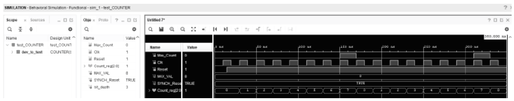

Hình 8.8 Cửa sổ Behavioral Simulation.

```
end component;

signal Max_Count: std_logic;
signal Clk: std_logic := ‘0’;
signal Reset: std_logic := ‘0’;

begin
   dev_to_test: COUNTER
       port map(Max_Count, Clk, Reset);

   data_stimulus: process
    begin
        wait for 10 ns;
        Clk <= not Clk;
        wait for 5 ns;
        Reset <= ‘1’;
        wait for 5 ns;
        Clk <= not Clk;
    end process data_stimulus;
end test;
```

Chúng tôi đã tạo một simulation nhanh chỉ để cho bạn thấy counter này trông như thế nào. Vậy, chúng ta có signal count, và nó không bắt đầu cho đến khi reset, mà chúng ta có thể thấy ở đây là không, vì vậy count vẫn ở mức không. Khi reset lên high, bạn sẽ để ý thấy count vẫn bằng không cho đến cạnh lên của clock, và đó là vì chúng ta xét cạnh lên của clock. Tại đúng thời điểm đó, chúng ta có count bằng một. Bạn sẽ để ý thấy mỗi lần đếm xảy ra ở cạnh lên của clock. Vậy, chúng ta có thể biết rằng mọi thứ xảy ra ở cạnh lên của clock và theo reset. Vì nó xảy ra ngay ở đó, counter không đếm cho đến khi chúng ta tới đó. Vậy, đó chỉ là một ví dụ cơ bản về một simulation cho thấy counter này sẽ làm gì. Giờ bạn đã có counter này, chính counter này sẽ được dùng trong project LED brightness.

## 8.5 Component instantiation trong VHDL

Mục này nói về component instantiation trong VHDL. Ở đây, chúng ta sẽ giải thích component instantiation là gì, đưa ra một ví dụ về cách nó có thể được dùng, và cho thấy cách áp dụng nó trong project LED brightness. Tại thời điểm này, chúng ta có một thiết kế PWM cũng như một thiết kế counter, và chúng ta muốn lấy cả hai thiết kế VHDL riêng lẻ đó và dùng chúng trong project LED brightness. Đầu tiên, hãy bắt đầu với việc component instantiation thực sự là gì; chúng cho phép các thiết kế VHDL của bạn lấy các thiết kế từ những file khác. Ví dụ, nếu bạn có một project, dù là trong Vivado hay bất kỳ loại công cụ phát triển nào khác, và bạn có nhiều thiết kế, bạn sẽ cần một thiết kế top-level. Thiết kế top-level này là nơi bạn ánh xạ các IO riêng lẻ. Từ entity đó, bạn sẽ ánh xạ tới tất cả các IO khác nhau trên FPGA mà bạn đang dùng. Tuy nhiên, bạn có thể có các thiết kế khác được viết trong các file VHDL riêng biệt được nhúng bên trong thiết kế của bạn. Cách tiếp cận này theo một cấu trúc phân cấp: bạn có một thiết kế top-level, và bên trong nó, bạn có thể include hay ‘kéo vào’ các sub-designs khác. Các sub-designs này không thực sự instantiate các entity, và các entity đó không thực sự được ánh xạ tới các chân IO vật lý từ file .xdc hay bất kỳ loại file ánh xạ chân nào. Chúng thực ra có thể được ánh xạ tới các signal bên trong thiết kế, và điều này cho phép bạn instantiate thiết kế nhiều lần. Ví dụ, nếu chúng ta đã tạo một module counter, chúng ta có thể dùng nó nhiều lần trong thiết kế – chẳng hạn, 20 counter – trong khi chỉ cần một file VHDL để định nghĩa counter đó; chúng ta đơn giản instantiate nó 20 lần. Khi bạn instantiate nhiều lần, bạn sẽ dùng nhiều tài nguyên hơn. Vậy, nó sẽ giống như bạn lấy, copy và paste thiết kế đó nhiều lần. Chỉ là bạn không còn phải viết nó ra 20 lần khác nhau. Vậy, nó giúp bạn tiết kiệm ở khía cạnh đó và làm thiết kế gọn gàng hơn một chút, và nhiều khi, khi bạn làm việc với các thiết kế phức tạp và lớn hơn, điều này sẽ ngày càng trở nên quan trọng, đặc biệt nếu bạn làm việc trong một project lớn và có nhiều người cùng thiết kế. Bạn có ai đó làm phần này. Họ sẽ nói, OK, làm thiết kế này, rồi chúng ta sẽ instantiate component đó ở đây. Bạn sẽ instantiate component đó ở đây, và bạn sẽ làm phần top-level hay wrapper, nếu bạn muốn gọi vậy, và kết hợp tất cả các thiết kế đó lại với nhau thành một thiết kế VHDL. Khi bạn làm việc với component instantiation, có một số phần. Đầu tiên, bạn cần định nghĩa component, do đó có tên “component instantiation.” Việc này được thực hiện trước architecture hoặc bên trong architecture, cụ thể là trước begin, trong phần declarative statement. Định nghĩa component nêu ra các input và output của nó. Sau đó, bên trong architecture, nếu muốn dùng component đó, bạn chỉ cần thực hiện port map và generic map để ánh xạ các signal đi vào chính component đó. Tiếp theo, chúng ta sẽ xem một ví dụ về điều này kèm một số ghi chú. Component instantiation là thuật ngữ chúng ta dùng để biểu diễn một thiết kế thứ hai bên trong thiết kế của mình. Ví dụ, nếu xem một block diagram, như cái được thể hiện trong Hình 8.9 , chúng ta có thể nói nó biểu diễn thiết kế VHDL top-level. Giả sử một trong số chúng có tên Example.vhd. Vậy, đây là một thiết kế VHDL được định nghĩa ở đâu đó trong project, nhưng có thể người khác đã viết nó, và chúng ta có một vài input cho nó. Nó có hai input và một output. Output được ánh xạ và đi ra ngoài thiết kế VHDL top-level. Với các input, giả sử chúng ta làm việc với thứ gì đó như một JK flip-flop. Đây chỉ là một ví dụ để minh họa ý. Vậy, chúng ta có thể có các signal như K, Clk và J làm input, và các output như Q hoặc Q-not. Các input này sẽ được ánh xạ tới các input bên ngoài, vậy chúng ta có ba input này. Sau đó chúng ta có một cái khác, mà chúng ta sẽ gọi là test.vhd. Đây là một thiết kế thứ hai cũng dùng signal clock và có một input. Nó tạo ra hai output mà sau đó chúng ta AND với nhau để tạo thành output cuối cùng. Vậy, trong thiết kế VHDL top-level, chúng ta đang instantiate hai component: cái thứ nhất là Example.vhd và cái thứ hai là test.vhd. Đây là hai file VHDL riêng biệt. Tính cả chính file top-level, giờ chúng ta có tổng cộng ba file VHDL. File top-level có thể được đặt tên kiểu Top.vhd. File Top.vhd này đóng vai trò cấp cao nhất trong phân cấp. Nó định nghĩa tất cả các input và output được ánh xạ tới các chân IO vật lý trên thiết bị FPGA thực tế. Ví dụ, bốn input mà chúng ta thấy ở bên trái và hai output mà chúng ta thấy ở bên phải được thể hiện trong Hình 8.9 .

Cách điều này hoạt động là nếu chúng ta làm việc này trong thiết kế VHDL, chúng ta sẽ không viết toàn bộ thiết kế một lần, mà điều chúng ta sẽ làm là định nghĩa các phần chính. Đầu tiên, chúng ta có entity, và bên trong entity, chúng ta định nghĩa cả generic lẫn port. Sau đó, chúng ta có architecture, và bên trong architecture, chúng ta sẽ định nghĩa các component. Trong trường hợp này, chúng ta sẽ định nghĩa các component Example.vhd và test.vhd. Khi định nghĩa chúng, điều chúng ta sẽ làm là định nghĩa các input và output là gì. Bản thân thiết kế thực tế sẽ nằm trong các file riêng biệt chứa định nghĩa architecture. Ở đây, chúng ta cũng chỉ định các input và output, cùng với bất kỳ constant hay signal nào sẽ được dùng trong architecture. Sau đó, bên trong architecture, chúng ta dùng statement begin, tiếp theo là instantiate các component, cùng với phần còn lại của thiết kế. Cuối cùng, chúng ta kết thúc bằng statement end, tạo thành cặp begin–end. Điều bạn có là một thiết kế top-level cho phép bạn tái sử dụng component dễ dàng. Ví dụ, nếu chúng ta muốn dùng Example.vhd lần thứ hai, tất cả những gì chúng ta cần làm là instantiate nó lần thứ hai bên trong architecture, chúng ta không phải định nghĩa nó lần thứ hai. Bạn chỉ cần instantiate nó lần nữa, hoặc bạn có thể instantiate nó lần thứ ba, thứ tư, hoặc nhiều hơn nữa. Đây là nơi bạn có thể dùng statement generate để định nghĩa số lần bạn instantiate một component, hoặc cả hai component. Đây chỉ là tổng quan về cách component instantiation này hoạt động, như được thể hiện trong code sau.

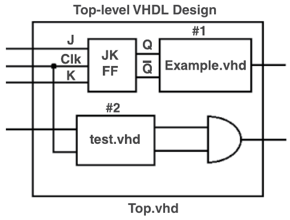

Hình 8.9 Component instantiation.

```
entity…
   Generic();
   Port();
end;
architecture
-- Define component
-- Constants
-- Signals
begin
  -- Instantiate components
end;
```

Thiết kế VHDL kiểu này khá hữu ích. Như đã đề cập ở trên, khi bạn làm việc với các thiết kế phức tạp hơn và dùng nhiều thiết kế, việc có một cách tiếp cận có cấu trúc là rất giá trị. Điều này đặc biệt đúng khi bạn có những component thường xuyên dùng. Ví dụ, chúng ta có một counter và một thiết kế PWM mà chúng ta dùng trong bài lab LED brightness. Hai component này có thể được tái sử dụng trong nhiều bài lab khác hoặc bất cứ khi nào bạn cần PWM. Khi thiết kế đã hoàn tất, bạn có thể đơn giản instantiate nó trong bất kỳ project nào khác, tiết kiệm thời gian và công sức. Khi thiết kế component hoặc làm các thiết kế của riêng mình, luôn là ý hay khi nghĩ xem bạn có thể làm chúng linh hoạt hơn như thế nào, để chúng có thể được tái sử dụng trong tương lai. Bây giờ, hãy mở project LED brightness. Trong project, bạn sẽ thấy chúng ta đã có sẵn thiết lập ban đầu: phần mô tả, comment, và mọi thứ đều được giải thích sơ qua. Chúng ta cũng đã định nghĩa các library và package, và entity đã được định nghĩa. Chúng ta cũng đã định nghĩa các generic và port. Trong phần architecture, tên architecture đã được cung cấp, cùng với các component cần instantiate. Các signal và constant cũng đã được định nghĩa. Bước đầu tiên là định nghĩa các component. Component đầu tiên chúng ta sẽ định nghĩa là thiết kế PWM. Điểm then chốt ở đây là việc định nghĩa một component rất giống một entity, ngoại trừ việc chúng ta dùng keyword component. Sau đó, chúng ta tham chiếu tới entity của thiết kế. Ví dụ, trong PWM.vhd, chúng ta có thể thấy tên entity là PWM. Vậy đó là tên chúng ta muốn dùng cho component. Để tiếp tục, hãy mở component PWM của LED brightness, và giờ chúng ta sẽ định nghĩa generic. Nếu xem thiết kế PWM, chúng ta có thể thấy các generic là BIT_DEPTH, INPUT_CLK và FREQ. Chúng ta có thể đơn giản copy các generic này từ thiết kế PWM vì nó giống hệt cho component instantiation trong project LED brightness. Giờ chúng ta cần định nghĩa các port. Việc đó được làm bằng cách dùng keyword port, giống như trong một entity, và nếu quay lại thiết kế PWM, chúng ta có thể thấy PWM có các port Pwm_Out, Duty_Cycle, Clk và Enable. Vậy, chúng ta có thể copy toàn bộ sang y như vậy, vì chúng ta phải định nghĩa data type cũng như nó là input hay output, điều mà chúng ta đã làm trong phần mô tả entity. Vậy, chúng ta quay lại LED brightness, thụt lề bằng tab và paste port vào đó. Vậy giờ chúng ta đã định nghĩa component, phần cuối cùng chúng ta cần làm là phần then chốt, end component, rồi chúng ta sẽ đặt tên PWM. Vậy giờ component đã được định nghĩa và chúng ta có thể instantiate thiết kế pulse width modulation (PWM) xuyên suốt project. Phần tiếp theo chúng ta muốn làm là định nghĩa hay instantiate counter. Vậy, chúng ta sẽ ghi counter để biết mình đang instantiate gì ở đây, và với phần này, nó theo cùng cấu trúc như PWM, chúng ta viết component rồi COUNTER, và giống như đã làm với PWM, chúng ta có thể copy và paste theo cách đó. Vậy, chúng ta vào COUNTER, chúng ta biết generic của nó có hai cái là MAX_VAL và SYNCH_Reset, vậy hãy copy và chúng ta sẽ paste chúng vào generic. Giờ chúng ta cần làm port, giống như đã làm với thiết kế PWM, port ở đây cũng y như vậy, chúng ta có thể copy nó từ COUNTER vì nó sẽ là cùng các port, cùng các signal, cùng tên, và điều đó cho chúng ta Max_Count, Clk và Reset, giờ chúng ta chỉ cần viết end component và tên COUNTER. Vậy giờ chúng ta đã định nghĩa cả PWM và COUNTER, điều chúng ta muốn làm là instantiate chúng bên trong architecture. Vậy, chúng ta đã có các signal và constant, tất cả đều đã được định nghĩa và thiết lập. Chúng ta có begin của architecture, chúng ta đang gán các output và giờ chúng ta muốn thêm vào trước các process *(ghi chú: sách in "over processes"; đúng là "our processes")* và sau phần đảo signal enable cho counter, chúng ta muốn bắt đầu instantiate các component. Vậy, hãy làm một component instantiation nhanh, cái đầu tiên chúng ta sẽ làm là LED counter này. Vậy, chúng ta sẽ có một counter đếm cho các LED. Vậy, chúng ta phải đặt label cho nó và chúng ta sẽ gọi nó là LED_COUNTER, rồi chúng ta viết dấu hai chấm và phải đưa tên component, đó là COUNTER, và giờ chúng ta cần làm generic map và port map. Vậy, với generic map, khi làm generic map, bạn phải đưa giá trị cho nó. Vậy, nếu nhìn vào COUNTER ở trên, chúng ta có các giá trị đầu tiên là MAX_VAL và SYNCH_Reset. Vậy, chúng ta cần đưa cho nó MAX_VAL, mà trong trường hợp của chúng ta, MAX_VAL là LED_MAX_COUNT, và nó được định nghĩa bởi constant LED_MAX_COUNT, rồi với SYNCH_Reset, chúng ta đã định nghĩa nó là một constant SYN_RESET có giá trị true. Vậy, chúng ta chỉ cần đặt nó vào đó. Vậy giờ generic map đã hoàn tất và chúng ta không muốn đặt dấu chấm phẩy ở cuối nó, chúng ta muốn làm port map, và với port map, trong trường hợp này sẽ viết port map, và chúng ta muốn có Max_Count, là giá trị chúng ta thấy trên COUNTER. Vậy, chúng ta sẽ nói, OK, Max_Count, vì đó là giá trị trong entity, đó là cái thực sự mà chúng ta gọi là output. Giờ chúng ta viết mũi tên bằng và cần gán cho nó một giá trị. Vậy, chúng ta sẽ gán cho nó signal led_max_cnt cho LED maximum count và chúng ta viết dấu phẩy. Giờ chúng ta muốn làm cái thứ hai. Vậy, Clk (clock), chúng ta sẽ ánh xạ tới clock (Clk), là một clock trong thiết kế, rồi với cái thứ ba, chúng ta muốn làm reset. Vậy, Reset được ánh xạ tới led_counter_rst, và tại thời điểm đó chúng ta đóng ngoặc đơn, và nếu lưu lại, chúng ta có thể thấy bên dưới LED brightness behavior, chúng ta có LED_COUNTER-COUNTER behavior này vì chúng ta vừa định nghĩa nó ngay đó. Vì LED_COUNTER được định nghĩa bên trong thiết kế LED brightness. Vậy, chúng ta chỉ vừa instantiate COUNTER. Phần đó thuộc về project LED brightness, nghĩa là chúng ta có COUNTER này được instantiate, vốn được định nghĩa như một thiết kế riêng. Giờ bạn để ý thấy nó nhận diện chúng ta có thiết kế PWM này, nhưng nó không nằm bên dưới LED brightness này vì chúng ta chưa instantiate nó, như được mô tả trong Hình 8.10 cũng như code bên dưới, và đó là ví dụ cho bạn thấy cách component instantiation hoạt động cũng như cách dùng chúng trong thiết kế, và ngay khi bạn instantiate chúng trong thiết kế VHDL, công cụ sẽ nhận diện và hiểu rằng nó đang được định nghĩa hay nó nằm trong cấu trúc phân cấp và nằm bên dưới thiết kế top-level của bạn.

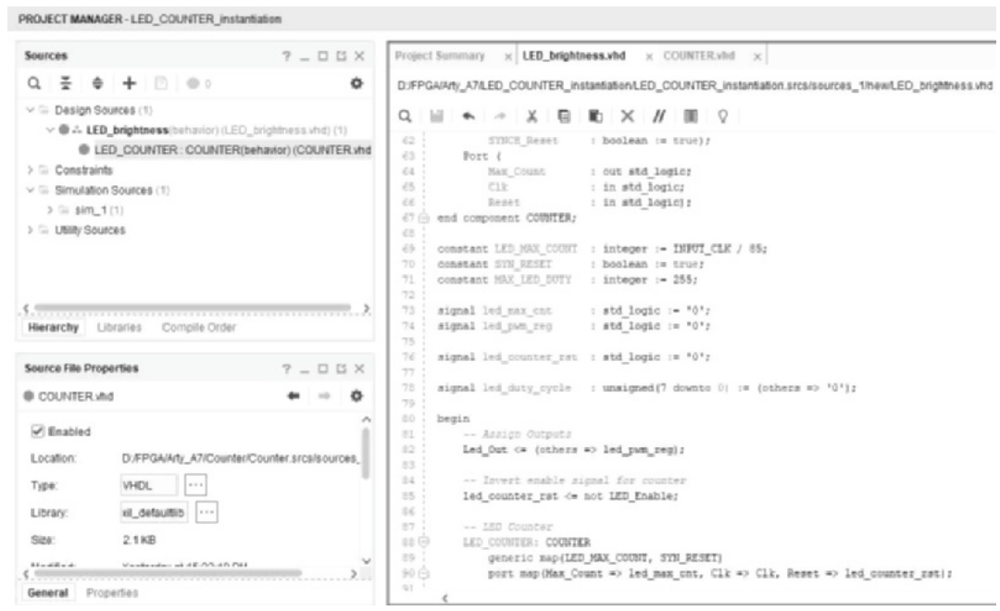

Hình 8.10 Instantiation của component COUNTER.

```
-- Libraries
library IEEE;
use IEEE.STD_LOGIC_1164.ALL;
use IEEE.numeric_std.ALL;
use IEEE.math_real.ALL;
-- Entity
entity LED_brightness is
  Generic (
      INPUT_CLK: integer := 100000000; -- 50 MHz default
      NUM_RGB_LEDS: integer := 4;
      NUM_LEDS: integer := 4);
  Port (
      Led_Out: out std_logic_vector(NUM_LEDS - 1 downto 0);
      Clk: in std_logic;
      LED_Enable: in std_logic);  -- Active Low
end LED_brightness;
-- Architecture
architecture behavior of LED_brightness is
-- Components
-- Pulse Width Modulation Design
component PWM
   Generic (
      BIT_DEPTH: integer := 8;
      INPUT_CLK: integer := 50000000; -- 50MHz
      FREQ: integer := 50); -- 50Hz
   Port (
      Pwm_Out: out std_logic;
      Duty_Cycle: in std_logic_vector(BIT_DEPTH - 1 downto 0);
      Clk: in std_logic;
      Enable: in std_logic);
end component PWM;
-- COUNTER
component COUNTER
   Generic (
     MAX_VAL: integer := 2**30;
     SYNCH_Reset: boolean := true);
   Port (
     Max_Count: out std_logic;
     Clk: in std_logic;
     Reset: in std_logic);
end component COUNTER;
constant LED_MAX_COUNT: integer := INPUT_CLK / 85;
constant SYN_RESET: boolean := true;
constant MAX_LED_DUTY: integer := 255;
signal led_max_cnt: std_logic := ‘0’;
signal led_pwm_reg: std_logic := ‘0’;
signal led_counter_rst: std_logic := ‘0’;
signal led_duty_cycle: unsigned(7 downto 0) := (others => ‘0’);
begin
-- Assign Outputs
   Led_Out <= (others => led_pwm_reg);
-- Invert enable signal for counter
   led_counter_rst <= not LED_Enable;
-- LED Counter
   LED_COUNTER: COUNTER
   generic map(LED_MAX_COUNT, SYN_RESET)
   port map(Max_Count => led_max_cnt, Clk => Clk, Reset => led_counter_rst);
-- LED PWM Count update Process
   Led_Count_Proc: process(Clk)
   begin
     if rising_edge(Clk) then
        if (led_duty_cycle = MAX_LED_DUTY) then
           led_duty_cycle <= (others => ‘0’);
        elsif (led_max_cnt = ‘1’) then
           led_duty_cycle <= led_duty_cycle + 1;
        end if;
     end if;
   end process Led_Count_Proc;
end behavior;
```

Tại thời điểm này, chúng ta đã định nghĩa instantiation LED counter, nơi chúng ta đã instantiate thiết kế counter. Chúng ta đã có counter, cũng như các thiết kế PWM được định nghĩa. Chúng ta chỉ cần instantiate các component để có một LED counter. Chúng ta muốn có một RGB counter đếm cho – nếu bạn có một LED RGB (nếu bạn dùng board Arty A7), bạn sẽ cần cái này. Vậy, nó có tên RGB_COUNTER và dấu hai chấm, rồi chúng ta phải định nghĩa component muốn dùng, mà chúng ta gọi là COUNTER. Giống như LED counter, chúng ta có một generic map, và chúng ta sẽ đưa cho nó RGB_MAX_COUNT, và chúng ta sẽ đưa cho nó SYN_RESET, rồi chúng ta sẽ làm port map. Bên trong port map, chúng ta cần định nghĩa mình muốn dùng gì. Vậy, chúng ta có MAX_Count, và nó sẽ nhận rgb_max_cnt để nối với nó, và clock (Clk) sẽ được nối với clock (Clk), giống như trên LED counter. Sau đó chúng ta có Reset, và Reset được nối với signal rgb_counter_rst. Về cơ bản chúng ta đang instantiate cùng một thứ như LED counter, ngoại trừ việc chúng ta có một giá trị đếm khác (rgb_max_cnt) vì các LED RGB đếm tới một giá trị cao hơn. Chúng ta có nhiều LED RGB hơn, vì vậy đó là lý do chúng ta có hai counter riêng biệt. Giờ chúng ta muốn định nghĩa các PWM thực tế để cũng được instantiate như thế này, và giờ chúng ta cần làm các PWM instantiation. Vậy, cái đầu tiên chúng ta sẽ làm là LED PWM signal generator, và ở cái tiếp theo, chúng ta sẽ đặt comment cho tất cả chúng để biết mình phải làm những cái nào. Vậy, chúng ta có LED PWM signal generator – chúng ta chỉ cần một cho LED vì chúng ta sẽ lấy cùng một giá trị, và dù chúng ta có bốn LED hay tám LED, chúng ta sẽ cấp cho tất cả các LED cùng một giá trị PWM. Vậy, chúng ta có thể xoay xở chỉ với một giá trị signal duy nhất. Với RGB, chúng ta sẽ có red, green và blue. Vậy, chúng ta sẽ ghi RGB LED PWM signal generator, và chúng ta sẽ ghi rõ để biết nó dành cho red, và đây là một signal four-bit và 50 Hz. Vậy, bốn bit được dùng để định nghĩa duty cycle, và chúng ta có tần số output 50 Hz cho signal. Vậy, nếu copy cái đó, chúng ta biết mình sẽ muốn có green cũng như blue. Luôn tốt khi đặt comment vào đó để khi quay lại xem, bạn có thể hiểu chuyện gì đang diễn ra. Vậy, với cái đầu tiên này – LED PWM signal generator – nơi chúng ta muốn instantiate, nó rất giống với counter. Chúng ta chỉ cần – thay vì counter – đưa chúng vào các map. Chúng ta ánh xạ tới PWM thực tế chứ không phải counter. Vậy, ví dụ, LED này – chúng ta sẽ gọi nó là LED_PWM, và chúng ta dùng dấu hai chấm rồi PWM, và chúng ta phải làm generic map. Với các generic, chúng ta nhìn vào PWM – chúng ta biết mình có BIT_DEPTH, INPUT_CLK và FREQ. Vậy, trong trường hợp này, chúng ta sẽ đặt hằng số tám cho BIT_DEPTH; tần số clock input được định nghĩa bởi INPUT_CLK, mà chúng ta lấy từ generic ở trên cùng – tức là generic ở thiết kế top-level (i.e., LED brightness này). Chúng ta sẽ lấy generic đó và đưa nó vào generic này, rồi chúng ta thêm 50 Hz. Vì đã có cái đó ở đó, chúng ta sẽ thêm một chút mô tả trong comment, chỉ để khi xem lại sau này, chúng ta có thể nhanh chóng hiểu và làm nó dễ đọc hơn một chút trong tương lai. Port map là nơi bạn muốn ánh xạ các output – trong trường hợp này, chúng ta có output Pwm_Out, và giá trị của nó được ánh xạ tới led_pwm_reg. Thứ tiếp theo chúng ta có là duty cycle. Duty cycle được ánh xạ tới một giá trị cụ thể, và trong trường hợp này, Duty_Cycle sẽ được ánh xạ tới phần sau. Tuy nhiên, led_duty_cycle của chúng ta được định nghĩa là kiểu unsigned, vì vậy chúng ta cần thực hiện một phép chuyển đổi. Điều này có nghĩa là Duty_Cycle sẽ được chuyển thành một standard logic vector của led_duty_cycle. Vậy, Duty_Cycle đang được ánh xạ tới led_duty_cycle, thứ mà chúng ta đã chuyển thành standard logic vector. Nếu không, thao tác này sẽ không thể thực hiện được, vì led_duty_cycle là data type unsigned, và clock (Clk) của chúng ta đang được ánh xạ tới clock (Clk), và điều đó khá phổ biến khi bạn có clock. Rất nhiều khi, bạn sẽ chỉ ánh xạ cùng signal đó tới tất cả các thiết kế này vì bạn muốn tất cả các thiết kế chạy theo cùng một clock (Clk). Vậy, khi bạn có một cạnh lên, nó xảy ra cùng lúc cho tất cả các thiết kế khác nhau, và cuối cùng, khi nhìn vào thiết kế, chúng ta có một generic map và một port map, Pwm_Out, Duty_Cycle và clock (Clk). Giờ chúng ta cần định nghĩa Enable. Vậy, chúng ta có Enable, và chúng ta sẽ ánh xạ tới signal của mình, chúng ta gọi nó là LED_Enable. Vậy, đó là thiết kế LED PWM (LED_PWM), và giờ chúng ta đã định nghĩa nó. Vậy, nếu chúng ta để nó cập nhật các source, và nếu nhìn vào LED brightness, thiết kế top-level, nó cho chúng ta biết chúng ta đang dùng counter hai lần. Chúng ta chỉ có một COUNTER, nhưng chúng ta đang dùng PWM một lần, vì nó cho bạn biết tên. Vậy, chúng ta có tên LED_PWM, là label. Chúng ta đã đặt cho component instantiation và chúng ta đang dùng PWM, vậy như phần trước dấu gạch và sau dấu gạch, chúng ta có PWM behavior, và behavior đó đến từ bên trong thiết kế PWM. Chúng ta đã định nghĩa architecture của PWM là behavior, vậy đó là nơi nó lấy thông tin đó. Vậy giờ chúng ta muốn lấy và nhân bản cái này, chỉ có điều chúng ta muốn làm với RGB red, RGB green và RGB blue. Vậy, một cách khác để instantiate là nếu chúng ta không muốn dùng các mũi tên, các mũi tên bằng, để gán, bạn có thể làm mà không cần nó. Ví dụ, chúng tôi sẽ chỉ cho bạn cách làm điều đó trên Red LED, vậy chúng ta sẽ đặt tên cho nó và đó là RGB_RED_PWM, dấu hai chấm, và nó sẽ là PWM, vẫn là cùng PWM đó, giờ chúng ta cần dùng, hay giống như trước, chúng ta làm genetic map *(ghi chú: sách in "genetic"; đúng là "generic")*, và chúng ta sẽ đưa cho nó giá trị bốn bit và clock input (INPUT_CLK) vì chúng ta vẫn lấy từ đó, rồi chúng ta sẽ cho nó 50 Hz. Vậy, port map giữ nguyên, vì nó sẽ thay đổi. Vậy, thay vì định nghĩa phần này, Pwm_Out => red_pwm_reg, chúng ta sẽ chỉ gán (sign) sao cho nó trở thành red_pwm_reg, là giá trị đầu tiên. Điều này tương đương với việc làm như ngay đó; tuy nhiên, nếu làm theo cách này, bạn sẽ thấy khi xong, trong Vivado, họ sẽ nhắc nhở bạn một chút và chỉ nói rằng, hey, nếu bạn dùng mũi tên bằng thì bạn biết cụ thể port nào ánh xạ tới signal nào. Vậy, chúng ta sẽ hoàn thành nó theo cách này chỉ để cho bạn thấy nó có thể được làm theo cách này. Vậy, đó là red PWM register. Giờ chúng ta muốn đặt led_duty_ cycle, là unsigned. Vậy, chúng ta sẽ copy phép chuyển đổi, chuyển nó thành standard logic vector để nó khớp trên PWM. Nếu nhìn vào duty cycle trong PWM.vhd, nó là standard logic vector. Vậy, chúng ta cần thực hiện phép chuyển đổi trên led_duty_cycle. Chúng ta có signal mà chúng ta gọi là RGB duty cycle và chúng ta lấy nó từ ba xuống không, vì chúng ta có một signal với RGB duty cycle; nếu nhìn vào, đây là một signal đi từ 11 đến 0, vậy nó có 12 bit. Đó là lý do chúng ta có ba signal khác nhau: red, green và blue. Vậy, chúng ta bắt đầu bằng cách chia signal thành bốn phần khác nhau. Chúng ta có bốn bit cho mỗi signal trong bốn signal khác nhau: red, green và blue. Vậy, chúng ta chỉ lấy ba bit dưới cùng của signal đó. Tiếp theo, chúng ta muốn có clock (Clk), vậy chúng ta chỉ viết Clk, dấu phẩy, và cuối cùng là RGB_Enable để đóng lại. Nếu có dấu chấm phẩy, chúng ta sẽ lưu và để ý ngay đó có một chỗ highlight nói rằng positional port connectivity này làm tăng rủi ro lỗi thiết kế ở đó. Nó giống như một cảnh báo nói rằng, hey, nếu bạn làm theo cách này, sẽ khó hiểu hơn signal nào đang được ánh xạ tới port nào. Nếu bạn làm theo cách bạn có thể thấy trong LED_PWM, nó không báo lỗi nào vì nó cho bạn biết cách này rõ ràng hơn nhiều. Vậy, nó chỉ quy về việc bạn thích cách nào hơn; không có vấn đề cụ thể nào, cách này vẫn hoạt động. Bước synthesis này đơn giản đưa ra một cảnh báo nói rằng họ khuyến nghị cách kia, và trong Vivado, có lẽ bạn đã tắt nó đi. Vậy, chúng ta sẽ làm, vì đã có cái này ngay đây, chúng ta biết mình muốn làm tương tự cho blue, green và blue, chúng ta sẽ chỉ copy cái này và sửa lại, vì chúng ta đang làm rất nhiều component instantiation thay vì gõ từng cái một. Nếu bạn đã làm rồi, chỉ cần copy nó, paste nó, và đừng sửa. Vậy, thay vì RGB Red, nó sẽ là green (GRN) để viết tắt và generic map giữ nguyên, trong port map giờ thay vì red_pwm_reg nó là grn_pwm_reg, rồi chúng ta có standard logic vector, và duty cycle thay vì ba xuống không thì là bảy xuống bốn, và clock cùng RGB_Enable giữ nguyên, vậy chúng ta có thể copy cái đó, và chúng ta sẽ làm lại lần nữa cho blue, giống như đã thiết lập cho green, gọi là RGB_BLU_ PWM và genetic map của chúng ta một lần nữa giữ nguyên, generic map không thay đổi. Trong port map, thay vì green, nó trở thành blu_pwm_reg, và signal RGB duty cycle này thay vì bảy xuống bốn, chúng ta sẽ lấy 11 xuống tám, rồi chúng ta có clock, và RGB_Enable giữ nguyên, vậy chúng ta lưu lại. Chúng ta sẽ thấy mình không có lỗi nào. Nó chỉ đưa ra một cảnh báo nhỏ nói rằng họ khuyến nghị bạn dùng mũi tên bằng này, nơi bạn chỉ định cụ thể mục nào trên port ánh xạ tới signal nào. Nhưng nếu nhìn vào design sources dưới LED brightness, nó đã nhận diện tất cả các instantiation này. Vậy, chúng ta có hai counter instantiation, và bốn PWM instantiation khác nhau. Tuy nhiên, trong project, chúng ta chỉ có ba file, chúng ta có LED_BRIGHTNESS.vhd, COUNTER.vhd và PWM.vhd này. Nhưng vì chúng ta đã làm component instantiation, nó giống như chúng ta đã gõ ra PWM và COUNTER này nhiều lần khác nhau, chỉ có điều chúng ta chỉ phải gõ nó một lần, và chúng ta có nhiều component instantiation, nơi chúng ta có thể tái sử dụng, về cơ bản là copy và paste thiết kế PWM cũng như thiết kế COUNTER. Vậy, khi bạn xây dựng những thứ này, một lần nữa chúng tôi nhắc lại rằng khi bạn làm một thiết kế như COUNTER và PWM, bạn nên cân nhắc làm nó generic để có thể dùng chúng ở những nơi khác và trong các project thiết kế khác. Code cho LED brightness như sau.

```
-- Libraries
library IEEE;
use IEEE.STD_LOGIC_1164.ALL;
use IEEE.numeric_std.ALL;
use IEEE.math_real.ALL;

-- Entity
entity LED_BRIGHTNESS is
  Generic (
     INPUT_CLK: integer := 100000000; -- 50 MHz default
     NUM_RGB_LEDS: integer := 4;
     NUM_LEDS: integer := 4);
   Port (
     Led_Out: out std_logic_vector(NUM_LEDS - 1 downto 0);
     RGB_R_Out: out std_logic_vector(NUM_RGB_LEDS - 1 downto 0);
     RGB_G_Out: out std_logic_vector(NUM_RGB_LEDS - 1 downto 0);
     RGB_B_Out: out std_logic_vector(NUM_RGB_LEDS - 1 downto 0);
     Clk: in std_logic;
     LED_Enable: in std_logic;
     RGB_Enable: in std_logic); -- Active Low
end LED_BRIGHTNESS;

-- Architecture
architecture behavior of LED_BRIGHTNESS is

-- Components
-- Pulse Width Modulation Design
component PWM
  Generic (
     BIT_DEPTH: integer := 8;
     INPUT_CLK: integer := 50000000; -- 50MHz
     FREQ: integer := 50); -- 50Hz
  Port (
     Pwm_Out: out std_logic;
     Duty_Cycle: in std_logic_vector(BIT_DEPTH - 1 downto 0);
     Clk: in std_logic;
     Enable: in std_logic);
end component PWM;

-- COUNTER
component COUNTER
  Generic (
     MAX_VAL: integer := 2**30;
     SYNCH_Reset: boolean := true);
   Port (
     Max_Count: out std_logic;
     Clk: in std_logic;
     Reset: in std_logic);
end component COUNTER;

-- Signals and Constants
-- 85 is from taking 255, the max PWM value, and dividing by 3 seconds
constant LED_MAX_COUNT: integer := INPUT_CLK / 85;
constant RGB_MAX_COUNT: integer := INPUT_CLK / 1365;
constant SYN_RESET: boolean := true;
constant MAX_LED_DUTY: integer := 255;
constant MAX_RGB_DUTY: integer := 4095;

signal led_max_cnt: std_logic := ‘0’;
signal rgb_max_cnt: std_logic := ‘0’;
signal led_pwm_reg: std_logic := ‘0’;
signal red_pwm_reg: std_logic := ‘0’;
signal grn_pwm_reg: std_logic := ‘0’;
signal blu_pwm_reg: std_logic := ‘0’;

signal rgb_counter_rst: std_logic := ‘0’;
signal led_counter_rst: std_logic := ‘0’;

signal led_duty_cycle: unsigned(7 downto 0) := (others => ‘0’);
signal rgb_duty_cycle: unsigned(11 downto 0) := (others => ‘0’);

begin
-- Assign Outputs
   Led_Out <= (others => led_pwm_reg);
   RGB_R_Out <= (others => red_pwm_reg);
   RGB_G_Out <= (others => grn_pwm_reg);
   RGB_B_Out <= (others => blu_pwm_reg);

  -- Invert enable signal for counter
  rgb_counter_rst <= not RGB_Enable;
  led_counter_rst <= not LED_Enable;

  -- LED Counter
  LED_COUNTER: COUNTER
  generic map(LED_MAX_COUNT, SYN_RESET)
  port map(Max_Count => led_max_cnt, Clk => Clk, Reset => led_counter_rst);

  -- RGB Counter
  RGB_COUNTER: COUNTER
  generic map(RGB_MAX_COUNT, SYN_RESET)
  port map(Max_Count => rgb_max_cnt, Clk => Clk, Reset => rgb_counter_rst);

 -- LED PWM Signal Generator (8 bit, 50Hz)
  LED_PWM: PWM
  generic map(8, INPUT_CLK, 50)
  port map(led_pwm_reg, std_logic_vector(led_duty_cycle), Clk, LED_Enable);

  -- RGB LED PWM Signal Generator [RED] (4 bit, 50Hz)
  RGB_RED_PWM: PWM
  generic map(4, INPUT_CLK, 50)
  port map(red_pwm_reg, std_logic_vector(rgb_duty_cycle(3 downto 0)), Clk, RGB_
Enable);

-- RGB LED PWM Signal Generator [GREEN] (4 bit, 50Hz)
  RGB_GRN_PWM: PWM
  generic map(4, INPUT_CLK, 50)
  port map(grn_pwm_reg, std_logic_vector(rgb_duty_cycle(7 downto 4)), Clk, RGB_
Enable);

 -- RGB LED PWM Signal Generator [BLUE] (4 bit, 50Hz)
  RGB_BLU_PWM: PWM
  generic map(4, INPUT_CLK, 50)
  port map(blu_pwm_reg, std_logic_vector(rgb_duty_cycle(11 downto 8)), Clk, RGB_
Enable);

 -- LED PWM Count update Process
  Led_Count_Proc: process(Clk)
  begin
  if rising_edge(Clk) then
    if (led_duty_cycle = MAX_LED_DUTY) then
      led_duty_cycle <= (others => ‘0’);
    elsif (led_max_cnt = ‘1’) then
      led_duty_cycle <= led_duty_cycle + 1;
    end if;
  end if;
end process Led_Count_Proc;

-- RGB PWM Count Update Process
Rgb_Count_Proc: process(Clk)
begin
  if rising_edge(Clk) then
     if (rgb_duty_cycle = MAX_RGB_DUTY) then
        rgb_duty_cycle <= (others => ‘0’);
     elsif (rgb_max_cnt = ‘1’) then
        rgb_duty_cycle <= rgb_duty_cycle + 1;
     end if;
   end if;
end process Rgb_Count_Proc;

end behavior;
```

Vậy, khi bạn bắt đầu một project mới, bạn đã có sẵn những mảnh ghép có thể dùng, và bạn không phải bắt đầu từ con số không. Đó là component instantiation trong VHDL và phần LED brightness cho bạn project LED brightness hoàn chỉnh. Tại thời điểm này, bạn đã sẵn sàng gán IO và bắt đầu synthesis, implementation và tạo bitstream hay programming file để chạy nó trên development board.

## 8.6 Bố trí IO của LED Brightness trên Arty A7

Mục này nói về việc bố trí IO trên Arty A7 cho project LED brightness. Trong mục này, chúng tôi sẽ chỉ cho bạn cách bố trí IO cho development board Arty A7. Vậy, với thiết kế này, nếu nhìn vào entity, chúng ta có thể thấy mình có Led_Out, là một standard logic vector từ số LED trừ một xuống không. Trên Arty A7, chúng ta biết mình có bốn LED thường và bốn LED RGB. Chúng ta cũng có một clock input (INPUT_CLK) và chúng ta sẽ có một LED_Enable và một RGB_Enable. Vậy, trước tiên hãy bắt đầu từ dưới lên với RGB_Enable. Chúng ta copy nó, và chúng ta sẽ vào file Arty_A7_Master. xdc. Trong phần switches, chúng ta sẽ cho switch 3 là RGB_Enable. Paste nó vào rồi bỏ comment dòng đó. Vậy ở đó, chúng ta gán package pin A10 với IO standard LVCMOS33 và đặt nó cho RGB_Enable. Chúng ta quay lại thiết kế, và RGB_Enable là một input. Bây giờ, copy LED_Enable và chúng ta sẽ cho nó là switch không, chỉ để chúng nằm ở hai phía đối diện. Bạn có thể đặt chúng trên bất kỳ slide switch nào bạn muốn. Chỉ cần lưu ý rằng switch nào bạn nối với RGB_Enable và LED_Enable sẽ quyết định switch nào điều khiển các LED RGB hay các LED thường. Hãy làm điều đó. Vậy giờ chúng ta có clock, thứ chúng ta sẽ làm tiếp theo. Copy clock. Nếu vào file .xdc, chúng ta có signal clock ở phía trên, và họ định nghĩa nó là clock 100 MHz. Chúng ta sẽ đặt nó vào và chỉ đổi tên clock. Ở dòng thứ hai, chúng ta sẽ tạo một clock, đặt tên sys_clk_pin, và để period và waveform ở mặc định. Vì theo mặc định, nó mô tả clock 100 MHz vốn đã đi vào board Arty A7, nên chúng ta không muốn thay đổi điều đó. Chúng ta sẽ highlight cả hai dòng và click vào toggle comments. Vậy giờ chúng ta đã có clock. Chúng ta đã đặt property cho chân cụ thể mà clock đi vào, và chúng ta cũng đã tạo cú pháp để khi nó đi qua bước timing của thiết kế, nó sẽ bảo đảm clock có thể đi vào ở 100 MHz mà không có vấn đề gì. Bây giờ, trong thiết kế, chúng ta có RGB_B_OUT, là output blue của LED RGB. Vì chúng ta có bốn LED RGB khác nhau, RGB_B_OUT phải được gắn với từng LED. Vậy, nếu vào file master .xdc cho các LED RGB, chúng ta có LED không, một, hai và ba. Vì chúng ta lấy RGB_B_OUT, sẽ là output blue, chúng ta muốn copy và paste nó vào chỗ các dòng blue tương ứng. Vậy chúng ta muốn lấy nó và paste vào dòng blue, và chúng ta sẽ đặt nó là không. Sau đó chúng ta sẽ đi xuống dòng blue tiếp theo cho led1_b, paste nó, và gán nó là một. Rồi chúng ta chuyển sang dòng blue tiếp theo cho led2_b, paste nó, và gán nó là RGB_B_OUT[2]. Cuối cùng, chúng ta paste lần nữa vào chỗ led3_b dùng RGB_B_OUT[3]. Điều đó cho chúng ta các output RGB blue: RGB blue output không, một, hai và ba. Bây giờ, với mỗi dòng đó, chúng ta sẽ bỏ comment chúng. Vậy, với bốn dòng đó đã bỏ comment, giờ chúng ta đã định nghĩa output LED blue cho LED RGB. Tiếp theo, chúng ta muốn cấu hình các output green. Vậy, chúng ta copy RGB_G_OUT, và chúng ta sẽ lặp lại chính xác các bước đã làm cho blue, giờ là cho green. Vậy, ở mọi chỗ có output green đặt là không, chúng ta sẽ paste và cho nó là không vì nó là standard logic vector. Rồi chúng ta đặt cái tiếp theo là một, rồi paste và đặt cái tiếp theo là hai, và paste lần nữa để đặt phần tử thứ ba. Sau đó, chúng ta bỏ comment các dòng đó. Bây giờ, chúng ta chuyển sang định nghĩa output red (RGB_R_OUT). Vậy, copy nó, và với red chúng ta muốn: đặt LED không, cho nó là không, rồi LED một, cho nó là một, LED hai, cho nó là hai, và LED ba, cho giá trị là ba. Rồi chúng ta bỏ dấu hashtag comment ở đầu tất cả các dòng này, để chúng ta có tất cả các LED RGB được định nghĩa. Giờ chúng ta chỉ còn phải định nghĩa Led_Out, mà chúng ta biết – nếu copy số LED – chúng ta chỉ có bốn cái. Vậy, chúng ta biết mình sẽ đi từ ba xuống không. Nếu vào phần LEDs, chúng ta có từ ba đến không. Vậy, ở phần đầu của nó, chúng ta chỉ muốn thay “led” bằng Led_Out, và chúng ta sẽ làm điều đó cho cả bốn dòng ở đó. Sau đó chúng ta chỉ cần highlight toàn bộ đoạn đó và nhấn toggle comment, rồi click vào button Save. Vậy, điều đó cho chúng ta tất cả các IO đã được bố trí cho Arty A7 trong project LED brightness, như được thể hiện trong Hình 8.11.

Ngoài ra, cho simulation, chúng ta có thể dùng code sau.

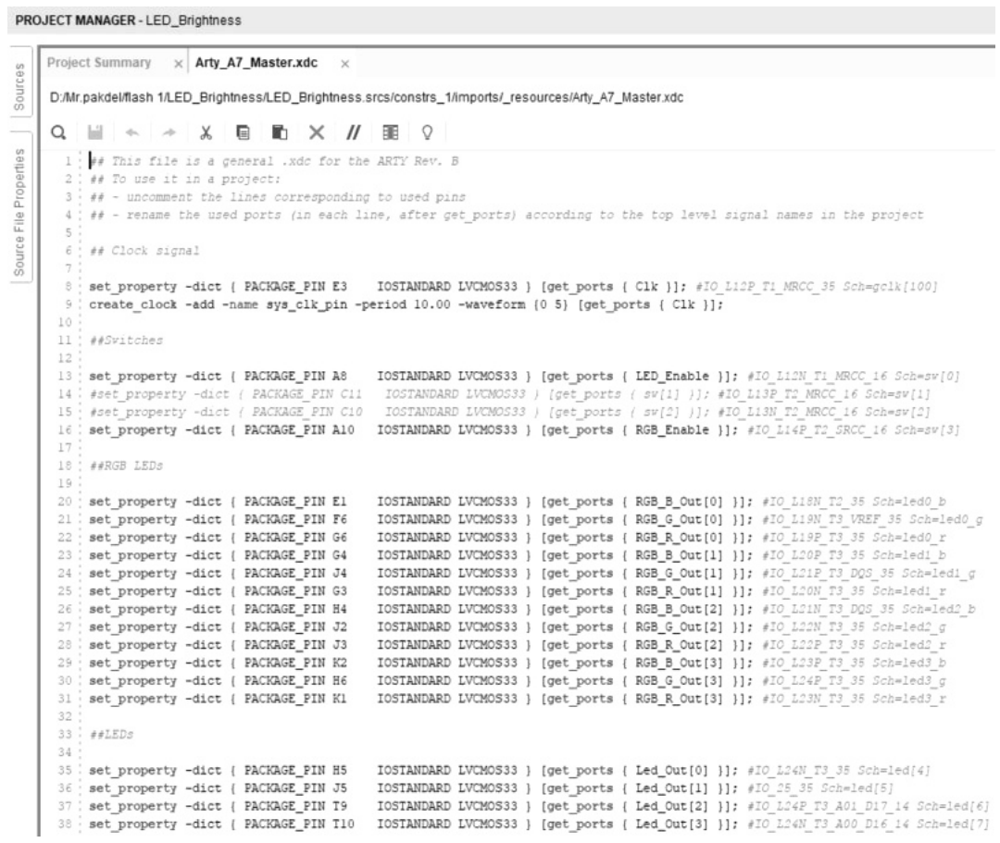

Hình 8.11 Các port đã bỏ comment trong Arty_A7_Master.xdc.

```
library IEEE;
use IEEE.STD_LOGIC_1164.ALL;
entity test_LED_BRIGHTNESS is
  Generic (
     NUM_RGB_LEDS: integer := 4;
     NUM_LEDS: integer := 4);
--  Port ( );
end test_LED_BRIGHTNESS;

architecture test of test_LED_BRIGHTNESS is

component LED_BRIGHTNESS
 Port(
     Led_Out: out std_logic_vector(NUM_LEDS - 1 downto 0);
     RGB_R_Out: out std_logic_vector(NUM_RGB_LEDS - 1 downto 0);
     RGB_G_Out: out std_logic_vector(NUM_RGB_LEDS - 1 downto 0);
     RGB_B_Out: out std_logic_vector(NUM_RGB_LEDS - 1 downto 0);
     Clk: in std_logic;
     LED_Enable: in std_logic;
     RGB_Enable: in std_logic);         -- Active Low
end component;

signal Led_Out: std_logic_vector(NUM_LEDS - 1 downto 0);
signal RGB_R_Out: std_logic_vector(NUM_RGB_LEDS - 1 downto 0);
signal RGB_G_Out: std_logic_vector(NUM_RGB_LEDS - 1 downto 0);
signal RGB_B_Out: std_logic_vector(NUM_RGB_LEDS - 1 downto 0);
signal Clk: std_logic := '0';
signal LED_Enable: std_logic := '0';
signal RGB_Enable: std_logic := '0';    -- Active Low
begin
  dev_to_test: LED_BRIGHTNESS
     port map(Led_Out, RGB_R_OUT, RGB_G_OUT, RGB_B_OUT, Clk, LED_Enable, RGB_
Enable);

  data_stimulus: process
    begin
        wait for 10 ns;
        Clk <= not Clk;
    end process data_stimulus;
end test;
```
