# 9 Project UART Demonstration

## 9.1 Giới thiệu

Trong chương này, UART được giải thích, và chúng ta sẽ giải thích UART là gì và nó được dùng như thế nào ở mức chi tiết. Trong chương này, chúng ta có phần UART demonstration, nơi chúng ta sẽ thử dùng một trong các development board này. Chúng có một cổng UART, hoặc hỗ trợ chuyển đổi UART sang USB, vậy chúng sẽ đảm nhận việc đó, và bạn cắm nó vào máy tính. Khi có một serial port emulator, chúng ta có thể gửi dữ liệu qua lại giữa máy tính và FPGA hay thiết kế thực tế, và khi làm điều đó, chúng ta muốn giải thích và hiểu những gì bạn có thể thấy ở mức chi tiết – chuyện gì đang diễn ra, những bit nào đang được truyền để gửi những mẩu dữ liệu nhất định. Vậy trước tiên, hãy hỏi: UART là viết tắt của gì? Nếu bạn làm việc với microcontroller hoặc làm trong lĩnh vực hệ thống nhúng hay máy tính, có lẽ bạn đã nghe về UART trước khi làm bất kỳ loại ứng dụng hệ thống nhúng nào. Và nó là viết tắt của universal asynchronous receiver/transmitter. Điều đó có nghĩa là nó bất đồng bộ, và universal có nghĩa là bạn có thể dùng nó cho nhiều tầng truyền dẫn khác nhau. Vậy, nếu bạn muốn dùng RS-232, RS-485, 10BUS, hay bất kỳ tầng vật lý nào khác, bạn có thể làm điều đó với UART – bạn chỉ cần một transceiver. Vậy, nó universal theo nghĩa là nó được dùng phổ biến nhất. Bạn gửi nó vào một chip phần cứng khác; tư duy ở đây là chip đó có một cổng UART; bạn kết nối bằng giao diện này, và nối với nó – chip sẽ chuyển dữ liệu và gửi nó ra qua RS-485 hay bất kỳ loại transceiver nào. Asynchronous có nghĩa là bạn có thể truyền và nhận cùng lúc. Không có nguồn clock nào được đồng bộ như ở rất nhiều giao thức truyền thông khác. Khi làm việc với các giao thức đó, bạn sẽ có một nguồn clock cụ thể mà bạn chạy theo, và bạn cần căn dữ liệu theo nguồn clock đó, hoặc bạn sẽ gửi một clock và dữ liệu của bạn tương quan trực tiếp với nguồn clock đó. Với UART, không có điều nào như vậy. Chỉ có hai signal: Rx và Tx. Asynchronous có nghĩa là Rx và Tx có thể diễn ra cùng lúc, và chúng hoàn toàn không tương quan với nhau qua một clock nào. Hiển nhiên, bạn có receiver và transmitter, nghĩa là bạn có Rx, tức receiver, và Tx, tức transmitter, và chúng ta thực sự dùng nó để làm gì? Vậy, nếu bạn dùng microcontroller hoặc development board, bạn sẽ nghe thuật ngữ UART này rất nhiều. Bạn thực sự dùng nó để làm gì? Nó đơn giản là một cách phổ biến để giao tiếp giữa các thiết bị. Trong trường hợp này, chúng ta sẽ dùng nó để giao tiếp giữa development board FPGA và máy tính của bạn. Bạn cũng có thể dùng nó để giao tiếp giữa các thiết bị riêng lẻ. Nếu bạn có, chẳng hạn, hai development board và muốn chúng nói chuyện qua lại với nhau, bạn có thể dùng UART để làm điều đó. Đó là một ngôn ngữ được định nghĩa sẵn để nói chuyện qua lại – giống như chúng tôi đang nói chuyện với bạn bằng tiếng Anh, UART được định nghĩa sẵn trong các thiết bị này để cả hai cùng hiểu và giao tiếp theo cách đó. Chúng thường được tìm thấy nhiều nhất bên trong microcontroller hoặc trong các chip mạch tích hợp. Bạn sẽ thấy chúng khi tìm kiếm trên DigiKey hoặc bất kỳ nhà phân phối linh kiện máy tính nào. Nếu bạn đang làm bảng mạch và tìm kiếm các giao diện khác nhau, UART thường được liệt kê là một trong những giao diện đó. Bạn có thể làm điều này theo nhiều cách. Bạn có thể hiện thực UART bằng VHDL bằng cách mô tả về mặt vật lý khi nào đặt các bit lên high hay xuống low và làm tất cả mọi thứ theo cách chúng ta sẽ dùng nó. Vì trên board Arty A7, mạch UART được nối với một chip transceiver, vậy nó lấy signal UART đó, chuyển nó sang USB và gửi tới máy tính. Vậy, bạn chỉ cần cắm USB vào, và các chân đó đã được nối cố định về mặt vật lý. Vì vậy, chúng ta không thể ánh xạ nó tới bất cứ đâu chúng ta muốn. Vậy, bên trong FPGA thực tế, chúng ta sẽ dùng một softcore processor hoặc một hardcore processor để tạo dữ liệu này. Điều đó có nghĩa là chúng ta sẽ viết code C để xử lý và truyền dữ liệu. Vậy, chúng ta sẽ dùng một softcore processor, mà nếu bạn dùng Xilinx thì đó là MicroBlaze, và chúng ta sẽ dùng các công cụ khác nhau trong đó để viết code cụ thể bảo nó gửi dữ liệu ra. Ở đây chúng tôi sẽ giải thích dữ liệu đó trông như thế nào, và nếu bạn đặt một máy hiện sóng (scope) lên đó, bạn sẽ thấy các waveform đó trông thế nào và điều đó thực sự có nghĩa là gì. Vậy, có một số điểm chung cho bạn biết UART là gì. Có hai signal: Tx để truyền, và Rx để nhận. Như đã đề cập ở trên, bạn có thể truyền và nhận cùng lúc. Đó là một hệ thống full duplex và không có signal clock nào để đồng bộ. Bạn chỉ có hai signal này. Chúng tôi sẽ cho bạn xem signal đó trông như thế nào. Khi bạn gửi dữ liệu, nó được truyền theo một trình tự định sẵn. Điều này cho phép giao tiếp UART hoạt động mà không cần diễn giải từng điều kiện riêng lẻ. Điều này có nghĩa là bạn có một trình tự định sẵn, nghĩa là bạn có một start bit, một stop bit, một parity bit, và các data bit. Bạn cũng có thể định nghĩa bạn truyền theo little endian hay big endian. Bây giờ, hãy xem điều này thực sự trông như thế nào và nó sẽ trông ra sao nếu bạn có một máy hiện sóng hay thiết bị đo nào đó cho dữ liệu UART đó. Chúng ta sẽ ghi một vài ghi chú về UART. Chỉ để khi quay lại, chúng ta có thứ gì đó để tham khảo. Vậy, nếu lấy một signal và chúng ta chỉ tạo một signal bất kỳ, nó sẽ toggle giữa 3.3 V và 0 V. Vậy, khi ở trạng thái idle, chúng ta sẽ nói là đang ở mức high, rồi chúng ta sẽ kéo nó xuống low trong một khoảng thời gian cụ thể, rồi nó sẽ quay lại high và giữ một lúc. Chúng ta sẽ định nghĩa khoảng thời gian cụ thể này là bit time, được xác định bởi baud rate. Khi đã vẽ xong toàn bộ signal này, chúng tôi sẽ giải thích cách tính bit time hay baud rate này khi làm việc với UART. Đó là một thuật ngữ phổ biến bạn sẽ nghe: bit rate. Vậy, chúng ta sẽ đi vào giải thích điều đó. Bit đầu tiên bạn sẽ thấy là cái mà chúng ta gọi là start bit, và sau đó, chúng tôi sẽ giải thích tất cả liên kết với nhau như thế nào. Vậy, bạn có start bit, được định nghĩa khi đường truyền đang idle hay không có dữ liệu nào được truyền. Bạn ở mức high, mà chúng ta sẽ nói là 3.3 V. Nó có thể là 5 V hoặc bất kỳ mức logic nào đang chạy, với mức low gần 0 V, vậy chúng ta sẽ ở mức high ở đây, và chúng ta sẽ nói là chúng ta đi xuống, điều đó cũng như nhau. Vậy, mỗi lần, chúng ta có khoảng cách giữa tất cả các nét gạch này, chúng ta không đo chính xác, nhưng chúng ta sẽ nói tất cả đều là cùng một khoảng thời gian chính xác. Vậy, start bit bằng với việc đường này ở mức high trong khoảng tương đương hai start bit. Vậy, đây là một vạch chia thời gian khác mà chúng ta sẽ gọi khi chúng ta có một vạch chia thời gian khác nữa, và vạch chia thời gian thứ ba lên high. Đây là start bit của chúng ta. Bây giờ, vì nó ở mức high trong vạch chia thời gian này, chúng ta sẽ cho nó giá trị một, giá trị logic một. Bây giờ, nó ở mức low trong vạch chia thời gian kia, vậy cái này có giá trị logic không, cũng như hai số một và ba số không. Bây giờ chúng ta sẽ nói chúng ta ở mức high trong một bit time. Vậy, nó có giá trị logic một rồi chúng ta sẽ kéo xuống low lần nữa. Bây giờ, bit time tiếp theo có giá trị logic không, và cái tiếp theo, vì vạch chia thời gian tiếp theo có giá trị logic không, và giờ tại thời điểm này, chúng ta có thể thấy mình có start bit, và nếu chúng ta truyền theo little endian, điều đó chỉ có nghĩa là chúng ta truyền least significant bit trước. Vậy, chúng ta sẽ giả định rằng đây là truyền little endian, và bạn có thể có little endian hoặc big endian, và little endian chỉ có nghĩa là bit đầu tiên bạn truyền là bit thấp nhất. Vậy, chúng ta sẽ viết trong thiết kế top-level các bit này là gì. Vậy, đó sẽ là bit không, bit một, và cứ thế cho đến bit bảy, vậy chúng ta biết từ không đến bảy, cho chúng ta tám bit, và đó là một tham số khác được định nghĩa trong các giao thức UART đối với chúng ta, là little endian. Sau đó là tám data bit, và điều đó cho chúng ta biết rằng, OK, bit đầu tiên chúng ta thấy là bit không đó, vì chúng ta dùng little endian. Với big endian, nó sẽ là bảy, sáu, và cứ thế xuống tới không. Vậy, chúng ta có little endian, tám data bit, và chúng ta sẽ nói mình có even parity, và parity là gì, đó là một dạng sửa lỗi cơ bản. Vậy, vì chúng ta có even parity, điều đó có nghĩa là trong lần truyền dữ liệu, chúng ta có tám data bit; chúng ta cần thêm một parity bit dựa trên số lượng số một chúng ta có, và chúng ta muốn làm cho số đó chẵn. Trong trường hợp này, chúng ta có từ một đến ba số một, và vì dùng even parity, chúng ta cần thêm một số một để làm cho nó chẵn, vậy chúng ta có bốn số một. Vậy, chúng ta sẽ thêm một, và đây là parity bit. Vậy, nó không phải là một phần dữ liệu, nhưng nó được dùng để kiểm tra lỗi. Ví dụ, nếu parity bit được đặt bằng không, chúng ta sẽ bỏ các data bit này đi, vì chúng ta kiểu như, chúng ta dùng even parity, nhưng chúng ta chỉ có ba số một, tính cả parity. Nếu cái này là không, chúng ta sẽ bỏ message này đi và nói, OK, có gì đó bị hỏng trên đường truyền, hãy truyền lại, chúng tôi không tin dữ liệu đó, vì vậy nó trở thành một, rồi chúng ta có một stop bit, đơn giản là dừng, và nó được định nghĩa bằng mức high. Vậy, đó chỉ là bit time của chúng ta. Sau đó chúng ta có một bit time khác, và điều này cho chúng ta biết đây là stop bit. Vậy sau đó, sau stop bit, đường truyền sẽ ở mức high rồi chờ xem có đang nhận gì không, và rồi chúng ta chờ cho đến khi lại xuống low cho tới khi có một start khác. Nhưng khi có một start khác, chúng ta sẽ bắt đầu lại toàn bộ quá trình này, và chúng ta gửi dữ liệu, parity, và stop bit. Bạn có các tùy chọn khác nhau, nơi bạn có thể định nghĩa là không có parity bit, vậy bạn chỉ có hai stop bit. Nếu là trường hợp bạn có parity bit này, bạn sẽ luôn thấy một số một. Bây giờ, nếu chúng ta dùng odd parity, nếu đó là những gì đang diễn ra, chúng ta sẽ đặt parity bit bằng không vì chúng ta có ba số một, là một số lẻ các số một. Vậy, chúng ta sẽ đặt nó bằng không, nhưng vì chúng ta dùng even parity, chúng ta muốn đặt nó bằng một. Bây giờ, dữ liệu thực tế của chúng ta, nếu nhìn vào dữ liệu đã gửi, chúng ta viết ra và nếu nhìn nó ở dạng nhị phân, bạn sẽ nghĩ số một đầu tiên của bạn là most significant bit, nhưng không phải vậy. Vậy, nó có thứ tự kiểu ngược lại. Nhưng nếu nhìn vào, đối với chúng ta nó sẽ trông giống như sau: 00100011. Vậy, nếu lấy giá trị đó, chúng ta có thể nói, bạn biết đấy, nó bằng số hex 0x23. Nếu chúng ta nhận được lần truyền UART này, giá trị thực tế bạn xử lý hay dữ liệu bạn sẽ thấy là số hex 23 (00100011) này; đó là dữ liệu thực tế bạn sẽ làm việc. Trong thiết kế project của chúng ta, chúng ta làm việc với ASCII, vì chúng ta sẽ tra xem mã ASCII 23 này ở đâu và đó sẽ là ký tự mà bạn nhận được, và bạn sẽ gửi đi phần lớn các ký tự này. Vậy, nếu bạn gửi đi chẳng hạn hello hay my name is gì đó, và bất cứ thứ gì bạn muốn gửi đi, bạn sẽ gửi ký tự đầu tiên của hello. Vậy, bạn tra ký tự ASCII cho h và gửi nó đi vì đó là một giá trị 8-bit, rồi ký tự ASCII cho e, ký tự ASCII cho l, v.v., và bạn cứ tiếp tục theo thứ tự đó. Vậy, bạn sẽ có nhiều packet như thế này được gửi – mỗi packet cho một ký tự riêng lẻ. Bây giờ chúng ta đã nói về các vạch chia thời gian ở đây, và điều này được định nghĩa bởi baud rate. Vậy, baud rate tương tự bit rate. Vậy, đó là số bit bạn có thể gửi mỗi giây. Ví dụ, nếu chúng ta có baud rate 19200, chúng ta có thể gửi ra 19200 bit mỗi giây. Vậy, để xác định khoảng thời gian này, bạn sẽ nói, OK, đó là bit rate, và thời gian được xác định bằng một chia cho baud rate, tức 19200, bằng 52.08 μs. Khi bạn làm việc với nó, luôn có một mức dung sai nhất định, vậy nếu bạn không đúng chính xác 52.08 μs, nó vẫn hoạt động miễn là bạn nằm trong một dung sai nhất định. Ví dụ, nếu bạn làm nó thành khoảng 100 μs, thì bạn sẽ gặp đủ loại lỗi vì không có gì khớp, và toàn bộ việc kiểm tra dữ liệu của bạn sẽ không thành công, hoặc bạn sẽ chỉ thấy các ký tự kỳ lạ trên terminal. Vậy như đã nói, mỗi mốc thời gian riêng lẻ này có nghĩa là bit time là 52.08 μs, và lý do điều này quan trọng là vì bạn có hai thiết bị: một thiết bị truyền cái này và một thiết bị khác nhận cái này. Vậy, bên nhận sẽ nhìn và thấy rằng trong khi đường truyền của mình ở mức high hay ở 3.3 V, nó sẽ bỏ qua, và không làm gì cả cho đến khi thấy một chuyển mức từ high xuống low. Khi thấy điều đó, nó biết rằng đây là đường đầu tiên (start bit) và chúng ta biết mình có 52.08 μs cho đến khi bit này kết thúc, vậy chúng ta sẽ chia nó cho 2, và vậy khoảng 26 μs ngay đây là nơi chúng ta sẽ lấy mẫu. Vậy, chúng ta sẽ lấy mẫu ở đó và thấy rằng, OK, vì chúng ta đang ở mức low, chúng ta đã bắt đầu, vì bạn có thể gặp nhiễu, nó đi xuống một chút rồi quay lên lại. Vậy, khi bạn kiểm tra ở đây (tại 26 μs) và bạn thấy start bit của mình là một ở đó, chỉ cần bỏ qua và bắt đầu lại, rồi bạn sẽ nói, OK, chờ 52.08 μs, và chúng ta sẽ lấy mẫu ở đó. Vậy, điều bạn sẽ cố làm là lấy mẫu ở giữa mỗi bit time này. Vậy, điều đó cho bên truyền một khoảng dư; nó không cần đúng chính xác 52.08 μs; nó có thể lệch một chút, nhưng miễn là nó tới đó trước điểm giữa, khoảng 26 μs, bên nhận sẽ thấy đó là low hoặc high, tùy theo bên truyền đang cố gửi gì. Bây giờ, nếu có gì đó bị hỏng, bạn có nhiều cách để sửa. Cách đầu tiên và thô sơ nhất là parity bit này. Bạn có thể gửi sai dữ liệu ở phần parity, nhưng nó vẫn có thể báo là hợp lệ. Ví dụ, nếu chúng ta có even parity và chúng ta gửi ba số một. Nhưng nếu chúng ta vô tình gửi năm số một (và parity cũng là 1) thì sao? Chúng ta vẫn sẽ gửi bit này; even parity bit vẫn ổn. Vậy, đó chỉ là tuyến phòng thủ đầu tiên, và nhiều khi điều bạn sẽ làm, nếu bạn làm việc với một giao thức khác, là họ sẽ gửi một CRC checksum hoặc thứ gì đó sau đó để kiểm chứng rằng dữ liệu thực sự đúng. Với project của chúng ta, chúng ta không cần điều đó lắm vì chúng ta sẽ thấy rõ trên terminal rằng nếu chúng ta cố gửi Hello World và chúng ta thấy Hello World, chúng ta biết dữ liệu đã được truyền đúng, và chúng ta không phải lo về việc kiểm tra lỗi. Bây giờ, để cho bạn thấy các đường truyền, ví dụ, nếu chúng ta có board FPGA và một máy tính, điều đó thực sự không quan trọng; ý tưởng chỉ là bạn có hai thiết bị riêng biệt, vậy chúng ta có thể nối chúng qua UART; bạn sẽ có hai đường quan trọng ở đây. Hiển nhiên, bạn có một đường ground, vậy chúng dùng chung một ground. Với máy tính, đây sẽ là đường Rx hay đường nhận, và đường truyền, đường Tx, đi từ máy tính của tôi tới FPGA. Bây giờ, phía board FPGA sẽ là đường Rx của chúng ta, và kia sẽ là đường truyền (Tx). Điều này quan trọng vì nếu bạn cố nối đường truyền từ board FPGA hay từ một thiết bị tới đường truyền của thiết bị thứ hai, điều đó sẽ hoàn toàn không hoạt động. Bạn có thể thấy một lần nữa transmitter (Tx) phải đi tới Rx, và Rx phải đi tới Tx. Vậy, điều này phải hợp lý vì đây là một lỗi rất phổ biến khi nối hai đường Rx với nhau và hai đường Tx với nhau. Nhưng bạn không muốn làm vậy, vì nếu làm vậy, bạn sẽ gặp lỗi và không có gì giao tiếp được. Bạn sẽ nghĩ có gì đó sai với code của mình, nhưng thực tế là cáp của bạn không được nối đúng. Với project của chúng ta, bạn không phải lo về điều đó vì nó nằm trong USB. Vậy, bạn chỉ cần cắm một sợi cáp USB từ FPGA tới máy tính, và nó xử lý tất cả. Vậy, chúng ta không phải lo về việc khớp các cổng khác nhau này về mặt vật lý. Nhưng nếu bạn làm điều này ở bất kỳ nơi nào khác hoặc sẽ làm việc với nó sau này, điều đó trở nên quan trọng, và đó chỉ là một điều cần lưu ý. Vậy, đó là phần giải thích UART ở đây và cách chúng ta sẽ dùng nó trong project, như được thể hiện trong Hình 9.1.

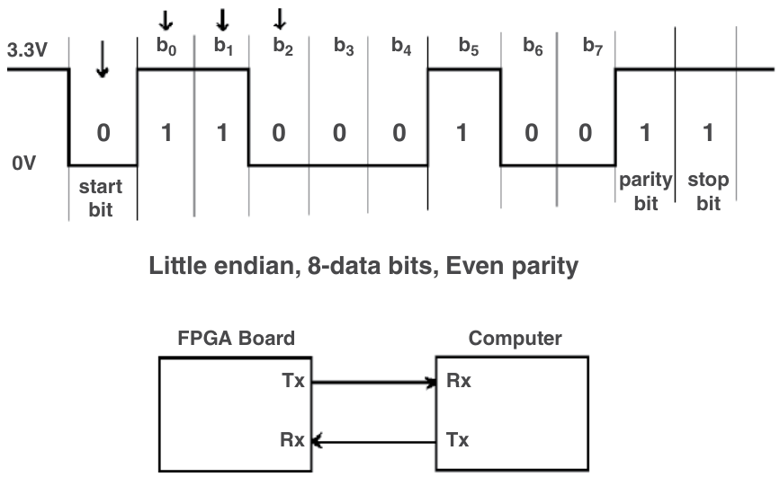

Hình 9.1 Giao thức UART.

## 9.2 Softcore processor MicroBlaze

Mục này nói về softcore processer *(ghi chú: sách in "processer"; đúng là "processor")* MicroBlaze của Xilinx. Trong mục này, chúng ta sẽ giải thích softcore processor MicroBlaze là gì và cách bạn có thể instantiate để dùng một processor như vậy cho development board Xilinx của mình, bên trong Vivado. Nếu bạn dùng development board Arty A7, để làm project UART demonstration, bạn cần dùng một softcore processor MicroBlaze. Vậy, bước đầu tiên là hiểu softcore processor là gì. Nếu bạn từng nghe về nó hoặc quen thuộc với processor và microprocessor, có lẽ bạn đã nghe về Arduino hay Microchip, hoặc Texas Instruments, là các hard processor về cơ bản được đúc sẵn vào một mạch tích hợp thực tế. Bạn không thể thay đổi chúng, và chúng không thể định nghĩa lại. Nhưng một softcore processor là một processor có thể định nghĩa, được hiện thực từ FPGA fabric, mà khi nghĩ về FPGA, bạn có thể coi về cơ bản là một fabric số. Bạn có thể làm bất cứ điều gì bạn muốn với chúng, và nó hoàn toàn mở. Nó cho bạn những nguyên liệu thô để tạo một thiết kế số. Một trong những thứ bạn có thể tạo là một processor, và vì vậy Xilinx cung cấp một khối drop in đại diện cho một trong các processor này. Vậy, nếu bạn có một FPGA, bạn có thể thả nhiều processor như vậy lên đó, điều này về cơ bản sẽ biến FPGA của bạn thành một multicore processor. Vậy, điều đó khá thú vị, và điều thực sự thú vị là chúng ta có thể định nghĩa toàn bộ tài nguyên. Vậy, nếu muốn có nhiều bộ nhớ hơn, chúng ta hoặc gắn bộ nhớ ngoài hoặc dùng nhiều hơn block memory bên trong FPGA. Nếu muốn thêm cổng SPI, cổng UART hay IO, chúng ta có thể làm điều đó chỉ bằng cách định nghĩa softcore processor đó và thêm vào. Tất nhiên là có giới hạn, nhưng nhiều khi khi bạn có một development board có microcontroller hay processor trên đó, bạn có thể chỉ có ba hoặc bốn timer để dùng. Nhưng nếu bạn phát triển trên FPGA, bạn có thể cấu hình processor MicroBlaze cho phù hợp với nhu cầu. Bạn có thể chỉ định muốn nhiều timer hơn hay ít timer hơn và số bit cho mỗi timer đó. Thêm vào đó, bạn có toàn bộ FPGA fabric xung quanh processor. Vậy, nếu bạn muốn thêm chức năng, bạn có thể tạo thiết kế bằng VHDL và một giao diện nhỏ để microprocessor có thể giao tiếp trực tiếp với các port của bạn trong chip VHDL. Vậy, thay vì có một chip riêng trên board, tất cả nằm trong một chip, và việc giao tiếp cũng rất nhanh. Vậy, có rất nhiều lợi thế và lợi ích khi dùng software processor. Một số ngoại vi bạn có thể thêm vào các softcore processor MicroBlaze có nhiều phiên bản khác nhau: các phiên bản high-end dùng nhiều tài nguyên hơn, nhưng cho bạn nhiều tính năng hơn. Chúng có một phiên bản low end gọi là MCS, chỉ có một vài tập con tính năng nhỏ. Ví dụ, với những gì chúng ta đang làm ở đây, chúng ta chỉ gửi dữ liệu ra cổng UART nên không cần phiên bản high end, và tất cả những tính năng siêu xịn đó, chúng ta chỉ cần một cổng UART và thế là đủ. Nhưng bạn có thể thêm các tính năng như, tất nhiên là UART, bạn có SPI hoặc I<sup>2</sup>C hoặc GPIO, là general-purpose inputs, outputs, hoặc timer, cũng như các tính năng bổ sung bạn có thể thêm, và một điều thú vị khác là chúng ta có thể tạo, như đã nói, các custom peripheral, để họ có thể tạo một giao diện theo chuẩn AXI, như họ gọi nó, và vì vậy nếu bạn tạo giao diện AXI trên các thiết kế VHDL của mình, giờ bạn có thể có, chẳng hạn, khối PWM mà chúng ta đã tạo, và nếu đặt một giao diện AXI lên đó, chúng ta có thể cho software processor MicroBlaze bắt đầu nói chuyện với input hay thiết kế PWM thực tế này và thực sự giao tiếp với nó, nhờ đó chúng ta có thể ghép nối nó, chỉ cần viết code C, điều này khá thú vị. Tuy nhiên, bạn có thể làm theo những cách dễ hơn nhiều, và bạn chỉ cần đặt một general-purpose input output. Chúng ta muốn có một general-purpose output nơi chúng ta ghi ra tám bit, và tám bit đó tương ứng với duty cycle của signal pulse width modulated (PWM) của tôi, hoặc bạn có thể làm nó thành chín bit, trong đó một bit nối với enable để bạn có thể enable hoặc disable thiết kế PWM. Vậy, có rất nhiều điều khác nhau bạn có thể làm với chúng. Nó rất dễ tùy biến, và điều tuyệt nhất về các softcore processor này là bạn không bị ràng buộc vào những tài nguyên nhất định, bạn chỉ bị ràng buộc bởi những gì có sẵn trong FPGA. Nhưng nếu bạn muốn dùng thêm tài nguyên, nếu bạn có tài nguyên ở đó, bạn có thể thêm các tính năng và chức năng đó. Vậy, đó là một điều khá thú vị, và một vài điểm chính về các processor này: chúng sẽ dùng các tài nguyên sau. Trên FPGA, chúng sẽ dùng BRAM bên trong, tức Block RAM, và chúng sẽ dùng một bộ nhân. Vậy, trong processor, nếu bạn muốn thực hiện phép nhân, điều đó sẽ cần một bộ nhân bên trong arithmetic logic unit của processor đó, cũng như logic, thứ cần digital logic để hiện thực nó. Bạn phải có các bảng bộ nhớ và có cả một loạt thông tin về nó. Nhưng về cơ bản, bạn không thể thả processor vào mà không tốn gì. Nó có tốn tài nguyên, vì vậy khi bạn nói muốn tạo một multicore processor trên FPGA, bạn sẽ bị giới hạn bởi tài nguyên có trên FPGA đó. Nếu bạn thả vào, chẳng hạn, năm softcore processor MicroBlaze, có thể bạn vẫn ổn, nhưng bạn có thể không đặt được đến sáu cái. Bạn có thể phải nâng cấp lên một part có package lớn hơn, điều này đơn giản là tốn nhiều tiền hơn, và nó tốn nhiều điện năng hơn. Vậy, có những cân nhắc đi kèm, và bạn không thể cứ thoải mái thả chúng vào. Sau đó, khi bạn synthesize thiết kế, ý tưởng đằng sau là bạn sẽ lấy processor MicroBlaze, định nghĩa nó, hiện thực nó trong thiết kế, và rồi khi synthesize thiết kế đó, bạn có thể export nó sang một công cụ khác, công cụ Xilinx software development kit (SDK), nơi bạn có thể viết code C rồi code đó được nạp vào processor MicoBlaze *(ghi chú: sách in "MicoBlaze"; đúng là "MicroBlaze")* đó, và sau đó chúng ta có thể lấy code C đó và tạo ra cái gọi là file a.elf, và file đó được gắn với softcore processor để khi bạn nạp nó lên board, bạn không phải nạp nó rồi lại nạp code C, mà bạn chỉ cần nạp một file, một file bit lên board FPGA, file đó sẽ làm mọi thứ bạn đã mô tả trong code C, và chúng tôi sẽ chỉ cho bạn cách làm điều đó sau. Vậy, điều tiếp theo chúng ta muốn xem là mở project UART demo, và trong project UART, bạn sẽ thấy nó trống, và không có design source nào. Vậy, trong design sources, chúng ta muốn tạo một softcore processor MicroBlaze. Nếu bạn muốn làm điều đó trực tiếp bằng code VHDL, đó sẽ là một thử thách, và bạn phải dùng các script đặc biệt và function đặc biệt để làm được. Điều chúng ta sẽ làm là tạo một block diagram. Vậy, chúng ta sẽ click vào Create Block Design và đặt tên thiết kế là UART_Demo, và với directory, chúng ta muốn để là local project và chỉ định source set là design sources, rồi sẽ click OK, vậy thao tác này sẽ tạo một block design cho chúng ta, và nó sẽ cho phép chúng ta thả vào một softcore processor MicroBlaze, từ đó chúng ta có thể tạo một file VHDL để nạp chương trình, như được mô tả trong Hình 9.2.

Vậy, chúng ta muốn click vào Add IP, và trong thanh tìm kiếm, gõ MicroBlaze. Bạn sẽ thấy ba tùy chọn: MicroBlaze, MicroBlaze Debug Module (MDM), và MicroBlaze MCS. Với project này, chúng ta sẽ dùng MicroBlaze MCS, như được minh họa lần lượt trong Hình 9.3 và 9.4.

MicroBlaze là phiên bản có rất nhiều tính năng và chức năng, nhưng nó cần nhiều tài nguyên và điện năng hơn để hiện thực. Dù dùng nó cũng ổn và board có thể đáp ứng, với project này, chúng ta sẽ chọn MicroBlaze MCS thay thế. Nó dễ instantiate hơn, ít phức tạp hơn, và nó có thể làm mọi thứ chúng ta cần. Vậy, chúng ta có thể double-click vào MicroBlaze MCS. Một cửa sổ nhỏ sẽ xuất hiện thông báo rằng nó đang thêm IP đó vào block diagram. Khi nó đã thả vào đó, chúng ta muốn double-click vào object MicroBlaze MCS để mở cửa sổ “Re-customize IP.” Trong cửa sổ này, chúng ta sẽ đặt và định nghĩa tất cả các tham số gắn với processor MicroBlaze. Ở phần đầu cho MCS, kích thước bộ nhớ là quan trọng – nó quyết định code của bạn có chạy đúng hay không. Nếu không đủ bộ nhớ, bạn sẽ gặp vấn đề. Nhưng tất cả những gì chúng ta làm là xuất UART, vậy tám kilobyte là quá đủ; với phần optimization, chúng ta sẽ chọn Area. Chúng ta thực ra không có vấn đề lớn về hiệu năng, chúng ta chỉ ghi dữ liệu ra cổng UART. Chúng ta không làm xử lý tín hiệu gì cả. Nếu chúng ta làm xử lý tín hiệu hay một tác vụ rất nặng, chúng ta sẽ chọn Performance, khi đó chúng ta không quan tâm nếu nó tốn nhiều diện tích hơn, và chúng ta muốn hiệu năng trong trường hợp đó. Chúng ta muốn tối ưu về diện tích, và với buses, chúng ta sẽ để trống cả hai tùy chọn, và với debug, chúng ta sẽ chọn None, như được thể hiện trong Hình 9.5.

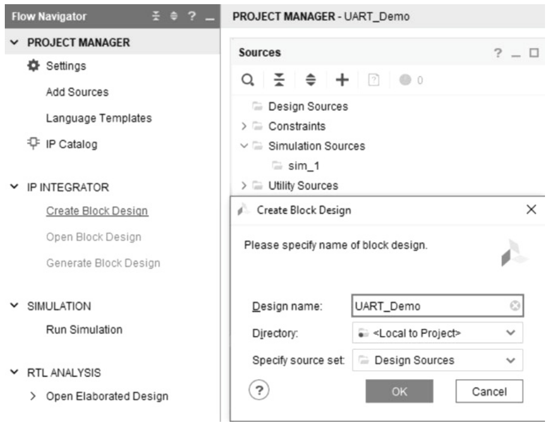

Hình 9.2 Tạo block design (UART_Demo).

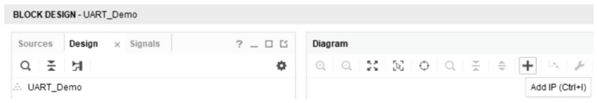

Hình 9.3 Click vào button Add IP (Ctrl+I).

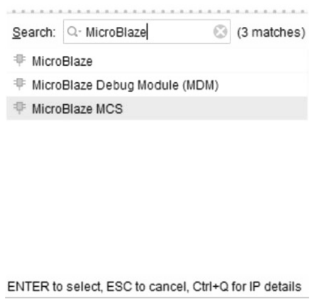

Hình 9.4 Chọn MicroBlaze MCS.

Tiếp theo, chúng ta sẽ chuyển sang tab UART. Ở đây, chúng ta chỉ muốn enable transmitter và định nghĩa baud rate là 115200. Với Programmable Baud Rate, chúng ta sẽ để nó không được đánh dấu. Chúng ta sẽ để đây là một processor MicroBlaze rất cơ bản, và chúng ta sẽ không có quá nhiều tham số trong processor này, vậy phần còn lại sẽ vẫn không được đánh dấu, như được mô tả trong Hình 9.6.

Các tab tiếp theo cho phép bạn dùng fixed interval timer (FIT) và programmable interval timer (PIT). Tuy nhiên, vì chúng ta không dùng chúng trong project, chúng ta sẽ để chúng không được đánh dấu. Tương tự, với GPO (general-purpose output) và GPI (general-purpose input), chúng ta cũng không dùng cái nào, vậy chúng ta cũng sẽ để tất cả không được đánh dấu. Interrupts cũng vậy, vậy tùy chọn đó cũng sẽ không được đánh dấu. Tại thời điểm này, chúng ta có thể click OK. Thao tác này sẽ lấy các cấu hình chúng ta đã đặt, mà trong trường hợp này là một thiết lập rất cơ bản. Tất cả những gì chúng ta làm chỉ là enable việc truyền UART. Chúng ta thậm chí không dùng đường nhận (rx) vì với phần demonstration này, nhiệm vụ duy nhất là truyền dữ liệu từ board FPGA tới máy tính. Vì chúng ta không cần đường Rx, đây chỉ là một đường truyền dữ liệu duy nhất. Nếu click vào nó, bạn sẽ thấy phần UART plus ở đó, và nếu kéo nó xuống, bạn có thể thấy đường UART_txd. Đó là đường truyền UART của chúng ta, như được minh họa trong Hình 9.7.

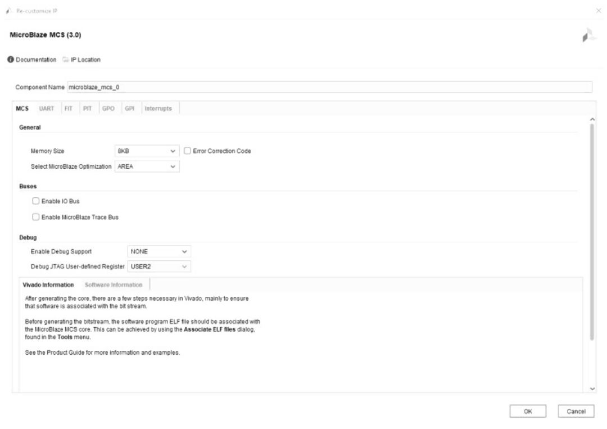

Hình 9.5 Tab MCS của cửa sổ Re-customize IP.

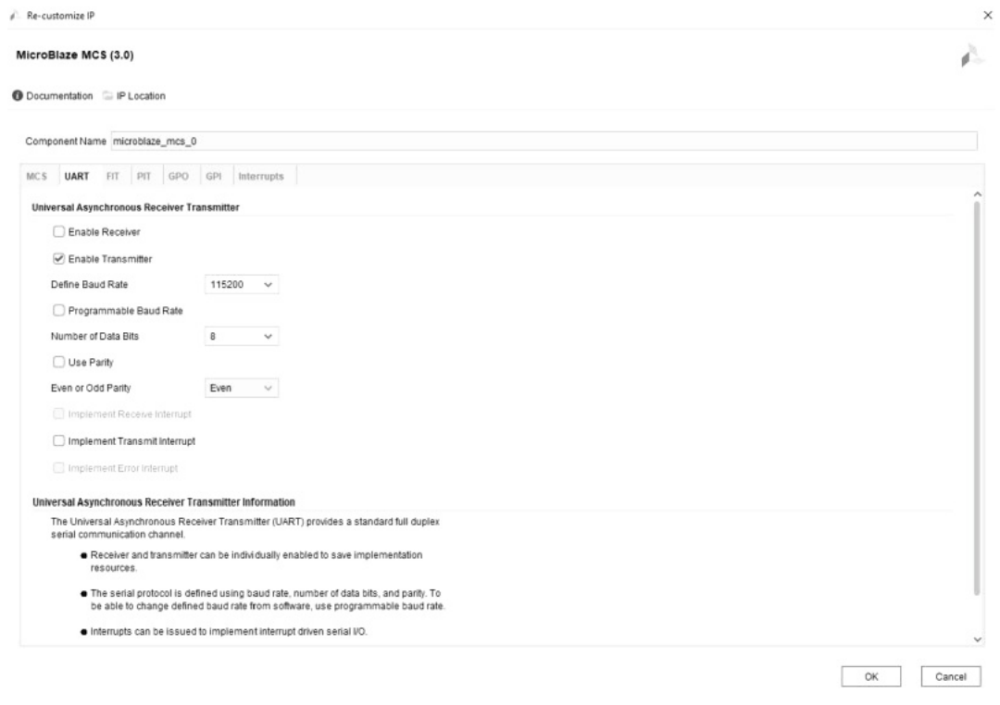

Hình 9.6 Tab UART của cửa sổ Re-customize IP.

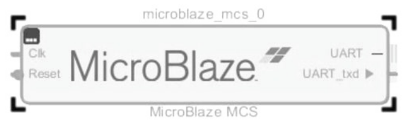

Hình 9.7 Đường UART_txd của MicroBlaze MCS.

Tại thời điểm này, processor MicroBlaze của chúng ta đã được cấu hình và thiết lập thành công trong project UART demonstration. Nếu bạn muốn thêm một processor khác, bạn chỉ cần đi qua cùng quá trình, tìm IP, và thêm một processor MicroBlaze khác. Bạn có thể thêm bao nhiêu processor tùy theo tài nguyên của FPGA cho phép. Như đã đề cập ở trên, mỗi core MicroBlaze đều tiêu tốn tài nguyên. Trong trường hợp của chúng ta, chúng ta chỉ cấp 8KB bộ nhớ. Nếu chương trình của bạn lớn hơn hoặc thực hiện các tác vụ phức tạp hơn, nó sẽ cần nhiều bộ nhớ hơn, và bạn sẽ hết bộ nhớ. Vậy, bạn có thể đặt bao nhiêu processor tùy theo tài nguyên có thể đáp ứng. Mục này giải thích softcore processor MicroBlaze bên trong thiết bị Xilinx.

## 9.3 Xilinx Software Development Kit

Mục này nói về Xilinx SDK. Trong mục này, chúng ta sẽ giải thích Xilinx SDK là gì và chúng ta sẽ dùng nó cho project như thế nào. Xilinx SDK, hay X-SDK, là viết tắt của Xilinx software development kit, là một môi trường thiết kế tích hợp cho phép bạn tạo các ứng dụng nhúng chạy riêng trên các microprocessor của Xilinx. Nếu bạn làm việc với Texas Instruments hay bất kỳ loại microprocessor nào khác, bạn không thể dùng công cụ này. Nó dành riêng cho microprocessor của Xilinx, và trong trường hợp của chúng ta, chúng ta dùng softcore processor MicroBlaze, vậy nó sẽ hoạt động với processor đó. Tuy nhiên, bạn không thể dùng nó cho bất kỳ thứ gì khác; bạn có thể tải nó về như một công cụ độc lập, nhưng nếu bạn tải Vivado, nó mặc định được kèm theo Vivado webpack, hay phiên bản miễn phí. Vậy, theo mặc định, nó được kèm theo và miễn phí. Bạn sẽ có thể dùng nó mà không gặp vấn đề gì. Đây là công cụ chúng ta sẽ dùng để viết code chạy trên các softcore processor MicroBlaze. Ví dụ, chúng ta sẽ dùng nó trong project UART demonstration này cũng như trong các project sau trong cuốn sách này. Công cụ này dựa trên môi trường phát triển Eclipse. Nếu bạn quen với nhiều công cụ phát triển code dựa trên eclipse, công cụ này sẽ trông rất giống chúng, với nhiều tính năng, menu và mọi thứ giống nhau. Chỉ là Xilinx đã lấy môi trường phát triển eclipse và sửa đổi nó cho phù hợp với công cụ họ cần. Vậy, trong các project của chúng ta, khi tạo một softcore processor MicroBlaze, chúng ta instantiate nó trong thiết kế và nó xây dựng toàn bộ logic cho processor đó. Nhưng nếu bạn không lập trình cho nó, nếu bạn không viết code nào trong SDK để chạy trên đó, bạn sẽ đưa nó lên board, và khi bắt đầu chạy, bạn sẽ nhận ra rằng không có gì xảy ra. Đó là vì nó giống như có một microcontroller hay microprocessor trên development board: nếu bạn không lập trình mà chỉ cấp nguồn, sẽ có vẻ như không có gì hoạt động vì nó không làm gì cả, và đó là vì hiệu ứng là như nhau. Bạn có thể nạp board thành công, nhưng nếu bạn không nạp code nào vào MicroBlaze, nó cũng sẽ không làm gì cả, và nó sẽ chỉ nằm yên đó. SDK có một số tính năng khá hay; nó rất mạnh và cho phép bạn làm rất nhiều thứ khác nhau. Nó thậm chí còn có khả năng tích hợp real-time operating system. Trong cuốn sách này, chúng ta sẽ không dùng điều đó, mà chỉ cho bạn biết một chút thông tin nền về nó. Họ có free RTOS, một free real-time operating system mà bạn có thể dùng và chạy bên trong các softcore processor MicroBlaze. Vậy, nếu bạn làm một project cần một real-time operating system, bạn có thể đưa free RTOS này vào, và nó cho bạn framework và cấu trúc để tạo một project dựa trên đó. Bạn chỉ cần tạo các task và cho chúng hoạt động trong một môi trường real-time. Như đã đề cập ở trên, đó là một công cụ rất mạnh, và chúng ta sẽ dùng nó rất nhiều. Ngay bây giờ, chúng ta sẽ làm việc với project UART demo để xem chúng ta cần làm gì để bắt đầu với Xilinx SDK. Vậy, nếu mở project UART demo, bạn sẽ thấy chúng ta có MicroBlaze MCS, thứ chúng ta đã cấu hình. Bây giờ, chúng ta cần thêm IO và tạo một thiết kế VHDL top-level. Sau đó, chúng ta sẽ cần chạy synthesis, chạy implementation và tạo bitstream để có thể đưa mọi thứ chúng ta cần vào môi trường Xilinx SDK. Vậy, hãy tạo các IO. Chúng ta sẽ cần tạo một IO cho clock và gọi nó là input clock. Nếu right-click và chọn Create Port, nó mở ra một cửa sổ nơi bạn có thể tạo các input và output. Trong trường hợp này, chúng ta sẽ tạo một clock. Vậy, chúng ta sẽ gọi nó là Input_Clk, chọn hướng là input, và đặt type là clock. Sau đó, chúng ta sẽ đặt tần số là 100MHz và click OK, như được thể hiện trong Hình 9.8.

Vậy, giờ chúng ta có một input clock mà chúng ta có thể kéo và đặt thẳng hàng với clock (Clk). Nếu bạn rê chuột lên nó và chuột đến đủ gần, bạn sẽ thấy một ngón tay trỏ. Khi đến đủ gần, con trỏ sẽ chuyển thành hình bút chì. Nếu bạn click khi thấy bút chì, nó sẽ cho bạn thấy những gì đang ở đó và chỗ bạn thực sự có thể nối tới. Khi nối nó, chúng ta có thể thấy một dấu check nhỏ màu xanh lá bên cạnh clock, đó là vì công cụ nhận ra đây là một signal clock. Vì đó là signal clock, nó có thể được nối với nhau, như được mô tả trong Hình 9.9.

Chúng ta có thể nối Input_Clk này với Reset, nhưng nếu chọn một signal Reset, nó sẽ nhận ra rằng signal này nên được nối với Reset, không phải với Clk, và ngược lại. Vậy, giờ hãy tạo signal reset. Chúng ta sẽ right-click và chọn Create Port ở phía dưới và đặt tên cho port. Chúng ta sẽ gọi nó là Reset_Top; hướng sẽ là Input, và với type, chúng ta sẽ chọn là Reset. Sau đó, bạn cần chọn nó là active high hay active low. Vậy, trong trường hợp này, chúng ta sẽ chọn polarity là Active High reset và click OK, như được minh họa trong Hình 9.10.

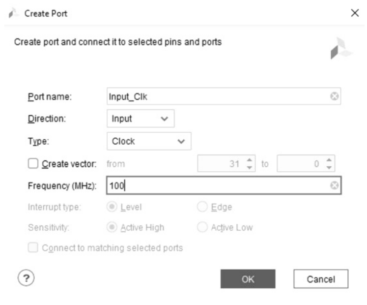

Hình 9.8 Cửa sổ Create Port cho clock.

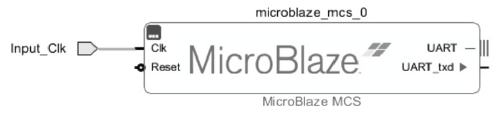

Hình 9.9 Nối Input_Clk với Clk của MicroBlaze MCS.

Khi thấy biểu tượng ngón tay nhỏ, biểu tượng bàn tay, chúng ta sẽ click và kéo đường nối xuống phía reset input, và chúng ta sẽ có biểu tượng bút chì, và khi bắt đầu kéo, chúng ta có thể thấy một dấu checkmark xanh lá chỉ ra một kết nối hợp lệ, vậy chúng ta sẽ kéo nó tới đó, như được thể hiện trong Hình 9.11.

Giờ chúng ta đã nối Input_Clk với clock input và Reset_Top với reset trên MicroBlaze, chỉ còn một IO nữa cần đặt. Nó được gọi là UART_txd hay đường truyền. Với UART demo này, chúng ta sẽ không nhận dữ liệu nào từ máy tính; chúng ta chỉ truyền dữ liệu từ MicroBlaze tới máy tính. Khi mở serial port và thấy dữ liệu đi vào, chúng ta sẽ biết MicroBlaze đang hoạt động đúng. Để làm điều này, chúng ta right-click và chọn Create Port, và chúng ta sẽ đặt tên là UART_Tx. Với hướng, chúng ta sẽ bảo đảm nó là Output và type chúng ta sẽ để là Other rồi click OK, như được mô tả trong Hình 9.12.

Chúng ta sẽ kéo nó xuống UART_txd, và nếu có biểu tượng bút chì hay kéo được tới đó, chúng ta có thể có một MicroBlaze MCS, nơi Input_Clk, Reset_Top và UART_Tx đều đã được nối, như được minh họa trong Hình 9.13.

Giờ, với block diagram được chọn, chúng ta muốn click Save. Tại thời điểm này, chúng ta cần tạo thiết kế VHDL top-level. Để làm điều này, trong cửa sổ Sources, bạn cần chọn block diagram UART_Demo.bd, right-click, và chọn Create HDL Wrapper, nghĩa là tạo một hardware descriptive language wrapper, như được thể hiện trong Hình 9.14.

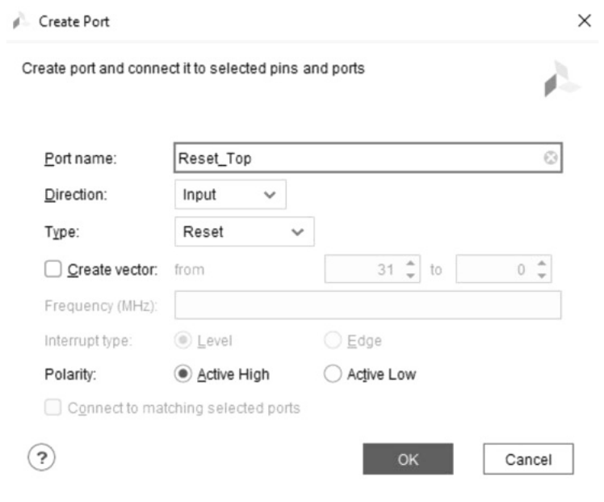

Hình 9.10 Cửa sổ Create Port cho reset.

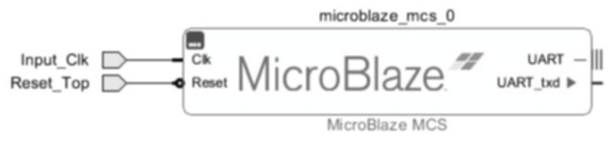

Hình 9.11 Nối Reset_Top với Reset của MicroBlaze MCS.

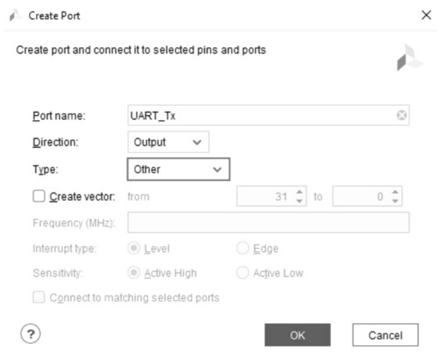

Hình 9.12 Cửa sổ Create Port cho UART_txd.

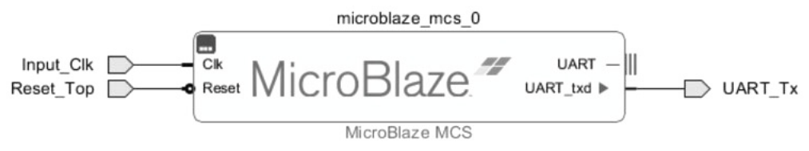

Hình 9.13 Nối UART_Tx với UART_txd của MicroBlaze MCS.

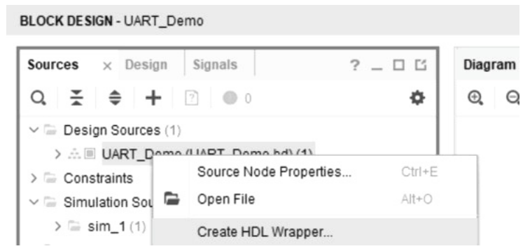

Hình 9.14 Chọn Create HDL Wrapper.

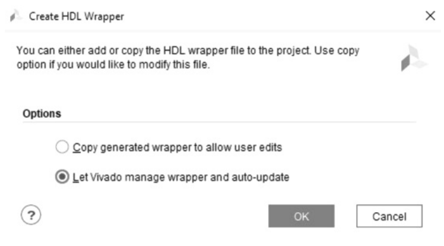

Hình 9.15 Để Vivado quản lý wrapper và auto-update.

Vậy, chúng ta sẽ click vào đây và để Vivado quản lý wrapper và auto-update, như được thể hiện trong Hình 9.15.

Điều đó quan trọng vì nếu chúng ta thực hiện bất kỳ thay đổi nào với block diagram, chúng ta muốn Vivado cập nhật wrapper. Chúng ta không muốn phải tự vào sửa code, vậy chúng ta sẽ click OK, và điều Vivado sẽ làm là lấy block diagram này và biến nó thành một file VHDL, vì bạn không thể lấy một block diagram rồi biến nó thành bitstream.

Vậy, bạn phải tạo một file VHDL để chúng ta có thể thấy thiết kế top-level. Sau khi làm điều này, chúng ta có thể xem UART_Demo_Wrapper. Nếu click mở xuống, chúng ta có thể thấy nó chứa block diagram UART_Demo. bd. Bằng cách double-clicking vào UART_Demo_Wrapper đó, chúng ta có thể thực sự mở wrapper mà Vivado đã tạo. Nếu để ý, nó rất giống cách chúng ta sẽ viết code. Vậy, họ có một thiết kế top-level, nơi họ đưa một số comment ở trên cùng. Họ có library, và entity được định nghĩa, bao gồm các input và output chúng ta đã định nghĩa: Input_Clk, Reset_Top và UART_Tx. Quay lại sơ đồ trong Hình 9.13, đây là nơi họ lấy entity. Về cơ bản, đây là thiết kế top-level của chúng ta. Họ chỉ tạo VHDL để biểu diễn điều đó, và bạn cũng có thể thấy họ có một component. Vậy, họ đang thực hiện một component instantiation cho block diagram của chúng ta, mà chúng ta đã đặt tên là UART_Demo. Vậy, họ gọi component này là UART_Demo và có các port Input_Clk, Reset_Top và UART_Tx. Với architecture của họ, tất cả những gì họ làm là lấy thiết kế top-level này và ánh xạ nó tới UART_Demo. Vậy, về cơ bản, đây là thiết kế của chúng ta, như được mô tả trong Hình 9.13 – chỉ có MicroBlaze này, và chúng ta không có gì khác diễn ra, vậy đó là toàn bộ thiết kế. Vậy, giờ chúng ta đã thiết lập UART demo wrapper, chúng ta có thể click Run Synthesis. Khi click Run Synthesis, một vòng tròn nhỏ màu xanh lá xuất hiện ở phía trên để chỉ ra rằng nó đang chạy synthesis. Khi hoàn thành synthesis, chúng ta sẽ chạy implementation rồi tạo bitstream. Tại thời điểm đó, lý do chúng ta muốn làm điều này là vì chúng ta muốn bảo đảm thiết kế đang hoạt động đúng trước khi viết phần mềm cho MicroBlaze. Nếu chúng ta có vấn đề với thiết kế, như synthesis thất bại hay bất kỳ loại lỗi lớn nào, chúng ta muốn sửa nó trước khi import vào công cụ phát triển SDK. Ngoài ra, nếu quay lại wrapper, chúng ta có thể thấy họ đưa cho bạn một số comment ở đây. Vậy, điều gì hay ở đây? Nếu bạn có nhiều MicroBlaze – ở đây chúng ta chỉ đặt một MicroBlaze. Nhưng nếu chúng ta đặt một MicroBlaze thứ hai hay thứ ba, nó sẽ instantiate tất cả các component đó và chúng ta không phải quản lý. Vậy, tất cả những gì chúng ta phải làm là để Vivado cập nhật nó, và nó sẽ lo tất cả cho chúng ta. Vậy, đó là một tính năng hay để bảo đảm Vivado lo liệu việc đó. Chúng ta sẽ quay lại sơ đồ trong Hình 9.13, và tùy thuộc vào máy tính của bạn nhanh đến đâu, việc chạy synthesis thiết kế này đôi khi có thể mất một chút thời gian. Nó chỉ đang đi qua để kiểm chứng rằng không có vấn đề gì với code và mọi thứ hoạt động như mong đợi. Vậy, chúng ta chờ nó xong, và ngay đó, synthesis đã hoàn tất. Vậy giờ chúng ta muốn chạy implementation. Giờ synthesis đã hoàn tất, nó cho chúng ta biết không có lỗi nào trong thiết kế mà nó đã synthesize. Chúng ta sẽ chạy implementation, bước này sẽ lấy thiết kế và thực sự tìm ra về mặt vật lý cách nó sẽ hiện thực thiết kế trên chính board. Khi bước đó hoàn tất, chúng ta muốn tạo bitstream, rồi chúng ta sẽ phải vào menu file và export hardware. Khi làm điều đó, nó sẽ lấy mọi thứ trong hardware và export ra để chúng ta có thể mở nó trong môi trường SDK, vì sau đó, từ đây, chúng ta muốn khởi chạy software development kit, hay SDK như họ gọi. Vậy, chờ implementation hoàn tất, và giờ nó đã xong. Chúng ta sẽ tạo bitstream. Khi bạn chạy route design, một trong những điều lớn sẽ ảnh hưởng là lượng bộ nhớ bạn đang dùng. Vậy, chúng ta chỉ chỉ định tám kilobyte. Nếu bạn chỉ định nhiều bộ nhớ hơn, nó phải lấy từ đó theo cách thiết kế của chúng ta được thiết lập. Chúng ta không có giao diện nào cho bộ nhớ ngoài trên chính board. Có bộ nhớ ngoài, nhưng chúng ta không dùng nó. Chúng ta chỉ dùng block RAM hay bộ nhớ bên trong. Vậy, sẽ mất một chút thời gian để tạo tất cả những thứ đó, và bitstream generation của chúng ta đã thất bại, như được minh họa trong Hình 9.16.

Vậy, chúng ta chọn OK, và có lẽ đó là vì chúng ta chưa định nghĩa IO và điều đó không sao, chúng ta sẽ làm phần đó sau, như được thể hiện trong Hình 9.17. Ở giai đoạn này, chúng ta biết mình đã vượt qua synthesis và implementation.

Từ thời điểm này chúng ta sẽ ổn. Chúng tôi có thể chỉ cho bạn cách lấy thiết kế này và export nó sang SDK. Sau đó chúng ta sẽ phát triển code, ánh xạ IO, và chạy nó trên development board. Bây giờ, chúng ta sẽ export thiết kế phần cứng sang Xilinx SDK, và từ đó, chúng ta sẽ dùng nó để viết code, tạo một project, và viết code mà chúng ta thực sự sẽ dùng trên processor MicroBlaze. Giờ thiết kế đã được synthesize và thiết kế top-level (UART_Demo_Wrapper) đã được tạo, chúng ta muốn click vào File và export hardware. Thao tác này sẽ mở một hộp thoại nhỏ ghi export the hardware for software development tools và chúng ta sẽ để Include Bitstream không được đánh dấu, vì chúng ta chưa tạo file bitstream, nên không thể đưa nó vào đây, và điều đó không sao. Vậy, chúng ta sẽ chỉ export vào local project, và bạn có thể export nó tới một vị trí khác. Tuy nhiên, chúng ta muốn giữ càng nhiều thứ trong local project càng tốt, điều này giúp mọi thứ dễ hơn nhiều khi làm việc với các công cụ khác nhau, đặc biệt là các công cụ phát triển phần mềm. Nhờ đó, bạn sẽ biết tìm các file khác nhau cần để làm việc với phần mềm ở đâu, như được mô tả trong Hình 9.18.

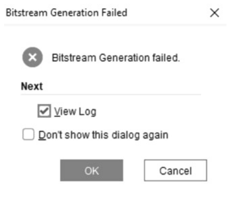

Hình 9.16 Cửa sổ bitstream generation thất bại.

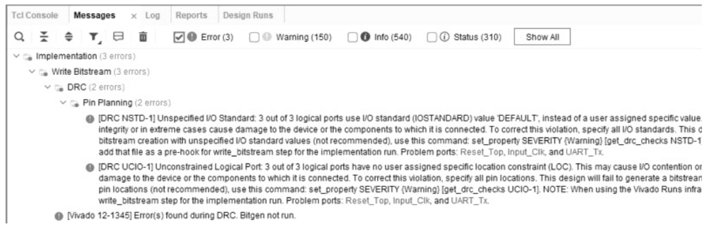

Hình 9.17 Cửa sổ thông báo lỗi.

Tiếp theo, click OK để export phần cứng cho các công cụ. Bây giờ, điều chúng ta muốn làm là vào File và Launch SDK. Khi khởi chạy, bạn sẽ được yêu cầu chỉ định vị trí export của công cụ phát triển phần mềm. Nếu bạn đã chọn một vị trí khác với local to project, bạn sẽ cần điều hướng tới vị trí đó và cho SDK biết tìm phần cứng bạn đã phát triển ở đâu. Ví dụ, chúng ta muốn giữ tất cả cục bộ trong project, và điều mà workspace này làm là lưu project cho SDK của bạn: tất cả thiết lập cho project đó, code cho project đó, nơi bạn muốn project đó được đặt, và chúng ta sẽ muốn nó được đặt trong local project. Vậy, click OK, như được minh họa trong Hình 9.19.

Thao tác này sẽ mở SDK của Xilinx, và khi nó mở, bạn sẽ thấy một cửa sổ hiển thị hardware platform của UART demo wrapper. Vậy, chúng ta cần tạo một project để làm điều đó. Nó cho chúng ta toàn bộ thông tin thiết kế về MicroBlaze đối với thiết bị FPGA đích, như được thể hiện trong Hình 9.20. Nó cho chúng ta biết nó được tạo bằng gì, cũng như base address, high address, thông tin về các loại bộ nhớ khác nhau, và tất cả các khối IP có trong thiết kế. Vậy, bên trong khối MicroBlaze đó, có rất nhiều thứ, như block memory generator, controller và IO module. Bạn có thể xem tất cả chúng và thấy chính xác chúng đang làm gì. Nhưng điều này cho bạn hiểu chuyện gì đang diễn ra bên trong system.hdf. Giờ chúng ta có thể đóng nó.

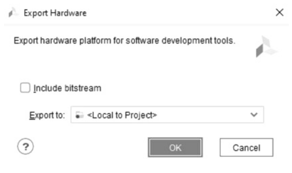

Hình 9.18 Export hardware.

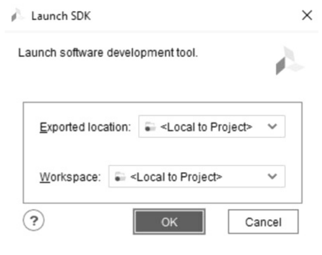

Hình 9.19 Cửa sổ Launch SDK.

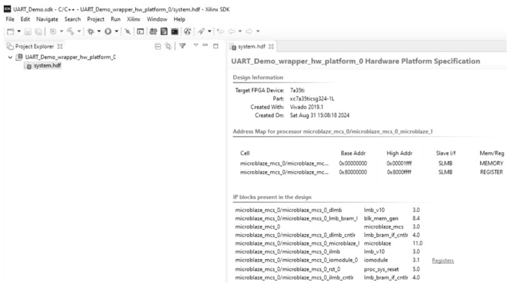

Hình 9.20 Thông tin thiết kế về MicroBlaze.

Trong Xilinx SDK, chúng ta muốn tạo một application project mới. Để làm điều này, chúng ta sẽ vào File > New > Application Project. Từ đây, chúng ta muốn đặt tên project là Hello_World, và chúng ta muốn đánh dấu use default location. Với OS platform, nó cho bạn nhiều tùy chọn khác nhau. Chúng ta sẽ chọn standalone, nhưng bạn có thể chọn free real-time operating system, hoặc bạn có thể chọn Linux hay các loại hệ điều hành khác. Nhưng chúng ta sẽ dùng hệ điều hành standalone. Hardware platform của chúng ta là UART_Demo_wrapper_hw_platform_0, thứ export thiết kế từ Vivado, cùng tất cả các file cần thiết để SDK hiểu processor đích là gì. Vậy, nó nhận ra rằng processor đích, điều này hợp lý, là microblaze_mcs_0_microblaze_1. Nếu chúng ta có nhiều processor khi tạo project này, chúng ta có thể dùng menu pull-down này và chọn một processor khác mà chúng ta muốn nhắm tới. Nhưng vì chúng ta chỉ có một processor, chúng ta sẽ nhắm tới processor duy nhất có ở đó. Với ngôn ngữ phần mềm đích, bạn có thể chọn C hoặc C++; trong trường hợp này, chúng ta muốn chọn C, vì nó dùng ít bộ nhớ hơn. Chúng ta chỉ có tám kilobyte, nên không thể dùng nhiều bộ nhớ, vì vậy C sẽ là lựa chọn tốt nhất. C++, ngôn ngữ cho phép lập trình object-oriented, có thể dùng nhiều bộ nhớ hơn để làm điều đó, và vì chúng ta đang ở trong một môi trường kiểu nhúng, bộ nhớ là rất quan trọng. Với broad support package *(ghi chú: sách in "broad"; đúng là "board")*, chúng ta sẽ để nó tạo một cái mới và để mặc định. Bạn có thể đổi tên nếu muốn, nhưng chúng tôi nghĩ hợp lý nhất là cứ để là Hello_World_bsp. Vậy, hãy cứ để như vậy và chúng ta sẽ click Next, như được mô tả trong Hình 9.21.

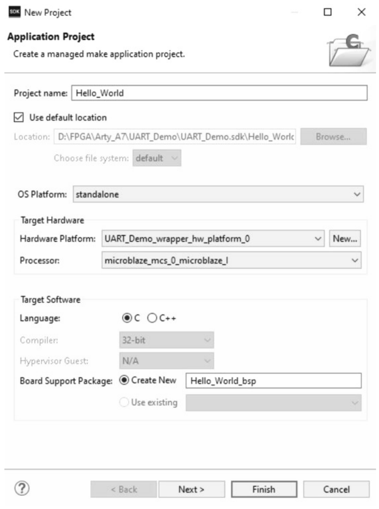

Hình 9.21 Các thiết lập New Project.

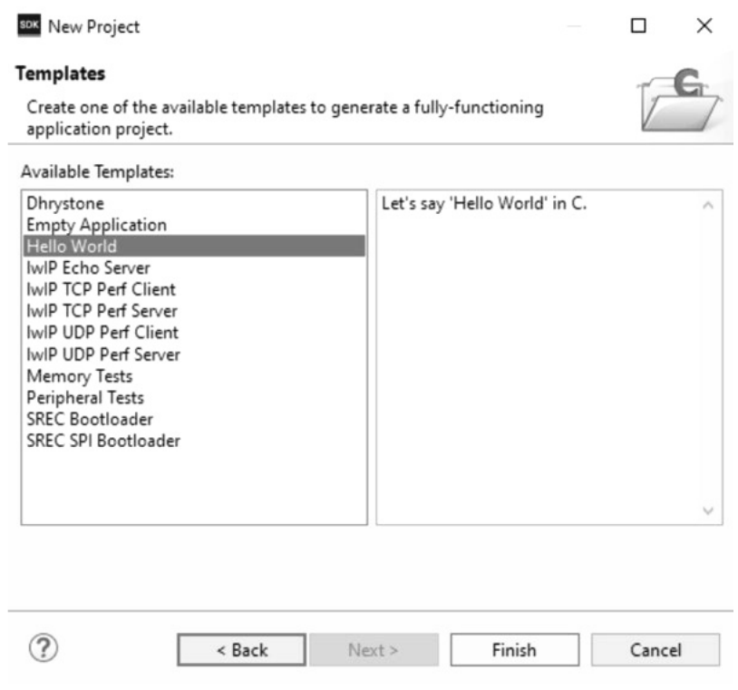

Hình 9.22 Chọn template Hello World.

Trong Hình 9.22, chúng ta chọn template cho project. Vậy, khi bắt đầu một project, bạn có thể chọn empty application. Chúng tôi khuyên không nên làm vậy vì nó cho bạn một project rồi bạn phải tự liên kết và thêm mọi thứ vào. Chúng ta sẽ chọn template Hello World, vậy nó sẽ cho chúng ta một project in ra Hello World. Vậy, chúng ta sẽ sửa nó một chút. Chúng ta sẽ lấy project có sẵn và sửa nó, và điều hay về việc này là nó là một cách test tốt: khi có project, bạn chọn Hello World này mà không cần viết code nào, build project, kiểm chứng xem nó có hoạt động không bằng cách nạp lên board, và rồi nếu thấy Hello World hiện lên, bạn biết rằng MicroBlaze đang giao tiếp được, bộ nhớ được liên kết đúng và mọi thứ hoạt động như mong đợi. Vậy, đó là một bài test đầu tiên tốt nên làm, và đây là một cách tuyệt vời để test UART. Sau đó, bạn có thể muốn thêm các bài test bổ sung vào đó để nối với IO, chẳng hạn các LED và slide switch, để kiểm chứng rằng chúng đang hoạt động. Nhưng ngay bây giờ, chúng ta chỉ làm việc với UART. Vậy, Hello World là template chúng ta sẽ chọn và rồi chúng ta sẽ click Finish, như được minh họa trong Hình 9.22.

Vậy, nó sẽ chạy qua wizard và tạo một project cho chúng ta, vậy chúng ta có UART demo wrapper. Nó chỉ định nghĩa phần cứng; system.hdf định nghĩa chuyện gì đang diễn ra bên trong thiết kế. Hello_World_bsp này là board support package. Vậy, nó cho bạn tài liệu phần nào nói về tất cả những thứ khác nhau đang diễn ra, vậy chúng ta có thể mở tài liệu BSP. Nếu bạn mở file block RAM (bram) đó, nó mở ra một file HTML cho bạn biết về những thứ khác nhau chúng ta có: brand *(ghi chú: sách in "brand"; đúng là "bram")*, là một block RAM controller, và họ cho bạn một số cấu trúc dữ liệu, API, và tất cả các function khác nhau mà bạn có thể gọi. Vậy, điều này cho thấy cách dùng phần trợ giúp trong đó. Nếu bạn muốn dùng iomodule hay standalone này, họ có các tài liệu HTML khác nhau. Nếu bạn muốn học cách dùng các function này, bạn sẽ phải đọc qua tài liệu này. Chúng tôi sẽ chỉ cho bạn cách làm những cái cơ bản: UART để ghi dữ liệu ra cổng UART. Nhưng nếu bạn muốn hiểu các API khác nhau ở đây, một số trong đó là để hướng dẫn cách làm, và đó là để cho bạn thấy board support package, và họ có nhiều thứ khác nhau ở đây, trong thư mục microblaze_mcs_0_microblaze_1 này, họ có một số code library và mọi thứ bên trong đó. Vậy, Hello World là project thực tế của chúng ta, nơi chúng ta sẽ phát triển code. Vậy, chúng ta có helloworld.c này và chúng ta sẽ đóng system.mss. Nếu vào helloworld.c và double-click vào nó, nó mở helloworld.c, file này có một header lớn giải thích copyright và tất cả thông tin mà Xilinx cung cấp về project. Điều chúng ta quan tâm nằm ngay đây. Tại thời điểm này, chúng ta có một hàm main, phần khởi tạo platform, và chúng ta sẽ in Hello World, dọn dẹp platform, và return không, như được thể hiện trong Hình 9.23.

Đây là một project Hello_World rất cơ bản. Nhưng nó rất hữu ích và giúp chúng ta có điểm khởi đầu cho những gì mình muốn làm. Vậy, điều chúng ta muốn làm là thêm phần đó ngay bây giờ. Vậy, trước phần khởi tạo platform, chúng ta sẽ tạo các integer i và j. Đó là vì trong project UART demonstration này, chúng ta muốn lặp và in Hello World 10 lần, rồi chúng ta muốn có thứ gì đó in ra để chỉ ra rằng code đã chạy xong. Vậy, chúng ta sẽ có các integer i và j, khởi tạo platform, rồi tạo một vòng lặp for. Chúng ta sẽ đi từ không đến chín, tổng cộng chạy 10 lần. Bên trong vòng lặp đó, chúng ta muốn in Hello World, theo sau là “\n\r” để xuống dòng và về đầu dòng. Vậy, chúng ta in những thứ đó 10 lần khác nhau, rồi chúng ta sẽ có một vòng lặp for thứ hai, đóng vai trò như một độ trễ cho chúng ta – và vòng lặp for đó trống. Chúng ta sẽ không làm gì cả; tất cả những gì chúng ta làm là chờ. Đây là một cách nhanh và cơ bản để tạo độ trễ. Không có nó, vòng lặp sẽ chạy nhanh đến mức chúng ta sẽ không thể thấy Hello world hiện lên nhiều lần. Tất cả sẽ hiện ra cùng lúc vì chúng ta dùng baud rate cao là 115200. Khi vòng lặp for hoàn tất, chúng ta muốn in ra thứ gì đó cho biết code đã xong. Vậy, chúng ta sẽ in một câu báo code hoàn tất kèm dấu chấm than, theo sau là ký tự xuống dòng. Đây là code mà chúng ta sẽ dùng để chạy trên FPGA thực tế, như được mô tả trong Hình 9.24 và code sau.

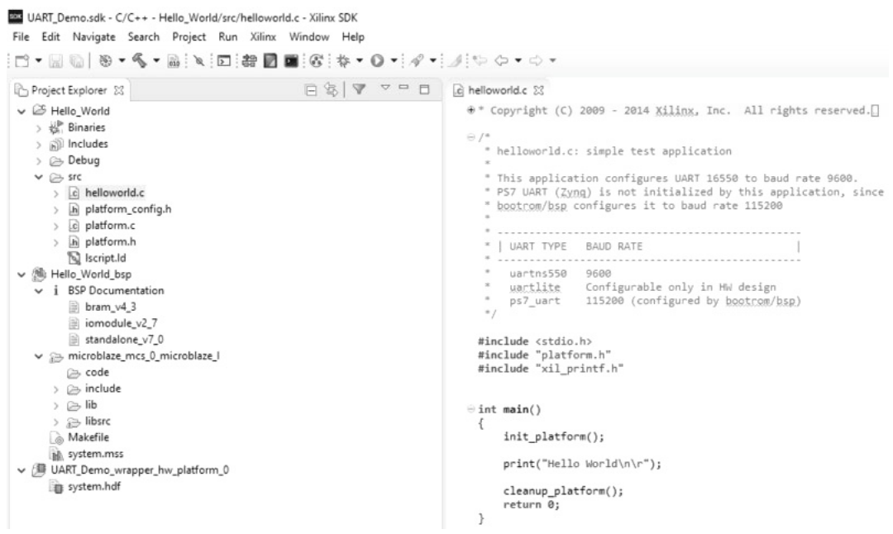

Hình 9.23 Code helloworld.c.

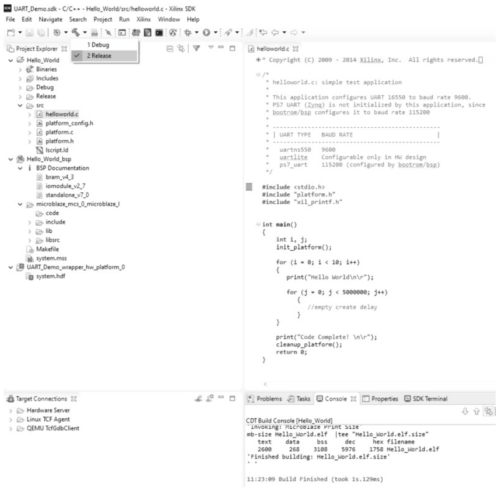

Hình 9.24 Code để chạy trên FPGA thực tế.

```
#include <stdio.h>
#include "platform.h"
#include "xil_printf.h"

int main()
{
      int i, j;
    init_platform();

    for (i = 0; i < 10; i++)
    {
       print("Hello World\n\r");

       for (j = 0; j < 5000000; j++)
          {
           //empty create delay
          }
    }

    print("Code Complete! \n\r");
    cleanup_platform();
    return 0;
}
```

Vậy, từ thời điểm này, chúng ta sẽ lưu project rồi build nó. Chúng ta sẽ chọn build ‘debug’ cho project Hello_World. Khi bắt đầu build project, nó sẽ cho chúng ta một số thông tin, và khi hoàn tất, nó ghi Build Finished. Khi build hoàn tất thành công, thứ then chốt chúng ta muốn xem là file .elf và đó là thứ chúng ta sẽ dùng để nạp khi tạo bitstream. Nó sẽ chứa code được nạp vào bên trong MicroBlaze. Để tìm file .elf, hãy điều hướng tới thư mục chứa project của bạn. Trong trường hợp này, nó nằm ở: Arty_A7 > UART_Demo > UART_Demo.sdk > Hello_World > Debug > Hello_World.elf.

File này quan trọng vì đó là thứ chúng ta muốn dùng khi quay lại Vivado để nạp board thực tế, và chúng ta muốn dùng file này để liên kết với nó. Tại thời điểm này, chúng ta cần kiểm tra file Hello_World.elf.size. Bạn có thể mở nó bằng Notepad++ hoặc bất kỳ trình soạn thảo văn bản nào khác. File này chỉ cho bạn biết kích thước file, nhưng đúng hơn là kích thước của code, như được minh họa trong Hình 9.25.

Vậy, giá trị thập phân này (6192 byte) là kích thước của Hello_World.elf. Điều đó có nghĩa là chúng ta đang dùng 6192 byte cho code này. Nếu bạn còn nhớ, chúng ta chỉ cấp tám kilobyte, vậy chúng ta còn khoảng hai kilobyte. Như bạn có thể thấy, chúng ta đã dùng khá nhiều bộ nhớ, và chúng ta thậm chí chưa làm gì nhiều. Đó là lý do tám kilobyte không phải là nhiều bộ nhớ. Nếu chúng ta đã dùng C++ hoặc viết một đống code, chúng ta sẽ gặp lỗi khi cố build nó. Nó sẽ báo rằng, không, cách này không được vì bạn đang dùng quá nhiều bộ nhớ. Để liên kết file .elf với MicroBlaze, chúng ta muốn quay lại project UART_Demo Hardware. Sau đó, vào Tools > Associate ELF Files. Với design sources, chúng ta có microblaze_mcs, và hiện tại, chúng ta có mb_bootloop_le.elf, như được thể hiện trong Hình 9.26. Đó chỉ là một đoạn code cơ bản – nó không thực sự làm gì. Vậy, chúng ta muốn click vào mũi tên, chọn file, và thêm nó. Để làm điều đó, vào Add Files, điều hướng tới thư mục chứa file Hello_World. elf, chọn nó, và click OK. Sau đó, click OK lần nữa, như được mô tả lần lượt trong Hình 9.27 và 9.28.

Vậy giờ, khi nhìn vào design sources, chúng ta có file Hello_World.elf này được liên kết với processor MicroBlaze MCS, như được minh họa trong Hình 9.29.

Vậy, mục này minh họa cách phát triển bằng Xilinx SDK để viết code sẽ chạy trên MicroBlaze.

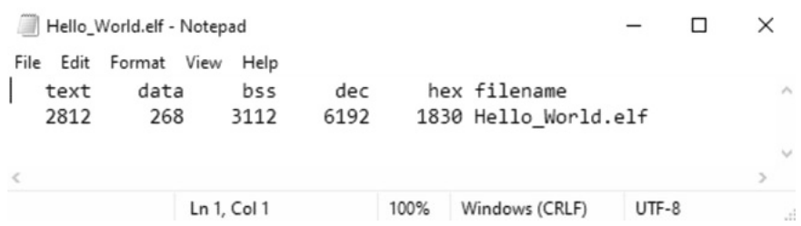

Hình 9.25 Nội dung file Hello_World.elf.size.

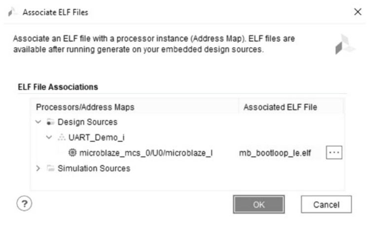

Hình 9.26 Cửa sổ Associate ELF Files.

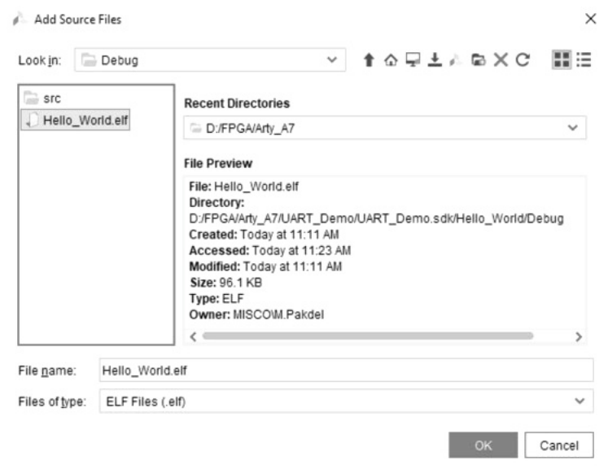

Hình 9.27 Cửa sổ Add Source Files.

## 9.4 Bố trí IO của UART Demonstration trên Arty A7

Mục này tập trung vào việc bố trí IO trên Arty A7 cho UART demonstration. Ở đây, chúng tôi sẽ chỉ cho bạn cách bố trí IO cho Arty A7 trong project UART demonstration. Vậy, nếu bạn mở project UART_Demo và file master “.xdc” của Arty A7, là constraints file cho project này, chúng ta cần ánh xạ IO. Điều này dựa trên block diagram trong Hình 9.13; chúng ta có ba IO khác nhau cần ánh xạ: Input_Clk, Reset_Top và UART_Tx. Với IO đầu tiên, Input_Clk, trong file master .xdc của Arty A7, chúng ta muốn đặt signal clock. Package đã định nghĩa chân E3, cũng như standard, vậy ở chỗ get ports ghi 100MHz, chúng ta muốn thay nó bằng Input_Clk. Điều đó cho chúng ta input clock và ánh xạ nó tới chân E3, là chân nối với bộ dao động trên board. Chúng ta sẽ đưa signal clock vào thiết kế từ đó. Sau đó chúng ta có dòng tiếp theo ghi create_clock, và chúng ta muốn đi tới phần ghi get_ports. Chúng ta muốn copy Input_Clk và paste vào đó. Vậy, khi chạy synthesis và thiết kế, nó sẽ dùng các tham số này để kiểm chứng rằng các timing constraint của chúng ta được đáp ứng. Vậy, chúng ta lưu thiết kế rồi đặt Reset_Top. Chúng ta sẽ thay sw[0] bằng Reset_Top, rồi bỏ comment và lưu lại. Bây giờ, chúng ta cần đặt UART_Tx ở cuối file .xdc, nơi chúng ta có giao diện USB–UART. Chúng ta muốn nó nằm trên package pin D10, được đánh nhãn trong schematic là uart_rxd_out. Vậy, đây là chỗ chúng ta phải cẩn thận, vì nó có thể gây nhầm lẫn. Chúng ta sẽ gọi nó là UART_Tx vì Tx của chúng ta được xét trong mối quan hệ với máy tính thực tế hay USB. Vậy, nó nói đây là Rx, vì vậy chúng ta muốn nối Tx của mình với nó. Chúng ta muốn áp dụng điều đó cho chân D10, như được thể hiện trong Hình 9.30.

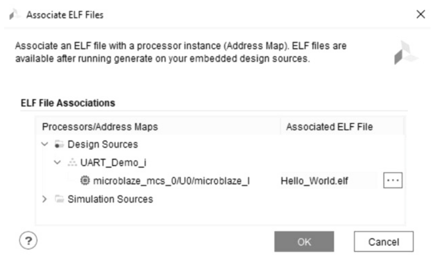

Hình 9.28 File Hello_World.elf đã được thêm.

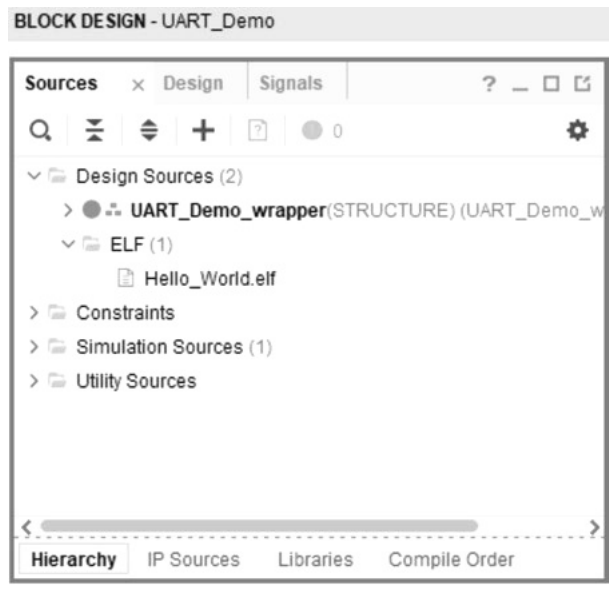

Hình 9.29 File Hello_World.elf đã được liên kết.

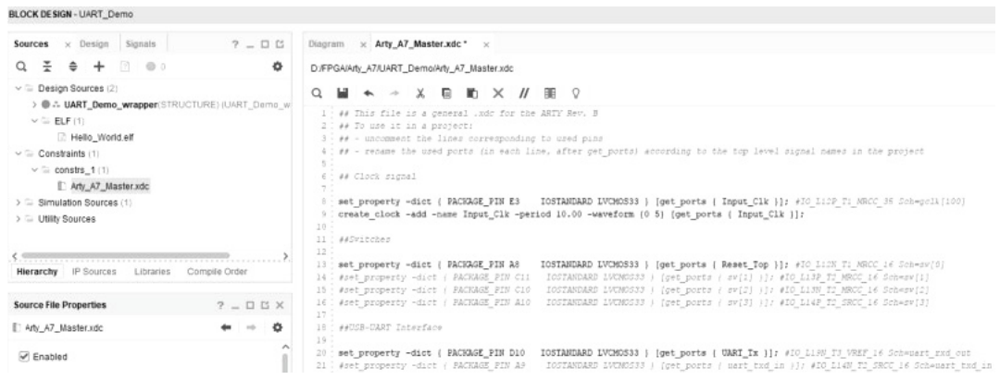

Hình 9.30 Constrains file *(ghi chú: sách in "Constrains"; đúng là "Constraints")* cho project UART_Demo.

Giờ chúng ta lưu lại và quay lại sơ đồ. Tại thời điểm này, tất cả các chân đã được ánh xạ: Input_Clk, Reset_ Top và UART_Tx, trong project UART_Demo. Giờ bạn có thể chạy synthesis, chạy implementation và tạo bitstream. Khi hoàn tất, bạn có thể nạp nó lên development board Arty A7 thực tế và bảo đảm đã mở Tera Term hay bất kỳ chương trình terminal emulator nào khác để có thể xem các message được gửi từ softcore processor MicroBlaze này lên màn hình máy tính.
