# 10 UART IO và truy cập register

## 10.1 Giới thiệu

Chương này nói về việc dùng GPIO của MicroBlaze. Trong chương này, chúng tôi sẽ chỉ cho bạn cách dùng các general-purpose input và output với softcore processor MicroBlaze. Đến thời điểm này, chúng ta đã dùng softcore processor MicroBlaze chỉ để truyền dữ liệu từ development board tới máy tính thực tế và đọc message, vốn chỉ hiển thị “Hello World,” và code đã hoàn tất. Bây giờ, chúng ta sẽ tiến thêm một bước, nơi chúng ta phải có thể truyền message từ board tới máy tính như đã làm trước đây, cũng như có thể nhận message từ máy tính về lại development board thực tế và xử lý các message đó bên trong processor MicroBlaze. Với project này, chúng ta muốn có thể nhận lệnh để bật các LED, đọc các slide switch và đọc các pushbutton. Điều này sẽ đòi hỏi chúng ta làm nhiều việc khác nhau. Trước hết, chúng ta cần nhận message, nghĩa là các message sẽ đi vào từ giao diện UART. Vậy, chúng ta cần enable receiver ở phía UART để thực sự có thể nhận message. Sau đó, chúng ta muốn xử lý chúng để xác định việc cần làm tiếp theo, và trong trường hợp đó, chúng ta sẽ có các output gửi tới các LED. Vậy, nếu chúng ta bảo nó rằng chúng ta muốn có giá trị bốn, chúng ta hiển thị số bốn đó trên các LED hay làm sáng các LED cụ thể tương ứng với lệnh chúng ta đưa ra. Chúng ta cũng cần có thể đọc giá trị, mà trong trường hợp này là các slide switch hoặc pushbutton. Nếu họ gửi cho chúng ta một lệnh nói rằng họ muốn biết trạng thái của các pushbutton, chúng ta phải đọc giá trị của các pushbutton đó và có thể hiển thị thông tin đó ra lại trên cổng UART, thứ mà sau đó chúng ta sẽ xem bằng Tera Term hay bất kỳ loại terminal emulator nào khác, tùy bạn chọn dùng cái nào. Điều quan trọng cho bài lab này và điều nổi bật ở đây là các general-purpose input và output, được dùng theo rất nhiều cách khác nhau, và đúng như tên gọi, chúng là general-purpose. Vậy, bạn có thể dùng chúng cho nhiều việc khác nhau. Trong trường hợp cụ thể của chúng ta, chúng ta dùng chúng để xuất dữ liệu ra các LED và đọc dữ liệu vào. Vậy, hãy xem bên trong project Vivado và xem xét processor MicroBlaze. Vậy, chúng ta có processor MicroBlaze MCS, và chúng tôi muốn cho bạn xem tất cả các thuộc tính của processor đó mà bạn muốn có. Vậy, chúng ta chỉ dùng MicroBlaze MCS phiên bản 3.0, và với các thuộc tính chung, chúng ta muốn có những thiết lập sau: với kích thước bộ nhớ, chúng ta chọn 32 KB, và bạn có thể chọn kích thước lớn hơn nếu muốn. Chúng tôi nghĩ như vậy là quá đủ để thực hiện thao tác chúng ta đang làm. Nhưng bạn có thể chọn lớn hơn, và họ khuyến nghị bạn chọn các kích thước là lũy thừa của 2, tức là 4, 8, 16, 32, 64 hoặc 128 KB. Với optimization, chúng ta chọn area optimization, và đó là vì chúng ta không làm bất kỳ loại xử lý nặng nào như xử lý tín hiệu âm thanh, xử lý ảnh, hay bất cứ thứ gì đòi hỏi dùng CPU nhiều. Thay vào đó, chúng ta chỉ hiện thực việc đọc signal UART và xuất ra UART. Vậy, chúng ta sẽ chọn area optimization để không dùng quá nhiều tài nguyên trên FPGA, và chúng ta không có IO bus hay trace bus nào, và chúng ta sẽ không enable cái nào trong số đó. Với debug, chúng ta không có hỗ trợ debug nào, và phần mềm cũng như chương trình chúng ta sẽ chạy đủ đơn giản để chúng ta sẽ ổn mà không cần có một giao diện debug JTAG-supported thực tế, như được thể hiện trong Hình 10.1.

Với UART, chúng ta muốn enable receiver và transmitter. Transmitter sẽ cho phép chúng ta gửi message tới máy tính để có thể đọc chúng, và receiver sẽ cho phép chúng ta nhận các message được gõ trong terminal emulator để có thể đọc và xử lý dữ liệu này. Với baud rate, chúng ta sẽ đặt là 115200, và chúng ta sẽ để nó ở chế độ non-programmable. Chúng ta có thể làm nó programmable, nhưng vì chúng ta sẽ không thay đổi baud rate, chúng ta không muốn làm nó phức tạp hơn mức cần thiết. Với số data bit, chúng ta sẽ đặt là tám, và chúng ta sẽ không kiểm tra hay dùng parity. Ngoài ra, hai stop bit được kèm theo mặc định, vậy chúng ta không cần có tham số cho điều đó, như được mô tả trong Hình 10.2.

Với các fixed interval timer, họ có FIT 1, FIT 2, FIT 3 và FIT 4. Chúng ta không dùng cái nào trong số đó, vậy chúng ta không có loại fixed interval timer nào cả; chúng ta để tất cả không được đánh dấu, và theo mặc định, chúng đều không được đánh dấu. Vậy, bạn có thể cứ để nguyên như vậy. Với programmable interval timer (PIT), chúng ta cũng sẽ không dùng cái nào, và theo mặc định, chúng đều không được đánh dấu. Vậy, với PIT 1, PIT 2, PIT 3 và PIT 4, chúng ta sẽ để tất cả không được đánh dấu. Với GPO hay general-purpose output, chúng ta có GPO 1. Chúng ta sẽ chọn nó, và chúng ta muốn đặt số bit là bốn vì nó sẽ được nối với bốn LED thực tế ở output. Chúng ta có bốn LED RGB và bốn LED thường, và chúng ta sẽ nối general-purpose output này với bốn LED thường, vậy chúng ta sẽ đặt nó rộng bốn bit, như được minh họa trong Hình 10.3.

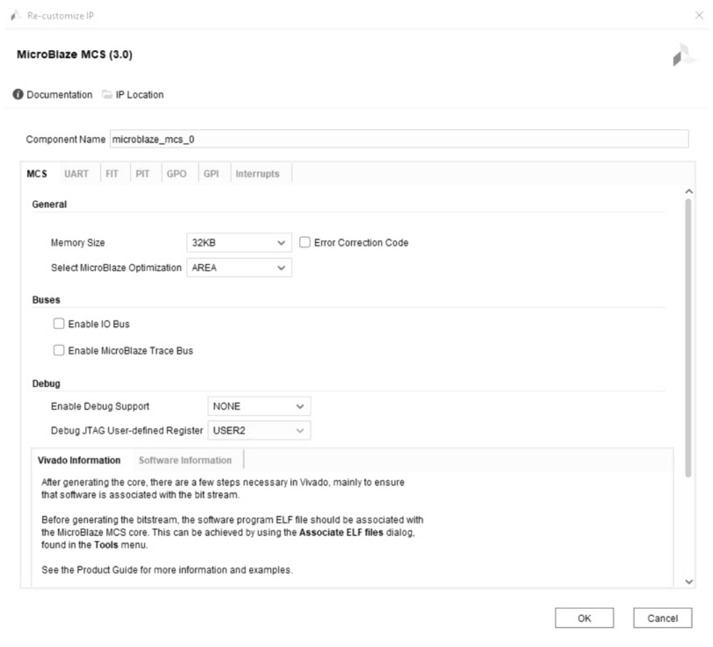

Hình 10.1 Thiết lập tab MCS của MicroBlaze MCS.

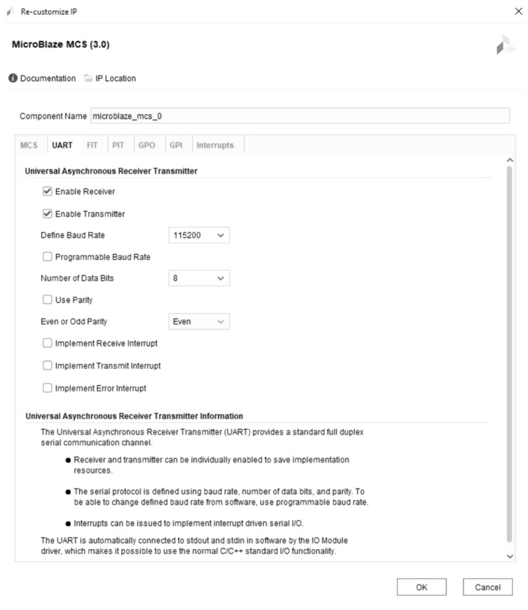

Hình 10.2 Thiết lập tab UART của MicroBlaze MCS.

Với các general-purpose input, chúng ta sẽ có hai cái. Chúng ta sẽ có các pushbutton cũng như các slide switch. Với GPI 1 hay general-purpose input một, nó sẽ rộng bốn bit, và nó sẽ được nối với bốn pushbutton. Với GPI 2, general-purpose input hai, chúng ta sẽ đặt số bit là ba vì một bit được nối với reset, vốn nối trực tiếp với MicroBlaze. Như vậy, chúng ta chỉ có ba bit, mà chúng ta sẽ dùng cho các switch, như được minh họa trong Hình 10.4.

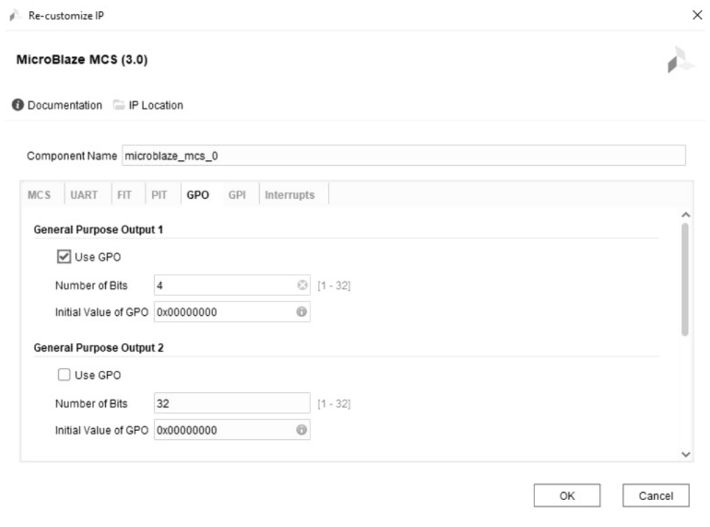

Hình 10.3 Thiết lập tab GPO của MicroBlaze MCS.

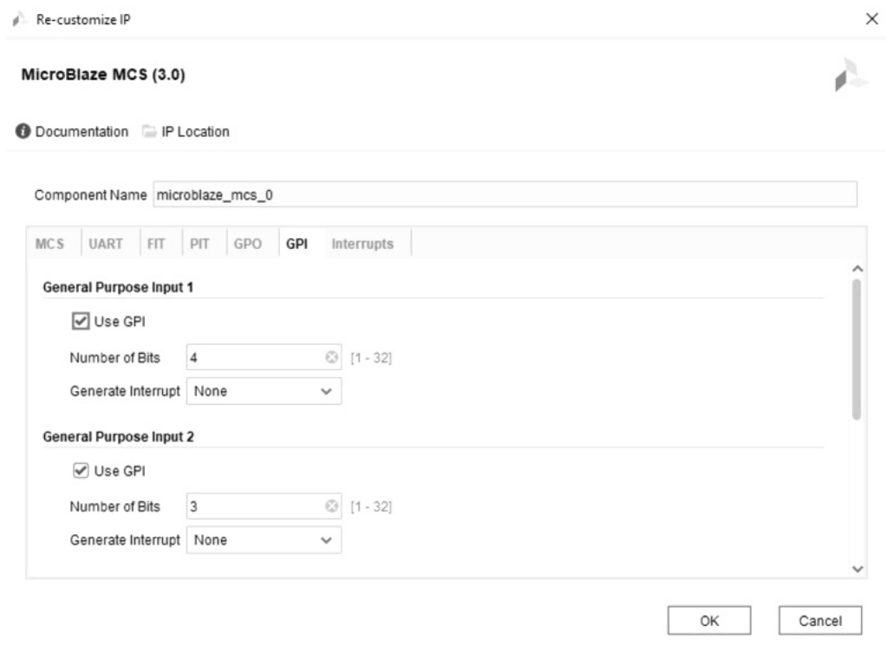

Hình 10.4 Thiết lập tab GPI của MicroBlaze MCS.

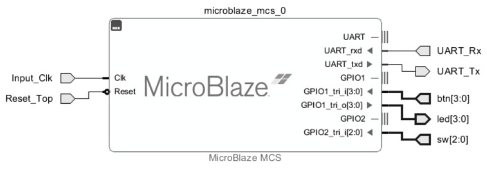

Hình 10.5 Tạo các port cho MicroBlaze MCS.

Với interrupt, chúng ta sẽ không dùng cái nào. Chúng ta không có bất kỳ loại ngắt nào, và chúng ta sẽ chỉ tiếp tục lặp và chờ phản hồi từ UART. Khi nhận được phản hồi đó, chúng ta sẽ xử lý nó, vậy chúng ta không có nhu cầu dùng interrupt. Chúng ta sẽ không dùng bất kỳ loại external interrupt nào, và tại thời điểm này, bạn sẽ click OK, thao tác này sẽ tạo ra một MicroBlaze MCS. Tiếp theo, chúng ta tạo port, nơi chúng ta có Input_Clk, signal Reset_Top, và với UART, chúng ta có UART_Tx (UART transmitter) và UART_Rx (UART receiver). Với các general-purpose input và output, chúng ta sẽ có một input rộng bốn bit cho các button khác nhau và một output rộng bốn bit, sẽ được nối với các LED. Từ GPO 2, chúng ta có một input rộng ba bit, được nối với các slide switch, như được thể hiện trong Hình 10.5.

Vậy, đó là cách cấu hình MicroBlaze MCS cho việc dùng general-purpose input và output trong project UART_IO.

## 10.2 Thiết kế hoàn chỉnh UART IO

Mục này đi qua (walk-through) thiết kế hoàn chỉnh UART IO. Trong mục này, chúng tôi sẽ hướng dẫn bạn đi qua thiết kế hoàn chỉnh dùng cho project UART IO để chạy trên development board Arty A7. Vậy, chúng ta sẽ đi qua thiết kế bằng công cụ Vivado và mở nó lên. Chúng ta có một block diagram, và block diagram này chứa softcore processor MicroBlaze MCS, cùng với nhiều IO, như được mô tả trong Hình 10.5. Chúng ta có Input_Clk, Reset_Top, và giao tiếp UART – các signal nhận và truyền – cho phép chúng ta giao tiếp với máy tính để truyền và nhận lệnh. Chúng ta có ba giao diện general-purpose input/output (GPIO) khác nhau. GPIO_0 là một input từ chân 3 xuống 0 và tương ứng với các button trên development board Arty A7. GPIO_1 là một output từ chân 3 xuống 0, nối với bốn LED được processor MicroBlaze điều khiển. GPIO_2 cũng là một input, nối với các switch từ 2 xuống 0 – cho chúng ta ba switch dùng để đọc trạng thái switch. Dù board có bốn switch, một cái được dành làm system reset (Reset_Top), và ba cái còn lại được dùng làm input. Vậy, nếu nhìn vào block diagram, nó chứa MicroBlaze của chúng ta với nhiều input và output. Điều chúng ta làm là lấy UART_IO.bd, tạo một wrapper, rồi để Vivado quản lý wrapper và auto-update nó, như được minh họa trong Hình 10.6.

Nếu điều hướng tới source file, chúng ta có thể thấy UART_IO_wrapper, đơn giản là tên của block diagram (UART_IO) cộng thêm hậu tố gạch dưới wrapper. Chúng ta có thể mở UART_IO_wrapper, là một file VHDL được Xilinx tự động tạo dựa trên block diagram mà chúng ta đã tạo. Vậy, nếu xem sơ đồ trong Hình 10.5, chúng ta có thể thấy entity của UART_IO_wrapper này chứa tất cả các input và output chúng ta đã định nghĩa trong sơ đồ. Sau đó, chúng ta lần lượt chạy synthesis, implementation và bitstream generation. Nếu có lỗi xảy ra trong bitstream generation, chúng ta bỏ qua chúng và tiếp tục bằng cách click vào File. Bước tiếp theo là export hardware, như được thể hiện trong Hình 10.7.

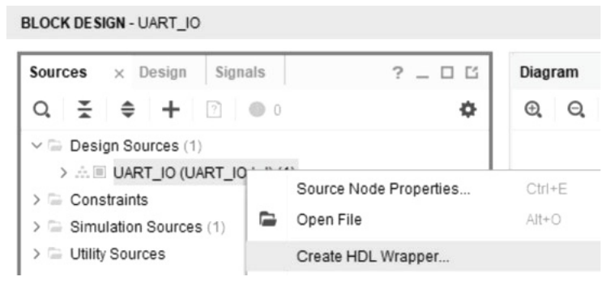

Hình 10.6 Tạo HDL wrapper.

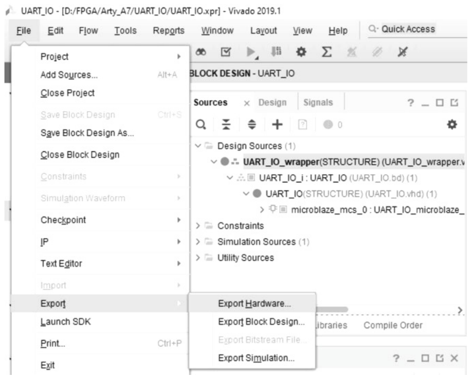

Hình 10.7 Export hardware.

Thao tác này sẽ mở một hộp thoại ghi “Export hardware platform for software development tools.” Chúng ta sẽ để tùy chọn “Include bitstream” không được đánh dấu vì chúng ta chưa tạo file bitstream, nghĩa là chúng ta không thể đưa nó vào ở giai đoạn này, và điều đó không sao, như được thể hiện trong Hình 9.18. Tiếp theo, chúng ta mở Xilinx SDK và đi qua code dùng để đọc và gửi dữ liệu. Vậy, chúng ta tạo một application project mới, như được mô tả trong Hình 10.8.

Chúng ta áp dụng các thiết lập sau cho cửa sổ new project, như được minh họa trong Hình 10.9.

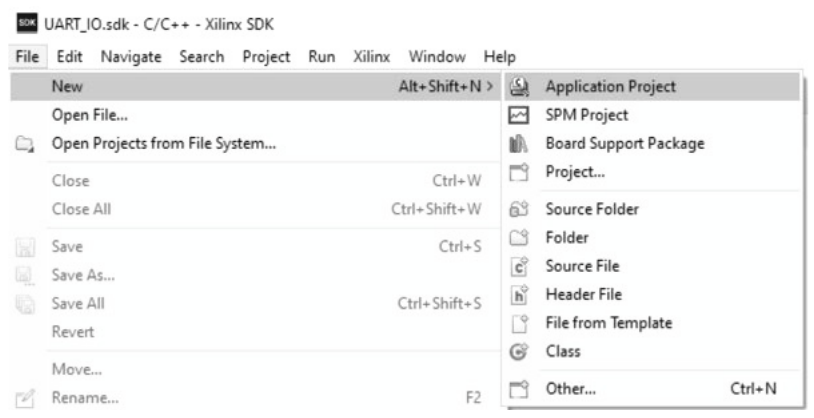

Hình 10.8 Tạo một application project mới.

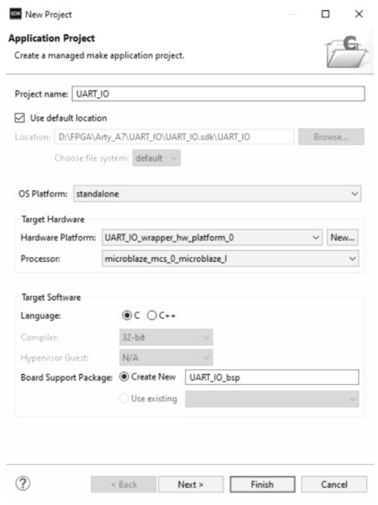

Hình 10.9 Các thiết lập cho cửa sổ new project.

Sau đó, chúng ta đổi tên file helloworld.c thành testperiph.c. Bên trong hàm main, chúng ta khởi tạo các variable sẽ dùng. Phía trên đó, chúng ta có các library và header file: stdio.h, string.h, xparameters.h, xil_cache.h và xiomodule.h. Sau đó, chúng ta định nghĩa một số integer, character và data type unsigned, rồi chúng ta có dữ liệu trong XIO module này, và ở đó chúng ta có Xilinx cache enable và Xilinx D cache enable, rồi chúng ta khởi tạo module. Vậy, với phần khởi tạo module này, chúng ta thiết lập và chỉ định IO module này, mà chúng ta có dưới dạng một XIO module. Nó chỉ cho chúng ta một handle mà sau đó chúng ta có thể tham chiếu khi muốn ghi giá trị. Vậy, nếu nhìn vào X parameter device (XPAR_IOMODULE_0_DEVICE_ID) này, nó cho chúng ta biết chúng ta có IO module. Ví dụ, trong trường hợp này, nếu bạn có nhiều IO module, bạn sẽ phải khởi tạo từng cái với một ID khác nhau. Tuy nhiên, trong trường hợp này, chúng ta chỉ dùng một, vậy chúng ta có thể khởi tạo nó ở đây, và điều này áp dụng cho chỉ ba lệnh khởi tạo module đó. Function xil_printf chỉ là phiên bản printf của Xilinx. Vậy, khi bạn dùng printf, nếu bạn dùng printf C/C++ tiêu chuẩn, nó tốn rất nhiều dữ liệu để làm điều đó. Vì chúng ta đang làm một ứng dụng nhúng, khả năng có memory footprint nhỏ hơn là rất lý tưởng. Vậy, với phần khởi tạo module, hay sau khi khởi tạo module, chúng ta có thể nói rằng CFInitialize trả về (0 = success), nghĩa là thành công. Nếu chúng ta thấy giá trị một, thì chúng ta đã khởi tạo không thành công. Sau đó, chúng ta in ra một message nói “Enter a command,” theo sau là ký tự xuống dòng và về đầu dòng. Sau đó, chúng ta vào một vòng lặp while cho đến khi người dùng nhập lệnh “finish”. Vậy, trong khi variable “done” bằng không – ở trên kia, chúng ta biết mình có một integer done và nó bằng không, và lần duy nhất nó bằng một là khi lệnh là “finish.” Bên trong vòng lặp này, chúng ta có các thao tác khác như execute command, memory set và byte count, mà chúng ta đặt về không. Đây là nơi chúng ta dựng message từ UART terminal. Trong khi execute command bằng không, chúng ta sẽ lặp. Nếu dữ liệu nhận được từ XIO module bằng không, buffer của chúng ta sẽ bằng buffer tạm. Nếu buffer tại vị trí byte count bằng “\n” hay ký tự xuống dòng, thì chúng ta sẽ đặt execute command bằng một. Chúng ta tiếp tục lặp ở đây cho đến khi nhận ra ký tự “\n” hay newline này, và điều đó có nghĩa là khi gửi một lệnh, chúng ta muốn bảo đảm gửi lệnh theo sau là “\n” để có thể đưa cho nó lệnh “\r\n”. Bằng cách này, khi thấy “\n” hay ký tự xuống dòng đó, chúng ta biết cần thực thi lệnh đã nhận. Vậy, sau đó chúng ta tăng byte count nếu không vào nhánh execute command đó (nếu buffer nhận được không bằng “\n”). Khi thoát khỏi vòng lặp đó, chúng ta tiếp tục với đoạn code này, nơi chúng ta dựng các mảng lệnh. Với các lệnh, chúng ta có buffer zero, thứ chúng ta copy, và chúng ta thực hiện ba lần memory copy khác nhau từ command, LED command và LED numbers. Bây giờ, điều chúng ta sẽ làm là đọc trạng thái button và switch. Dữ liệu button sẽ là một giá trị tương ứng với input từ button. Vậy, nếu tất cả button bằng không, giá trị sẽ bằng không. Nếu có một button được nhấn và nó ở xa nhất về bên phải hay có thể là least significant bit, thì chúng ta sẽ có giá trị một. Nếu nó ở xa nhất về bên trái hay most significant bit, thì chúng ta sẽ có giá trị bốn hay giá trị cao nhất mà chúng ta có. Vậy, nó sẽ lấy bốn button chúng ta có và coi chúng như bốn bit nhị phân. Điều tương tự áp dụng với dữ liệu switch – nó sẽ lấy dữ liệu đó và coi như các giá trị nhị phân. Dù chúng ta có nó dưới dạng unsigned 32, số lớn nhất nó có thể biểu diễn chỉ là tổng cộng bốn bit, và unsigned 32 còn lại chỉ có thể biểu diễn tổng cộng ba bit vì chúng ta dùng một bit của switch cho reset (Reset_Top). Đây là nơi chúng ta thực sự thực thi lệnh nhận được. Để thực thi lệnh, chúng ta dùng lệnh “strcmp”, một phép so sánh chuỗi, vậy điều nó làm là lấy một chuỗi và so với chuỗi khác *(ghi chú: sách in "copy it to another"; strcmp thực ra so sánh hai chuỗi)*, và nếu chúng khớp, giá trị sẽ bằng không. Nếu không, nó sẽ cho bạn giá trị một hoặc âm một, cho biết các chuỗi không khớp. Điều đầu tiên chúng ta kiểm tra là lệnh có bằng “led” hay không; nếu bằng “led”, thì thứ chúng ta nhận được là không, và led_date *(ghi chú: sách in "led_date"; đúng là "led_data")* của chúng ta sẽ bằng led_num[1] này trừ 48, và đó là vì các số chúng ta gửi đi ở dạng ASCII. Vậy, nếu bạn trừ 48 khỏi số đó, bạn sẽ có con số tương ứng thực tế. Ví dụ, biểu diễn ASCII của số không là 48. Vậy, khi bạn lấy 48 trừ 48, bạn sẽ có led_data bằng không. Tiếp theo, chúng ta thực hiện một thao tác discrete write bằng XIO module. Chúng ta gửi led_data tới output discrete write của XIO module. Logic này được hiện thực trong một chuỗi statement if-else if. Đầu tiên, chúng ta kiểm tra xem lệnh có phải “led” không. Nếu đúng, chúng ta lấy led_num được chỉ định trong lệnh và ghi nó ra output port. Nếu không, nếu lệnh là “button,” chúng ta in trạng thái button bằng cách xuất ra giá trị của button_data, giá trị đã được đọc trước đó bằng lệnh discrete read của XIO module. Thao tác đọc này lấy dữ liệu button và switch. Mỗi lần chúng ta đọc dữ liệu này, tùy theo lệnh, người dùng yêu cầu in dữ liệu button hoặc dữ liệu switch. Khi chúng ta dùng lệnh Xilinx printf, nó thực sự lấy giá trị và in ra UART terminal. Nếu chúng ta dùng Tera Term, thứ chúng ta đã dùng trong project này (hoặc bất kỳ terminal emulator nào khác), nó sẽ báo dữ liệu button hoặc switch. Ngoài ra, nếu bạn gõ lệnh “finish”, thì tất cả những gì chúng ta làm là đặt “done” bằng một. Vậy, khi chúng ta đi xuống và re-enter vòng lặp while, done sẽ bằng một. Vì điều kiện while done bằng không (while(done == 0)) không còn đúng nữa, chúng ta thoát khỏi vòng lặp đó. Khi đã ra ngoài vòng lặp đó, chúng ta sẽ in một message nói “Exiting main”, rồi disable Xilinx D cache và Xilinx I cache, và cuối cùng return không, báo cho processor dừng chạy. Sau đó chúng ta return và thoát khỏi vòng lặp main, và đó là processor softcore MicroBlaze MCS. Code hoàn chỉnh cho project này được trình bày như sau.

```
#include <stdio.h>
#include <string.h>
#include "xparameters.h"
#include "platform.h"
#include "xil_printf.h"
#include "xil_cache.h"
#include "xiomodule.h"

int main()
{
      int done = 0;
      int byte_count = 0;
      int execute_cmd;
      char command[6];
      char led_cmd[3];
      char led_num[2];
      u8 tmp_rx_buf;
      u8 rx_buf[40];
      u32 button_data = 0;
      u32 switch_data = 0;
      u32 led_data = 0;
      u32 data;
      XIOModule iomodule;
      Xil_ICacheEnable();
      Xil_DCacheEnable();

      //Initialize module
    init_platform();
    data = XIOModule_Initialize(&iomodule, XPAR_IOMODULE_0_DEVICE_ID);
    data = XIOModule_Start(&iomodule);
    data = XIOModule_CfgInitialize(&iomodule, NULL, 1);
    xil_printf("CFInitialize returned (0 = success) %d\n\r", data);
    print("---Enter a command---\n\r");

    // While loop until user enters "finish" command
    while(done == 0)
    {
           execute_cmd = 0;
           memset(rx_buf, 0, sizeof(rx_buf));
           byte_count = 0;

           //Build up message from UART Terminal
           while(execute_cmd == 0)
           {
                 //Read UART data
                 while((data = XIOModule_Recv(&iomodule, &tmp_rx_buf, 1)) == 0);
                 rx_buf[byte_count] = tmp_rx_buf;
                 if(rx_buf[byte_count] == '\n')
                       execute_cmd = 1;
                 byte_count++;
           }

        //Build the command arrays
           memcpy(command, &rx_buf[0], 6);
           memcpy(led_cmd, &rx_buf[0], 3);
           memcpy(led_num, &rx_buf[4], 2);

           //Read the button & switch status
           button_data = XIOModule_DiscreteRead(&iomodule, 1);
           switch_data = XIOModule_DiscreteRead(&iomodule, 2);

           //Execute the received command
           if(strcmp(led_cmd, "led") == 0)
           {
                   led_data = led_num[1] - 48;
                   if((led_num[0] - 48) == 1)
                           led_data += 10;
                      XIOModule_DiscreteWrite(&iomodule, 1, led_data);
           }
           else if(strcmp(command, "button") == 0)
                    xil_printf("Button Status: %d\n\r", button_data);
           else if(strcmp(command, "switch") == 0)
               xil_printf("Switch Status: %d\n\r", switch_data);
           else if(strcmp(command, "finish") == 0)
                    done = 1;
           else
                    print("Command is invalid, re-enter below:\n\r");
    }

    print("---Exiting main---\n\r");
    Xil_DCacheDisable();
    Xil_ICacheDisable();
    cleanup_platform();
    return 0;
  }
```

Vậy, chúng ta build nó, thao tác này tạo ra file UART_IO.elf mà chúng ta đã nói đến bên trong thiết kế Vivado, như được thể hiện trong Hình 10.10, 10.11 và 10.12.

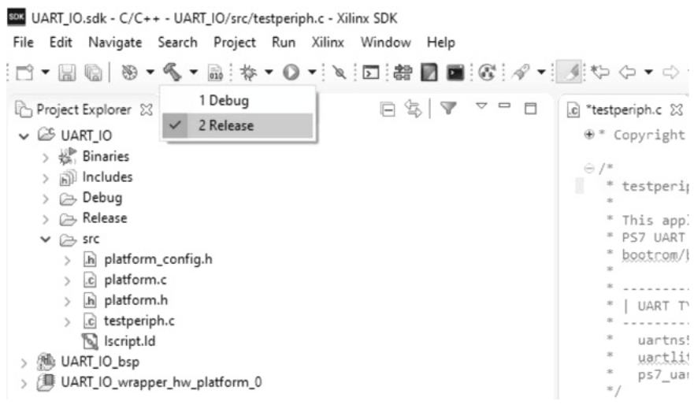

Hình 10.10 Build file UART_IO.elf.

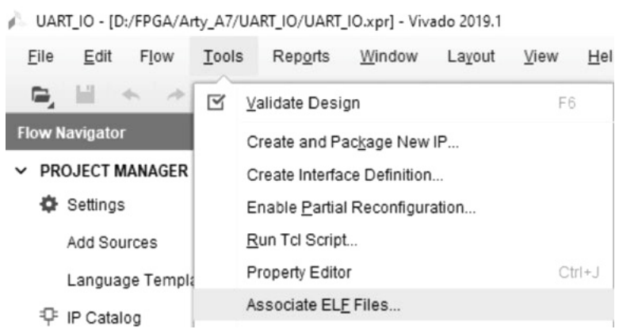

Hình 10.11 Chọn associate ELF files.

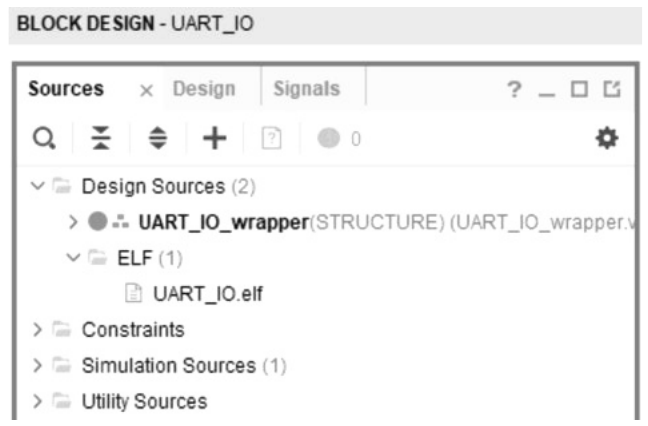

Hình 10.12 File UART_IO.elf trong design sources của project UART_IO.

Về cơ bản, đó là toàn bộ thiết kế UART_IO cho development board Xilinx. Vậy, đây là phần walkthrough thiết kế hoàn chỉnh từ đầu đến cuối để cho bạn một cái nhìn tổng quan – đây là mọi thứ, và đây là cách tất cả hoạt động cùng nhau. Có tất cả các port và bit, và tại thời điểm này, tất cả những gì bạn phải làm là, khi đã gán IO, tạo bitstream và nạp nó lên board để bảo đảm nó thực sự làm đúng những gì chúng ta dự định.

## 10.3 Bố trí IO của UART IO trên Arty A7

Mục này nói về việc bố trí IO trên Arty A7 cho UART IO. Trong mục này, chúng tôi sẽ chỉ cho bạn nơi đặt tất cả các IO cho project UART IO trên Arty A7. Trên board Arty A7, chúng ta có một file master .xdc. Trong file này, chúng ta muốn đặt tất cả các IO, và trong trường hợp này, chúng ta có Input_Clk, Reset_Top, UART_Rx, UART_Tx, btn từ ba đến không, led từ ba đến không, và sw từ hai đến không. Nếu vào file master .xdc của Arty A7, điều đầu tiên chúng ta làm là set property CFGBVS VCCO in current_design và set property CONFIG_VOLTAGE thành 3.3 in current_design. Bây giờ, với signal clock, chúng ta có package pin được đặt là E3, và chúng ta gán nó cho Input_Clk. Sau đó, chúng ta dùng create clock add này, và đặt tên là Input_Clk với period là 10 và waveform từ 0 đến 5 và get_ports Input_Clk. Điều đó sẽ giúp chúng ta khi công cụ chạy synthesis cũng như implementation, và nó sẽ tạo ra và bảo đảm rằng Input_Clk của chúng ta, được định nghĩa ở đó, có thể đáp ứng yêu cầu timing của một clock 100MHz. Dòng tiếp theo chúng ta sẽ dùng là các switch. Vậy, chúng ta sẽ dùng cả bốn switch trên board Arty A7. Switch đầu tiên, mà nếu nhìn vào thì là switch không, là reset (Reset_Top). Vậy, dựa trên việc nó ở mức high hay low, nó sẽ cho phép softcore processor MicroBlaze chạy hoặc không. Nó sẽ đưa processor vào trạng thái reset hoặc trạng thái chạy. Với các chân tiếp theo, chúng ta có cái sẽ là các switch 1, 2 và 3, trở thành sw[0], sw[1] và sw[2]. Vậy, chúng ta chỉ đọc ba switch từ không đến hai, và chúng ta có chúng ở các PIN C11, C10 và A10. Và giống như đi kèm với file master .xdc của Arty A7, tất cả đều là chuẩn 3.3V. Vậy, cứ để nguyên như vậy. Sau đó chúng ta sẽ bỏ comment và chỉ đổi tên các switch thành “sw” và đánh thứ tự từ 0 đến 2. Nếu quay lại sơ đồ trong Hình 10.5, nó bao gồm Input_Clk, Reset_Top, và các switch (sw) từ 2 xuống 0. Nếu quay lại file master .xdc của Arty A7, thì với LEDs, chúng ta có led[0] đến led[3], và nếu nhìn vào sơ đồ, đó là từ ba đến không, vậy chúng ta đã có đủ. Đó chỉ là bốn LED thường trên board. Có tổng cộng tám LED. Cũng có các LED từ không đến ba, là các LED RGB trên development board Arty A7, nhưng chúng ta chỉ quan tâm đến các LED thường. Vậy, họ gọi chúng là bốn, năm, sáu và bảy. Vậy, chúng ta chỉ đổi tên chúng thành không, một, hai và ba để khớp với những gì có trên sơ đồ cho output ở đó. Nếu quay lại file .xdc, có bốn button, và chúng ta dùng cả bốn trong schematic (button không đến button ba hay btn[0] đến btn[3]). Do đó, chúng ta sẽ bỏ comment chúng và dùng button không đến button ba, và đó là vì quy ước đặt tên của chúng ta giống nhau, btn[3] đến btn[0]. Bây giờ, cuối cùng, chúng ta có UART_Tx và UART_Rx. Vậy, nếu đi xuống tiếp tới chỗ có giao diện USB-UART này, chúng ta có hai signal là UART_Tx và UART_Rx, và đó là nơi chúng ta muốn đặt UART_Tx và UART_Rx. Lưu ý rằng đây là chỗ có thể hơi gây nhầm lẫn, nhưng chúng ta đặt UART_Tx vào chỗ schematic ghi uart_rxd_out. Nếu nhìn vào sơ đồ, UART_Tx đi từ MicroBlaze hay UART, thứ truyền dữ liệu đó ra. Nếu nhìn ở đây trong file .xdc, chỗ mà chúng ta truyền ra chính là nơi phía kia nhận – uart_rxd_out. Vậy, UART_Tx là chân D10, còn UART_Rx là chân A9. Đó là tất cả các IO chúng ta dùng cho project UART_IO này, và đó là vị trí bố trí cho từng IO, như được thể hiện trong Hình 10.13.

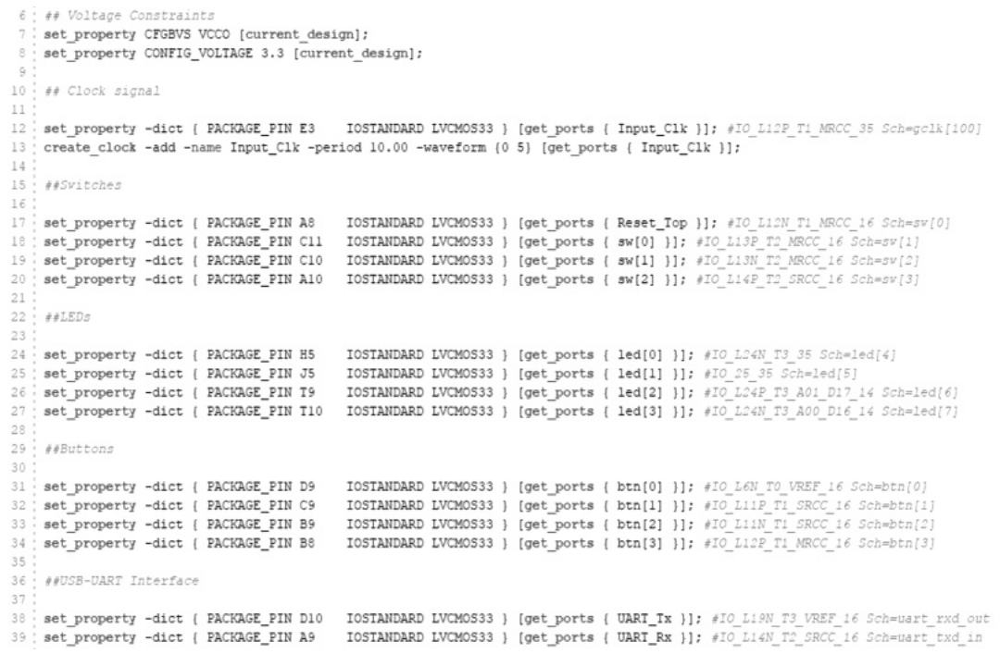

Hình 10.13 Constraints file cho project UART_IO trên Arty A7.
