# 11 Project ADC Processing

## 11.1 Giới thiệu

Chương này tập trung vào việc xử lý ADC cho cảm biến nhiệt độ. Chúng ta sẽ giải thích các loại cảm biến nhiệt độ khác nhau hoạt động thế nào, đặc biệt tập trung vào cảm biến nhiệt độ được dùng trong project ADC processing. Trong project này, chúng ta nhắm tới việc xử lý một signal analog và chuyển nó thành giá trị nhiệt độ có thể được hiển thị qua serial port và xem trên máy tính, cho phép chúng ta theo dõi nhiệt độ thực tế. Có nhiều loại cảm biến nhiệt độ, thường thuộc một trong hai nhóm: cảm biến nhiệt độ số và cảm biến nhiệt độ analog. Cả hai loại đều thực hiện cùng một chức năng – đo và cảm nhận nhiệt độ. Tuy nhiên, cảm biến nhiệt độ số có giao diện số, nơi bạn chỉ cần đọc các bit và chúng cho bạn biết nhiệt độ là bao nhiêu. Việc này thường được làm qua giao diện kiểu SPI hoặc I<sup>2</sup>C. Mặt khác, cảm biến nhiệt độ analog xuất ra một điện áp analog tương ứng với một nhiệt độ cụ thể, lúc đó bạn cần lấy điện áp analog đó, thực hiện chuyển đổi analog sang digital, xử lý nó, và chuyển nó thành nhiệt độ. Trong chương này, chúng ta dùng một cảm biến nhiệt độ analog, cụ thể là TMP36 của Analog Devices. TMP36 có ba chân: chân nguồn điện áp, chân output và ground. Chúng ta sẽ cấp 3.3 V cho chân nguồn, nối ground đúng cách, và điện áp output là nơi chúng ta sẽ thực hiện chuyển đổi analog sang digital. Signal điện áp output đó sẽ được dùng để xác định nhiệt độ. Vậy, cách cảm biến hoạt động rất đơn giản: khi nhiệt độ tăng hoặc giảm, điện áp output của cảm biến sẽ tăng hoặc giảm tương ứng với nhiệt độ. Từ đó, chúng ta chỉ cần thực hiện việc tính toán, nơi chúng ta sẽ dùng MicroBlaze hay softcore processor để xử lý thông tin đó. Ngoài ra, với chuyển đổi analog sang digital, cách nó hoạt động là: bạn lấy một điện áp analog, và bạn xuất ra biểu diễn số của điện áp đó vì chúng ta không thể thực sự xử lý một giá trị analog bên trong MicroBlaze. Chúng ta đang làm việc trong thế giới số, vì vậy chúng ta cần các bit hay giá trị thực tế để xử lý và làm việc. Vậy, tất cả những gì chuyển đổi analog sang digital làm là lấy giá trị analog và chuyển nó thành giá trị số, được xác định bởi số bit bạn có. Với development board Arty A7, dùng FPGA Artix, chúng ta có cái gọi là XADC core được tích hợp sẵn trong FPGA thực tế. Điều đó có nghĩa là một số chân nhất định có thể cho phép signal analog đi thẳng vào, và FPGA đã có sẵn bộ chuyển đổi analog sang digital built-in. Vậy, trong Vivado, tất cả những gì chúng ta phải làm là thả XADC IP core vào một block design. Sau đó, chúng ta có thể cấu hình *(ghi chú: sách in "figure"; đúng là "configure")* XADC core đó để hoạt động trên bất kỳ channel nào mà chúng ta đưa signal analog nhiệt độ vào. Chúng ta chỉ cần cho nó biết đang dùng channel nào và đặt các tham số tương ứng để sau đó có thể xử lý dữ liệu đó bằng MicroBlaze, và điều này thực sự rất tiện. Thực tế, chúng ta sẽ tạo một thiết kế có một softcore processor MicroBlaze và XADC core. Chúng sẽ giao tiếp với nhau, và tất cả những gì chúng làm là: MicroBlaze sẽ liên tục đọc giá trị chuyển đổi analog sang digital từ XADC core đó, và XADC core đó sẽ chỉ lấy giá trị analog đến từ cảm biến nhiệt độ, chuyển nó thành giá trị số, và liên tục làm như vậy cùng với processor MicroBlaze, processor sẽ xác định nhiệt độ và gửi nó ra serial port. Vậy, việc tiếp theo là xem datasheet thực tế của thiết bị analog to digital, CHIP ADC converter của Analog Devices, tức TMP36. Chúng ta sẽ xem datasheet và lướt qua nó để hiểu thiết bị này là gì và nó thực sự hoạt động thế nào. Vậy, datasheet cho chúng ta thấy nó được gọi là một cảm biến nhiệt độ low-voltage. Họ gọi nó như vậy vì nó có thể hoạt động ở bất kỳ đâu từ 2.7 đến 5.5 V. Trên hầu hết bảng mạch, điện áp nằm trong khoảng từ 1.8 đến 5 V. Vậy, 2.7–5.5 V bao phủ một dải điện áp khá rộng mà bạn thường thấy trên các development board này. Vì chúng ta làm việc với 3.3 V, chúng ta nằm ngay giữa dải hoạt động này. Điều này có nghĩa là cảm biến nhiệt độ sẽ hoạt động tốt với development board FPGA của chúng ta. Chúng ta dùng package TO-92, có ba chân. Pin 1 là input điện áp dương, vậy chúng ta sẽ nối nó với 3.3 V. Pin 2 là VOUT, là signal analog thực tế mà chúng ta sẽ xử lý và diễn giải để xác định nhiệt độ. Pin 3 là ground. Vậy, một điều quan trọng cần lưu ý ở đây là pin 2 là VOUT. Khi nối cảm biến này với board, bạn sẽ phải bảo đảm xem package này, hiểu chân nào là chân nào, và bảo đảm nối nó đúng, như được thể hiện trong Hình 11.1.

Điều tiếp theo chúng ta sẽ xem – và rất quan trọng – là một biểu đồ trong datasheet. Nó thể hiện nhiệt độ so với điện áp output cho ba cảm biến: TMP35, TMP36 và TMP37, như được mô tả trong Hình 11.2.

Chúng ta dùng TMP36, vì vậy chúng ta muốn tập trung vào đường b. Nếu nhìn kỹ, chúng ta sẽ thấy đây là một đường thẳng tuyến tính – thực ra, tất cả các đường này đều tuyến tính – và chúng cho một mối quan hệ rõ ràng giữa nhiệt độ và điện áp output. Chúng ta sẽ đọc điện áp output, và dựa trên điện áp này, chúng ta có thể xác định nhiệt độ bằng phương trình của đường b, mà chúng tôi sẽ chỉ cho bạn cách giải. Điều này sẽ cho chúng ta nhiệt độ theo độ C. Từ đó, chúng ta có thể thực hiện một phép chuyển đổi đơn giản từ độ C sang độ F để xác định nhiệt độ theo độ C hoặc độ F. Một điểm quan trọng cần lưu ý khi tìm phương trình thực tế cho đường tuyến tính này nằm trong phần mô tả chức năng của datasheet. Họ có một bảng thể hiện các đặc tính output, như được minh họa trong Bảng 11.1. Các giá trị then chốt chúng ta muốn xem là offset voltage, là nửa volt (0.5 V), và output voltage scaling, là 10 mV/°C. Điều này có nghĩa là ở 25 °C hay nhiệt độ phòng, điện áp output của TMP36 nên vào khoảng 750 mV. Vậy giờ, hãy ghi một vài ghi chú và hiểu chính xác phương trình nào chúng ta cần dùng để thực hiện phép tính này.

Vậy, nếu chúng ta có một điện áp output tính bằng millivolt (mV), làm sao chúng ta thực sự chuyển nó thành nhiệt độ? Hãy ghi một vài ghi chú mà chúng ta sẽ dùng. Vì chúng ta biết đây là một đường tuyến tính, chúng ta có thể định nghĩa nó bằng phương trình cơ bản như sau.

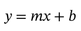 (11.1)

Giá trị b đó trong Phương trình (11.1) được lấy như sau: chúng ta đã xem Bảng 11.1, bảng này cho biết offset voltage là 0.5 V hay 500 mV, vậy đó sẽ là số hạng b. Vậy, chúng ta biết b bằng 500 mV, và đó là offset. Ngoài ra, nó cho chúng ta hệ số scaling, và đó là 10 mV/°C, và nó tương đương với giá trị m, giống như hệ số góc, vậy m bằng 10 mV/°C, và đó sẽ là hệ số góc. Sau đó chúng ta cũng có giá trị x, sẽ tương ứng với nhiệt độ tính bằng °C, và lý do là vì chúng ta có Bảng 11.1 ở đó, chúng ta đã xem điện áp output so với nhiệt độ tính bằng °C. Nhiệt độ được thể hiện trên X-axis và điện áp output trên Y-axis, như được thể hiện trong Hình 11.2 . Vậy, chúng ta có một đường tuyến tính, và chúng ta sẽ biết điện áp output. Vậy, chúng ta đang cố tìm nhiệt độ. Vậy, x là thứ chúng ta đang thực sự cố tìm, vì x bằng nhiệt độ – gọi nó là temp_C – đó là x , và y bằng điện áp output và chúng ta sẽ để nó theo mV vì b tính bằng mV, vậy y bằng voltage_mV, và đây là giá trị đọc thực tế mà chúng ta sẽ lấy. Chúng ta sẽ đọc điện áp này, giá trị sẽ liên tục thay đổi, và chúng ta cần giải tìm x . Vậy, để giải tìm x , nếu chúng ta chỉ giải Phương trình (11.1) tuyến tính đó, chúng ta biết rằng mình sẽ có

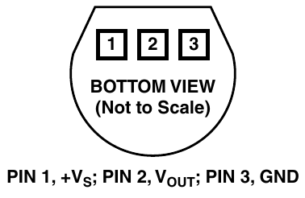

Hình 11.1 Package TO-92 của TMP36.

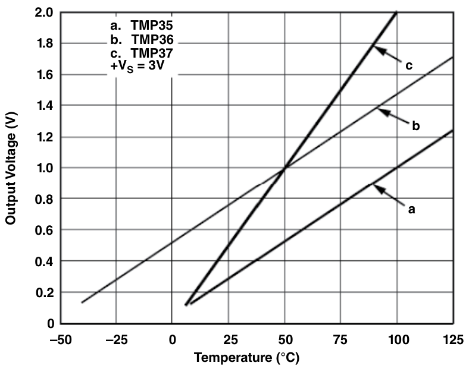

Hình 11.2 Điện áp output so với nhiệt độ.

Bảng 11.1 Các đặc tính output của TMP35/TMP36/TMP37.

| Cảm biến | Offset voltage (V) | Output voltage scaling (mV/°C) | Điện áp output ở 25 °C (mV) |
|---|---|---|---|
| TMP35 | 0 | 10 | 250 |
| TMP36 | 0.5 | 10 | 750 |
| TMP37 | 0 | 20 | 500 |

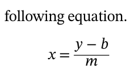 (11.2)

Vậy, viết ra như vậy, temp_C của chúng ta sẽ bằng phương trình sau.

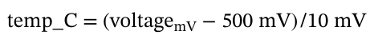 (11.3)

Điều đó sẽ cho chúng ta nhiệt độ tính bằng °C, và đó là cách chúng ta sẽ tính nhiệt độ theo độ C. Sau đó, khi muốn chuyển sang độ F, chúng ta chỉ cần thực hiện phương trình chuyển đổi từ độ C sang độ F để có nhiệt độ theo độ F. Một điều quan trọng khác cần lưu ý khi bạn làm việc với loại này hay bất kỳ loại chuyển đổi analog sang digital nào khác là độ phân giải, điều quan trọng vì nó sẽ cho bạn biết bạn thực sự có thể chính xác đến đâu. Điều này sẽ dựa trên số bit bạn có, cũng như dải điện áp bạn đang cố đo. Vậy, cách bạn tính độ phân giải là lấy dải điện áp, trong trường hợp này là 3.3 V, rồi chia cho số vị trí có thể có. Vậy, trong trường hợp này, chúng ta có 12 bit. Vậy, nếu chúng ta có 12 bit, chúng ta lấy 2 mũ 12, và điều đó cho chúng ta 4096, tức 4096 tổ hợp có thể. Vậy, phương trình sau sẽ cho chúng ta độ phân giải:

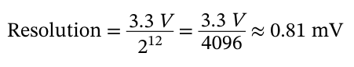 (11.4)

Điều đó có nghĩa là nhiệt độ mà chúng ta đọc, hay giá trị điện áp đọc được, chính xác đến khoảng 0.81 mV, và nếu nhìn vào m hay 10 mV/°C, thì chúng ta sẽ chính xác hơn một độ C. Vậy, chúng ta có độ chính xác rất cao vì 10 mV bằng một độ C, và chúng ta thậm chí còn nhỏ hơn 1 mV, tức là nhỏ hơn one-tenth độ. Vậy, chúng ta có độ phân giải và độ chính xác cao. Bây giờ, áp dụng khái niệm này, nếu chúng ta có cùng số bit và một dải điện áp cao hơn – vậy, ví dụ, giả sử chúng ta có một trường hợp phổ biến khác là 5 V, và chúng ta vẫn dùng chuyển đổi analog sang digital 12-bit, và chúng ta vẫn có 4096 khả năng – thì độ phân giải sẽ như trong phương trình sau:

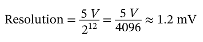 (11.5)

Độ phân giải vẫn thực sự khá tốt, và vẫn thực sự khá chính xác. Chúng ta vẫn chính xác trong phạm vi một độ – có thể không lớn hơn một độ. Nhưng nếu nhìn vào việc dùng cùng một bộ chuyển đổi analog sang digital, dù bạn dùng signal 3.3 V ở input hay signal 5 V, bạn có thể thấy 3.3 V cho bạn độ phân giải 0.81 mV so với 5 V cho bạn độ phân giải 1.2 mV. Vậy, chúng ta có kết quả tốt hơn đáng kể với 3.3 V. Hiển nhiên, nếu bạn đưa lên cao hơn nữa tới 10 V hay bất kỳ điện áp cao hơn nào, bạn có thể thấy khi dải càng cao, độ phân giải sẽ càng giảm, điều này hợp lý vì các bit về cơ bản cho bạn biết có bao nhiêu khả năng khác nhau giữa mỗi dải điện áp. Vậy, đó là một điều khác cần lưu ý về độ phân giải, và điều đó phát huy tác dụng khi bạn làm việc với độ chính xác. Nếu bạn có một mạch hay thứ gì đó mà bạn đang cố đo nhiệt độ tới một độ chính xác nhất định, bạn sẽ cần dùng phép tính này để xác định bạn thực sự có thể chính xác đến đâu. Vậy, đó là một phần giải thích tuyệt vời về mạch cảm biến nhiệt độ và cách chúng ta sẽ dùng nó trong project.

## 11.2 Dùng Xilinx XADC và MicroBlaze MCS

Mục này nói về việc dùng Xilinx XADC và MicroBlaze MCS. Ở đây, chúng ta sẽ đi qua cách thiết lập XADC core, một core do Xilinx cung cấp để dùng bộ chuyển đổi analog sang digital bên trong trên một số chip Xilinx. Chip chúng ta dùng trên board Arty A7 có một trong các core này. Vậy, trong Vivado, chúng ta sẽ thả vào một XADC core và cấu hình nó để có thể đọc các giá trị chuyển đổi analog sang digital này. Chúng ta muốn thiết lập nó sao cho có thể giao tiếp với nó bằng MicroBlaze MCS. Vậy, trong mục này, chúng tôi sẽ chỉ cho bạn cách thiết lập XADC core, và trong mục tiếp theo, chúng tôi sẽ chỉ cho bạn cách thiết lập MicroBlaze để chúng giao tiếp với nhau. Vì trên chip, chúng ta có khả năng thực hiện cả xử lý lẫn chuyển đổi analog sang digital, và chúng tôi sẽ chỉ cho bạn cách để tất cả hoạt động cùng nhau trên cùng một chip. Vậy, nếu bạn mở project – project cảm biến nhiệt độ – chúng ta sẽ đặt XADC Wizard core. Hãy mở nó lên, và chúng tôi sẽ chỉ cho bạn tất cả các thuộc tính bạn muốn đặt trên core này. Điều đầu tiên là chúng ta sẽ vào tab Basic, nơi chúng ta có các tùy chọn giao diện khác nhau: AXI4Lite, DRP hoặc None. Chúng ta muốn chọn DRP, viết tắt của dynamic reconfigurable port, cho phép chúng ta giao tiếp từ bên ngoài. Nếu click vào các nút dấu cộng (s_drp và Vp_Vn), với “Show Disabled Ports” không được đánh dấu, thì khi chúng ta thực hiện thay đổi qua các tab Basic, ADC Setup, Alarms, Single Channel và Summary, chúng ta sẽ thấy các port khác nhau xuất hiện và biến mất. Vậy, vì chúng ta dùng dynamic reconfigurable port này, nó sẽ cho chúng ta daddr_in[6:0], tức địa chỉ để chọn analog input nào chúng ta muốn đọc, và input nào được chọn sẽ đi ra ở do_out[15:0] này, tức digital output, là một giá trị 16-bit. Sau đó, với startup channel selection, chúng ta chỉ muốn chọn single channel, và với các tùy chọn AXI4STREAM, chúng ta sẽ để không được đánh dấu. Chúng ta sẽ có reset_in trong control/status ports, và điều này chỉ cho phép chúng ta có khả năng cấu hình reset, thứ chúng ta sẽ nối với MicroBlaze, và chúng ta sẽ nối nó với một slide switch trên development board. Với timing mode, chúng ta sẽ đặt là continuous mode, và với các tùy chọn DRP timing, tần số DCLK là 100 MHz, và đó là vì chúng ta sẽ chỉ đưa clock vào, tức system clock, đi vào từ bên ngoài board, và nó là 100 MHz. Vậy, chúng ta sẽ để nó là 100 MHz. Với ADC conversion rate tính bằng kilo samples per second, chúng ta sẽ đặt là 1000. Chúng ta sẽ đặt nó ở tốc độ lấy mẫu thực sự cao, và bạn có thể giảm nó nếu muốn. Không bắt buộc phải cao như vậy khi lấy mẫu một thứ như nhiệt độ, vốn không thay đổi super-fast. Vậy, bạn có thể để nó ở tốc độ lấy mẫu thấp hơn nếu muốn, hoặc bạn có thể cứ để ở 1000, như chúng ta đang có. Với acquisition time, chúng ta sẽ đặt là 4. Vậy, dựa trên hai tham số đó (ADC conversion rate và acquisition time), nó cho bạn biết bạn thực sự sẽ có bao nhiêu mẫu. Vậy, chúng ta cố đạt 1000 kilo samples per second (KSPS), nhưng thực tế nó sẽ cho chúng ta 961.54 KSPS, vẫn nhiều hơn mức chúng ta cần. Vậy, như thế là ổn, và nó đáp ứng tiêu chí để lấy mẫu một signal nhiệt độ, như được minh họa trong Hình 11.3, và chúng ta sẽ chuyển sang ADC Setup. Với ADC Setup, chúng ta sẽ để tắt các phép hiệu chỉnh ADC offset, ADC offset and gain, sensor offset, và sensor offset and gain.

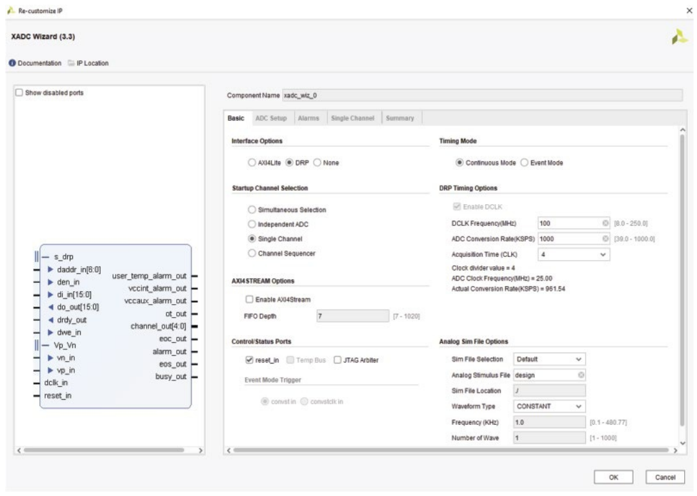

Hình 11.3 Tab Basic của XADC Wizard.

Vậy, bạn có thể bật những thứ này nếu bạn muốn một signal high-quality thực sự chính xác mà bạn đang cố làm cho siêu chính xác, bạn có thể dùng các phép hiệu chỉnh này, chúng cho bạn các offset và gain. Nhưng chúng ta sẽ không lo về điều đó trong mục này. Vì chúng ta chỉ làm một cảm biến nhiệt độ cơ bản, chúng ta không cần lo về tất cả các loại độ chính xác này. Với external multiplex setup, chúng ta sẽ đánh dấu external multiplexer, và chúng ta muốn dùng VAUXP4 VAUXN4. Chúng ta sẽ chọn channel 4 cho analog input phụ trợ (auxiliary), và chúng tôi sẽ cho bạn thấy, khi đi qua phần này, tại sao chúng ta chọn 4. Lý do chúng ta chọn 4 là vì nó nối với analog zero, hay chân A0. Nếu bạn nhìn trên development board thực tế, nơi họ có header ChipKit hay Arduino, có một chân A0, được nối với VAUXP4. Chúng tôi sẽ cho bạn thấy điều đó khi đi qua, như được thể hiện trong Hình 11.4.

Với alarms, chúng ta sẽ bỏ đánh dấu tất cả, và chúng ta sẽ không để nó đưa ra bất kỳ loại cảnh báo nào. Bạn có thể đặt chúng để nếu board đạt tới một nhiệt độ nhất định – vì bên trong chip thực tế có các diode nhiệt độ nhỏ hay transistor demonstrator ở trong đó – chúng sẽ đưa ra một chỉ báo. Khi nó đạt tới một điện áp nhất định, nó chỉ ra một nhiệt độ nhất định, vậy bạn có thể cho board tắt. Nếu nó ở trong tình huống quá nhiệt, nó có thể kích hoạt cảnh báo để tắt hệ thống hoặc bật quạt hoặc thực hiện bất kỳ hành động nào cần thiết để làm mát board, như được mô tả trong Hình 11.5.

Sau đó, chúng ta có tab Single Channel. Chúng ta chọn VAUXP4 VAUXN4, thao tác này enable channel cụ thể mà chúng ta muốn. Có sẵn các tùy chọn Bipolar và Acquisition Time, nhưng chúng ta sẽ để chúng không được đánh dấu, như được minh họa trong Hình 11.6.

Sau đó, chúng ta vào tab Summary, tab này cho chúng ta một bản tóm tắt nhanh mọi thứ. Tóm lại, chúng ta đã chọn giao diện DRP, XADC operating mode đặt là single_channel, và AXI4Stream Interface đặt là false vì chúng ta không dùng nó. Timing Mode là Continuous, tần số clock là 100 MHz, Sequencer Mode tắt, và Channel Averaging đặt là None. Chúng ta cũng có Enable External Mux đặt là true, như được thể hiện trong Hình 11.7.

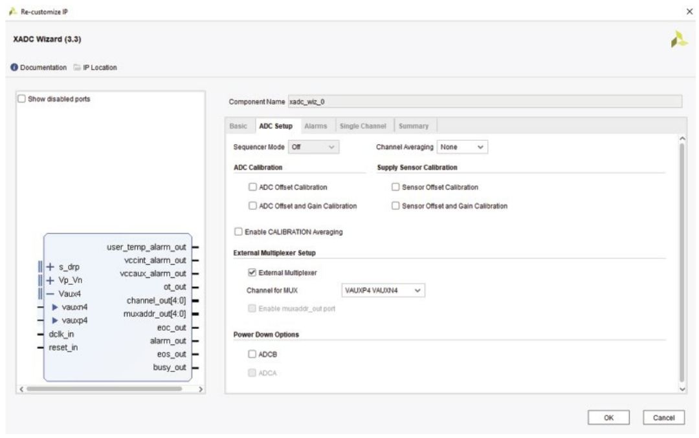

Hình 11.4 Tab ADC Setup của XADC Wizard.

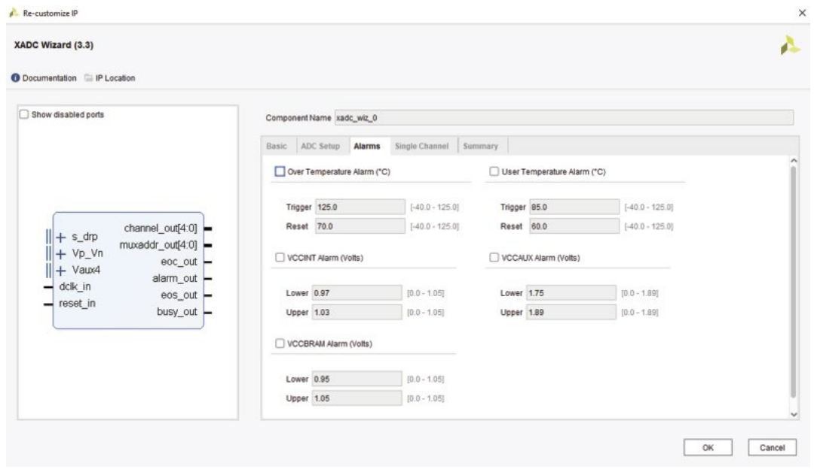

Hình 11.5 Tab Alarms của XADC Wizard.

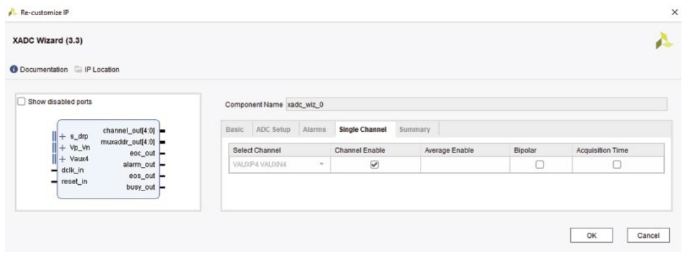

Hình 11.6 Tab Single Channel của XADC Wizard.

Vậy, sau đó bạn click OK, và khi làm vậy, bạn sẽ thấy rằng dù chúng ta chỉ dùng một vài output của XADC, chẳng hạn daddr_in, den_in và do_out, chúng là đủ cho cấu hình của chúng ta. Với địa chỉ ADC, chúng ta đặt nó là một hằng số. Vậy, nếu double-click và mở nó lên, chúng ta chỉ đặt một constant, vậy nếu bạn tìm một khối như vậy trong IP core, bạn có thể thả nó vào. Chúng ta muốn đặt độ rộng là 7 và giá trị constant là 20. Lý do chúng ta muốn đặt là 20 là vì nếu nhìn vào schematic của Arty A7, chúng ta có thể thấy CK_AN0_P và CK_AN0_N được nối với signal analog input single-ended A0. Nhìn sâu hơn vào tên IO trên BANK 35, bạn sẽ thấy IO AD4P và AD4N. Ở đây, P và N là positive và negative, và AD chỉ giá trị analog to digital. Điều này chỉ ra rằng signal có thể được dùng làm analog input và nó được nối với XADC core, như được mô tả trong Hình 11.8. Vậy, giờ chúng ta biết mình muốn channel 4 (AD4, được nối với AN0), làm sao chúng ta biết địa chỉ thực tế đó là gì?

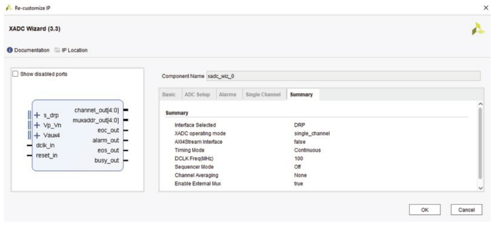

Hình 11.7 Tab Summary của XADC Wizard.

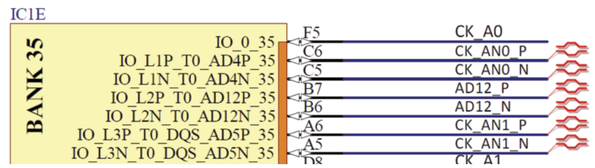

Hình 11.8 Schematic của Arty A7.

Nếu xem user guide của XADC (UG480), nó cho chúng ta biết các vị trí địa chỉ thực tế cho các column status register. Nhưng với giao diện DRP này, nó cho chúng ta biết DADDR[6:0] từ 00h đến 3Fh chứa các status register read-only. Nếu đi qua các status register read-only này, khi xuống tới các địa chỉ VAUXP[15:0]/VAUXN[15:0], chúng nằm trong khoảng từ 10h đến 1Fh. Vậy, địa chỉ cho VAUXP4/VAUXN4 sẽ là 14h, mà khi chuyển sang thập phân, cho chúng ta giá trị constant là 20. Do đó, chúng ta sẽ đặt nó là 20, và đó là cách chúng ta chọn signal thực tế sẽ xuất hiện ở output, do_out[15:0]. Output này là một signal số mà sau đó sẽ được đưa vào processor MicroBlaze MCS. Chúng ta có den_in, enable dynamic reconfigurable port (DRP). Chúng ta sẽ nối nó với một signal, signal này sau đó được nối với một slide switch để enable hoặc disable XADC. vauxn4 và vauxp4 là các signal analog vi sai, mà chúng ta sẽ nối với các IO cụ thể, và chúng tương ứng với analog input single-ended thực tế mà chúng ta có trên chân A0 của header Arduino. Sau đó, chúng ta có clock và reset, và đó là tất cả các IO khác nhau mà chúng ta dùng cho XADC Wizard này. Có một số port không được dùng, điều đó không sao – chúng ta không phải dùng tất cả. Dù chúng ta không dùng mọi thứ trên XADC Wizard này, khi bạn synthesize, nó có thể đưa ra một số cảnh báo. Tuy nhiên, bạn có thể bỏ qua chúng vì công cụ sẽ tối ưu loại bỏ một số, nhưng nhiều cái vẫn sẽ còn đó, và điều đó không sao. Dù chúng ta không nối chúng, chúng ta có thể để chúng không kết nối, và project của chúng ta vẫn sẽ hoạt động và có thể cấu hình bình thường, như được minh họa trong Hình 11.9. Vậy, về cơ bản đó là cách bạn dùng Xilinx XADC Wizard trong Vivado để bắt đầu đọc signal analog và output của nó từ cảm biến nhiệt độ.

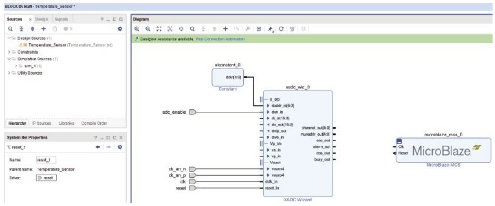

Hình 11.9 XADC Wizard trong block diagram Temperature_Sensor.

## 11.3 Cấu hình ADC cho MicroBlaze MCS

Mục này nói về cấu hình ADC cho MicroBlaze MCS. Trong mục này, chúng tôi sẽ chỉ cho bạn cách lấy MicroBlaze MCS core và cấu hình nó để có thể đọc các giá trị chuyển đổi analog sang digital. MicroBlaze MCS core của Xilinx không có sẵn bộ chuyển đổi analog sang digital. Tuy nhiên, nó nằm trên cùng chip với XADC. Đầu tiên, chúng ta sẽ xem cách thiết lập XADC, vậy XADC đã được đặt và cấu hình. Bây giờ, chúng ta muốn đọc dữ liệu đó từ một parallel port. Chúng ta có các general-purpose input và output (GPIO) này. Chúng ta sẽ lấy một general-purpose input 16-bit và dùng nó để đọc dữ liệu đi ra từ channel analog cụ thể thực tế. Vậy, chúng ta sẽ đặt MicroBlaze MCS lên block diagram, rồi cấu hình nó như sau. Với kích thước bộ nhớ, chúng ta dùng 64 kB – bạn có thể tăng nếu cần. Nếu bạn vượt quá 64 kB, chúng tôi khuyên bạn chọn 128 kB; tuy nhiên, điều đó phụ thuộc vào việc bạn muốn lớn đến đâu. Với MicroBlaze optimization, chúng ta sẽ tối ưu theo area vì chúng ta chỉ làm việc với nhiệt độ, vốn không thay đổi quá thường xuyên, vậy chúng ta không cần bất kỳ loại hiệu năng siêu cao nào. Chúng ta chỉ cần thực tế, và tất cả những gì chúng ta muốn làm là cập nhật nhiệt độ khoảng mỗi nửa giây hoặc mỗi giây, mỗi vài giây. Vì nhiệt độ dù sao cũng sẽ không thay đổi nhanh như vậy, chúng ta có thể tối ưu theo area chỉ để tiết kiệm tài nguyên. Chúng ta sẽ để cả hai bus không được đánh dấu, và với debug, chúng ta sẽ chọn NONE, như được thể hiện trong Hình 11.10.

Với UART, chúng ta muốn enable cả receiver lẫn transmitter. Hiện chúng ta không cần receiver, nhưng dù sao chúng ta vẫn sẽ enable nó – phòng khi bạn muốn thêm thứ gì đó vào project sau này liên quan đến gửi dữ liệu. Nhưng ngay bây giờ, chúng ta chỉ dùng transmitter, và chúng ta sẽ bật cả hai, vì chúng ta sẽ truyền dữ liệu nhiệt độ đọc được từ board tới terminal emulator Tera Term, như được mô tả trong Hình 11.11.

Với FIT hay fixed interval timer, chúng ta sẽ không dùng cái nào, vậy FIT 1 đến FIT 4 đều có thể để không được đánh dấu. Tương tự với các programmable interval timer, PIT 1, PIT 2, PIT 3 và PIT 4; chúng ta cũng sẽ không dùng, vậy hãy để chúng không được đánh dấu. Với các GPO, chúng ta sẽ không có general-purpose output nào vì chúng ta chỉ đọc dữ liệu. Output duy nhất chúng ta dùng là output UART, vậy chúng ta sẽ để tất cả các GPO không được đánh dấu. Với general purpose input (GPI), chúng ta muốn GPI 1 là giá trị chuyển đổi analog sang digital. Chúng ta sẽ lấy giá trị output ADC đó từ XADC và đọc nó vào GPI 1. Với GPI 2, chúng ta sẽ để nó là một bit, được nối với một slide switch quyết định chúng ta diễn giải nhiệt độ theo độ F hay độ C (1 cho độ F, và 0 cho độ C). Chúng ta sẽ tính cả hai, nhưng chúng ta sẽ chỉ thấy một giá trị, như được minh họa trong Hình 11.12.

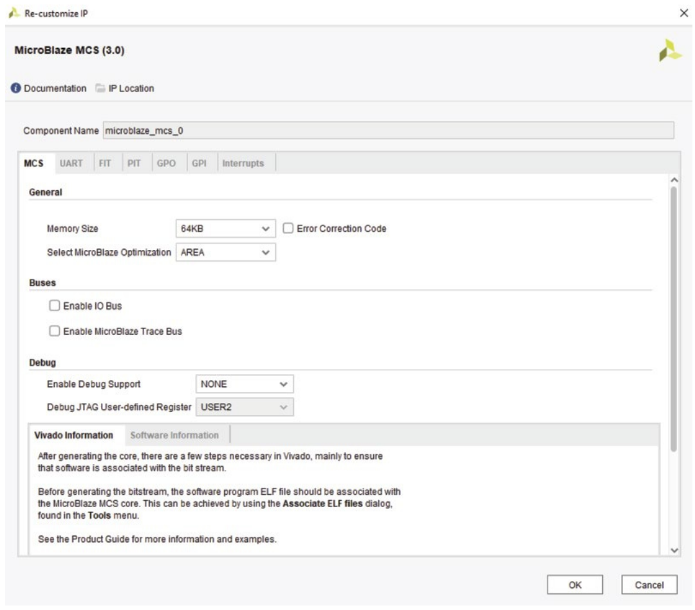

Hình 11.10 Tab MCS của MicroBlaze MCS.

Sau đó, với interrupts, chúng ta sẽ để trống, và chúng ta sẽ không dùng interrupt nào, vậy chúng ta sẽ để không được đánh dấu. Tại thời điểm đó, bạn có thể click OK để cấu hình MicroBlaze MCS để nó có thể giao tiếp với XADC core, như được thể hiện trong Hình 11.13.

## 11.4 Giao tiếp với XADC Core

Mục này nói về việc giao tiếp với XADC core. Ở đây, chúng tôi sẽ chỉ cho bạn cách viết phần mềm để giao tiếp với XADC IP core. Điều chúng ta làm là lấy Temperature_Sensor.bd, rồi tạo một wrapper, và để Vivado quản lý wrapper và auto-update nó, như được minh họa trong Hình 11.14.

Sau đó, chúng ta lần lượt chạy synthesis, chạy implementation và tạo bitstream. Nếu gặp lỗi trong bitstream generation, chúng ta bỏ qua chúng và click vào File. Tiếp theo, chúng ta muốn export hardware như được thể hiện trong Hình 11.15.

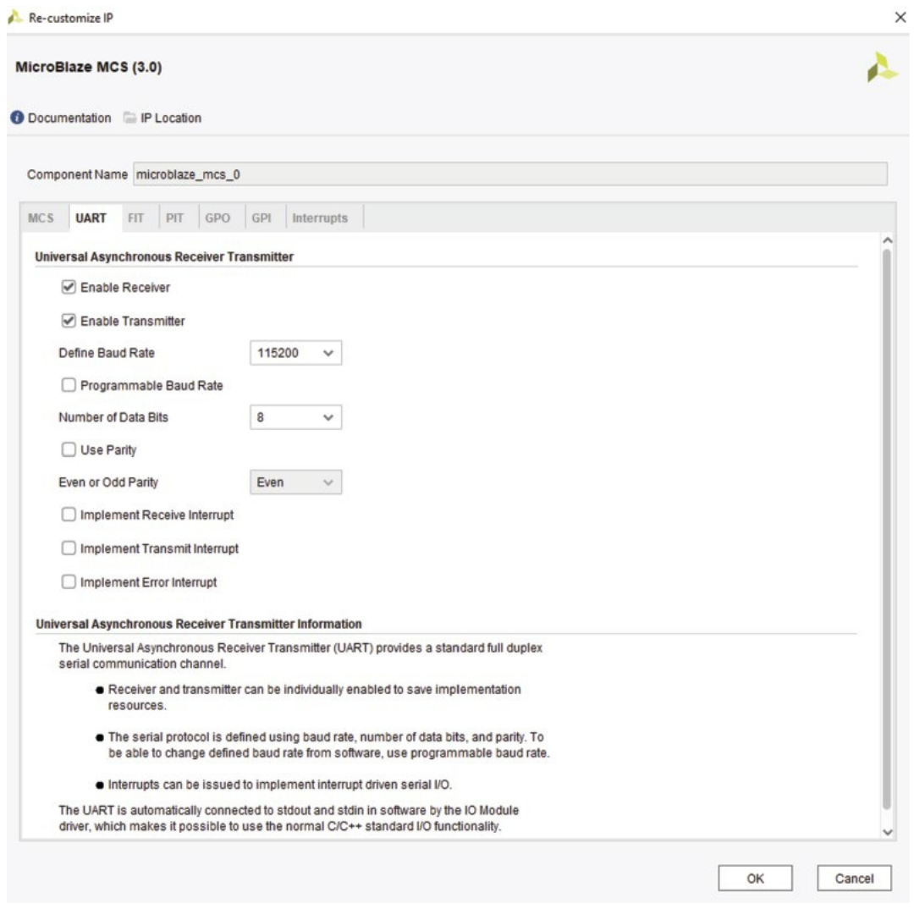

Hình 11.11 Tab UART của MicroBlaze MCS.

Thao tác này sẽ mở một hộp thoại nhỏ ghi “Export the hardware for software development tools.” Chúng ta sẽ để “Include bitstream” không được đánh dấu, vì chúng ta chưa tạo file bitstream, nên không thể đưa nó vào đây, và điều đó không sao. Sau đó, chúng ta muốn mở Xilinx SDK bằng cách vào File và chọn Launch SDK, như được mô tả trong Hình 11.15. Khi đã mở Xilinx SDK, vào File > New > Application Project. Từ đây, chúng ta sẽ đặt tên cho project – chúng ta sẽ gọi nó là Temp_ Sensor cho temperature sensor – và giữ tùy chọn “Use default location” được đánh dấu. Với OS platform, chúng ta sẽ chọn standalone. Phần cứng đích của chúng ta được định nghĩa bởi Temperature_Sensor_ wrapper_hw_platform_0, và processor là MicroBlaze MCS zero, là processor MicroBlaze MCS mà chúng ta đã đặt trong project Vivado. Với Language, chúng ta sẽ dùng C, và với Board Support Package, chúng ta sẽ dùng Create New với Temp_Sensor_bsp, như được minh họa trong Hình 11.16.

Sau đó, chúng ta sẽ click Next, và với application template, chúng ta sẽ click vào Peripheral Tests, rồi click Finish, như được thể hiện trong Hình 11.17.

Thao tác này sẽ tạo một project cho chúng ta. Bây giờ, nếu mở rộng Temp_Sensor và điều hướng tới source (src), chúng ta sẽ thấy testperiph.c. Nếu double-click vào nó, nó sẽ mở testperiph.c, chứa một chương trình nhỏ cơ bản sẽ test lệnh print và test UART. Từ đây, giờ chúng ta muốn bổ sung vào để có thể đọc nhiệt độ, cũng như xử lý thông tin đó và thực hiện phép tính mà chúng ta đã xác định để tìm ra nhiệt độ. Vậy, từ bên trong đây, chúng ta sẽ phải thêm một số header file nữa. Chúng ta có standard IO (stdio.h), X parameters (xparameters.h), Xilinx cache (xil_cache.h), XIO module (xiomodule.h), và IO module header (iomodule_header.h). Giờ chúng ta có thể vào bên trong chương trình main. Vậy, bên trong chương trình main, chúng ta sẽ định nghĩa các tham số. Đây chỉ là các giá trị khác nhau mà chúng ta sẽ dùng xuyên suốt project. Để bắt đầu, chúng ta sẽ có một data type unsigned 32-bit, và chúng ta sẽ gọi nó là data. Chúng ta sẽ có một ADC_reading, và chúng ta sẽ có Selected_Degree. Selected_Degree là thứ chúng ta sẽ dùng để xác định hiển thị giá trị theo độ F hay độ C. ADC_reading là giá trị chuyển đổi analog sang digital ban đầu, mà sau đó chúng ta cần chuyển sang điện áp tính bằng millivolt, và data là thứ chúng ta sẽ dùng khi khởi tạo và instantiate các general-purpose input và output để có thể đọc từ và ghi vào chúng. Tiếp theo, chúng ta muốn có một số giá trị floating-point hay floating point 32-bit. Đây sẽ là Voltage_mV. Chúng ta muốn nó là floating point. Chúng ta cũng sẽ có nhiệt độ theo độ C (Temperature_C) và độ F (Temperature_F). Chúng ta cũng muốn có một giá trị floating-point khác, sẽ là Temperature_out, và đây sẽ là giá trị chúng ta hiển thị ở output. Cuối cùng, chúng ta muốn có một số integer, vậy chúng ta sẽ có delay_count. Đó là vì chúng ta sẽ có một độ trễ kể từ khi xử lý. Chúng ta không muốn in giá trị nhiệt độ này nhanh đến mức trên terminal chúng ta không có thời gian để đọc nó. Chúng ta muốn nó đủ chậm để có thể thấy nó khi được in ra, cũng như Temperature_whole, sẽ là phần số nguyên. Vậy, chúng ta sẽ dùng lệnh Xilinx printf, lệnh này cho phép chúng ta in số thập phân nguyên, nhưng chúng ta không thể in một số floating-point. Vậy, chúng ta sẽ phải lấy giá trị floating-point của Temperature_out và chuyển nó thành phần nguyên cũng như phần thập phân. Chúng ta sẽ gọi phần sau là Temperature_hundreds, và đó chỉ là vì chúng ta sẽ hiển thị hai chữ số thập phân, temperature hundreds. Bây giờ, chúng ta muốn có XIO module, vậy chúng ta sẽ gọi nó là XIO module, và việc này giống như chúng ta đã làm trong project UART_IO. Vậy, chúng ta theo cùng mô hình, ngoại trừ việc chúng ta chỉ có general-purpose input, và không có general-purpose output nào. Bây giờ, chúng ta sẽ khởi tạo các GPIO, và chúng ta sẽ làm điều đó bằng cách dùng data, bằng XIOModule_initialize(&gpi, XPAR_IOMODULE_0_DEVICE_ID). Vậy ở đây chúng ta đang khởi tạo general-purpose input. Bây giờ, chúng ta muốn khởi động nó, vậy chúng ta sẽ làm điều đó bằng lệnh XIOModule_Start(&gpi) đặt ngay bên dưới. Vậy, điều đó sẽ khởi tạo tất cả các general-purpose input – trong trường hợp này, chỉ có các input. Chúng ta sẽ comment out toàn bộ phần code còn lại. Vậy, chúng ta sẽ comment hết phần đó – nếu muốn dùng sau, chúng ta có thể dùng. Nhưng ngay bây giờ, chúng ta không lo về nó, và chúng ta không cần return gì cả vì lời gọi main của chúng ta không có gì, và chúng ta sẽ không bao giờ tới đó. Vậy, có một lệnh return cũng không thực sự quan trọng. Chúng ta sẽ vào một vòng lặp while, nơi chúng ta không bao giờ phải return. Bây giờ, chúng ta muốn vào vòng lặp while vô hạn. Trong vòng lặp while này, chúng ta sẽ làm nhiều việc: đọc ADC, tính các giá trị nhiệt độ, và xác định hiển thị theo độ F hay độ C. Việc đầu tiên là đọc giá trị ADC bằng cách dùng XIO discrete read và truyền vào handle của general-purpose input, thứ chúng ta đã định nghĩa trong code sau.

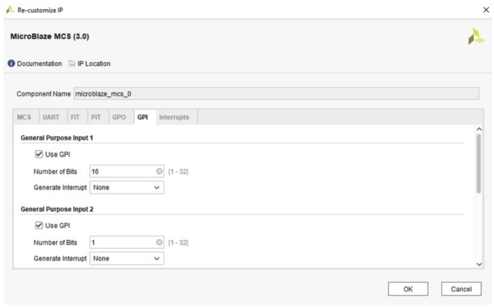

Hình 11.12 Tab GPI của MicroBlaze MCS.

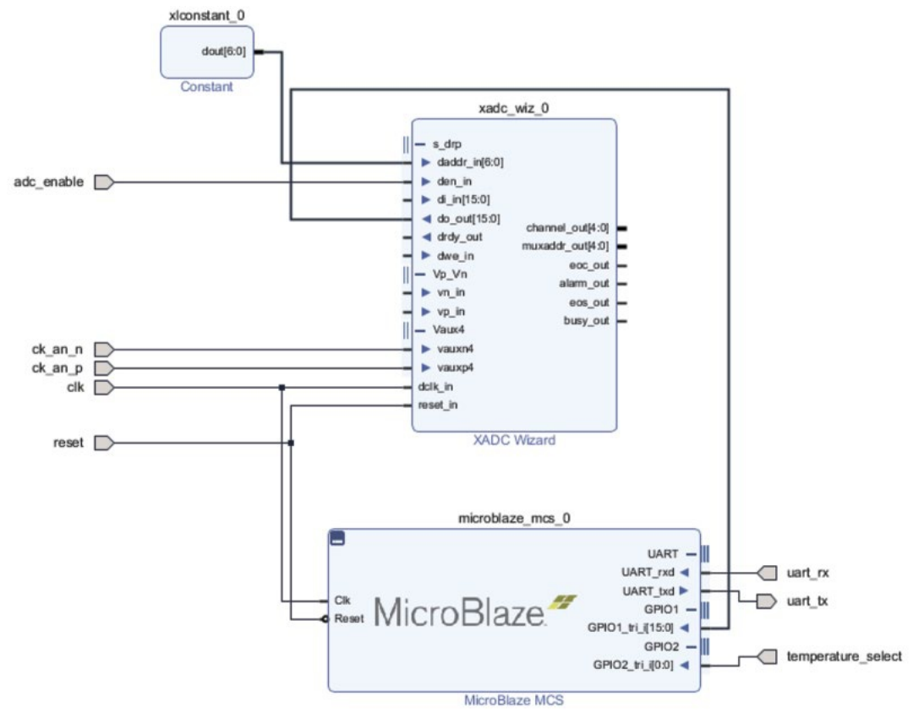

Hình 11.13 MicroBlaze MCS giao tiếp với XADC core.

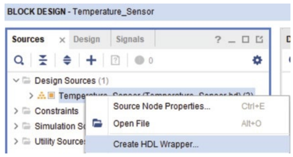

Hình 11.14 Tạo HDL wrapper.

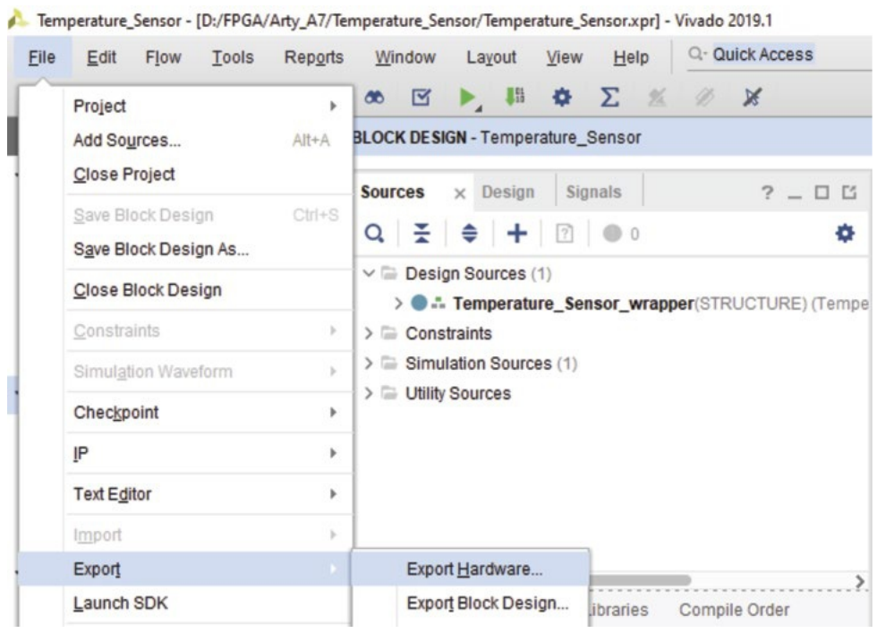

Hình 11.15 Export hardware.

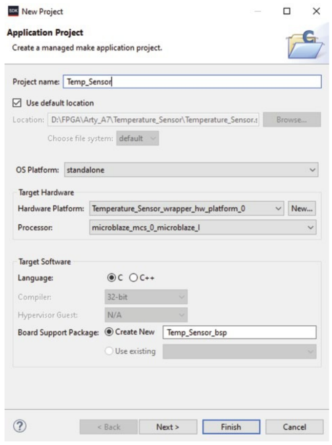

Hình 11.16 Các thiết lập Application Project.

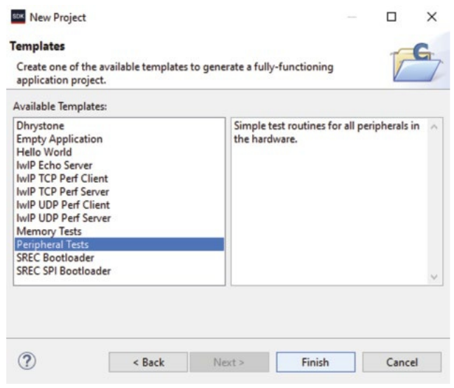

Hình 11.17 Chọn Peripheral Tests cho application template.

```
ADC_reading = XIOModule_DiscreteRead(&gpi, 1);
```

Vậy, đó là giá trị đọc chuyển đổi analog sang digital thô thực tế, và nó sẽ là giá trị 16-bit mà chúng ta đọc từ module XADC. Bây giờ chúng ta muốn dịch bỏ bốn least significant bit (LSB), và đó là vì ADC rating *(ghi chú: sách in "rating"; đúng là "reading")* của chúng ta rộng 12-bit. Tuy nhiên, họ cho bạn 16 bit, và họ bảo bạn trong user guide của XADC là hãy dịch bỏ bốn LSB. Vậy, chúng ta sẽ dịch chúng ra, và hãy viết một comment để biết mình đang làm gì. Điều tiếp theo chúng ta muốn làm tại thời điểm này là có giá trị ADC đọc thực tế ở bước ngay đây, và đó là giá trị ADC thô thực tế mà chúng ta có và sẽ làm việc. Vậy, điều tiếp theo chúng ta muốn làm là dùng slide switch để xác định chúng ta hiển thị kết quả theo độ F hay độ C. Việc đó được thực hiện bằng variable này để giữ độ được chọn, và chúng ta cho nó bằng XIO module discrete read trên channel 2, vì đó là slide switch mà general-purpose input của chúng ta được nối tới, như được thể hiện trong code sau.

```
Selected_Degree = XIOModule_DiscreteRead(&gpi, 2);
```

Sau đó, ngay bên dưới, chúng ta muốn tính điện áp tính bằng millivolt, và đây là một giá trị floating-point. Vậy, để tính nó, chúng ta dùng code sau.

```
Voltage_mV = (float)(3.3/4095) * (float)ADC_reading * 1000;
```

Chúng ta sẽ nhân giá trị đó với một nghìn, và đó là để đưa nó về mV. Nếu không nhân với một nghìn, giá trị sẽ vẫn tính bằng volt. Nhưng vì chúng ta muốn giá trị millivolt, chúng ta sẽ nhân với một nghìn. Vậy, toàn bộ phương trình này được dùng để xác định điện áp tính bằng millivolt. Bây giờ, chúng ta muốn xác định nhiệt độ theo độ C. Chúng ta phải tính giá trị này mỗi lần, ngay cả khi người dùng chọn hiển thị nhiệt độ theo độ F, vì công thức xác định nhiệt độ của chúng ta dựa trên độ C. Khi đã tính được nhiệt độ theo độ C, nếu người dùng chọn độ F, chúng ta sẽ thực hiện phép chuyển đổi. Nếu không, chúng ta sẽ chỉ dùng trực tiếp nhiệt độ theo độ C. Logic này được viết như code sau.

```
Temperature_C = (Voltage_mV – 500) / 10;
```

Vậy giờ, tại thời điểm này, chúng ta sẽ đặt Temperature_out vì Temperature_out là giá trị mà chúng ta sẽ hiển thị qua UART terminal. Vậy, ban đầu Temperature_out bằng Temperature_C. Bây giờ, điều chúng ta cần làm là kiểm tra và xác định Selected_Degree là gì. Selected_Degree, thứ chúng ta đã đọc vào, cho chúng ta biết đang đọc theo độ F hay độ C, vậy chúng ta cần dùng một if statement như được thể hiện trong code sau.

```
if(Selected_Degree == 1)
{
    Temperature_F = (Temperature_C * 1.8) + 32;
    Temperature_out = Temperature_F;
}
```

Vậy, nếu selected degree là 1 – nghĩa là slide switch của bạn được đặt lên high, nghĩa là chúng ta muốn hiển thị nhiệt độ output theo độ F – thì Temperature_out giờ bằng nhiệt độ theo độ F. Nếu không, Temperature_out vẫn giữ giá trị theo độ C. Vậy, tại thời điểm này, chúng ta đã tính nhiệt độ theo cả độ C và độ F, dựa trên việc người dùng có chọn hiển thị cái này hay cái kia. Bây giờ, việc cuối cùng chúng ta cần làm là ghi ra nhiệt độ output để người dùng có thể thực sự thấy giá trị nhiệt độ là bao nhiêu. Nếu không hiển thị nó ở đâu cả, chúng ta sẽ không biết nhiệt độ có đang thay đổi hay không, và chúng ta không thể kiểm chứng thiết kế của mình đang hoạt động đúng. Để hiển thị nó, chúng ta chỉ có thể in ra các giá trị số nguyên. Nhưng chúng ta có một giá trị floating-point, và chúng ta muốn thể hiện độ chính xác – cụ thể là các thay đổi ở hàng phần trăm. Vậy, để làm điều đó, chúng ta sẽ nói Temperature_whole bằng Temperature_out, và Temperature_out là một giá trị floating-point, còn Temperature_whole là một giá trị integer. Điều này sẽ lấy mọi thứ ở bên trái dấu thập phân và biểu diễn trong Temperature_whole. Vậy, giả sử nhiệt độ của chúng ta là 46.87 độ. Tại thời điểm này, temperature sẽ bằng 46. Bây giờ, điều chúng ta cần làm là lấy 87 đó để hiển thị. Để làm điều đó, chúng ta muốn lưu nó trong Temperature_hundreds, và Temperature_hundreds đó bằng Temperature_out, tức 46.87, và chúng ta sẽ trừ Temperature_whole, tức 46. Điều đó cho chúng ta 0.87. Sau đó chúng ta nhân nó với 100 để được 87. Vậy giờ, Temperature_whole bằng 46 và Temperature_hundreds bằng 87. Khi hiển thị, chúng ta cần bảo đảm đặt một dấu thập phân giữa chúng để hiển thị 46.87. Cuối cùng, chúng ta cần xác định chúng ta đang ở độ F hay độ C vì dựa trên lựa chọn, chúng ta muốn in ra C hoặc F để người dùng biết đó là độ F hay độ C. Vậy, chúng ta sẽ chỉ dùng một statement if-else trong code sau.

```
if(Selected_Degree == 0)
   xil_printf(“Temperature: %d.%d C\n\r”, Temperature_whole, Temperature_
hundreds);
else
   xil_printf(“Temperature: %d.%d F\n\r”, Temperature_whole, Temperature_
hundreds);
```

Sau đó, chúng ta muốn tạo một độ trễ, và lý do chúng ta muốn tạo độ trễ là việc này sẽ diễn ra nhanh đến mức nếu không có độ trễ, màn hình của bạn sẽ đầy lên nhanh đến nỗi bạn thậm chí không thể đọc hay thấy nhiệt độ là bao nhiêu. Vậy, khi nhiệt độ thay đổi, bạn sẽ không thể thấy nhiệt độ tăng hay giảm. Vậy, để tạo độ trễ, chúng ta sẽ chỉ dùng một phép đếm đơn giản. Đó là một cách thực sự đơn giản và cơ bản để tạo độ trễ trong một hệ thống kiểu nhúng.

```
delay_count = 0;
while(delay_count < 50000000)
     delay_count++;
```

Vậy, chúng ta sẽ tiếp tục đếm, vậy một thứ gì đó sẽ đếm tới một số lớn. Theo cách này, bạn có thể thay đổi con số đó – độ trễ sẽ thay đổi tương ứng. Nếu bạn đặt một số lớn hơn, bạn sẽ có độ trễ dài hơn. Nếu bạn đặt một số nhỏ hơn, bạn sẽ có độ trễ ngắn hơn. Trong khi nó nhỏ hơn con số đó, chúng ta sẽ tăng delay count, rồi chúng ta sẽ tiếp tục trong vòng lặp while bên ngoài. Vậy, vòng lặp while của chúng ta sẽ tiếp tục, và chúng ta có vòng lặp while(1) này. Vậy, trong khi nó đang chạy, chúng ta sẽ không bao giờ thực sự tới cuối main, và thực ra, trong main, chúng ta sẽ có return 0, và chúng ta sẽ bỏ comment nó. Chúng ta sẽ lưu code, và code hoàn chỉnh cho project này được trình bày như sau.

```
#include <stdio.h>
#include "xparameters.h"
#include "xil_cache.h"
#include "xiomodule.h"
#include "iomodule_header.h"
int main ()
{
   //Parameters
   u32 data, ADC_reading, Selected_Degree;
   float Voltage_mV, Temperature_C, Temperature_F;
   float Temperature_out;
   int delay_count, Temperature_whole, Temperature_hundreds;
   XIOModule gpi;
   //Initialize our GPIOs
   data = XIOModule_Initialize(&gpi, XPAR_IOMODULE_0_DEVICE_ID);
   data = XIOModule_Start(&gpi);
   while (1)
   {
          ADC_reading = XIOModule_DiscreteRead(&gpi, 1); //Perform ADC Reading
          ADC_reading =  ADC_reading >> 4;  //Shift right 4 LSBs
          Selected_Degree = XIOModule_DiscreteRead(&gpi, 2); //Read the slide
switch to determine C or F
          Voltage_mV = (float)(3.3/4095) * (float)ADC_reading * 1000; //Voltage
reading in mV
          Temperature_C = (Voltage_mV - 500) / 10; //Calculate temperature in C
          Temperature_out = Temperature_C;
          if(Selected_Degree == 1)
          {
                 Temperature_F = (Temperature_C * 1.8) + 32; //Calculate
temperature in F
                 Temperature_out = Temperature_F;
          }
          //Write the output temperature
          Temperature_whole = Temperature_out;
          Temperature_hundreds = (Temperature_out - Temperature_whole) * 100;
          if(Selected_Degree == 0)
                xil_printf("Temperature: %d.%d C\n\r", Temperature_whole,
Temperature_hundreds);
          else
                xil_printf("Temperature: %d.%d F\n\r", Temperature_whole,
Temperature_hundreds);
       //delay
          delay_count = 0;
          while(delay_count < 50000000)
               delay_count++;
   }

       /*
   Xil_ICacheEnable();
   Xil_DCacheEnable();
   print("---Entering main---\n\r");
   {
      XStatus status;
      print("\r\nRunning IOModuleSelfTestExample() for microblaze_mcs_0_
iomodule_0...\r\n");

      status = IOModuleSelfTestExample(XPAR_MICROBLAZE_MCS_0_IOMODULE_0_
DEVICE_ID);

      if (status == 0) {
         print("IOModuleSelfTestExample PASSED\r\n");
      }
      else {
         print("IOModuleSelfTestExample FAILED\r\n");
      }
   }
   print("---Exiting main---\n\r");
   Xil_DCacheDisable();
   Xil_ICacheDisable();
   */
   return 0;
}
```

Sau đó, chúng ta build, và nó cho chúng ta thông tin này ngay đây trên output terminal. Chúng ta có file Temp_Sensor.elf đó, mà sau đó chúng ta sẽ muốn liên kết trong Vivado, như được mô tả trong Hình 11.18.

Chúng ta sẽ muốn lấy và liên kết file .elf với softcore processor MicroBlaze MCS thực tế, để có thể nạp lại thiết bị với phần mềm đã được nhúng sẵn trong MicroBlaze MCS. Bằng cách này, chúng ta không phải nạp board hai lần, và nó cho bạn kích thước của file .elf đó ở dạng thập phân, như được minh họa trong Hình 11.19.

Bạn có thể thấy chúng ta đang dùng khoảng 26 kB, và chúng ta đã chỉ định khoảng 64 kB, vậy chúng ta đang dùng ít hơn một nửa những gì đã chỉ định. Điều đó có nghĩa là chúng ta có quá đủ bộ nhớ để làm việc. Như vậy là hoàn tất mọi thứ cần thiết để giao tiếp với XADC core trong Vivado từ phía phần mềm.

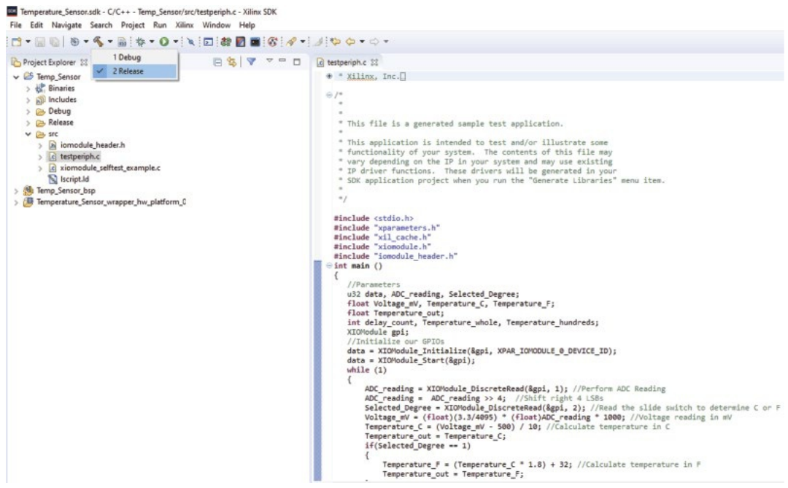

Hình 11.18 Build project Temp_Sensor.

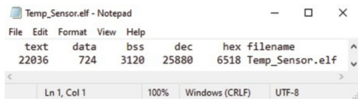

Hình 11.19 Nội dung file Temp_Sensor.elf.size.

## 11.5 Bố trí IO của ADC Processing trên Arty A7

Mục này nói về việc bố trí IO trên Arty A7 cho ADC processing. Ở đây, chúng ta sẽ đi qua tất cả các vị trí bố trí IO khác nhau cho project cảm biến nhiệt độ. Với project này, chúng ta có nhiều input và output khác nhau. Các input bao gồm adc_enable, reset và temperature_select, được nối với các slide switch. Nếu vào file Arty_A7_Master.xdc và xem ở đầu, chúng ta có thể thấy các slide switch được liệt kê đầu tiên. Vậy, switch không, mà chúng ta sẽ nối với adc_enable, sẽ enable hoặc disable việc chuyển đổi analog sang digital. Sau đó, chúng ta có reset, được nối với switch hai, và nó sẽ xác định MicroBlaze và bộ chuyển đổi analog sang digital có bị giữ ở trạng thái reset hay không. temperature_select được nối với switch ba, và nó sẽ xác định chúng ta sẽ xuất nhiệt độ theo độ C hay độ F. Với clock (clk), đi vào XADC và MicroBlaze MCS, chúng ta sẽ nối nó với package pin E3, chân được nối với một bộ dao động ngoài trên development board thực tế. Đó chỉ là một clock 100 MHz mà chúng ta đưa vào FPGA. Chúng ta dùng dòng tiếp theo để tạo một clock và chỉ cho nó biết period và waveform để khi phân tích, nó có thể kiểm chứng rằng mọi thứ nối với clock này có thể chạy ở 100 MHz. Chúng ta cũng có ck_an_n và ck_an_p, và đây là signal analog vi sai được đưa vào XADC core để thực hiện chuyển đổi analog sang digital. Nếu cuộn xuống cuối file Arty_A7_Master. xdc, chúng ta sẽ thấy một phần có tiêu đề ChipKit Single Ended Analog Inputs, và nó tiếp tục ở đó. Các chân ck_an_p có thể được dùng làm analog input single-ended với điện áp từ 0 đến 3.3 V (Chipkit Analog pins A0–A5). Đây là sáu channel analog khác nhau, và chúng ta dùng A0. Vậy, nếu bạn làm việc với ChipKit hay Arduino, đây sẽ là analog input A0 của bạn, và đó là thứ nó được nối tới. Chúng ta có thể đưa một signal từ 0 đến 3.3 V vào. Nó lấy signal đó và biến nó thành một signal vi sai. Vậy, một input single-ended từ 0 đến 3.3 V được tách thành hai chân thực tế trên FPGA. Bằng cách dùng analog input A0, chúng ta sẽ cần hai input: ck_an_n và ck_an_p. Nếu nhìn vào, chúng được nối trực tiếp với vauxn4 và vauxp4. Trên XADC, đó chỉ là một trong các channel cho chuyển đổi analog sang digital. Vậy, chúng ta sẽ nối chúng ở đó. Tiếp theo, chúng ta có giao diện UART–USB, thứ chúng ta sẽ dùng để truyền các giá trị nhiệt độ đã chuyển đổi tới màn hình máy tính. Đó chỉ là một giao diện UART tiêu chuẩn – uart_tx và uart_rx – và chúng ta sẽ đặt chúng ở giao diện UART–USB trên các chân D10 và A9. Khi làm xong, đó là tất cả những gì chúng ta có cho project cảm biến nhiệt độ. Vậy, chúng ta nối ck_an_n và ck_an_p, đi ra A0 trên header ChipKit. Điều này sẽ nối và đưa vào signal output từ cảm biến nhiệt độ, được đưa tới XADC. Sau đó, nó thực hiện chuyển đổi. MicroBlaze đọc giá trị chuyển đổi đó, xác định giá trị điện áp, chuyển nó thành nhiệt độ, rồi báo cáo nhiệt độ đó trên serial port terminal hay UART terminal. Đó là phần bố trí IO trên Arty A7 cho ADC processing trong project Temp_Sensor, như được thể hiện trong Hình 11.20.

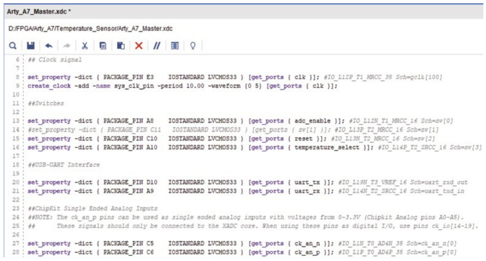

Hình 11.20 Constraints file cho project Temp_Sensor trên Arty A7.
