# 12 Project SPI Interface

## 12.1 Giới thiệu

Chương này nói về việc dùng giao diện SPI với bộ nhớ flash ngoài. Trước hết, chúng ta sẽ giải thích và nói ngắn gọn về chip bộ nhớ flash ngoài được dùng trên development board Arty A7. Với development board Arty A7, có một chip QSPI flash ngoài nằm trên board, và thông thường nó được dùng để lưu cấu hình của FPGA. Khi bạn cấp nguồn cho board, nếu nghĩ về FPGA, rất nhiều lần trong các bài lab, chúng ta phải nạp nó bằng cáp JTAG. Mỗi lần tắt nguồn rồi bật lại, chúng ta phải nạp lại. Vậy, các chip bộ nhớ QSPI flash ngoài này thường được dùng để giữ cấu hình đó. Bằng cách đó, ngay khi board được cấp nguồn, nó đọc cấu hình từ bộ nhớ flash ngoài đó và tự động cấu hình FPGA. Ngoài thực địa, bạn sẽ không muốn nạp lại board mỗi lần nó bị tắt nguồn – điều đó không khả thi. Vậy, đó thường là mục đích sử dụng của các chip QSPI này. Chip dùng trên board Arty A7 là một chip flash 16 MB, và file cấu hình của Arty A7 chiếm khoảng 2 MB. Điều đó để lại khoảng 14 MB trống để làm việc. Chúng ta sẽ chỉ dùng vài byte vì chúng ta chỉ lưu một cái tên và một số thông tin bổ sung. Nhưng bạn có thể lưu tới 14 MB dữ liệu, vậy có rất nhiều thông tin bạn có thể lưu trên đó. Toàn bộ ý tưởng của bài lab trong project này là giúp bạn hiểu cách dùng giao diện SPI để giao tiếp với một chip nằm ngoài FPGA. Trong trường hợp này, đó là một chip bộ nhớ do Micron sản xuất, một nhà sản xuất IC thường làm các thiết bị nhớ. Đây là một chip bộ nhớ flash ngoài nonvolatile. Họ cũng sản xuất RAM, SD-RAM, và nhiều loại mạch tích hợp khác mà bạn có thể làm việc. Đừng lo về việc ghi đè thứ gì đó trong QSPI flash trong project này, vì khi làm việc với các board và tất cả các project chúng ta đang làm, chúng ta chỉ nạp chúng trực tiếp vào FPGA từ giao diện JTAG thực tế. Vậy, ngay cả khi chúng ta ghi đè lên thứ gì đó trong QSPI flash, chúng ta luôn có thể ghi lại sau. Nếu bạn truy cập website digital *(ghi chú: sách in "digital"; có lẽ đúng là "Digilent")*, họ cung cấp cho bạn file ban đầu đã được nạp sẵn trên Arty A7, vậy chúng ta luôn có thể nạp lại hay khôi phục nội dung gốc. Bất cứ thứ gì bạn ghi vào QSPI flash, đừng lo – chúng ta luôn có thể xóa hay thay thế nó. Bây giờ, chúng ta sẽ xem datasheet của Micron cho part flash thực tế mà chúng ta sẽ giao tiếp. Ở trang đầu, nó cho chúng ta một bản tóm tắt nhanh về thiết bị. Đó là một bộ nhớ Micron serial NOR flash – NOR chỉ loại kiến trúc mà nó dùng. Chúng có thể là NOR hoặc NAND flash, và điều đó chỉ dựa trên các cổng hay kiến trúc mà họ dùng để xây dựng bộ nhớ thực tế. Đó là một thiết bị 128 Mb, tương đương 16 MB (128 Mb/8 = 16 MB). Nó hỗ trợ sector erase 4 kB, nghĩa là bạn có thể xóa cả một khối 4 kB cùng lúc, thay vì xóa từng byte, điều sẽ chậm hơn nhiều. Vậy, nó cho chúng ta biết đó là một giao diện serial bus SPI-compatible, là giao diện chúng ta sẽ dùng để giao tiếp với chip bộ nhớ flash này.

Ngoài ra, nó cho chúng ta tần số clock tối đa là 108 MHz, vậy thiết bị này có thể chạy rất nhanh. Nếu nghĩ về điều đó, development board Arty A7 có một clock 100 MHz đi vào. Vậy, dù chúng ta muốn chạy thiết bị SPI này nhanh đến đâu, chúng ta vẫn có thể chạy nó cực nhanh – nó có thể lên tới 108 MHz, còn chúng ta chỉ đi vào ở 100 MHz. Chúng ta sẽ không dùng Phase-Locked Loop (PLL) để tăng tần số trên thiết bị Arty A7 thực tế. Vậy, bất kỳ tốc độ nào chúng ta muốn chạy cũng sẽ nằm trong đặc tả. Ví dụ, nếu chạy nó ở 50 MHz, chúng ta sẽ nằm thoải mái trong đặc tả 100 MHz mà nó có thể xử lý. Ngoài ra, nó cho bạn thêm các chi tiết, chẳng hạn dải điện áp (2.7–3.6 V), điều quan trọng khi bạn làm việc với các bộ nhớ flash khác nhau. Điều chính chúng ta cần lo là bảo đảm hiểu các đặc tính SPI thực tế về điện áp và dòng điện. Nhóm thiết kế và chế tạo board đã kiểm chứng tất cả những điều đó để bảo đảm mọi thứ hoạt động tốt. Chúng ta chỉ muốn tập trung vào việc hiểu cách giao tiếp với chip – chúng ta gửi gì xuống và có thể mong đợi nhận lại gì. Vậy, hãy xem phần mô tả tổ chức bộ nhớ và block diagram, như được thể hiện trong Hình 12.1. Block diagram cho chúng ta thấy các signal khác nhau: hold, write/Vpp, S, C, và DQ0, DQ1 đến DQ2 và DQ3. Chúng được dùng và đưa vào I/O shift register. Khi nghĩ về SPI, mà chúng ta sẽ bàn sau, nó thực ra là một shift register lớn. Bạn gửi dữ liệu và điều khiển clock dịch dữ liệu vào và ra. Vậy, chúng ta sẽ dịch dữ liệu vào I/O shift register này, và dựa trên thông tin chúng ta dịch vào, nó sẽ đặt address register. Còn có một data buffer 256-byte và một status register. Chúng ta sẽ cho nó biết chúng ta muốn ghi dữ liệu vào đâu hay đọc dữ liệu từ đâu, và nó sẽ xử lý điều đó rồi gửi dữ liệu lại cho chúng ta. Bộ nhớ này cho phép chúng ta truy cập và ghi từng byte một, hoặc chúng ta có thể ghi theo khối. Thứ tiếp theo chúng ta sẽ xem là protocol, rồi chúng ta sẽ xem các command, cho chúng ta thấy những gì chúng ta thực sự có thể ghi xuống và dữ liệu chúng ta có thể đọc lại. Nếu xem các protocol được hỗ trợ, họ liệt kê các protocol extended, dual và quad SPI. Protocol extended này là cái chúng ta sẽ dùng. Ở chế độ này, chúng ta chỉ có một data bit ở mỗi chu kỳ clock. Ở dual, bạn dùng DQ1 và DQ0, và ở quad, bạn gửi bốn data bit ở mỗi chu kỳ clock dùng DQ3 xuống DQ0. Với mục đích của chúng ta, chúng ta chỉ dùng DQ0 và họ cho bạn một mô tả ngắn. Vậy, đây là protocol mặc định của thiết bị từ nhà máy và các command bổ sung mở rộng SPI protocol. Nếu muốn dùng các protocol khác này, chúng ta phải gửi xuống các command cụ thể ở định dạng extended này để có thể dùng giao diện dual hoặc quad. Nhưng chúng ta sẽ gắn với protocol extended. Vậy, khi bạn xem qua datasheet, nếu muốn hiểu cách nó hoạt động, chỉ cần xem protocol extended. Tiếp theo, hãy xem một số flash command được hỗ trợ. Họ liệt kê các thao tác khác nhau mà chúng ta có thể làm. Nếu để ý, ở cột left-hand, họ cung cấp command, code, và chỉ ra nó là extended, dual I/O hay quad I/O, cùng với các data byte. Vậy, chúng ta dùng chế độ extended. Nếu nhìn vào bảng, nó cho thấy thao tác có được hỗ trợ hay không. Một số thao tác này chỉ được hỗ trợ trên một số giao diện nhất định. Ví dụ, multiple I/O read ID này không được hỗ trợ ở chế độ extended, nhưng được hỗ trợ ở chế độ dual hoặc quad. Với mục đích của chúng ta, chúng ta chỉ cần thực hiện các thao tác read và write. Thao tác read được hỗ trợ ở chế độ extended, vậy chúng ta có thể tiếp tục với nó. Tương tự, các thao tác write cũng được hỗ trợ. Ví dụ, command write enable có ghi yes, tức là nó hỗ trợ. Vậy, mọi thứ chúng ta cần làm đều được hỗ trợ ở chế độ extended. Vậy, cột code đó cho thấy dữ liệu thực tế mà chúng ta sẽ gửi. Vậy, nếu muốn enable reset, chúng ta cần gửi xuống 66 h hay giá trị 8-bit này, vậy nó ở định dạng hexadecimal. Chúng ta sẽ không đi vào chi tiết tất cả các command này vì có khá nhiều command ở đây và mô tả của chúng có thể phức tạp. Nhưng khi bắt tay vào viết phần mềm thực tế và thiết kế SPI core, chúng ta sẽ xem tất cả chúng và bảo đảm có thể hỗ trợ và gửi tất cả chúng xuống đúng cách. Một khía cạnh hữu ích của datasheet là nó cung cấp mô tả chi tiết cho từng command. Nếu cuộn xuống thêm, nó giải thích định dạng dữ liệu cho các lần truyền và đưa ra thông tin in-depth về từng thao tác. Ví dụ, command “write enable” được mô tả kỹ lưỡng, bao gồm nó làm gì và hoạt động thế nào. Vậy, datasheet rất hữu ích, và khi bạn làm việc với các loại thiết bị này và muốn giao tiếp với chúng bằng các protocol cụ thể như SPI, điều thiết yếu là đọc, hiểu các command, biết cần gửi dữ liệu gì, và biết cần mong đợi phản hồi gì. Rất quan trọng là xem qua phần này và hiểu rằng tất cả các command này đều hợp lý – cả về cách chúng được gửi lẫn cách nhận phản hồi. Khi tiến tới thiết kế phần mềm, chúng tôi sẽ giải thích chúng ta đang gửi gì và đọc lại gì. Chúng ta sẽ không cần mọi command được liệt kê, nhưng chúng ta sẽ dùng nhiều command – đặc biệt là các command read và write, sẽ là trọng tâm chính của chúng ta. Vậy, đây chỉ là tổng quan về bộ nhớ flash ngoài mà chúng ta sẽ dùng trong project này, cụ thể là bộ nhớ trên development board Arty A7.

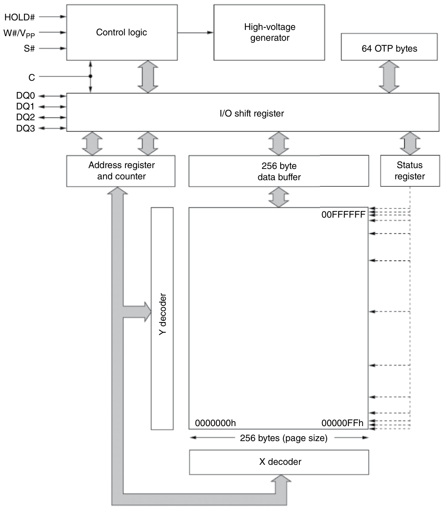

Hình 12.1 Block diagram của bộ nhớ Micron serial NOR flash 16 MB.

## 12.2 Tổng quan về giao diện SPI

Mục này giải thích giao diện SPI. Ở đây, chúng ta sẽ giải thích giao diện SPI, cụ thể là cách chúng ta sẽ dùng nó trong project để giao tiếp với một chip bộ nhớ ngoài. Trước hết, SPI là gì? Nó là viết tắt của serial peripheral interface, và SPI là một protocol truyền thông nối tiếp được các mạch tích hợp (IC) khác nhau trên một bảng mạch dùng để giao tiếp với nhau. Khi nghĩ về UART, đó là một protocol khác mà các IC có thể dùng để giao tiếp. Tuy nhiên, SPI là một protocol truyền thông khác. Ví dụ, nếu bạn có hai microcontroller trên một bảng mạch, chúng có thể dùng giao diện SPI để giao tiếp với nhau. Hoặc trong trường hợp của chúng ta với FPGA, bạn có thể có hai FPGA khác nhau trên cùng một board giao tiếp qua SPI. Thông thường, SPI không được dùng cho truyền thông long-distance. Phần lớn thời gian, SPI được dùng khi hai thiết bị nằm trên cùng một board PCB vật lý. Nếu bạn cần giao tiếp qua khoảng cách xa, bạn phải chuyển nó sang một định dạng khác, chẳng hạn RS-45 *(ghi chú: sách in "RS-45"; có lẽ đúng là "RS-485")*, hay một định dạng ethernet-style. Vậy, cách chúng ta sẽ dùng nó là để thiết bị hay FPGA và processor của chúng ta giao tiếp với một chip bộ nhớ thực tế. Một lợi thế của SPI là nó cho phép truyền dữ liệu rất nhanh. Nhược điểm là nó dùng nhiều chân hơn, nhưng bạn có thể truyền dữ liệu rất nhanh với giao diện SPI. Có bốn signal phổ biến được dùng trong giao tiếp SPI: MOSI (signal master out, slave in), MISO (signal master in, slave out), SCK (signal serial synchronous clock), và CS (control select). Signal CS được dùng khi bạn có nhiều thiết bị trên SPI bus. Vậy, khi bạn có một SPI bus, bạn có thể có một thiết bị – microcontroller của bạn, hay bất cứ thứ gì bạn muốn gọi là master – và nó sẽ có một số thiết bị slave khác gắn vào cùng bus đó. Chúng sẽ có đường CS riêng, nhưng dùng chung các đường MOSI, MISO và SCK. Vậy, master chọn thiết bị nó muốn nói chuyện và kéo đường CS đó xuống low. Tất cả các đường CS khác sẽ ở mức high. Thiết bị đó biết, khi CS xuống low, rằng master đang nói chuyện với nó, vậy nó bắt đầu lắng nghe trên bus. MOSI là signal mà master gửi dữ liệu ra, và nó đồng bộ với clock. Khi dữ liệu đã được nhận đầy đủ và command đã được gửi tới slave, slave đó trả về dữ liệu, hay phản hồi dựa trên message đó là gì. Vậy, ví dụ, trong trường hợp bộ nhớ, nếu chúng ta muốn đọc ở một địa chỉ cụ thể, chúng ta sẽ gửi dữ liệu đó xuống trên đường MOSI. Sau đó, chúng ta sẽ tiếp tục gửi synchronous clock còn thiết bị nhớ thực tế sẽ gửi dữ liệu nhớ trên đường MISO. Nó sẽ gửi dữ liệu lại cho chúng ta, và chúng ta sẽ có thể đọc và diễn giải dữ liệu đó có ý nghĩa gì. Bạn có thể chạy SPI rất nhanh tùy thuộc vào thiết bị. Miễn là cả slave và master đều có thể hoạt động ở một tần số cho trước, bạn có thể chạy SPI ở tốc độ đó. Với SPI, có một số phiên bản khác nhau: standard SPI, chỉ truyền một bit dữ liệu mỗi chu kỳ clock, và đó là nơi bạn gửi một synchronous clock, trong đó bạn gửi một bit dữ liệu xuống cùng thiết bị đó. Họ có dual SPI, trong đó ở mỗi chu kỳ clock, bạn gửi hai bit dữ liệu tới cùng thiết bị, và khi nó phản hồi, nó sẽ gửi lại hai bit dữ liệu. Sau đó, họ có quad SPI (QSPI), nơi bạn gửi bốn bit dữ liệu mỗi chu kỳ clock. Vậy, quad SPI hiển nhiên là nhanh nhất vì bạn gửi nhiều dữ liệu hơn với ít chu kỳ clock hơn. Nếu nghĩ về điều đó, bạn có tám bit dữ liệu hay một byte cần truyền tới thiết bị slave. Nếu bạn dùng standard SPI, sẽ mất 8 chu kỳ clock để đưa cả 8 bit dữ liệu xuống thiết bị slave. Nếu bạn dùng dual SPI, sẽ chỉ mất bốn chu kỳ clock để đưa 8 bit đó tới cùng thiết bị, trong khi nếu bạn dùng quad SPI, bạn sẽ chỉ dùng hai chu kỳ clock để đưa trọn byte dữ liệu đó xuống cùng thiết bị. Vậy, nó nhanh hơn nhiều, và chỉ tốn thêm đường IO. Thông thường, khi làm việc với FPGA, bạn sẽ có các thiết bị mà QSPI rất phổ biến vì bạn có một file bit cấu hình lớn, để khi bạn bật nguồn, FPGA sẽ tìm tới thiết bị SPI then chốt đó và nạp file cấu hình vào, và bạn muốn điều đó diễn ra khá nhanh. Bạn không muốn bật thiết bị lên rồi phải chờ vài giây để kiểu lập trình JTAG diễn ra. Nếu bạn dùng QSPI, nó sẽ diễn ra rất nhanh trong vài mili giây hoặc micro giây trong bất kỳ tình huống nào. Khi làm việc với SPI bus, bạn có thể nối nhiều thiết bị vào một SPI bus. Vậy, bạn sẽ có một master, và bạn có thể có nhiều slave. Mỗi thiết bị slave bạn thêm vào cần một chân CS mới để chọn thiết bị riêng lẻ đó. Nếu nhìn ở mức tổng quát, trong giao diện SPI, chúng ta có một master chọn thiết bị slave mà nó muốn nói chuyện, rồi master điều khiển serial clock (SCK) và đường MOSI và truyền dữ liệu xuống thiết bị slave được chọn, thiết bị mà nó đã chọn qua đường control select, rồi slave phản hồi bằng cách truyền dữ liệu lại trên đường MISO đó, vậy master gửi và nó khởi xướng cuộc hội thoại. Slave chỉ phản hồi khi master gửi thông tin tới nó và yêu cầu thứ gì đó trả về. Vậy, ngay cả khi bạn có mọi thứ, tùy thuộc vào protocol đã được thiết lập hay thiết bị thực tế, bạn phải xem datasheet; ví dụ, chúng ta sẽ lại nhắc đến chip bộ nhớ. Nếu muốn đọc lại một vị trí nhớ, chúng ta sẽ gửi xuống command, và chúng ta sẽ gửi xuống địa chỉ, rồi chip sẽ phản hồi lại với nội dung thực tế ở địa chỉ đó. Nếu chúng ta dùng command write, chúng ta sẽ nói với chip rằng, OK, chúng ta muốn thực hiện write. Chúng ta chỉ định địa chỉ và dữ liệu đang ghi, và nhiều khi, tùy chip, bạn phải xem datasheet. Nhưng họ sẽ cho bạn biết rằng khi bạn gửi command write xuống, nó sẽ hoặc không làm gì, hoặc phản hồi bằng một acknowledgment hay đưa cho bạn một phản hồi nào đó để nói rằng command write đã hoàn tất hay đã được diễn giải thành công là command write. Trong project SPI interface này, FPGA sẽ là master, và chip bộ nhớ ngoài sẽ là slave. Vậy, chúng ta sẽ khởi xướng giao tiếp với chip bộ nhớ ngoài, nơi chúng ta sẽ yêu cầu chip đọc lại dữ liệu ở một vị trí địa chỉ cụ thể, và chúng ta sẽ ghi dữ liệu xuống chip thực tế, tới chỗ chúng ta muốn ghi bất kỳ dữ liệu thực tế nào muốn ghi trên chip đó. Vậy, hãy xem giao diện SPI thực sự hoạt động thế nào, và trước hết, chúng ta sẽ nói về các đường vật lý thực tế trông như thế nào. Vậy, nếu chúng ta có thiết bị master, chúng ta sẽ gọi nó là master, và đây có thể là bất cứ thứ gì. Đây có thể là một microcontroller, một FPGA, hay bất kỳ loại chip nào. Vậy, chúng ta sẽ có một đường CS. Ngoài ra, chúng ta sẽ có một đường SCK, và chúng ta có đường MOSI, hay đường dữ liệu master out, slave in, và đường MISO. Chúng ta chỉ giả định một giao diện SPI tiêu chuẩn, nơi chúng ta gửi xuống một bit dữ liệu cho mỗi chu kỳ clock. Vậy, nếu chúng ta có một thiết bị slave, chúng ta cũng có một CS. Ngoài ra, chúng ta có một đường serial clock (SCK), một đường MOSI và một đường MISO. Vậy, CS được master điều khiển – đó là output của master và input của slave. Serial clock (SCK) cũng vậy – đó là output của master và input của slave, và nó cũng được master điều khiển. Các đường MOSI là master output, slave input, vậy đó là dữ liệu mà thiết bị master truyền tới thiết bị slave, cũng được master điều khiển. Sau đó, các đường MISO đến từ các slave, vậy đó là master input, slave output, đi ngược về master. Vậy, khi slave phản hồi, nó gửi thông tin lại trên đường MISO. Vậy, đó là kết nối bạn có giữa master và các thiết bị slave, như được mô tả trong Hình 12.2.

Tiếp theo, chúng ta sẽ nói về các waveform thực tế trông như thế nào. Vậy, master – theo cách nó sẽ hoạt động – có đường control select (CS) đó, và khi idle, nó sẽ ở mức high. Sau đó nó sẽ xuống low. Khi nó xuống low là lúc slave bắt đầu theo dõi đường serial clock và đường MOSI để xác định dữ liệu đang đi vào. Vậy, sau đó chúng ta sẽ có SCK clock, hay synchronous clock, đang ở mức high. Rồi, đột nhiên, khi đường control select xuống low, chúng ta sẽ thấy khi nào nó xảy ra tại điểm đó. SCK clock sau đó sẽ xuống low, và nó sẽ toggle ở bất kỳ tần số clock nào bạn đang gửi. Điều này xác định tốc độ dữ liệu được gửi. Trong trường hợp này, chúng ta sẽ gửi ra một bit dữ liệu mỗi chu kỳ clock. Tùy thuộc vào thiết bị, và thường là ở cạnh lên của clock, dù bạn phải xem datasheet của thiết bị cụ thể này, bạn sẽ biết khi nào dữ liệu được đọc. Khi việc truyền dữ liệu dừng, đường serial clock (SCK) sẽ lên high. Giờ chúng ta có đường MOSI, xác định dữ liệu được gửi từ master tới thiết bị slave. Đây có thể là bất kỳ loại command nào tùy thuộc vào việc thiết bị slave đang làm gì. Bằng cách xem datasheet, nó cho bạn biết loại command cần gửi. Vậy, nó sẽ ở mức high khi idle, rồi nó sẽ xuống low hoặc lên high dựa trên việc đó là một hay không. Vì chúng ta ở mức low trong tình huống ngay đây, cạnh lên đầu tiên là lúc chúng ta sẽ xem dữ liệu. Trong một chu kỳ, và giữa các cạnh lên của SCK, không có gì xảy ra. Nhưng tại cạnh lên của SCK clock, thiết bị slave thấy trạng thái của đường MOSI này và xác định đó là một hay không. Tại cạnh lên của SCK clock này, đường MOSI ở mức low. Điều đó cho chúng ta biết có một số không. Vậy ngay đây là một số không. Tại cạnh lên tiếp theo, nó kiểm tra đường MOSI lần nữa – vẫn ở mức low, vậy chúng ta có thêm một số không. Sau đó đường MOSI lên high trong hai chu kỳ clock tiếp theo. Điều đó cho chúng ta hai số một. Cuối cùng, chúng ta sẽ giữ ở mức high, điều đó cũng tạo ra một số một. Chúng ta có thể tiếp tục, nhưng chúng ta chỉ đang cho thấy rằng, trong trường hợp này, bạn sẽ có 00111 được truyền trên đường MOSI. Đó là vì ở mỗi cạnh lên, hoặc ở cạnh xuống, nó sẽ đọc dữ liệu dựa trên đặc tả của slave. Trong trường hợp này, chúng ta giả định là cạnh lên, vậy ở mỗi cạnh lên của đường SCK này, chúng ta sẽ đọc đường MOSI này. Nếu ở mức low thì tính là không, và nếu ở mức high thì tính là một. Vậy, sau đó đường MOSI này sẽ chỉ giữ ở mức high hay idle tại điểm cuối cùng này khi toàn bộ dữ liệu đã được truyền, và điều đó, một lần nữa, thực sự quy về những gì data shit *(ghi chú: sách in "data shit"; đúng là "datasheet")* của slave đó cho biết, bạn có thể gửi 8 bit, 16 bit, 4 bit hoặc 32 bit tùy thuộc vào protocol bạn đã hiện thực, và rồi chúng ta có đường MISO, và đây là đường mà slave phản hồi lại master. Vậy, trong suốt thời gian điều này diễn ra, và đường MOSI đang truyền, đường MISO sẽ chỉ idle và giữ ở mức high và nó sẽ giữ ở mức high cho đến khi SCK clock bắt đầu chạy lại. Vậy, sau khi truyền mọi thứ trên đường MOSI, chúng ta dừng clock rồi chúng ta sẽ khởi động lại serial clock, khi đó dữ liệu vẫn sẽ được truyền ở cạnh lên của clock, chỉ có điều thay vì trên đường MOSI, lần này nó ở trên đường MISO, và trong suốt thời gian điều này diễn ra, đường MOSI sẽ chỉ idle hay giữ ở mức high vì chúng ta sẽ không truyền vào lúc này, và chúng ta đang chờ phản hồi. Đường này sẽ giữ ở mức high suốt toàn bộ khoảng thời gian này và rồi đường MISO sẽ đến đây và ở cạnh lên đầu tiên, chúng ta ở mức high, vậy chúng ta biết đó là một số một, rồi chúng ta sẽ xuống low, và giữ low để vẫn là số không, và chúng ta sẽ có hai số không, rồi giả sử chúng ta lên high lần nữa và rồi nó ở mức high như khi idle và đó trở thành một số một. Vậy, trong trường hợp này, MISO của chúng ta sẽ phản hồi với 1001, và điều này thực sự sẽ quy về những gì datasheet cho bạn biết. Nhưng theo cách thiết bị slave đó sẽ phản hồi, master của chúng ta, ở cạnh lên của clock, sẽ nhìn vào đường MISO này và xác định nếu đường MISO ở mức high, đó là một, và nếu đường MISO ở mức low, đó là không, và như vậy control select sẽ giữ ở mức low cho đến khoảng chỗ đó khi master nhận được phản hồi từ slave và không còn muốn nói chuyện với nó hoặc muốn nói chuyện với một slave khác, khi đó đường control select đó sẽ lên high. Vậy, tại thời điểm này, nếu master gửi một message khác ra trên đường MOSI này và control select đang ở mức high, slave sẽ bỏ qua toàn bộ command đó như được minh họa trong Hình 12.3.

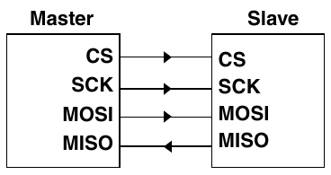

Hình 12.2 Giao diện SPI.

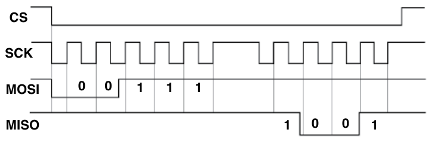

Hình 12.3 Waveform các signal của giao diện SPI.

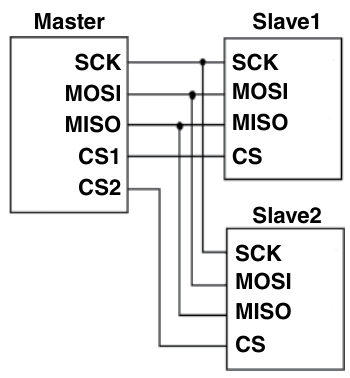

Hình 12.4 Giao diện SPI giữa một master và hai slave.

Vậy, điều tiếp theo là, nếu chúng ta muốn có một master và hai slave, nó sẽ trông như thế nào? Nếu chúng ta có một master duy nhất, chúng ta sẽ dùng một synchronous clock (SCK), một đường MOSI và một đường MISO. Sau đó, tùy thuộc vào số thiết bị slave chúng ta muốn nối vào bus, điều đó sẽ xác định số signal CS chúng ta cần. Vì chúng ta có hai slave, chúng ta sẽ có CS1 và CS2. Với Slave1, chúng ta sẽ biểu diễn nó là một thiết bị, và nó sẽ được nối với SCK, MOSI, MISO, và nó sẽ chỉ có một CS.

Sau đó chúng ta có slave thứ hai, Slave2, và đây có thể là nhiều loại thiết bị khác nhau, vậy bạn có thể có một chip bộ nhớ, một chip chuyển đổi analog sang digital, hay bất kỳ loại mạch tích hợp nào trên board PCB. Chúng ta sẽ có các đường SCK, MOSI và MISO, và mỗi slave cũng sẽ có một CS. Cách chúng được nối là: CS2 từ master đi tới Slave2, và CS1 từ master đi tới CS của Slave1, như được thể hiện trong Hình 12.4. Các đường SCK clock, MOSI và MISO được dùng chung giữa master, Slave1 và Slave2 – Slave 1, Slave 2, và bất kỳ slave bổ sung nào. Các đường CS xác định slave nào đang active. Nếu chúng ta có slave thứ ba, chúng ta sẽ thêm một đường CS thứ ba. Đó là cách bạn nối nhiều thiết bị với nhau bằng giao diện SPI.

## 12.3 Chiến lược thiết kế giao diện SPI

Mục này nói về chiến lược thiết kế giao diện SPI. Trong mục này, chúng ta sẽ bàn về chiến lược chúng ta sẽ dùng để hiện thực project SPI interface. Thiết kế giao diện SPI sẽ được dùng để giao tiếp với bộ nhớ ngoài. Chúng ta muốn dùng processor Micro Blaze MCS. Tuy nhiên, nó không có cổng SPI chuyên dụng. Thông thường, nếu bạn làm việc với một số microcontroller hay microprocessor nhất định, nhiều khi chúng có phần cứng chuyên dụng để hiện thực giao diện SPI. Nhưng trong trường hợp của chúng ta, chúng ta sẽ hiện thực giao diện SPI bằng VHDL. Vậy, với Micro Blaze, chúng ta muốn có một general-purpose input cũng như một output để giao tiếp với SPI controller chuyên dụng, thứ chúng ta sẽ hiện thực trong logic FPGA thực tế. Chúng ta sẽ có một giao diện SPI viết bằng VHDL, cũng như Micro Blaze, và chúng ta sẽ ghép nối hai thứ đó với nhau để chúng có thể giao tiếp với chip bộ nhớ thực tế nằm trên chính board. Sau đó, chúng ta sẽ dùng giao diện UART để hiển thị dữ liệu đọc từ chip bộ nhớ và hiển thị nó trên máy tính. Ngoài ra, chúng ta sẽ gửi các lần truyền từ máy tính tới MicroBlaze MCS để xác định ghi gì vào chip bộ nhớ thực tế. Luôn tốt khi có một chiến lược từ trước khi bắt tay vào thiết kế – để biết, ở mức tổng quát, bạn muốn làm gì. Ở mức tổng quát, chúng ta sẽ có processor MicroBlaze MCS, thứ chúng ta đã dùng cho nhiều project khác nhau trong cuốn sách này. Đó là softcore processor của chúng ta, và nó sẽ được hiện thực trong block design. Chúng ta cũng sẽ tạo module VHDL – chúng ta sẽ gọi nó là thiết kế VHDL SPI, và chúng ta sẽ phải tạo nó thành một khối IP để sau đó thả vào block design. Từ đó, chúng ta muốn có một giao diện từ MicroBlaze tới thiết kế VHDL SPI, và chúng ta sẽ làm điều này bằng hai GPIO khác nhau. Vậy, chúng ta sẽ tạo hai GPIO ở đây cho phép chúng ta giao tiếp qua lại. Chúng sẽ được hiện thực chỉ bằng các general-purpose input và output, vì khi đã phát triển thiết kế VHDL SPI này, chúng ta sẽ biết cụ thể cần bao nhiêu input và output, và cần độ rộng bit nào để MicroBlaze MCS giao tiếp với thiết kế SPI. Còn thiết kế SPI, chúng ta sẽ hiện thực nó sau. Điều quan trọng nhất là hiện thực giao diện thiết kế VHDL SPI này, để chúng ta có thể nói chuyện với bộ nhớ. Chúng ta sẽ chỉ vẽ một khối ở đây và gọi nó là memory. Nó nằm ngoài chip, trên board. Giao diện SPI này sẽ hoặc ghi dữ liệu vào bộ nhớ hoặc đọc thông tin từ bộ nhớ và đưa nó trở lại softcore processor MicroBlaze MCS. Chúng ta cũng sẽ giao tiếp với một máy tính, vậy chúng ta sẽ có máy tính dùng một cổng COM, nơi chúng ta sẽ dùng Tera Term hay bất kỳ loại terminal emulator nào khác. Đó chỉ là một giao diện UART giữa máy tính và MicroBlaze MCS. Chúng ta biết MicroBlaze MCS hỗ trợ UART. Vậy, chúng ta sẽ phải truyền dữ liệu tới máy tính và nhận dữ liệu. Các command đó sẽ được gửi xuống processor MicroBlaze để xác định giá trị nào cần ghi vào bộ nhớ. Sau đó chúng ta sẽ dùng các general-purpose input và output để giao tiếp với thiết kế VHDL SPI, và thiết kế đó, đến lượt nó, sẽ giao tiếp với bộ nhớ. Vậy, nó giống như cả một chuỗi khối, như được mô tả trong Hình 12.5.

Chúng ta có máy tính, thứ chúng ta sẽ dùng để gửi thông tin tới processor. Processor sau đó sẽ gửi thông tin đó tới thiết kế SPI, thiết kế này sẽ chuyển tiếp nó tới bộ nhớ, và tất nhiên, chúng ta sẽ có các tín hiệu chung khác, chẳng hạn reset và clock sẽ đi vào đó, và đây giống như một global reset mà có lẽ chúng ta sẽ chỉ nối với một slide switch. Chúng ta cũng sẽ có clock, và thiết kế SPI ở đây sẽ có một clock, và chúng ta sẽ cố lấy cùng clock đó từ đó, rồi nó sẽ đi vào thiết kế SPI. Tiếp theo là UART, và chúng ta cũng có thể thêm một slide switch khác ở đây dùng một GPIO để chỉ ra chúng ta muốn đọc từ hay ghi vào bộ nhớ. Vậy, chúng ta có thể làm điều này theo nhiều cách khác nhau, nhưng thứ chúng ta sẽ có ở đây là một general-purpose input sẽ xác định, bằng cách đọc slide switch, chúng ta sẽ đọc dữ liệu từ bộ nhớ hay ghi dữ liệu vào bộ nhớ. Nếu chúng ta sẽ đọc hoặc ghi dữ liệu vào bộ nhớ, chúng ta khi đó cần hỏi người dùng qua cổng UART xem họ muốn đọc hay ghi. Vậy, đó là chiến lược thiết kế tổng thể cho project SPI này. Về cơ bản chúng ta sẽ dùng VHDL để thiết kế SPI này và MicroBlaze; chúng ta đã biết mình có thể thả IP core vào và chúng ta sẽ phải viết phần mềm để giao tiếp với GPIO cũng như UART. Vậy, đó là chiến lược thiết kế SPI ở mức tổng quát.

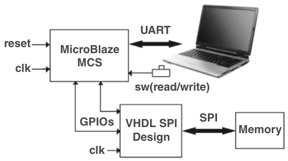

Hình 12.5 Toàn bộ block diagram. Nguồn: Fatman73/Adobe Stock.

## 12.4 Tổ chức bộ nhớ của chip SPI flash ngoài

Mục này nói về tổ chức bộ nhớ của chip SPI flash ngoài. Trong mục này, chúng ta sẽ giải thích và giúp bạn hiểu chip SPI của Micron nằm trên development board Arty A7 được tổ chức như thế nào. Vậy, chúng ta có datasheet của Micron cho chip flash trên development board Arty A7, và họ có một block diagram nằm trong phần cấu trúc tổ chức bộ nhớ, như được thể hiện trong Hình 12.1. Vậy ở đó, bạn có một khối mà họ gọi là control logic, và đây là nơi bạn có giao diện bên ngoài, được thể hiện bằng hold#, write#, S#, C, và DQ0 đến DQ3. Đây là giao diện SPI. Vậy, chúng ta biết chip bộ nhớ hỗ trợ extended, dual và quad SPI, và chúng ta làm việc với extended SPI, chỉ dùng clock, CS, đường MOSI và đường MISO. Chúng được dùng để giao tiếp với control logic và cụ thể là giao tiếp với I/O shift register. I/O shift register là thứ chúng ta dùng để đi vào đây, nơi chúng ta có khối thực tế, khối chính này ở đây, nơi họ có 256 byte (page size) từ 0000000h cho đến tận 00FFFFFF. Đó chính là bộ nhớ thực tế, và đó là thứ chúng ta đang cố truy cập.

Vậy, chúng ta chỉ dịch command và thông tin vào I/O shift register này, thứ chúng ta gửi xuống address register and counter này, cũng như một data buffer 256-byte, và chúng ta gửi dữ liệu xuống theo nhiều đợt. Vậy, đây là một điều tốt – khi bạn xem datasheet của Micron, đây là thứ cần xem lại để hiểu bạn cần làm gì khi làm việc với chip SPI flash này, cả về cách nó hoạt động ở mức tổng quát lẫn các command khác nhau bạn cần gửi xuống nếu muốn giao tiếp với nó và lấy loại thông tin này. Vậy, điều chúng ta sẽ làm là cho thấy điều này có ý nghĩa gì với chúng ta. Chúng ta sẽ chỉ gọi nó là external flash memory, và chúng tôi sẽ đưa ra một giải thích high-level về những gì chúng ta cần biết hay những gì quan trọng đối với chúng ta. Nếu chúng ta có chip bộ nhớ flash ngoài, hãy chỉ xem nó dưới góc nhìn block diagram, điều hữu ích khi bạn làm việc với bộ nhớ hay các component tương tự. Hiểu nó bằng cách nhìn từ góc nhìn block memory là tốt. Vậy, chúng ta sẽ nói rằng từ trên đây chúng ta có địa chỉ bắt đầu ở 0x000000h (0 MB), và đây là địa chỉ không, cho đến tận 0xFFFFFFh, tương ứng với 16 MB. Điều quan trọng là nếu bạn tra cứu, có một app note (XAPP951 v1.3) chỉ rõ rằng khi bạn nạp một file cấu hình – hay trong trường hợp này, lấy một project chúng ta đã tạo trong Vivado và nạp nó vào bộ nhớ flash ngoài này – nó sẽ bắt đầu từ địa chỉ không đến chỗ nào nó thấy điểm kết thúc. Vậy, điều đó có nghĩa là, nếu chúng ta muốn lưu thông tin bổ sung hay dùng flash ngoài này cho bất cứ việc gì khác, chúng ta cần chừa ra không gian từ không đến hết kích thước file .mcs, tức file cấu hình. Với Arty A7, họ nói nó vào khoảng 2 MB. Đó là một con số xấp xỉ dựa trên thiết kế của bạn và lượng bộ nhớ nó tiêu tốn. Trong trường hợp này, chúng ta sẽ chỉ vẽ một đường ở 0x1FFFFF (≈ 2 MB), và nó đánh dấu khoảng mốc 2 MB. Đây là nơi chúng ta lưu file .mcs. Chúng ta có file này từ các file .bit đã tạo. Vậy, dùng một công cụ (Vivado), chúng ta chuyển file .bit đó thành file .mcs, rồi nạp nó lên flash ngoài – ngay đây là flash ngoài của chúng ta. Nếu chúng ta sẽ ghi vào flash này hay trong tương lai lưu bất kỳ dữ liệu hay thông tin bổ sung nào lên chip flash này, chúng ta muốn tránh vùng địa chỉ từ không cho đến địa chỉ 0x1FFFFFh (xấp xỉ 2 MB). Bạn nên để yên vùng đó cho cấu hình vì app note cho chúng ta biết rằng khi Arty A7 hay FPGA Arix *(ghi chú: sách in "Arix"; đúng là "Artix")* khởi động và được cấu hình để đọc từ QSPI flash, nó bắt đầu ở địa chỉ không và đọc qua flash cho đến khi thấy chỉ báo end of file, cho biết file .mcs đã kết thúc. Nếu chúng ta nạp file cấu hình này ở phía dưới cùng đây, thì nó sẽ không được nạp vào FPGA. Hoặc nếu chúng ta ghi đè bất kỳ thông tin nào trong số này – nếu giao diện SPI của chúng ta lưu thông tin lên chip flash này và ghi đè một phần cấu hình, xóa rồi ghi đè lên nó – sẽ có vấn đề khi nó cố ghép lại dữ liệu bị hỏng, và thiết kế của bạn sẽ không nạp được vì các phép kiểm tra không khớp, và sẽ có rất nhiều vấn đề. Vậy, điều quan trọng ở đây là bạn cần biết file cấu hình sẽ được lưu ở đâu. Chúng ta ước tính nó là 2 MB ở đây. Vậy, chúng ta vẫn còn khoảng 14 MB để lưu những gì mình muốn. Vậy, có lẽ chúng ta sẽ vẽ một đường đâu đó ở 0x7FFFFFF, vào khoảng mốc 8 MB, và nói, “OK, vùng ngay đây an toàn để dùng làm user flash,” và đó là nơi bạn có thể lưu thông tin bổ sung. Điều này cho bạn một vùng đệm an toàn. Bạn có thể dời nó lên gần hơn một chút vì nhiều khả năng bạn sẽ không dùng hết. Nhưng để an toàn, hãy chừa cho mình 8 MB và dùng không gian này để lưu vào flash nếu cần. Thực sự quan trọng cần lưu ý rằng file cấu hình nên bắt đầu ở địa chỉ không và cứ ghi tiếp cho đến khi đầy. Vậy, bạn sẽ muốn file cấu hình bắt đầu ở địa chỉ không. Điều này quan trọng khi nạp nó lên flash, vì nó bảo đảm FPGA sẽ tự động nạp cấu hình hay chương trình chúng ta đã tạo – mà không cần được nối với máy tính mỗi lần board được cấp nguồn. Điều này càng trở nên quan trọng nếu bạn làm việc với một board chứa FPGA cùng với một microprocessor, microcontroller hay control logic khác. Trong trường hợp đó, microprocessor, microcontroller, hay thậm chí chính FPGA có thể nhận một file cấu hình mới, một file .mcs mới, và ghi nó vào vị trí này. Khi khởi động lại, nó sẽ dùng file mới đó. Vậy, bạn thậm chí có thể có một kiểu hệ thống nhiều file cấu hình, nơi file cấu hình chính bắt đầu ở vị trí địa chỉ không. Nếu bạn có file cấu hình thứ hai, bạn có thể lưu nó bắt đầu từ mốc 8 MB hay địa chỉ 0x7FFFFFh. Trong thiết lập này, bạn sẽ lưu file cũ ở 0x7FFFFFh và file mới ở 0x000000h. Khi khởi động, file cấu hình mà chúng ta chọn sẽ được nạp, như được minh họa trong Hình 12.6.

Rất quan trọng là hiểu toàn bộ tổ chức bộ nhớ của chip flash, vì khi làm việc với nó, bạn muốn cẩn thận để không xóa những thứ cụ thể ở đây (vùng file cấu hình (.mcs) bắt đầu ở địa chỉ 0x000000h). Điều này rất safety-critical, và bạn không muốn xóa bất cứ thứ gì ở đó hay gây ra bất kỳ loại vấn đề nào, nếu không, đột nhiên bạn sẽ gặp những vấn đề khiến board không khởi động được. Khi bạn làm việc với tất cả các board, cái hay là bạn có nó ngay đó trên bàn. Vậy, nếu có vấn đề, bạn có thể chỉ cần flash lại. Nhưng nếu bạn thiết kế một board mà bạn muốn đưa ra ngoài thực địa, hay ở đâu đó mà bạn sẽ không có mặt, hoặc nơi không có ai ở đó nếu có gì trục trặc, bạn muốn bảo đảm có các biện pháp bảo vệ và kiểm tra an toàn, để file cấu hình ngay đây không bị ghi đè hay hỏng theo bất kỳ cách nào. Vậy, đó chỉ là tổng quan nhanh về tổ chức bộ nhớ của chip SPI flash ngoài và cách bạn có thể làm việc với cấu trúc đó.

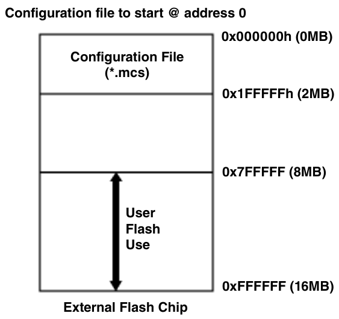

Hình 12.6 Tổ chức bộ nhớ flash ngoài.

## 12.5 Cấu hình SPI và tạo file

Mục này nói về cấu hình SPI và tạo file. Ở đây, chúng tôi sẽ chỉ cho bạn cách đi qua và lấy một project để tạo file mà sau đó chúng ta có thể nạp lên bộ nhớ SPI flash nằm trên development board Arty A7. Trước đây chúng ta đã hoàn thành project UART IO, và chúng ta sẽ tạo một file .mcs có thể nạp lên flash ngoài. Vậy, để làm điều đó, chúng ta muốn đi qua tất cả các bước cần thiết: chạy synthesis, chạy implementation và tạo bitstream. Chúng ta chạy lại Generate Bitstream. Chúng ta sẽ tạo lại bitstream vì khi nó hoàn tất, một cửa sổ pop-up sẽ xuất hiện hỏi bạn có muốn tạo memory configuration file hay file .mcs không. Từ đó, chúng ta sẽ click Yes, vì chúng ta sẽ lấy file đó và nạp nó lên QSPI flash, như được thể hiện trong Hình 12.7.

Vậy ngay bây giờ, chúng ta có cửa sổ Tera Term, được nối với cổng COM gắn với development board Arty A7. Nếu nhấn nút reset, chúng ta sẽ thấy LED xanh lá tắt và FPGA reset. Vậy, chúng ta sẽ thử khởi động lại. Nhưng có hai điều ngăn nó hoạt động: thứ nhất, jumper JP1 hiện đang đặt ở JTAG, và chúng ta cần đổi nó sang QSPI. Thứ hai, chúng ta chưa nạp file vào thiết bị SPI đó, nên không có gì để khởi động. Bitstream generation đã hoàn tất, và giờ chúng ta muốn mở Hardware Manager, nhưng chúng ta muốn chọn tùy chọn cuối cùng: Generate Memory Configuration File. Vậy, chúng ta chọn nó và click OK, thao tác này sẽ mở một cửa sổ tên Write Memory Configuration File. Từ đây, chúng ta chọn định dạng file – chúng ta có thể chọn bin hoặc hex, nhưng chúng ta sẽ chọn định dạng file .mcs. Bạn có thể chọn một memory part cụ thể hoặc chọn custom memory size. Vì chúng ta biết memory part dùng trên board, chúng ta sẽ chọn một memory part. Để làm điều này, chúng ta click vào Part Chooser, rồi chúng ta sẽ chọn All, rồi Reset All Filters. Sau khi reset các bộ lọc, chúng ta đặt manufacture là Micron, density là 128 Mb, và type là SPI. Điều này thu hẹp còn hai tùy chọn. Sau đó chúng ta chọn part 3.s V *(ghi chú: sách in "3.s V"; đúng là "3.3 V")*, và click OK, như được mô tả trong Hình 12.8.

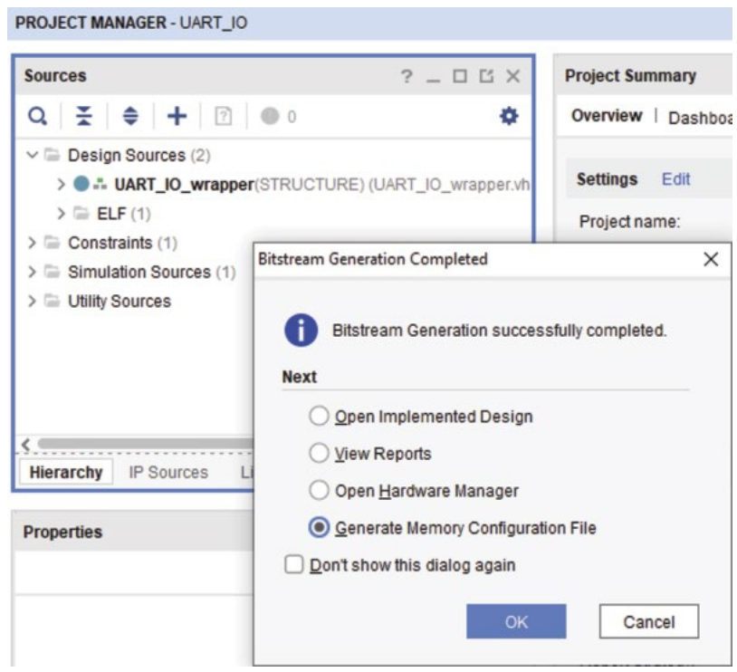

Hình 12.7 Chọn Generate Memory Configuration File.

Vậy, nó nhận diện memory part, và chúng ta sẽ chọn nó vì đó là part chúng ta muốn dùng. Sau đó, chúng ta cần chỉ định filename, là nơi chúng ta muốn lưu file .mcs thực tế. Vậy, chúng ta sẽ lưu nó trong thư mục project nơi đặt project UART IO. Chúng ta có các thư mục runs và implementation, và đây cũng là vị trí lưu file bit và tất cả các file cấu hình khác. Chúng ta muốn chúng được lưu ở cùng vị trí. Vậy, chúng ta sẽ lưu nó trong cùng thư mục project đó và đặt tên là UART_IO.mcs, như được minh họa trong Hình 12.9.

Vậy, nó sẽ tạo file ở vị trí đã chỉ định, và với interface, chúng ta muốn chọn SPIx1. Hiện tại, chúng ta đặt thiết bị là SPI với giao diện single, nghĩa là chúng ta chỉ dùng các đường MOSI và MISO – hai đường dữ liệu. Vậy, chúng ta muốn chọn SPIx1. Bây giờ, chúng ta cần nạp file bitstream. Từ đây, chúng ta click vào nút three-dot và điều hướng trong project UART_IO tới runs > implementation, rồi chọn UART_IO_wrapper.bit và click OK. Thao tác này sẽ lấy file bit đó và dùng nó để tạo file .mcs. Với start address, chúng ta chỉ muốn nó bắt đầu ở địa chỉ không và direction là up. Điều này quan trọng vì nếu xem user guide của Xilinx, cấu hình bộ nhớ phải bắt đầu ở địa chỉ 0 và đếm lên. Với các tùy chọn còn lại, chúng ta sẽ để không được đánh dấu: Write checksum, Disable bit swapping và Overwrite. Vậy, chúng ta sẽ click OK, như được thể hiện trong Hình 12.10.

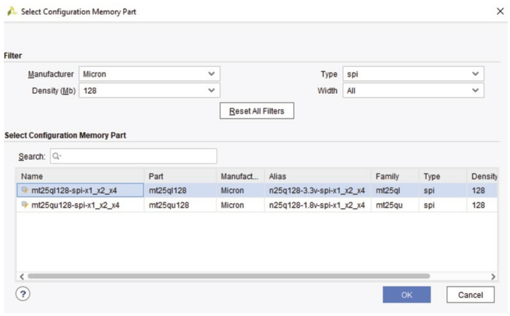

Hình 12.8 Chọn configuration memory part.

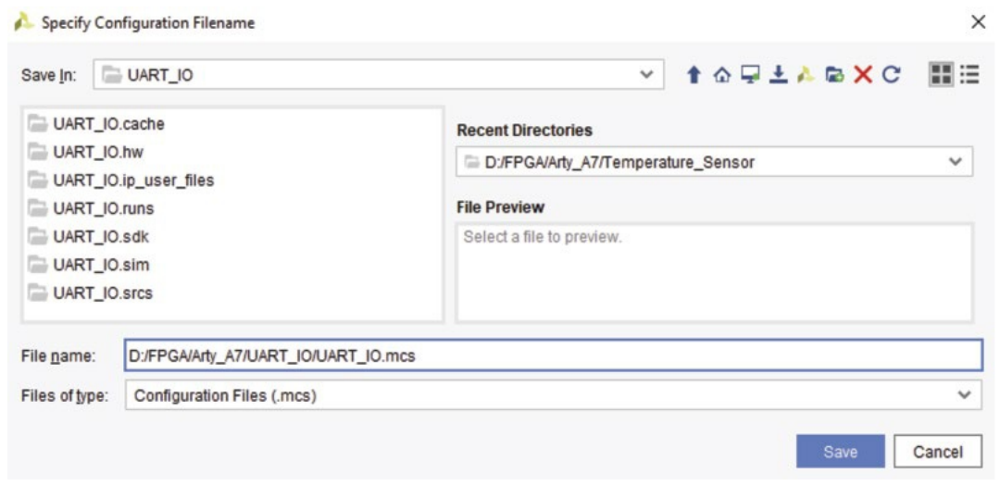

Hình 12.9 Chỉ định configuration filename.

Vậy ngay đó, nó cho bạn một chút thông tin cho biết file .mcs đã được tạo, và cho bạn starting address, ending address, và các chỉ báo khác như Addr1 và Addr2. Các trường này giúp bạn hiểu kích thước khối bộ nhớ đang được dùng và file cấu hình sẽ chiếm bao nhiêu bộ nhớ QSPI flash ngoài, như được mô tả trong Hình 12.11.

Vậy, từ đó, giờ chúng ta có thể nạp nó lên part QSPI flash. Chúng ta sẽ chọn external memory part, right-click, và chọn Program Configuration Memory Device. Đó là memory device của chúng ta. Với configuration file, chúng ta sẽ vào thư mục project, và chúng ta sẽ thấy file .mcs ở đó. Chúng ta sẽ click OK. Với address range, chúng ta sẽ chọn Configuration File Only. Chúng ta không cần file PRM, vậy chúng ta sẽ để nó là None, chúng ta cũng sẽ đặt Pull là None. Chúng ta muốn có address range là configuration file only, và đánh dấu các tùy chọn Erase, Program và Verify. Sau đó, chúng ta sẽ click OK. Giờ chúng ta có một chỉ báo nhỏ cho chúng ta biết điều gì đang diễn ra. Cách các thiết bị flash này hoạt động – và điều này rất quan trọng để hiểu khi làm việc hay giao tiếp với chúng – là bất cứ khi nào bạn muốn ghi, bước một là xóa. Sau đó bạn mới có thể ghi. Chính thao tác xóa thường mất nhiều thời gian hơn một chút. Vậy, hiển nhiên, khi chúng ta nạp một thiết kế trực tiếp lên FPGA, nó nhanh hơn nhiều so với thao tác này vì FPGA dùng bộ nhớ RAM-based, hoạt động nhanh hơn nhiều so với bộ nhớ flash. Bộ nhớ flash chậm hơn đáng kể, nhưng lợi thế là nó nonvolatile. Vậy, nó lưu dữ liệu trong đó, và chúng ta có thể tắt nguồn board, và khi bật lại, nó sẽ có hiệu lực ngay lập tức. Vậy, dùng nó rất mạnh, và như bạn có thể thấy ở đây, chúng ta gần như đã xong hoàn toàn. Vậy, khi việc nạp này xong, điều duy nhất chúng ta phải làm sau đó là đặt jumper trên development board và nhấn nút program để reset nó vào lúc đó. Sau đó nó sẽ nạp file MCS và chuyển nó từ QSPI flash sang FPGA, cho phép bạn chạy project UART_IO – hay bất kỳ project nào khác bạn đang làm. Đây là một phần của flow phát triển điển hình: trước tiên bạn nạp thiết kế lên thiết bị bằng cáp JTAG, như chúng ta đã làm với các project trước. Cách tiếp cận này lý tưởng cho việc debug, test và kiểm chứng rằng mọi thứ hoạt động đúng. Khi đã kiểm chứng, bạn có thể nạp thiết kế vào QSPI flash để hoạt động độc lập. Cuối cùng, click OK để hoàn tất quá trình thành công. Vậy, nếu chúng ta làm tiếp, chúng ta sẽ lấy jumper và chuyển nó sang. Vậy giờ chúng ta sẽ khởi động từ thiết bị QSPI, và nếu nhấn nút Program ngay đó để reset sang thiết bị QSPI, chúng ta sẽ khởi động lại, và chúng ta có cửa sổ terminal ngay đó có thông tin của chúng ta. Vậy, chúng ta có thể thấy mọi dấu hiệu cho thấy nó đã khởi động – giờ chúng ta có QSPI này, project UART_IO này giờ đang chạy trên đây. Vậy, bạn biết đấy, nếu chúng ta chỉ gõ led 15, chúng ta có thể thấy bốn LED sáng lên. Vậy, đó là cách bạn làm việc với và tạo một file cấu hình rồi nạp nó lên thiết bị SPI của development board Arty A7.

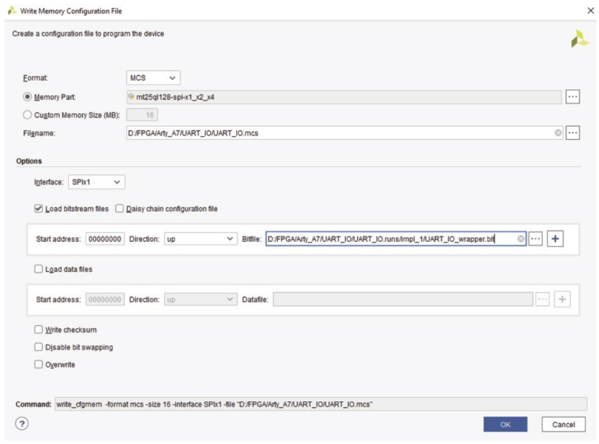

Hình 12.10 Cửa sổ Write Memory Configuration File.

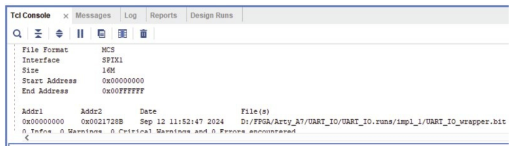

Hình 12.11 Một chút thông tin về bộ nhớ QSPI flash.
