# 13 Một số project khác với Vivado

## 13.1 Giới thiệu

Trong bối cảnh digital design phát triển nhanh chóng, Xilinx Vivado Design Suite nổi bật như một công cụ không thể thiếu đối với kỹ sư và người đam mê. Các tính năng mạnh mẽ của nó đáp ứng nhiều loại ứng dụng, từ các project field-programmable gate array (FPGA) đơn giản đến các thiết kế system-on-chip (SoC) phức tạp. Chương này đi sâu vào một tập các project khác nhau minh họa tính linh hoạt của Vivado, nối kiến thức lý thuyết với hiện thực thực tế. Khi bắt đầu hành trình qua các project khác nhau này, chúng ta sẽ khám phá các khía cạnh khác nhau của thiết kế phần cứng, từ hiện thực mạch cơ bản đến các khái niệm nâng cao hơn như xử lý tín hiệu và tích hợp hệ thống. Mỗi project thể hiện những khả năng riêng của Vivado, làm nổi bật giao diện user-friendly, các công cụ kiểm chứng thiết kế toàn diện, và sự tích hợp liền mạch với các workflow simulation và synthesis.

## 13.2 Project giao diện I2C

Block diagram của project này được thể hiện trong Hình 13.1.

Bằng cách right-clicking và chọn “Run Connection Automation” và cả “Regenerate Layout,” chúng ta có thể dễ dàng nối và dùng các IP core cần thiết. Sau đó, chúng ta dùng cửa sổ Address Editor sau để cấu hình bộ nhớ data và instruction của MicroBlaze, như được mô tả trong Hình 13.2. Bằng cách right-clicking vào microblaze_0, chúng ta cũng có thể chọn “Auto Assign Address.”

Sau đó, chúng ta right-click vào tên file block diagram và chọn Create HDL wrapper…, rồi lần lượt chạy synthesis, chạy implementation và tạo bitstream. Ở bước tiếp theo, chúng ta vào menu File, chọn Export, rồi tùy chọn Export Hardware…. Cuối cùng, chúng ta chọn Launch SDK từ menu File để mở phần mềm Xilinx SDK. Chúng ta tạo một application project bằng cách vào File> New > Application Project. Trong cửa sổ New Project, chúng ta nhập tên project, chọn C làm ngôn ngữ, để các mục khác ở mặc định, và click button Next. Sau đó, chúng ta chọn Peripheral Tests làm template và click button Finish. Sau đó, chúng ta copy và paste code sau vào file testperiph.c.

```
#include <stdio.h>
#include "xil_printf.h"
#include "xparameters.h"
#include "XIic.h"
u8 readReg(u16 reg_addr)
{
      u8 write_buf[3];
      write_buf[0] = (reg_addr >> 8) & 0xff;
      write_buf[1] = reg_addr & 0xff;
      u8 read_buf;
      XIic_Send(0x40800000, 0x36, write_buf, 2, 0);
      XIic_Recv(0x40800000, 0x36, &read_buf, 1, 0);
      return read_buf;
}

int main()
{

    u8 data;
    data = readReg(0x300b);
    xil_printf("%x\r\n", data);

    return 0;
}
```

Code được cung cấp là một chương trình C dùng giao diện Simple I2C để đọc một giá trị từ một register cụ thể của một thiết bị nối với bus I2C. Hãy phân tích nó step-by-step:

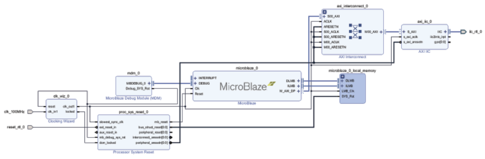

Hình 13.1 Block diagram của project giao diện I2C.

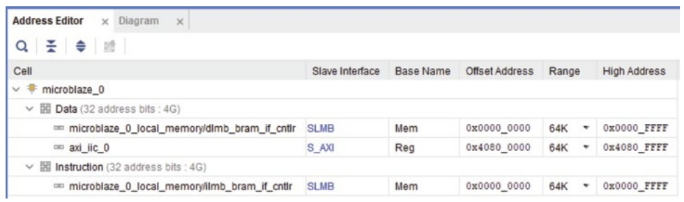

Hình 13.2 Cửa sổ Address Editor.

1. Các header file:

• #include <stdio.h>: Include thư viện standard input–output cho các function như printf.

• #include “xil_printf.h”: Một thư viện tùy biến do Xilinx cung cấp để xuất dữ liệu trên phần cứng cụ thể, cho phép xuất có định dạng tương tự printf tiêu chuẩn.

• #include “xparameters.h”: Một header file thường được các công cụ Xilinx tạo ra, chứa các tham số cho hệ thống phần cứng, chẳng hạn địa chỉ thiết bị.

• #include “XIic.h”: Hỗ trợ việc dùng giao diện I2C trong các hệ thống Xilinx.

2. Định nghĩa function readReg(u16 reg_addr):

• Function này đọc một byte từ một địa chỉ register cụ thể (một địa chỉ 16-bit) qua giao diện I2C.

• Variable write_buf được định nghĩa với kích thước ba byte, được dùng để định dạng địa chỉ register thành hai byte: một byte cao (write_buf[0]) và một byte thấp (write_buf[1]).

• Địa chỉ được chia thành hai byte bằng các phép toán bitwise. Byte cao có được bằng cách dịch địa chỉ sang phải 8 bit, và byte thấp có được bằng cách mask với 0xff.

• read_buf được định nghĩa để giữ byte đơn sẽ được đọc từ thiết bị.

• Sau đó function dùng function XIic_Send để gửi địa chỉ đã dựng tới thiết bị ở địa chỉ I2C 0x36.

• Sau khi gửi, nó gọi XIic_Recv để nhận một byte đơn từ cùng địa chỉ thiết bị, byte này chứa dữ liệu từ register đã chỉ định.

• Cuối cùng, function trả về byte nhận được.

3. Function main:

• Một variable data kiểu u8 (unsigned 8-bit integer) được khai báo.

• Chương trình gọi readReg(0x300b), đọc dữ liệu từ địa chỉ register 0x300b và lưu nó vào data.

• Sau đó nó dùng xil_printf để in biểu diễn hexadecimal của data, theo sau là ký tự về đầu dòng và ký tự xuống dòng.

Tóm lại, code được thiết kế để giao tiếp với một thiết bị I2C, đọc một byte đơn từ register 0x300b, và in byte đó ở định dạng hexadecimal. Code này phù hợp cho các hệ thống nhúng dùng phần cứng Xilinx và protocol truyền thông I2C.

Cuối cùng, chúng ta có thể build và tạo file ELF rồi liên kết nó với project Vivado từ menu Tools và tùy chọn Associate ELF Files….

## 13.3 Bộ tạo Sine-Cosine CORDIC bằng VHDL

CORDIC (Coordinate Rotation Digital Computer) là một thuật toán được dùng để thực hiện nhiều loại hàm toán học, đặc biệt là các phép tính lượng giác, hyperbolic, mũ và logarit. Nó hiệu quả cho việc hiện thực bằng phần cứng vì chỉ cần các phép dịch và cộng, khiến nó phù hợp với kiến trúc FPGA. Trong ngữ cảnh VHDL (VHSIC Hardware Description Language) và Vivado, một design suite do Xilinx cung cấp để phát triển FPGA và SoC, CORDIC có thể được hiện thực như một thiết kế VHDL. Việc này bao gồm tạo các entity định nghĩa thuật toán CORDIC để tính các hàm khác nhau, chẳng hạn sine, cosine và tangent, với hiệu quả phần cứng. Các tính năng chính của VHDL CORDIC trong Vivado được liệt kê như sau:

1. Hiện thực thuật toán:

• Thuật toán CORDIC có thể được hiện thực bằng VHDL để thực hiện nhiều phép tính toán học khác nhau với số lượng tài nguyên phần cứng tối thiểu.

• Code VHDL thường bao gồm các cấu trúc lặp để xử lý các thao tác quay và sự hội tụ của các góc.

2. Chế độ tĩnh so với động:

• CORDIC có thể hoạt động ở nhiều chế độ khác nhau, bao gồm vectoring mode và rotation mode, có thể được chọn dựa trên yêu cầu ứng dụng.

3. Biểu diễn Fixed-Point:

• CORDIC thường dùng số học fixed-point, vốn well-suited cho các hiện thực FPGA để cân bằng giữa độ chính xác và mức sử dụng tài nguyên.

4. Tham số hóa:

• Các hiện thực CORDIC có thể được tham số hóa cho các yêu cầu độ chính xác khác nhau (số lần lặp, bit-width, v.v.), cho phép người thiết kế tối ưu cho tốc độ hoặc mức sử dụng tài nguyên.

5. Tích hợp với các thiết kế khác:

• Các module CORDIC có thể được tích hợp với các component digital signal processing (DSP) khác trong một thiết kế FPGA, chẳng hạn bộ lọc, để nâng cao chức năng.

Hiện thực CORDIC bằng VHDL trong môi trường Vivado cung cấp một cách hiệu quả để thực hiện các phép tính toán học phức tạp với FPGA. Bằng cách tận dụng các đặc tính của thuật toán CORDIC, người thiết kế có thể đạt hiệu năng cao trong khi giảm thiểu tiêu thụ tài nguyên, nhờ đó khiến nó trở thành lựa chọn phổ biến cho các ứng dụng trong xử lý tín hiệu, truyền thông và hệ thống điều khiển. Trong mục này, chúng ta sẽ tạo các waveform sine và cosine bằng VHDL CORDIC trong Vivado. Cửa sổ thiết lập CORDIC IP core được minh họa trong Hình 13.3.

Sau khi tìm CORDIC IP core trong IP catalog và cấu hình các thiết lập như được minh họa trong Hình 13.3, click button OK. Thao tác này mở ra một cửa sổ mới, nơi chúng ta nên click button Generate, như được thể hiện trong Hình 13.4.

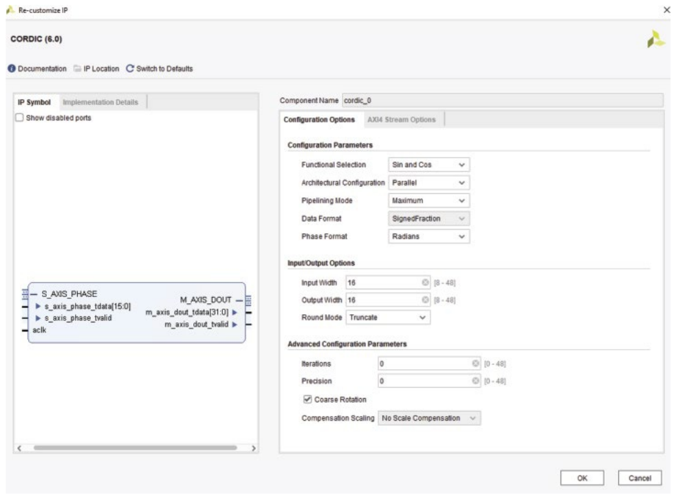

Hình 13.3 Cửa sổ thiết lập CORDIC IP core.

Sau đó, chúng ta tạo một file text editor mới như được thể hiện trong Hình 13.5.

Chúng ta đặt tên cho nó (sincos.vhd) và lưu nó trong một thư mục như được mô tả trong Hình 13.6.

Tiếp theo, chúng ta thêm code VHDL đã viết vào thư mục Design Sources như được minh họa trong Hình 13.7.

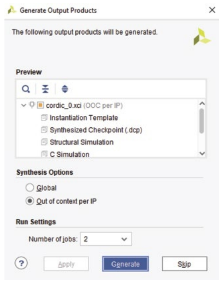

Hình 13.4 Click vào button Generate.

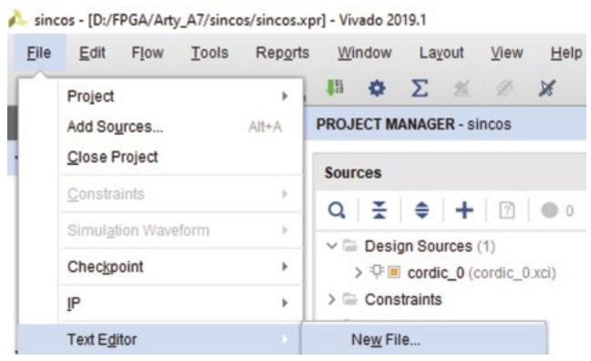

Hình 13.5 Tạo một file text editor mới.

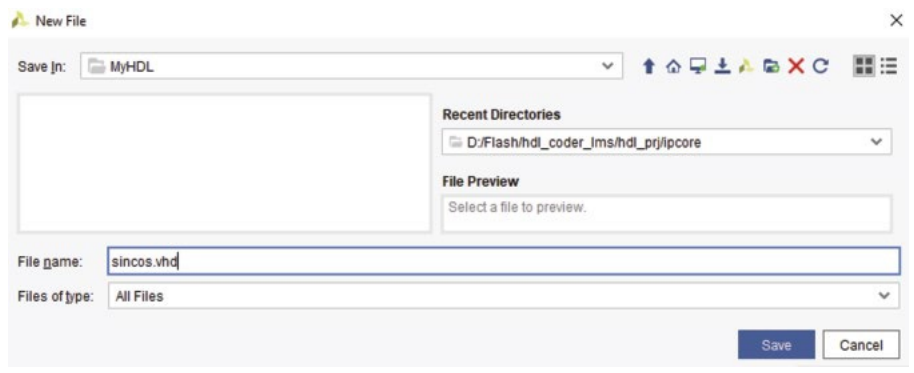

Hình 13.6 Lưu file sincos.vhd trong một thư mục.

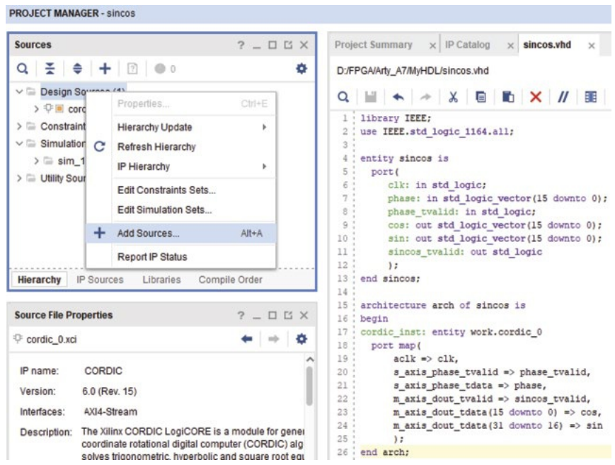

Hình 13.7 Thêm code VHDL vào thư mục Design Sources.

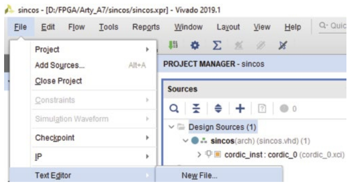

Hình 13.8 Tạo một file text editor khác cho test bench.

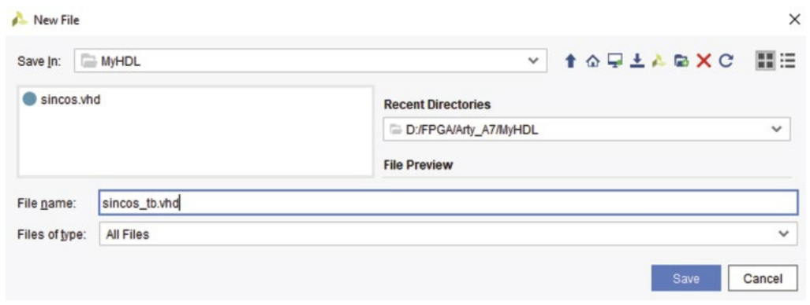

Hình 13.9 Lưu file sincos_tb.vhd trong cùng thư mục.

File sincos.vhd được thêm vào thư mục Design Sources, rồi chúng ta tạo một file text editor khác cho test bench như được thể hiện trong Hình 13.8.

Chúng ta đặt tên cho nó (sincos_tb.vhd) và lưu nó trong cùng thư mục nơi đã có sẵn file sincos.vhd, như được mô tả trong Hình 13.9.

Chúng ta viết code sau vào file sincos_tb.vhd.

```
library IEEE;
use IEEE.std_logic_1164.all;
use IEEE.numeric_std.all;
entity sincos_tb is
end sincos_tb;
architecture arch of sincos_tb is
constant CLOCK_PERIOD: time := 10ns;
constant PI_POS: signed(15 downto 0) := "0110010010001000";
constant PI_NEG: signed(15 downto 0) := "1001101101111000";
constant PHASE_INC: integer := 256;
signal clk: std_logic := '0';
signal rst: std_logic := '1';
signal phase: signed(15 downto 0);
signal phase_tvalid: std_logic;
signal cos, sin: std_logic_vector(15 downto 0);
signal sincos_tvalid: std_logic;
begin
sincos_inst: entity work.sincos
   port map(
     clk => clk,
     phase => std_logic_vector(phase),
     phase_tvalid => phase_tvalid,
     cos => cos,
     sin => sin,
     sincos_tvalid => sincos_tvalid
     );
process
begin
    clk <= '0';
    wait for CLOCK_PERIOD/2;
    clk <= '1';
    wait for CLOCK_PERIOD/2;
end process;
process
begin
    rst <= '1';
    wait for CLOCK_PERIOD*10;
    rst <= '0';
    wait;
end process;

process(clk)
begin
   if rst = '1' then
      phase <= (others => '0');
      phase_tvalid <= '0';
   else
      phase_tvalid <= '1';
      if(phase+PHASE_INC < PI_POS) then
         phase <= phase+PHASE_INC;
      else
         phase <= PI_NEG;
      end if;
   end if;
end process;
end arch;
```

Sau đó chúng ta thêm file sincos_tb.vhd vào thư mục Simulation Sources, như được minh họa trong Hình 13.10.

Sau đó, chúng ta có thể chạy simulation và xem cửa sổ waveforms. Chúng ta chọn signal phase, right-click, và chọn Radix rồi Real settings, như được thể hiện trong Hình 13.11.

Trong cửa sổ Real Settings, chúng ta chọn Signed dưới Fixed Point với 13 binary point, như được mô tả trong Hình 13.12.

Chúng ta right-click vào signal phase lần nữa, rồi chọn Waveform Style, và Analog Settings…, như được minh họa trong Hình 13.13.

Chúng ta nhập chiều cao hàng 150 pixel trong cửa sổ Analog Settings và để nguyên phần còn lại, như được thể hiện trong Hình 13.14.

Các waveform của phase, cos và sin trong Waveforms Window được mô tả trong Hình 13.15.

## 13.4 Trailing Edge PWM bằng VHDL

Trong mục này, chúng ta sẽ hiện thực một trailing edge PWM bằng VHDL trong Vivado. Vậy, chúng ta tạo một project VHDL mới trong Vivado, và thêm file PWM_carrier.vhd vào thư mục Design Sources, như được minh họa trong Hình 13.16.

Sau đó, chúng ta click vào button Finish, như được thể hiện trong Hình 13.17.

Trong cửa sổ Define Module, chúng ta thêm các port input và output rồi click vào button OK, như được minh họa trong Hình 13.18.

Sau đó, chúng ta tạo một signal carrier tăng dần bên trong một process, và từ menu Flow, chúng ta chọn Run Behavioral Simulation, như được thể hiện trong Hình 13.19.

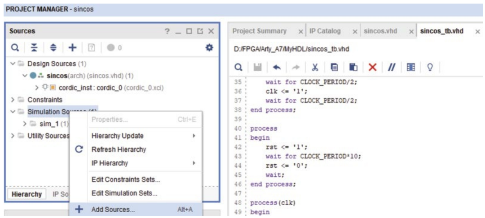

Hình 13.10 Thêm file sincos_tb.vhd vào thư mục Simulation Sources.

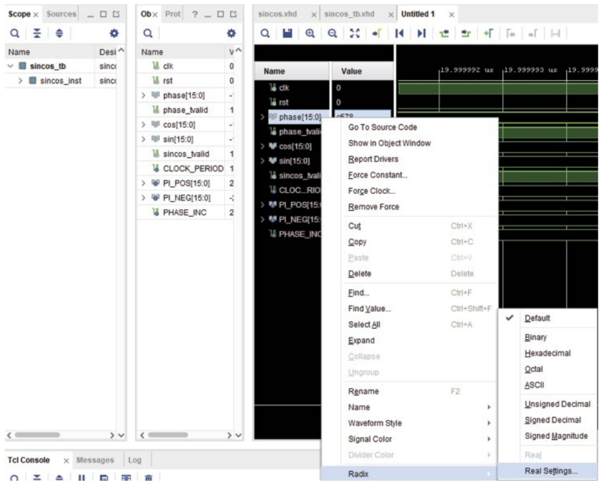

Hình 13.11 Chọn Real Settings cho signal phase.

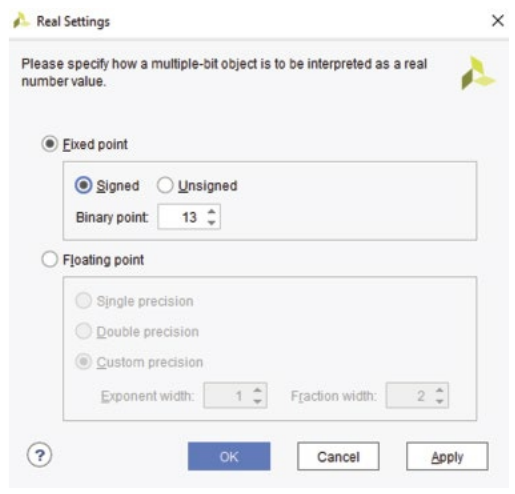

Hình 13.12 Chọn signed fixed point với 13 binary point.

Chúng ta nhập bước thời gian simulation là 2 ms vào các ô và click vào button Restart, rồi button Time Step Simulation, và cũng click vào button Zoom Fit, như được mô tả lần lượt trong Hình 13.20 và 13.21.

Chúng ta right-click vào signal “clk” và chọn tùy chọn Force Clock…, như được minh họa trong Hình 13.22.

Chúng ta cấu hình các thiết lập của cửa sổ Force Clock, như được thể hiện trong Hình 13.23.

Sau đó chúng ta click vào button Restart, button Time Step Simulation, rồi button Zoom Fit. Cửa sổ waveforms được mô tả trong Hình 13.24.

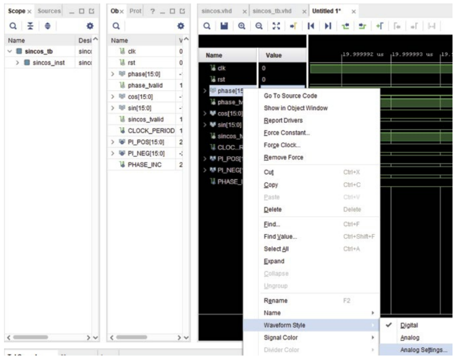

Hình 13.13 Chọn Analog Settings… cho signal phase.

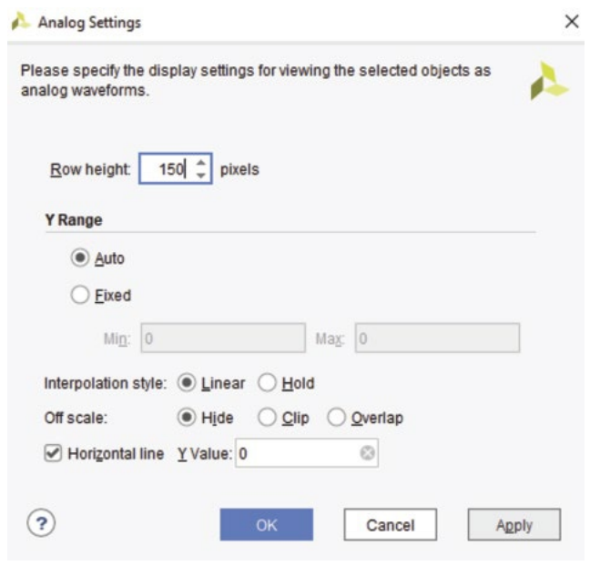

Hình 13.14 Cửa sổ Analog Settings.

Chúng ta right-click vào signal “car_sig”, và chọn Waveform Style là Analog, như được minh họa trong Hình 13.25.

Ngoài ra, chúng ta right-click vào signal “car_sig”, và chọn Radix, rồi Unsigned Decimal, như được minh họa trong Hình 13.26.

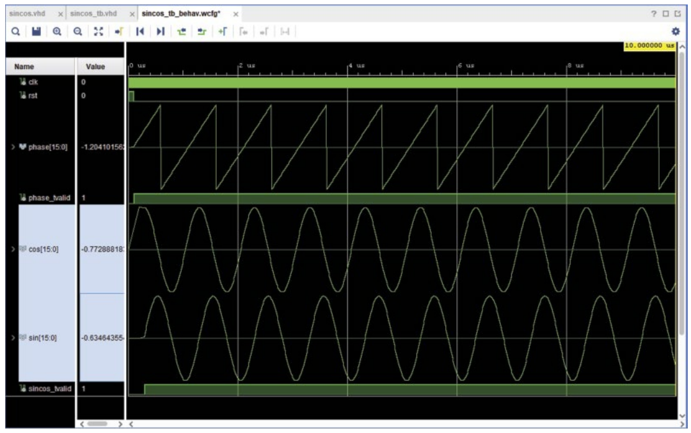

Hình 13.15 Các waveform của phase, cos và sin.

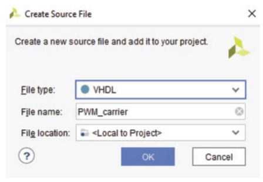

Hình 13.16 Tạo source file PWM_carrier.vhd.

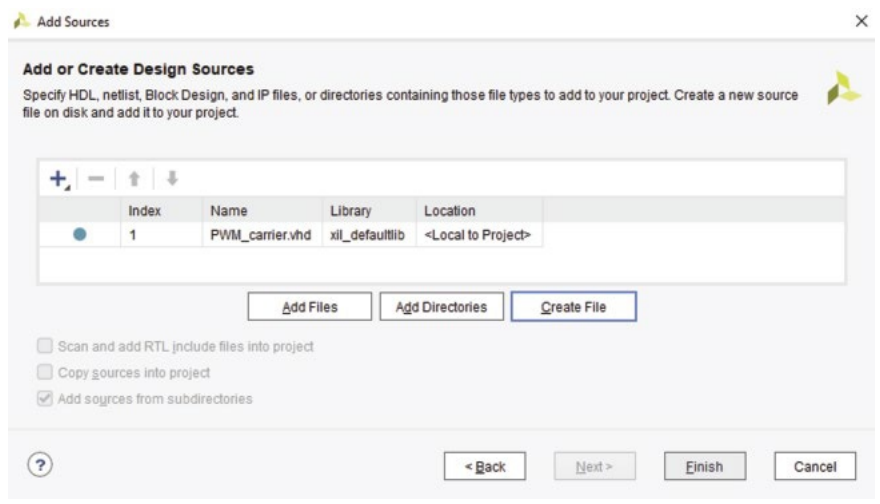

Hình 13.17 Click vào button Finish.

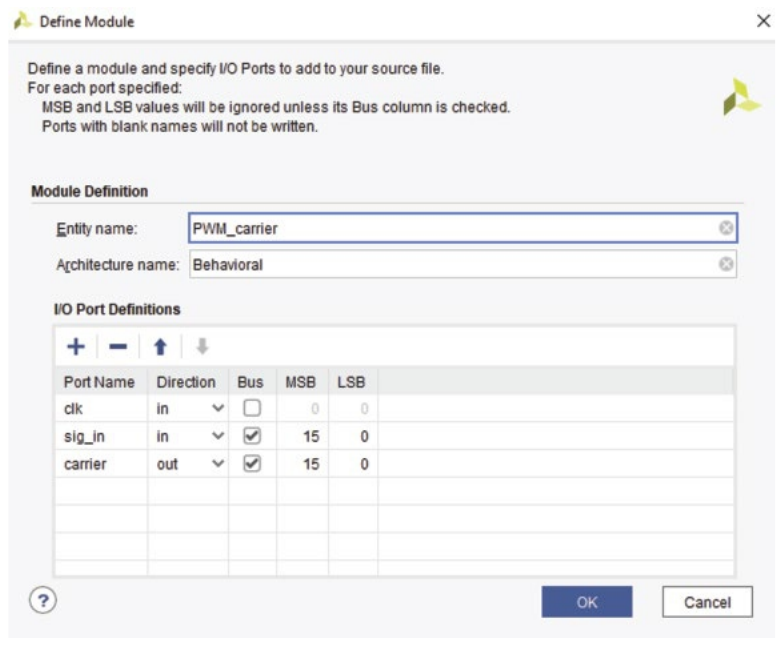

Hình 13.18 Thêm các port input và output.

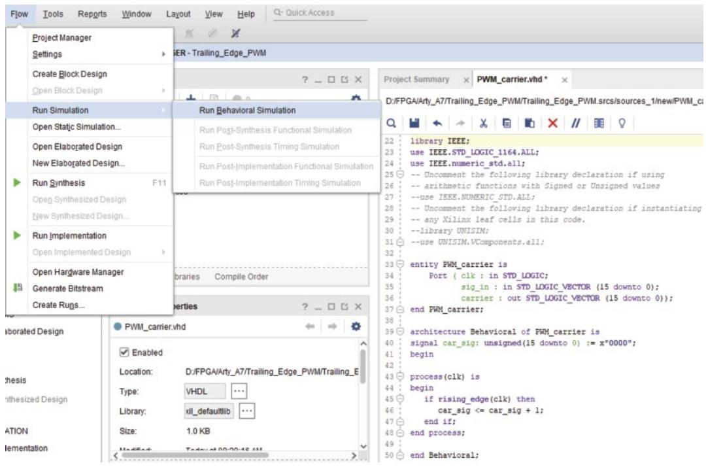

Hình 13.19 Simulation signal carrier.

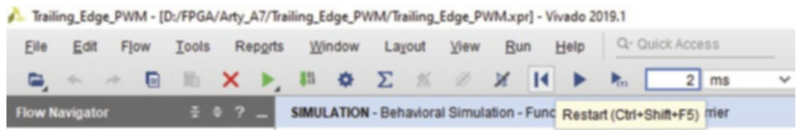

Hình 13.20 Đặt bước thời gian simulation và click button Restart.

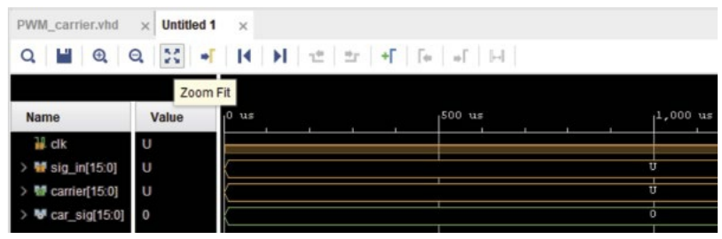

Hình 13.21 Click vào button Zoom Fit.

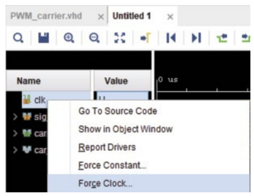

Hình 13.22 Chọn tùy chọn Force Clock….


Hình 13.23 Các thiết lập của cửa sổ Force Clock.

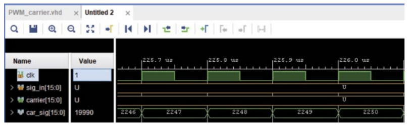

Hình 13.24 Cửa sổ waveforms.

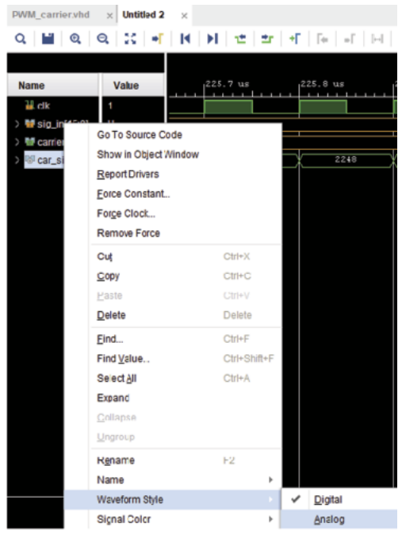

Hình 13.25 Chọn Waveform Style là Analog cho signal “car_sig”.

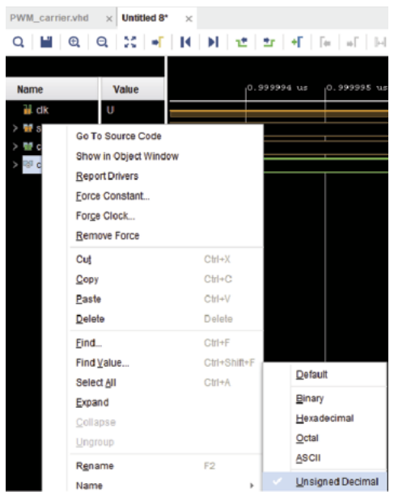

Hình 13.26 Chọn Radix, và Unsigned Decimal.

Chúng ta click vào button Restart, button Time Step Simulation, và cả button Zoom Fit. Waveform của signal analog “car_sig” được thể hiện trong Hình 13.27.

Chúng ta muốn giới hạn signal “car_sig” chỉ đếm lên tới giá trị tối đa 29999. Để làm điều này, chúng ta sửa code và chạy behavioral simulation, như được mô tả trong Hình 13.28.

Chúng ta lặp lại các bước tương tự để mô phỏng trong cửa sổ waveforms. Chúng ta có thể thấy tần số của signal carrier tăng lên như được minh họa trong Hình 13.29.

Tiếp theo, chúng ta tạo một signal PWM bằng cách so sánh một signal hằng với signal carrier và chạy behavioral simulation, như được thể hiện trong Hình 13.30.

Chúng ta right-click vào signal “sig_in” và chọn tùy chọn Force Constant…, như được mô tả trong Hình 13.31.

Chúng ta chọn 1000 làm giá trị unsigned decimal, như được minh họa trong Hình 13.32.

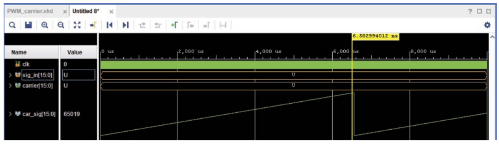

Hình 13.27 Waveform của signal analog “car_sig”.

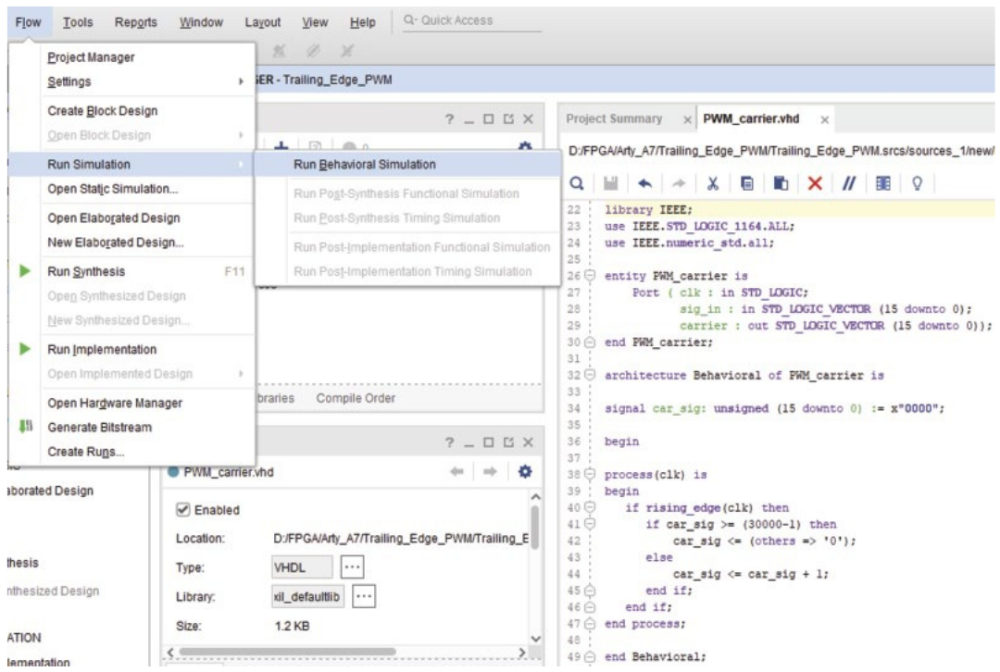

Hình 13.28 Sửa code và chạy behavioral simulation.

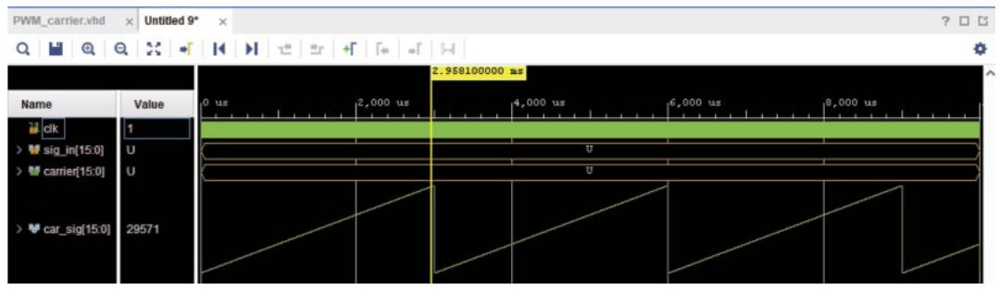

Hình 13.29 Tần số tăng lên của signal carrier.

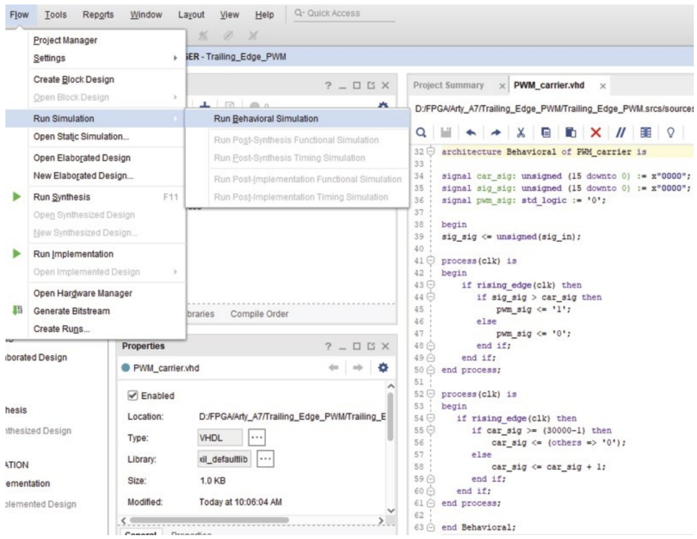

Hình 13.30 Chạy behavioral simulation.

Các signal trên cửa sổ waveforms được thể hiện trong Hình 13.33.

Chúng ta đặt force value là 5000, và click vào button Step Time Simulation để xem các signal trên cửa sổ waveforms như được mô tả lần lượt trong Hình 13.34 và 13.35.

Chúng ta đổi giá trị force constant thành 15000 và click vào button Step Time Simulation để xem sự thay đổi của signal PWM như được minh họa trong Hình 13.36 và 13.37.

Chúng ta cũng đổi giá trị force constant thành 25000 và click vào button Step Time Simulation để xem lại signal PWM như được minh họa lần lượt trong Hình 13.38 và 13.39.

Các signal cho toàn bộ thời gian simulation trên cửa sổ waveforms được thể hiện trong Hình 13.40.

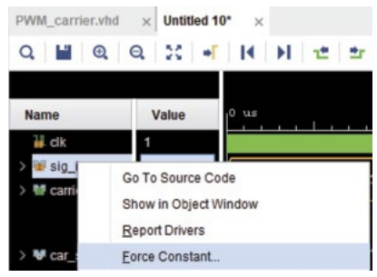

Hình 13.31 Chọn tùy chọn Force Constant….

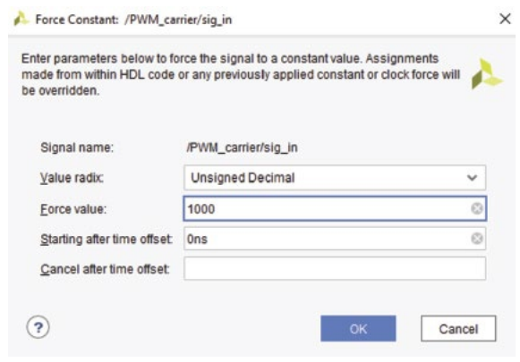

Hình 13.32 Các thiết lập của cửa sổ Force Constant.

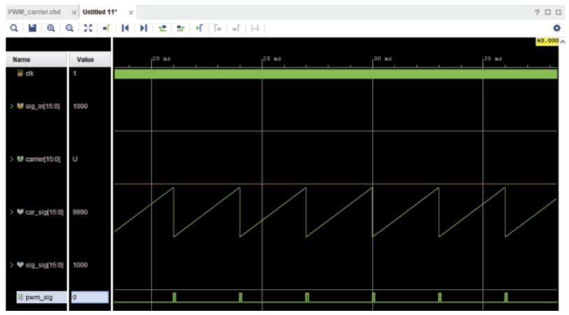

Hình 13.33 Các signal trên cửa sổ waveforms.

Chúng ta thêm “pwm_out” làm một output port và gán nó cho signal pwm_sig. Ngoài ra, gán signal “car_sig” cho output port “carrier” và chạy behavioral simulation như được mô tả trong Hình 13.41.

Chúng ta đổi giá trị force constant thành 10000, và click vào button Step Time Simulation để xem toàn bộ các signal trên cửa sổ waveforms như được minh họa trong Hình 13.42.

Bây giờ, chúng ta có thể tạo một IP core cho PWM carrier này. Để làm điều đó, từ menu Tools, chúng ta chọn Create and Package New IP… như được thể hiện trong Hình 13.43.

Trong cửa sổ được mở ra, chúng ta click vào button Next như được mô tả trong Hình 13.44.

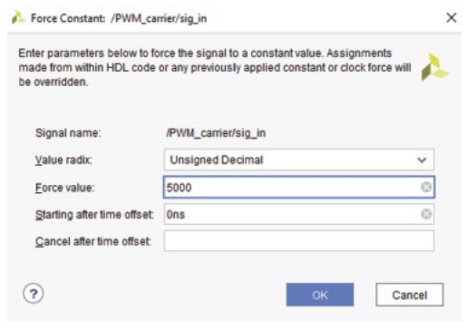

Hình 13.34 Force giá trị hằng thành 5000.

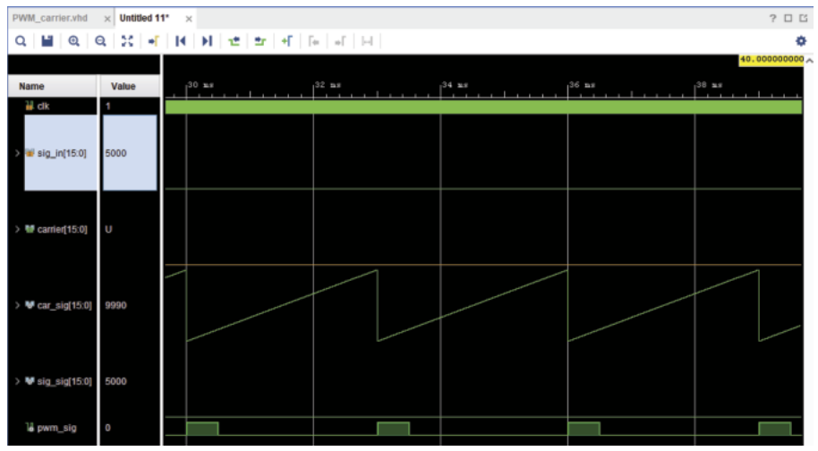

Hình 13.35 Các signal trên cửa sổ waveforms.

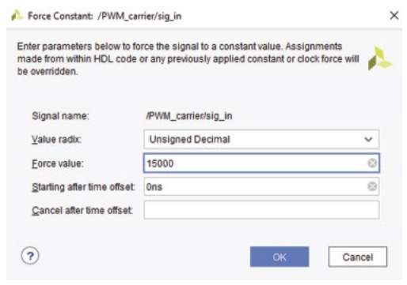

Hình 13.36 Đổi Force value thành 15000.

Sau đó, chúng ta chọn Package your current project, và click vào button Next như được minh họa trong Hình 13.45.

Chúng ta để nguyên IP location và click vào button Next như được thể hiện trong Hình 13.46.

Trong cửa sổ tiếp theo, chúng ta click vào button Finish như được mô tả trong Hình 13.47.

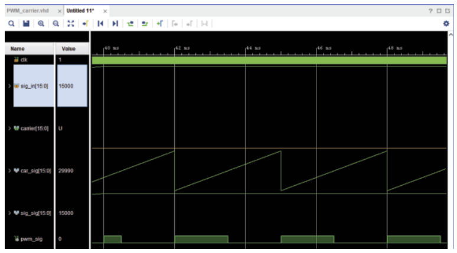

Hình 13.37 Các signal trên cửa sổ waveforms.

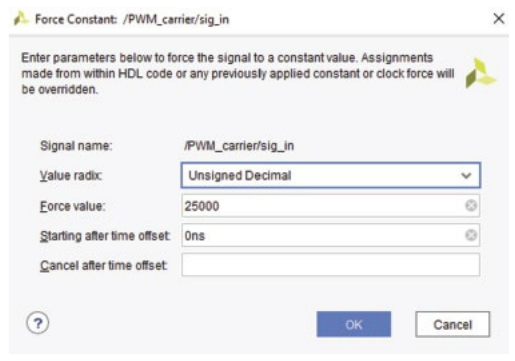

Hình 13.38 Đổi Force value thành 25000.


Hình 13.39 Các signal trên cửa sổ waveforms.

Trong cửa sổ packaging setup, ở tab Review and Package, chúng ta click vào button Package IP, vậy IP PWM_carrier được tạo ra, và chúng ta có thể tìm thấy nó trong IP Catalog như được minh họa lần lượt trong Hình 13.48 và 13.49.

Nếu click vào biểu tượng PWM_carrier_v1_0, chúng ta có thể thấy cửa sổ Customize IP như được thể hiện trong Hình 13.50.

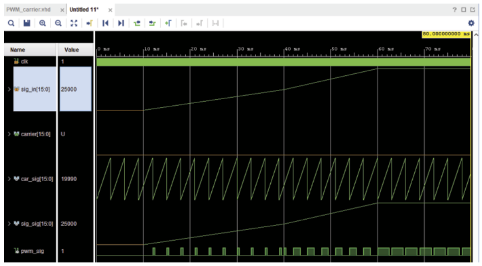

Hình 13.40 Toàn bộ thời gian simulation trên cửa sổ waveforms.

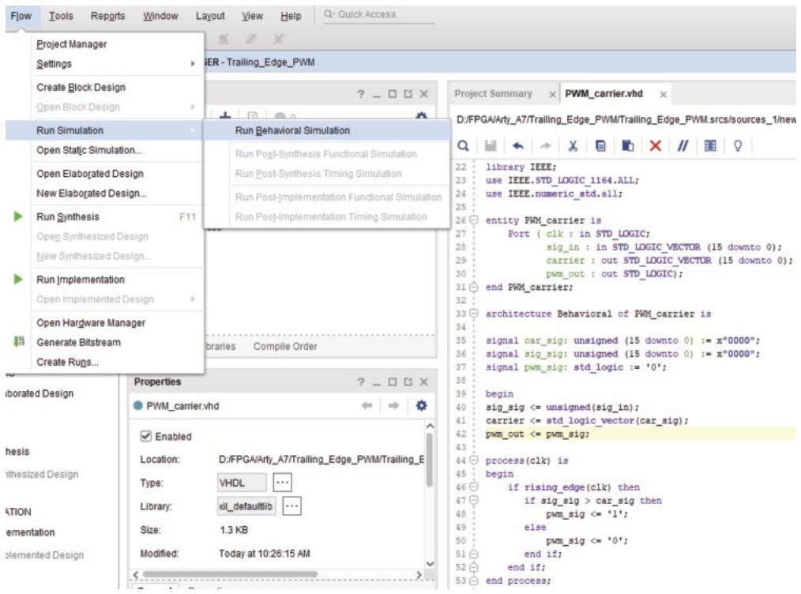

Hình 13.41 Chạy behavioral simulation cho code hoàn chỉnh.

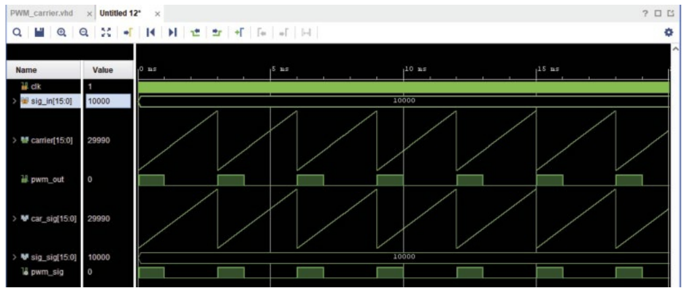

Hình 13.42 Toàn bộ các signal trên cửa sổ waveforms.

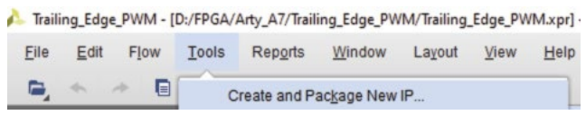

Hình 13.43 Chọn Create and Package New IP….

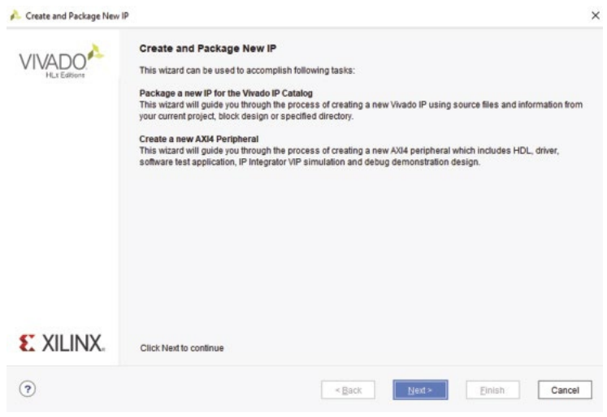

Hình 13.44 Click vào button Next.

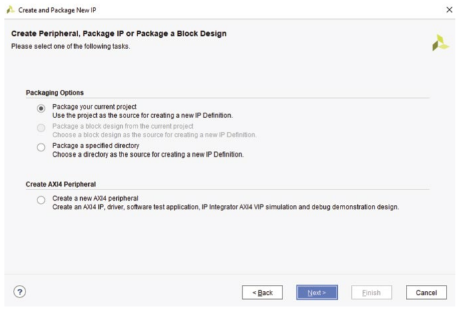

Hình 13.45 Chọn Package your current project.

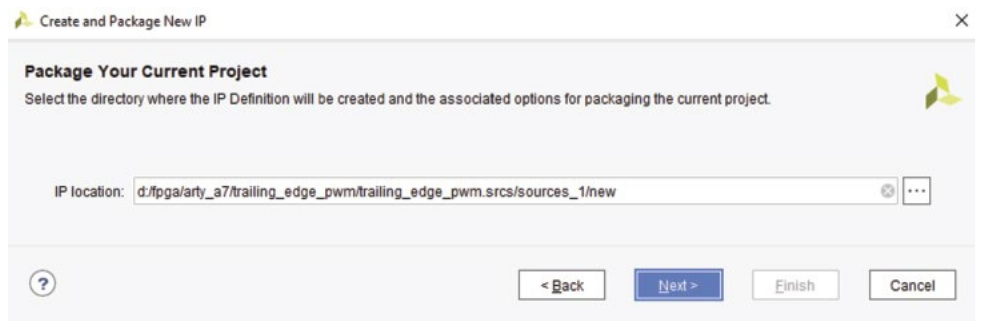

Hình 13.46 Click vào button Next.

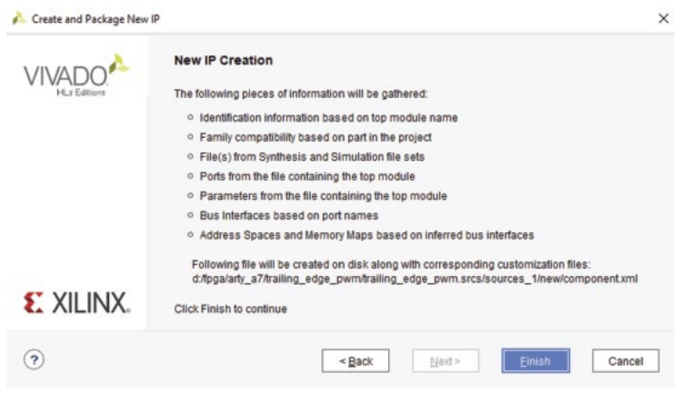

Hình 13.47 Click vào button Finish.

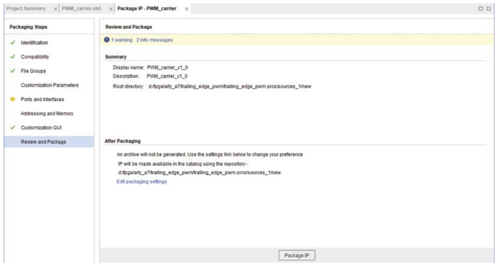

Hình 13.48 Click vào button Package IP.

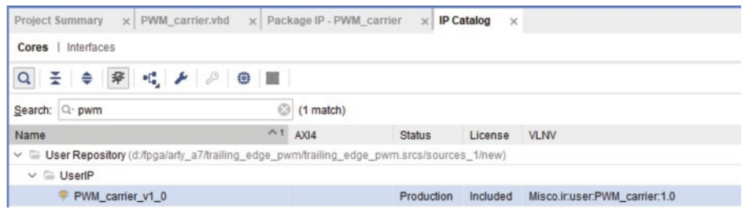

Hình 13.49 IP PWM_carrier đã được tạo.

## 13.5 Sóng sine LUT-based bằng VHDL

Trong mục này, chúng ta sẽ tạo một sóng sine dựa trên lookup table (LUT) bằng VHDL trong Vivado. Kỹ thuật này hữu ích cho các chức năng như PWM. Chúng ta sẽ dùng Google Colab, một dịch vụ Jupyter notebook được host sẵn, để tạo các giá trị LUT cho waveform sine, và chúng ta dùng code sau.

```
import numpy as np
from numpy import sin, pi
import matplotlib.pyplot as plt
x = np.linspace(0,1,500)
lut = sin(pi*x)*7500+7500
plt.plot(x,lut)
```

Signal sine half-wave được tạo ra được thể hiện trong Hình 13.51.

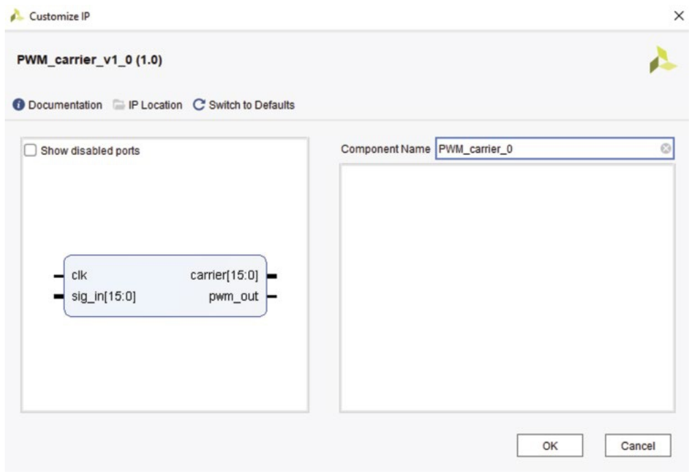

Hình 13.50 Cửa sổ Customize IP của PWM_carrier.

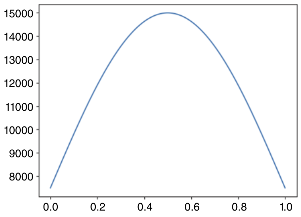

Hình 13.51 Signal sine half-wave được tạo ra.

Code sau được dùng để tạo 500 giá trị LUT với 20 giá trị trên một hàng.

```
for i,val in enumerate(lut):
    if i % 20:
       print(int(val),end=',')
    else:
       print(int(val),end=',')
       print(' ')
```

Chúng ta tạo một file VHDL có tên “sine_lut.vhd” và chèn code sau vào bên trong.

```
library IEEE;
use IEEE.STD_LOGIC_1164.ALL;
use IEEE.NUMERIC_STD.ALL;

entity sine_lut is
     Port(
          clk: in std_logic;
          rst: in std_logic;
          sine: out std_logic_vector(15 downto 0));
end sine_lut;

architecture Behavioral of sine_lut is

type LUT_TYPE is array(0 to 499) of integer;
constant LUT: LUT_TYPE :=
(
7500,7547,7594,7641,7688,7736,7783,7830,7877,7924,7971,8018,8066,8113,8160,
8207,8254,8301,8348,8395,8441,
8488,8535,8582,8628,8675,8722,8768,8815,8861,8908,8954,9000,9047,9093,9139,
9185,9231,9277,9323,9368,
9414,9460,9505,9551,9596,9641,9687,9732,9777,9822,9866,9911,9956,10000,10045,
10089,10134,10178,10222,10266,
10310,10353,10397,10440,10484,10527,10570,10613,10656,10699,10741,10784,10826,
10869,10911,10953,10995,11036,11078,11119,
11161,11202,11243,11284,11324,11365,11405,11445,11485,11525,11565,11605,11644,
11683,11723,11761,11800,11839,11877,11916,
11954,11992,12029,12067,12104,12141,12178,12215,12252,12288,12324,12360,12396,
12432,12467,12503,12538,12573,12607,12642,
12676,12710,12744,12778,12811,12844,12877,12910,12943,12975,13007,13039,13071,
13102,13134,13165,13196,13226,13257,13287,
13317,13346,13376,13405,13434,13463,13491,13520,13548,13575,13603,13630,13657,
13684,13711,13737,13763,13789,13815,13840,
13865,13890,13915,13939,13963,13987,14010,14034,14057,14080,14102,14124,14146,
14168,14190,14211,14232,14252,14273,14293,
14313,14332,14352,14371,14390,14408,14426,14444,14462,14479,14497,14513,14530,
14546,14562,14578,14594,14609,14624,14638,
14653,14667,14680,14694,14707,14720,14733,14745,14757,14769,14780,14791,14802,
14813,14823,14833,14843,14852,14862,14871,
14879,14887,14895,14903,14910,14918,14924,14931,14937,14943,14949,14954,14959,
14964,14968,14972,14976,14980,14983,14986,
14989,14991,14993,14995,14996,14998,14999,14999,14999,14999,14999,14999,14998,
14996,14995,14993,14991,14989,14986,14983,
14980,14976,14972,14968,14964,14959,14954,14949,14943,14937,14931,14924,14918,
14910,14903,14895,14887,14879,14871,14862,
14852,14843,14833,14823,14813,14802,14791,14780,14769,14757,14745,14733,14720,
14707,14694,14680,14667,14653,14638,14624,
14609,14594,14578,14562,14546,14530,14513,14497,14479,14462,14444,14426,14408,
14390,14371,14352,14332,14313,14293,14273,
14252,14232,14211,14190,14168,14146,14124,14102,14080,14057,14034,14010,13987,
13963,13939,13915,13890,13865,13840,13815,
13789,13763,13737,13711,13684,13657,13630,13603,13575,13548,13520,13491,13463,
13434,13405,13376,13346,13317,13287,13257,
13226,13196,13165,13134,13102,13071,13039,13007,12975,12943,12910,12877,12844,
12811,12778,12744,12710,12676,12642,12607,
12573,12538,12503,12467,12432,12396,12360,12324,12288,12252,12215,12178,12141,
12104,12067,12029,11992,11954,11916,11877,
11839,11800,11761,11723,11683,11644,11605,11565,11525,11485,11445,11405,11365,
11324,11284,11243,11202,11161,11119,11078,
11036,10995,10953,10911,10869,10826,10784,10741,10699,10656,10613,10570,10527,
10484,10440,10397,10353,10310,10266,10222,
10178,10134,10089,10045,10000,9956,9911,9866,9822,9777,9732,9687,9641,9596,9551,
9505,9460,9414,9368,9323,
9277,9231,9185,9139,9093,9047,9000,8954,8908,8861,8815,8768,8722,8675,8628,8582,
8535,8488,8441,8395,
8348,8301,8254,8207,8160,8113,8066,8018,7971,7924,7877,7830,7783,7736,7688,7641,
7594,7547,7500
);

signal lut_sig: unsigned(15 downto 0);

begin

sine <= std_logic_vector(lut_sig);

process(clk,rst) is
variable cnt: integer range 0 to 500;
begin
    if rst = '0' then
       cnt := 0;
       lut_sig <= (others => '0');
    elsif rising_edge(clk) then
       lut_sig <= to_unsigned(LUT(cnt),16);
       if cnt > 498 then
          cnt := 0;
       else
          cnt := cnt + 1;
       end if;
    end if;
end process;

end Behavioral;
```

Sau đó, từ menu Flow, chúng ta chọn Run Behavioral Simulation như được mô tả trong Hình 13.52.

Sau đó, chúng ta click vào button Restart trong cửa sổ waveforms vừa mở như được minh họa trong Hình 13.53.

Sau đó chúng ta right-click vào “rst” và chọn tùy chọn Force Constant… như được minh họa trong Hình 13.54.

Chúng ta nhập giá trị không trong cửa sổ Force Constant, như được thể hiện trong Hình 13.55.

Chúng ta right-click vào “clk” và chọn tùy chọn Force Clock… như được mô tả trong Hình 13.56.

Chúng ta thiết lập cửa sổ Force Clock cho “clk” như được thể hiện trong Hình 13.57.

Sau đó, chúng ta chạy simulation trong 100 μs như được minh họa trong Hình 13.58.

Sau khi mô phỏng 100 μs , chúng ta right-click vào “rst” và đặt Force value là 1, như được thể hiện trong Hình 13.59.

Chúng ta click vào button Simulation for 100 μs lần nữa và click vào button Zoom Fit. Các waveform signal thu được được mô tả trong Hình 13.60.

Tiếp theo, chúng ta right-click vào lut_sig và chọn Waveform Style là Analog như được minh họa trong Hình 13.61.

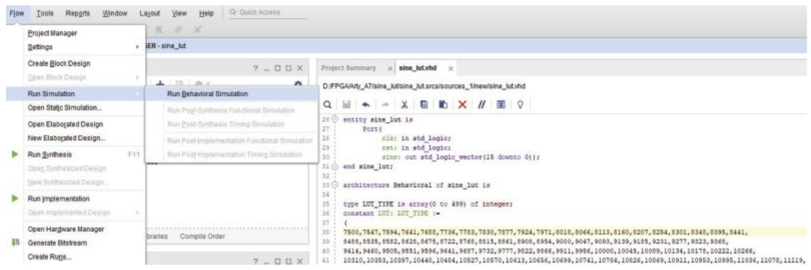

Hình 13.52 Chọn Run Behavioral Simulation.


Hình 13.53 Click vào button Restart.


Hình 13.54 Chọn tùy chọn Force Constant… cho “rst”.


Hình 13.55 Nhập giá trị không trong cửa sổ Force Constant.


Hình 13.56 Chọn tùy chọn Force Clock….


Hình 13.57 Thiết lập cửa sổ Force Clock cho “clk”.


Hình 13.58 Chạy simulation trong 100 μs .


Hình 13.59 Đổi Force value của “rst” thành 1.


Hình 13.60 Các signal trên cửa sổ waveforms.


Hình 13.61 Chọn Waveform Style là Analog.

Waveform thu được của “lut_sig” được thể hiện trong Hình 13.62.

Để thực hiện phép quay 180-degree trong half-cycle âm, chúng ta định nghĩa một signal “state” và sửa code trước đó cho phù hợp. Sau đó chúng ta chạy behavioral simulation như được mô tả trong Hình 13.63.

Chúng ta restart simulation, đặt giá trị “rst” bằng không, force clock “clk”, và chạy simulation trong 100 μs . Sau đó, như trước, chúng ta đặt giá trị “rst” bằng 1 và tiếp tục chạy simulation nhiều lần mỗi lần 100 μs . Kết quả là waveform “sine” được tạo ra như mong đợi, như được thể hiện trong Hình 13.64.


Hình 13.62 Waveform thu được của “lut_sig”.


Hình 13.63 Sửa code và chạy behavioral simulation.


Hình 13.64 Waveform “sine” được tạo ra.


Hình 13.65 Tạo một test bench source file cho simulation.


Hình 13.66 Chọn Run Behavioral Simulation.


Hình 13.67 Cửa sổ waveforms thu được cho test bench.


Hình 13.68 Chọn Add Module to Block Design.

Sau đó, chúng ta tạo một test bench source file có tên “sine_lut_tb.vhd” trong thư mục simulation sources như được minh họa trong Hình 13.65.

Chúng ta viết code vào file “sine_lut_tb.vhd”, và chọn Run Behavioral Simulation từ menu Flow, như được thể hiện trong Hình 13.66.

Chúng ta restart simulation, click vào button Run for 100 μs nhiều lần, và chọn waveform style của “sine_tb” là Analog. Cửa sổ waveforms thu được cho test bench được mô tả trong Hình 13.67.

Nếu tạo một block design có tên “test_IP”, chúng ta có thể thêm sine_lut.vhd như một IP core trong cửa sổ Diagram. Để làm điều này, chúng ta right-click vào tên file và chọn Add Module to Block Design, như được minh họa trong Hình 13.68.

Module “sine_lut” được thêm vào cửa sổ Diagram như được thể hiện trong Hình 13.69.


Hình 13.69 Module “sine_lut” đã được thêm vào cửa sổ Diagram.

## 13.6 PWM đối xứng bằng VHDL

Trong mục này, chúng ta sẽ hiện thực một PWM carrier đối xứng để tạo PWM, và so sánh nó với một sóng sine để tạo signal PWM two-level, có thể được dùng sau này trong các bộ biến đổi điện tử công suất. Trước đây chúng ta đã hiện thực một trial PWM carrier trong Mục 13.3 *(ghi chú: sách in "trial" và "Section 13.3"; đúng là PWM carrier trailing edge ở Mục 13.4)*. Bây giờ, chúng ta sẽ thực hiện một số thay đổi trong trial PWM để nó thành một counter up–down đối xứng. Code cho file PWM_CAR.vhd như sau.

```
library IEEE;
use IEEE.STD_LOGIC_1164.ALL;
use IEEE.numeric_std.all;

entity PWM_CAR is
    Port ( clk : in STD_LOGIC;
           rst : in STD_LOGIC;
           carrier : out STD_LOGIC_VECTOR (15 downto 0)
          );
end PWM_CAR;

architecture Behavioral of PWM_CAR is

signal car_sig: unsigned (15 downto 0) := x"0000";
signal car_dir: std_logic;
begin
carrier <= std_logic_vector(car_sig);

process(clk) is
begin
   if rst = '0' then
   -- Initial start up
      car_dir <= '1';
      car_sig <= (others => '0');
   elsif rising_edge(clk) then
    -- PWM direction flag
      if car_sig >= (15000-2) then
          car_dir <= '0';
          car_sig <= to_unsigned(15000,16);
      elsif car_sig <= 2 then
          car_dir <= '1';
          car_sig <= (others => '0');
      end if;
      -- Actual PWM counter
      if car_dir = '1' then
          car_sig <= car_sig + 2;
      else
          car_sig <= car_sig - 2;
      end if;
   end if;
end process;

end Behavioral;
```

Sau đó chúng ta có thể chạy behavioral simulation như được thể hiện trong Hình 13.70.

Chúng ta click vào button Restart trong cửa sổ vừa mở, rồi right-click vào signal “clk”, chọn tùy chọn Force Clock, và áp dụng các thiết lập như được mô tả trong Hình 13.71.

Ngoài ra, chúng ta right-click vào “rst” và force một giá trị hằng bằng không, như được minh họa trong Hình 13.72.

Sau đó chúng ta click button Run for 100 μs một lần, rồi đổi Force value của “rst” thành 1, như được minh họa trong Hình 13.73.

Chúng ta click vào button Run for 100 μs nhiều lần rồi click vào button Zoom Fit để xem toàn bộ cửa sổ waveforms, như được thể hiện trong Hình 13.74. Bây giờ, chúng ta có thể right-click vào “carrier” và chọn Waveform Style là Analog, như được mô tả trong Hình 13.75.

Chúng ta có thể thấy trong Hình 13.76 rằng một waveform tam giác đối xứng được tạo ra cho “carrier”.

Cũng nên right-click vào “carrier” và chọn Radix là Unsigned Decimal như được minh họa trong Hình 13.77.


Hình 13.70 Chạy behavioral simulation cho PWM_CAR.vhd.


Hình 13.71 Chọn tùy chọn Force Clock cho “clk” và cấu hình các thiết lập.


Hình 13.72 Force một giá trị hằng bằng không cho “rst”.


Hình 13.73 Đổi Force value của “rst” thành 1.


Hình 13.74 Các signal trên cửa sổ waveforms.


Hình 13.75 Chọn waveform style của “carrier” là analog.


Hình 13.76 Waveform tam giác đối xứng của “carrier”.

Sau đó, chúng ta có thể sửa code cho PWM_CAR.vhd bằng cách thêm một generic pwm_step và variable pwm_var thay cho “2” bằng code đã sửa sau.

```
library IEEE;
use IEEE.STD_LOGIC_1164.ALL;
use IEEE.numeric_std.all;

entity PWM_CAR is
```


Hình 13.77 Chọn Radix là Unsigned Decimal cho “carrier”.

```
    generic(
        pwm_step: integer :=2
        );
    Port ( clk : in STD_LOGIC;
           rst : in STD_LOGIC;
           carrier : out STD_LOGIC_VECTOR (15 downto 0)
          );
end PWM_CAR;

architecture Behavioral of PWM_CAR is

signal car_sig: unsigned (15 downto 0) := x"0000";
signal car_dir: std_logic;
begin
carrier <= std_logic_vector(car_sig);

process(clk,rst) is
variable step_var: unsigned(15 downto 0);
begin
   if rst = '0' then
   -- Initial start up
      car_dir <= '1';
      car_sig <= (others => '0');
   elsif rising_edge(clk) then
    -- PWM direction flag
      step_var := to_unsigned(pwm_step,16);
      if car_sig >= (15000-step_var) then
          car_dir <= '0';
          car_sig <= to_unsigned(15000,16);
      elsif car_sig <= step_var then
          car_dir <= '1';
          car_sig <= (others => '0');
      end if;
      -- Actual PWM counter
      if car_dir = '1' then
          car_sig <= car_sig + step_var;
      else
          car_sig <= car_sig - step_var;
      end if;
   end if;
end process;
```

Sau đó, chúng ta tạo một block design tên “top” để mở cửa sổ Diagram, như được thể hiện trong Hình 13.78.

Chúng ta right-click vào file PWM_CAR.vhd, rồi chọn tùy chọn Add Module to Block Design, và module PWM_CAR được thêm vào cửa sổ Diagram như được mô tả lần lượt trong Hình 13.79 và 13.80.

Chúng ta right-click vào thư mục Design Sources và chọn button Add Sources… như được minh họa trong Hình 13.81. Sau đó chúng ta click vào Add Files, và từ thư mục project của mục trước, chúng ta chọn file “sine_lut.vhd” như được thể hiện trong Hình 13.82.

Trong cửa sổ Add Sources vừa mở, chúng ta click vào button Finish như được mô tả trong Hình 13.83.

“sine_lut” được thêm vào thư mục Design Sources, rồi chúng ta right-click vào nó và chọn tùy chọn Add Module to Block Design như được minh họa trong Hình 13.84. Vậy, module lut_sine cũng được thêm vào cửa sổ Diagram.

Sau đó, chúng ta right-click vào thư mục Design Sources và chọn tùy chọn Add Sources để tạo một file VHDL tên “compare.vhd” như được thể hiện trong Hình 13.85.

Trong cửa sổ Add Sources vừa mở, chúng ta click vào button Finish như được thể hiện trong Hình 13.86.

Chúng ta thêm code vào file “compare.vhd”, và đặt nó làm top, để có thể mô phỏng nó như được mô tả trong Hình 13.87.

Ngoài ra, dưới Project Manager, chúng ta chọn biểu tượng Settings, rồi chọn tab Simulation, và chọn simulation top module name là “compare” như được minh họa trong Hình 13.88. Tiếp theo, chúng ta có thể chạy behavioral simulation.


Hình 13.78 Tạo một block design.


Hình 13.79 Chọn tùy chọn Add Module to Block Design.


Hình 13.80 Module PWM_CAR đã được thêm vào cửa sổ Diagram.

Trong cửa sổ waveforms, chúng ta click vào button Restart, force clock cho “clk”, và force giá trị hằng bằng không cho “rst”, “car” và “sig”. Tiếp theo, chúng ta chạy trong 100 μs . Sau đó, chúng ta đổi force value của “rst” thành 1, và chạy simulation thêm 100 μs nữa. Bây giờ, chúng ta đổi force value của “car” thành 5h (=5) và chạy thêm 100 μs nữa. Cuối cùng, chúng ta đổi force value của “sig” thành 10 h (=16) trong thêm 100 μs nữa. Chúng ta có thể thấy tất cả các signal trên cửa sổ waveforms trong Hình 13.89.

Sau khi simulation thành công, chúng ta có thể thêm module “compare” vào cửa sổ Diagram như được mô tả trong Hình 13.90.


Hình 13.81 Click vào button Add Sources….


Hình 13.82 Chọn file “sine_lut.vhd”.


Hình 13.83 Click vào button Finish.


Hình 13.84 Chọn tùy chọn Add Module to Block Design.


Hình 13.85 Tạo một file VHDL.


Hình 13.86 Click vào button Finish.


Hình 13.87 Code của “compare.vhd”.


Hình 13.88 Chọn simulation top module name là “compare”.


Hình 13.89 Simulation tất cả các signal trên cửa sổ waveforms.

Trong cửa sổ Diagram, chúng ta right-click và chọn tùy chọn Add IP… như được minh họa trong Hình 13.91.

Trong cửa sổ vừa mở, chúng ta tìm clock và chọn Simulation Clock Generator như được thể hiện trong Hình 13.92.

Nếu double-click vào module Simulation Clock Generator, chúng ta có thể thấy cửa sổ re-customize IP, và chúng ta để nguyên các giá trị như được mô tả trong Hình 13.93.

Chúng ta nối các signal clock và reset của tất cả các module với nhau và liên kết chúng với simulation clock generator. Sau đó, chúng ta chọn các port carrier, sine và pulse, rồi nhấn Ctrl+T để tạo các external port cho chúng. Tiếp theo, chúng ta right-click trong cửa sổ Diagram và chọn tùy chọn Regenerate Layout như được minh họa trong Hình 13.94.


Hình 13.90 Click vào tùy chọn Add Module to Block Design.


Hình 13.91 Chọn tùy chọn Add IP….


Hình 13.92 Chọn Simulation Clock Generator.

Chúng ta cũng double-click vào module PWM_CAR và đổi PWM Step thành 10 như được minh họa trong Hình 13.95.

Sau đó, chúng ta right-click vào block diagram “top” và chọn tùy chọn Create HDL Wrapper…, như được thể hiện trong Hình 13.96.


Hình 13.93 Cửa sổ re-customize IP cho Simulation Clock Generator.


Hình 13.94 Nối các module và regenerate layout.


Hình 13.95 Double-clicking vào module PWM_CAR và đổi PWM Step thành 10.


Hình 13.96 Chọn tùy chọn Create HDL Wrapper….


Hình 13.97 Để Vivado quản lý wrapper và auto-update.


Hình 13.98 Chọn simulation top module name là “top_wrapper”.

Trong cửa sổ vừa mở, chúng ta để Vivado quản lý wrapper và auto-update, rồi click vào button OK, như được mô tả trong Hình 13.97.

Trong cửa sổ Project Manager và Settings, chúng ta chọn tab Simulation và chọn simulation top module name là “top_wrapper”, như được minh họa trong Hình 13.98.


Hình 13.99 Chọn Waveform Style là Analog cho “carrier_0”.


Hình 13.100 Chọn Waveform Style là Analog cho “sine_0”.

Trong cửa sổ waveforms, chúng ta restart simulation, rồi right-click vào các port carrier_0 và sine_0, và chọn waveform style của chúng là Analog, như được thể hiện lần lượt trong Hình 13.99 và 13.100.

Cuối cùng, chúng ta chạy simulation trong 100 μs , và click vào button Zoom Fit để xem các signal trên cửa sổ waveforms, như được mô tả trong Hình 13.101.

Như bạn có thể thấy, tần số của sóng sine cao hơn tần số của PWM carrier. Tuy nhiên, trong thực tế, tần số của sóng sine phải thấp hơn nhiều so với PWM carrier. Vậy, chúng ta cần giảm tần số của sóng sine. Như bạn biết, chúng ta chỉ có 500 giá trị trong LUT của sóng sine, vậy chúng ta cần tăng con số này – ví dụ, lên 10000 giá trị. Do đó, chúng ta dùng code sau trong Google Colab để tạo 10000 giá trị LUT cho nửa chu kỳ sóng sine.


Hình 13.101 Xem các signal trên cửa sổ waveforms.

```
import numpy as np
from numpy import sin, pi
import matplotlib.pyplot as plt

x = np.linspace(0,1,10000)
lut = sin(pi*x)*7500+7500
for i,val in enumerate(lut):
    if i % 20:
       print(int(val),end=',')
    else:
       print(int(val),end=',')
       print('')
```

Vậy, chúng ta xóa file “top_wrapper” khỏi project, như được minh họa trong Hình 13.102.

Chúng ta cũng sửa file “sine_lut.vhd”, như code sau.

```
library IEEE;
use IEEE.STD_LOGIC_1164.ALL;
use IEEE.NUMERIC_STD.ALL;

entity sine_lut is
     Port(
          clk: in std_logic;
          rst: in std_logic;
          sine: out std_logic_vector(15 downto 0));
end sine_lut;

architecture Behavioral of sine_lut is

type LUT_TYPE is array(0 to 9999) of integer;
constant LUT: LUT_TYPE :=
(
-- We do copy and paste 10000 LUT values here
);

signal lut_sig: unsigned(15 downto 0);
signal state: std_logic := '0';
begin
sine <= std_logic_vector(lut_sig) when state = '0' else
        std_logic_vector(15000-lut_sig);

process(clk,rst) is
variable cnt: integer range 0 to 10000;
begin
    if rst = '0' then
       cnt := 0;
       state <= '0';
       lut_sig <= (others => '0');
    elsif rising_edge(clk) then
       lut_sig <= to_unsigned(LUT(cnt),16);
       if cnt > 9998 then
          cnt := 0;
          state <= not state;
       else
          cnt := cnt + 1;
       end if;
    end if;
end process;
end Behavioral;
```

Bây giờ, với code đã sửa cho file “sine_lut.vhd”, nếu mô phỏng lại top_wrapper, chúng ta có thể có các signal tốt hơn nhiều trên cửa sổ waveforms, như được thể hiện trong Hình 13.103.


Hình 13.102 Xóa file “top_ wrapper” khỏi project.


Hình 13.103 Các signal PWM sóng sine trên cửa sổ waveforms.
