# 14 Tạo code VHDL cho Vivado bằng Simulink HDL Coder

## 14.1 Giới thiệu

Trong bối cảnh digital design không ngừng phát triển, nhu cầu về các phương pháp phát triển hiệu quả, tin cậy và nhanh chóng trở nên quan trọng hơn bao giờ hết. Chương này đi sâu vào một trong những sự tích hợp mạnh mẽ nhất dành cho kỹ sư: sự kết hợp giữa Simulink HDL Coder và Xilinx Vivado. Các công cụ này đại diện cho sự hội tụ giữa high-level modeling và hardware synthesis, cho phép người thiết kế chuyển đổi liền mạch từ các biểu diễn hệ thống trừu tượng sang các hiện thực phần cứng thực tế. Simulink cung cấp một nền tảng động để mô phỏng các hệ thống phức tạp, cho phép kỹ sư trực quan hóa và tinh chỉnh thiết kế qua các block diagram trực quan. Trong khi đó, HDL Coder giúp người dùng tự động tạo code VHDL có thể synthesize trực tiếp từ các model Simulink, rút ngắn con đường tới triển khai trên FPGA và ASIC. Khi người thiết kế ngày càng chuyển sang các high-level abstraction, việc hiểu các sắc thái của quá trình tạo VHDL trở nên thiết yếu để tận dụng đầy đủ khả năng của các môi trường thiết kế hiện đại. Chương này sẽ hướng dẫn bạn qua các quá trình then chốt trong việc khai thác Simulink HDL Coder để tạo code VHDL phù hợp cho việc hiện thực trong Xilinx Vivado. Từ việc thiết lập model Simulink đến cấu hình các thiết lập HDL Coder và nắm bắt các chi tiết phức tạp của code được tạo ra, bạn sẽ có được những hiểu biết về các best practice giúp nâng cao hiệu quả và hiệu năng thiết kế. Đến cuối chương này, bạn sẽ không chỉ thấy được sự cộng hưởng giữa các công cụ mạnh mẽ này mà còn có được các kỹ năng thực hành nâng workflow digital design của bạn lên một tầm cao mới.

## 14.2 Thiết kế mạch Half Adder

Trong mục này, chúng ta sẽ thiết kế một mạch half adder trong Simulink. Trong command window của MATLAB, chúng ta gõ lệnh sau.

```
>> simulink
```

Sau khi mở môi trường Simulink, chúng ta dùng code sau để mở HDL Coder library browser.

```
>> hdllib
```

Sau đó, dùng HDL Coder library browser, chúng ta tạo một model mới tên Half_Adder, như được thể hiện trong Hình 14.1. Model subsystem Half_Adder_HDL được thể hiện trong Hình 14.2.

Tất cả các phần tử, trừ rounding function và uniform random number generator, đều có sẵn trong Commonly Used Blocks ở tab HDL Coder. Để thêm rounding function và uniform random number, chúng ta cần chạy code sau trong MATLAB command window.

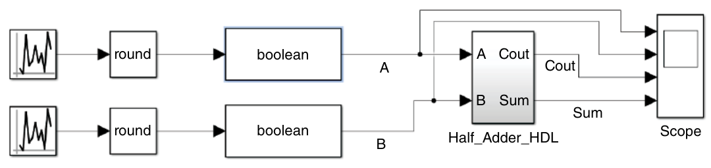

Hình 14.1 Model Half_Adder trong Simulink.

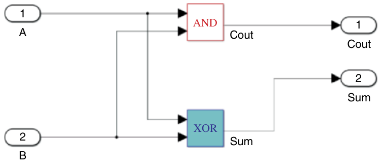

Hình 14.2 Model subsystem Half_Adder_HDL.

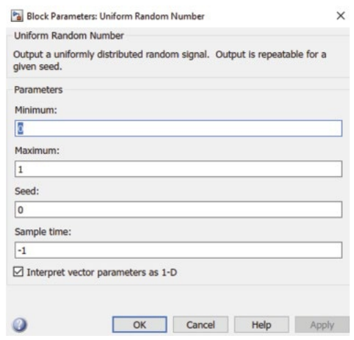

Hình 14.3 Thiết lập uniform random number phía trên.

```
>> hdllib(‘off’)
```

Các cửa sổ cấu hình cho thiết lập phía trên và phía dưới của uniform random number được thể hiện lần lượt trong Hình 14.3 và 14.4.

Cửa sổ thiết lập tham số của rounding function được minh họa trong Hình 14.5.

Ngoài ra, cửa sổ thiết lập tham số convert được thể hiện trong Hình 14.6.

Sau đó, chúng ta lưu thiết kế Simulink trong một thư mục mong muốn (Half_Adder) và đặt tên là Half_Adder. slx. Gõ code sau trong MATLAB command window.

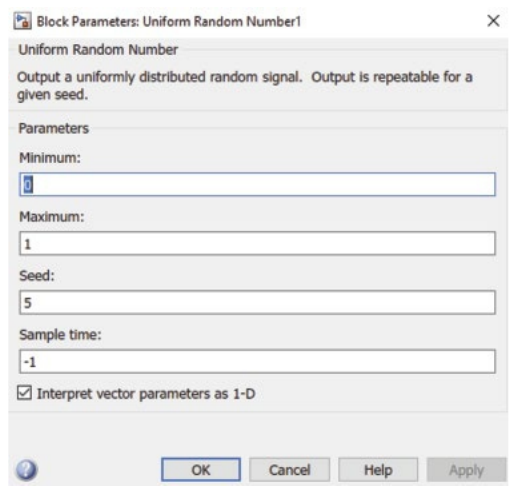

Hình 14.4 Thiết lập uniform random number phía dưới.

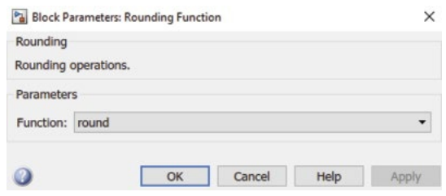

Hình 14.5 Thiết lập tham số rounding function.

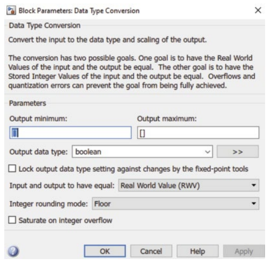

Hình 14.6 Thiết lập tham số convert.

```
>> cd(‘H:\matlab_fpga\Half_Adder’)
```

Bây giờ, chúng ta cũng có thể gõ code sau trong MATLAB command window.

```
>> hdlsetup(‘Half_Adder’)
```

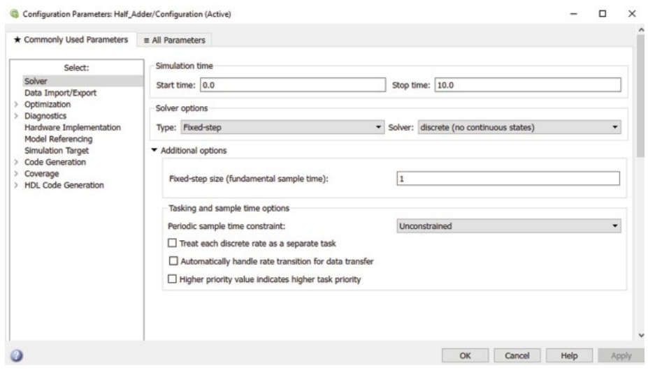

Hình 14.7 Đặt các tham số Solver.

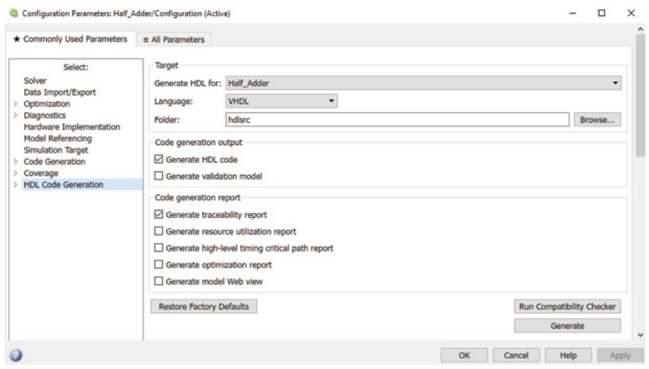

Hình 14.8 Đặt các tham số HDL Code Generation.

Chúng ta click vào button Model Parameters Configuration trên menu và đặt các tham số Solver như được mô tả trong Hình 14.7. Tiếp theo, chúng ta chọn tab HDL Code Generation và đặt các tham số như được minh họa trong Hình 14.8.

Bây giờ, chúng ta có thể chạy simulation. Khi simulation đang chạy, model Simulink chuyển sang màu đỏ, và data type của các port được hiển thị. Nếu data type không được hiển thị, chúng ta có thể right-click vào thiết kế Simulink, chọn Other Displays > Signals & Ports, rồi chọn Ports Data Types, như được minh họa trong Hình 14.9.

Các waveform trên scope được thể hiện trong Hình 14.10.

Bây giờ, chúng ta viết code sau trong MATLAB command window.

```
>> checkhdl(‘Half_Adder/Half_Adder_HDL’)
```

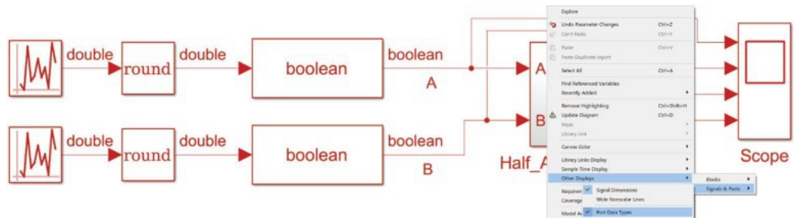

Hình 14.9 Hiển thị Port Data Types.

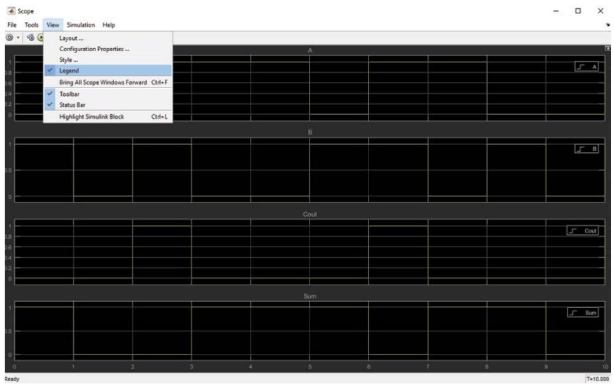

Hình 14.10 Các waveform trên scope.

Một HDL check report trên web browser bật lên, như được mô tả trong Hình 14.11.

Cuối cùng, chúng ta gõ code sau trong MATLAB command window.

```
>> makehdl(‘Half_Adder/Half_Adder_HDL’)
```

Cửa sổ Code Generation Report được hiển thị, và file VHDL (Half_Adder_HDL.vhd) được tạo ra, như được minh họa trong Hình 14.12.

Bây giờ, chúng ta mở Vivado và tạo một project mới tên Half_Adder_HDL. Click Next, rồi click vào Add files trong phần design sources. Tuy nhiên, trước khi click vào button Add Files, tốt hơn là copy và paste file VHDL đã tạo (Half_Adder_HDL.vhd) vào thư mục project Vivado-generated (Half_Adder_HDL), và cuối cùng, chúng ta click vào button Finish. Sau đó, chúng ta Run Synthesis, và khi nó hoàn tất thành công, chúng ta có thể click button Cancel, như được thể hiện trong Hình 14.13.

Trong phần RTL analysis của Project Manager, chúng ta chọn schematic. Cửa sổ Elaborate Design sẽ bật lên, như được mô tả trong Hình 14.14. Click button OK.

Bây giờ, chúng ta có thể xem schematic, như được minh họa trong Hình 14.15.

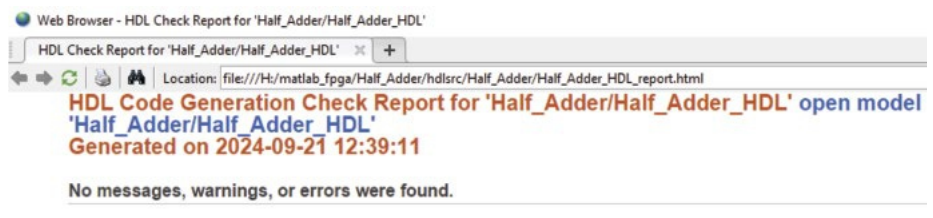

Hình 14.11 Web Browser – HDL Check Report.

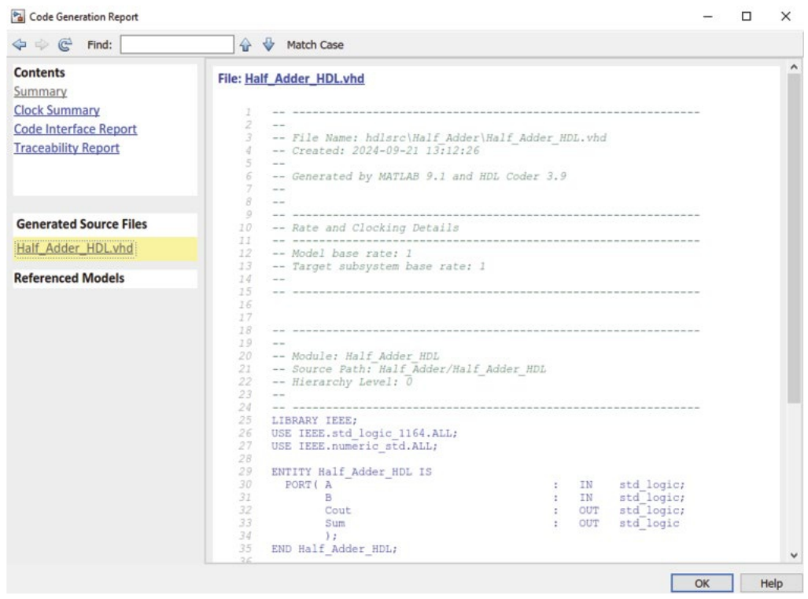

Hình 14.12 Cửa sổ Code Generation Report.

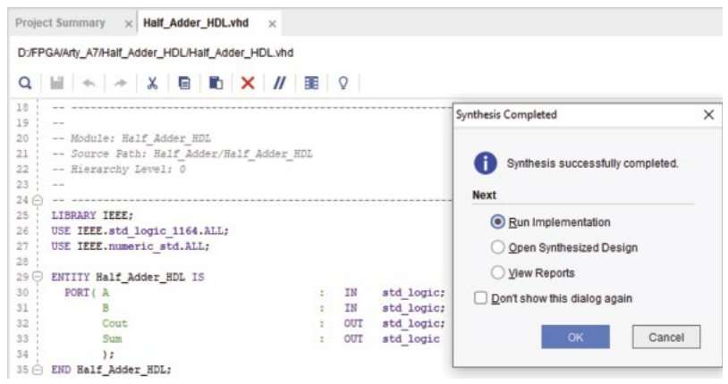

Hình 14.13 Synthesis analysis hoàn tất thành công.

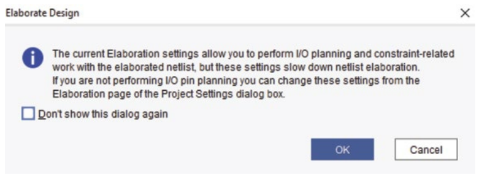

Hình 14.14 Cửa sổ Elaborate Design.

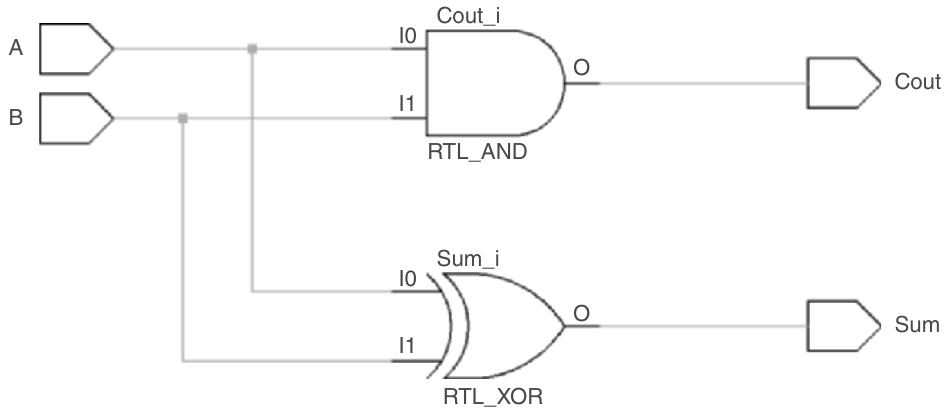

Hình 14.15 Schematic cho project Half_Adder_HDL.

Trong phần IP Integrator, chúng ta click vào tùy chọn Create Block Design để tạo một block diagram tên “top”. Sau đó, right-click vào file “Half_Adder_HDL.vhd” và chọn Add Module to Block Design để chèn nó như một module vào cửa sổ diagram, như được thể hiện trong Hình 14.16.

## 14.3 Mô hình hóa mạch tuần tự và State Flow Chart

Trong mục này, chúng ta sẽ thiết kế một mạch tuần tự (một Johnson counter) và mô hình hóa một bộ tạo xung bằng state flow chart trong Simulink. Đầu tiên, mở MATLAB command window và gõ lệnh sau.

```
>> simulink
```

Ngoài ra, chúng ta chuyển thư mục tới nơi muốn lưu project Simulink bằng code sau.

```
>> cd(‘H:\matlab_fpga\Johnson_Counter’)
```

Sau khi mở môi trường Simulink, chúng ta dùng code sau để mở HDL Coder library browser.

```
>> hdllib
```

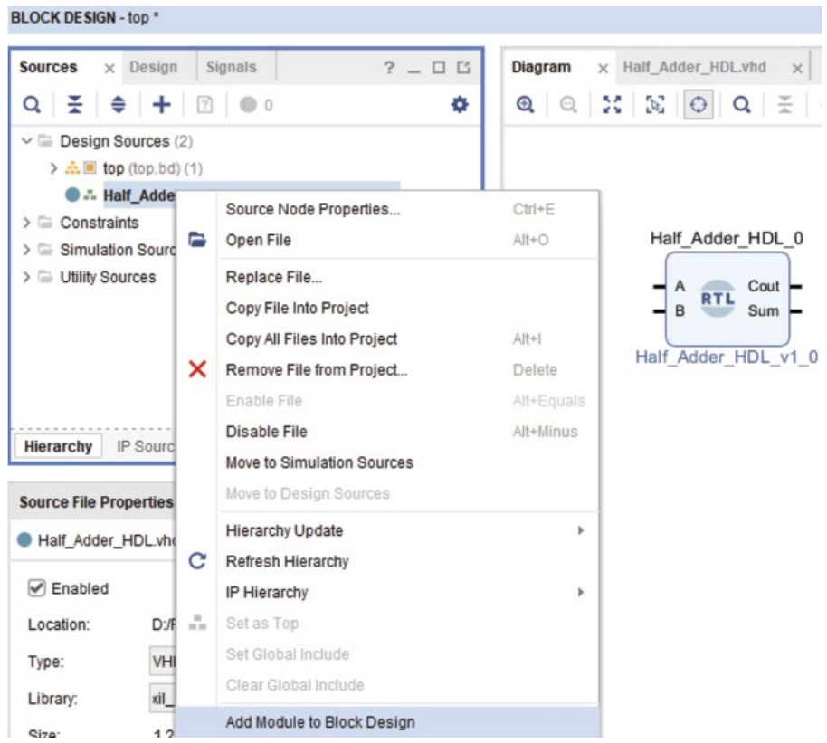

Hình 14.16 Chọn tùy chọn Add Module to Block Design.

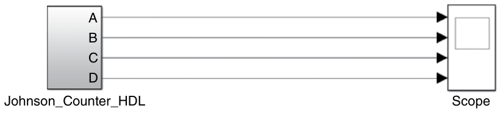

Hình 14.17 Model Johnson_Counter trong Simulink.

Sau đó, dùng HDL Coder library browser, chúng ta tạo một model mới tên Johnson_Counter, như được thể hiện trong Hình 14.17. Ngoài ra, model subsystem Johnson_Counter_HDL được mô tả trong Hình 14.18.

Chúng ta biết rằng một Johnson counter 4-bit gồm bốn D flip-flops nối với nhau, và sơ đồ mạch của nó được minh họa trong Hình 14.19. Bảng chân trị của Johnson counter 4-bit được thể hiện trong Bảng 14.1.

Ngoài ra, model subsystem Johnson_Counter được minh họa trong Hình 14.20.

Các block parameter cho delay (Z<sup>−1</sup>) được thể hiện trong Hình 14.21.

Ngoài ra, các block parameter cho cổng NOT được mô tả trong Hình 14.22.

Chúng ta dùng chart trong stateflow library browser để tạo một model finite state machine (FSM) cho việc tạo xung clock. Chúng ta có hai state (S0 và S1). Để chuyển từ S0 sang S1, chúng ta có thể dùng một điều kiện như [after(1,sec)]. Tuy nhiên, với HDL Coder, tốt hơn là dùng một điều kiện như [after(10,tick)]. Trong trường hợp này, nếu đặt fixed step size là 0.1 trong solver configuration parameters, độ trễ 1s cũng được tạo ra, như được minh họa trong Hình 14.23.

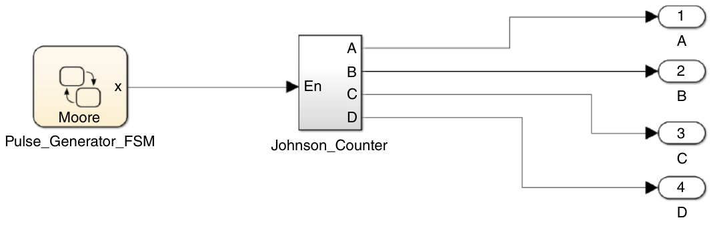

Hình 14.18 Model subsystem Johnson_Counter_HDL.

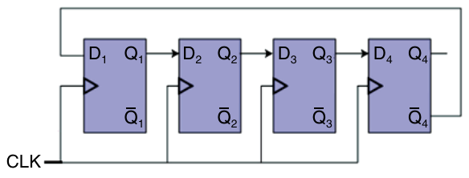

Hình 14.19 Một Johnson counter 4-bit.

Bảng 14.1 Bảng chân trị của Johnson counter 4-bit.

| CLK | Q<sub>1</sub> | Q<sub>2</sub> | Q<sub>3</sub> | Q<sub>4</sub> |
|---|---|---|---|---|
| 0 | 0 | 0 | 0 | 0 |
| 1 | 1 | 0 | 0 | 0 |
| 2 | 1 | 1 | 0 | 0 |
| 3 | 1 | 1 | 1 | 0 |
| 4 | 1 | 1 | 1 | 1 |
| 5 | 0 | 1 | 1 | 1 |
| 6 | 0 | 0 | 1 | 1 |
| 7 | 0 | 0 | 0 | 1 |

Chúng ta chọn Model Explorer (Ctrl+H), như được thể hiện trong Hình 14.24.

Sau đó, chúng ta đặt các tham số của cửa sổ Model Explorer, như được mô tả trong Hình 14.25.

Bây giờ, chúng ta cũng có thể gõ code sau trong MATLAB command window.

```
>> hdlsetup(‘Half_Adder’)
```

Ngoài ra, chúng ta đặt fixed step size là 0.1s trong solver configuration parameters, như được minh họa trong Hình 14.26.

Nếu chạy simulation, các xung được tạo ra ở output của state flow chart (x) được thể hiện trong Hình 14.27.

Ngoài ra, các waveform Johnson counter của subsystem Jounson_Counter_HDL *(ghi chú: sách in "Jounson"; đúng là "Johnson")* được mô tả trong Hình 14.28.

Tuy nhiên, vì tần số system clock của development board Arty A7 là 100 MHz, fixed step size của chúng ta sẽ là 1/10<sup>8</sup> = 10<sup>−8</sup>. Do đó, cửa sổ solver configuration parameters được minh họa lại trong Hình 14.29.

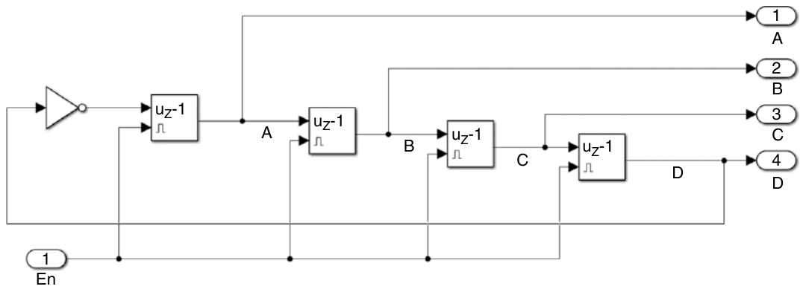

Hình 14.20 Model subsystem Johnson_Counter.

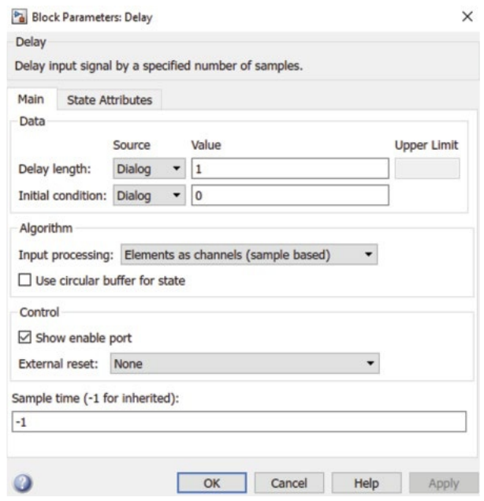

Hình 14.21 Các block parameter cho delay (Z<sup>−1</sup>).

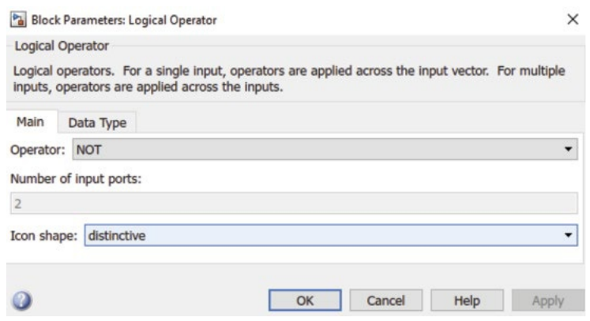

Hình 14.22 Block parameter cho cổng NOT.

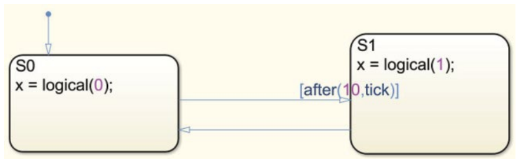

Hình 14.23 State flow chart cho bộ tạo xung clock.

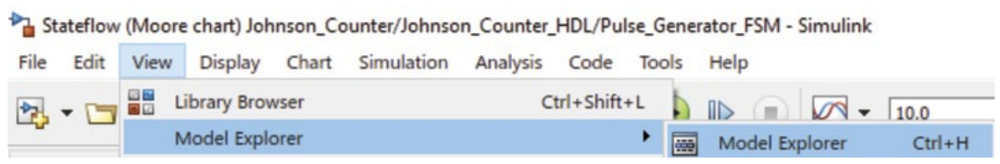

Hình 14.24 Chọn Model Explorer (Ctrl+H).

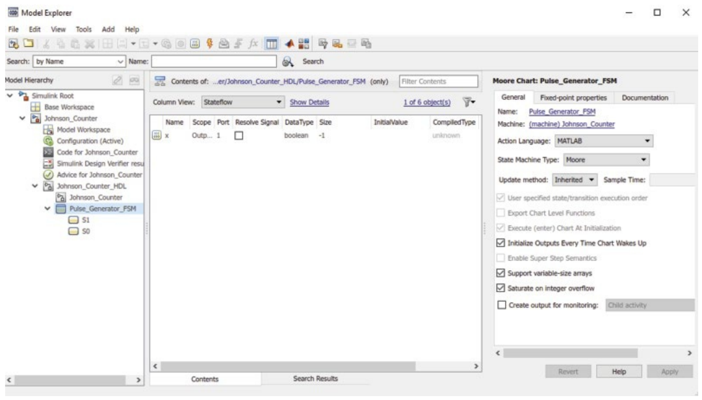

Hình 14.25 Đặt các tham số của cửa sổ Model Explorer.

Ngoài ra, chúng ta đặt các tham số tab HDL Code Generation, như được minh họa trong Hình 14.30.

Bây giờ, chúng ta viết code sau trong MATLAB command window.

```
>> checkhdl(‘Johnson_Counter/Johnson_Counter_HDL’)
```

Một Web Browser – HDL Check Report được hiển thị, như được thể hiện trong Hình 14.31.

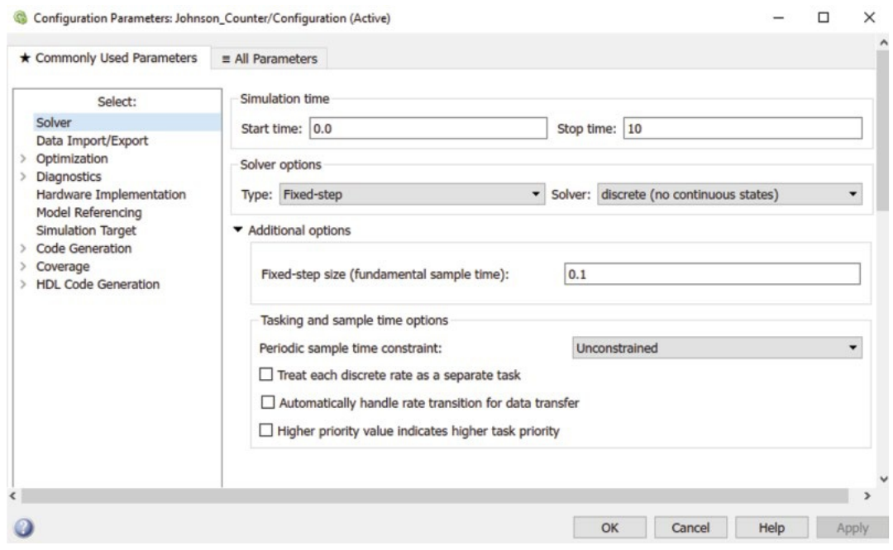

Hình 14.26 Đặt fixed step size là 0.1s.

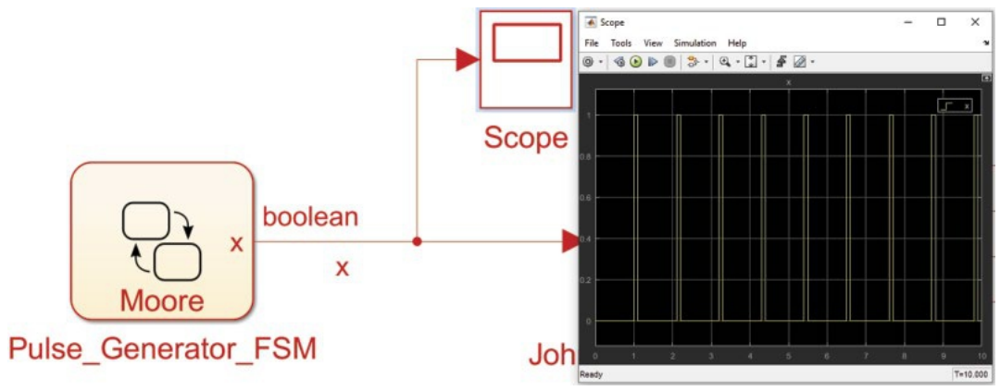

Hình 14.27 Các xung được tạo ra ở output của state flow chart.

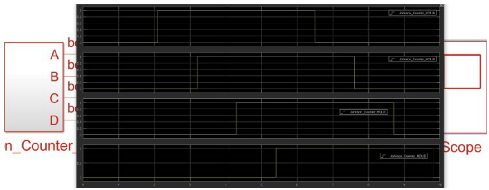

Hình 14.28 Các waveform của subsystem Jounson_Counter_HDL.

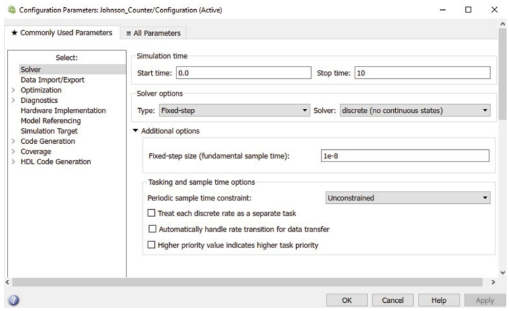

Hình 14.29 Đặt fixed-step size là 10<sup>−8</sup>s.

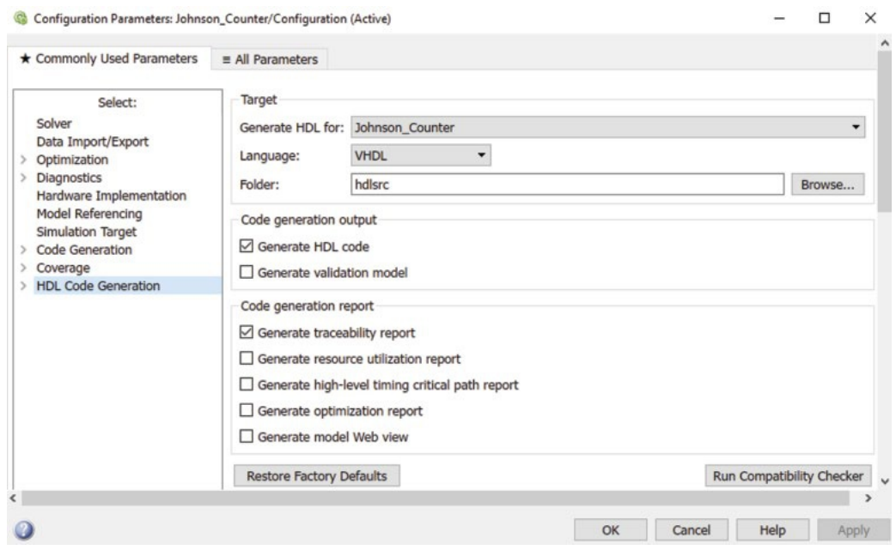

Hình 14.30 Đặt các tham số tab HDL Code Generation.

Cuối cùng, chúng ta gõ code sau trong MATLAB command window.

```
>> makehdl(‘Johnson_Counter/Johnson_Counter_HDL’)
```

Cửa sổ Code Generation Report bật lên, và bốn file VHDL được tạo ra, như được mô tả trong Hình 14.32.

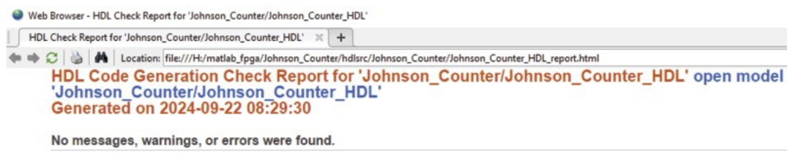

Hình 14.31 Web Browser – HDL Check Report.

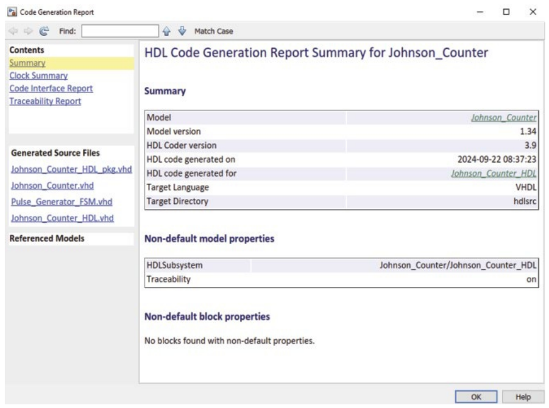

Hình 14.32 Cửa sổ Code Generation Report.

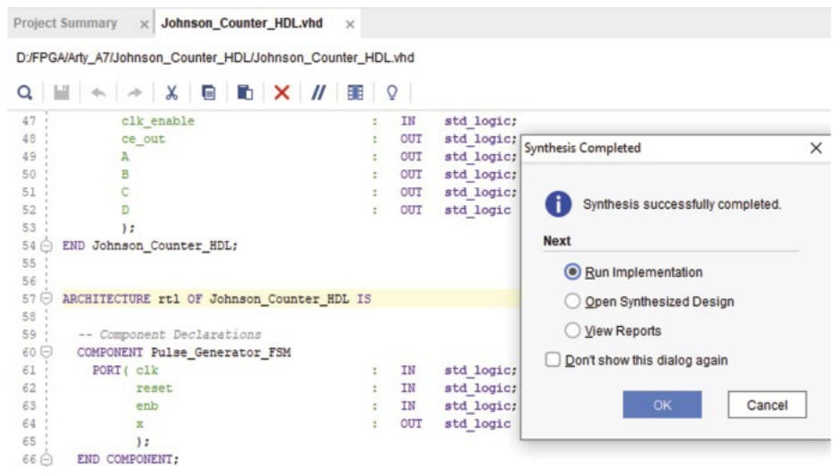

Hình 14.33 Synthesis analysis hoàn tất thành công.

Bây giờ, chúng ta mở Vivado và tạo một project mới tên Johnson_Counter_HDL. Chúng ta click Next, rồi chọn Add files vào design sources. Trước khi click button Add Files, tốt hơn là copy và paste bốn file VHDL đã tạo (thể hiện trong Hình 14.32) vào thư mục Vivado-generated (Johnson_Counter_HDL). Cuối cùng, chúng ta click button Finish. Tiếp theo, chúng ta chạy synthesis analysis, và nó hoàn tất thành công, vậy chúng ta click vào button Cancel, như được thể hiện trong Hình 14.33.

Trong RTL analysis ở tab Project Manager, chúng ta chọn schematic. Cửa sổ Elaborate Design bật lên, rồi chúng ta click vào button OK. Bây giờ, chúng ta có thể thấy schematic, như được mô tả trong Hình 14.34.

Ngoài ra, trong phần IP Integrator, chúng ta click vào tùy chọn Create Block Design để tạo block diagram tên “top”, rồi right-click vào file “Johnson_Counter _HDL.vhd” và chọn tùy chọn Add Module to Block Design để thêm nó như một module vào cửa sổ diagram, như được minh họa trong Hình 14.35.

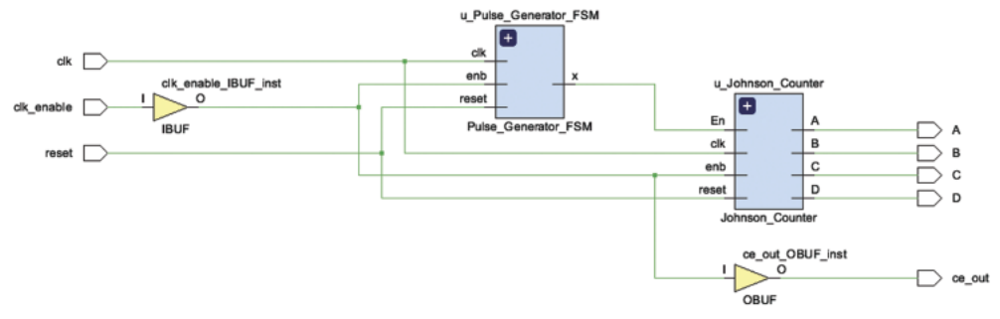

Hình 14.34 Schematic cho project Johnson_Counter_HDL.

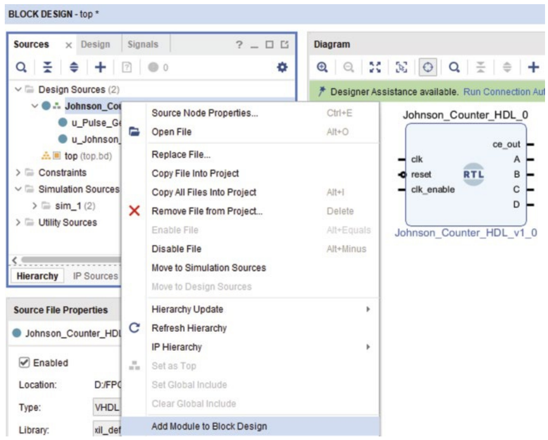

Hình 14.35 Chọn tùy chọn Add Module to Block Design.

## 14.4 Thiết kế PWM cơ bản

Trong mục này, chúng ta sẽ thiết kế một mạch PWM cơ bản và mô hình hóa nó trong Simulink. Trước hết, trong command window của MATLAB, chúng ta viết lệnh sau để mở Simulink.

```
>> simulink
```

Ngoài ra, chúng ta chuyển thư mục tới nơi muốn lưu project Simulink bằng code sau.

```
>> cd(‘H:\matlab_fpga\Basic_PWM_Design’)
```

Sau khi mở môi trường Simulink, chúng ta dùng code sau để mở HDL Coder library browser.

```
>> hdllib
```

Sau đó, dùng HDL Coder library browser, chúng ta tạo một model mới tên Basic_PWM_ Design, như được thể hiện trong Hình 14.36. Ngoài ra, model subsystem Basic_PWM_Design được mô tả trong Hình 14.37.

Các block parameter cho counter free-running 4-bit được minh họa trong Hình 14.38.

Các block parameter cho tab main và tab signal attributes của constant được thể hiện lần lượt trong Hình 14.39 và 14.40.

Bây giờ, chúng ta cũng có thể gõ code sau trong MATLAB command window.

```
>> hdlsetup(‘Basic_PWM_Design’)
```

Chúng ta đặt fixed step size là 1s trong solver configuration parameters, như được mô tả trong Hình 14.41. Ngoài ra, chúng ta đặt các tham số tab HDL Code Generation, như được minh họa trong Hình 14.42.

Bây giờ, nếu chạy simulation, các xung PWM được tạo ra ở output của subsystem Basic_ PWM_Design được thể hiện trong Hình 14.43.

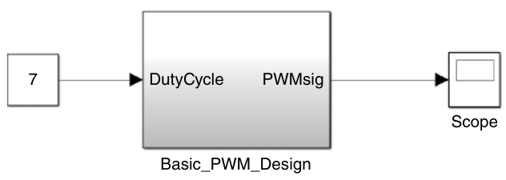

Hình 14.36 Model Basic_PWM_Design trong Simulink.

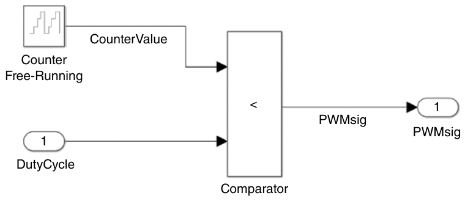

Hình 14.37 Model subsystem Basic_PWM_Design.

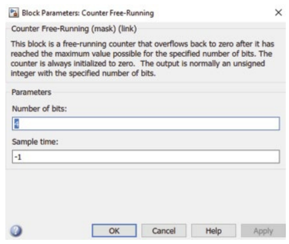

Hình 14.38 Các block parameter cho counter free-running.

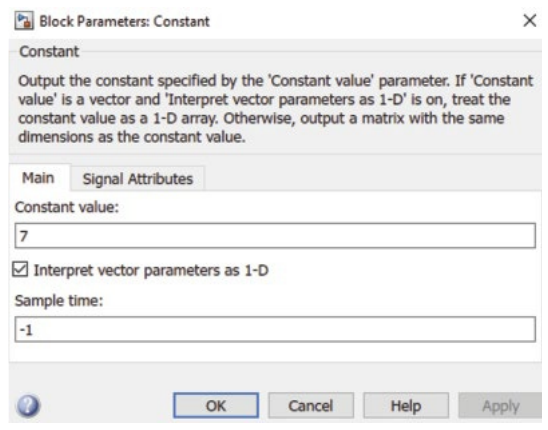

Hình 14.39 Các block parameter cho tab main của constant.

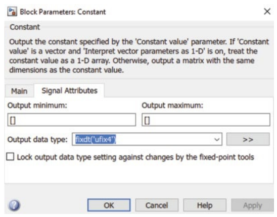

Hình 14.40 Các block parameter cho tab signal attributes của constant.

Waveform output của counter free-running 4-bit và signal PWM bên trong model subsystem Basic_ PWM_Design được mô tả trong Hình 14.44.

Trước khi kiểm tra và chạy các lệnh HDL coder, tốt hơn là xóa scope bên trong model subsystem Basic_PWM_Design. Bây giờ, chúng ta viết code sau trong MATLAB command window.

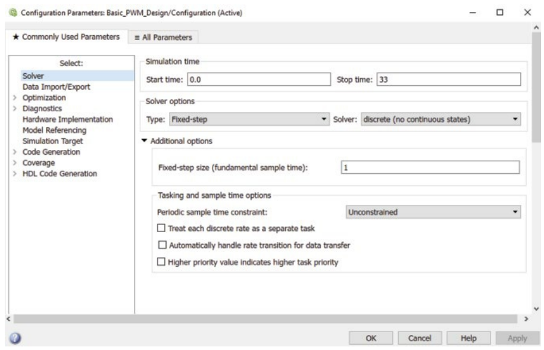

Hình 14.41 Đặt fixed-step size là 1s.

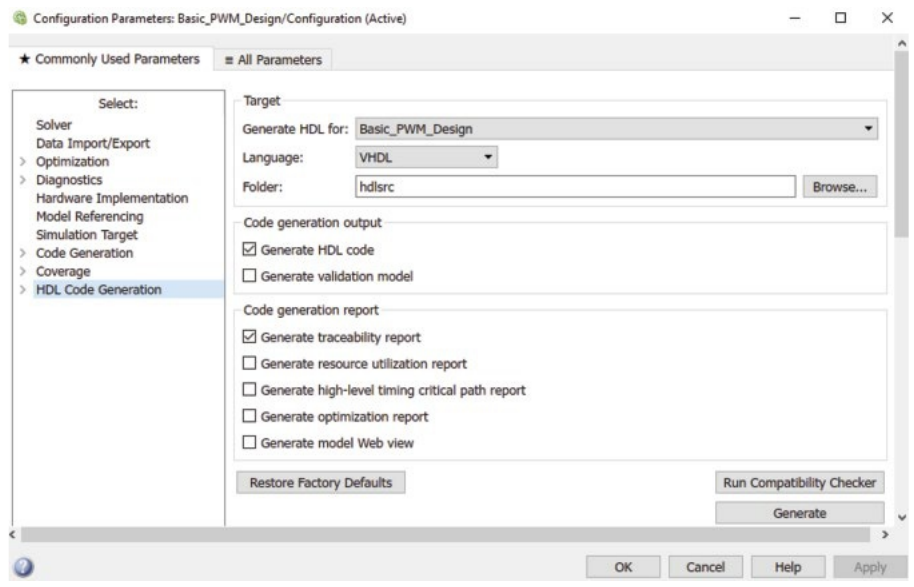

Hình 14.42 Đặt các tham số tab HDL Code Generation.

```
>> makehdl(‘Basic_PWM_Design/Basic_PWM_Design’)
```

Một Web Browser – HDL Check Report được hiển thị, như được minh họa trong Hình 14.45.

Cuối cùng, chúng ta gõ code sau trong MATLAB command window.

```
>> makehdl(‘Basic_PWM_Design/Basic_PWM_Design’)
```

Cửa sổ Code Generation Report bật lên, và file VHDL (Basic_PWM_Design.vhd) được tạo ra như được thể hiện trong Hình 14.46.

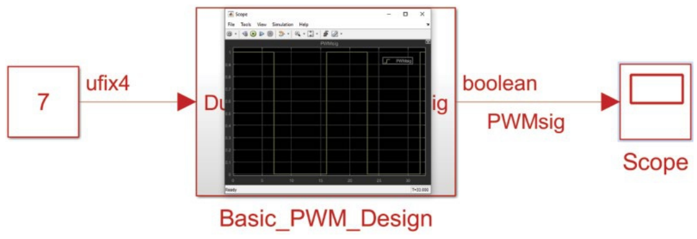

Hình 14.43 Các xung PWM được tạo ra ở output của subsystem Basic_PWM_Design.

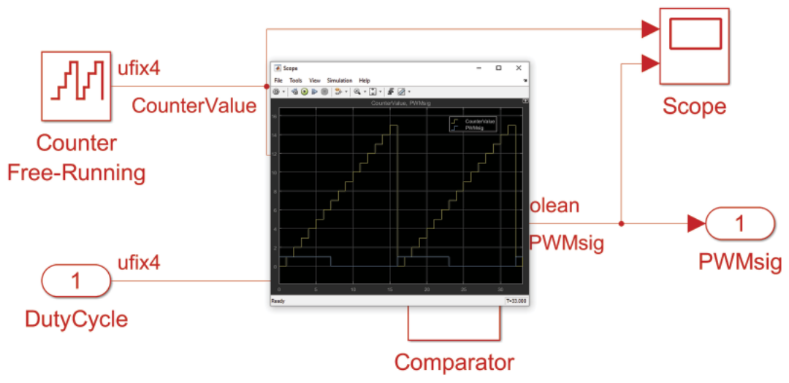

Hình 14.44 Waveform output của counter free-running 4-bit và signal PWM.

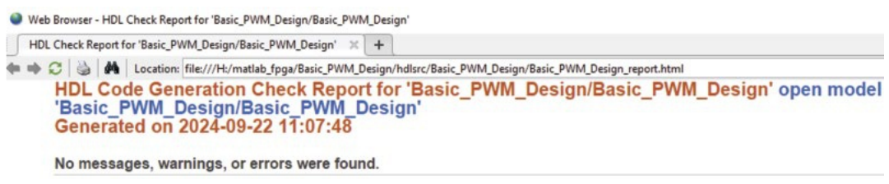

Hình 14.45 Web Browser – HDL Check Report.

Bây giờ, chúng ta mở Vivado và tạo một project mới tên Basic_PWM. Chúng ta click Next, rồi chọn Add files vào design sources. Trước khi click button Add Files, tốt hơn là copy và paste file VHDL đã tạo ở Hình 14.46 vào thư mục Vivado-generated (Basic_PWM). Cuối cùng, chúng ta click button Finish. Tiếp theo, chúng ta chạy synthesis analysis, và nó hoàn tất thành công, vậy chúng ta click button Cancel, như được mô tả trong Hình 14.47.

Như bạn có thể thấy, chúng ta đã thêm Count_Val làm một output port, và giá trị của nó được gán bởi signal unsigned CounterValue, như được minh họa trong Hình 14.47. Trong RTL analysis ở phần project manager, chúng ta chọn schematic. Cửa sổ Elaborate Design bật lên, rồi chúng ta click vào button OK. Bây giờ, chúng ta có thể thấy schematic, như được mô tả trong Hình 14.48.

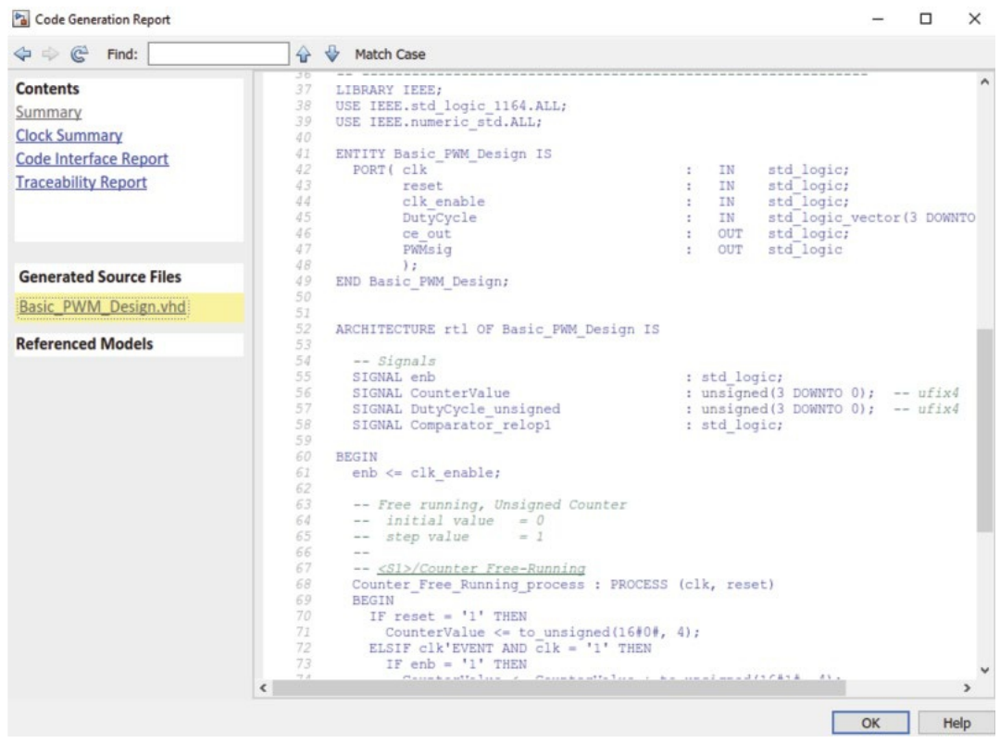

Hình 14.46 Cửa sổ Code Generation Report.

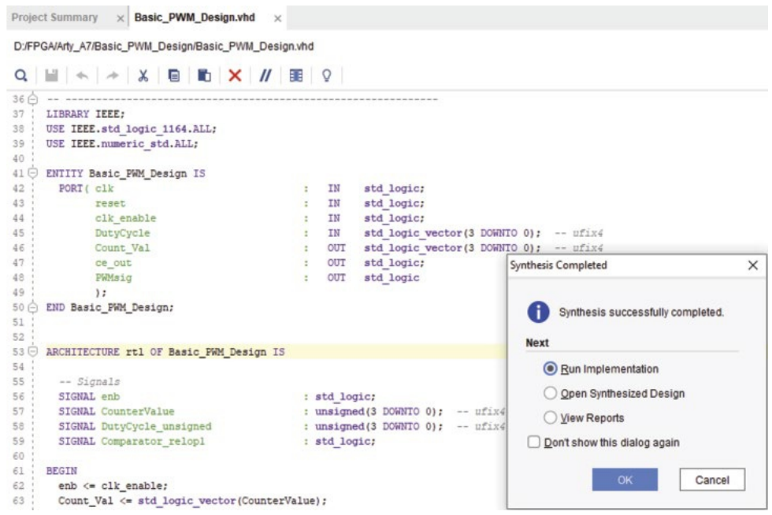

Hình 14.47 Synthesis analysis hoàn tất thành công.

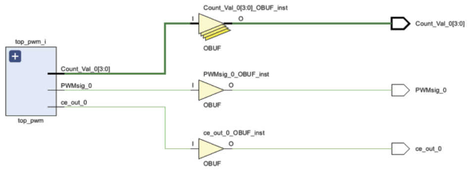

Hình 14.48 Schematic cho project Basic_PWM.

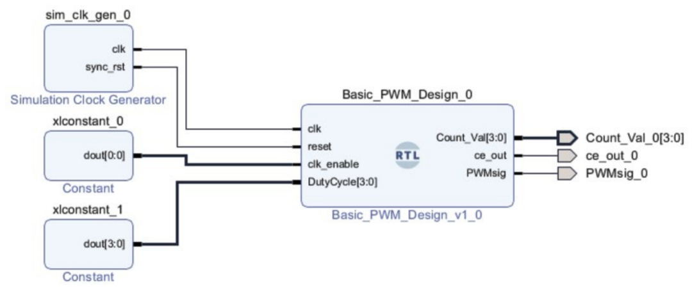

Hình 14.49 Block design trong cửa sổ diagram.

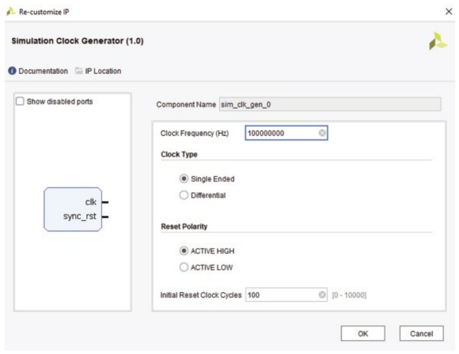

Hình 14.50 Cửa sổ re-customize IP cho simulation clock generator.


Hình 14.51 Cửa sổ tham số re-customize IP cho constant (clk_enable).


Hình 14.52 Cửa sổ tham số re-customize IP cho constant (DutyCycle).


Hình 14.53 Chọn create HDL wrapper….

Ngoài ra, trong phần IP Integrator, chúng ta click vào tùy chọn Create Block Design để tạo một block diagram tên “top_pwm”. Sau đó chúng ta right-click vào file “Basic_PWM_Design.vhd” và chọn tùy chọn Add Module to Block Design để thêm nó như một module vào cửa sổ diagram. Chúng ta cũng thêm một simulation clock generator, một constant cho clk_enable, và một constant 4-bit cho DutyCycle. Sau đó, chúng ta chọn Count_Val, ce_out và PWMsig, rồi nhấn Ctrl+T để tạo output port cho chúng, như được minh họa trong Hình 14.49.


Hình 14.54 Chọn tùy chọn Run Behavioral Simulation.


Hình 14.55 Signal PWM được tạo ra sau 100 chu kỳ.


Hình 14.56 Chọn radix là unsigned decimal.


Hình 14.57 Chọn waveform style là analog.


Hình 14.58 Waveform tam giác của Count_Val.

Cửa sổ tham số re-customize IP cho simulation clock generator được thể hiện trong Hình 14.50.

Ngoài ra, các cửa sổ tham số re-customize IP cho các constant được mô tả lần lượt trong Hình 14.51 và 14.52.

Sau đó, chúng ta right-click vào top_pwm.bd, và chọn create HDL wrapper…, như được minh họa trong Hình 14.53.

Bây giờ, từ menu Flow, chúng ta chọn tùy chọn Run Behavioral Simulation, như được thể hiện trong Hình 14.54.

Đầu tiên, chúng ta restart simulation và chạy simulation trong 200 ns. Sau 100 chu kỳ (1000 ns), signal PWM được tạo ra như được mô tả trong Hình 14.55, vì chu kỳ clock reset ban đầu đã được đặt là 100 trong Hình 14.50.

Chúng ta right-click vào Count_Val và chọn radix là unsigned decimal, như được minh họa trong Hình 14.56.

Ngoài ra, chúng ta right-click vào Count_Val và chọn waveform style là analog, như được thể hiện trong Hình 14.57.

Bây giờ, chúng ta có thể xem waveform tam giác của Count_Val, như được mô tả trong Hình 14.58.
