# 15 Ứng dụng flowchart trong Simulink để tạo code VHDL

## 15.1 Flowchart của bộ nhân

Trong mục này, chúng ta sẽ triển khai một bộ nhân bằng flowchart trong Simulink. Các thuật toán dựa trên state flowchart trong HDL Coder để lập trình VHDL bằng Vivado được bàn chi tiết. Flowchart của bộ nhân (P = A × B) được thể hiện trong Hình 15.1. Chúng ta giả định rằng B ≠ 0 và ban đầu P = 0.

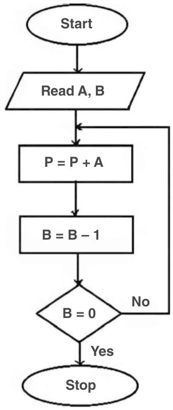

Hình 15.1 Flowchart của bộ nhân (P = A × B).

Chúng ta sẽ dùng kiểu số fixed-point để định nghĩa các tham số của flowchart trong một m-file của MATLB *(ghi chú: sách in "MATLB"; đúng là "MATLAB")*. Ví dụ, nếu viết và chạy code sau, chúng ta sẽ có kết quả như sau.

```
clear all; close all; clc
% Define 5-bit unsigned number
nt = numerictype(0,5,0);
a = fi(3,nt)
a.bin

a =
     3
          DataTypeMode: Fixed-point: binary point scaling
            Signedness: Unsigned
            WordLength: 5
        FractionLength: 0
ans =
00011
```

Khi bắt đầu flowchart trong môi trường Stateflow của Simulink, chúng ta bắt đầu với state ban đầu (S0) bằng cách khởi tạo tất cả các output về không hoặc về các giá trị định sẵn dùng các constant được định nghĩa trong m-file MATLAB. Sau đó, chúng ta triển khai flowchart step-by-step, coi mỗi bước là một state riêng trong Stateflow. Nếu gặp một thao tác phức tạp, chúng ta chia nó thành nhiều bước hay nhiều state để rõ ràng và dễ quản lý. Các constant được định nghĩa trong m-file được đặt làm parameter, còn các variable trung gian được định nghĩa là local trong Stateflow Model Explorer. Chúng ta gán các input cho các local variable và tương tự định nghĩa các input và output trong Model Explorer. Khi thực hiện bất kỳ phép toán số học nào bên trong một state, hãy bảo đảm chuyển nó sang định dạng fixed-point bằng lệnh fi. Ví dụ, chúng ta có code sau.

```
P = fi(P+A,0,14,0); % Perform P = P + A and save it as 14-bit unsigned number
B = fi(B-a1,0,7,0); % Perform B = B - 1 and save it as 7-bit unsigned number
```

Chúng ta cũng có thể cân nhắc dùng MATLAB function hoặc Simulink function để đơn giản hóa và làm gọn flowchart. Stateflow chart đã thiết kế trong Simulink được thể hiện trong Hình 15.2.

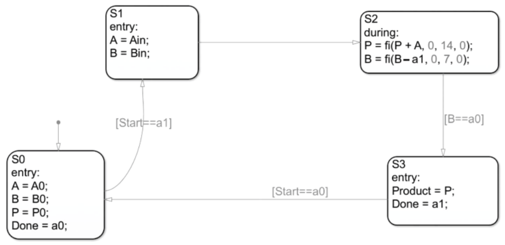

Hình 15.2 Stateflow chart đã thiết kế trong Simulink.

Các parameter (constant) đã được định nghĩa sẵn bên trong m-file (FC_Parameters.m) như code sau.

```
clear all; close all; clc
N = 7; %nbits
nt1 = numerictype(0,1,0);
nt2 = numerictype(0,N,0);
nt3 = numerictype(0,2*N,0);

% 1-bit constants
a0 = fi(0,nt1);
a1 = fi(1,nt1);

% Inputs
Ain = fi(50,nt2);
Bin = fi(12,nt2);

% Initial values
A0 = fi(0,nt2);
B0 = fi(0,nt2);
P0 = fi(0,nt3);
```

Để dùng các constant này bên trong Stateflow, chúng ta nên chạy m-file. A0, B0, P0, a0 và a1 là các parameter fixed-point được định nghĩa bên trong m-file. A, B và P là các variable local hay trung gian. Ain, Bin và Start là các input, còn Product và Done là các output. Từ View → Model Explorer → Model Explorer, chúng ta mở cửa sổ Model Explorer như được mô tả trong Hình 15.3.

Để thêm parameter, local variable, input và output cho thiết kế Stateflow ở Hình 15.2, trong cửa sổ Model Explorer, click vào Add trên thanh menu và chọn tùy chọn Data, như được minh họa trong Hình 15.4.

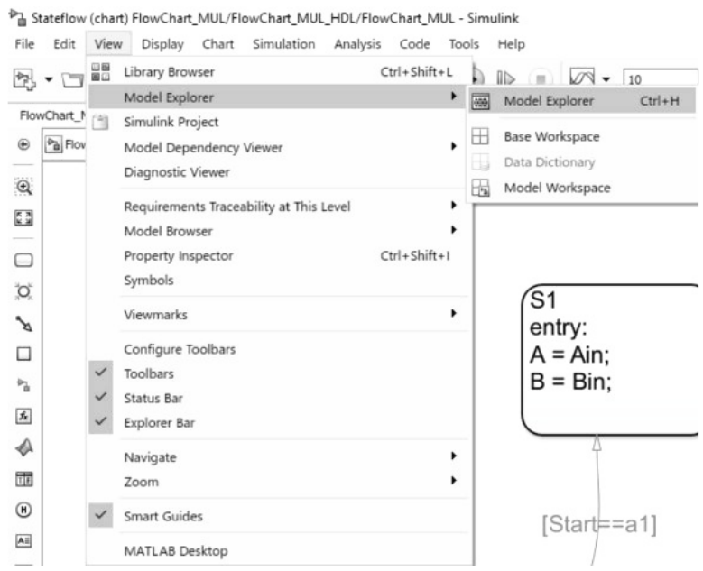

Hình 15.3 Chọn tùy chọn Model Explorer.

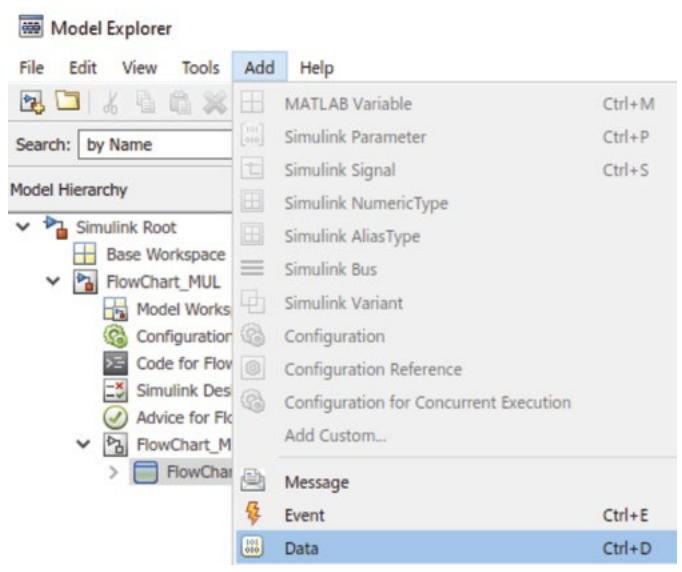

Hình 15.4 Chọn tùy chọn Data.

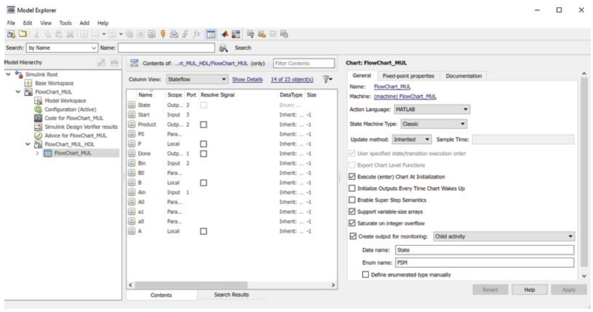

Hình 15.5 Các variable đã được thêm đầy đủ của flowchart.

Danh sách đầy đủ các variable đã thêm cho flowchart được thể hiện trong Hình 15.5.

Chúng ta cũng enable tùy chọn Create output for monitoring, và nhập Data name là State và Enum name là FSM, như được minh họa trong Hình 15.5. Các variable input và output của flowchart được minh họa trong Hình 15.6.

Tiếp theo, chúng ta đặt flowchart vào bên trong một subsystem như được thể hiện trong Hình 15.7.

Các block parameter cho các block Constant và Repeating Sequence Stair được mô tả lần lượt trong Hình 15.8, 15.9 và 15.10.

Trước khi chạy simulation, chúng ta đặt tab Solver của cửa sổ Configuration Parameters như được minh họa trong Hình 15.11.

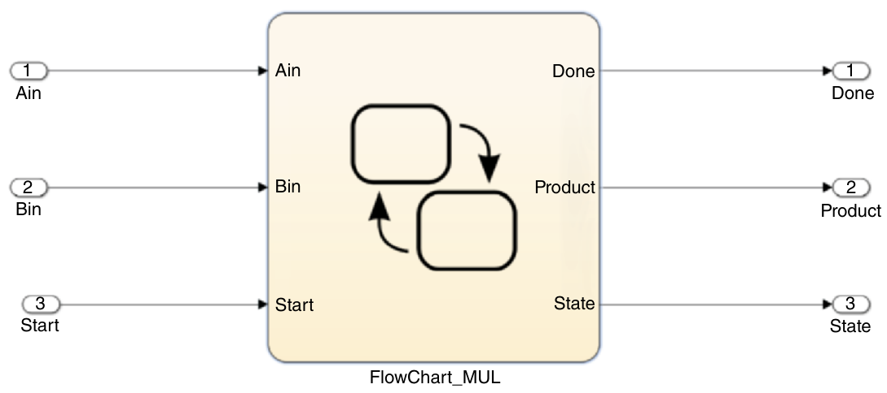

Hình 15.6 Các variable input và output của flowchart.

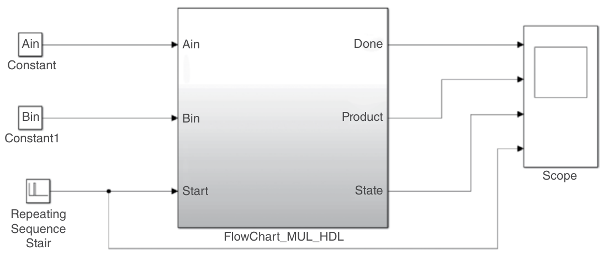

Hình 15.7 Đặt flowchart vào bên trong một subsystem.

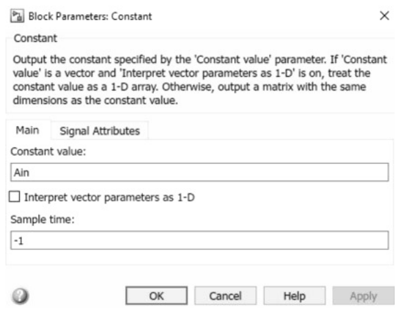

Hình 15.8 Các block parameter cho Constant.

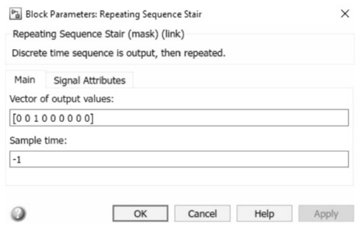

Hình 15.9 Các block parameter cho phần main của Repeating Sequence Stair.

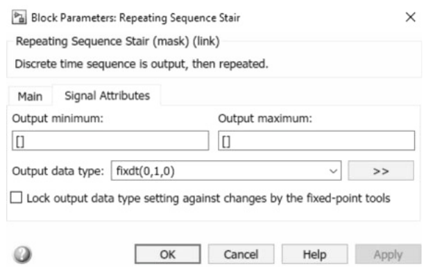

Hình 15.10 Các block parameter cho signal attributes của Repeating Sequence Stair.

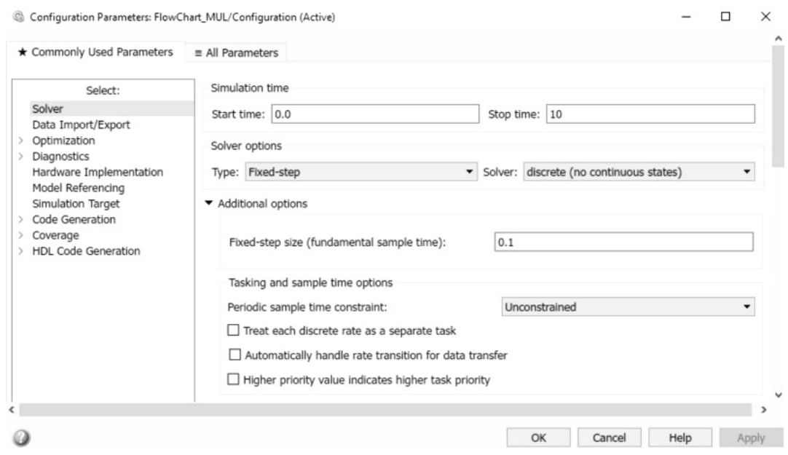

Hình 15.11 Đặt tab Solver của cửa sổ Configuration Parameters.

Bây giờ, chúng ta có thể chạy simulation. Các waveform output trên block Scope được thể hiện trong Hình 15.12.

Tiếp theo, chúng ta tạo code VHDL cho subsystem “FlowChart_MUL_HDL” ở Hình 15.7 bằng HDL Coder. Để làm điều đó, chúng ta viết code sau trong MATLAB command window.

```
>> hdlsetup('FlowChart_MUL')
```

Ở đây, FlowChart_MUL là tên của file Simulink (FlowChart_MUL.slx). Sau đó, chúng ta cấu hình tab Solver của cửa sổ Configuration Parameters, như được mô tả trong Hình 15.13.

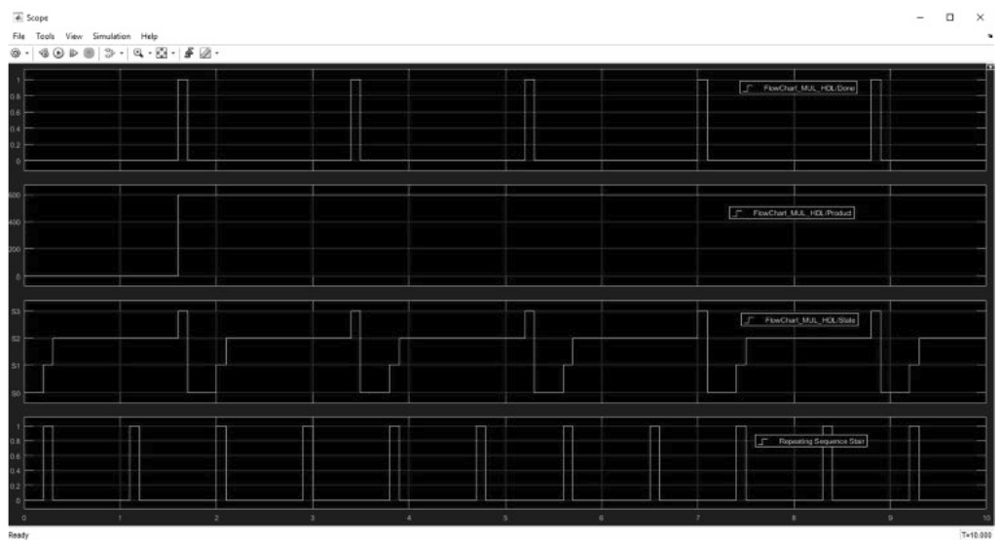

Hình 15.12 Các waveform trên Scope.

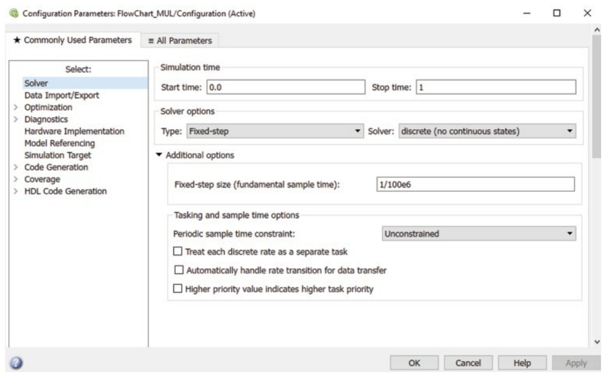

Hình 15.13 Đặt tab Solver của cửa sổ Configuration Parameters.

Vì tần số clock của các development board FPGA Xilinx thường là 100 MHz, chúng ta đặt fixed-step size là 1/100e6 như được minh họa trong Hình 15.13. Ngoài ra, chúng ta đặt tab HDL Code Generation của cửa sổ Configuration Parameters như được minh họa trong Hình 15.14.

Tiếp theo, chúng ta gõ code sau trong MATLAB command window.

```
>> checkhdl('FlowChart_MUL/FlowChart_MUL_HDL')
```

Thao tác này mở cửa sổ HDL Check Report trong web browser, như được thể hiện trong Hình 15.15.

Bây giờ, chúng ta dùng code sau để tạo code HDL trong MATLAB command window.

```
>> makehdl('FlowChart_MUL/FlowChart_MUL_HDL')
```

Code VHDL được tạo ra thành công, và cửa sổ Code Generation Report xuất hiện, như được mô tả trong Hình 15.16.

Bây giờ, chúng ta chạy Vivado và tạo một thư mục tên “FlowChart.” Bên trong thư mục này, chúng ta tạo một project tên “FlowChart” và click button Next để tiếp tục. Trong cửa sổ Add Sources, trước khi thêm các file VHDL đã tạo, trước tiên chúng ta copy và paste ba file VHDL đã tạo, như được thể hiện trong Hình 15.16, vào thư mục FlowChart của project Vivado. Bây giờ, bằng cách click button Add Files, chúng ta có thể thêm chúng vào project. Sau đó chúng ta chọn development board Xilinx và click vào button Finish để tạo project FlowChart với các file VHDL đã tạo được thêm vào. Cuối cùng, chúng ta chạy synthesis, như được minh họa trong Hình 15.17.

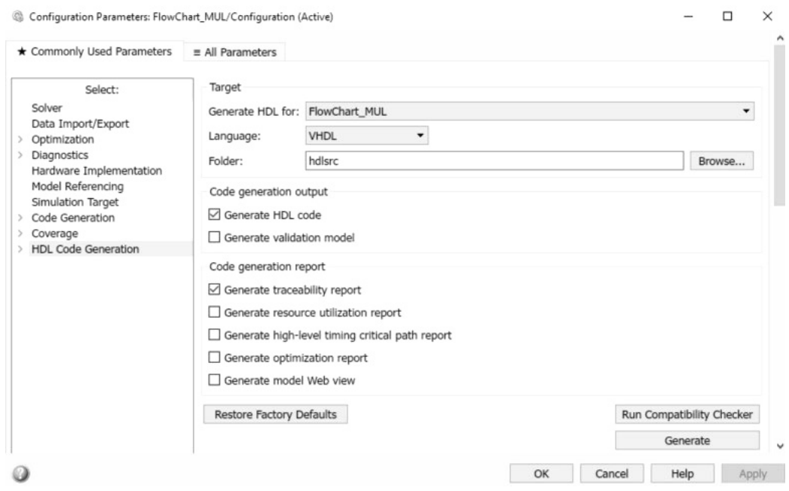

Hình 15.14 Đặt HDL Code Generation của cửa sổ Configuration Parameters.

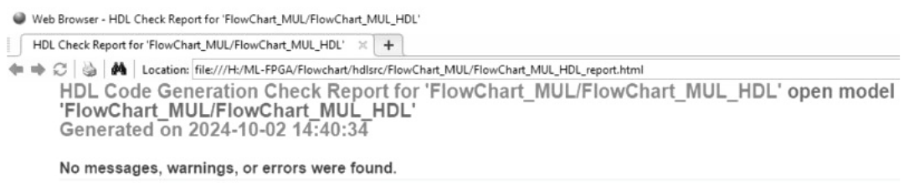

Hình 15.15 Cửa sổ HDL Check Report.

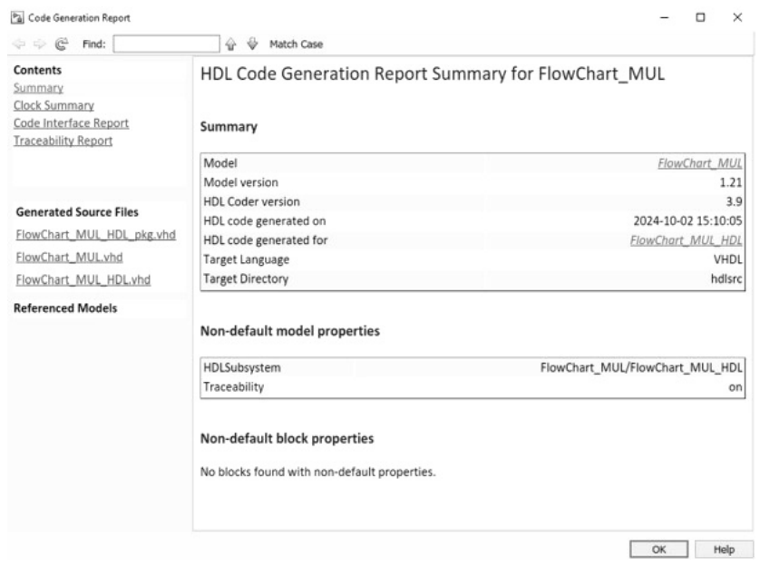

Hình 15.16 Cửa sổ Code Generation Report.

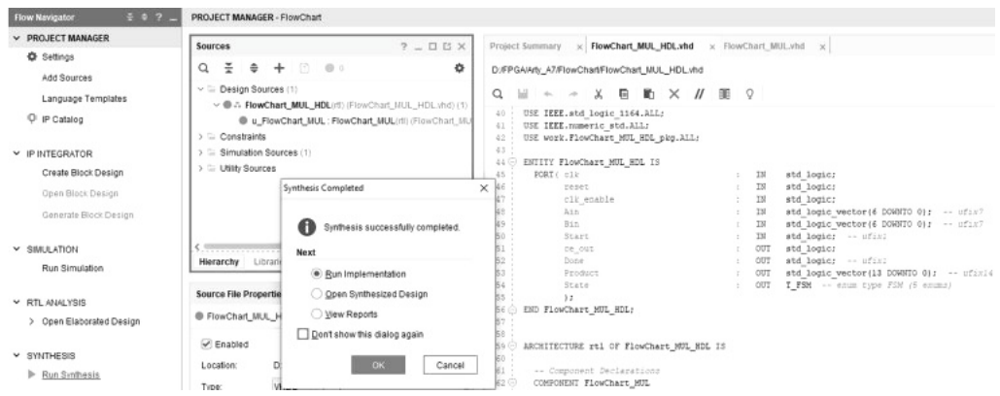

Hình 15.17 Chạy synthesis.

Như được minh họa trong Hình 15.17, synthesis đã hoàn tất thành công. Giờ chúng ta có thể click button Cancel. Sau đó, chúng ta mở schematic trong tab RTL Analysis, như được thể hiện trong Hình 15.18.

Bây giờ, chúng ta có thể mô phỏng project bằng cách chọn Flow → Run Simulation → Run Behavioral Simulation, như được mô tả trong Hình 15.19.

Trong cửa sổ simulation vừa mở, chúng ta click vào button Restart. Sau đó, trong cửa sổ waveform, chúng ta right-click vào “clk” và chọn tùy chọn “Force Clock…”. Đặt cấu hình của nó như được minh họa trong Hình 15.20. Tương tự, right-click vào các signal “reset” và “clk_enable”, chọn tùy chọn “Force Constant…”, và force giá trị của nó thành 1, như được thể hiện trong Hình 15.21. Chúng ta right-click vào “Ain”, chọn tùy chọn “Force Constant…”, và force giá trị của nó thành unsigned decimal 20, như được minh họa trong Hình 15.22. Tương tự, chúng ta force giá trị constant “Bin” thành unsigned decimal 10.

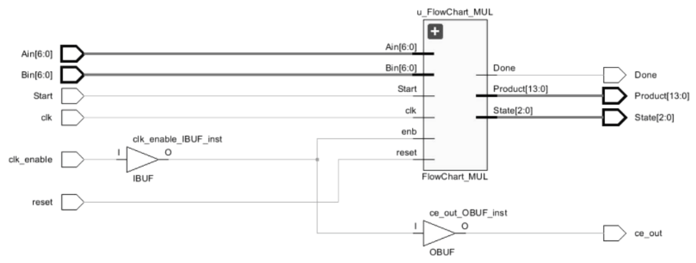

Hình 15.18 Schematic của “FlowChart_MUL_HDL.”

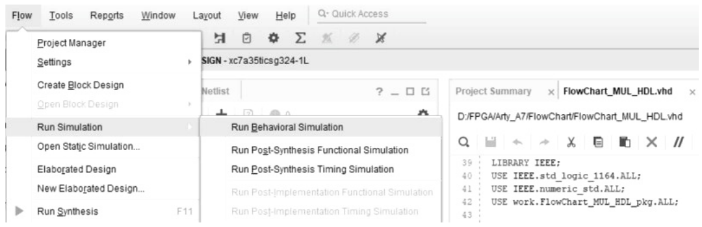

Hình 15.19 Chạy simulation.

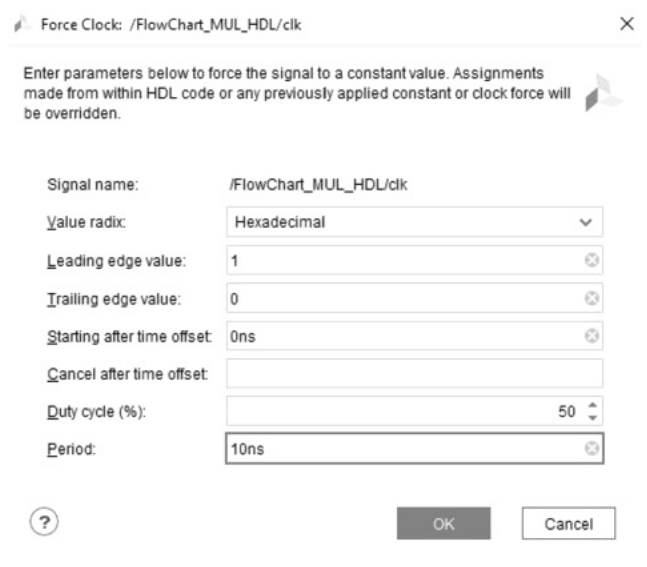

Hình 15.20 Thiết lập Force Clock cho “clk.”

Tiếp theo, chúng ta right-click vào “Start”, chọn tùy chọn “Force Clock…”, và điều chỉnh thiết lập của nó, như được thể hiện trong Hình 15.23.

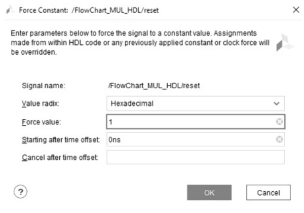

Hình 15.21 Thiết lập Force Constant cho “reset” và “clk_enable.”

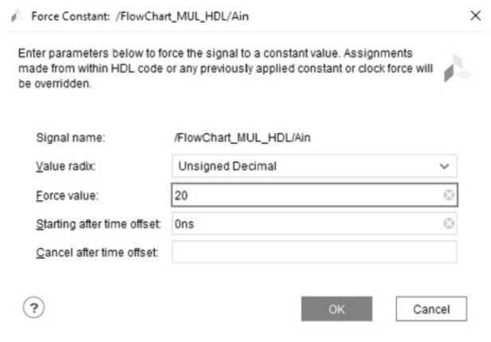

Hình 15.22 Thiết lập Force Constant cho “Ain.”

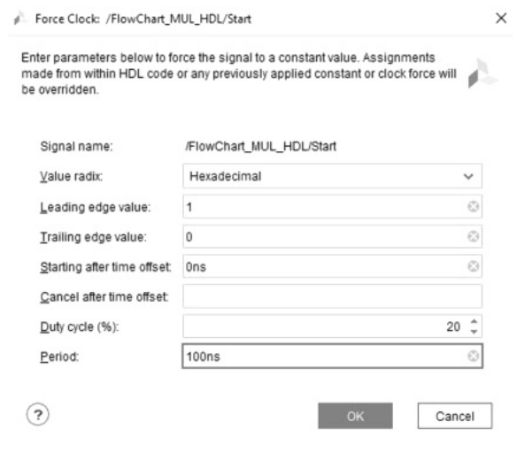

Hình 15.23 Thiết lập force clock cho “Start.”

Bây giờ, click button Run for 20 ns, như được thể hiện trong Hình 15.24.

Chúng ta right-click lần nữa vào “reset” và force giá trị của nó về không, như được mô tả trong Hình 15.25.

Cuối cùng, click button Run for 20 ns nhiều lần và click button Zoom Fit trong cửa sổ waveforms để xem các waveform đã mô phỏng, như được minh họa trong Hình 15.26.

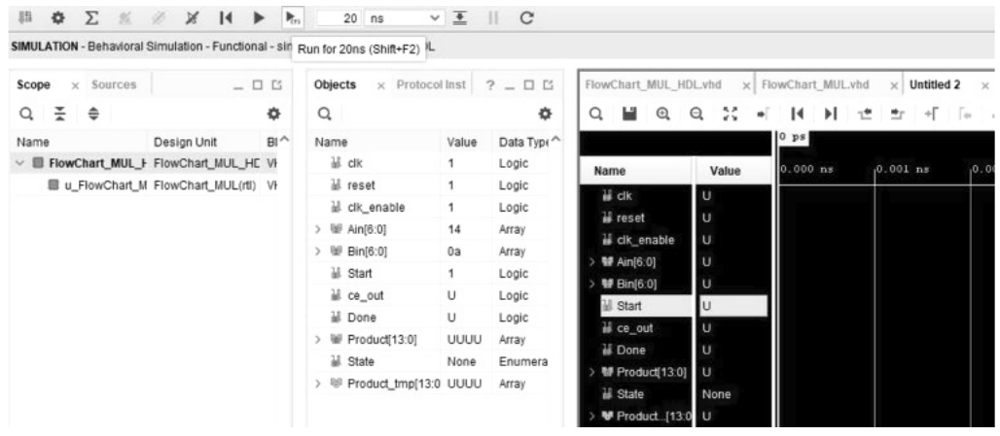

Hình 15.24 Click một lần vào button Run for 20 ns.

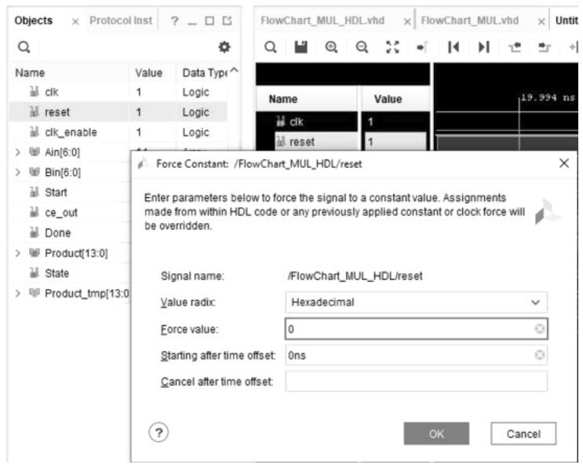

Hình 15.25 Force giá trị “reset” về không.

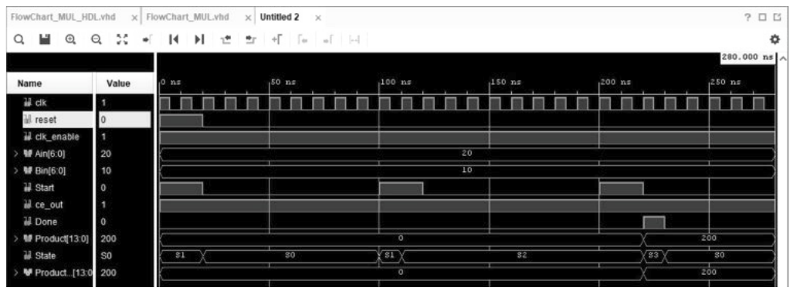

Hình 15.26 Các waveform đã mô phỏng.

## 15.2 Flowchart của bộ tính GCD

Trong mục này, chúng ta sẽ triển khai thuật toán tính GCD trực tiếp từ flowchart của nó bằng HDL Coder và mô phỏng thiết kế trong môi trường MATLAB Simulink để kiểm chứng chức năng. Tiếp theo, chúng ta sẽ dùng HDL Coder để tạo code VHDL có thể synthesize từ bộ tính GCD đã thiết kế được triển khai trong Stateflow. Cuối cùng, chúng ta sẽ synthesize và triển khai code VHDL đã tạo bằng Xilinx Vivado. Flowchart của bộ tính GCD được thể hiện trong Hình 15.27.

Để triển khai hiệu quả thuật toán thiết kế hệ thống số trực tiếp từ flowchart, chúng ta cần phân tích kỹ flowchart và xác định các input, output, constant và variable trung gian. Ngoài ra, chúng ta nên khởi tạo các constant và input bằng một MATLAB script riêng (m-file) dùng các fixed-point numeric object như “numerictype” và “fi”, như đã mô tả ở mục trước. Khi bắt đầu flowchart trong Stateflow bên trong Simulink, hãy bắt đầu với state ban đầu (S0) bằng cách khởi tạo tất cả các output về không hoặc về các giá trị định sẵn dùng các constant đã được định nghĩa trước trong m-file. Sau đó, triển khai flowchart step-by-step, coi mỗi bước là một state riêng trong Stateflow chart. Nếu bạn gặp một thao tác phức tạp, hãy chia nó thành nhiều bước hay nhiều state để rõ ràng và dễ quản lý. Các constant được định nghĩa trong m-file nên được thêm làm parameter, và các variable trung gian nên được định nghĩa là local variable trong Model Explorer của Stateflow trong Simulink. Các input nên được gán cho local variable. Tương tự, chúng ta định nghĩa các input và output trong Model Explorer. Khi bạn thực hiện bất kỳ phép toán số học nào ở bất kỳ state nào, hãy bảo đảm chuyển nó sang fixed point bằng function “fi”, như đã bàn ở mục trước. Ngoài ra, tốt hơn là cân nhắc dùng MATLAB function hoặc Simulink function để đơn giản hóa và làm gọn flowchart bên trong Stateflow. Stateflow chart của bộ tính GCD được mô tả trong Hình 15.28.

Các parameter (constant) đã được định nghĩa sẵn bên trong m-file (FC_Parameters.m) như code sau.

```
clear all; close all; clc
N = 7; %nbits
nt1 = numerictype(0,1,0);
nt2 = numerictype(0,N,0);

% 1-bit constants
a0 = fi(0,nt1);
a1 = fi(1,nt1);

% Inputs
Ain = fi(65,nt2);
Bin = fi(13,nt2);

% Initial values
A0 = fi(0,nt2);
B0 = fi(0,nt2);
```

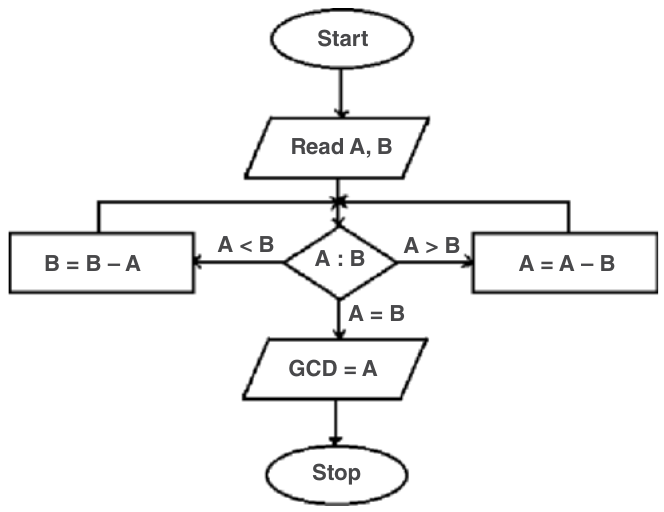

Hình 15.27 Flowchart của bộ tính GCD.

Để dùng các constant này bên trong Stateflow, chúng ta nên chạy m-file. Các variable A0, B0, a0 và a1 là các parameter fixed-point được định nghĩa trong m-file. A và B là các variable local hay trung gian. Ngoài ra, Ain, Bin và Start là các input, còn GCD và Done là các output. Từ View → Model Explorer → Model Explorer, chúng ta mở cửa sổ Model Explorer để thêm parameter, local variable, input và output cho thiết kế Stateflow ở Hình 15.28. Trong cửa sổ Model Explorer, chúng ta click vào Add trên thanh menu, chọn tùy chọn Data, và bắt đầu thêm các variable được định nghĩa trong Stateflow chart. Danh sách đầy đủ các variable đã thêm cho Stateflow chart được thể hiện trong Hình 15.29.

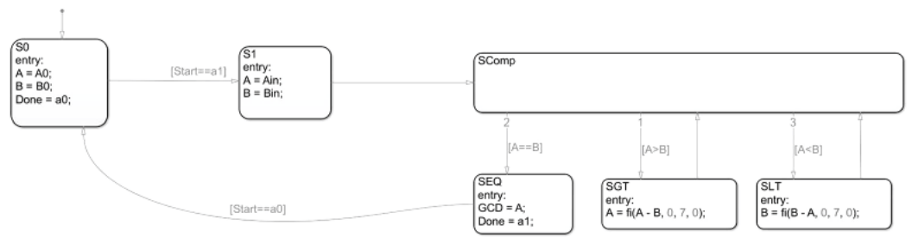

Hình 15.28 Stateflow chart của bộ tính GCD.

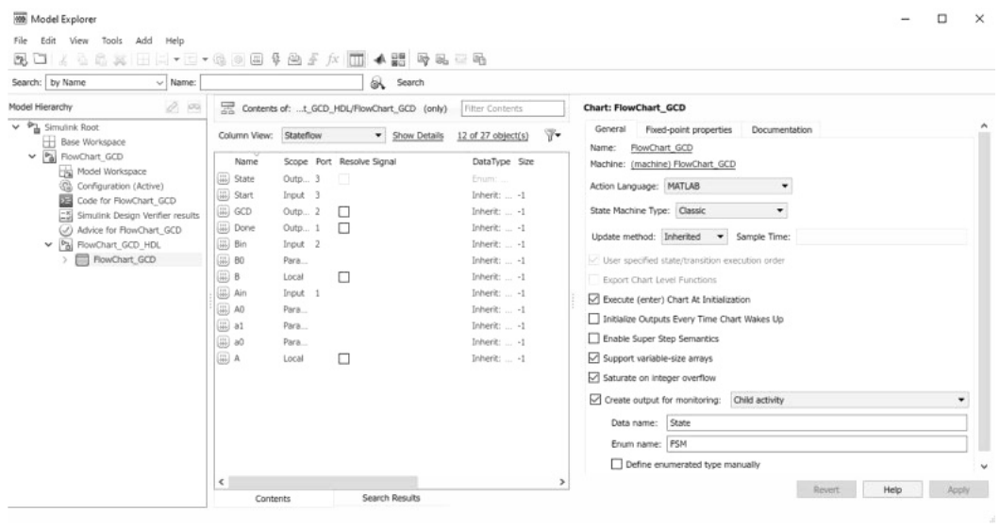

Hình 15.29 Danh sách đầy đủ các variable đã thêm cho Stateflow chart.

Chúng ta cũng đánh dấu tùy chọn Create Output for Monitoring, và nhập Data name là State và Enum name là FSM, như được minh họa trong Hình 15.29. Các variable input và output của flowchart được minh họa trong Hình 15.30.

Tiếp theo, chúng ta đặt flowchart vào bên trong một subsystem, như được thể hiện trong Hình 15.31.

Các block parameter cho các block Constant và Repeating Sequence Stair ở Hình 15.31 tương tự như đã mô tả ở mục trước và được mô tả lần lượt trong Hình 15.8, 15.9 và 15.10. Trước khi chạy simulation, chúng ta đặt tab Solver của cửa sổ Configuration Parameters, như được minh họa trong Hình 15.11.

Bây giờ, chúng ta có thể chạy simulation. Các waveform scope thu được được thể hiện trong Hình 15.32. Nếu gõ code sau trong MATLAB command window, chúng ta có thể truy cập các phần tử thư viện của HDL Coder.

```
>> hdllib
```

Để quay lại thư viện Simulink bình thường, chúng ta nên dùng code sau trong MATLAB command window.

```
>> hdllib(‘off’)
```

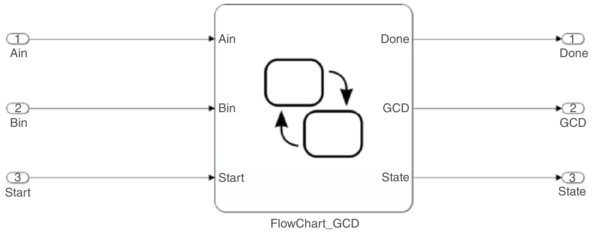

Hình 15.30 Các variable input và output của flowchart.

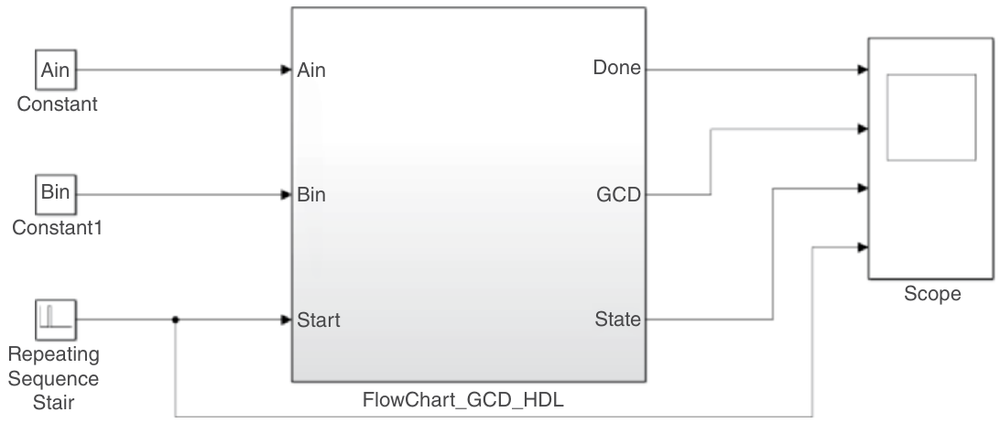

Hình 15.31 Đặt flowchart vào bên trong một subsystem.

Giờ chúng ta có thể tạo code VHDL cho subsystem “FlowChart_GCD_HDL” ở Hình 15.31 bằng HDL Coder. Để làm điều này, chúng ta viết code sau trong MATLAB command window.

```
>> hdlsetup('FlowChart_GCD')
```

Ở đây, FlowChart_GCD là tên của file Simulink (flowchart_GCD.slx). Tiếp theo, chúng ta cấu hình các tab Solver và HDL Code Generation trong cửa sổ Configuration Parameters tương tự như lần lượt ở Hình 15.13 và 15.14. Sau đó, chúng ta gõ code sau trong MATLAB command window.

```
>> checkhdl('FlowChart_GCD/FlowChart_GCD_HDL')
```

Thao tác này mở cửa sổ HDL Check Report trong web browser, như được thể hiện trong Hình 15.33.

Bây giờ, chúng ta dùng code sau để tạo code HDL trong MATLAB command window.

```
>> makehdl('FlowChart_GCD/FlowChart_GCD_HDL')
```

Code VHDL được tạo ra thành công, và cửa sổ Code Generation Report được hiển thị như được mô tả trong Hình 15.34.

Bây giờ, chúng ta chạy Vivado và tạo một project tên “FlowChart_GCD” rồi click button Next, như được minh họa trong Hình 15.35.

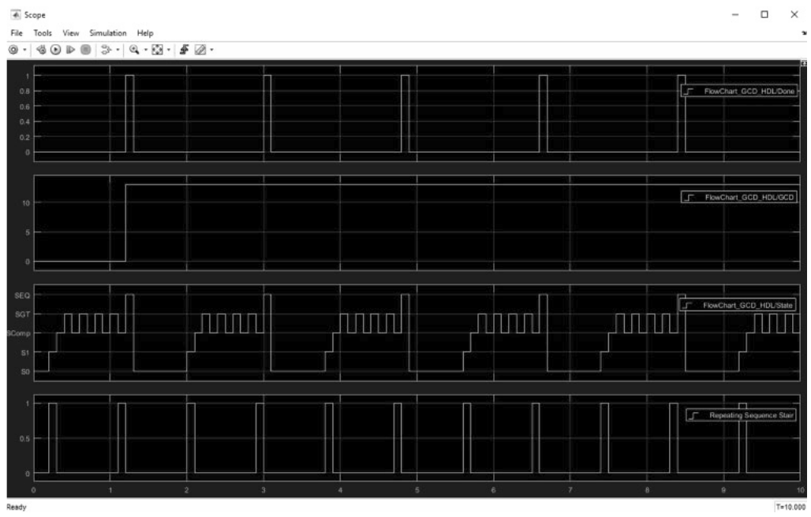

Hình 15.32 Các waveform của Scope.

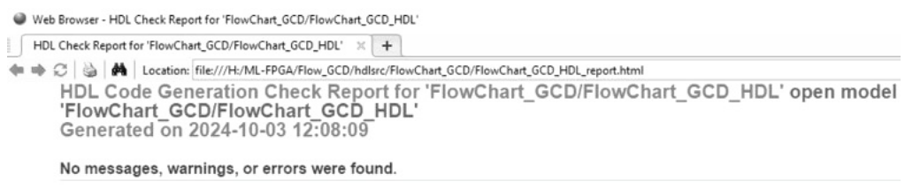

Hình 15.33 Cửa sổ HDL Check Report.

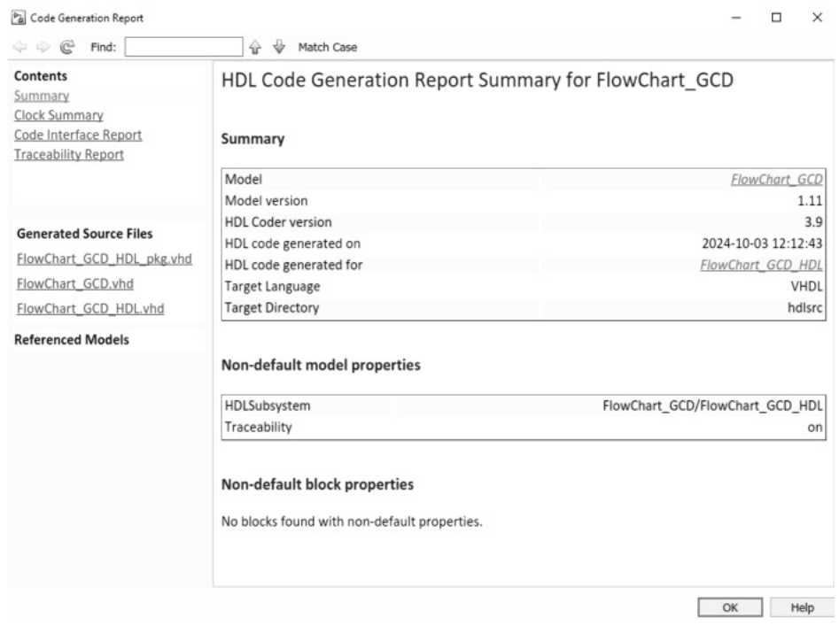

Hình 15.34 Cửa sổ Code Generation Report.

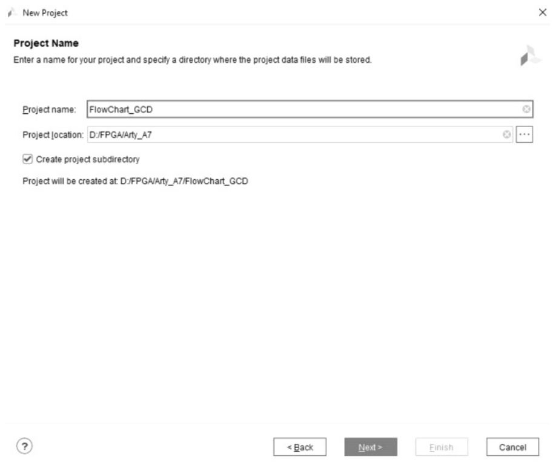

Hình 15.35 Tạo một project tên “FlowChart_GCD.”

Chúng ta chọn loại RTL Project và click button Next. Trong cửa sổ Add Sources, trước khi thêm các file VHDL đã tạo, trước tiên chúng ta copy và paste ba file VHDL đã tạo từ Hình 15.34 vào thư mục FlowChart_GCD bên trong thư mục project Vivado. Bây giờ, bằng cách click button Add Files, chúng ta thêm chúng vào project, như được thể hiện trong Hình 15.36.

Tiếp theo, chúng ta chọn development board Xilinx và click vào button Next, như được mô tả trong Hình 15.37.

Cuối cùng, chúng ta click button Finish để tạo project FlowChart_GCD với các file VHDL đã thêm, như được minh họa trong Hình 15.38.

Sau đó, chúng ta chạy synthesis, như được minh họa trong Hình 15.39.

Như được minh họa trong Hình 15.39, synthesis đã hoàn tất thành công, và chúng ta có thể click vào button Cancel. Sau đó, chúng ta mở schematic trong tab RTL Analysis, như được thể hiện trong Hình 15.40.

Bây giờ, chúng ta có thể mô phỏng project bằng cách chọn Flow → Run Simulation → Run Behavioral Simulation. Trong cửa sổ simulation vừa mở, chúng ta click vào button Restart. Sau đó, trong cửa sổ waveform, chúng ta right-click vào “clk”, chọn tùy chọn “Force Clock…” và cấu hình các thiết lập, như được minh họa trong Hình 15.20. Ngoài ra, chúng ta right-click vào “reset” và “clk_enable”, chọn tùy chọn “Force Constant…” và force giá trị của nó thành 1, như được thể hiện trong Hình 15.21. Chúng ta right-click vào “Ain”, chọn tùy chọn “Force Constant…”, và force giá trị của nó thành unsigned decimal 40. Tương tự, chúng ta force giá trị constant “Bin” thành unsigned decimal 25. Cuối cùng, chúng ta right-click vào “Start”, chọn tùy chọn “Force Clock…” và đặt thiết lập của nó, như được thể hiện trong Hình 15.23. Sau đó, chúng ta click một lần vào button Run for 20 ns, như được thể hiện trong Hình 15.24. Chúng ta right-click lần nữa vào “reset” và force giá trị của nó về không như được mô tả trong Hình 15.25. Sau đó, chúng ta click vào button Run for 20 ns nhiều lần và click vào button Zoom Fit trong cửa sổ waveforms để có các waveform đã mô phỏng, như được minh họa trong Hình 15.41.

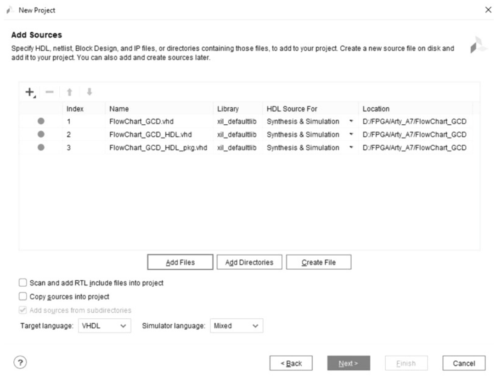

Hình 15.36 Thêm các file VHDL đã tạo vào thư mục Sources.

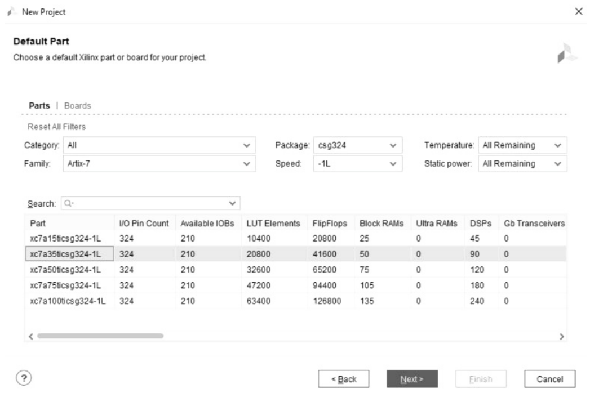

Hình 15.37 Chọn development board Xilinx.

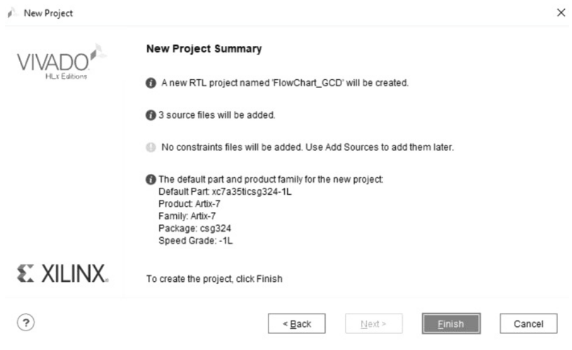

Hình 15.38 Click vào button Finish.

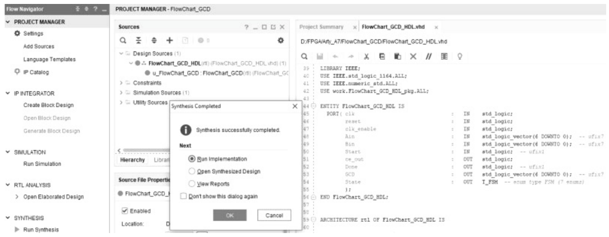

Hình 15.39 Chạy synthesis thành công.

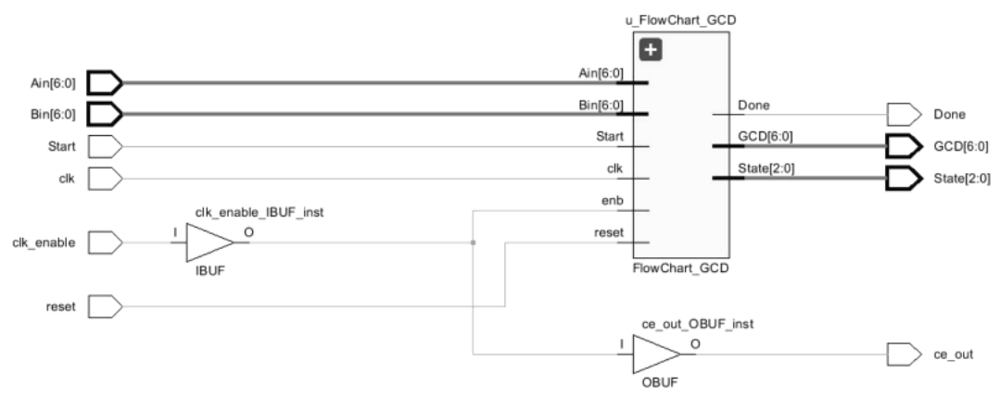

Hình 15.40 Schematic của “FlowChart_GCD_HDL.”


Hình 15.41 Các waveform đã mô phỏng.

## 15.3 Flowchart của phép nhân Booth

Trong mục này, chúng ta sẽ triển khai thuật toán nhân Booth trực tiếp từ flowchart của nó. Chúng ta sẽ mô phỏng thiết kế trong môi trường MATLAB Simulink để kiểm chứng chức năng. Sau đó, chúng ta sẽ dùng HDL Coder để tạo code VHDL có thể synthesize từ thuật toán nhân Booth đã thiết kế được triển khai trong Stateflow, và cuối cùng, chúng ta sẽ synthesize và triển khai code VHDL đã tạo bằng Xilinx Vivado. Flowchart của thuật toán nhân Booth được thể hiện trong Hình 15.42. Để triển khai thuật toán thiết kế hệ thống số trực tiếp từ flowchart, chúng ta phải phân tích kỹ nó và xác định các input, output, constant và variable trung gian. Các constant và input nên được khởi tạo bằng một MATLAB script riêng (m-file), trong đó tất cả các giá trị được định nghĩa bằng các fixed-point numeric object như “numerictype” và “fi”, như đã mô tả ở các mục trước. Chúng ta thường bắt đầu với state ban đầu (S0) bằng cách khởi tạo tất cả các output về không hoặc về các giá trị định sẵn, dùng các constant đã được định nghĩa trước trong m-file.

Sau đó, chúng ta triển khai flowchart từng bước một, coi mỗi bước là một state riêng trong Stateflow của Simulink. Nếu gặp một thao tác phức tạp, tốt hơn là chia nó thành nhiều bước hay nhiều state để rõ ràng và dễ quản lý. Các constant được định nghĩa trong m-file được khai báo làm parameter, còn các variable trung gian được định nghĩa là local variable trong Model Explorer của Stateflow. Các input được gán cho local variable và tương tự, các input và output cũng được định nghĩa trong Model Explorer. Khi thực hiện bất kỳ phép toán số học nào ở bất kỳ state nào, chúng ta nên bảo đảm các giá trị được chuyển sang fixed point bằng “fi”, như đã bàn ở các mục trước. Cũng nên cân nhắc dùng MATLAB function hoặc Simulink function để đơn giản hóa và làm gọn thiết kế flowchart trong Stateflow của Simulink. Sơ đồ Stateflow cho thuật toán nhân Booth được mô tả trong Hình 15.43. Bạn nên lưu ý rằng trong Hình 15.43, Q<sub>−1</sub> được biểu diễn là Qm1. Để lấy least significant bit (LSB) của Q, chúng ta có thể dùng getlsb(Q) hoặc bitget(Q,1). Lệnh để thực hiện phép dịch phải 1-bit cho variable A là bitsra(A,1). Ngoài ra, để đặt most significant bit (MSB) của Q (bit thứ bảy trong trường hợp này) bằng LSB của A, chúng ta dùng lệnh bitset(Q,7,getlsb(A)). Hơn nữa, để nối các variable A và Q, chúng ta dùng lệnh bitconcat(A,Q), như được minh họa trong Hình 15.43.

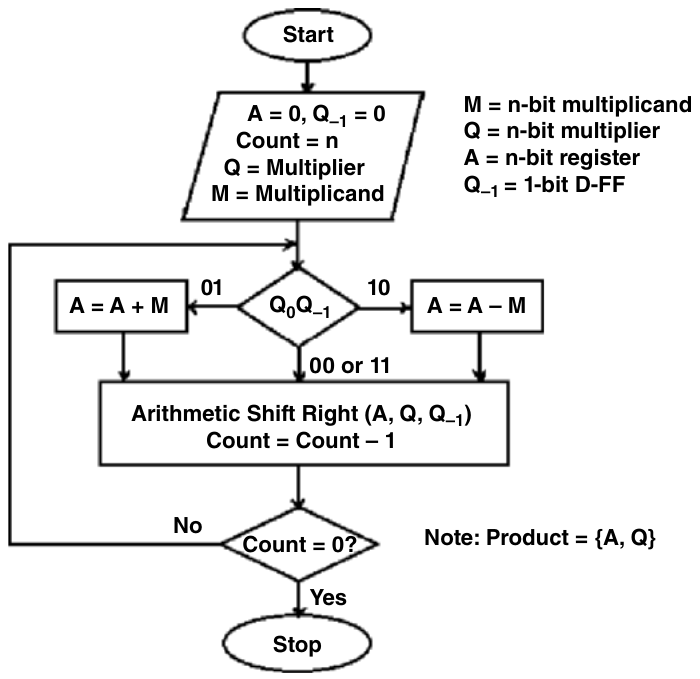

Hình 15.42 Flowchart của thuật toán nhân Booth.

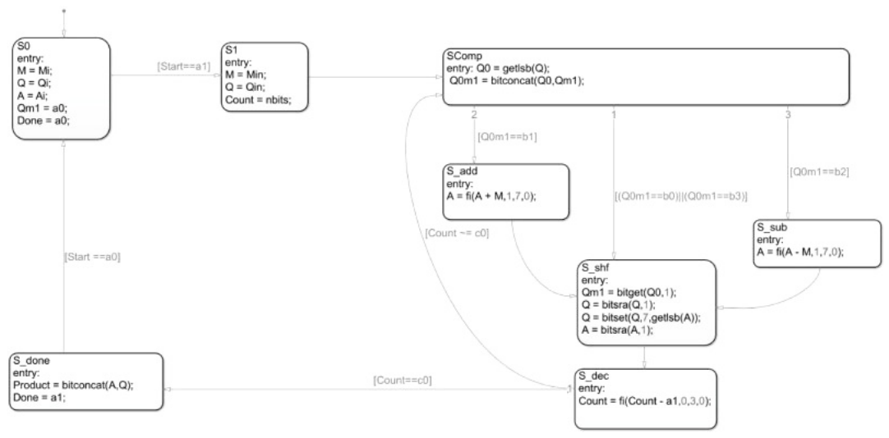

Hình 15.43 Stateflow chart của thuật toán nhân Booth.

Các parameter (constant) đã được định nghĩa sẵn bên trong m-file (FC_Parameters.m) như code sau.

```
clear all; close all; clc
N = 7; %nbits
n = ceil(log2(N));
ntc = numerictype(0,n,0);
nbits = fi(N,ntc);
c0 = fi(0,ntc);

nt = numerictype(1,N,0);

% Inputs
Min = fi(36,nt);
Qin = fi(24,nt);

% Initial conditions
Mi = fi(0,nt);
Qi = fi(0,nt);
Ai = fi(0,nt);

% 1-bit constants
nt1 = numerictype(0,1,0);
a0 = fi(0,nt1);
a1 = fi(1,nt1);

% 2-bit constants
nt2 = numerictype(0,2,0);
b0 = fi(0,nt2);
b1 = fi(1,nt2);
b2 = fi(2,nt2);
b3 = fi(3,nt2);
```

Để dùng các constant này bên trong Stateflow, trước hết chúng ta cần chạy m-file. Mi, Qi, Ai, nbits, c0, a0, a1, b0, b1, b2 và b3 là các parameter fixed-point được định nghĩa trong m-file. M, Q và A là các variable local hay trung gian. Ngoài ra, Min, Qin và Start là các input, còn State, Qm1, Q0m1, Product, Count và Done là các output. Từ View → Model Explorer → Model Explorer, chúng ta mở cửa sổ Model Explorer để thêm parameter, local variable, input và output cho thiết kế Stateflow ở Hình 15.43. Trong cửa sổ Model Explorer, chúng ta click vào Add trên thanh menu và chọn tùy chọn Data, rồi bắt đầu thêm các variable như được định nghĩa trong Stateflow chart. Danh sách đầy đủ các variable đã thêm của Stateflow chart được thể hiện trong Hình 15.44.

Chúng ta cũng đánh dấu tùy chọn Create output for monitoring và nhập Data name là State và Enum name là FSM, như được minh họa trong Hình 15.44. Các variable input và output của flowchart được minh họa trong Hình 15.45.

Tiếp theo, chúng ta đặt flowchart vào bên trong một subsystem, như được thể hiện trong Hình 15.46.

Các block parameter cho Constant và Repeating Sequence Stair ở Hình 15.31 tương tự như đã mô tả ở các mục trước, như được mô tả lần lượt trong Hình 15.8, 15.9 và 15.10. Trước khi chạy simulation, chúng ta đặt tab Solver của cửa sổ Configuration Parameters, như được minh họa trong Hình 15.11. Bây giờ, chúng ta có thể chạy simulation. Các waveform scope thu được được thể hiện trong Hình 15.47.

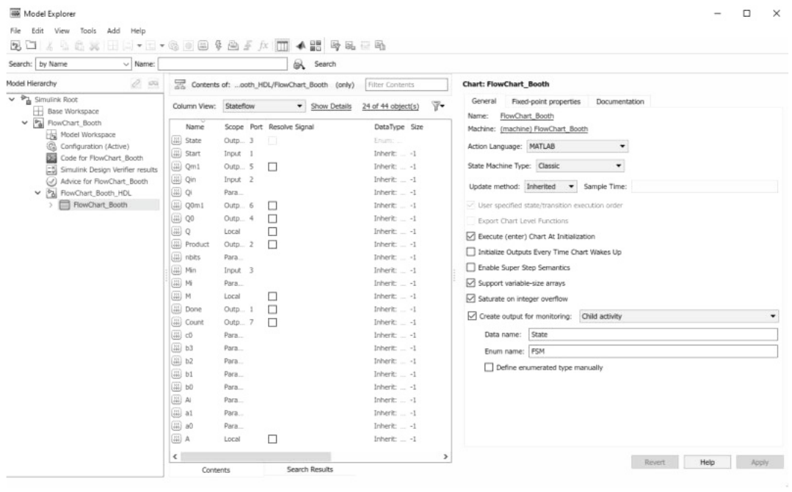

Hình 15.44 Danh sách đầy đủ các variable đã thêm cho flowchart.

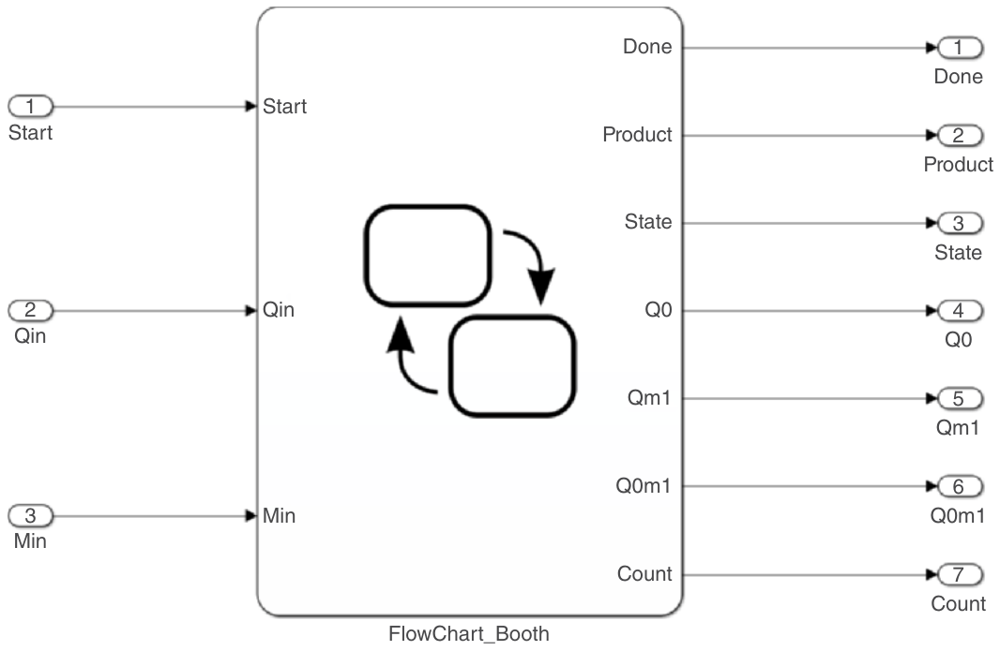

Hình 15.45 Các variable input và output của flowchart.

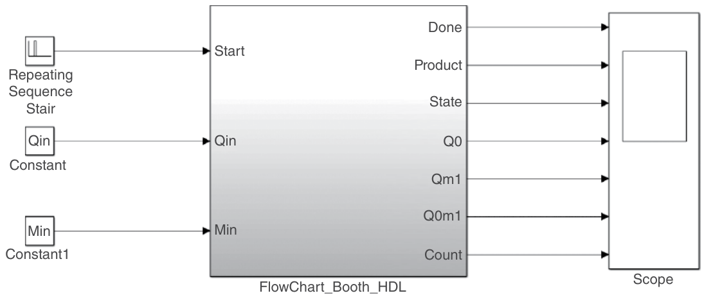

Hình 15.46 Đặt flowchart vào bên trong một subsystem.

Bây giờ, chúng ta có thể tạo code VHDL cho subsystem “FlowChart_GCD_HDL” *(ghi chú: sách in nguyên tên subsystem của mục GCD; ở đây là subsystem của phép nhân Booth)* ở Hình 15.46 bằng HDL Coder. Để làm điều này, chúng ta viết code sau trong MATLAB command window.

```
>> hdlsetup('FlowChart_Booth')
```

FlowChart_Booth là tên của file Simulink (flowchart_Booth.slx). Sau đó, chúng ta cấu hình các tab Solver và HDL Code Generation của cửa sổ Configuration Parameters như được thể hiện lần lượt trong Hình 15.13 và 15.14. Sau đó, chúng ta gõ code sau trong MATLAB command window.

```
>> checkhdl('FlowChart_Booth/FlowChart_Booth_HDL')
```

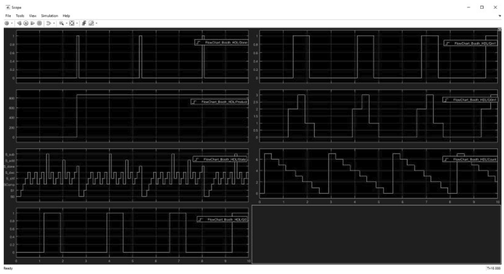

Hình 15.47 Các waveform của scope.

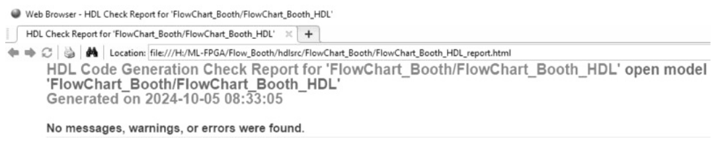

Hình 15.48 Cửa sổ HDL Check Report.

Thao tác này mở HDL Check Report Window trong web browser, như được thể hiện trong Hình 15.48.

Bây giờ, chúng ta dùng code sau để thực hiện HDL Code Generation trong MATLAB command window.

```
>> makehdl('FlowChart_Booth/FlowChart_Booth_HDL')
```

Code VHDL được tạo ra thành công, và cửa sổ Code Generation Report được hiển thị, như được mô tả trong Hình 15.49.

Chúng ta có thể chọn tùy chọn “MATLAB function” từ thanh công cụ bên trái của stateflow chart và đưa MATLAB function có tên “ASR” vào thiết kế, như được minh họa trong Hình 15.50.

Code của MATLAB function có tên “ASR” như sau.

```
function [Ao,Qo] = ASR(Ax,Qx)
Qo = bitsra(Qx,1);
Qo = bitset(Qo,7,getlsb(Ax));
Ao = bitsra(Ax,1);
```

Chúng ta cũng có thể tạo code VHDL cho subsystem này bằng HDL Coder. Để làm điều này, chúng ta viết code sau trong MATLAB command window.

```
>> hdlsetup('FlowChart_Booth2')
```

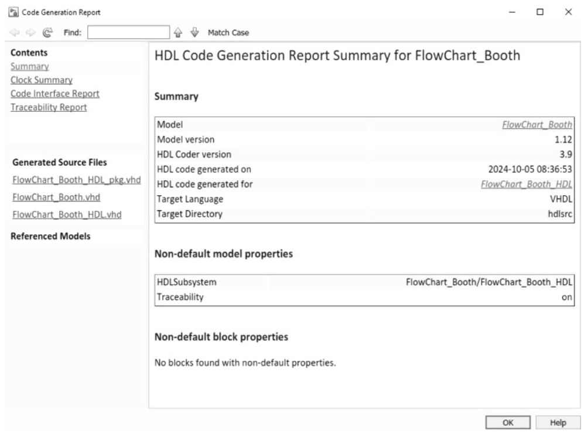

Hình 15.49 Cửa sổ Code Generation Report.

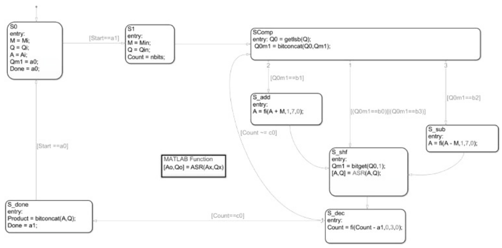

Hình 15.50 Đưa MATLAB function có tên “ASR” vào thiết kế.

FlowChart_Booth2 là tên của file Simulink mới (flowchart_Booth2.slx). Sau đó, chúng ta cấu hình các tab Solver và HDL Code Generation của cửa sổ Configuration Parameters tương tự như lần lượt ở Hình 15.13 và 15.14. Sau đó, chúng ta gõ code sau trong MATLAB command window.

```
>> checkhdl('FlowChart_Booth2/FlowChart_Booth_HDL')
```

Thao tác này mở cửa sổ HDL Check Report trong web browser, như được thể hiện trong Hình 15.51.

Bây giờ, chúng ta dùng code sau để tạo code HDL trong MATLAB command window.

```
>> makehdl('FlowChart_Booth2/FlowChart_Booth_HDL')
```

Code VHDL được tạo ra thành công, và cửa sổ Code Generation Report được hiển thị như được mô tả trong Hình 15.52.

Bây giờ, chúng ta chạy Vivado và tạo một project tên “FlowChart_Booth2” rồi click button Next. Chúng ta chọn loại project là RTL Project và click button Next. Trong cửa sổ Add Sources, trước khi thêm các file VHDL đã tạo, chúng ta copy và paste ba file VHDL đã tạo ở Hình 15.52 vào thư mục FlowChart_Booth2 của project Vivado. Bây giờ, bằng cách click vào button Add Files, chúng ta có thể thêm chúng vào project, như được thể hiện trong Hình 15.53.

Tiếp theo, chúng ta chọn development board Xilinx và click vào button Next. Cuối cùng, chúng ta click vào button Finish để tạo project FlowChart_Booth2 với các file VHDL đã tạo được thêm vào. Sau đó chúng ta chạy synthesis như được minh họa trong Hình 15.54.


Hình 15.51 Cửa sổ HDL Check Report.

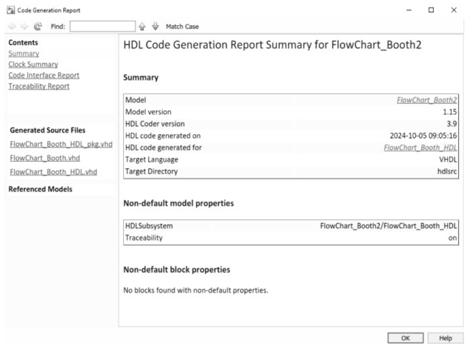

Hình 15.52 Cửa sổ Code Generation Report.


Hình 15.53 Thêm các file VHDL đã tạo vào thư mục Sources.


Hình 15.54 Chạy synthesis thành công.

Như được minh họa trong Hình 15.54, synthesis đã hoàn tất thành công, và chúng ta có thể click vào button Cancel. Sau đó, chúng ta mở schematic trong tab RTL Analysis, như được thể hiện trong Hình 15.55.

Bây giờ, chúng ta có thể mô phỏng project bằng cách chọn Flow → Run Simulation → Run Behavioral Simulation. Trong cửa sổ simulation vừa mở, chúng ta click vào button Restart. Sau đó, trong cửa sổ waveform, chúng ta right-click vào “clk”, chọn tùy chọn “Force Clock…”, và cấu hình thiết lập của nó như được minh họa trong Hình 15.20. Ngoài ra, chúng ta right-click vào “reset” và “clk_enable”, chọn tùy chọn “Force Constant…”, và force giá trị của nó thành 1, như được thể hiện trong Hình 15.21. Chúng ta right-click vào “Qin”, chọn tùy chọn “Force Constant…”, và force giá trị của nó thành unsigned decimal 15. Tương tự, chúng ta force giá trị constant “Min” thành unsigned decimal 20. Cuối cùng, chúng ta right-click vào “Start”, chọn tùy chọn “Force Clock…”, và đặt thiết lập của nó như được thể hiện trong Hình 15.23. Sau đó, chúng ta click một lần vào button Run for 20 ns như được thể hiện trong Hình 15.24. Chúng ta right-click lần nữa vào “reset” và force giá trị của nó về không như được mô tả trong Hình 15.25. Sau đó, chúng ta click vào button Run for 20 ns nhiều lần và click vào button Zoom Fit trong cửa sổ waveforms. Chúng ta cũng chọn Q0m1, Count, Product_tmp, Q0m1_tmp và Count_tmp rồi right-click và chọn Radix → Unsigned Decimal, sau đó chúng ta có các waveform đã mô phỏng, như được mô tả trong Hình 15.56.


Hình 15.55 Schematic của “FlowChart_Booth_HDL.”


Hình 15.56 Các waveform đã mô phỏng.

## 15.4 Flowchart của một hệ thống điều khiển công nghiệp

Trong mục này, chúng ta sẽ triển khai một hệ thống điều khiển công nghiệp trực tiếp từ flowchart của nó. Chúng ta sẽ mô phỏng thiết kế trong môi trường MATLAB Simulink để kiểm chứng chức năng. Sau đó, chúng ta sẽ dùng HDL Coder để tạo code VHDL có thể synthesize từ hệ thống điều khiển công nghiệp đã thiết kế được triển khai trong môi trường Stateflow của Simulink. Cuối cùng, chúng ta sẽ synthesize và triển khai code VHDL đã tạo bằng Xilinx Vivado. Trình tự hoạt động của hệ thống được minh họa trong Hình 15.57 như sau:

• Ban đầu hộp được đặt ở LS1 (LS1 đóng).

• Khi nhấn nút start, motor băng tải được kích hoạt, di chuyển hộp tới vị trí A (LS1 mở).

• Băng tải vận chuyển hộp tới vị trí A rồi dừng (vị trí được xác nhận bằng tám xung off-to-on từ encoder tới up counter).

• Sau độ trễ 10-s, băng tải tiếp tục di chuyển, đưa hộp tới LS2 nơi nó dừng lại (LS2 đóng).

• Có một push button dừng khẩn cấp để dừng quá trình bất kỳ lúc nào.

• Nếu quá trình bị ngắt bằng push button dừng khẩn cấp, cả timer và counter sẽ tự động reset.

Flowchart của hệ thống điều khiển công nghiệp (Hình 15.57) được thể hiện trong Hình 15.58.


Hình 15.57 Một hệ thống điều khiển công nghiệp.


Hình 15.58 Flowchart của hệ thống điều khiển công nghiệp (Hình 15.57).

State flowchart của hệ thống điều khiển công nghiệp được mô tả trong Hình 15.59. Các parameter (constant) đã được định nghĩa sẵn bên trong m-file (FC_Parameters.m) như code sau.

```
close all; clear all; clc
a0 = fi(0,0,1,0);
a1 = fi(1,0,1,0);
en_cnt0 = fi(0,0,4,0);
cnt_val = fi(8,0,4,0);
```

Để dùng các constant này bên trong Stateflow, trước hết chúng ta cần chạy m-file. Các parameter cnt_val, en_cnt0, a0 và a1 là các parameter fixed-point được định nghĩa bên trong m-file. encoder_cnt là một variable local hay trung gian. Ngoài ra, start, ls1, ls2, emg_stop và encoder là các input, còn State và motor là các output. Từ View → Model Explorer → Model Explorer, chúng ta mở cửa sổ Model Explorer để thêm parameter, local variable, input và output cho thiết kế Stateflow ở Hình 15.59. Trong cửa sổ Model Explorer, chúng ta click vào menu Add trên thanh menu và chọn tùy chọn Data rồi bắt đầu thêm các variable được định nghĩa trong Stateflow chart. Danh sách đầy đủ các variable đã thêm của Stateflow chart được thể hiện trong Hình 15.60.

Chúng ta cũng đánh dấu tùy chọn Create output for monitoring và nhập Data name là State và Enum name là FSM, như được minh họa trong Hình 15.60. Các variable input và output của flowchart được minh họa trong Hình 15.61.

Ngoài ra, chúng ta đặt flowchart vào bên trong một subsystem như được thể hiện trong Hình 15.62.

Các block parameter cho Repeating Sequence Stair của “start” ở Hình 15.62 tương tự như đã mô tả ở các mục trước, như được mô tả lần lượt trong Hình 15.9 và 15.10. Ngoài ra, các block parameter cho Repeating Sequence Stair của “ls1” ở Hình 15.62 là nghịch đảo chính xác của Repeating Sequence Stair của “start.” Các block parameter cho Repeating Sequence Stair của “ls2” được mô tả trong Hình 15.63, và trong tab Signal Attributes, output data type là fixdt(0,1,0).

Cuối cùng, các block parameter cho Repeating Sequence Stair của “encoder” được mô tả trong Hình 15.64, và trong tab Signal Attributes, output data type cũng là fixdt(0,1,0).


Hình 15.59 State flowchart của hệ thống điều khiển công nghiệp.


Hình 15.60 Danh sách đầy đủ các variable đã thêm cho flowchart.


Hình 15.61 Các variable input và output của flowchart.


Hình 15.62 Đặt flowchart vào bên trong một subsystem.


Hình 15.63 Các block parameter cho Repeating Sequence Stair của “ls2.”


Hình 15.64 Các block parameter cho Repeating Sequence Stair của “encoder.”

Ngoài ra, các tham số của step source (Step, Step1) và data type conversion được minh họa lần lượt trong Hình 15.65, 15.66 và 15.67.

Trước khi chạy simulation, chúng ta đặt tab Solver của cửa sổ Configuration Parameters như được minh họa trong Hình 15.68.

Chúng ta nên lưu ý rằng vì fixed-step size là 0.1 s, để có độ trễ 10 s ở Hình 15.59, chúng ta đã dùng “[after(100,tick)]” trong transition từ S2 sang S3. Bây giờ, chúng ta có thể chạy simulation, và các waveform của scope được thể hiện trong Hình 15.69.

Bây giờ, chúng ta có thể tạo code VHDL cho subsystem “Ind_Cont_Sys_HDL” ở Hình 15.46 *(ghi chú: sách in như vậy; subsystem này nằm ở Hình 15.62)* bằng HDL Coder. Để làm điều đó, chúng ta viết code sau trong MATLAB command window.

```
>> hdlsetup('Ind_Cont_Sys')
```

“Ind_Cont_Sys” là tên của file Simulink (Ind_Cont_Sys.slx). Bây giờ, nếu dùng 10<sup>−8</sup> s (1/100e6) làm fixed-step size trong cửa sổ Configuration Parameters, để đạt độ trễ 10 s, chúng ta nên dùng [after(1e9,tick)] (chúng ta không thể dùng [after(10,s)] vì HDL Coder không xử lý được và báo lỗi khi tạo code). Tuy nhiên, cho mục đích simulation, chúng ta sẽ dùng fixed-step size 0.1 s. Ngoài ra, chúng ta đặt tab HDL Code Generation của cửa sổ Configuration Parameters tương tự Hình 15.14. Sau đó chúng ta gõ code sau trong MATLAB command window.

```
>> checkhdl('Ind_Cont_Sys/Ind_Cont_Sys_HDL')
```


Hình 15.65 Các tham số block Step.


Hình 15.66 Các tham số block Step1.


Hình 15.67 Các tham số data type conversion.


Hình 15.68 Thiết lập tab Solver của cửa sổ Configuration Parameters.


Hình 15.69 Các waveform của scope.

Thao tác này mở cửa sổ HDL Check Report trong web browser, như được thể hiện trong Hình 15.70.

Bây giờ, chúng ta dùng code sau để tạo code HDL trong MATLAB command window.

```
>> makehdl('Ind_Cont_Sys/Ind_Cont_Sys_HDL')
```


Hình 15.70 Cửa sổ HDL Check Report.


Hình 15.71 Cửa sổ Code Generation Report.

Code VHDL được tạo ra thành công, và cửa sổ Code Generation Report được hiển thị như được mô tả trong Hình 15.71. Bây giờ, chúng ta chạy Vivado và tạo một project tên “Ind_Cont_Sys” rồi click button Next. Sau đó chúng ta chọn loại project là RTL project và click button Next. Trong cửa sổ Add Sources, trước khi thêm các file VHDL đã tạo, chúng ta copy và paste ba file VHDL đã tạo ở Hình 15.71 vào thư mục Ind_Cont_Sys của project Vivado. Bây giờ, bằng cách click vào button Add Files, chúng ta có thể thêm chúng vào project như được thể hiện trong Hình 15.72.

Tiếp theo, chúng ta chọn development board Xilinx và click vào button Next. Cuối cùng, chúng ta click vào button Finish để tạo project Ind_Cont_Sys với các file VHDL đã tạo được thêm vào. Sau đó, chúng ta chạy synthesis như được minh họa trong Hình 15.73.

Như được minh họa trong Hình 15.73, synthesis đã hoàn tất thành công, và chúng ta có thể click vào button Cancel. Sau đó, chúng ta mở schematic trong tab RTL Analysis như được thể hiện trong Hình 15.74.


Hình 15.72 Thêm các file VHDL đã tạo vào thư mục Sources.


Hình 15.73 Chạy synthesis thành công.

Bây giờ, chúng ta có thể mô phỏng project bằng cách chọn Flow → Run Simulation → Run Behavioral Simulation. Trong cửa sổ simulation vừa mở, chúng ta click vào button Restart. Sau đó, trong cửa sổ waveform, chúng ta right-click vào “clk”, chọn tùy chọn “Force Clock…” và cấu hình thiết lập của nó, như được minh họa trong Hình 15.20. Ngoài ra, chúng ta right-click vào “reset” và “clk_enable”, chọn tùy chọn “Force Constant…”, và force giá trị của nó thành 1, như được thể hiện trong Hình 15.21. Chúng ta right-click vào “start”, chọn tùy chọn “Force Clock…”, và đặt các tham số của nó như được thể hiện trong Hình 15.75.


Hình 15.74 Schematic của “Ind_Cont_Sys_HDL.”


Hình 15.75 Thiết lập force clock cho “start.”

Tương tự, chúng ta force clock các tham số của “ls1” như được mô tả trong Hình 15.76.

Ngoài ra, chúng ta force clock các tham số của “ls2” như được mô tả trong Hình 15.77.


Hình 15.76 Thiết lập force clock cho “ls1.”


Hình 15.77 Thiết lập force clock cho “ls2.”


Hình 15.78 Thiết lập force clock cho “encoder.”


Hình 15.79 Các waveform đã mô phỏng.

Chúng ta right-click vào “emg_stop,” chọn tùy chọn “Force Constant…”, và force giá trị của nó về không. Cuối cùng, chúng ta right-click vào “encoder”, chọn tùy chọn “Force Clock…”, và cấu hình thiết lập của nó, như được minh họa trong Hình 15.78.

Sau đó, chúng ta click một lần vào button Run for 10 ns. Chúng ta right-click lần nữa vào “reset” và force giá trị của nó về không. Sau đó, chúng ta click vào button Run for 10 ns nhiều lần và click vào button Zoom Fit trong cửa sổ waveforms để có các waveform đã mô phỏng, như được minh họa trong Hình 15.79.
