# 16 Model hồi quy machine learning trên FPGA

## 16.1 Giới thiệu

Trong chương này, chúng ta sẽ triển khai một model hồi quy machine-learning trên FPGA bằng Simulink và Vivado. Trước hết, chúng ta tải một dataset từ Kaggle phù hợp cho việc triển khai hồi quy tuyến tính (linear regression). Dùng MATLAB, chúng ta huấn luyện model linear regression dựa trên phương pháp bình phương tối thiểu (least squares). Chúng ta dùng admission dataset để dự đoán khả năng được nhận vào một trường đại học dựa trên nhiều tham số input khác nhau. Sau đó, chúng ta triển khai model hồi quy machine learning đã huấn luyện và tạo code VHDL có thể synthesize bằng HDL Coder. Cuối cùng, dùng Vivado, chúng ta chạy synthesis analysis và simulation để kiểm chứng project VHDL đã thiết kế.

## 16.2 Dataset Kaggle

Trong chương này, chúng ta sẽ dùng admission dataset từ Kaggle để dự đoán khả năng được nhận vào một trường đại học dựa trên nhiều tham số input khác nhau. Link web để tải admission dataset như sau.

https://www.kaggle.com/datasets/ks2001/admission-dataset

Tổng quan về admission dataset trong phần mềm Excel được thể hiện trong Hình 16.1.

## 16.3 Model hồi quy machine learning cho admission dataset

Chúng ta dùng m-file MATLAB sau (RegModel.m) để triển khai model hồi quy machine learning cho admission dataset.

```
clear all; close all; clc
cd('H:\ML-FPGA\Regression');
% Load Data from excel file
d = xlsread('adm_data.xlsx');

% Histogram Plots
histogram(d(:,2));
grid on;
xlabel('Score')
ylabel('Frequency')
title('GRE Score')

figure
histogram(d(:,3));
grid on;
xlabel('Score')
ylabel('Frequency')
title('TOFEL Score')

figure
c1 = cellstr(string(d(:,4)));
histogram(categorical(c1),'BarWidth',0.3);
grid on;
xlabel('Rating')
ylabel('Frequency')
title('University Rating')

figure
c2 = cellstr(string(d(:,5)));
histogram(categorical(c2),'BarWidth',0.3);
grid on;
xlabel('SOP')
ylabel('Frequency')
title('SOP')

figure
c3 = cellstr(string(d(:,6)));
histogram(categorical(c3),'BarWidth',0.3);
grid on;
xlabel('LOR')
ylabel('Frequency')
title('LOR')

figure
histogram(d(:,7));
grid on;
xlabel('CGPA')
ylabel('Frequency')
title('CGPA')

figure
c4 = cellstr(string(d(:,8)));
histogram(categorical(c4),'BarWidth',0.3);
grid on;
xlabel('Research')
ylabel('Frequency')
title('Research')

figure
histogram(d(:,9));
grid on;
xlabel('Chance')
ylabel('Frequency')
title('Chances of Admission')

Xfeatures = d(:,2:end-1);
Y = d(:,end);
X = [ones(size(Y,1),1) Xfeatures];
AllData = [X Y];

cv = cvpartition(size(AllData,1),'HoldOut',0.2);
Index = cv.test;

Test_Data = AllData(Index,:);
Train_Data = AllData(~Index,:);

XTrain = Train_Data(:,1:end-1);
YTrain = Train_Data(:,end);

XTest = Test_Data(:,1:end-1);
YTest = Test_Data(:,end);

% Linear Regression
Xt = XTrain';
Th = (pinv(Xt*XTrain))*Xt*YTrain;

ypr = (Th')*XTest(1:end,:)';
ypr = ypr';
% Calculate MSE
disp('MSE Linear Regression')
MSE = immse(YTest, ypr)

NTe = length(ypr);
n = 0:1:(NTe-1);
% Plot graph
figure
scatter(n,YTest);
grid on;
hold on
plot(n, ypr);
legend('Testing Data','Predicted Data')
ylabel('Chance of Admit')
title('Linear Regression')

% Teta (Learned Parameters)
t0 = Th(1);
t1 = Th(2);
t2 = Th(3);
t3 = Th(4);
t4 = Th(5);
t5 = Th(6);
t6 = Th(7);
t7 = Th(8);

% Test Data
x0 = Convert_to_Fixed_Point(XTest(:,1));
x1 = Convert_to_Fixed_Point(XTest(:,2));
x2 = Convert_to_Fixed_Point(XTest(:,3));
x3 = Convert_to_Fixed_Point(XTest(:,4));
x4 = Convert_to_Fixed_Point(XTest(:,5));
x5 = Convert_to_Fixed_Point(XTest(:,6));
x6 = Convert_to_Fixed_Point(XTest(:,7));
x7 = Convert_to_Fixed_Point(XTest(:,8));
```

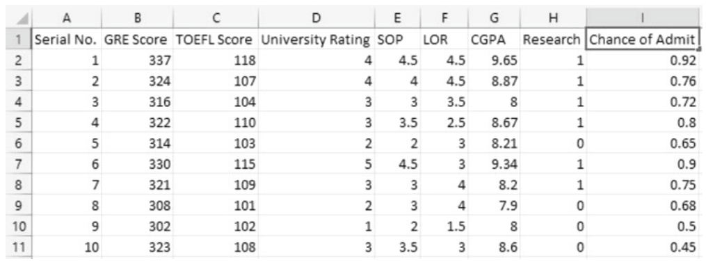

Hình 16.1 Tổng quan về admission dataset trong Excel.

Function MATLAB (Convert_to_Fixed_Point.m) được định nghĩa bởi code sau.

```
function xf = Convert_to_Fixed_Point(xin,hstep)
% Converting double type array into fixed type array
% hstep is optional parameter
Xmax = max(xin);
Xmin = min(xin);
IP_max = fix(Xmax);
IP_min = fix(Xmin);
fractional_parts = abs(xin - floor(xin));
non_zero_fractional_parts = fractional_parts(fractional_parts > 0);
FP_min = min(non_zero_fractional_parts);
if ((IP_max > 0) && (IP_min < 0))
    WL_int = ceil(log2((abs(IP_max) + abs(IP_min)) + 1));
elseif ((IP_max > 0) && (IP_min >= 0))
    IP_min = 0;
    WL_int = ceil(log2((abs(IP_max) + abs(IP_min)) + 1));
else
    IP_max = 0;
    WL_int = ceil(log2((abs(IP_max) + abs(IP_min)) + 1));
end

if nargin < 2
    hfactor = 10;
    if isempty(FP_min)
        FL = 0;
    else
        FL = ceil(log2(1/abs(FP_min/hfactor)));
    end
else
    FL = ceil(log2(1/abs(hstep)));
end
WL = WL_int + FL + 1; % 1 extra bit is for sign
s = 1;
xf = fi(xin,s,WL,FL);
```

Trong linear regression, chúng ta giả định rằng biến output y (một số vô hướng) có thể được mô tả như một tổ hợp của n biến input x<sub>1</sub>, x<sub>2</sub>,…, x<sub>n</sub>.

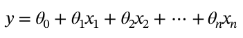 (16.1)

trong đó chúng ta có các biểu thức sau.

1. Các hệ số θ<sub>0</sub>, θ<sub>1</sub>,…, θ<sub>n</sub> là các tham số của model.

2. θ<sub>0</sub> là số hạng chặn (intercept, còn gọi là offset hay bias).

Model linear regression được mô tả trong Phương trình (16.1) cũng có thể được biểu diễn dưới dạng ký hiệu vector. Cho vector tham số θ = [θ<sub>0</sub> θ<sub>1</sub>…θ<sub>n</sub>]<sup>T</sup> và vector input x có thêm phần tử 1 ở vị trí đầu tiên, Phương trình (16.1) có thể được viết lại như sau.

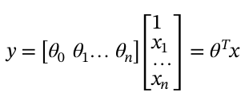 (16.2)

Để tìm θ, chúng ta dùng phương trình sau:

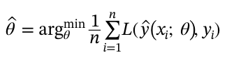 (16.3)

Cost function (J(θ)) được định nghĩa như sau:

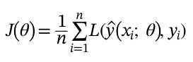 (16.4)

Ngoài ra, squared error loss function được cho bởi:

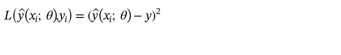 (16.5)

Dùng đại số tuyến tính, lời giải cho bài toán này là xác định θ bằng phương trình sau:

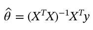 (16.6)

Tóm lại, phương pháp linear regression được mô tả như sau.

Việc học (learning) linear regression được thực hiện với squared error loss như sau:

Input: Dữ liệu huấn luyện τ = {x<sub>i</sub>,y<sub>i</sub>}<sup>N</sup><sub>i=1</sub>

Output: Vector tham số đã học θ̂ (tính bằng cách giải Phương trình (16.6))

Việc dự đoán (prediction) bằng linear regression được thực hiện như sau:

Input: Vector tham số đã học θ̂ và input test x<sup>*</sup>

Output: Dự đoán ŷ(x<sup>*</sup>) bằng phương trình sau:

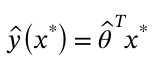 (16.7)

Khi chạy m-file MATLAB RegModel.m, chúng ta có thể xem các biểu đồ histogram của GRE Score, TOFEL Score *(ghi chú: sách in "TOFEL"; đúng là "TOEFL")*, University Rating, SOP, LOR, CGPA, Research và Chances of Admission. Ngoài ra, biểu đồ linear regression của dữ liệu testing và dữ liệu dự đoán cho Chance of Admit được mô tả trong Hình 16.2.

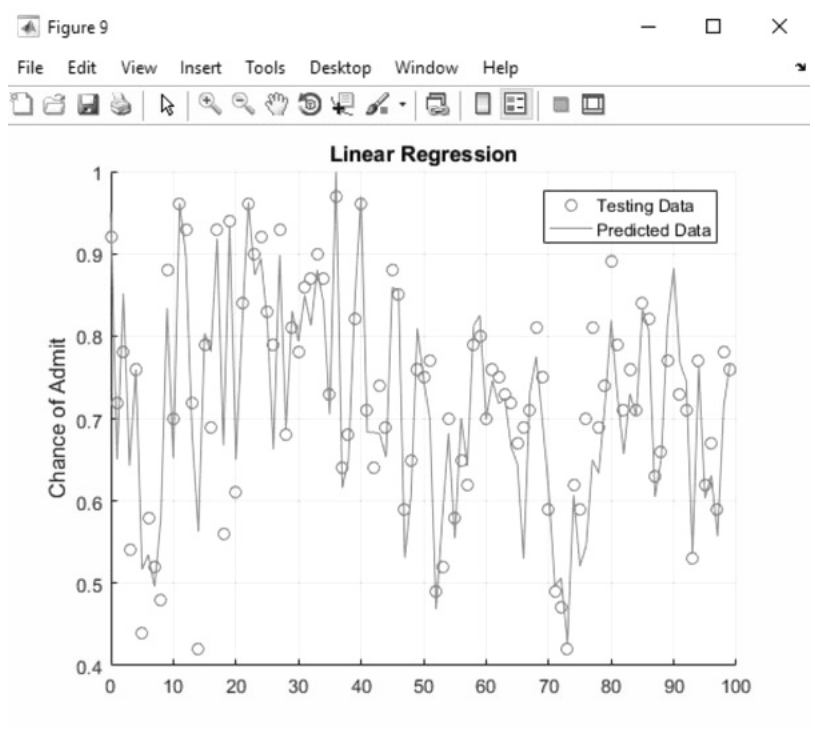

Hình 16.2 Biểu đồ linear regression của dữ liệu testing và dữ liệu dự đoán.

Hơn nữa, biểu thức sau xuất hiện trong command window:

```
MSE Linear Regression
MSE =
    0.0027
```

Vậy, chúng ta thấy rằng mean squared error là 0.0031, và các tham số θ đã học cuối cùng có được bằng lệnh sau:

```
>> Th
Th =
   -1.2459
    0.0017
    0.0028
    0.0068
    0.0002
    0.0191
    0.1215
    0.0247
```

## 16.4 Model hồi quy trong Simulink

Bây giờ, chúng ta mở Simulink bằng lệnh sau:

```
>> simulink
```

Thiết kế Simulink (ML_Regression.slx) được minh họa trong Hình 16.3.

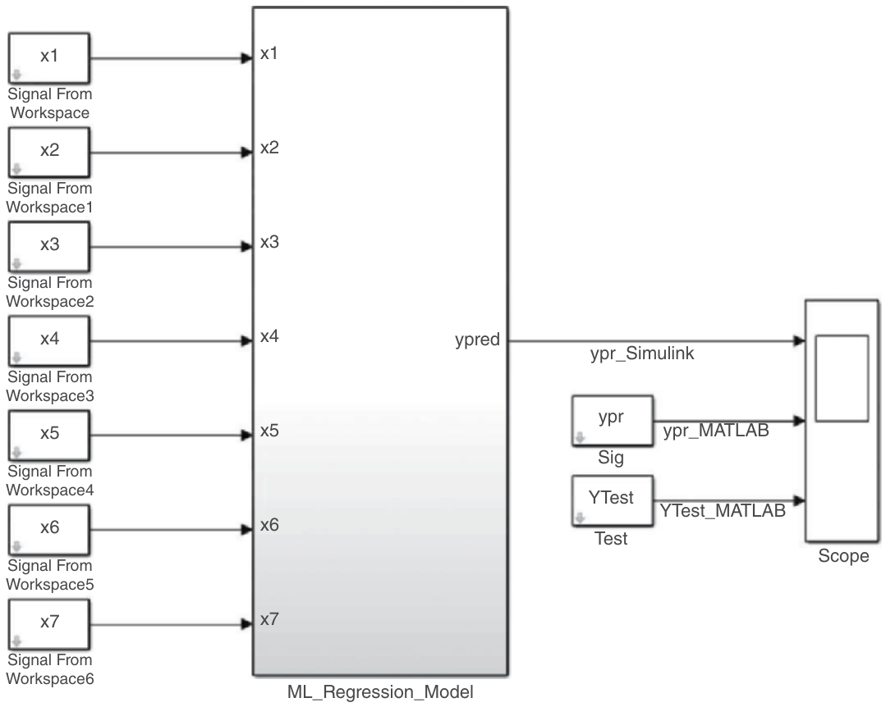

Hình 16.3 Thiết kế Simulink cho model hồi quy.

Thiết kế subsystem “ML_Regression_Model” được thể hiện trong Hình 16.4.

Các block parameter Signal From Workspace cho x1 được mô tả trong Hình 16.5.

Chúng ta nên lưu ý rằng x0 = XTest(:,1) = ones(100,1). Vậy, chúng ta chỉ dùng constant t0 ở Hình 16.4. Các block parameter cho constant t0 được minh họa lần lượt trong Hình 16.6 và 16.7.

Ngoài ra, các block parameter cho gain t1 được thể hiện lần lượt trong Hình 16.8 và 16.9.

Hơn nữa, tab Signal Attributes của Sum ở Hình 16.4 được mô tả trong Hình 16.10.

Bây giờ, chúng ta có thể chạy simulation, và để xem data type của các port, chúng ta right-click vào thiết kế Simulink và chọn Other Displays → Signals & Ports → Port Data Types. Chúng ta đặt tab Solver của cửa sổ Configuration Parameters, như được minh họa trong Hình 16.11. Sau đó, chúng ta có thể chạy simulation, và trong cửa sổ Scope, chúng ta click vào View → Legend và cả View → Style… rồi chọn marker phù hợp cho từng đường để có các waveform Simulink prediction, MATLAB prediction và YTest, như được thể hiện trong Hình 16.12.

Giờ chúng ta có thể tạo code VHDL cho subsystem “ML_Regression_Model” ở Hình 16.3 bằng HDL Coder. Để làm điều đó, chúng ta viết code sau trong MATLAB command window.

```
>> hdlsetup('ML_Regression')
```

ML_Regression là tên của thiết kế Simulink. Sau đó, chúng ta vào cửa sổ Configuration Parameters và đặt các giá trị tab Solver, như được minh họa trong Hình 16.11. Vì size(XTest) = 100 × 8, chúng ta đã đặt stop time là 100 ở Hình 16.11. Tiếp theo, chúng ta vào tab HDL Code Generation và đặt các tham số, như được mô tả trong Hình 16.13.

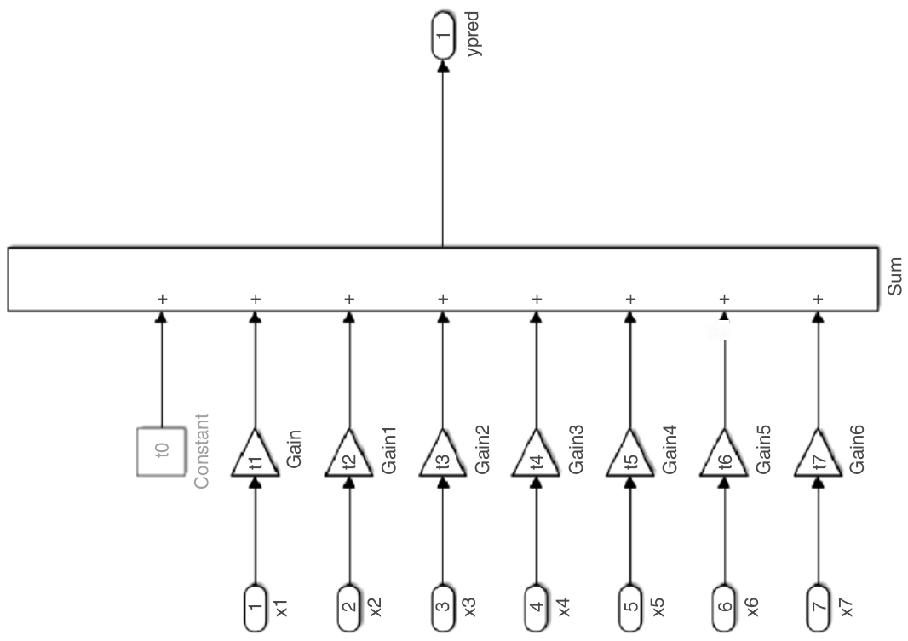

Hình 16.4 Thiết kế subsystem “ML_Regression_Model”.

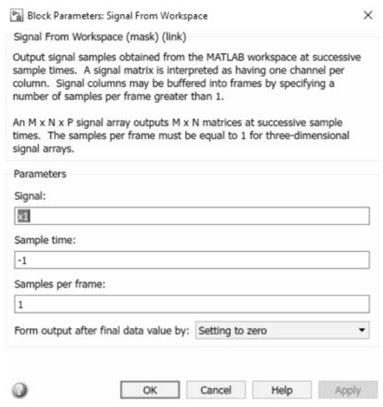

Hình 16.5 Các block parameter Signal From Workspace cho x1.

Sau đó, chúng ta gõ code sau trong MATLAB command window.

```
>> checkhdl('ML_Regression/ML_Regression_Model')
```

Cửa sổ HDL check report dạng web browser bật lên, như được thể hiện trong Hình 16.14.

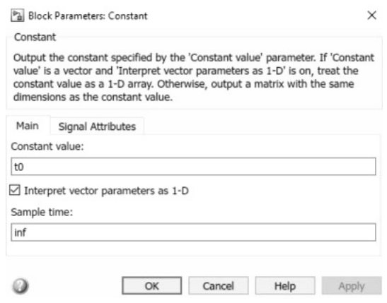

Hình 16.6 Block Parameters (Constant) cho tab Main.

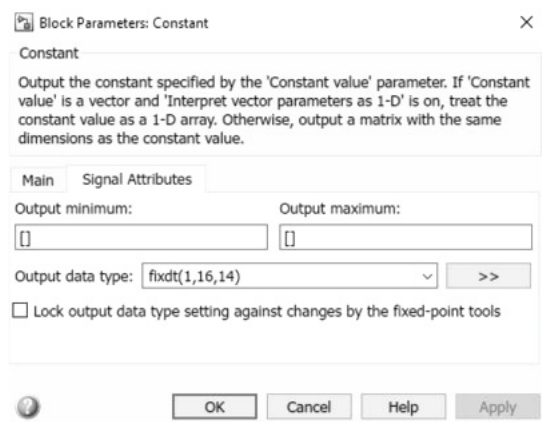

Hình 16.7 Block Parameters (Constant) cho tab Signal Attributes.

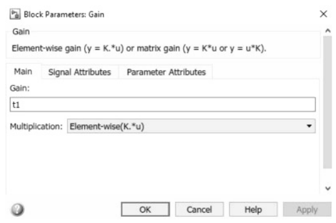

Hình 16.8 Block Parameters (Gain) cho tab Main.

Bây giờ, chúng ta dùng code sau để thực hiện HDL Code Generation trong MATLAB command window.

```
>> makehdl('ML_Regression/ML_Regression_Model')
```

Code VHDL được tạo ra thành công, và cửa sổ Code Generation Report được hiển thị, như được mô tả trong Hình 16.15.

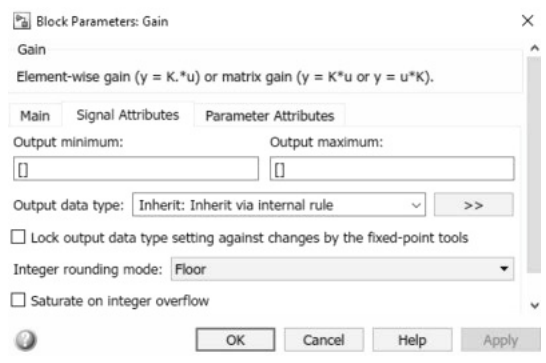

Hình 16.9 Block Parameters (Gain) cho tab Signal Attributes.

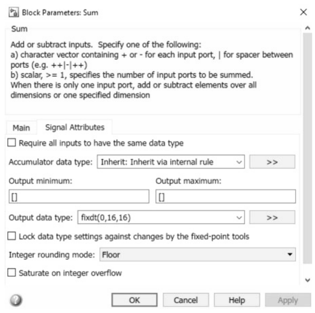

Hình 16.10 Tab Signal Attributes của block Sum.

## 16.5 Dùng code VHDL đã tạo trong Vivado

Bây giờ, chúng ta chạy Vivado và tạo một project tên “ML_Regression” rồi click button Next. Sau đó, chúng ta chọn loại project là RTL project và click button Next. Trong cửa sổ Add Sources, trước khi thêm file VHDL đã tạo, trước tiên chúng ta copy và paste file VHDL đã tạo (ML_Regression_Model.vhd) từ Hình 16.15 vào thư mục ML_Regression của project Vivado. Bây giờ, bằng cách click vào button Add Files, chúng ta có thể thêm nó vào project, như được thể hiện trong Hình 16.16.

Tiếp theo, chúng ta chọn development board Xilinx, click button Next, và cuối cùng click button Finish để tạo project “ML_Regression” với file VHDL đã tạo được thêm vào. Sau đó, chúng ta chạy synthesis, như được minh họa trong Hình 16.17.

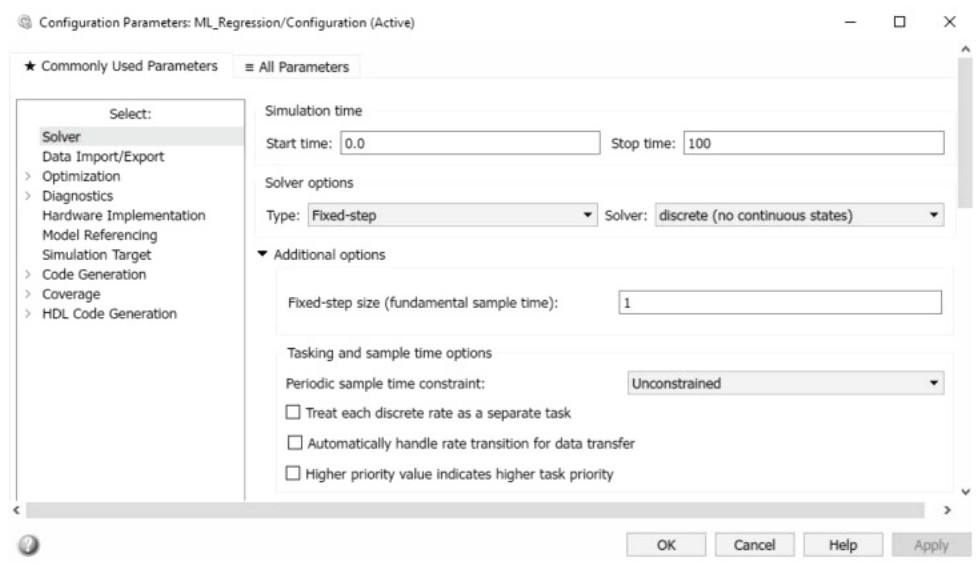

Hình 16.11 Tab Solver của cửa sổ Configuration Parameters.

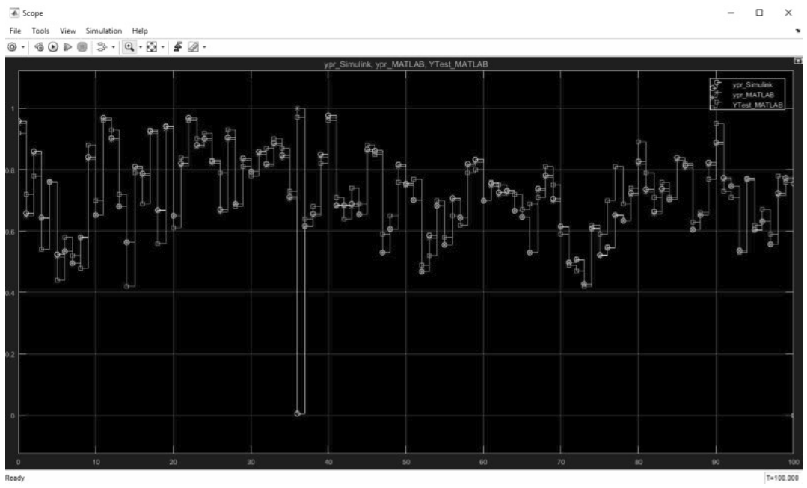

Hình 16.12 Các waveform Simulink prediction, MATLAB prediction và YTest.

Như được minh họa trong Hình 16.17, synthesis đã hoàn tất thành công, và chúng ta có thể click vào button Cancel. Sau đó, chúng ta mở schematic trong tab RTL Analysis như được thể hiện trong Hình 16.18.

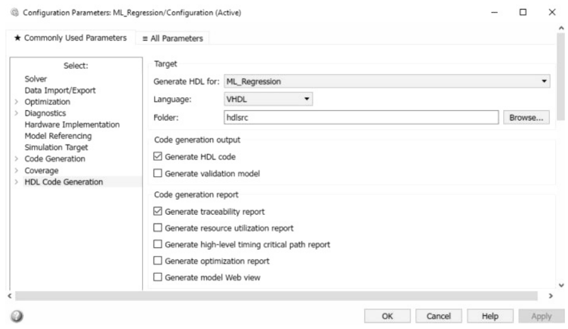

Hình 16.13 Tab HDL Code Generation của cửa sổ Configuration Parameters.

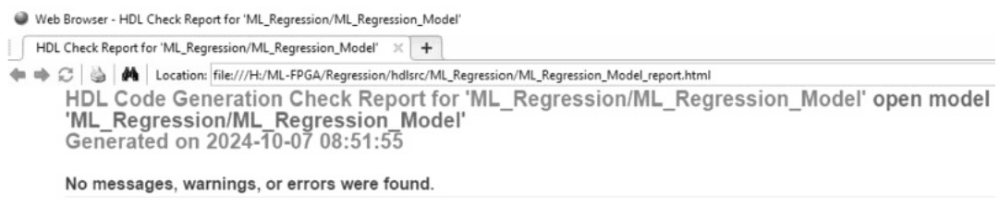

Hình 16.14 Cửa sổ HDL Check Report.

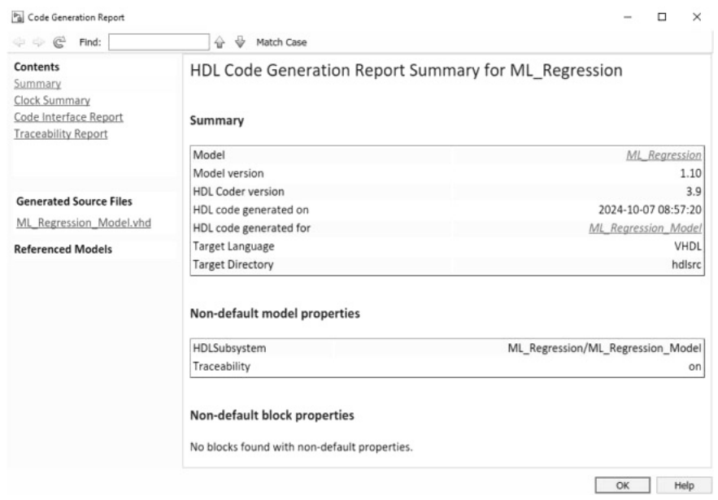

Hình 16.15 Cửa sổ Code Generation Report.

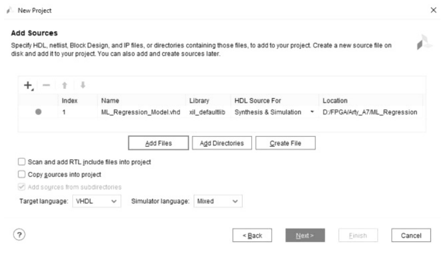

Hình 16.16 Thêm file VHDL đã tạo vào thư mục Sources.

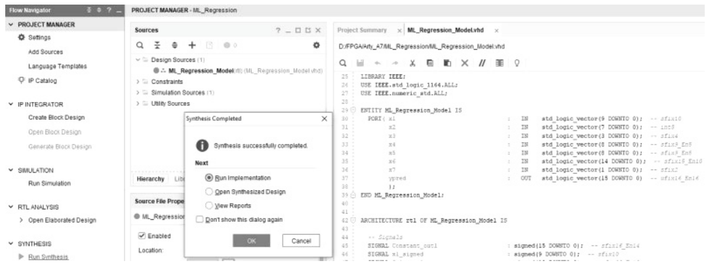

Hình 16.17 Synthesis chạy thành công.

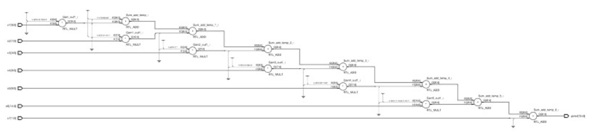

Hình 16.18 Schematic của “ML_Regression_Model.”

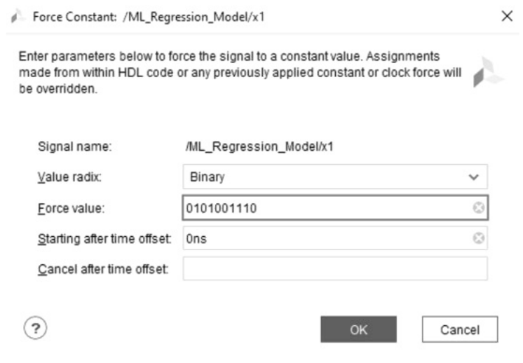

Hình 16.19 Cửa sổ Force Constant cho x1.

Bây giờ, chúng ta có thể mô phỏng project bằng cách chọn Flow → Run Simulation → Run Behavioral Simulation. Trong cửa sổ simulation vừa mở, chúng ta click vào button Restart. Sau đó chúng ta viết code sau trong MATLAB command window.

```
>> x1_20 = x1(20)
x1_20 =
   334
          DataTypeMode: Fixed-point: binary point scaling
            Signedness: Signed
            WordLength: 10
        FractionLength: 0
>> x1_20.bin
ans =
0101001110
```

Sau đó, trong cửa sổ Waveform, chúng ta right-click vào “x1” và chọn tùy chọn “Force Constant…”, đặt tham số của nó, như được minh họa trong Hình 16.19.

Chúng ta lặp lại quá trình tương tự cho x2 = 01110111, x3 = 0101, x4 = 010010000, x5 = 010010000, x6 = 010010111101100 và x7 = 01. Sau đó, chúng ta click button Run for 10 ns một lần và click button Zoom Fit trong cửa sổ waveform để có các waveform đã mô phỏng, như được minh họa trong Hình 16.20. Chúng ta cũng right-click vào “ypred” và chọn Radix → Binary để xem giá trị “ypred” dưới dạng số nhị phân. Chúng ta biết rằng data type “pred” là fixdt(0,16,16), nghĩa là nó là unsigned với word length 16 bit và fraction length 16 bit. Vì không có phần nguyên, chỉ tồn tại phần thập phân. Do đó, chúng ta có phương trình sau.

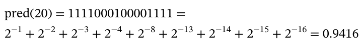 (16.8)

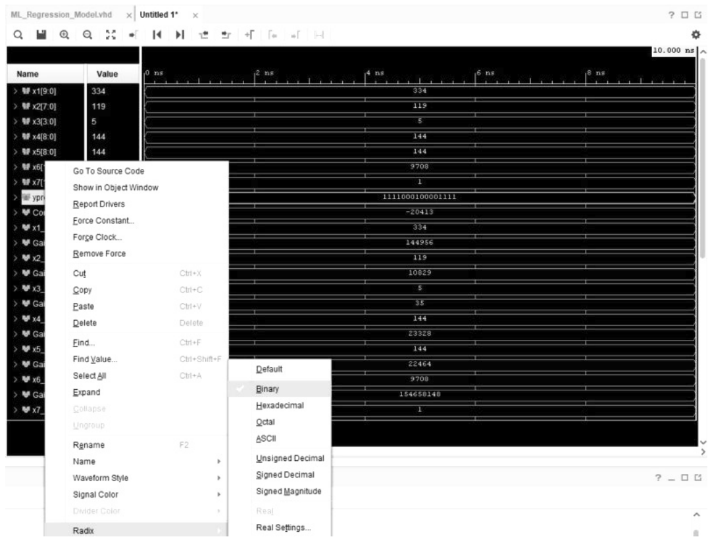

Hình 16.20 Các waveform đã mô phỏng.

Chúng ta có thể dùng function bin2float để lấy giá trị float của một số nhị phân, như được thể hiện trong code sau.

```
function out = bin2float(bin)

ind = find(bin == '.');
decpart = bin(1:ind-1);
floatpart = bin(ind+1:end);

out = bin2dec(decpart);
for n = 1:length(floatpart)
    if floatpart(n) == '1'
        out = out + 2^(-n);
    end
end
```

Vậy, nếu nhập code sau trong MATLAB command window, chúng ta có kết quả sau.

```
>> bin2float('0.1111000100001111')
ans =
    0.9416
```

Ngoài ra, nếu thực thi code sau trong MATLAB command window, chúng ta có các kết quả sau.

```
>> ypr(20)
ans =
    0.9344
>> YTest(20)
ans =
    0.9400
```

Như vậy, chúng ta cũng đạt được một dự đoán tốt khi dùng FPGA.
