# 17 Model phân loại nhị phân machine learning trên FPGA

## 17.1 Giới thiệu

Trong mục này, chúng ta sẽ hiện thực một model phân loại nhị phân (binary classification) machine learning trên FPGA bằng Simulink và Vivado. Đầu tiên, chúng ta tải một dataset từ Kaggle phù hợp cho việc hiện thực binary classification. Dùng MATLAB, chúng ta huấn luyện model binary classification bằng cách cực tiểu hóa cost function negative log-likelihood. Chúng ta dùng customer satisfaction dataset để dự đoán mức độ hài lòng của khách hàng dựa trên nhiều tham số input khác nhau. Sau đó, chúng ta hiện thực model machine learning binary classification đã huấn luyện bằng HDL Coder và tạo code VHDL có thể synthesize. Cuối cùng, dùng Vivado, chúng ta chạy synthesis analysis và simulation để kiểm chứng project VHDL đã thiết kế.

## 17.2 Dataset Kaggle

Trong chương này, chúng ta sẽ dùng customer satisfaction dataset từ Kaggle để dự đoán mức độ hài lòng của khách hàng dựa trên một số tham số input. Link web để tải dataset như sau.

https://www.kaggle.com/datasets/raminhuseyn/airline-customer-satisfaction

Tổng quan về một phần customer satisfaction dataset trong phần mềm Excel được thể hiện trong Hình 17.1.

## 17.3 Binary classification (logistic regression)

Trong mục này, chúng ta mô tả binary classification hay logistic regression, và mục tiêu của chúng ta là học hàm g ( x ) được tham số hóa bởi θ , hàm này dự đoán lớp nhị phân.

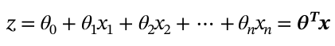 (17.1)

z nhận giá trị trên toàn bộ trục số thực, nhưng chúng ta cần một hàm trả về giá trị trong khoảng [0, 1]. Logistic function được định nghĩa bởi phương trình sau.

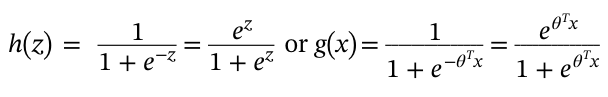 (17.2)

Code sau được dùng để vẽ h ( z ) theo z trong khoảng [−10, 10], và waveform thu được được mô tả trong Hình 17.2.

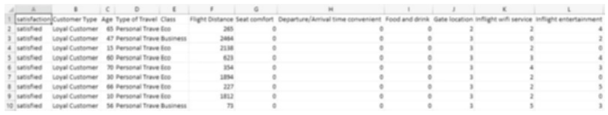

Hình 17.1 Tổng quan về một phần customer satisfaction dataset.

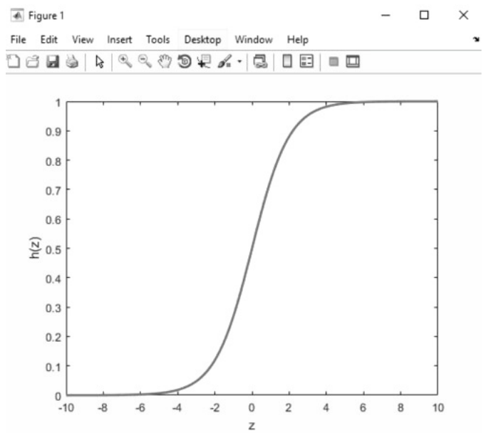

Hình 17.2 Đồ thị h ( z ) theo z .

```
z = -10:0.1:10;
hz = zeros(1,length(z));
for i = 1:length(z)
   hz = 1./(1+exp(-z));
end
plot(z,hz,'LineWidth',2);
xlabel('z');
ylabel('h(z)')
```

Class prediction hay binary classification được định nghĩa bởi phương trình sau.

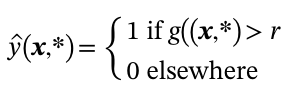 (17.3)

Ngưỡng quyết định là r = 0.5 .

Vector tham số 𝜽 được tìm bằng phương trình sau.

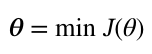 (17.4)

Cost function (negative log-likelihood cost) trong logistic regression được cho bởi phương trình sau:

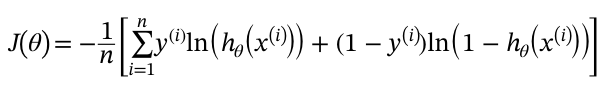 (17.5)

Gradient của cost function là một vector có cùng độ dài với 𝜽 , được cho bởi phương trình sau:

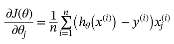 (17.6)

Ngoài ra, logistic regression function được định nghĩa bởi phương trình sau:

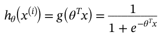 (17.7)

Tóm lại, phương pháp logistic regression được mô tả như sau.

Việc học (learning) binary regression được thực hiện như sau.

Input: Dữ liệu huấn luyện τ = {x<sub>i</sub>,y<sub>i</sub>}<sup>N</sup><sub>i=1</sub> (với các lớp output y = { 0,1})

Output: Vector tham số đã học 𝜽 (tính bằng phương pháp số theo Phương trình (17.4))

Việc dự đoán bằng binary logistic regression được thực hiện như sau.

Input: Vector tham số đã học 𝜽 , và input test x*

Output: Dự đoán ŷ(x*) bằng phương trình sau.

Tính g(x,*) , bằng phương trình sau.

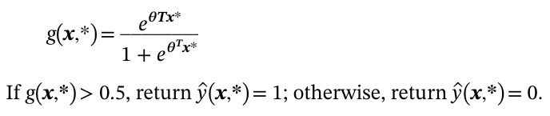 (17.8)

## 17.4 Model logistic regression machine learning cho dataset

Chúng ta dùng m-file MATLAB sau (ClassModel.m) để hiện thực model binary classification machine learning cho customer satisfaction dataset.

```
clear all; close all; clc
cd('H:\ML-FPGA\Classification');
t = readtable('airline_customer.csv');
% Indices of different types of variables
Text_Var = [1 2 4 5];
Num_Disc_Var = [7 8 9 10 11 12 13 14 15 16 17 18 19 20];
Num_Cont_Var = [3 6 21 22];
% Text Data
Text_Data = t(:,Text_Var);
Text_Data_Cell = table2cell(Text_Data);
Text_Var_str = string(Text_Data_Cell);
% Discrete Numeric Data
NumD_Data = t(:,Num_Disc_Var);
NumD_Arr = table2array(NumD_Data);
NumD_str = string(NumD_Arr);
NumD_cell = cellstr(NumD_str);
% Continuous Numeric Data
NumC_Data = t(:,Num_Cont_Var);
NumC_Arr = table2array(NumC_Data);
% Convert Textual Data to Numerical Data
Text_Count = ones(size(Text_Var_str));
for i = 1:length(Text_Count)
    if (Text_Var_str(i,1) == 'satisfied')
        Text_Count(i,1) = 1;
    else
        Text_Count(i,1) = 0;
    end
end

for i = 1:length(Text_Count)
    if (Text_Var_str(i,2) == 'Loyal Customer')
        Text_Count(i,2) = 1;
    else
        Text_Count(i,2) = 0;
    end
end

for i = 1:length(Text_Count)
    if (Text_Var_str(i,3) == 'Business travel')
        Text_Count(i,3) = 0;
    else
        Text_Count(i,3) = 1;
    end
end

for i = 1:length(Text_Count)
    if (Text_Var_str(i,4) == 'Business')
        Text_Count(i,4) = 1;
    elseif (Text_Var_str(i,4) == 'Eco')
        Text_Count(i,4) = 2;
    else
        Text_Count(i,4) = 3;
    end
end

% Histogram's Plots of features
figure
subplot(121)
histogram(categorical(Text_Data_Cell(:,1)),'BarWidth',0.3);
ylabel('Frequency');
title('satisfaction');
grid on;

subplot(122)
histogram(categorical(Text_Data_Cell(:,2)),'BarWidth',0.3);
ylabel('Frequency');
title('Customer Type');
grid on;

figure
subplot(211)
histogram(categorical(Text_Data_Cell(:,3)),'BarWidth',0.3);
ylabel('Frequency');
title('Type of Travel');
grid on;

subplot(212)
histogram(categorical(Text_Data_Cell(:,4)),'BarWidth',0.3);
ylabel('Frequency');
title('Class');
grid on;

figure
subplot(221)
histogram(categorical(NumD_cell(:,1)),'BarWidth',0.3);
ylabel('Frequency');
title('Seat comfort');
grid on;

subplot(222)
histogram(categorical(NumD_cell(:,2)),'BarWidth',0.3);
ylabel('Frequency');
title('Departure/Arrival time convenient');
grid on;

subplot(223)
histogram(categorical(NumD_cell(:,3)),'BarWidth',0.3);
ylabel('Frequency');
title('Food and drink');
grid on;

subplot(224)
histogram(categorical(NumD_cell(:,4)),'BarWidth',0.3);
ylabel('Frequency');
title('Gate location');
grid on;

figure
subplot(121)
histogram(categorical(NumD_cell(:,5)),'BarWidth',0.3);
ylabel('Frequency');
title('Inflight wifi service');
grid on;

subplot(122)
histogram(categorical(NumD_cell(:,6)),'BarWidth',0.3);
ylabel('Frequency');
title('Inflight entertainment');
grid on;

figure
subplot(211)
histogram(categorical(NumD_cell(:,7)),'BarWidth',0.3);
ylabel('Frequency');
title('Online support');
grid on;
subplot(212)
histogram(categorical(NumD_cell(:,8)),'BarWidth',0.3);
ylabel('Frequency');
title('Ease of Online booking');
grid on;

figure
subplot(131)
histogram(categorical(NumD_cell(:,9)),'BarWidth',0.3);
ylabel('Frequency');
title('On-board service');
grid on;

subplot(132)
histogram(categorical(NumD_cell(:,10)),'BarWidth',0.3);
ylabel('Frequency');
title('Leg room service');
grid on;

subplot(133)
histogram(categorical(NumD_cell(:,11)),'BarWidth',0.3);
ylabel('Frequency');
title('Baggage handling');
grid on;

figure
subplot(131)
histogram(categorical(NumD_cell(:,12)),'BarWidth',0.3);
ylabel('Frequency');
title('Checkin service');
grid on;

subplot(132)
histogram(categorical(NumD_cell(:,13)),'BarWidth',0.3);
ylabel('Frequency');
title('Cleanliness');
grid on;

subplot(133)
histogram(categorical(NumD_cell(:,14)),'BarWidth',0.3);
ylabel('Frequency');
title('Online boarding');
grid on;

figure
subplot(221)
histogram(NumC_Arr(:,1));
ylabel('Frequency');
title('Age');
grid on;

subplot(222)
histogram(NumC_Arr(:,2));
ylabel('Frequency');
title('Flight Distance');
grid on;

subplot(223)
histogram(NumC_Arr(:,3));
xlim([0 140]);
ylabel('Frequency');
title('Departure Delay in Minutes');
grid on;

subplot(224)
histogram(NumC_Arr(:,4));
xlim([0 120]);
ylabel('Frequency');
title('Arrival Delay in Minutes');
grid on;

% Text_Count = Text_Count(1:100,:);
% NumD_Arr = NumD_Arr(1:100,:);
% NumC_Arr = NumC_Arr(1:100,:);

All_Data = [Text_Count NumD_Arr NumC_Arr];
rnan = all(~isnan(All_Data),2);
All_Data = All_Data(rnan,:);

% Matrix presentation of entire data
Xfeatures = All_Data(:,2:end);
Yout = All_Data(:,1);
Xf = [ones(size(Yout,1),1) Xfeatures];

%Splitting data into training and testing
P = 0.8;
Pn = 1-P;
XTrain = Xf(1:round(P*length(Xf)),:);
YTrain = Yout(1:round(P*length(Xf)),:);

XTest = Xf(end-round(Pn*length(Xf)):end,:);
YTest = Yout(end-round(Pn*length(Xf)):end,:);

%Implementation of logistic regression for classification
[Rows, Columns] = size(Xfeatures);
Theta_initial = zeros(Columns + 1, 1);

%Initial value of cost function
[Ji, Gradi] = Cost_Function(Theta_initial, XTrain, YTrain);
options = optimoptions(@fminunc,'Display','iter','Algorithm','Quasi-
Newton','GradObj','on','MaxIter',500);
[Theta, cost] = fminunc(@(t)(Cost_Function(t, XTrain, YTrain)),Theta_
initial,options);

%Final value of cost function
[Jf, Gradf] = Cost_Function(Theta_initial, XTrain, YTrain);
%Sigmoid function evaluation
z = XTest * Theta;
hz = 1 ./ (1 + exp(-z));  %Sigmoid function implementation

%Output Prediction
ypred = round(hz);

%Accuracy Prediction
Accuracy = 100*mean(ypred == YTest);
fprintf('Accuracy of Log Reg Method = %0.4f \n',Accuracy)

%Plot Graphs
figure
Out_Ys = [YTest ypred];
plot(Out_Ys(:,2),'*r')
grid on;
hold on

plot(Out_Ys(:,1),'ob')
ylim([-0.2 1.2])
legend('Predicted','Actual')
title('Logistic Regression Method')

figure
C1 = categorical(Out_Ys(:,2),[0 1], {'Not Satisfied','Satisfied'});
histogram(C1,'BarWidth',0.3);
hold on;
grid on;

C2 = categorical(Out_Ys(:,1),[0 1], {'Not Satisfied','Satisfied'});
histogram(C2,'BarWidth',0.15);
legend('Predicted','Actual')
title('Logistic Regression Method')
ylabel('Frequency')

%Quantization
x0 = Convert_to_Fixed_Point(XTest(:,1));
x1 = Convert_to_Fixed_Point(XTest(:,2));
x2 = Convert_to_Fixed_Point(XTest(:,3));
x3 = Convert_to_Fixed_Point(XTest(:,4));
x4 = Convert_to_Fixed_Point(XTest(:,5));
x5 = Convert_to_Fixed_Point(XTest(:,6));
x6 = Convert_to_Fixed_Point(XTest(:,7));
x7 = Convert_to_Fixed_Point(XTest(:,8));
x8 = Convert_to_Fixed_Point(XTest(:,9));
x9 = Convert_to_Fixed_Point(XTest(:,10));
x10 = Convert_to_Fixed_Point(XTest(:,11));
x11 = Convert_to_Fixed_Point(XTest(:,12));
x12 = Convert_to_Fixed_Point(XTest(:,13));
x13 = Convert_to_Fixed_Point(XTest(:,14));
x14 = Convert_to_Fixed_Point(XTest(:,15));
x15 = Convert_to_Fixed_Point(XTest(:,16));
x16 = Convert_to_Fixed_Point(XTest(:,17));
x17 = Convert_to_Fixed_Point(XTest(:,18));
x18 = Convert_to_Fixed_Point(XTest(:,19));
x19 = Convert_to_Fixed_Point(XTest(:,20));
x20 = Convert_to_Fixed_Point(XTest(:,21));
x21 = Convert_to_Fixed_Point(XTest(:,22));

Thf = fi(Theta,1,16,12);
YTest = YTest(1:1000);
```

Trước hết, chúng ta vẽ histogram của các cột khác nhau trong customer satisfaction dataset. Chúng ta cũng dành 80% dữ liệu cho training và 20% cho testing. Code cho function “Cost_Function” được trình bày như sau.

```
function [J, Grad] = Cost_Function(Theta, X, y)
n = length(y);
z = X * Theta;
Grad = zeros(size(Theta));
h = 1 ./ (1 + exp(-z));
J = -(1/n)*sum((y.*log(h))+((1-y).*log(1-h)));
for j=1:size(Theta,1)
    Grad(j)=(1/n)*sum((h-y).*X(:,j));
end
end
```

Ngoài ra, cùng function “Convert_to_Fixed_Point” từ chương trước cũng được dùng ở đây. Các histogram dự đoán và thực tế cho customer satisfaction được minh họa trong Hình 17.3. Hơn nữa, các đồ thị dự đoán và thực tế cho customer satisfaction được thể hiện trong Hình 17.4.

Độ chính xác của phương pháp logistic regression được hiển thị trong MATLAB command window như sau.

```
Accuracy of Log Reg Method = 94.2505
```

Ngoài ra, các giá trị tối ưu của 𝜽​ như sau:​

```
>> Theta'
ans =
  Columns 1 through 13
   -5.9870    1.6159   -0.5531   -0.4730    0.2791   -0.2126   -0.2270    0.1238
-0.0781    0.7168    0.1137    0.1442    0.2946
  Columns 14 through 22
    0.2091    0.0706    0.2812    0.0460    0.1497   -0.0096   -0.0002    0.0035
-0.0088
```

Độ dài của 𝜽 như sau:

```
>> length(Theta)
ans =
    22
```

Vì min(Theta) = −5.9870, và max(Theta) = 1.6159, chúng ta có thể biểu diễn phần nguyên của Theta bằng 4 bit (1 bit cho dấu). Chúng ta dùng lệnh Thf = fi(Theta,1,16,12), trong đó word length là 16 bit và fraction length là 12 bit. Để tính từng phần tử của Theta tới ít nhất 32 chữ số có nghĩa, chúng ta dùng lệnh vpa(Theta), lệnh này cung cấp số học variable-precision cho các số floating-point. Các giá trị fixed-point của 𝜽 được trình bày như sau.

```
>> Thf'
ans =
  Columns 1 through 13
   -5.9871    1.6160   -0.5530   -0.4731    0.2791   -0.2126   -0.2271    0.1238
-0.0781    0.7168    0.1138    0.1443    0.2947
  Columns 14 through 22
    0.2090    0.0706    0.2813    0.0459    0.1497   -0.0095   -0.0002    0.0034
-0.0088
          DataTypeMode: Fixed-point: binary point scaling
            Signedness: Signed
            WordLength: 16
        FractionLength: 12
```

Chúng ta có thể dùng lệnh vpa(Thf’) để có số học variable-precision cho các số floating-point của Thf’ trong MATLAB command window như sau.

```
>> vpa(Thf')

ans =

[ -5.987060546875, 1.615966796875, -0.552978515625, -0.47314453125, 0.279052734375,
-0.212646484375, -0.22705078125, 0.123779296875, -0.078125, 0.716796875, 0.1137695
3125, 0.144287109375, 0.294677734375, 0.208984375, 0.070556640625, 0.28125, 0.0458
984375, 0.149658203125, -0.009521484375, -0.000244140625, 0.00341796875, -0.008789
0625]
```

Như bạn có thể thấy, chúng ta có tối đa 12 chữ số ở phần thập phân.

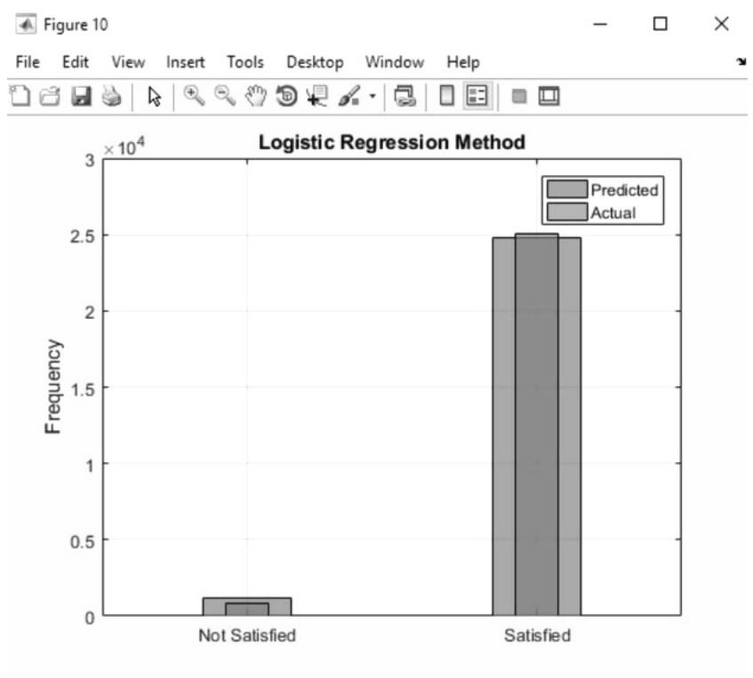

Hình 17.3 Các histogram dự đoán và thực tế cho customer satisfaction.

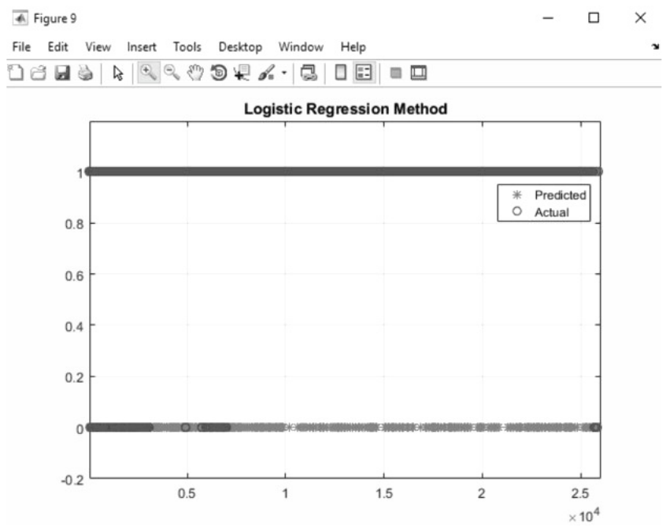

Hình 17.4 Các đồ thị dự đoán và thực tế cho customer satisfaction.

## 17.5 Model logistic regression trong Simulink

Bây giờ, chúng ta mở Simulink bằng lệnh sau.

```
>> simulink
```

Thiết kế Simulink (Bin_Class.slx) được minh họa trong Hình 17.5.

Thiết kế subsystem “Bin_Class_Model” được thể hiện trong Hình 17.4 *(ghi chú: sách in "Figure 17.4"; đúng là Hình 17.6)*. Code của MATLAB function “WeightedSum” ở Hình 17.6 như sau.

```
function z = WeightedSum(x0,x1,x2,x3,x4,x5,x6,x7,x8,x9,x10,x11,x12,x13,...
    x14,x15,x16,x17,x18,x19,x20,x21,Theta)

T = Theta;
t0 = T(1); t1 = T(2); t2 = T(3); t3 = T(4); t4 = T(5);
t5 = T(6); t6 = T(7); t7 = T(8); t8 = T(9); t9 = T(10);
t10 = T(11); t11 = T(12); t12 = T(13); t13 = T(14); t14 = T(15);
t15 = T(16); t16 = T(17); t17 = T(18); t18 = T(19); t19 = T(20);
t20 = T(21); t21 = T(22);

WS0 = t0*x0 + t1*x1 + t2*x2 + t3*x3 + t4*x4;
WS1 = t5*x5 + t6*x6 + t7*x7 + t8*x8 + t9*x9;
WS2 = t10*x10 + t11*x11 + t12*x12 + t13*x13 + t14*x14;
WS3 = t15*x15 + t16*x16 + t17*x17 + t18*x18 + t19*x19;
WS4 = t20*x20 + t21*x21;
Wsum = WS0 + WS1 + WS2 + WS3 + WS4;
z = fi(Wsum,1,16,11);
```

Nếu viết code plot(z) trong MATLAB command window, chúng ta có thể thấy đồ thị của z như được mô tả trong Hình 17.7.

Chúng ta có thể thấy các giá trị z nằm trong khoảng [−6, 6]. Vậy, z = fi(Wsum,1,16,11) trong MATLAB function “WeightedSum” với 5 bit cho phần nguyên (1 bit cho dấu) và 11 bit cho phần thập phân là phù hợp. Code của MATLAB function “Sigmoid” như sau.

```
function hz = Sigmoid(z)
zd = double(z);
hz = 1/(1+exp(-zd));
```

Cuối cùng, code sau được dùng bên trong MATLAB function “Prediction”.

```
function y = fcn(u)
if u > 0.5
    y = fi(1,0,1,0);
else
    y = fi(0,0,1,0);
end
```

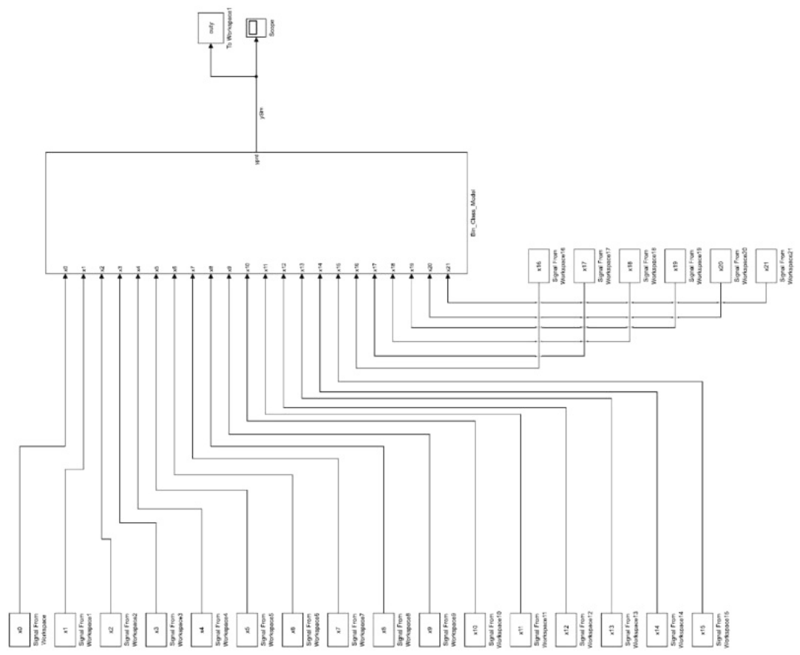

Hình 17.5 Model Simulink của binary classification.

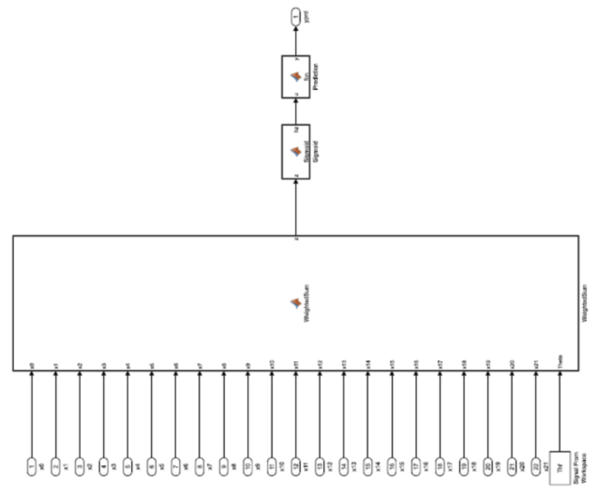

Hình 17.6 Thiết kế subsystem “Bin_Class_Model”.

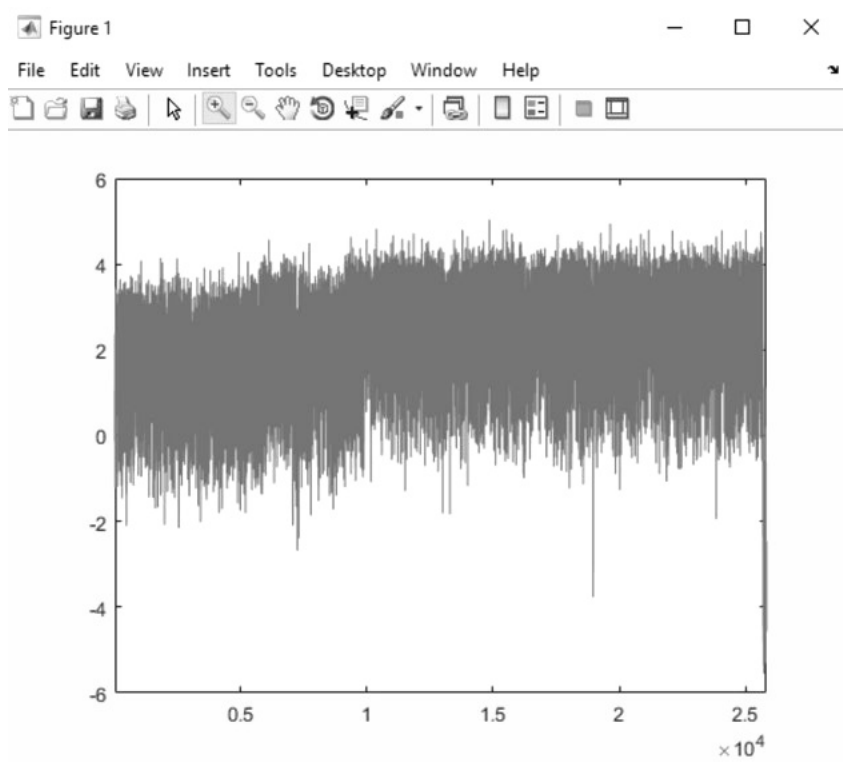

Hình 17.7 Đồ thị của z.

Các block parameter signal from workspace cho “Thf” ở Hình 17.6 được minh họa trong Hình 17.8.

Các block parameter signal from workspace cho “x0” ở Hình 17.5 được thể hiện trong Hình 17.9 (các tham số tương tự được dùng cho x1, …, x21).

Ngoài ra, các configuration parameter cho tab Solver được mô tả trong Hình 17.10.

Bây giờ, nếu chạy simulation, chúng ta có thể xem các giá trị dự đoán yprd (ySim) trên scope, như được minh họa trong Hình 17.11.

Các block parameter “to workspace” ở Hình 17.5 được thể hiện trong Hình 17.12.

Để tính độ chính xác, chúng ta dùng m-file sau (Calculate_Accuracy.m).

```
close all; clc
y2 = outy;
y2(end) = [];
AccuracySim = 100*mean(y2 == YTest)
```

Khi chạy m-file này, chúng ta có kết quả sau trong MATLAB command window.

```
AccuracySim =
   77.3000
```

HDL Coder không thể tạo code cho MATLAB function “Sigmoid” và báo lỗi. Do đó, tốt hơn là dùng một 1-D Lookup Table thay thế. Các block parameter cho 1-D Lookup Table được mô tả trong Hình 17.13.

Tiếp theo, chúng ta click button “Edit table and breakpoints…”. Trong cửa sổ vừa mở, từ tab Edit, chúng ta chọn tùy chọn Add Row để thêm các hàng cần thiết. Chúng ta dùng m-file sau để lấy các giá trị của sigmoid function trong khoảng [−6:0.5:6].

```
z = -6:0.5:6;
hz = zeros(1,length(z));
for i = 1:length(z)
   hz = 1./(1+exp(-z));
end
plot(z,hz,'LineWidth',2);
xlabel('z');
ylabel('h(z)');
```

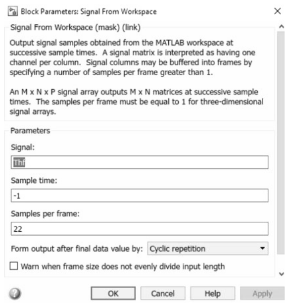

Hình 17.8 Các block parameter signal from workspace cho “Thf”.

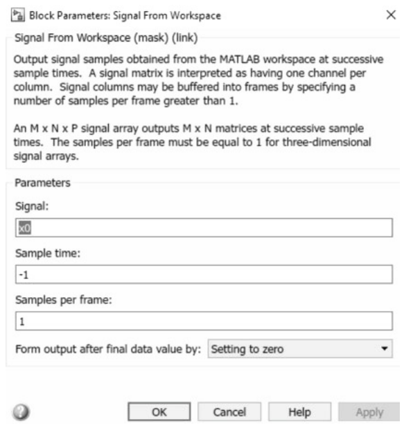

Hình 17.9 Các block parameter signal from workspace cho “x0”.

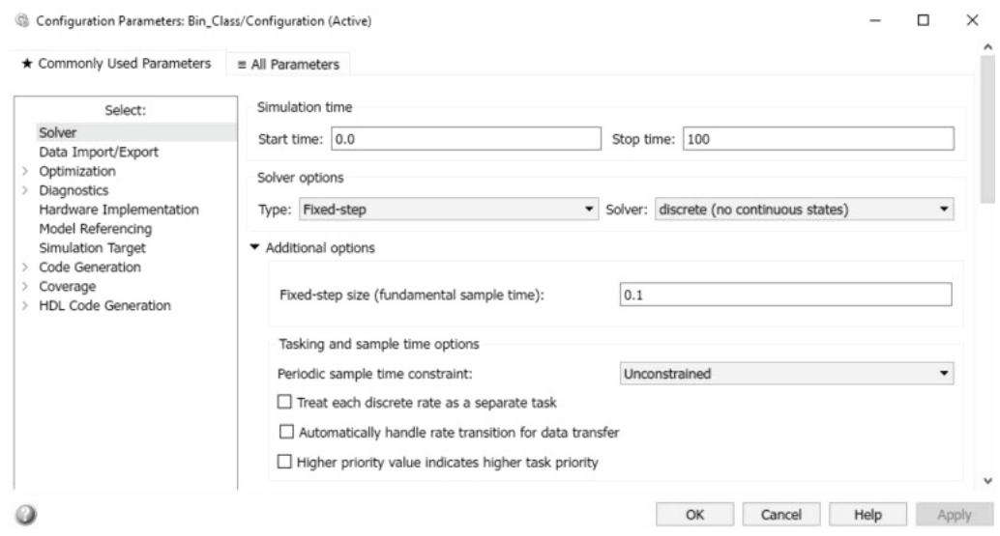

Hình 17.10 Các configuration parameter cho tab Solver.

Sau khi chạy m-file, nếu gõ “hz” trong MATLAB command window, chúng ta sẽ có các giá trị sau.

```
>> hz

hz =

  Columns 1 through 13
    0.0025    0.0041    0.0067    0.0110    0.0180    0.0293    0.0474    0.0759
0.1192    0.1824    0.2689    0.3775    0.5000
  Columns 14 through 25
    0.6225    0.7311    0.8176    0.8808    0.9241    0.9526    0.9707    0.9820
0.9890    0.9933    0.9959    0.9975
```

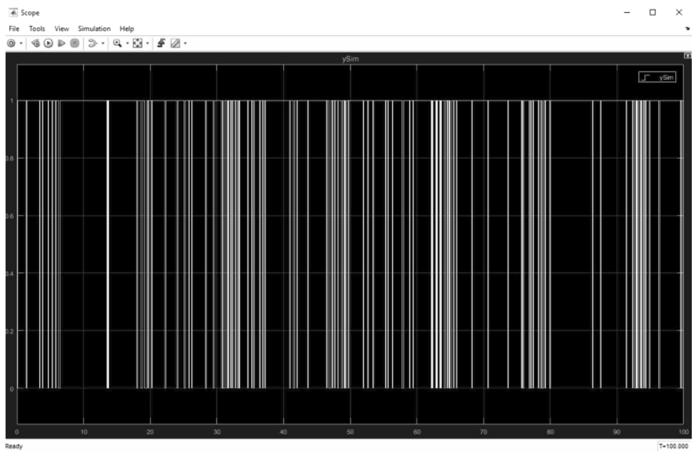

Hình 17.11 Các giá trị dự đoán yprd (ySim) trên scope.

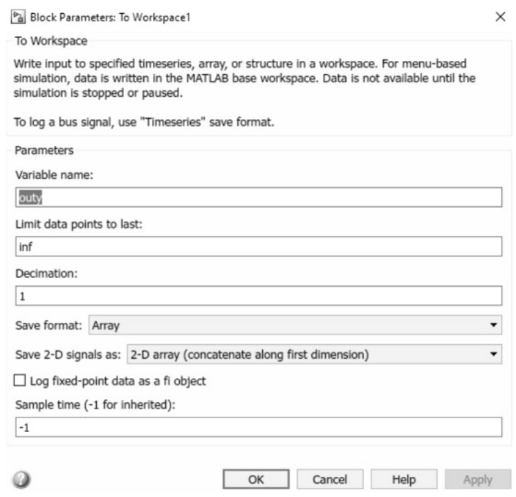

Hình 17.12 Các block parameter “to workspace” cho “outy”.

Chúng ta có thể copy và paste các giá trị này vào Table data của Hình 17.13. Bằng cách click vào linear plot trong cửa sổ Lookup Table editor, chúng ta có thể thấy đồ thị tuyến tính của sigmoid function trong khoảng [−6:0.5:6], như được minh họa trong Hình 17.14.

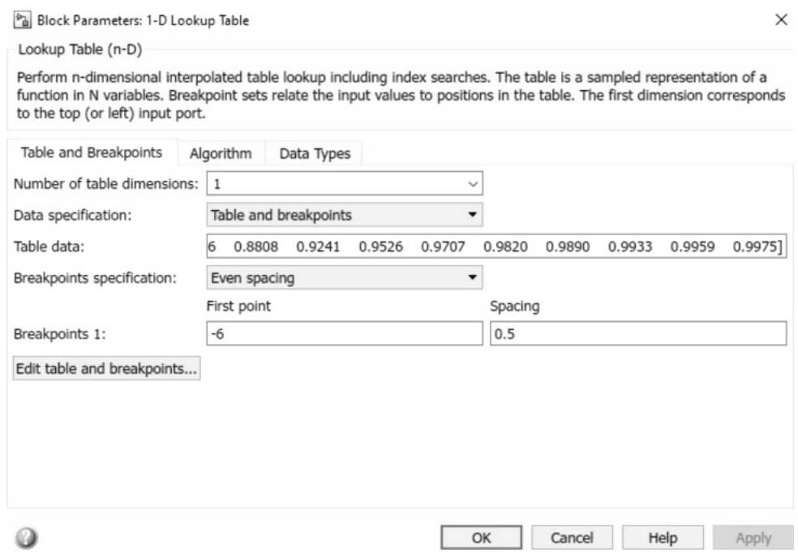

Hình 17.13 Các block parameter cho 1-D Lookup Table.

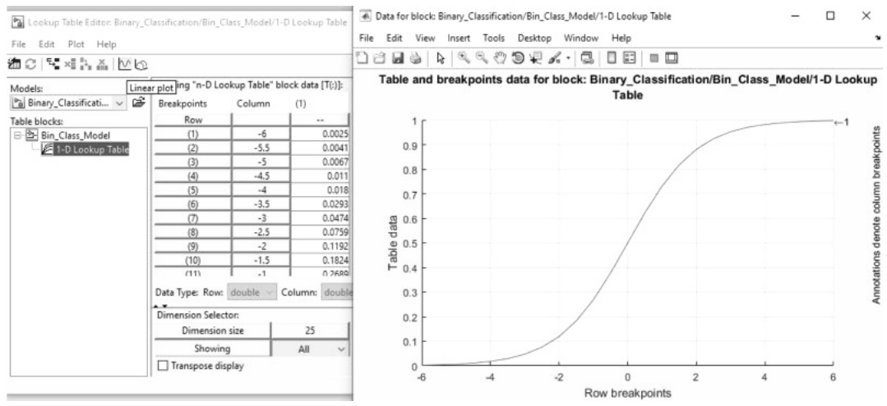

Hình 17.14 Đồ thị tuyến tính của sigmoid function trong khoảng [−6:0.5:6].

Một giải pháp khác là dùng xấp xỉ tuyến tính từng đoạn (piecewise linear approximation) của sigmoid function dưới dạng MATLAB function bằng code sau.

```
function y = fcn(u)
u_in = fi(u,1,16,11);
if u_in < -3
    y = fi(0,1,16,11);
elseif (u_in >= -3 && u_in < -2)
    y = fi(0.072*u_in + 0.22,1,16,11);
elseif (u_in >= -2 && u_in < 2)
    y = fi(0.21*u_in + 0.5,1,16,11);
elseif (u_in >= 2 && u_in < 3)
    y = fi(0.072*u_in + 0.78,1,16,11);
else
    y = fi(1,1,16,11);
end
```

Vì HDL Coder không thể tạo code cho block signal from workspace của “Thf”, chúng ta dùng 22 constant block và một multiplexer thay thế, như được thể hiện trong Hình 17.15.

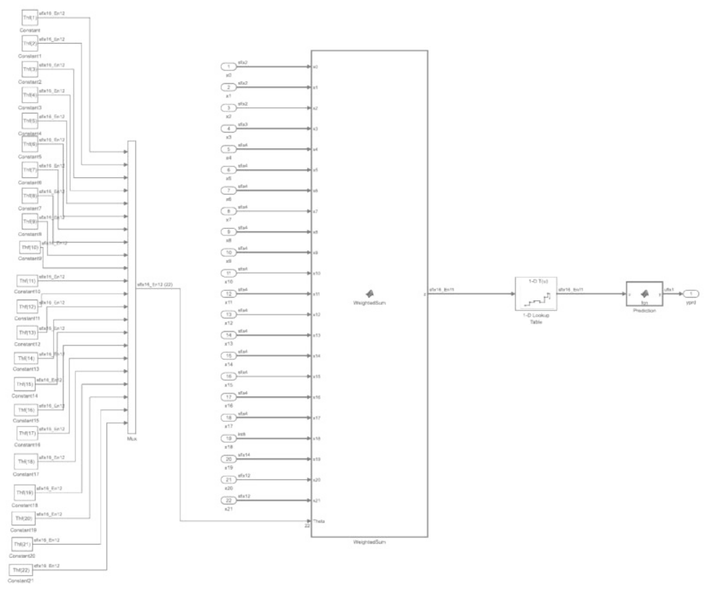

Hình 17.15 Dùng 22 constant block và một multiplexer.

Các block parameter constant cho phần tử đầu tiên của “Thf” được mô tả trong Hình 17.16.

Tiếp theo, chúng ta có thể tạo code VHDL cho subsystem “Bin_Class_Model” ở Hình 17.15 bằng HDL Coder. Để làm điều này, chúng ta viết code sau trong MATLAB command window.

```
>> hdlsetup('Binary_Classification')
```

Ở đây, Binary_Classification là tên của thiết kế Simulink. Sau đó, chúng ta vào cửa sổ Configuration Parameters, đặt các giá trị tab Solver như được minh họa trong Hình 17.10, và cấu hình tab HDL Code Generation như được mô tả trong Hình 17.17.

Sau đó, chúng ta gõ code sau trong MATLAB command window.

```
>> checkhdl('Binary_Classification/Bin_Class_Model')
```

Thao tác này mở cửa sổ HDL Check Report trong web browser, như được thể hiện trong Hình 17.18.

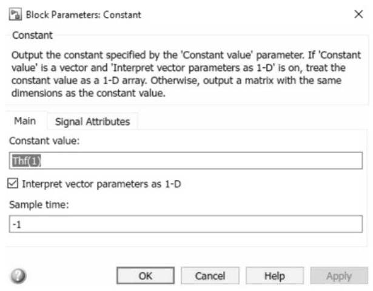

Hình 17.16 Các block parameter constant cho Thf(1).

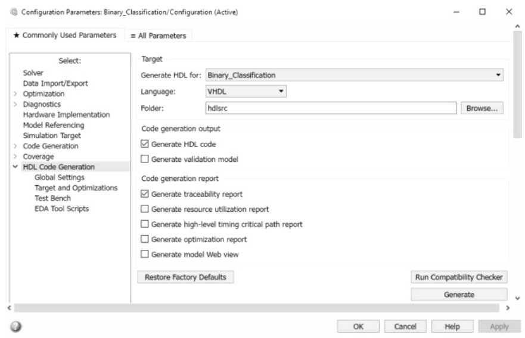

Hình 17.17 Tab HDL Code Generation của cửa sổ Configuration Parameters.

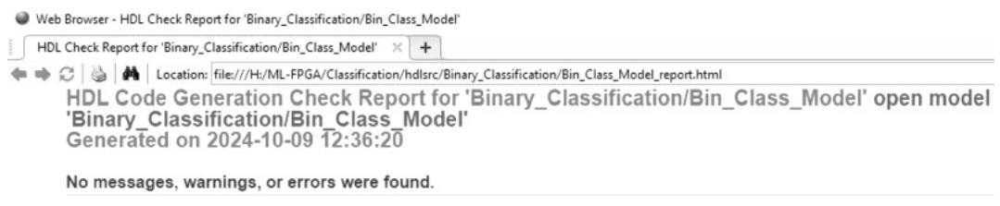

Hình 17.18 Cửa sổ HDL Check Report.

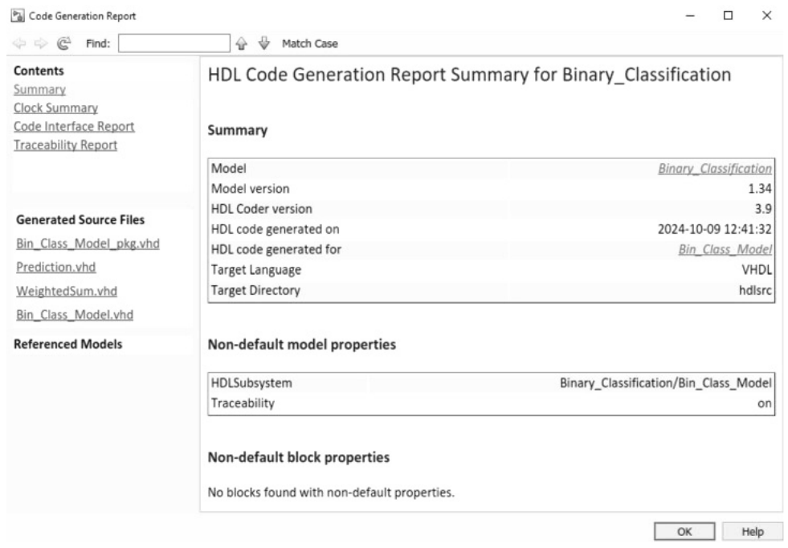

Hình 17.19 Cửa sổ Code Generation Report.

Bây giờ, chúng ta dùng code sau để tạo code HDL trong MATLAB command window.

```
>> makehdl('Binary_Classification/Bin_Class_Model')
```

Code VHDL được tạo ra thành công, và cửa sổ Code Generation Report được hiển thị, như được mô tả trong Hình 17.19.

Chúng ta cũng có thể dùng MATLAB function xấp xỉ tuyến tính từng đoạn của sigmoid như đã đề cập trước đó thay cho 1-D Lookup Table, như được minh họa trong Hình 17.20.

Giờ chúng ta có thể tạo code VHDL cho subsystem “Bin_Class_Model” ở Hình 17.15 bằng HDL Coder. Để làm điều này, chúng ta viết code sau trong MATLAB command window.

```
>> hdlsetup('Binary_Classifier')
```

Binary_Classifier là tên của thiết kế Simulink. Sau đó, chúng ta vào cửa sổ Configuration Parameters và đặt các giá trị tab Solver như được minh họa trong Hình 17.10. Tiếp theo, chúng ta vào tab HDL Code Generation và đặt các tham số như được mô tả trong Hình 17.17. Sau đó, chúng ta gõ code sau trong MATLAB command window.

```
>> checkhdl('Binary_Classifier/Bin_Class_Model')
```

Thao tác này mở HDL Check Report Window trong web browser, như được thể hiện trong Hình 17.21.

Bây giờ, chúng ta dùng code sau để tạo code HDL trong MATLAB command window.

```
>> makehdl('Binary_Classifier/Bin_Class_Model')
```

Code VHDL được tạo ra thành công, và cửa sổ Code Generation Report được hiển thị, như được mô tả trong Hình 17.22.

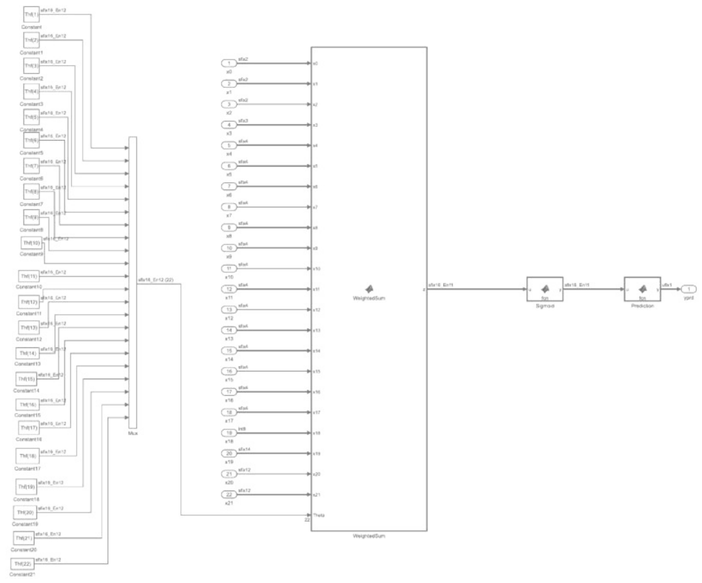

Hình 17.20 Dùng xấp xỉ tuyến tính từng đoạn của sigmoid.

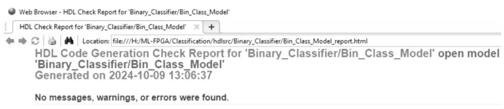

Hình 17.21 Cửa sổ HDL Check Report.

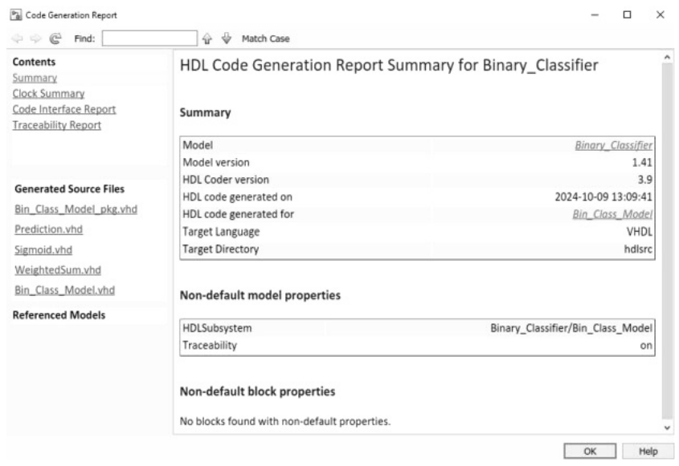

Hình 17.22 Cửa sổ Code Generation Report.

## 17.6 Dùng code VHDL đã tạo trong Vivado

Bây giờ, chúng ta chạy Vivado và tạo một project tên “Binary_Classification”, rồi click button Next. Tiếp theo, chúng ta chọn RTL Project làm loại project và click button Next. Trong cửa sổ Add Sources, trước khi thêm các file VHDL đã tạo, chúng ta copy và paste các file VHDL đã tạo ở Hình 17.19 vào thư mục Binary_Classification của project Vivado. Bây giờ, bằng cách click vào button Add Files, chúng ta có thể thêm chúng vào project, như được thể hiện trong Hình 17.23.

Tiếp theo, chúng ta chọn development board Xilinx và click button Next. Cuối cùng, chúng ta click button Finish để tạo project “Binary_Classification” với các file VHDL đã tạo được thêm vào. Sau đó, chúng ta chạy synthesis, như được minh họa trong Hình 17.24. Như được minh họa trong Hình 17.24, synthesis đã hoàn tất thành công, và chúng ta có thể click button Cancel. Sau đó, chúng ta mở schematic trong tab RTL Analysis, như được thể hiện trong Hình 17.25.

Bây giờ, chúng ta có thể mô phỏng project bằng cách chọn Flow → Run Simulation → Run Behavioral Simulation. Trong cửa sổ simulation vừa mở, chúng ta click button Restart. Chúng ta viết code sau trong MATLAB command window.

```
>> XTest(100,:)

ans =

  Columns 1 through 11

           1           1           0           1           2
2           2           2           5           4           4
  Columns 12 through 22

           4           4           4           4           3
4           4          44        3062           0           3
>> YTest(100)
ans =
     1
>> ypred(100)
ans =
     1
```

Trong cửa sổ waveform, chúng ta right-click vào “x0” và chọn tùy chọn “Force Constant…”, rồi cấu hình thiết lập của nó, như được minh họa trong Hình 17.26.

Chúng ta lặp lại quá trình tương tự cho x1 = 1, x2 = 0, x3 = 1, x4 = 2, x5 = 2, x6 = 2, x7 = 2, x8 = 5, x9 = 4, x10 = 4, x11 = 4, x12 = 4, x13 = 4, x14 = 4, x15 = 3, x16 = 4, x17 = 4, x18 = 44, x19 = 3062, x20 = 0 và x21 = 3. Tiếp theo, chúng ta click button Run for 10 ns một lần, và click button Zoom Fit trong cửa sổ waveforms để có các waveform đã mô phỏng, như được minh họa trong Hình 17.27.

Bằng cách này, chúng ta đạt được cùng kết quả dự đoán khi dùng FPGA với 1-D Lookup Table cho sigmoid function. Bây giờ, chúng ta tạo một project mới tên “Binary_Classifier” rồi click button Next. Sau đó, chúng ta chọn loại project là RTL Project và click button Next. Trong cửa sổ Add Sources, trước khi thêm các file VHDL đã tạo, chúng ta copy và paste các file VHDL đã tạo ở Hình 17.22 vào thư mục Binary_Classifier của project Vivado. Bây giờ, bằng cách click vào button Add Files, chúng ta có thể thêm chúng vào project, như được thể hiện trong Hình 17.28.

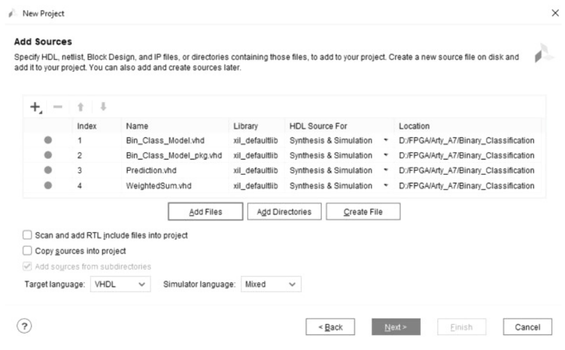

Hình 17.23 Thêm các file VHDL đã tạo vào thư mục Sources.

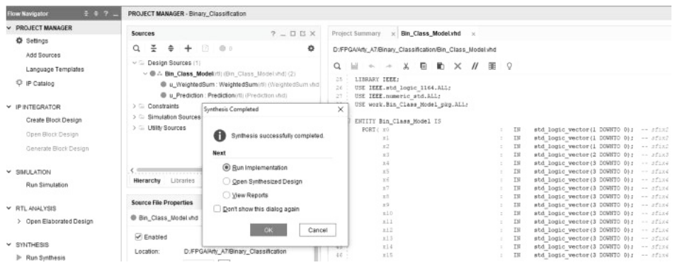

Hình 17.24 Chạy synthesis thành công.

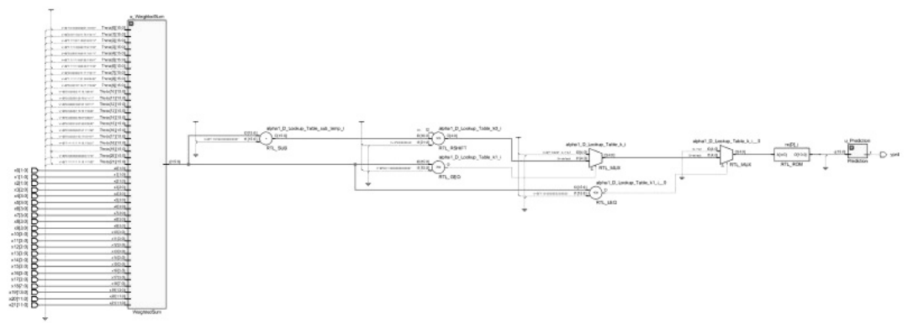

Hình 17.25 Schematic của “Bin_Class_Model”.

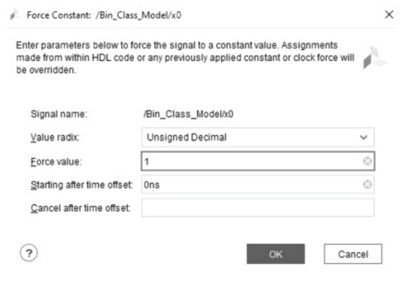

Hình 17.26 Cửa sổ Force Constant cho x0.

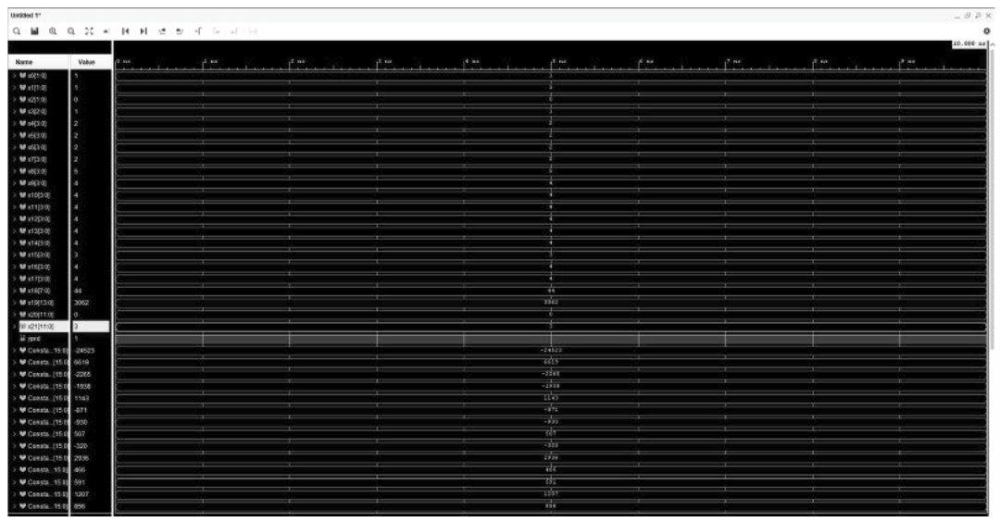

Hình 17.27 Các waveform đã mô phỏng.

Tiếp theo, chúng ta chọn development board Xilinx và click button Next. Cuối cùng, chúng ta click vào button Finish để tạo project “Binary_Classifier” với các file VHDL đã tạo được thêm vào. Sau đó, chúng ta chạy synthesis như được minh họa trong Hình 17.29. Như được minh họa trong Hình 17.29, synthesis đã hoàn tất thành công, và chúng ta có thể click vào button Cancel. Sau đó, chúng ta mở schematic trong tab RTL Analysis, như được thể hiện trong Hình 17.30.

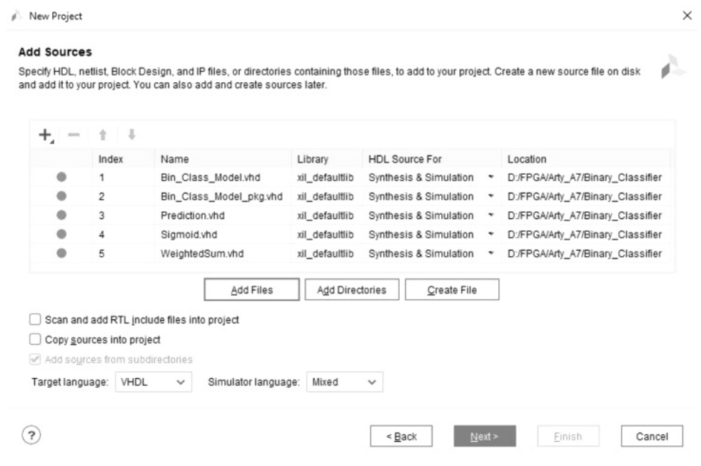

Hình 17.28 Thêm các file VHDL đã tạo vào thư mục Sources.

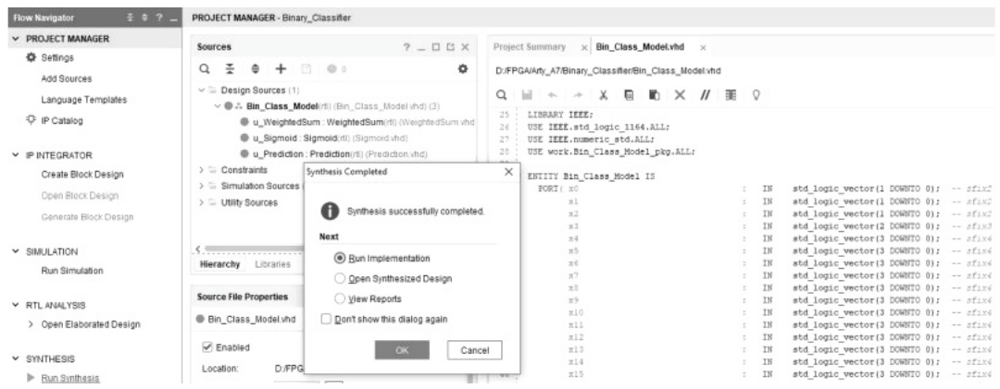

Hình 17.29 Chạy synthesis thành công.

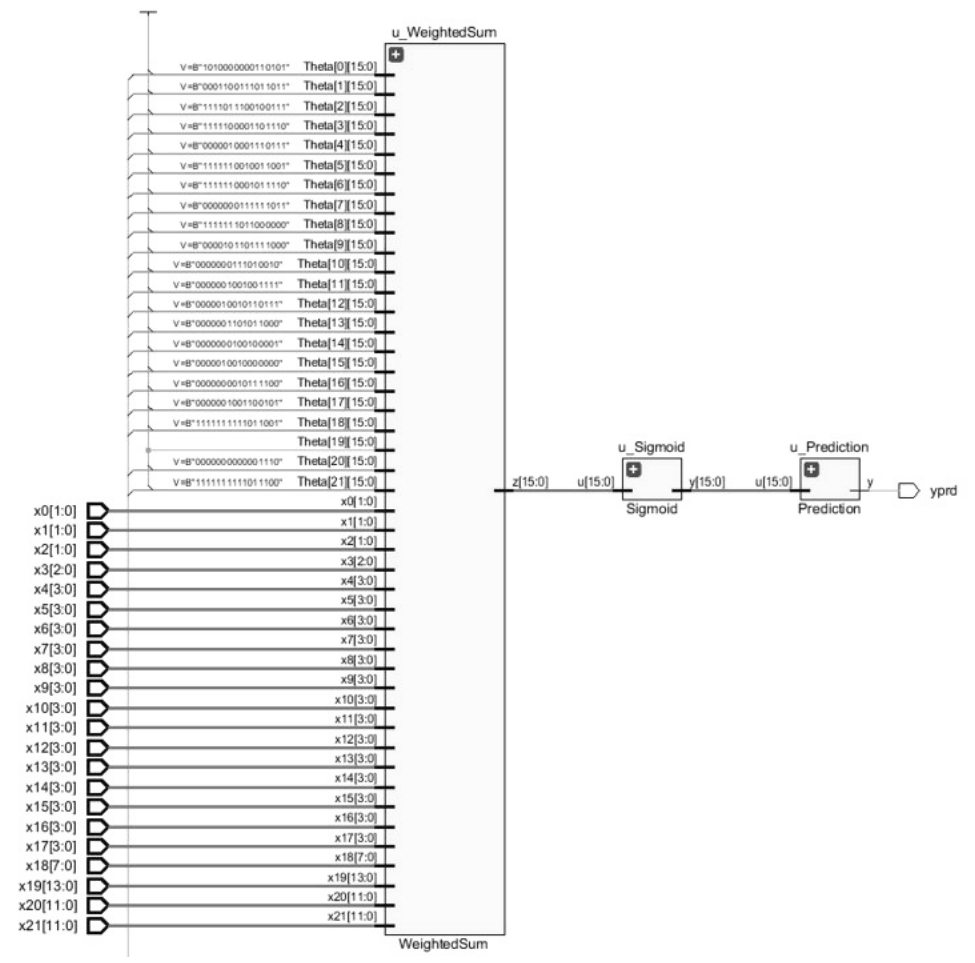

Hình 17.30 Schematic của “Bin_Class_Model”.

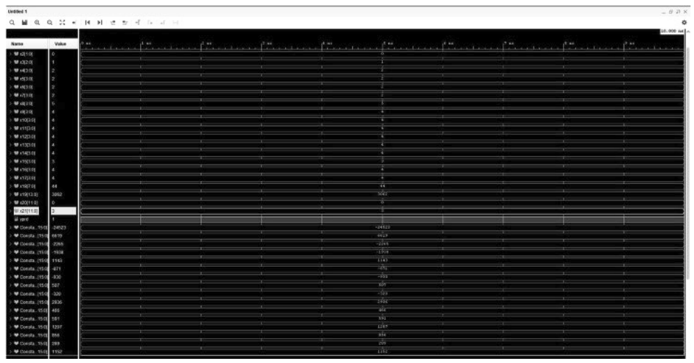

Hình 17.31 Các waveform đã mô phỏng.

Bây giờ, chúng ta có thể mô phỏng project bằng cách chọn Flow → Run Simulation → Run Behavioral Simulation. Trong cửa sổ simulation vừa mở, chúng ta click button Restart. Sau đó, trong cửa sổ waveforms, chúng ta right-click vào “x0”, chọn tùy chọn “Force Constant…”, và cấu hình thiết lập của nó, như được minh họa trong Hình 17.26. Chúng ta lặp lại quá trình tương tự cho x1 = 1, x2 = 0, x3 = 1, x4 = 2, x5 = 2, x6 = 2, x7 = 2, x8 = 5, x9 = 4, x10 = 4, x11 = 4, x12 = 4, x13 = 4, x14 = 4, x15 = 3, x16 = 4, x17 = 4, x18 = 44, x19 = 3062, x20 = 0 và x21 = 3. Sau đó, chúng ta click button Run for 10 ns một lần và click vào button Zoom Fit trong cửa sổ waveforms để có các waveform đã mô phỏng, như được minh họa trong Hình 17.31.

Điều này hoàn tất quá trình đạt được cùng kết quả dự đoán với FPGA khi dùng xấp xỉ tuyến tính từng đoạn của sigmoid function.
