# 18 Triển khai một deep neural network trên FPGA

## 18.1 Giới thiệu

Trong mục này, chúng ta sẽ triển khai một model deep neural network (DNN) trên FPGA bằng Simulink và Vivado. Trước hết, chúng ta tải một dataset từ Kaggle phù hợp cho việc triển khai DNN, và dùng MATLAB, chúng ta huấn luyện model dựa trên việc cực tiểu hóa cost function. Chúng ta dùng diabetes dataset để dự đoán bệnh nhân có bị tiểu đường hay không dựa trên nhiều tham số input khác nhau. Sau đó, chúng ta hiện thực model DNN đã huấn luyện bằng HDL Coder và tạo code VHDL có thể synthesize. Cuối cùng, dùng Vivado, chúng ta chạy synthesis analysis và simulation để kiểm chứng project VHDL đã thiết kế.

## 18.2 Dataset Kaggle

Trong chương này, chúng ta sẽ dùng diabetes dataset từ Kaggle để dự đoán bệnh nhân có bị tiểu đường hay không dựa trên nhiều tham số input khác nhau. Link web để tải diabetes dataset như sau:

https://www.kaggle.com/datasets/mathchi/diabetes-data-set

Tổng quan về diabetes dataset trong Excel được thể hiện trong Hình 18.1.

## 18.3 Giới thiệu về neural network

Neural network là một model tính toán lấy cảm hứng từ cấu trúc và chức năng của não người. Nó là một thành phần nền tảng của deep learning, một lĩnh vực con của trí tuệ nhân tạo (AI). Các neural network được thiết kế để nhận diện các mẫu và đưa ra quyết định thông minh, giống như cách não người làm. Dưới đây là một số khái niệm và thành phần chính của neural network:

1. Neuron: Các khối xây dựng cơ bản của một neural network là các neuron nhân tạo, còn được gọi là node hay unit. Các neuron này nhận input, thực hiện tính toán và tạo ra output.

2. Layer: Các neuron được tổ chức thành các layer bên trong một neural network. Thông thường có ba loại layer:

a. Input Layer: Layer này nhận dữ liệu hay các feature ban đầu được đưa vào network. Mỗi neuron trong input layer đại diện cho một feature hay một biến input.

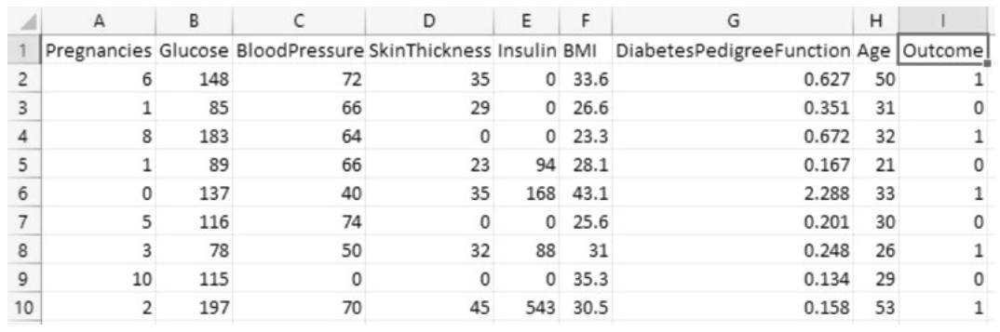

Hình 18.1 Tổng quan về diabetes dataset.

b. Hidden Layers: Các layer này nằm giữa input layer và output layer và chịu trách nhiệm xử lý và học các mẫu trong dữ liệu. DNN có nhiều hidden layer, do đó có thuật ngữ “deep learning.”

c. Output Layer: Layer neuron cuối cùng tạo ra output của network, có thể là một kết quả phân loại, hồi quy hay một kết quả task-specific khác.

3. Weights và Biases: Mỗi kết nối giữa các neuron có các weight và bias đi kèm. Các tham số này được học trong quá trình huấn luyện và xác định độ mạnh của các kết nối giữa các neuron.

4. Activation Function: Một activation function được áp dụng lên tổng có trọng số của các input và bias trong mỗi neuron. Nó đưa tính phi tuyến vào network, cho phép network học các mối quan hệ phức tạp trong dữ liệu. Các activation function phổ biến bao gồm sigmoid, ReLU (rectified linear unit) và tanh (hyperbolic tangent).

5. Feedforward Propagation: Quá trình đưa dữ liệu đi qua network từ input layer tới output layer được gọi là feedforward propagation. Các neuron trong mỗi layer tính activation của chúng dựa trên các input và weight, và quá trình này tiếp tục qua các layer cho đến khi output cuối cùng được tạo ra.

6. Backpropagation: Để huấn luyện một neural network, bạn cần một dataset có nhãn và một loss function đo sự khác biệt giữa output dự đoán và giá trị đích thực. Backpropagation là một thuật toán dùng để cập nhật các weight và bias trong network nhằm cực tiểu hóa loss này. Nó hoạt động bằng cách lan truyền sai số từ output layer ngược lại qua các hidden layer, điều chỉnh các tham số trên đường đi.

7. Training: Huấn luyện một neural network bao gồm việc lặp đi lặp lại đưa dữ liệu huấn luyện vào network, tính loss, và dùng backpropagation để cập nhật các tham số của model. Quá trình này tiếp tục cho đến khi hiệu năng của model hội tụ về một mức chấp nhận được.

Neural network có thể được dùng cho rất nhiều loại tác vụ, bao gồm nhận dạng ảnh và giọng nói, xử lý ngôn ngữ tự nhiên, hệ thống gợi ý và nhiều thứ khác. Chúng đã thể hiện hiệu năng ấn tượng trong nhiều lĩnh vực và đã đóng góp vào những tiến bộ đáng kể trong AI và machine learning. Một DNN điển hình được thể hiện trong Hình 18.2.

Model toán học của một neuron được mô tả trong Hình 18.3.

Trong số hạng w<sub>ki</sub> , k biểu diễn số thứ tự layer và i biểu diễn số thứ tự instance. Chúng ta cũng có phương trình sau.

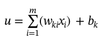 (18.1)

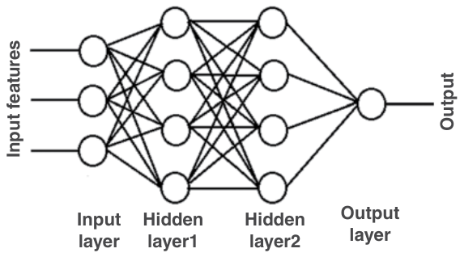

Hình 18.2 Một deep neural network điển hình.

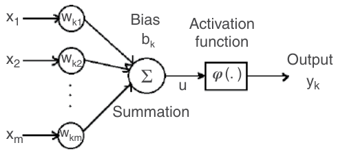

Hình 18.3 Model toán học của neuron.

Vậy, chúng ta có thể viết lại Phương trình (18.1) như sau.

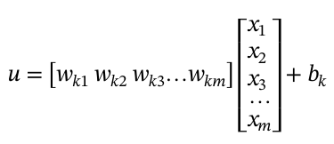 (18.2)

Sau đó, chúng ta sẽ có phương trình sau.

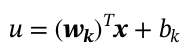 (18.3)

Lưu ý: Trong biểu diễn ma trận của tổng có trọng số u , các weight của các layer nên được sắp xếp thành một vector hàng, còn các input instance nên được sắp xếp thành một vector cột. Khi tổng có trọng số u đã được tính, output của neuron có thể được tính bằng cách đưa u qua activation function, như được minh họa trong phương trình sau.

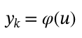 (18.4)

## 18.4 Xấp xỉ tuyến tính từng đoạn của các activation function

Sigmoid, tanh và ReLU là các activation function phổ biến được dùng trong neural network nhân tạo. Mỗi hàm này đưa tính phi tuyến vào các phép tính của network, cho phép nó học các mối quan hệ phức tạp trong dữ liệu.

1. Sigmoid Activation Function: Hàm sigmoid được định nghĩa bởi phương trình sau:

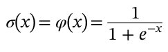 (18.5)

Xấp xỉ tuyến tính từng đoạn của hàm sigmoid được cho bởi phương trình sau:

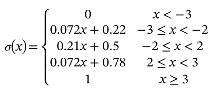 (18.6)

Chúng ta dùng m-file MATLAB sau để vẽ hàm sigmoid thực tế và xấp xỉ tuyến tính từng đoạn của nó.

```
x = -5:0.1:5;
z = 1./(1+exp(-x));
y = zeros(1,length(x));
for i = 1:length(x)
   j = -5.1+0.1*i;
   y(i) = sigmoid(j);
end
plot(x,y,'r','LineWidth',2);
hold on;
grid on;
plot(x,z,'b','LineWidth',2);
legend('Approx','Actual');
title('Piecewise Linear Approximation of Sigmoid Function');
xlabel('x');
ylabel('y');
```

Function “sigmoid” được định nghĩa bởi code sau.

```
function y = sigmoid(u)
if u < -3
    y = 0;
elseif (u >= -3 && u < -2)
    y = 0.072*u + 0.22;
elseif (u >= -2 && u < 2)
    y = 0.21*u + 0.5;
elseif (u >= 2 && u < 3)
    y = 0.072*u + 0.78;
else
    y = 1;
end
```

Các đồ thị thực tế và xấp xỉ tuyến tính từng đoạn của hàm sigmoid được minh họa trong Hình 18.4.

2. Tanh Activation Function: Hàm tanh được định nghĩa bởi phương trình sau:

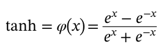 (18.7)

Xấp xỉ tuyến tính từng đoạn của hàm tanh được cho bởi phương trình sau:

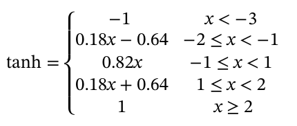 (18.8)

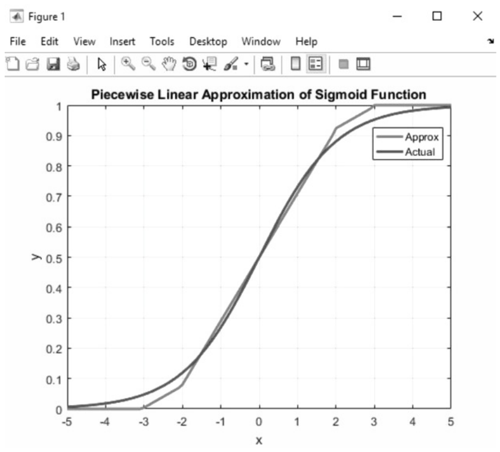

Hình 18.4 Các đồ thị thực tế và xấp xỉ của hàm sigmoid.

Chúng ta dùng m-file MATLAB sau để vẽ hàm tanh thực tế và xấp xỉ tuyến tính từng đoạn của nó.

```
x = -5:0.1:5;
z = (exp(x)-exp(-x))./(exp(x)+exp(-x));
y = zeros(1,length(x));
for i = 1:length(x)
   j = -5.1+0.1*i;
   y(i) = Tanh(j);
end
plot(x,y,'r','LineWidth',2);
hold on;
grid on;
plot(x,z,'b','LineWidth',2);
legend('Approx','Actual');
title('Piecewise Linear Approximation of Tanh Function');
xlabel('x');
ylabel('y');
```

Function “Tanh” được định nghĩa bởi code sau.

```
function y = Tanh(u)
if u < -2
    y = -1;
elseif (u >= -2 && u < -1)
    y = 0.18*u - 0.64;
elseif (u >= -1 && u < 1)
    y = 0.82*u;
elseif (u >= 1 && u < 2)
    y = 0.18*u + 0.64;
else
    y = 1;
end
```

Các đồ thị thực tế và xấp xỉ tuyến tính từng đoạn của hàm tanh được minh họa trong Hình 18.5.

1. ReLU *(ghi chú: sách đánh số "1."; theo thứ tự đúng là "3.")*: Hàm ReLU được định nghĩa bởi phương trình sau:

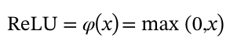 (18.9)

Chúng ta dùng m-file MATLAB sau để vẽ hàm ReLU:

```
x = -10:0.1:10;
z = max(0,x);
plot(x,z,'b','LineWidth',2);
title('ReLU = max(0,x)');
xlabel('x');
ylabel('y');
grid on;
```

Đồ thị của hàm ReLU được thể hiện trong Hình 18.6.

m-file MTLAB *(ghi chú: sách in "MTLAB"; đúng là "MATLAB")* sau (sig_approx1.m) được dùng để có được xấp xỉ tuyến tính từng đoạn của hàm sigmoid.

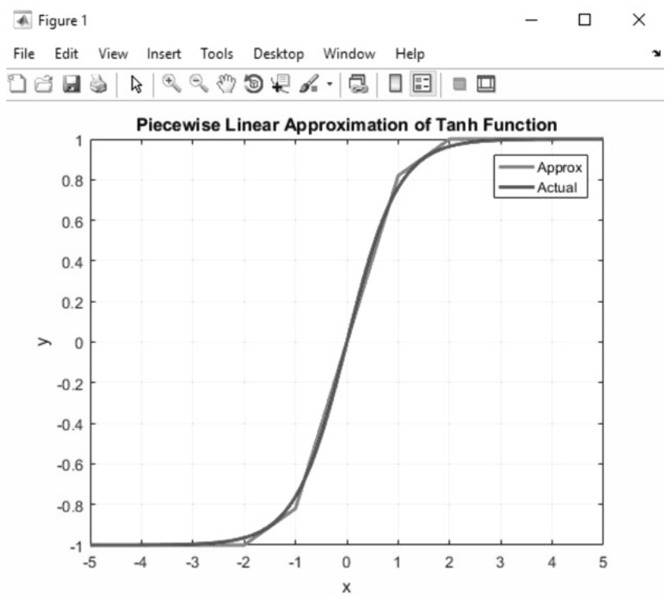

Hình 18.5 Các đồ thị thực tế và xấp xỉ của hàm tanh.

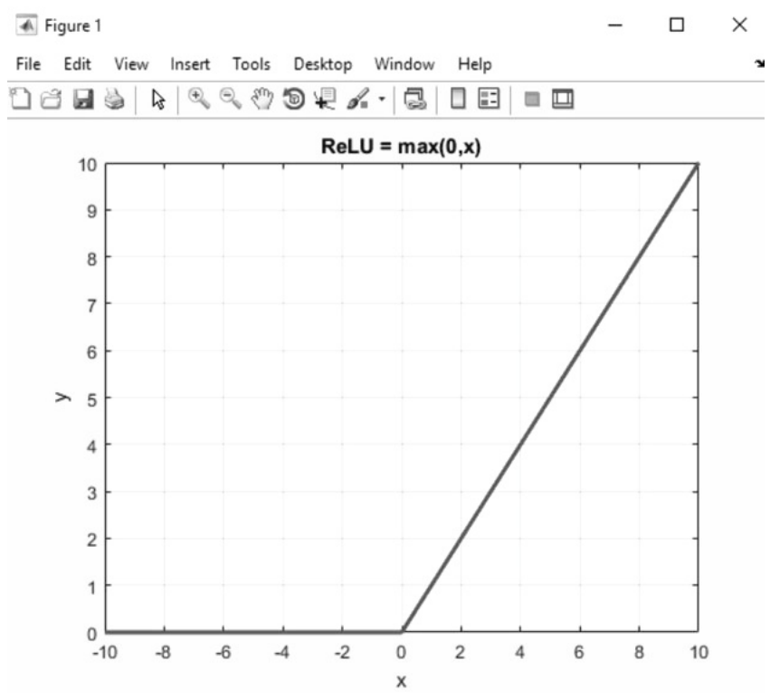

Hình 18.6 Đồ thị của hàm ReLU.

```
clear all; close all; clc
degree = 1;
dx = 0.1;
f = @(x) 1./(1 + exp(-x));
x = -5:dx:5;
y =f(x);
plot(x,y);
grid on;
xlabel('x');

x2 = -3:dx:-2;
y2 = f(x2);
p2 = polyfit(x2, y2, degree);

x3 = -2:dx:2;
y3 = f(x3);
p3 = polyfit(x3, y3, degree);

x4 = 2:dx:3;
y4 = f(x4);
p4 = polyfit(x4, y4, degree);

zf2 = polyval(p2,x2);
zf3 = polyval(p3,x3);
zf4 = polyval(p4,x4);
x1 = -10:dx:-3;
zf1 = zeros(1,length(x1));

x5 = 3:dx:10;
zf5 = ones(1,length(x5));

x = -10:dx:10;
ya = f(x);

plot(x1,zf1,'LineWidth',2);
hold on;
plot(x2,zf2,'LineWidth',2);
plot(x3,zf3,'LineWidth',2);
plot(x4,zf4,'LineWidth',2);
plot(x5,zf5,'LineWidth',2);

plot(x,ya,'k','LineWidth',1);
grid on;
legend('y1','y2','y3','y4','y5','sig');
xlabel('x');
ylabel('y');
title('Piecewise Linear Approximation of Sigmoid');
xlim([-5 5]);
```

Nếu chạy m-file đó, chúng ta có đồ thị như được mô tả trong Hình 18.7.

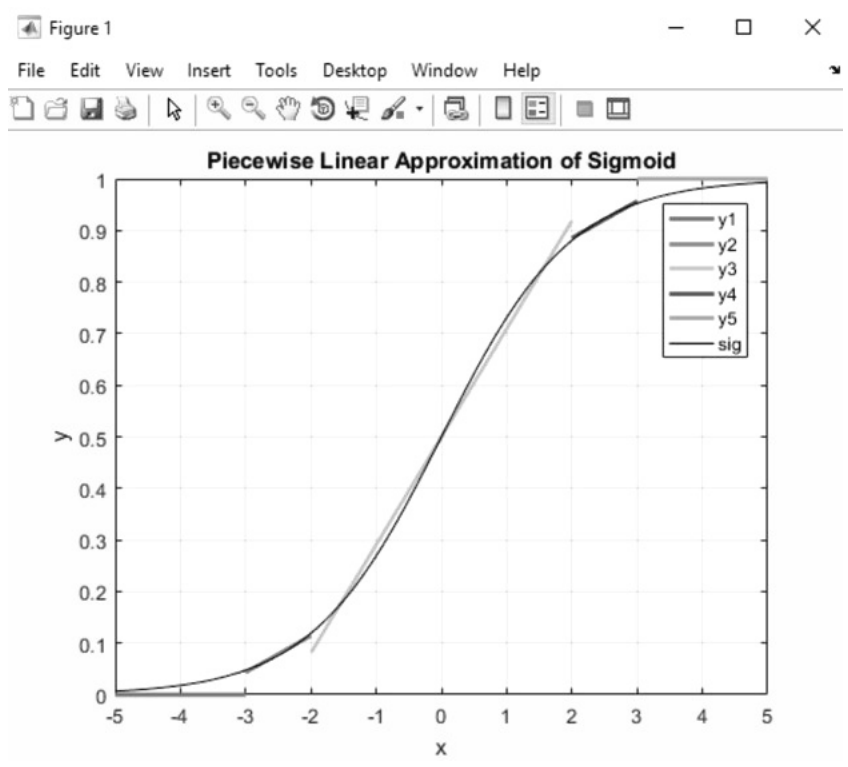

Hình 18.7 Xấp xỉ tuyến tính từng đoạn của hàm sigmoid.

Nếu gõ p2, p3 và p4 trong MATLAB command window và nhấn enter, chúng ta có các kết quả sau.

```
>> p2
p2 =
    0.0713    0.2571
>> p3
p3 =
    0.2094    0.5000
>> p4
p4 =
    0.0713    0.7429
```

Ở đây, phần tử đầu tiên biểu diễn hệ số góc, và phần tử thứ hai biểu diễn offset của phương trình đường thẳng. Chúng ta có 0.0713 ≈ 0.072, 0.2571 ≈ 0.22, 0.2094 ≈ 0.21 và 0.7429 ≈ 0.78 trong Phương trình (18.6). Bây giờ, để hiện thực xấp xỉ tuyến tính từng đoạn của hàm sigmoid trong HDL Coder, chúng ta dùng m-file sau (sig_approx2.m).

```
clear all; close all; clc
dx = 0.01;
f = @(x) 1./(1 + exp(-x));
x = -5:dx:5;

for k = 1:length(x)
    y(k) = sig_pw_HDL(x(k));
end
plot(x,y,'LineWidth',2);
grid on;
hold on;

ya = f(x);
plot(x,ya,'LineWidth',2);
ylim([-0.1 1.1]);
xlabel('x');
ylabel('y');
legend('Approx','Actual');
title('Piecewise Linear Approximation of Sigmoid');
```

Ở đây, function sig_pw_HDL được định nghĩa bởi code sau.

```
function ysig = sig_pw_HDL(x)
WL = 16;
FL = 10;

F = hdlfimath();
nt = numerictype(1,WL,FL);

xf = fi(x,nt);

m1 = fi(0.072,nt);
c1 = fi(0.22,nt);

m2 = fi(0.21,nt);
c2 = fi(0.5,nt);
m3 = fi(0.072,nt);
c3 = fi(0.78,nt);

if xf < fi(-3,nt)
    y = fi(0,nt,F);
elseif xf < fi(-2,nt)
    y = fi(m1*x+c1,nt,F);
elseif ((xf >= fi(-2,nt)) && (xf <= fi(2,nt)))
    y = fi(m2*x+c2,nt,F);
elseif xf < fi(3,nt)
    y = fi(m3*x+c3,nt,F);
else
    y = fi(1,nt,F);
end

if y <= fi(0,nt)
    ysig = fi(0,nt,F);
elseif y >= fi(1,nt)
    ysig = fi(1,nt,F);
else
    ysig = fi(y,nt,F);
end
```

Nếu chạy m-file (sig_approx2.m), chúng ta có đồ thị như được minh họa trong Hình 18.8, giống hệt đồ thị trong Hình 18.4.

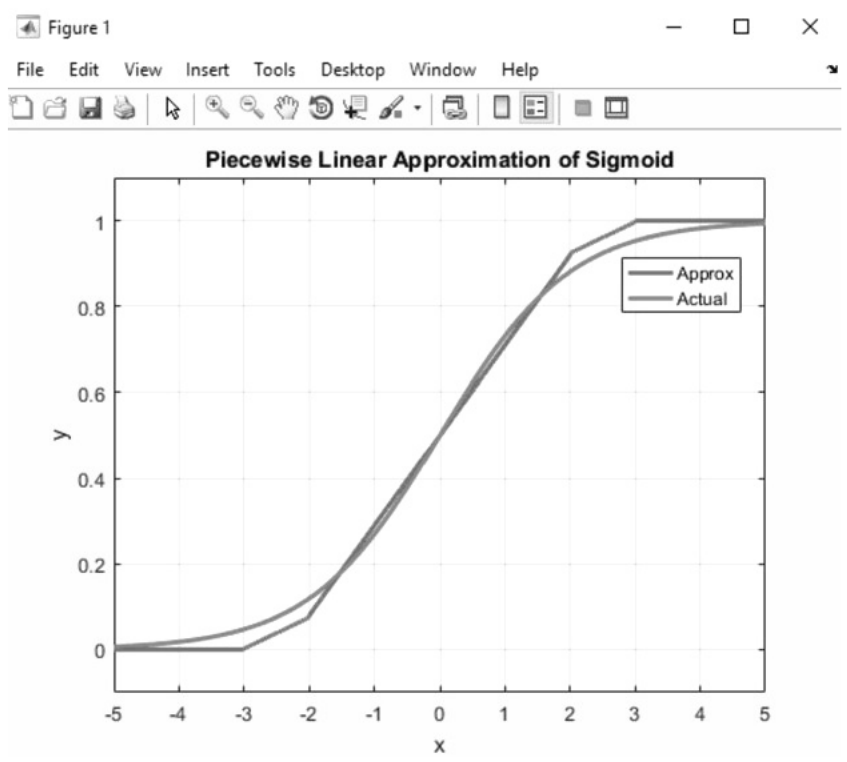

Hình 18.8 Xấp xỉ tuyến tính từng đoạn của sigmoid cho HDL Coder.

Quá trình tương tự được dùng cho xấp xỉ tuyến tính từng đoạn của hàm tanh. m-file MTLAB sau (tanh_approx1.m) được dùng để có được xấp xỉ tuyến tính từng đoạn của hàm tanh.

```
clear all; close all; clc
degree = 1;
dx = 0.1;
f = @(x) (exp(x) - exp(-x))./(exp(x) + exp(-x));
x = -5:dx:5;
y =f(x);
plot(x,y);
grid on;
xlabel('x');

x2 = -2:dx:-1;
y2 = f(x2);
p2 = polyfit(x2, y2, degree);

x3 = -1:dx:1;
y3 = f(x3);
p3 = polyfit(x3, y3, degree);

x4 = 1:dx:2;
y4 = f(x4);
p4 = polyfit(x4, y4, degree);

zf2 = polyval(p2,x2);
zf3 = polyval(p3,x3);
zf4 = polyval(p4,x4);

x1 = -10:dx:-2;
zf1 = -1*ones(1,length(x1));

x5 = 2:dx:10;
zf5 = ones(1,length(x5));

x = -10:dx:10;
ya = f(x);

plot(x1,zf1,'LineWidth',2);
hold on;
plot(x2,zf2,'LineWidth',2);
plot(x3,zf3,'LineWidth',2);
plot(x4,zf4,'LineWidth',2);
plot(x5,zf5,'LineWidth',2);

plot(x,ya,'k','LineWidth',1);
grid on;
legend('y1','y2','y3','y4','y5','tanh');
xlabel('x');
ylabel('y');
title('Piecewise Linear Approximation of Tanh');
xlim([-5 5]);
```

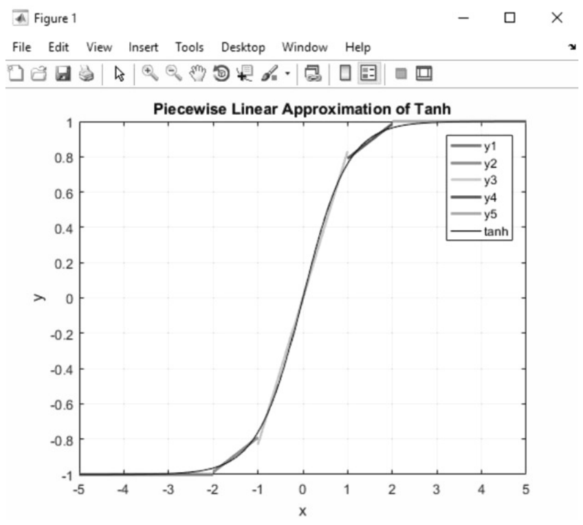

Hình 18.9 Xấp xỉ tuyến tính từng đoạn của hàm tanh.

Nếu chạy m-file (tanh_approx1.m), chúng ta có đồ thị như được thể hiện trong Hình 18.9.

Nếu gõ p2, p3 và p4 trong MATLAB command window và nhấn enter, chúng ta có các kết quả sau.

```
>> p2
p2 =
    0.1962   -0.5941
>> p3
p3 =
    0.8319   -0.0000
>> p4
p4 =
    0.1962    0.5941
```

Ở đây, phần tử đầu tiên biểu diễn hệ số góc, và phần tử thứ hai biểu diễn offset của phương trình đường thẳng. Chúng ta có 0.1962 ≈ 0.18, −0.5941 ≈ −0.64, 0.8319 ≈ 0.82 và 0.5941 ≈ 0.64 trong Phương trình (18.8). Bây giờ, để dùng xấp xỉ tuyến tính từng đoạn của hàm tanh trong HDL Coder, chúng ta dùng m-file sau (tanh_approx2.m).

```
clear all; close all; clc

f = @(x) (exp(x) - exp(-x))./(exp(x) + exp(-x));
x = linspace(-5,5,200);
for k = 1:length(x)
    y(k) = tanh_pw_HDL(x(k));
end
plot(x,y,'LineWidth',2);
grid on;
hold on;

ya = f(x);
plot(x,ya,'LineWidth',2);
ylim([-1.1 1.1]);
xlabel('x');
ylabel('y');
legend('Approx','Actual');
title('Piecewise Linear Approximation of Tanh');
```

Ở đây, function tanh_pw_HDL được định nghĩa bởi code sau.

```
function ysig = tanh_pw_HDL(x)
WL = 16;
FL = 10;

F = hdlfimath();
nt = numerictype(1,WL,FL);

xf = fi(x,nt);

m1 = fi(0.18,nt);
c1 = fi(-0.64,nt);

m2 = fi(0.82,nt);
c2 = fi(0,nt);

m3 = fi(0.18,nt);
c3 = fi(0.64,nt);

if xf < fi(-2,nt)
    y = fi(-1,nt,F);
elseif xf < fi(-1,nt)
    y = fi(m1*x+c1,nt,F);
elseif ((xf >= fi(-1,nt)) && (xf < fi(1,nt)))
    y = fi(m2*x+c2,nt,F);
elseif xf < fi(2,nt)
    y = fi(m3*x+c3,nt,F);
else
    y = fi(1,nt,F);
end

if y <= fi(-1,nt)
    ysig = fi(-1,nt,F);
elseif y >= fi(1,nt)
    ysig = fi(1,nt,F);
else
    ysig = fi(y,nt,F);
end
```

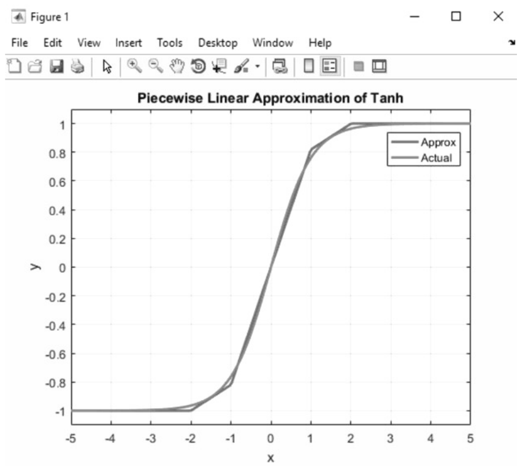

Hình 18.10 Xấp xỉ tuyến tính từng đoạn của tanh cho HDL Coder.

Nếu chạy m-file (tanh_approx2.m), chúng ta có đồ thị như được minh họa trong Hình 18.10, giống hệt đồ thị trong Hình 18.5.

## 18.5 Huấn luyện model neural network

m-file MATLAB sau (Train_NN_Model.m) được dùng để huấn luyện model neural network.

```
close all; clear all; clc
cd('H:\ML-FPGA\NN');
t = readtable('diabetes.csv');
%Histogram_Plots(t)

%Training and Testing Data
All_Data = table2array(t);
Xin = All_Data(:,1:end-1);
Yout = All_Data(:,end);

%Normalize the Data
X = mapminmax(Xin');
Y = mapminmax(Yout',0,1);
Len = length(Y);
%Training and Testing Data
Prob = 0.8;
NTr = round(Prob*Len);
XTrain = X(:,1:NTr);
YTrain = Y(:,1:NTr);

XTest = X(:,NTr+1:end);
YTest = Y(:,NTr+1:end);

XTest = XTest'; % Features Along Column
YTest = YTest';

%% Set Neural Network Parameters
% Define sizes
[R,C] = size(XTrain);
inputSize = R;
hiddenLayerSize1 = 3;
hiddenLayerSize2 = round(R/2);

% Define Neural Network
net = feedforwardnet([hiddenLayerSize1,hiddenLayerSize2]);

% Set Training Parameters
net.trainParam.epochs = 1000;
net.trainParam.goal = 1e-6;
net.trainParam.max_fail = 200;

% Specify the logsig transfer function for each layer
ActFun_Layaer1 = 'tansig'; %tanh
ActFun_Layaer2 = 'tansig'; %tanh
OutputLayer = 'logsig'; %sigmoid

net.layers{1}.transferFcn = ActFun_Layaer1; % 1st hidden layer
net.layers{2}.transferFcn = ActFun_Layaer2; % 2nd hidden layer
net.layers{3}.transferFcn = OutputLayer; % Output layer

% Train the Neural Network
size(XTrain)
size(YTrain)

net = train(net,XTrain,YTrain);

% Generate Simulink Model of Trained Neural Network
gensim(net);

%% Extract Weights and Biases
W1d = net.IW{1,1};  % Input Layer
b1d = net.b{1};

W2d = net.LW{2,1};  % Hidden Layer 1
b2d = net.b{2};
W3d = net.LW{3,2};  % Output Layer
b3d = net.b{3};

% Save W's and b's in .mat file (for later use)
save('Trained_NN_Model.mat','W1d','W2d','W3d','b1d','b2d','b3d','net');

%% Conversion to Fixed Point
% Convert XTest Data into Fixed Point
XTestf = Convert_Data_to_Fixed_Point(X, XTest);

% Convert W's and b's
[W1, b1, W2, b2, W3, b3] = Convert_Parameters_to_Fixed_Point();

save('Trained_fixed_NN_Model.mat','W1','W2','W3','b1','b2','b3');
```

Code cho function “Histogram_Plots”, vốn đã bị comment trong m-file (Train_NN_Model.m), được trình bày như sau.

```
function Histogram_Plots(t)
Num_Disc_Var = [1 9];
Num_Cont_Var = [2 3 4 5 6 7 8];

NumD_Data = t(:,Num_Disc_Var);
NumD_Arr = table2array(NumD_Data);
NumD_str = string(NumD_Arr);
NumD_cell = cellstr(NumD_str);

% Histogram Plots
histogram(categorical(NumD_cell(:,1)),'BarWidth',0.3);
grid on;
ylabel('Frequency');
title('Pregnancies');

figure
histogram(categorical(NumD_cell(:,2)),'BarWidth',0.3);
grid on;
ylabel('Frequency');
title('Outcome');

NumC_Data = t(:,Num_Cont_Var);
NumC_Arr = table2array(NumC_Data);

figure
histogram(NumC_Arr(:,1));
grid on;
ylabel('Frequency');
title('Glucose');
xlabel('#');

figure
histogram(NumC_Arr(:,2));
grid on;
ylabel('Frequency');
title('Blood Pressure');
xlabel('Level');

figure
histogram(NumC_Arr(:,3));
grid on;
ylabel('Frequency');
title('Skin Thickness');

figure
histogram(NumC_Arr(:,4));
grid on;
ylabel('Frequency');
title('Insulin');
xlabel('mm');

figure
histogram(NumC_Arr(:,5));
grid on;
ylabel('Frequency');
title('BMI');
xlabel('Level');

figure
histogram(NumC_Arr(:,6));
grid on;
ylabel('Frequency');
title('Diabetes Pedigree Function');

figure
histogram(NumC_Arr(:,7));
grid on;
ylabel('Frequency');
title('Age');
xlabel('Years');
```

Nếu bỏ comment và chạy m-file (Train_NN_Model.m), các biểu đồ histogram của diabetes dataset sẽ được hiển thị. Ngoài ra, chúng ta đã dùng 80% dữ liệu cho training và 20% cho testing. Neural network gồm một input layer có kích thước bằng số input feature (tám neuron), hidden layer 1 (layer 1) với 3 neuron, hidden layer 2 (layer 2) với bốn neuron, và một output layer (layer 3) với một neuron. Activation function cho layer 1 và layer 2 là tanh (‘tansig’); tuy nhiên, với output layer (layer 3), activation function là sigmoid (‘logsig’). Ngoài ra, chúng ta lưu các tham số neural network đã huấn luyện (weight và bias) vào file “Trained_NN_ Model.mat.” Bây giờ, chúng ta có thể chạy m-file MATLAB (Train_NN_Model.m) và xem cửa sổ huấn luyện neural network, như được thể hiện trong Hình 18.11.

Ngoài ra, model Simulink của feedforward neural network được tạo ra, như được mô tả trong Hình 18.12.

Nếu gõ W1d, b1d, W2d, b2d và W3d, b3d trong MATLAB command window, chúng ta có giá trị của chúng (W1d = 3×8, b1d = 3×1, W2d = 4×3, b2d = 4×1, và W3d = 1×4, b3d = 1×1). Ngoài ra, nếu viết “>> view(net)” trong MATLAB command window, chúng ta có thể thấy neural network đã thiết kế như được minh họa trong Hình 18.13.

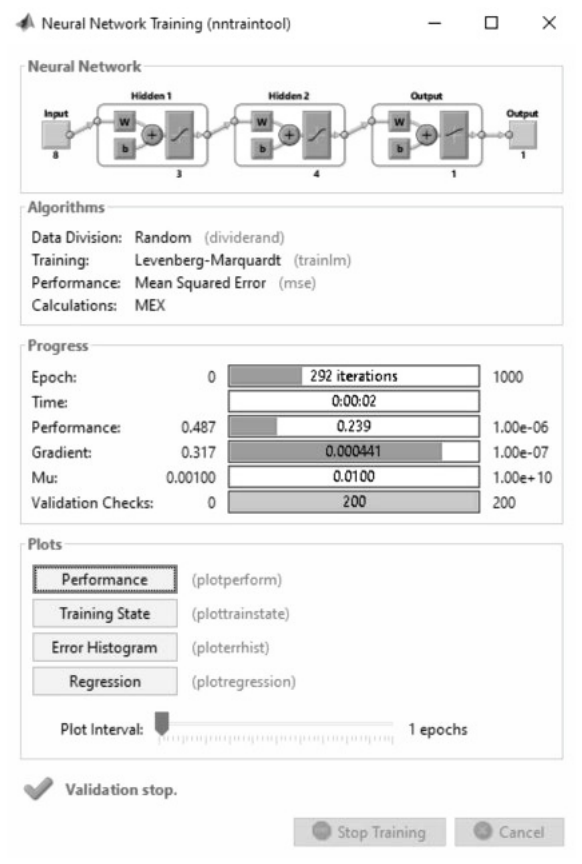

Hình 18.11 Cửa sổ huấn luyện neural network.

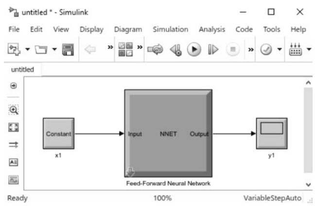

Hình 18.12 Model Simulink của feedforward neural network.

Nếu click vào constant x1 ở Hình 18.12, chúng ta có thể thấy cửa sổ block parameters của nó như được thể hiện trong Hình 18.14.

Như bạn có thể thấy trong Hình 18.14, theo mặc định x1 là một ma trận 8×1 đã được chuẩn hóa. Nếu chạy model Simulink, chúng ta có thể xem waveform y1 trên scope, có giá trị khoảng 0.82, như được mô tả trong Hình 18.15.

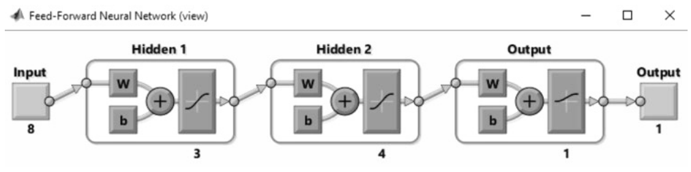

Hình 18.13 Xem neural network đã thiết kế.

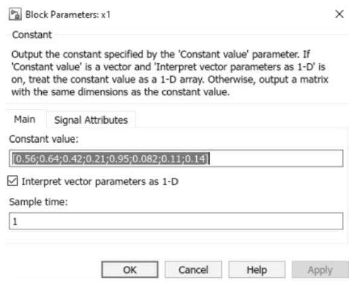

Hình 18.14 Cửa sổ block parameters cho constant x1.

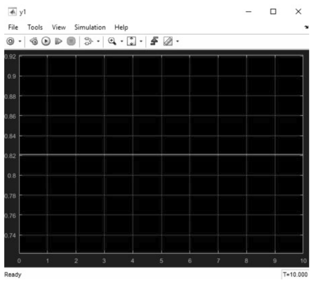

Hình 18.15 Waveform y1 trên scope.

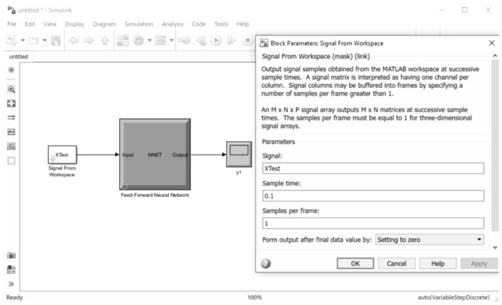

Hình 18.16 Các block parameter Signal From Workspace.


Hình 18.17 Tab Solver của configuration parameters.

Bây giờ, chúng ta có thể xóa constant x1 và đưa block Signal From Workspace vào model Simulink rồi đặt các tham số của nó như được minh họa trong Hình 18.16.

Vì XTest là một ma trận 154×8, chúng ta đặt tab Solver của configuration parameters như được thể hiện trong Hình 18.17.

```
>> size(XTest)
ans =
 154    8
```

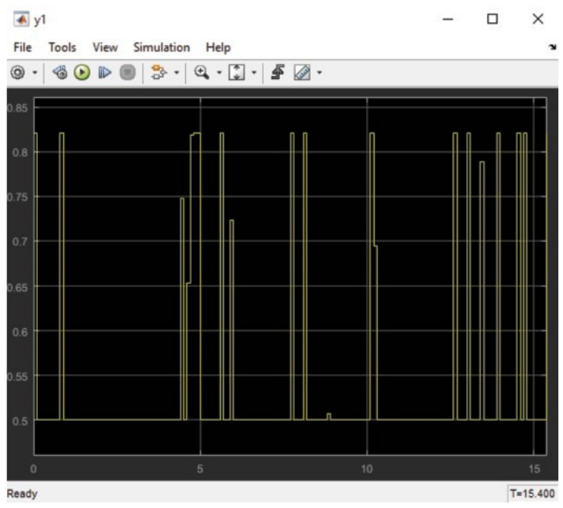

Hình 18.18 Waveform của y1 trên scope.

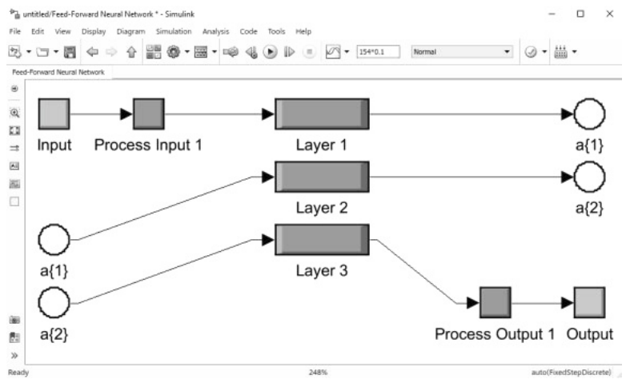

Hình 18.19 Xóa các block Process Input 1 và Process Output 1.

Bây giờ, nếu chạy model Simulink ở Hình 18.16, chúng ta có waveform của y1 trên scope như được mô tả trong Hình 18.18.

Bên trong block feedforward neural network, có các block Process Input 1 và Process Output 1, được dùng để chuẩn hóa, như được minh họa trong Hình 18.19. Tuy nhiên, vì chúng ta đã chuẩn hóa dữ liệu bên trong m-file MATLAB (Train_NN_Model.m), chúng ta có thể xóa các block này khỏi model và nối input trực tiếp tới layer 1, và layer 3 tới output. Bây giờ, nếu chạy lại simulation, waveform của y1 sẽ giữ nguyên.

Chúng ta đưa một block MATLAB function vào model Simulink và viết code sau bên trong nó.

```
function y = fcn(u)

if u > 0.5
    y = 1;
else
    y = 0;
end
```

Ngoài ra, chúng ta đưa một block To Workspace vào model với các block parameter như được thể hiện trong Hình 18.20. Model Simulink được mô tả trong Hình 18.21. Bây giờ, nếu chạy simulation, waveform của y2 trên scope được hiển thị, như được minh họa trong Hình 18.22.

Chúng ta tạo một m-file tên “Cal_Accu.m” để tính độ chính xác của simulation bằng code sau.

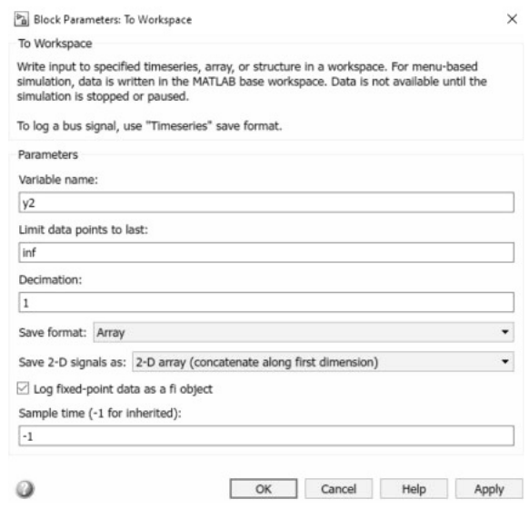

Hình 18.20 Các block parameter của “To Workspace.”

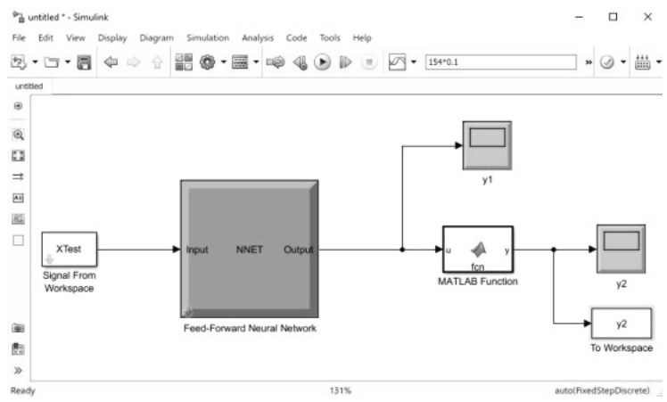

Hình 18.21 Model Simulink.

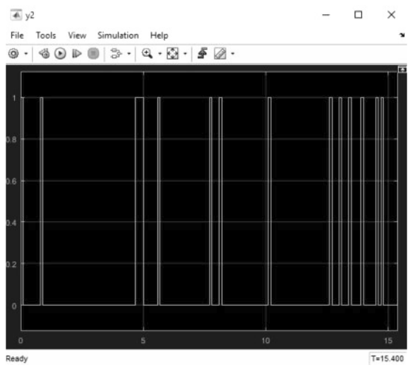

Hình 18.22 Waveform của y2 trên scope.

```
close all; clc;
ySim = y2;
ySim(end) = [];
Accuracy_Sim = 100*mean(ySim == YTest)
```

Nếu chạy m-file đó, đoạn text sau được hiển thị trong MATLAB command window.

```
Accuracy_Sim =
 70.1299
```

Vậy, độ chính xác của simulation vào khoảng 70.13%. Chúng ta nên lưu ý rằng HDL Coder không thể tạo code cho block feedforward neural network ở Hình 18.21, và nó chỉ được dùng cho mục đích simulation. Vậy, chúng ta nên tự xây dựng DNN. Chúng ta định nghĩa function “NN_Layer_Tanh_HDL” bằng code sau.

```
function ytan = NN_Layer_Tanh_HDL(Bias,Weight,X)
% This function implements NN_Layer using tanh function
% It is HDL supported, and can be used in HDL code generation
% Weight = they should be arranged as row vector
% X = Instances of input features should be arranged as column vector
% Bias = It can be row or column vector
% y = It is output vector arranged as column vector containing outputs
% From all neurons of given layer
% Note: All inputs of this function should be in fixed point format

Nodes = size(Weight,1);
WL = 16;
FL = 10;
PM = fi(zeros(Nodes,1),1,WL,FL);
WS = fi(zeros(Nodes,1),1,WL,FL);
ytan = fi(zeros(Nodes,1),1,WL,14);

for k = 1:Nodes
    PM(k) = Weight(k,:)*X(:,1);
    WS(k) = PM(k) + Bias(k);
    y = tanh_pw_HDL(WS(k));
    ytan(k) = y;
end
```

Sau đó, trong model Simulink, chúng ta đưa HDL Coder MATLAB function vào và viết code sau trong đó.

```
function ytan = NN_Layer_Tanh_HDL(Bias,Weight,X)
% Call Function
ytan = NN_Layer_Tanh_HDL(Bias,Weight,X);
```

MATLAB function (Hidden_Layer1) được thể hiện trong Hình 18.23.

Code cho function “Convert_Data_to_Fixed_Point” trong m-file MATLAB (Train_NN_ Model.m) như sau.

```
function XTest_FixedPoint = Convert_Data_to_Fixed_Point(XFeatures, XTest)
% This function converts double type XTest (Test Data) into fixed point by
% considering the maximum and minimum values of XFeatures matrix along with
% fractional part.
% It is assumed that XTest is submatrix of XFeatures.
% Convert matrices to fixed-point representation based on statistics from
% XFeatures.

% 1. Find maximum and minimum values across all elements of XFeatures
max_val = max(XFeatures(:));
min_val = min(XFeatures(:));

% 2. Find maximum and minimum fractional values greather than zero across all
elements of XFeatures
fractional_values = abs(XFeatures - floor(XFeatures)); % Fractional parts of all
elements of XFeatures
fractional_values_non_zero = fractional_values(fractional_values > 0); %
Filter non-zero fractional parts of all elements of XFeatures
if isempty(fractional_values_non_zero) % If XFeatures has only positive integers
    FL = 0;
    max_fractional = 0;
    min_fractional = 0;
else
    max_fractional = max(fractional_values_non_zero);
    min_fractional = min(fractional_values_non_zero);
    % To determine FL, consider the smallest non-zero fractional value and
    % ensure
    FL = 1+ceil(-log2(min_fractional)); % 1 is added (manually)
end
```

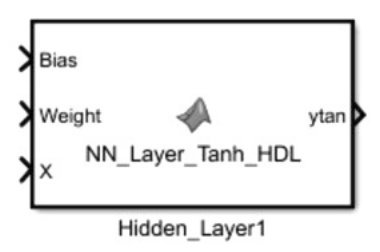

Hình 18.23 MATLAB function (Hidden_Layer1).

```
% 3. Calculate WL
% WL = number of bits of the integer part of max value + 1 bit for sign +
% FL
WL = 1 + ceil(log2(max(abs([max_val, min_val])))) + FL;

% 4. Convert XTest to fixed-point using WL and FL
XTest_FixedPoint = fi(XTest, 1, WL, FL);

% Optional: Display the results (You can comment this out if not needed)
fprintf('Max value: %f\n', max_val);
fprintf('Min value: %f\n', min_val);
fprintf('Max fractional (non-zero): %f\n', max_fractional);
fprintf('Min fractional (non-zero): %f\n', min_fractional);
fprintf('\n------------- Data (Testing) Conversion');
fprintf('\nWord Length (WL): %d bits\n', WL);
fprintf('\nFraction Length (WL): %d bits\n\n\n', FL);
end
```

Ngoài ra, code cho function “Convert_Parameters_to_Fixed_Point” trong m-file MATLAB (Train_NN_Model.m) như sau.

```
function [W1, b1, W2, b2, W3, b3] = Convert_Parameters_to_Fixed_Point()

data = load('Trained_NN_Model.mat');
W1d = data.W1d;
b1d = data.b1d;
W2d = data.W2d;
b2d = data.b2d;
W3d = data.W3d;
b3d = data.b3d;

maxW1d_val = max(W1d(:));
minW1d_val = min(W1d(:));

fractional_W1dvalues = abs(W1d - floor(W1d));
fractional_W1dvalues_non_zero = fractional_W1dvalues(fractional_W1dvalues > 0);
if isempty(fractional_W1dvalues_non_zero)
    FLW1d = 0;
else
    minW1d_fractional = min(fractional_W1dvalues_non_zero);
    FLW1d = 1+ceil(-log2(minW1d_fractional));
end

WLW1d = 1 + ceil(log2(max(abs([maxW1d_val, minW1d_val])))) + FLW1d;
W1 = fi(W1d, 1, WLW1d, FLW1d);
%%%%%%%%%%%%%%%%%%%%%%%%%%%%%%%%%%%%%%%%%%%%%%%%%%%%%%%%%%%%%%%%%%%%%%%%%%%%%%
maxb1d_val = max(b1d(:));
minb1d_val = min(b1d(:));

fractional_b1dvalues = abs(b1d - floor(b1d));
fractional_b1dvalues_non_zero = fractional_b1dvalues(fractional_b1dvalues > 0);
if isempty(fractional_b1dvalues_non_zero)
    FLb1d = 0;
else
    minb1d_fractional = min(fractional_b1dvalues_non_zero);
    FLb1d = 1+ceil(-log2(minb1d_fractional));
end

WLb1d = 1 + ceil(log2(max(abs([maxb1d_val, minb1d_val])))) + FLb1d;
b1 = fi(b1d, 1, WLb1d, FLb1d);
%%%%%%%%%%%%%%%%%%%%%%%%%%%%%%%%%%%%%%%%%%%%%%%%%%%%%%%%%%%%%%%%%%%%%%%%%%%%%%
maxW2d_val = max(W2d(:));
minW2d_val = min(W2d(:));

fractional_W2dvalues = abs(W2d - floor(W2d));
fractional_W2dvalues_non_zero = fractional_W2dvalues(fractional_W2dvalues > 0);
if isempty(fractional_W2dvalues_non_zero)
    FLW2d = 0;
else
    minW2d_fractional = min(fractional_W2dvalues_non_zero);
    FLW2d = 1+ceil(-log2(minW2d_fractional));
end

WLW2d = 1 + ceil(log2(max(abs([maxW2d_val, minW2d_val])))) + FLW2d;
W2 = fi(W2d, 1, WLW2d, FLW2d);
%%%%%%%%%%%%%%%%%%%%%%%%%%%%%%%%%%%%%%%%%%%%%%%%%%%%%%%%%%%%%%%%%%%%%%%%%%%%%%
maxb2d_val = max(b2d(:));
minb2d_val = min(b2d(:));

fractional_b2dvalues = abs(b2d - floor(b2d));
fractional_b2dvalues_non_zero = fractional_b2dvalues(fractional_b2dvalues > 0);
if isempty(fractional_b2dvalues_non_zero)
    FLb2d = 0;
else
    minb2d_fractional = min(fractional_b2dvalues_non_zero);
    FLb2d = 1+ceil(-log2(minb2d_fractional));
end

WLb2d = 1 + ceil(log2(max(abs([maxb2d_val, minb2d_val])))) + FLb2d;
b2 = fi(b2d, 1, WLb2d, FLb2d);
%%%%%%%%%%%%%%%%%%%%%%%%%%%%%%%%%%%%%%%%%%%%%%%%%%%%%%%%%%%%%%%%%%%%%%%%%%%%%%
maxW3d_val = max(W3d(:));
minW3d_val = min(W3d(:));

fractional_W3dvalues = abs(W3d - floor(W3d));
fractional_W3dvalues_non_zero = fractional_W3dvalues(fractional_W3dvalues > 0);
if isempty(fractional_W3dvalues_non_zero)
    FLW3d = 0;
else
    minW3d_fractional = min(fractional_W3dvalues_non_zero);
    FLW3d = 1+ceil(-log2(minW3d_fractional));
end

WLW3d = 1 + ceil(log2(max(abs([maxW3d_val, minW3d_val])))) + FLW3d;
W3 = fi(W3d, 1, WLW3d, FLW3d);
%%%%%%%%%%%%%%%%%%%%%%%%%%%%%%%%%%%%%%%%%%%%%%%%%%%%%%%%%%%%%%%%%%%%%%%%%%%%%%
maxb3d_val = max(b3d(:));
minb3d_val = min(b3d(:));

fractional_b3dvalues = abs(b3d - floor(b3d));
fractional_b3dvalues_non_zero = fractional_b3dvalues(fractional_b3dvalues > 0);
if isempty(fractional_b3dvalues_non_zero)
    FLb3d = 0;
else
    minb3d_fractional = min(fractional_b3dvalues_non_zero);
    FLb3d = 1+ceil(-log2(minb3d_fractional));
end

WLb3d = 1 + ceil(log2(max(abs([maxb3d_val, minb3d_val])))) + FLb3d;
b3 = fi(b3d, 1, WLb3d, FLb3d);
```

Chúng ta thiết kế DNN như được mô tả trong Hình 18.24.

MATLAB function “Hidden_Layer2” giống với “Hidden_Layer1”; tuy nhiên, code của MATLAB function “OutputLayer” như sau.

```
function ysig = NN_Layer_Sigmoid_HDL(Bias,Weight,X)
% Call Function
ysig = NN_Layer_Sigmoid_HDL(Bias,Weight,X);
```

Ngoài ra, function “NN_Layer_Sigmoid_HDL” được định nghĩa bằng code sau, tương tự function “NN_Layer_Tanh_HDL.”

```
function ysig = NN_Layer_Sigmoid_HDL(Bias,Weight,X)
%This function implements NN_Layer using sigmoid function
% It is HDL supported, and can be used in HDL code generation
% Weight = they should be arranged as row vector
% X = Instances of input features should be arranged as column vector
% Bias = It ca be row or column vactor
% y = It is output vector arranged as column vector containing outputs
```

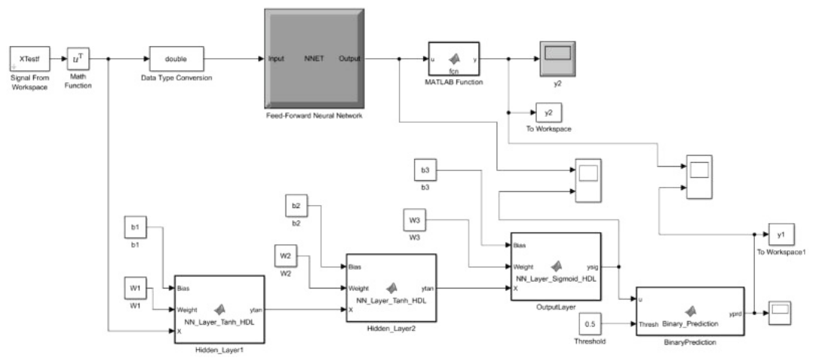

Hình 18.24 Thiết kế deep neural network.

```
% from all neurons of given layer
% Note: All inputs of this function should be in fixed point format

Nodes = size(Weight,1);
WL = 16;
FL = 10;
PM = fi(zeros(Nodes,1),1,WL,FL);
WS = fi(zeros(Nodes,1),1,WL,FL);
ysig = fi(zeros(Nodes,1),1,WL,14);

for k = 1:Nodes
    PM(k) = Weight(k,:)*X(:,1);
    WS(k) = PM(k) + Bias(k);  %u
    y = sig_pw_HDL(WS(k));    %y = sigmoid(u)
    ysig(k) = y;
end
```

MATLAB function “BinaryPrediction” ở Hình 18.24 được định nghĩa bằng code sau.

```
function yprd = Binary_Prediction(u,Thresh)
% Call Function
yprd = Binary_Prediction(u,Thresh);
```

Code cho function “Binary_Prediction” như sau.

```
function yprd = Binary_Prediction(u,Thresh)
if u > Thresh
    yprd = fi(1,0,1,0);
else
    yprd = fi(0,0,1,0);
end
```

Các block parameter cho tab Main và tab Signal Attributes của Constant Threshold được minh họa lần lượt trong Hình 18.25 và 18.26. Ngoài ra, các block parameter cho tab Main của Constant W1 được thể hiện trong Hình 18.27, và các thiết lập tương tự cũng được dùng cho các tham số khác (b1, W2, b2, W3 và b3).

Output dự đoán dùng block feedforward neural network và DNN thiết kế thủ công được so sánh trong Hình 18.28. Ngoài ra, các input cho các block MATLAB function prediction của cả DNN được tạo tự động lẫn DNN thủ công được so sánh trong Hình 18.29.

Bây giờ, nếu chạy m-file Calculation Accuracy (Cal_Accu.m) với code sau, chúng ta có kết quả trong MATLAB command window như sau.

```
close all; clc;
ySim = y2;
yHDL = y1;
ySim(end) = [];
yHDL(end) = [];
Accuracy_Sim = 100*mean(ySim == YTest)
Accuracy_HDL = 100*mean(yHDL == YTest)

Accuracy_Sim =
   70.1299
Accuracy_HDL =
   68.8312
```

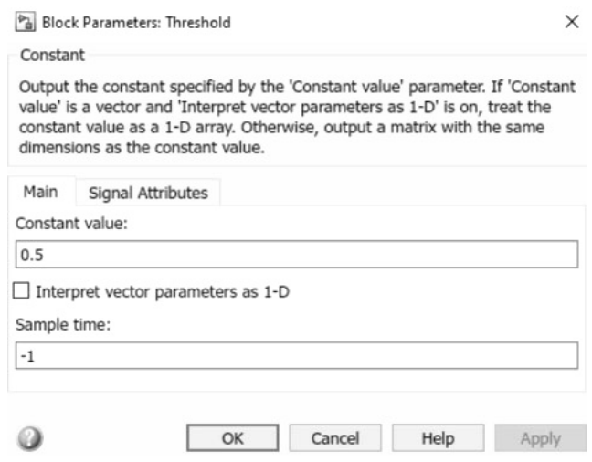

Hình 18.25 Các block parameter cho tab Main của threshold.

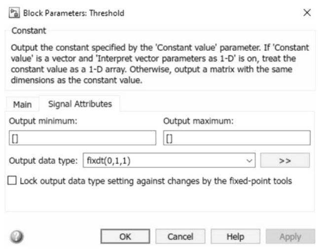

Hình 18.26 Các block parameter cho tab Signal Attributes của threshold.

Vậy, độ chính xác simulation vào khoảng 70.13%, và độ chính xác HDL vào khoảng 68.83%. Chúng ta chọn các block Hidden_Layer1, Hidden_Layer1 *(ghi chú: sách in lặp; khối thứ hai đúng là Hidden_Layer2)*, OutputLayer và BinaryPrediction, rồi right-click và chọn tùy chọn Create Subsystem from Selection, như được mô tả trong Hình 18.30.

Subsystem đã tạo (DNN) được minh họa trong Hình 18.31. Ngoài ra, block design của subsystem “DNN” được thể hiện trong Hình 18.32.

Giờ chúng ta có thể tạo code VHDL cho subsystem “DNN” ở Hình 18.31 bằng HDL Coder. Để làm điều đó, chúng ta viết code sau trong MATLAB command window.

```
>> hdlsetup('simulation_DNN_sub')
```

Tên của thiết kế Simulink là simulation_DNN_sub. Sau đó, chúng ta vào cửa sổ Configuration Parameters và đặt các giá trị tab Solver như được minh họa trong Hình 18.33. Tiếp theo, chúng ta vào tab HDL Code Generation và đặt các tham số như được mô tả trong Hình 18.34.

Sau đó chúng ta gõ code sau trong MATLAB command window.

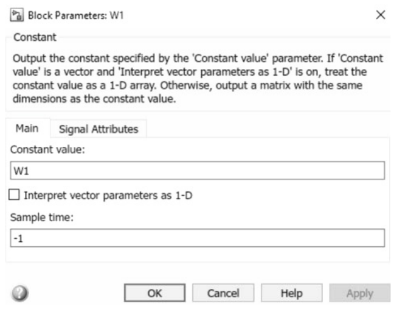

Hình 18.27 Các block parameter cho tab Main của Constant W1.

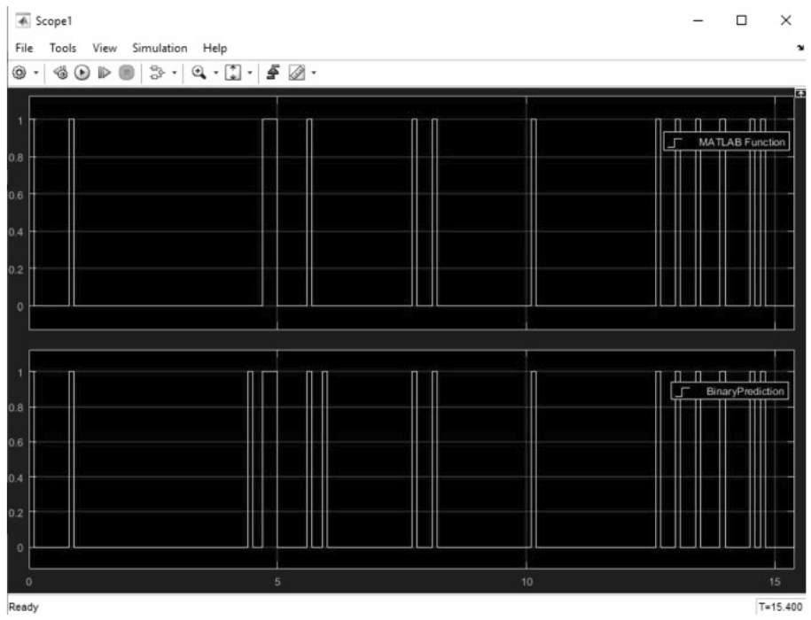

Hình 18.28 So sánh output dự đoán khi dùng DNN được tạo tự động và DNN thủ công.

```
>> checkhdl('simulation_DNN_sub/DNN')
```

Cửa sổ HDL Check Report dạng web browser bật lên, như được thể hiện trong Hình 18.35.

Như được thể hiện trong Hình 18.35, chúng ta gặp hai lỗi và một cảnh báo, vì các ma trận (W1 và W2) không được hỗ trợ ở giao diện block Simulink trong HDL Coder. Chúng ta gõ W1 và nhấn enter, và kết quả sẽ như sau.

```
>> W1
W1 =
   -3.4688   -6.5938   -1.9375   -0.2969   -4.0469   -4.9063   -3.1406   -3.4688
   -0.6406    0.6719    2.3125   -0.1719   -0.6406    0.0938   -1.2656   -1.6094
    1.7813    3.8750  -13.0938    0.5938    0.8750    3.7031    2.4219    1.8281
          DataTypeMode: Fixed-point: binary point scaling
            Signedness: Signed
            WordLength: 11
        FractionLength: 6
```

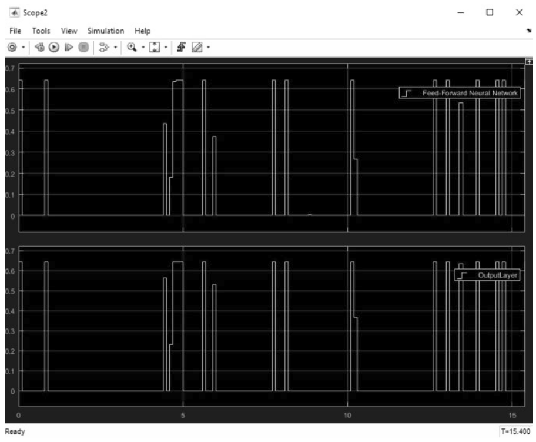

Hình 18.29 So sánh các input của các block MATLAB function prediction.

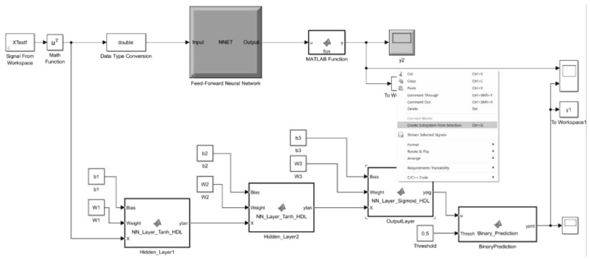

Hình 18.30 Chọn tùy chọn Create Subsystem from Selection.

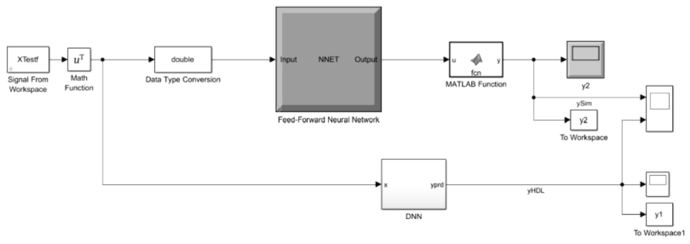

Hình 18.31 Subsystem đã tạo (DNN).

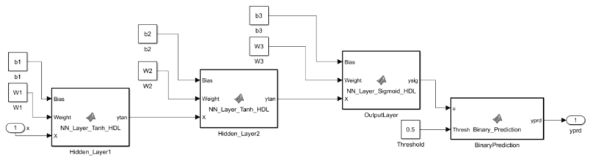

Hình 18.32 Block design của subsystem “DNN.”

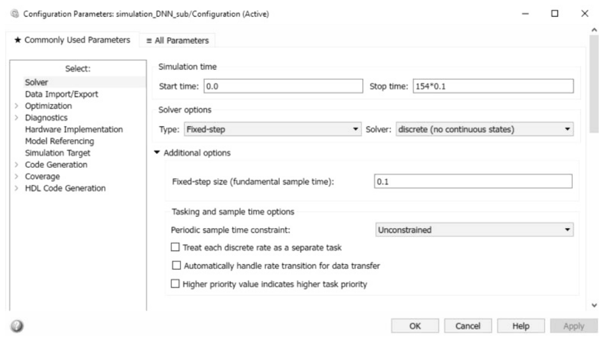

Hình 18.33 Các configuration parameter cho tab Solver.

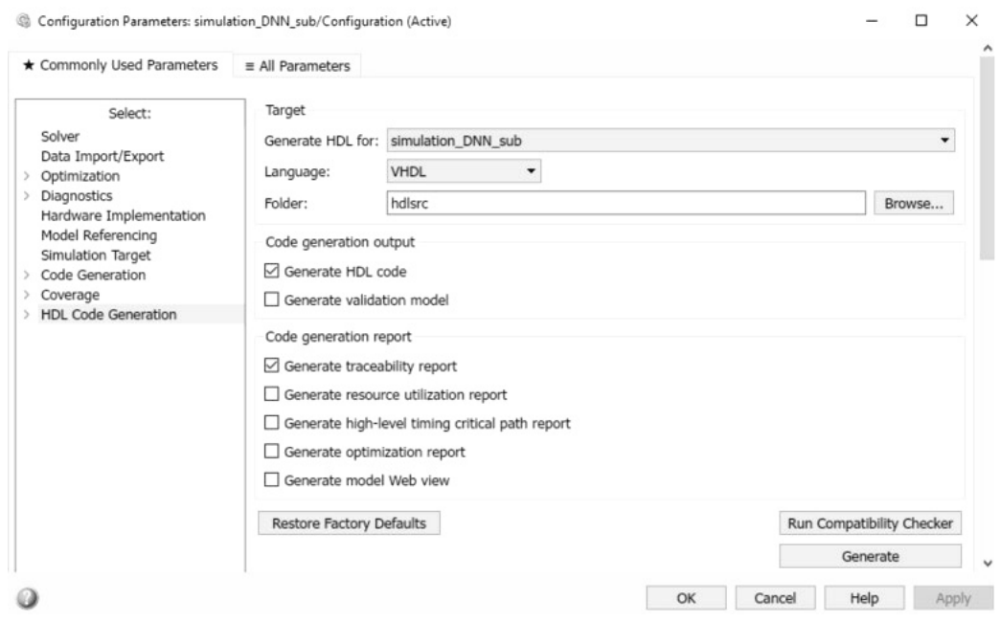

Hình 18.34 Tab HDL Code Generation của cửa sổ Configuration Parameters.

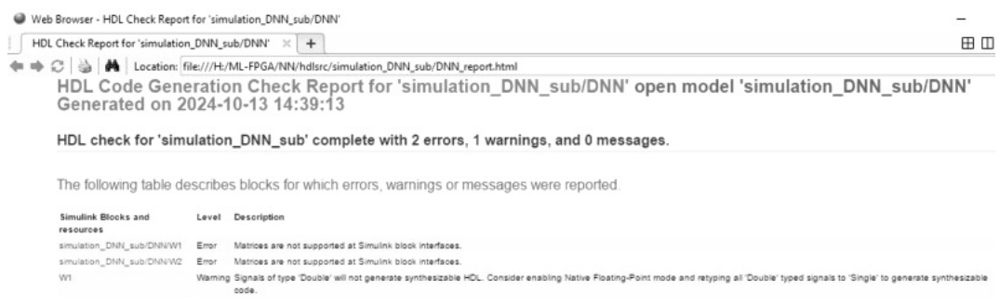

Hình 18.35 Cửa sổ HDL Check Report.

Sau đó, chúng ta click vào MATLAB function Hidden_Layer1, và sửa code như sau.

```
function ytan = NN_Layer_Tanh_HDL(Bias,X)
% Call Function
W1 = [-3.4688  -6.5938  -1.9375  -0.2969  -4.0469  -4.9063  -3.1406  -3.4688
   -0.6406   0.6719   2.3125  -0.1719  -0.6406   0.0938  -1.2656  -1.6094
    1.7813   3.8750  -13.0938   0.5938   0.8750   3.7031   2.4219   1.8281];
W1 = fi(W1,1,11,6);

ytan = NN_Layer_Tanh_HDL(Bias,W1,X);
```

Chúng ta gõ W2 và nhấn enter trong MATLAB command window, và kết quả sẽ như sau.

```
>> W2
W2 =
    1.9688   -1.5938   -0.1250
   -1.6563   -3.2813    1.0938
    4.2188   -0.2188    2.2813
   -9.6875   -4.7813    0.7813
          DataTypeMode: Fixed-point: binary point scaling
            Signedness: Signed
            WordLength: 10
        FractionLength: 5
```

Sau đó, chúng ta click vào MATLAB function Hidden_Layer2, và sửa code như sau.

```
function ytan = NN_Layer_Tanh_HDL(Bias,X)
% Call Function
W2 = [1.9688   -1.5938   -0.1250
   -1.6563   -3.2813    1.0938
    4.2188   -0.2188    2.2813
   -9.6875   -4.7813    0.7813];
W2 = fi(W2,1,10,5);

ytan = NN_Layer_Tanh_HDL(Bias,W2,X);
```

Như bạn có thể thấy trong Hình 18.36, chúng ta xóa các constant W1 và W2, vì chúng đã được định nghĩa bên trong các MATLAB function Hidden_Layer1 và Hidden_Layer2.

Nếu mô phỏng lại thiết kế Simulink, chúng ta có thể xem các waveform output dự đoán như được mô tả trong Hình 18.37.

Giờ chúng ta có thể tạo code VHDL cho subsystem “DNN” ở Hình 18.36 bằng HDL Coder. Để làm điều đó, chúng ta viết code sau trong MATLAB command window.

```
>> hdlsetup(‘simulation_DNN_sub’)
```

Tên của thiết kế Simulink là simulation_DNN_sub. Sau đó, chúng ta lại vào cửa sổ Configuration Parameters và đặt các giá trị tab Solver như được minh họa trong Hình 18.33. Tiếp theo, chúng ta vào tab HDL Code Generation và đặt các tham số như được mô tả trong Hình 18.34. Sau đó, chúng ta gõ code sau trong MATLAB command window.

```
>> checkhdl(‘simulation_DNN_sub/DNN’)
```

Cửa sổ HDL Check Report dạng web browser bật lên, như được thể hiện trong Hình 18.38.

Bây giờ, chúng ta dùng code sau để tạo code HDL trong MATLAB command window.

```
>> makehdl(‘simulation_DNN_sub/DNN’)
```

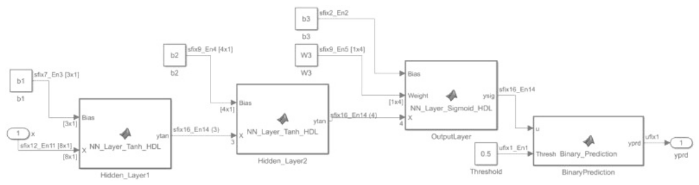

Hình 18.36 Block design đã sửa của subsystem “DNN.”

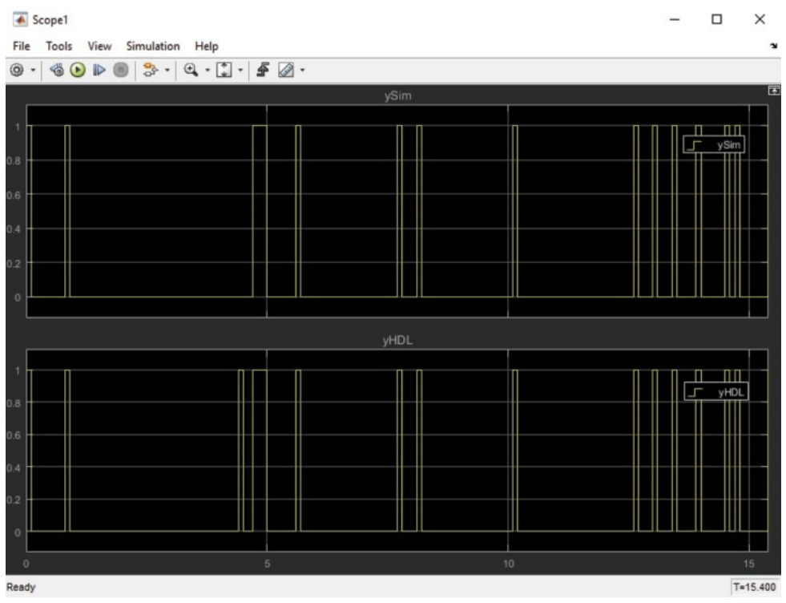

Hình 18.37 So sánh các output dự đoán.


Hình 18.38 Cửa sổ HDL Check Report.

Code VHDL được tạo ra thành công, và cửa sổ Code Generation Report được hiển thị, như được mô tả trong Hình 18.39.

## 18.6 Dùng code VHDL đã tạo trong Vivado

Bây giờ, chúng ta chạy Vivado và tạo một project tên “DNN”, rồi click button Next. Tiếp theo, chúng ta chọn Project Type là RTL Project và click button Next. Trong cửa sổ Add Sources, trước khi thêm các file VHDL đã tạo, chúng ta copy và paste các file VHDL đã tạo từ Hình 18.39 vào thư mục “DNN” của project Vivado. Bây giờ, bằng cách click vào button Add Files, chúng ta có thể thêm chúng vào project, như được thể hiện trong Hình 18.40.

Tiếp theo, chúng ta chọn development board Xilinx và click vào button Next. Cuối cùng, chúng ta click button Finish để tạo project “DNN” với file VHDL đã tạo được thêm vào. Sau đó, chúng ta click vào Run Synthesis, như được minh họa trong Hình 18.41.

Như được minh họa trong Hình 18.41, synthesis đã hoàn tất thành công, và chúng ta có thể click vào button Cancel. Sau đó, chúng ta mở schematic trong tab RTL Analysis như được thể hiện trong Hình 18.42.

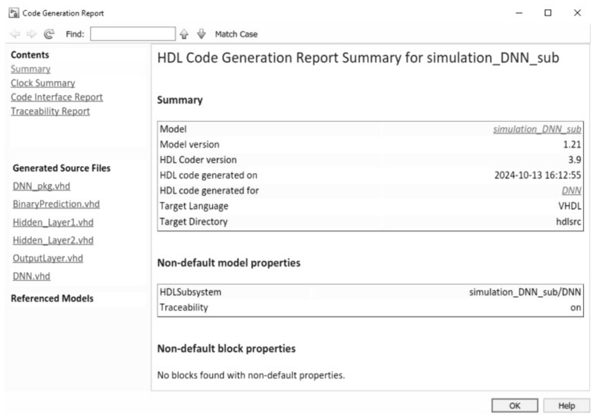

Hình 18.39 Cửa sổ Code Generation Report.

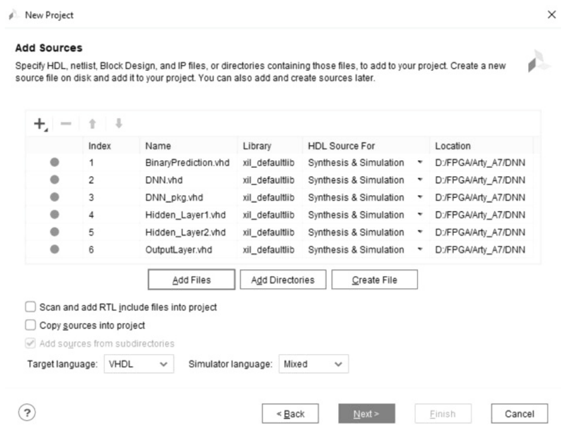

Hình 18.40 Thêm các file VHDL đã tạo vào thư mục Sources.

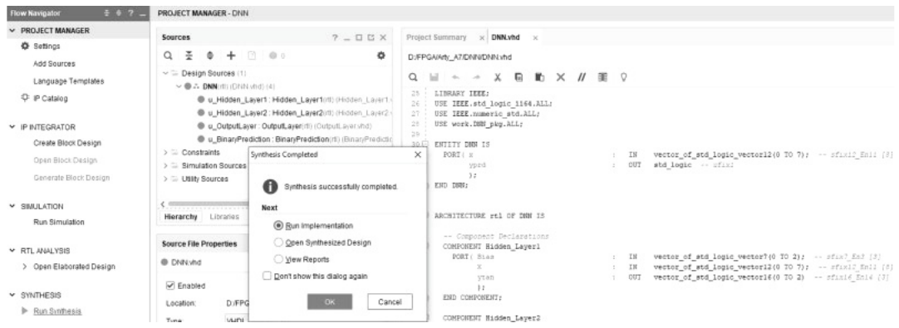

Hình 18.41 Chạy synthesis thành công.

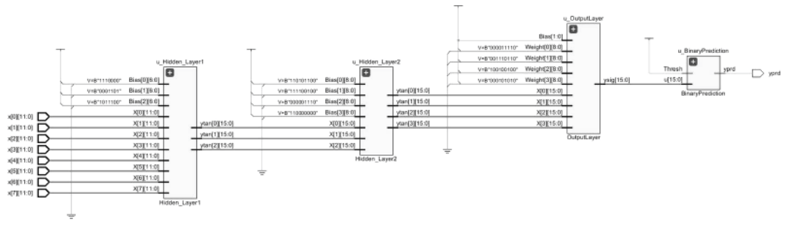

Hình 18.42 Schematic của “DNN.”

Bây giờ, chúng ta có thể mô phỏng project bằng cách chọn Flow → Run Simulation → Run Behavioral Simulation. Trong cửa sổ simulation vừa mở, chúng ta click vào button Restart. Chúng ta viết code sau trong MATLAB command window.

```
>> XTestf(50,:)
ans =
    0.0586    0.4575    0.3115   -0.0708   -0.6929    0.1299   -0.5225   -0.3667
          DataTypeMode: Fixed-point: binary point scaling
            Signedness: Signed
            WordLength: 12
        FractionLength: 11
>> t50 = XTestf(50,:);
>> t50.bin
ans =
000001111000   001110101001   001001111110   111101101111   101001110101   000100
001010   101111010010   110100010001
>> y1(50)
ans =
     1
          DataTypeMode: Fixed-point: binary point scaling
            Signedness: Unsigned
            WordLength: 1
        FractionLength: 0
>> y2(50)
ans =
     1
```

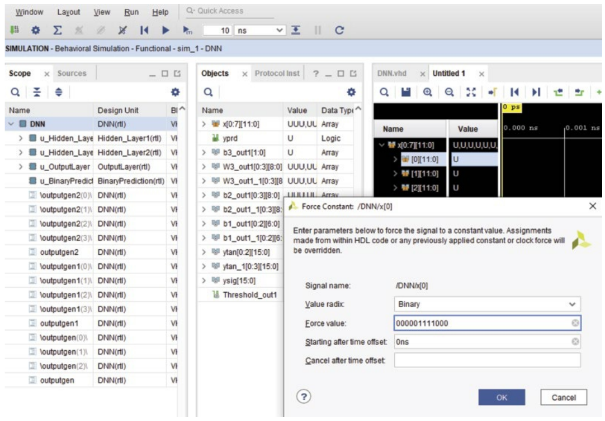

Hình 18.43 Cửa sổ Force Constant cho x[0].


Hình 18.44 Các waveform đã mô phỏng.

Sau đó, trong cửa sổ waveform, chúng ta right-click vào “x[0]” và chọn tùy chọn “Force Constant…”, và cấu hình thiết lập của nó như được minh họa trong Hình 18.43.

Chúng ta lặp lại quá trình tương tự cho x[1] = 001110101001, x[2] = 001001111110, x[3] = 111101101111, x[4] = 101001110101, x[5] = 000100001010, x[6] = 101111010010 và x[7] = 110100010001. Sau đó, chúng ta click button Run for 10 ns một lần, và click vào button Zoom Fit trong cửa sổ waveforms để có các waveform đã mô phỏng như được minh họa trong Hình 18.44.

Vậy, chúng ta cũng đạt được cùng kết quả dự đoán khi dùng FPGA (yprd = 1).
