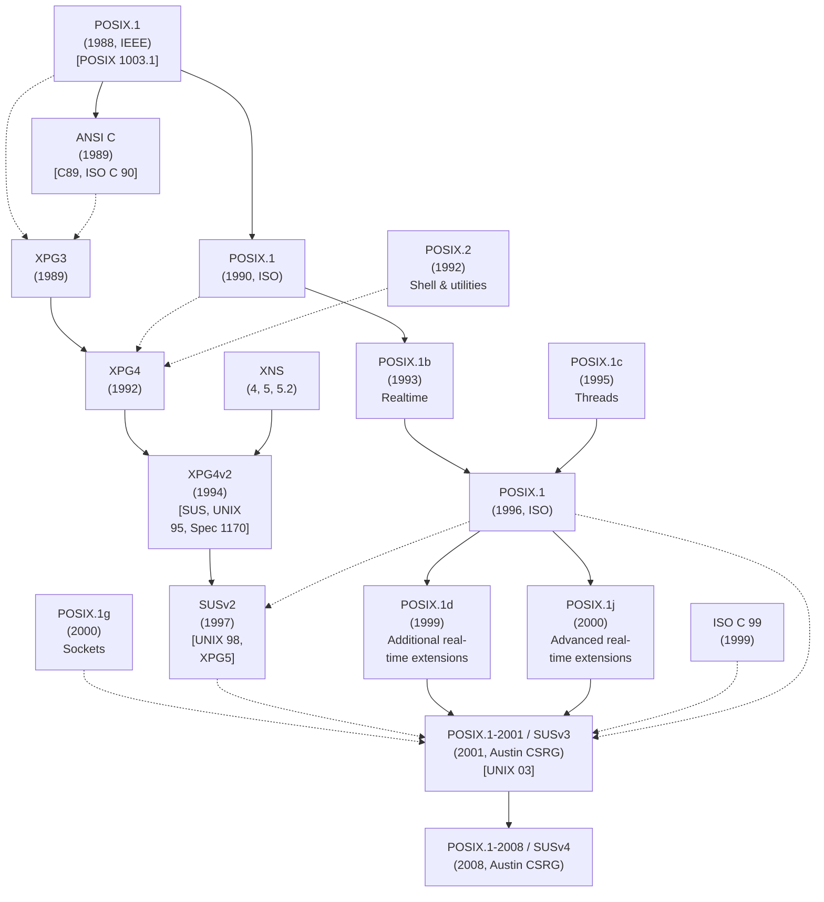

#### Chương 1
### **LỊCH SỬ VÀ CÁC TIÊU CHUẨN**
Linux là một thành viên của họ hệ điều hành UNIX. Xét về mặt điện toán, UNIX có một lịch sử lâu đời. Phần đầu của chương này trình bày một lược sử về quá trình đó. Chúng ta bắt đầu với mô tả về nguồn gốc của hệ thống UNIX và ngôn ngữ lập trình C, sau đó xem xét hai dòng phát triển chính đã dẫn đến hệ thống Linux như ngày nay: dự án GNU và sự phát triển của Linux kernel.
Một trong những đặc điểm nổi bật của hệ thống UNIX là việc phát triển nó không bị kiểm soát bởi một nhà cung cấp (vendor) hay tổ chức duy nhất. Thay vào đó, nhiều nhóm — cả thương mại và phi thương mại — đã đóng góp vào sự tiến hóa của nó. Lịch sử này đã mang lại nhiều tính năng sáng tạo được bổ sung vào UNIX, nhưng cũng dẫn đến hậu quả tiêu cực là các bản thực thi (implementations) UNIX bị phân nhánh (diverged) theo thời gian, khiến việc viết các ứng dụng chạy được trên tất cả các triển khai UNIX trở nên ngày càng khó khăn. Điều này đã dẫn đến nỗ lực chuẩn hóa (standardization) các bản thực thi UNIX, điều mà chúng ta sẽ thảo luận ở phần thứ hai của chương này.
Có hai định nghĩa về thuật ngữ UNIX được sử dụng phổ biến. Một trong số đó chỉ các hệ điều hành đã vượt qua các bài kiểm tra tuân thủ (conformance tests) chính thức cho Single UNIX Specification và do đó được The Open Group (đơn vị nắm giữ nhãn hiệu thương mại UNIX) chính thức cấp quyền gắn nhãn "UNIX". Tại thời điểm viết cuốn sách này, không có bản thực thi UNIX tự do nào (ví dụ: Linux và FreeBSD) đạt được nhãn hiệu này.
Ý nghĩa phổ biến còn lại gắn liền với thuật ngữ UNIX chỉ những hệ thống có diện mạo và hành vi giống như các hệ thống UNIX cổ điển (tức là UNIX ban đầu của Bell Laboratories và các nhánh chính sau này của nó, System V và BSD). Theo định nghĩa này, Linux thường được coi là một hệ thống UNIX (cũng như các hệ thống BSD hiện đại). Mặc dù chúng ta chú ý kỹ đến Single UNIX Specification trong cuốn sách này, chúng ta sẽ tuân theo định nghĩa thứ hai này của UNIX, do đó chúng ta sẽ thường nói những câu như "Linux, giống như các bản thực thi UNIX khác. . . ."
### **1.1 Lược sử về UNIX và C**
Bản thực thi UNIX đầu tiên được phát triển vào năm 1969 (cùng năm Linus Torvalds sinh ra) bởi Ken Thompson tại Bell Laboratories, một bộ phận của tập đoàn viễn thông AT&T. Nó được viết bằng assembler cho máy vi tính (minicomputer) Digital PDP-7. Tên gọi UNIX là một trò chơi chữ nhại theo MULTICS (Multiplexed Information and Computing Service), tên của một dự án hệ điều hành trước đó mà AT&T đã hợp tác với Massachusetts Institute of Technology (MIT) và General Electric. (AT&T vào thời điểm đó đã rút khỏi dự án do thất vọng vì thất bại ban đầu trong việc phát triển một hệ thống có hiệu quả kinh tế.) Thompson đã rút ra một số ý tưởng cho hệ điều hành mới của mình từ MULTICS, bao gồm tree-structured file system (hệ thống tập tin cấu trúc cây), một chương trình riêng biệt để giải mã lệnh (shell), và khái niệm file là một chuỗi byte không cấu trúc (unstructured streams of bytes).
Vào năm 1970, UNIX được viết lại bằng assembly language cho máy minicomputer Digital PDP-11 mới được trang bị, lúc đó là một cỗ máy mới và mạnh mẽ. Dấu vết của di sản PDP-11 này vẫn có thể được tìm thấy trong nhiều tên gọi vẫn được sử dụng trên hầu hết các bản thực thi UNIX, bao gồm cả Linux.
Một thời gian ngắn sau đó, Dennis Ritchie, một đồng nghiệp của Thompson tại Bell Laboratories và là nhà cộng tác sớm trên UNIX, đã thiết kế và triển khai ngôn ngữ lập trình C. Đây là một quá trình tiến hóa; C nối tiếp một ngôn ngữ thông dịch (interpreted language) trước đó là B. B ban đầu được triển khai bởi Thompson và lấy nhiều ý tưởng từ một ngôn ngữ lập trình sớm hơn nữa tên là BCPL. Đến năm 1973, C đã trưởng thành đến mức kernel của UNIX có thể được viết lại gần như hoàn toàn bằng ngôn ngữ mới này. UNIX nhờ đó trở thành một trong những hệ điều hành sớm nhất được viết bằng một ngôn ngữ bậc cao (high-level language), một thực tế giúp cho việc porting sau này sang các kiến trúc phần cứng khác trở nên khả thi.
Nguồn gốc của C giải thích lý do tại sao nó, và ngôn ngữ kế thừa C++, đã được sử dụng rộng rãi như các ngôn ngữ lập trình hệ thống (system programming languages) ngày nay. Các ngôn ngữ được sử dụng rộng rãi trước đó được thiết kế với các mục đích khác: FORTRAN cho các tác vụ toán học của kỹ sư và nhà khoa học; COBOL cho các hệ thống thương mại xử lý các luồng dữ liệu hướng bản ghi (record-oriented data). C đã lấp đầy một khoảng trống cho đến lúc đó còn trống, và không giống như FORTRAN và COBOL (được thiết kế bởi các ủy ban lớn), thiết kế của C nảy sinh từ ý tưởng và nhu cầu của một số cá nhân làm việc hướng tới một mục tiêu duy nhất: phát triển một ngôn ngữ bậc cao để triển khai UNIX kernel và phần mềm liên quan. Giống như chính hệ điều hành UNIX, C được thiết kế bởi các lập trình viên chuyên nghiệp cho mục đích sử dụng của chính họ. Ngôn ngữ kết quả rất nhỏ gọn, hiệu quả, mạnh mẽ, cô đọng (terse), mô-đun hóa (modular), thực tiễn và nhất quán trong thiết kế.
###### **UNIX từ phiên bản First đến Sixth**
Nằm trong khoảng từ năm 1969 đến 1979, UNIX đã trải qua một số bản phát hành, được gọi là các edition. Về bản chất, các bản phát hành này là các ảnh chụp (snapshots) của phiên bản phát triển đang tiến triển tại AT&T. [Salus, 1994] ghi nhận các mốc thời gian sau cho sáu edition đầu tiên của UNIX:
* First Edition, tháng 11 năm 1971: Đến thời điểm này, UNIX đang chạy trên PDP-11 và đã có một FORTRAN compiler cũng như các phiên bản của nhiều chương trình vẫn còn được sử dụng ngày nay, bao gồm `ar`, `cat`, `chmod`, `chown`, `cp`, `dc`, `ed`, `find`, `ln`, `ls`, `mail`, `mkdir`, `mv`, `rm`, `sh`, `su`, và `who`.
* Second Edition, tháng 6 năm 1972: Đến thời điểm này, UNIX đã được cài đặt trên 10 cỗ máy trong AT&T.
* Third Edition, tháng 2 năm 1973: Edition này bao gồm một C compiler và bản triển khai đầu tiên của pipes.
* Fourth Edition, tháng 11 năm 1973: Đây là phiên bản đầu tiên được viết gần như hoàn toàn bằng C.
* Fifth Edition, tháng 6 năm 1974: Đến thời điểm này, UNIX đã được cài đặt trên hơn 50 hệ thống.
* Sixth Edition, tháng 5 năm 1975: Đây là edition đầu tiên được sử dụng rộng rãi bên ngoài AT&T.
Trong khoảng thời gian của các bản phát hành này, việc sử dụng và danh tiếng của UNIX bắt đầu lan rộng, đầu tiên là trong nội bộ AT&T, và sau đó ra bên ngoài. Một đóng góp quan trọng cho sự nhận thức ngày càng tăng này là việc xuất bản một bài báo về UNIX trên tạp chí được đọc rộng rãi Communications of the ACM ([Ritchie & Thompson, 1974]).
Vào thời điểm này, AT&T nắm giữ độc quyền được chính phủ phê duyệt đối với hệ thống điện thoại Hoa Kỳ. Các điều khoản trong thỏa thuận của AT&T với chính phủ Hoa Kỳ ngăn cản họ bán phần mềm, điều đó có nghĩa là họ không thể bán UNIX như một sản phẩm. Thay vào đó, bắt đầu từ năm 1974 với Fifth Edition, và đặc biệt là với Sixth Edition, AT&T đã cấp phép UNIX cho các trường đại học sử dụng với một khoản phí phân phối tượng trưng. Các bản phân phối cho đại học bao gồm tài liệu hướng dẫn và mã nguồn kernel (khoảng 10.000 dòng mã vào thời điểm đó).
Việc AT&T phát hành UNIX vào các trường đại học đã đóng góp rất lớn vào sự phổ biến và việc sử dụng hệ điều hành này, và đến năm 1977, UNIX đã chạy tại khoảng 500 địa điểm, bao gồm 125 trường đại học ở Hoa Kỳ và một số quốc gia khác. UNIX mang đến cho các trường đại học một hệ điều hành đa người dùng (multiuser) tương tác giá rẻ nhưng mạnh mẽ, vào thời điểm mà các hệ điều hành thương mại rất đắt đỏ. Nó cũng cung cấp cho các khoa khoa học máy tính ở đại học mã nguồn của một hệ điều hành thực sự, nơi họ có thể sửa đổi và cung cấp cho sinh viên học hỏi và thử nghiệm. Một số sinh viên này, được trang bị kiến thức về UNIX, đã trở thành những người truyền bá UNIX. Những người khác tiếp tục thành lập hoặc gia nhập vô số công ty khởi nghiệp bán các máy trạm (workstations) giá rẻ chạy hệ điều hành UNIX dễ dàng porting.
##### **Sự ra đời của BSD và System V**
Tháng 1 năm 1979 ghi nhận bản phát hành Seventh Edition UNIX, giúp cải thiện độ tin cậy của hệ thống và cung cấp một file system nâng cao. Bản phát hành này cũng chứa một số công cụ mới, bao gồm `awk`, `make`, `sed`, `tar`, `uucp`, Bourne shell, và một FORTRAN 77 compiler. Bản phát hành Seventh Edition cũng rất quan trọng vì từ mốc này, UNIX phân nhánh thành hai biến thể quan trọng: BSD và System V, mà nguồn gốc của chúng sẽ được chúng ta tóm tắt ngắn gọn sau đây.
Thompson đã dành năm học 1975/1976 làm giáo sư thỉnh giảng tại University of California at Berkeley, nơi ông đã tốt nghiệp. Tại đó, ông làm việc với một số sinh viên cao học, bổ sung nhiều tính năng mới cho UNIX. (Một trong những sinh viên này, Bill Joy, sau đó tiếp tục đồng sáng lập Sun Microsystems, một tên tuổi sớm gia nhập thị trường workstation UNIX.) Theo thời gian, nhiều công cụ và tính năng mới đã được phát triển tại Berkeley, bao gồm C shell, vi editor, một hệ thống tập tin cải tiến (Berkeley Fast File System), sendmail, một Pascal compiler, và quản lý bộ nhớ ảo (virtual memory management) trên kiến trúc Digital VAX mới.
Dưới tên gọi Berkeley Software Distribution (BSD), phiên bản UNIX này, bao gồm cả mã nguồn của nó, đã được phân phối rộng rãi. Bản phân phối đầy đủ đầu tiên là 3BSD vào tháng 12 năm 1979. (Các bản phát hành trước đó từ Berkeley — 1BSD và 2BSD — là các bản phân phối các công cụ mới do Berkeley tạo ra, chứ không phải các bản phân phối UNIX hoàn chỉnh.)
Năm 1983, Computer Systems Research Group tại University of California at Berkeley đã phát hành 4.2BSD. Bản phát hành này rất quan trọng vì nó chứa một bản triển khai TCP/IP hoàn chỉnh, bao gồm sockets application programming interface (API) và nhiều công cụ mạng khác nhau. 4.2BSD và bản tiền nhiệm 4.1BSD đã được phân phối rộng rãi trong các trường đại học trên toàn thế giới. Chúng cũng tạo thành cơ sở cho SunOS (phát hành lần đầu năm 1983), biến thể UNIX do Sun bán. Các bản phát hành BSD quan trọng khác là 4.3BSD vào năm 1986, và bản phát hành cuối cùng, 4.4BSD vào năm 1993.
Các cổng port đầu tiên của hệ thống UNIX sang phần cứng khác không phải PDP-11 diễn ra trong năm 1977 và 1978, khi Dennis Ritchie và Steve Johnson port nó sang Interdata 8/32 và Richard Miller tại University of Wollongong ở Úc đồng thời port nó sang Interdata 7/32. Cổng Berkeley Digital VAX dựa trên một bản port trước đó (1978) của John Reiser và Tom London. Được biết đến với tên 32V, bản port này về cơ bản giống với Seventh Edition cho PDP-11, ngoại trừ không gian địa chỉ (address space) lớn hơn và các kiểu dữ liệu rộng hơn.
Trong thời gian đó, đạo luật chống độc quyền của Hoa Kỳ đã buộc AT&T phải chia tách (các thủ tục pháp lý bắt đầu từ giữa những năm 1970 và việc chia tách có hiệu lực vào năm 1982), dẫn đến kết quả là vì không còn nắm giữ độc quyền đối với hệ thống điện thoại nữa, công ty được phép thương mại hóa UNIX. Điều này dẫn đến bản phát hành System III (ba) vào năm 1981. System III được sản xuất bởi UNIX Support Group (USG) của AT&T, đơn vị sử dụng hàng trăm nhà phát triển để nâng cấp UNIX và phát triển các ứng dụng UNIX (đáng chú ý là các gói soạn thảo tài liệu và công cụ phát triển phần mềm). Bản phát hành đầu tiên của System V (năm) nối tiếp vào năm 1983, và một loạt bản phát hành đã dẫn đến bản System V Release 4 (SVR4) dứt điểm vào năm 1989, thời điểm mà System V đã tích hợp nhiều tính năng từ BSD, bao gồm các phương tiện mạng (networking facilities). System V được cấp phép cho nhiều nhà cung cấp thương mại khác nhau, những người đã sử dụng nó làm cơ sở cho các bản thực thi UNIX của họ.
Do đó, ngoài các bản phân phối BSD khác nhau lan rộng trong giới viện hàn lâm, đến cuối những năm 1980, UNIX đã có sẵn trong một loạt các bản thực thi thương mại trên nhiều phần cứng khác nhau. Các bản thực thi này bao gồm SunOS và sau này là Solaris của Sun, Ultrix và OSF/1 của Digital (ngày nay, sau một loạt các lần đổi tên và thâu tóm, là HP Tru64 UNIX), AIX của IBM, HP-UX của Hewlett-Packard (HP), NeXTStep của NeXT, A/UX cho Apple Macintosh, và XENIX của Microsoft và SCO cho kiến trúc Intel x86-32. (Trong toàn bộ cuốn sách này, bản thực thi Linux cho x86-32 được gọi là Linux/x86-32.) Tình trạng này trái ngược hoàn toàn với các kịch bản hệ điều hành/phần cứng độc quyền điển hình vào thời điểm đó, nơi mỗi nhà cung cấp sản xuất một hoặc nhiều nhất là một vài kiến trúc chip máy tính độc quyền, trên đó họ bán (các) hệ điều hành độc quyền của riêng mình. Tính chất độc quyền của hầu hết các hệ thống nhà cung cấp có nghĩa là người mua bị khóa chặt vào một nhà cung cấp (vendor lock-in). Việc chuyển sang một hệ điều hành và nền tảng phần cứng độc quyền khác có thể trở nên rất đắt đỏ do cần phải port các ứng dụng hiện có và đào tạo lại nhân viên. Yếu tố này, kết hợp với sự xuất hiện của các workstation UNIX đơn người dùng giá rẻ từ nhiều nhà cung cấp, đã khiến hệ thống UNIX có tính di động (portable) ngày càng trở nên hấp dẫn từ góc độ thương mại.
### **1.2 Lược sử về Linux**
Thuật ngữ Linux thường được sử dụng để chỉ toàn bộ hệ điều hành giống UNIX (UNIX-like) mà Linux kernel tạo thành một phần trong đó. Tuy nhiên, đây là một sự nhầm lẫn tên gọi (misnomer), vì nhiều thành phần then chốt có trong một bản phân phối Linux thương mại điển hình thực tế lại bắt nguồn từ một dự án đã ra đời trước Linux vài năm.
#### **1.2.1 Dự án GNU**
Năm 1984, Richard Stallman, một lập trình viên tài năng xuất chúng từng làm việc tại MIT, bắt tay vào việc tạo ra một bản thực thi UNIX "tự do" (free). Quan điểm của Stallman mang tính đạo đức, và từ "free" được định nghĩa theo nghĩa pháp lý chứ không phải nghĩa tài chính (xem http://www.gnu.org/philosophy/free-sw.html). Mặc dù vậy, sự tự do pháp lý mà Stallman mô tả mang theo hệ quả ngầm định là phần mềm như hệ điều hành sẽ có sẵn với chi phí bằng không hoặc rất thấp.
Stallman đã đấu tranh chống lại các hạn chế pháp lý đặt lên các hệ điều hành độc quyền bởi các nhà cung cấp máy tính. Các hạn chế này có nghĩa là người mua phần mềm máy tính nói chung không thể xem mã nguồn (source code) của phần mềm họ mua, và họ chắc chắn không thể sao chép, thay đổi hoặc phân phối lại nó. Ông chỉ ra rằng một khuôn khổ như vậy khuyến khích các lập trình viên cạnh tranh lẫn nhau và tích trữ công việc của họ, thay vì hợp tác và chia sẻ.
Để đáp lại, Stallman đã khởi xướng dự án GNU (một từ viết tắt đệ quy cho "GNU's not UNIX") để phát triển một hệ thống giống UNIX hoàn chỉnh, có sẵn tự do, bao gồm một kernel và tất cả các gói phần mềm liên quan, đồng thời khuyến khích những người khác tham gia cùng ông. Năm 1985, Stallman thành lập Free Software Foundation (FSF), một tổ chức phi lợi nhuận để hỗ trợ dự án GNU cũng như sự phát triển của phần mềm tự do nói chung.
Khi dự án GNU bắt đầu, BSD không phải là phần mềm tự do theo nghĩa của Stallman. Việc sử dụng BSD vẫn yêu cầu giấy phép từ AT&T, và người dùng không thể tự do sửa đổi và phân phối lại mã AT&T vốn là một phần của BSD.
Một trong những kết quả quan trọng của dự án GNU là sự phát triển của Giấy phép Công cộng GNU (GNU General Public License - GPL), hiện thân pháp lý cho khái niệm phần mềm tự do của Stallman. Nhiều phần mềm trong một bản phân phối Linux, bao gồm cả kernel, được cấp phép theo GPL hoặc một trong các giấy phép tương tự. Phần mềm được cấp phép theo GPL phải được cung cấp dưới dạng mã nguồn và phải được tự do phân phối lại theo các điều khoản của GPL. Việc sửa đổi phần mềm được cấp phép GPL được phép tự do, nhưng bất kỳ sự phân phối nào của phần mềm sửa đổi đó cũng phải tuân theo các điều khoản của GPL. Nếu phần mềm sửa đổi được phân phối dưới dạng file thực thi (executable), tác giả cũng phải cho phép người nhận tùy chọn lấy mã nguồn đã sửa đổi với chi phí không vượt quá chi phí phân phối. Phiên bản đầu tiên của GPL được phát hành vào năm 1989. Phiên bản hiện tại của giấy phép, phiên bản 3, được phát hành vào năm 2007. Phiên bản 2 của giấy phép, phát hành năm 1991, vẫn được sử dụng rộng rãi và là giấy phép được sử dụng cho Linux kernel. (Các cuộc thảo luận về nhiều giấy phép phần mềm tự do khác nhau có thể tìm thấy trong [St. Laurent, 2004] và [Rosen, 2005].)
Dự án GNU ban đầu không tạo ra một UNIX kernel hoạt động được, nhưng đã tạo ra một loạt các chương trình khác. Vì các chương trình này được thiết kế để chạy trên một hệ điều hành giống UNIX, chúng có thể, và đã được, sử dụng trên các bản thực thi UNIX hiện có và trong một số trường hợp thậm chí còn được port sang các hệ điều hành khác. Trong số các chương trình nổi tiếng hơn do dự án GNU tạo ra có trình biên tập văn bản Emacs, GCC (ban đầu là GNU C compiler, nhưng nay được đổi tên thành GNU compiler collection, bao gồm các compiler cho C, C++, và các ngôn ngữ khác), bash shell, và glibc (GNU C library).
Đến đầu những năm 1990, dự án GNU đã tạo ra một hệ thống gần như hoàn chỉnh, ngoại trừ một thành phần quan trọng: một UNIX kernel hoạt động được. Dự án GNU đã bắt đầu làm việc trên một thiết kế kernel tham vọng, được gọi là GNU/HURD, dựa trên Mach microkernel. Tuy nhiên, HURD còn lâu mới đạt đến hình thái có thể phát hành. (Tại thời điểm viết sách, công việc vẫn tiếp tục trên HURD, hiện chỉ chạy trên kiến trúc x86-32.)
Vì một phần đáng kể mã chương trình cấu thành nên cái thường được gọi là hệ thống Linux thực tế lại xuất phát từ dự án GNU, Stallman ưu tiên sử dụng thuật ngữ GNU/Linux để chỉ toàn bộ hệ thống. Câu hỏi về tên gọi (Linux so với GNU/Linux) là nguồn gốc của một số cuộc tranh luận trong cộng đồng phần mềm tự do. Vì cuốn sách này chủ yếu đề cập đến API của Linux kernel, chúng ta sẽ nhìn chung sử dụng thuật ngữ Linux.
Sân khấu đã được dựng sẵn. Tất cả những gì còn thiếu là một kernel hoạt động được để đi kèm với hệ thống UNIX đã hoàn chỉnh ở các mặt khác do dự án GNU tạo ra.
###### **1.2.2 Linux Kernel**
Năm 1991, Linus Torvalds, một sinh viên người Phần Lan tại University of Helsinki, được truyền cảm hứng để viết một hệ điều hành cho chiếc máy tính Intel 80386 PC của mình. Trong quá trình học tập, Torvalds đã tiếp xúc với Minix, một kernel hệ điều hành nhỏ giống UNIX được phát triển vào giữa những năm 1980 bởi Andrew Tanenbaum, một giáo sư đại học ở Hà Lan. Tanenbaum đã cung cấp Minix, đi kèm mã nguồn đầy đủ, làm công cụ giảng dạy thiết kế hệ điều hành trong các khóa học đại học. Minix kernel có thể được biên dịch và chạy trên hệ thống 386. Tuy nhiên, vì mục đích chính của nó là một công cụ giảng dạy, nó được thiết kế để phần lớn độc lập với kiến trúc phần cứng, và nó không tận dụng tối đa khả năng của bộ xử lý 386.
Do đó, Torvalds đã bắt đầu một dự án tạo ra một UNIX kernel hiệu quả, đầy đủ tính năng để chạy trên 386. Trong vài tháng, Torvalds đã phát triển một kernel cơ bản cho phép ông biên dịch và chạy các chương trình GNU khác nhau. Sau đó, vào ngày 5 tháng 10 năm 1991, Torvalds đã yêu cầu sự trợ giúp của các lập trình viên khác, đưa ra thông báo nổi tiếng sau đây về phiên bản 0.02 của kernel của mình trên nhóm tin comp.os.minix Usenet:
Do you pine for the nice days of Minix-1.1, when men were men and wrote their own device drivers? Are you without a nice project and just dying to cut your teeth on a OS you can try to modify for your needs? Are you finding it frustrating when everything works on Minix? No more all-nighters to get a nifty program working? Then this post might be just for you. As I mentioned a month ago, I'm working on a free version of a Minix-look-alike for AT-386 computers. It has finally reached the stage where it's even usable (though may not be depending on what you want), and I am willing to put out the sources for wider distribution. It is just version 0.02 . . . but I've successfully run bash, gcc, gnu-make, gnu-sed, compress, etc. under it.
Theo một truyền thống lâu đời là đặt tên cho các bản sao UNIX kết thúc bằng chữ cái X, kernel (cuối cùng) đã được rửa tội bằng tên Linux. Ban đầu, Linux được đặt theo một giấy phép hạn chế hơn, nhưng Torvalds đã sớm cung cấp nó theo giấy phép GNU GPL.
Lời kêu gọi hỗ trợ đã tỏ ra hiệu quả. Các lập trình viên khác đã tham gia cùng Torvalds trong việc phát triển Linux, bổ sung các tính năng khác nhau, chẳng hạn như file system cải tiến, hỗ trợ networking, device drivers, và hỗ trợ multiprocessor. Đến tháng 3 năm 1994, các nhà phát triển đã có thể phát hành phiên bản 1.0. Linux 1.2 xuất hiện vào tháng 3 năm 1995, Linux 2.0 vào tháng 6 năm 1996, Linux 2.2 vào tháng 1 năm 1999, và Linux 2.4 vào tháng 1 năm 2001. Công việc trên kernel phát triển 2.5 bắt đầu vào tháng 11 năm 2001, và dẫn đến bản phát hành Linux 2.6 vào tháng 12 năm 2003.
###### **Đôi điều nói thêm: Các dòng BSD**
Đáng chú ý là một hệ điều hành UNIX tự do khác đã có sẵn cho x86-32 trong những năm đầu 1990. Bill và Lynne Jolitz đã phát triển một bản port của hệ thống BSD đã trưởng thành cho x86-32, được gọi là 386/BSD. Bản port này dựa trên bản phát hành BSD Net/2 (tháng 6 năm 1991), một phiên bản mã nguồn 4.3BSD trong đó tất cả mã nguồn độc quyền AT&T còn lại đã được thay thế hoặc, trong trường hợp six file mã nguồn không thể viết lại dễ dàng, đã bị xóa bỏ. Vợ chồng Jolitz đã port mã Net/2 sang x86-32, viết lại các file mã nguồn bị thiếu, và thực hiện bản phát hành đầu tiên (phiên bản 0.0) của 386/BSD vào tháng 2 năm 1992.
Sau làn sóng thành công và phổ biến ban đầu, công việc trên 386/BSD bị chậm lại vì nhiều lý do. Đối mặt với đống tồn đọng ngày càng lớn các bản vá (patches), hai nhóm phát triển thay thế nhanh chóng xuất hiện, tạo ra các bản phát hành của riêng họ dựa trên 386/BSD: NetBSD, nhấn mạnh tính di động (portability) trên nhiều nền tảng phần cứng, và FreeBSD, nhấn mạnh hiệu năng và là bản BSD hiện đại phổ biến nhất. Bản phát hành NetBSD đầu tiên là 0.8 vào tháng 4 năm 1993. Đĩa FreeBSD CD-ROM đầu tiên (phiên bản 1.0) xuất hiện vào tháng 12 năm 1993. Một bản BSD khác, OpenBSD, xuất hiện vào năm 1996 (với phiên bản ban đầu được đánh số 2.0) sau khi tách ra (forking) từ dự án NetBSD. OpenBSD nhấn mạnh về bảo mật (security). Vào giữa năm 2003, một bản BSD mới, DragonFly BSD, đã xuất hiện sau khi tách ra từ FreeBSD 4.x. DragonFly BSD có cách tiếp cận khác với FreeBSD 5.x liên quan đến thiết kế cho các kiến trúc đa xử lý đối xứng (symmetric multiprocessing - SMP).
Có lẽ không có cuộc thảo luận nào về các hệ BSD trong những năm đầu 1990 là hoàn chỉnh nếu không đề cập đến các vụ kiện giữa UNIX System Laboratories (USL, công ty con của AT&T tách ra để phát triển và thương mại hóa UNIX) và Berkeley. Đầu năm 1992, công ty Berkeley Software Design, Incorporated (BSDi, ngày nay thuộc Wind River) bắt đầu phân phối một bản BSD UNIX được hỗ trợ thương mại, BSD/OS, dựa trên bản phát hành Net/2 và các bổ sung 386/BSD của vợ chồng Jolitz. BSDi phân phối file thực thi (binaries) và mã nguồn với giá $995 (USD), và khuyên các khách hàng tiềm năng sử dụng số điện thoại 1-800-ITS-UNIX của họ.
Vào tháng 4 năm 1992, USL đã nộp đơn kiện BSDi nhằm ngăn cản BSDi bán sản phẩm mà USL cáo buộc là vẫn còn vướng mắc mã nguồn độc quyền và bí mật thương mại của USL. USL cũng yêu cầu BSDi ngừng sử dụng số điện thoại gây hiểu lầm. Vụ kiện cuối cùng đã được mở rộng để bao gồm đơn kiện chống lại University of California. Tòa án cuối cùng đã bác bỏ tất cả trừ hai cáo buộc của USL, và một đơn phản kiện của University of California chống lại USL đã diễn ra, trong đó đại học cáo buộc rằng USL đã không ghi nhận sự đóng góp đầy đủ cho việc sử dụng mã BSD trong System V.
Trong khi các vụ kiện này đang chờ xử lý, USL đã được Novell thâu tóm, người có CEO lúc đó là Ray Noorda quá cố đã tuyên bố công khai rằng ông thà cạnh tranh trên thị trường hơn là tại tòa án. Thỏa thuận hòa giải cuối cùng đạt được vào tháng 1 năm 1994, theo đó University of California bị yêu cầu xóa 3 trong số 18.000 file trong bản phát hành Net/2, thực hiện một số thay đổi nhỏ đối với một số file khác, và thêm thông báo bản quyền của USL vào khoảng 70 file khác, mà đại học dù sao vẫn có thể tiếp tục tự do phân phối. Hệ thống sửa đổi này được phát hành dưới tên 4.4BSD-Lite vào tháng 6 năm 1994. (Bản phát hành cuối cùng từ đại học là 4.4BSD-Lite, Release 2 vào tháng 6 năm 1995.) Tại thời điểm này, các điều khoản của hòa giải pháp lý yêu cầu BSDi, FreeBSD, và NetBSD phải thay thế cơ sở Net/2 của họ bằng mã nguồn 4.4BSD-Lite đã sửa đổi. Như [McKusick et al., 1996] ghi nhận, mặc dù điều này gây ra một số chậm trễ trong việc phát triển các biến thể BSD, nó cũng có tác động tích cực là các hệ thống này đã đồng bộ hóa lại với ba năm công việc phát triển do Computer Systems Research Group của đại học thực hiện kể từ bản phát hành Net/2.
###### **Các số phiên bản Linux kernel**
Giống như hầu hết các dự án phần mềm tự do, Linux tuân theo mô hình phát hành sớm, phát hành thường xuyên (release-early, release-often), do đó các phiên bản sửa đổi kernel mới xuất hiện thường xuyên (đôi khi hàng ngày). Khi cơ sở người dùng Linux tăng lên, mô hình phát hành đã được điều chỉnh để giảm bớt sự gián đoạn đối với người dùng hiện tại. Cụ thể, sau bản phát hành Linux 1.0, các nhà phát triển kernel đã áp dụng quy tắc đánh số phiên bản kernel với mỗi bản phát hành được đánh số x.y.z: x đại diện cho phiên bản chính (major version), y là phiên bản phụ (minor version) trong phiên bản chính đó, và z là phiên bản sửa đổi (revision) của phiên bản phụ (các cải tiến nhỏ và sửa lỗi).
Theo mô hình này, hai phiên bản kernel luôn được phát triển song song: một nhánh ổn định (stable branch) để sử dụng trên các hệ thống sản xuất (production systems), mang số phiên bản phụ chẵn, và một nhánh phát triển (development branch) biến động hơn, mang số phiên bản phụ lẻ cao hơn tiếp theo. Lý thuyết — không phải lúc nào cũng được tuân thủ nghiêm ngặt trong thực tế — là tất cả các tính năng mới nên được thêm vào chuỗi kernel phát triển hiện tại, trong khi các bản sửa đổi mới trong chuỗi kernel ổn định nên được giới hạn ở các cải tiến nhỏ và sửa lỗi. Khi nhánh phát triển hiện tại được coi là thích hợp để phát hành, nó trở thành nhánh ổn định mới và được gán một số phiên bản phụ chẵn. Ví dụ: nhánh kernel phát triển 2.3.z dẫn đến nhánh kernel ổn định 2.4.
Sau bản phát hành kernel 2.6, mô hình phát hành đã thay đổi. Động lực chính cho sự thay đổi này xuất phát từ các vấn đề và sự thất vọng do khoảng thời gian dài giữa các bản phát hành kernel ổn định. (Gần ba năm đã trôi qua giữa bản phát hành Linux 2.4.0 và 2.6.0.) Đã có những cuộc thảo luận định kỳ về việc tinh chỉnh mô hình này, nhưng các chi tiết thiết yếu vẫn như sau:
* Không còn sự phân chia giữa kernel ổn định và kernel phát triển. Mỗi bản phát hành 2.6.z mới có thể chứa các tính năng mới, và trải qua một vòng đời bắt đầu với việc bổ sung các tính năng mới, sau đó được làm cho ổn định qua một số phiên bản ứng viên (candidate release versions). Khi một phiên bản ứng viên được coi là đủ ổn định, nó sẽ được phát hành dưới dạng kernel 2.6.z. Các chu kỳ phát hành thường kéo dài khoảng ba tháng.
* Đôi khi, một bản phát hành 2.6.z ổn định có thể yêu cầu các bản vá nhỏ để sửa lỗi hoặc sự cố bảo mật. Nếu các bản sửa lỗi này có ưu tiên đủ cao, và các bản vá được coi là đủ đơn giản để "rõ ràng" là đúng, thì thay vì chờ bản phát hành 2.6.z tiếp theo, chúng sẽ được áp dụng để tạo ra bản phát hành có số có dạng 2.6.z.r, trong đó r là số thứ tự cho một phiên bản sửa đổi nhỏ của kernel 2.6.z này.
* Trách nhiệm bổ sung được chuyển sang các nhà cung cấp bản phân phối (distribution vendors) để đảm bảo tính ổn định của kernel được cung cấp cùng với bản phân phối.
Các chương sau đôi khi sẽ ghi chú phiên bản kernel mà trong đó một thay đổi API cụ thể (tức là system call mới hoặc sửa đổi) đã diễn ra. Mặc dù trước chuỗi 2.6.z, hầu hết các thay đổi kernel đều diễn ra trong các nhánh phát triển số lẻ, chúng ta sẽ nhìn chung đề cập đến phiên bản kernel ổn định tiếp theo mà thay đổi đó xuất hiện, vì hầu hết các nhà phát triển ứng dụng thông thường sẽ sử dụng một kernel ổn định hơn là một trong các kernel phát triển. Trong nhiều trường hợp, trang tài liệu (manual pages) ghi chú kernel phát triển chính xác mà một tính năng cụ thể xuất hiện hoặc thay đổi.
Đối với các thay đổi xuất hiện trong chuỗi kernel 2.6.z, chúng ta ghi chú phiên bản kernel chính xác. Khi chúng ta nói rằng một tính năng là mới trong kernel 2.6, mà không có số sửa đổi z, chúng ta có nghĩa là một tính năng đã được triển khai trong chuỗi kernel phát triển 2.5 và xuất hiện lần đầu trong kernel ổn định ở phiên bản 2.6.0.
Tại thời điểm viết sách, kernel Linux ổn định 2.4 vẫn được hỗ trợ bởi các nhà bảo trì, những người tích hợp các bản vá thiết yếu và sửa lỗi, đồng thời định kỳ phát hành các bản sửa đổi mới. Điều này cho phép các hệ thống đã cài đặt tiếp tục sử dụng kernel 2.4, thay vì buộc phải nâng cấp lên chuỗi kernel mới (điều này có thể đòi hỏi công việc đáng kể trong một số trường hợp).
###### **Các cổng port sang kiến trúc phần cứng khác**
Trong quá trình phát triển ban đầu của Linux, việc triển khai hiệu quả trên Intel 80386 là mục tiêu chính, chứ không phải tính di động (portability) sang các kiến trúc bộ xử lý khác. Tuy nhiên, với sự phổ biến ngày càng tăng của Linux, các cổng port sang các kiến trúc bộ xử lý khác bắt đầu xuất hiện, bắt đầu với một bản port sớm sang chip Digital Alpha. Danh sách các kiến trúc phần cứng mà Linux đã được port tiếp tục tăng lên và bao gồm x86-64, Motorola/IBM PowerPC và PowerPC64, Sun SPARC và SPARC64 (UltraSPARC), MIPS, ARM (Acorn), IBM zSeries (trước đây là System/390), Intel IA-64 (Itanium; xem [Mosberger & Eranian, 2002]), Hitachi SuperH, HP PA-RISC, và Motorola 68000.
###### **Các bản phân phối Linux**
Nói một cách chính xác, thuật ngữ Linux chỉ đề cập đến kernel do Linus Torvalds và những người khác phát triển. Tuy nhiên, thuật ngữ Linux thường được sử dụng để có nghĩa là kernel, cộng với một loạt các phần mềm khác (công cụ và thư viện) cùng nhau tạo thành một hệ điều hành hoàn chỉnh. Trong những ngày đầu tiên của Linux, người dùng được yêu cầu phải tự lắp ráp tất cả phần mềm này, tạo file system, và đặt cũng như cấu hình chính xác tất cả phần mềm trên file system đó. Điều này đòi hỏi thời gian và chuyên môn đáng kể. Kết quả là, một thị trường đã mở ra cho các nhà phân phối Linux, những người đã tạo ra các gói (distributions) để tự động hóa hầu hết quá trình cài đặt, tạo file system và cài đặt kernel cũng như các phần mềm cần thiết khác.
Các bản phân phối sớm nhất xuất hiện vào năm 1992, bao gồm MCC Interim Linux (Manchester Computing Centre, Anh), TAMU (Texas A&M University), và SLS (SoftLanding Linux System). Bản phân phối thương mại tồn tại lâu đời nhất, Slackware, xuất hiện vào năm 1993. Bản phân phối phi thương mại Debian xuất hiện vào khoảng cùng thời điểm, và SUSE cũng như Red Hat nhanh chóng nối tiếp. Bản phân phối hiện đang rất phổ biến Ubuntu xuất hiện lần đầu vào năm 2004. Ngày nay, nhiều công ty phân phối cũng thuê các lập trình viên tích cực đóng góp vào các dự án phần mềm tự do hiện có hoặc khởi xướng các dự án mới.
### **1.3 Chuẩn hóa**
Đến cuối những năm 1980, sự đa dạng phong phú của các bản thực thi UNIX hiện có cũng có những nhược điểm của nó. Một số bản thực thi UNIX dựa trên BSD, một số khác dựa trên System V, và một số rút ra các tính năng từ cả hai biến thể. Hơn nữa, mỗi nhà cung cấp thương mại đã thêm các tính năng bổ sung vào bản thực thi của riêng mình. Hậu quả là việc di chuyển phần mềm và con người từ bản thực thi UNIX này sang bản thực thi UNIX khác ngày càng trở nên khó khăn hơn. Tình trạng này đã tạo ra áp lực mạnh mẽ cho việc chuẩn hóa (standardization) ngôn ngữ lập trình C và hệ thống UNIX, để các ứng dụng có thể dễ dàng được port từ hệ thống này sang hệ thống khác. Bây giờ chúng ta xem xét các tiêu chuẩn kết quả.
### **1.3.1 Ngôn ngữ lập trình C**
Đến đầu những năm 1980, C đã tồn tại được mười năm, và được triển khai trên nhiều hệ thống UNIX cũng như các hệ điều hành khác. Những khác biệt nhỏ đã nảy sinh giữa các bản thực thi khác nhau, một phần vì một số khía cạnh về cách ngôn ngữ nên hoạt động đã không được nêu chi tiết trong tiêu chuẩn thực tế (de facto standard) hiện có cho C, cuốn sách năm 1978 của Kernighan và Ritchie, The C Programming Language. (Cú pháp C cũ hơn được mô tả trong cuốn sách đó đôi khi được gọi là traditional C hoặc K&R C.) Hơn nữa, sự xuất hiện của C++ vào năm 1985 đã làm nổi bật một số cải tiến và bổ sung có thể được thực hiện cho C mà không làm hỏng các chương trình hiện có, đáng chú ý là function prototypes, structure assignment, type qualifiers (`const` và `volatile`), enumeration types, và từ khóa `void`.
Các yếu tố này đã tạo ra động lực chuẩn hóa C, đỉnh điểm vào năm 1989 với việc phê duyệt tiêu chuẩn C của American National Standards Institute (ANSI) (X3.159-1989), sau đó được chấp nhận vào năm 1990 làm tiêu chuẩn của International Standards Organization (ISO) (ISO/IEC 9899:1990). Cùng với việc định nghĩa cú pháp và ngữ nghĩa của C, tiêu chuẩn này mô tả hoạt động của thư viện C chuẩn (standard C library), bao gồm các hàm stdio, các hàm xử lý chuỗi (string-handling functions), các hàm toán học (math functions), các file header khác nhau, v.v. Phiên bản C này thường được gọi là C89 hoặc (ít phổ biến hơn) ISO C90, và được mô tả đầy đủ trong xuất bản lần thứ hai (1988) cuốn sách The C Programming Language của Kernighan và Ritchie.
Một bản sửa đổi của tiêu chuẩn C đã được ISO chấp nhận vào năm 1999 (ISO/IEC 9899:1999; xem http://www.open-std.org/jtc1/sc22/wg14/www/standards). Tiêu chuẩn này thường được gọi là C99, và bao gồm một loạt thay đổi đối với ngôn ngữ và thư viện chuẩn của nó. Các thay đổi này bao gồm việc bổ sung các kiểu dữ liệu `long long` và Boolean, chú thích kiểu C++ (`//`), restricted pointers, và variable-length arrays. (Tại thời điểm viết sách, công việc đang tiến hành trên một bản sửa đổi tiếp theo của tiêu chuẩn C, có tên không chính thức là C1X. Tiêu chuẩn mới dự kiến sẽ được phê chuẩn vào năm 2011.)
Các tiêu chuẩn C độc lập với các chi tiết của bất kỳ hệ điều hành nào; nghĩa là chúng không gắn liền với hệ thống UNIX. Điều này có nghĩa là các chương trình C được viết chỉ sử dụng thư viện C chuẩn sẽ có thể port được sang bất kỳ máy tính và hệ điều hành nào cung cấp bản thực thi C.
Trong lịch sử, C89 thường được gọi là ANSI C, và thuật ngữ này đôi khi vẫn được sử dụng với ý nghĩa đó. Ví dụ, gcc áp dụng ý nghĩa đó; cờ `-ansi` của nó có nghĩa là "hỗ trợ tất cả các chương trình ISO C90." Tuy nhiên, chúng ta tránh thuật ngữ này vì hiện tại nó có phần mơ hồ. Vì ủy ban ANSI đã chấp nhận bản sửa đổi C99, nói một cách chính xác, ANSI C hiện tại là C99.
#### **1.3.2 Các tiêu chuẩn POSIX đầu tiên**
Thuật ngữ POSIX (từ viết tắt của Portable Operating System Interface) chỉ một nhóm các tiêu chuẩn được phát triển dưới sự bảo trợ của Institute of Electrical and Electronic Engineers (IEEE), cụ thể là Portable Application Standards Committee (PASC, http://www.pasc.org/) của tổ chức này. Mục tiêu của các tiêu chuẩn PASC là thúc đẩy tính di động của ứng dụng ở cấp độ mã nguồn (source code level).
Tên gọi POSIX được đề xuất bởi Richard Stallman. Chữ X ở cuối xuất hiện vì tên của hầu hết các biến thể UNIX đều kết thúc bằng chữ X. Tiêu chuẩn ghi chú rằng tên gọi nên được phát âm là "pahz-icks", giống như từ "positive".
Các tiêu chuẩn POSIX thú vị nhất đối với mục đích của chúng ta là tiêu chuẩn POSIX đầu tiên, được gọi là POSIX.1 (hoặc đầy đủ hơn là POSIX 1003.1), và tiêu chuẩn POSIX.2 tiếp theo.
###### **POSIX.1 và POSIX.2**
POSIX.1 đã trở thành tiêu chuẩn IEEE vào năm 1988 và, với các sửa đổi nhỏ, đã được chấp nhận làm tiêu chuẩn ISO vào năm 1990 (ISO/IEC 9945-1:1990). (Các tiêu chuẩn POSIX ban đầu không có sẵn trực tuyến, nhưng có thể mua từ IEEE tại http://www.ieee.org/..)
POSIX.1 ban đầu dựa trên một tiêu chuẩn không chính thức trước đó (1984) được sản xuất bởi một hiệp hội các nhà cung cấp UNIX tên là /usr/group.
POSIX.1 tài liệu hóa một API cho một tập hợp các dịch vụ cần được cung cấp cho một chương trình bởi một hệ điều hành tuân thủ. Một hệ điều hành làm được điều này có thể được chứng nhận là tuân thủ POSIX.1.
POSIX.1 dựa trên UNIX system call và C library function API, nhưng nó không yêu cầu bất kỳ bản thực thi cụ thể nào phải gắn liền với giao diện này. Điều này có nghĩa là giao diện có thể được triển khai bởi bất kỳ hệ điều hành nào, không nhất thiết là hệ điều hành UNIX. Trên thực tế, một số nhà cung cấp đã thêm các API vào hệ điều hành độc quyền của họ để khiến chúng tuân thủ POSIX.1, đồng thời vẫn giữ hệ điều hành bên dưới phần lớn không thay đổi.
Một số mở rộng cho tiêu chuẩn POSIX.1 ban đầu cũng rất quan trọng. IEEE POSIX 1003.1b (POSIX.1b, trước đây gọi là POSIX.4 hoặc POSIX 1003.4), được phê chuẩn năm 1993, chứa một loạt các mở rộng thời gian thực (realtime extensions) cho tiêu chuẩn POSIX cơ sở. IEEE POSIX 1003.1c (POSIX.1c), được phê chuẩn năm 1995, là định nghĩa của POSIX threads. Năm 1996, một phiên bản sửa đổi của tiêu chuẩn POSIX.1 (ISO/IEC 9945-1:1996) đã được sản xuất, giữ nguyên văn bản cốt lõi, nhưng tích hợp các mở rộng realtime và threads. IEEE POSIX 1003.1g (POSIX.1g) đã định nghĩa các API mạng, bao gồm sockets. IEEE POSIX 1003.1d (POSIX.1d), được phê chuẩn năm 1999, và POSIX.1j, được phê chuẩn năm 2000, đã định nghĩa bổ sung các mở rộng realtime cho tiêu chuẩn POSIX cơ sở.
Các mở rộng realtime POSIX.1b bao gồm file synchronization; asynchronous I/O; process scheduling; clocks và timers độ chính xác cao; và interprocess communication (IPC) sử dụng semaphores, shared memory, và message queues. Tiền tố POSIX thường được áp dụng cho ba phương pháp giao tiếp liên tiến trình này để phân biệt chúng với các phương pháp System V semaphores, shared memory, và message queues tương tự nhưng cũ hơn.
Một tiêu chuẩn liên quan, POSIX.2 (1992, ISO/IEC 9945-2:1993), đã chuẩn hóa shell và các tiện ích UNIX khác nhau, bao gồm giao diện dòng lệnh (command-line interface) của C compiler.
###### **FIPS 151-1 và FIPS 151-2**
FIPS là viết tắt của Federal Information Processing Standard, tên của một tập hợp các tiêu chuẩn được chính phủ Hoa Kỳ quy định cho việc mua sắm các hệ thống máy tính của mình. Năm 1989, FIPS 151-1 được xuất bản. Tiêu chuẩn này dựa trên tiêu chuẩn IEEE POSIX.1 năm 1988 và dự thảo tiêu chuẩn ANSI C. Sự khác biệt chính giữa FIPS 151-1 và POSIX.1 (1988) là tiêu chuẩn FIPS yêu cầu một số tính năng mà POSIX.1 để dưới dạng tùy chọn (optional). Vì chính phủ Hoa Kỳ là bên mua sắm hệ thống máy tính lớn, hầu hết các nhà cung cấp máy tính đã đảm bảo rằng các hệ thống UNIX của họ tuân thủ phiên bản FIPS 151-1 của POSIX.1.
FIPS 151-2 đã căn chỉnh với phiên bản ISO năm 1990 của POSIX.1, nhưng về mặt khác không thay đổi. FIPS 151-2 hiện đã lạc hậu và đã bị thu hồi làm tiêu chuẩn vào tháng 2 năm 2000.
### **1.3.3 X/Open Company và The Open Group**
X/Open Company là một liên minh được thành lập bởi một nhóm các nhà cung cấp máy tính quốc tế để áp dụng và điều chỉnh các tiêu chuẩn hiện có nhằm tạo ra một tập hợp tiêu chuẩn hệ thống mở (open systems standards) toàn diện và nhất quán. Họ đã sản xuất X/Open Portability Guide, một loạt các hướng dẫn về tính di động dựa trên các tiêu chuẩn POSIX. Bản phát hành quan trọng đầu tiên của hướng dẫn này là Issue 3 (XPG3) vào năm 1989, nối tiếp bởi XPG4 vào năm 1992. XPG4 đã được sửa đổi vào năm 1994, dẫn đến XPG4 version 2, một tiêu chuẩn cũng tích hợp các phần quan trọng trong System V Interface Definition Issue 3 của AT&T, được mô tả trong [Mục 1.3.7](#page-16-0). Bản sửa đổi này cũng được gọi là Spec 1170, với 1170 chỉ số lượng giao diện — các hàm, file header và lệnh được định nghĩa bởi tiêu chuẩn.
Khi Novell, đơn vị thâu tóm mảng kinh doanh hệ thống UNIX từ AT&T vào đầu năm 1993, sau đó thoái vốn khỏi mảng kinh doanh đó, họ đã chuyển nhượng quyền sở hữu nhãn hiệu thương mại UNIX cho X/Open. (Kế hoạch thực hiện chuyển nhượng này được thông báo vào năm 1993, nhưng các yêu cầu pháp lý đã trì hoãn việc chuyển nhượng cho đến đầu năm 1994.) XPG4 version 2 sau đó đã được đóng gói lại dưới tên Single UNIX Specification (SUS, hoặc đôi khi là SUSv1), và cũng được gọi là UNIX 95. Việc đóng gói lại này bao gồm XPG4 version 2, đặc tả X/Open Curses Issue 4 version 2, và đặc tả X/Open Networking Services (XNS) Issue 4. Version 2 của Single UNIX Specification (SUSv2, http://www.unix.org/version2/online.html) xuất hiện vào năm 1997, và các bản thực thi UNIX được chứng nhận theo đặc tả này có thể tự gọi mình là UNIX 98. (Tiêu chuẩn này thỉnh thoảng cũng được gọi là XPG5.)
Năm 1996, X/Open sáp nhập với Open Software Foundation (OSF) để thành lập The Open Group. Hầu như mọi công ty hoặc tổ chức liên quan đến hệ thống UNIX hiện nay đều là thành viên của The Open Group, đơn vị tiếp tục phát triển các tiêu chuẩn API.
OSF là một trong hai liên minh nhà cung cấp được thành lập trong cuộc chiến UNIX (UNIX wars) vào cuối những năm 1980. Trong số những tên tuổi khác, OSF bao gồm Digital, IBM, HP, Apollo, Bull, Nixdorf, và Siemens. OSF được thành lập chủ yếu để đáp lại mối đe dọa tạo ra bởi sự liên minh kinh doanh giữa AT&T (đơn vị khởi xướng UNIX) và Sun (đơn vị mạnh nhất trên thị trường workstation UNIX). Do đó, AT&T, Sun, và các công ty khác đã thành lập liên minh đối thủ UNIX International.
#### **1.3.4 SUSv3 và POSIX.1-2001**
Bắt đầu từ năm 1999, IEEE, The Open Group, và ISO/IEC Joint Technical Committee 1 đã hợp tác trong Austin Common Standards Revision Group (CSRG, http://www.opengroup.org/austin/) với mục đích sửa đổi và hợp nhất các tiêu chuẩn POSIX và Single UNIX Specification. (Austin Group được đặt tên như vậy vì cuộc họp khánh thành của họ diễn ra tại Austin, Texas vào tháng 9 năm 1998.) Điều này đã dẫn đến việc phê chuẩn POSIX 1003.1-2001, đôi khi chỉ gọi là POSIX.1-2001, vào tháng 12 năm 2001 (sau đó được phê duyệt làm tiêu chuẩn ISO, ISO/IEC 9945:2002).
POSIX 1003.1-2001 thay thế SUSv2, POSIX.1, POSIX.2, và một loạt các tiêu chuẩn POSIX sớm hơn khác. Tiêu chuẩn này cũng được gọi là Single UNIX Specification Version 3, và chúng ta sẽ nhìn chung gọi nó trong phần còn lại của cuốn sách này là SUSv3.
Đặc tả cơ sở SUSv3 bao gồm khoảng 3700 trang, được chia thành bốn phần sau:
* Base Definitions (XBD): Phần này chứa các định nghĩa, thuật ngữ, khái niệm và đặc tả nội dung của các file header. Tổng cộng có 84 đặc tả file header được cung cấp.
* System Interfaces (XSH): Phần này bắt đầu với nhiều thông tin nền tảng hữu ích. Phần lớn nội dung của nó bao gồm đặc tả của các hàm khác nhau (được triển khai dưới dạng system calls hoặc library functions trên các bản thực thi UNIX cụ thể). Tổng cộng có 1123 system interfaces được bao gồm trong phần này.
* Shell and Utilities (XCU): Phần này đặc tả hoạt động của shell và các lệnh UNIX khác nhau. Tổng cộng có 160 utilities được đặc tả trong phần này.
* Rationale (XRAT): Phần này bao gồm văn bản thông tin và lý giải liên quan đến các phần trước.
Ngoài ra, SUSv3 bao gồm đặc tả X/Open CURSES Issue 4 Version 2 (XCURSES), đặc tả 372 hàm và 3 file header cho API xử lý màn hình curses.
Tổng cộng, 1742 interfaces được đặc tả trong SUSv3. Trái lại, POSIX.1-1990 (với FIPS 151-2) đặc tả 199 interfaces, và POSIX.2-1992 đặc tả 130 utilities.
SUSv3 có sẵn trực tuyến tại http://www.unix.org/version3/online.html.. Các bản thực thi UNIX được chứng nhận theo SUSv3 có thể tự gọi mình là UNIX 03.
Đã có nhiều bản sửa lỗi nhỏ và cải tiến cho các vấn đề được phát hiện kể từ khi phê chuẩn văn bản SUSv3 ban đầu. Những điều này đã dẫn đến sự xuất hiện của Technical Corrigendum Number 1, mà các cải tiến của nó đã được tích hợp vào bản sửa đổi năm 2003 của SUSv3, và Technical Corrigendum Number 2, mà các cải tiến của nó đã được tích hợp vào bản sửa đổi năm 2004.
###### **Tuân thủ POSIX, tuân thủ XSI, và mở rộng XSI**
Trong lịch sử, các tiêu chuẩn SUS (và XPG) tuân theo các tiêu chuẩn POSIX tương ứng và được cấu trúc như các tập siêu chức năng (functional supersets) của POSIX. Cùng với việc chỉ định các interface bổ sung, các tiêu chuẩn SUS đã bắt buộc nhiều interface và hành vi vốn được coi là tùy chọn trong POSIX.
Sự phân biệt này tồn tại một cách tinh tế hơn trong POSIX 1003.1-2001, tiêu chuẩn vừa là một tiêu chuẩn IEEE vừa là một Open Group Technical Standard (tức là, như đã ghi chú, nó là sự hợp nhất của các tiêu chuẩn POSIX và SUS trước đó). Tài liệu này định nghĩa hai cấp độ tuân thủ:
* Tuân thủ POSIX (POSIX conformance): Điều này định nghĩa một mức cơ sở (baseline) của các interface mà một bản thực thi tuân thủ phải cung cấp. Nó cho phép bản thực thi cung cấp các interface tùy chọn khác.
* Tuân thủ X/Open System Interface (XSI) (XSI conformance): Để đạt tuân thủ XSI, một bản thực thi phải đáp ứng tất cả các yêu cầu tuân thủ POSIX và cũng phải cung cấp một số interface và hành vi vốn chỉ được yêu cầu tùy chọn đối với tuân thủ POSIX. Một bản thực thi phải đạt đến cấp độ tuân thủ này để có được nhãn hiệu UNIX 03 từ The Open Group.
Các interface và hành vi bổ sung bắt buộc đối với tuân thủ XSI được gọi chung là mở rộng XSI (XSI extension). Chúng bao gồm việc hỗ trợ cho các tính năng như threads, `mmap()` và `munmap()`, API `dlopen`, resource limits, pseudoterminals, System V IPC, API `syslog`, `poll()`, và login accounting.
Trong các chương sau, khi chúng ta nói về việc tuân thủ SUSv3, chúng ta có nghĩa là tuân thủ XSI.
Vì POSIX và SUSv3 hiện là một phần của cùng một tài liệu, các interface bổ sung và việc lựa chọn các tùy chọn bắt buộc đối với SUSv3 được chỉ ra thông qua việc sử dụng tô bóng và đánh dấu lề trong văn bản tài liệu.
###### **Không đặc tả và đặc tả yếu**
Thỉnh thoảng, chúng ta đề cập đến một interface như là "không được đặc tả" (unspecified) hoặc "được đặc tả yếu" (weakly specified) trong SUSv3.
Bởi một interface không được đặc tả, chúng ta có nghĩa là một interface không được định nghĩa chút nào trong tiêu chuẩn chính thức, mặc dù trong một số ít trường hợp có các ghi chú nền tảng hoặc văn bản lý giải có đề cập đến interface đó.
Nói rằng một interface được đặc tả yếu là cách nói ngắn gọn để diễn đạt rằng, trong khi interface được bao gồm trong tiêu chuẩn, các chi tiết quan trọng bị bỏ lửng không đặc tả (thường là vì các thành viên ủy ban không thể đạt được thỏa thuận do những điểm khác biệt trong các bản thực thi hiện có).
Khi sử dụng các interface không được đặc tả hoặc được đặc tả yếu, chúng ta có ít đảm bảo khi port ứng dụng sang các bản thực thi UNIX khác. Mặc dù vậy, trong một số ít trường hợp, một interface như vậy khá nhất quán giữa các bản thực thi, và ở những nơi như vậy, chúng ta nhìn chung ghi chú điều đó.
###### **Các tính năng LEGACY**
Đôi khi, chúng ta ghi chú rằng SUSv3 đánh dấu một tính năng đã được đặc tả là LEGACY. Thuật ngữ này chỉ một tính năng được giữ lại vì tính tương thích với các ứng dụng cũ hơn, nhưng các hạn chế của nó có nghĩa là nên tránh sử dụng nó trong các ứng dụng mới. Trong nhiều trường hợp, một số API khác tồn tại cung cấp chức năng tương đương.
#### **1.3.5 SUSv4 và POSIX.1-2008**
Năm 2008, nhóm Austin đã hoàn thành bản sửa đổi của tiêu chuẩn kết hợp POSIX.1 và Single UNIX Specification. Như với phiên bản trước của tiêu chuẩn, nó bao gồm một đặc tả cơ sở kết hợp với một mở rộng XSI. Chúng ta sẽ gọi bản sửa đổi này là SUSv4.
Các thay đổi trong SUSv4 ít sâu rộng hơn so với những thay đổi đã diễn ra đối với SUSv3. Những thay đổi đáng chú ý nhất như sau:
SUSv4 bổ sung các đặc tả mới cho một loạt hàm. Trong số các hàm mới được đặc tả mà chúng ta đề cập trong cuốn sách này có `dirfd()`, `fdopendir()`, `fexecve()`, `futimens()`, `mkdtemp()`, `psignal()`, `strsignal()`, và `utimensat()`. Một loạt hàm mới liên quan đến file khác (ví dụ: `openat()`, được mô tả trong Mục 18.11) tương tự như các hàm hiện có (ví dụ: `open()`), nhưng khác ở chỗ chúng giải mã các đường dẫn tương đối (relative pathnames) so với thư mục được tham chiếu bởi một file descriptor đang mở, thay vì tương đối so với thư mục làm việc hiện tại (current working directory) của process.
* Một số hàm được đặc tả dưới dạng tùy chọn trong SUSv3 trở thành một phần bắt buộc của tiêu chuẩn cơ sở trong SUSv4. Ví dụ, một số hàm thuộc mở rộng XSI trong SUSv3 đã trở thành một phần của tiêu chuẩn cơ sở trong SUSv4. Trong số các hàm trở thành bắt buộc trong SUSv4 có những hàm trong API `dlopen` (Mục 42.1), API realtime signals (Mục 22.8), API POSIX semaphore (Chương 53), và API POSIX timers (Mục 23.6).
* Một số hàm trong SUSv3 được đánh dấu là lạc hậu (obsolete) trong SUSv4. Chúng bao gồm `asctime()`, `ctime()`, `ftw()`, `gettimeofday()`, `getitimer()`, `setitimer()`, và `siginterrupt()`.
* Đặc tả của một số hàm đã được đánh dấu là lạc hậu trong SUSv3 đã bị loại bỏ trong SUSv4. Các hàm này bao gồm `gethostbyname()`, `gethostbyaddr()`, và `vfork()`.
* Nhiều chi tiết của các đặc tả hiện có trong SUSv3 được thay đổi trong SUSv4. Ví dụ, các hàm khác nhau được thêm vào danh sách các hàm bắt buộc phải async-signal-safe (Bảng 21-1 ở trang 426).
Trong phần còn lại của cuốn sách này, chúng ta ghi chú những thay đổi trong SUSv4 ở những nơi chúng có liên quan đến chủ đề đang được thảo luận.
#### **1.3.6 Dòng thời gian các tiêu chuẩn UNIX**
Hình [1-1](#page-16-1) tóm tắt mối quan hệ giữa các tiêu chuẩn khác nhau được mô tả trong các mục trước và sắp xếp các tiêu chuẩn theo trình tự thời gian. Trong sơ đồ này, các đường nét liền chỉ sự kế thừa trực tiếp giữa các tiêu chuẩn, và các mũi tên nét đứt chỉ các trường hợp mà một tiêu chuẩn ảnh hưởng đến một tiêu chuẩn khác, được hợp nhất thành một phần của tiêu chuẩn khác, hoặc đơn giản là tuân theo tiêu chuẩn khác.
Tình hình với các tiêu chuẩn mạng có phần phức tạp. Các nỗ lực chuẩn hóa trong lĩnh vực này bắt đầu vào cuối những năm 1980 với sự thành lập của ủy ban POSIX 1003.12 để chuẩn hóa API sockets, API X/Open Transport Interface (XTI) (một API lập trình mạng thay thế dựa trên Transport Layer Interface của System V), và các API liên quan khác. Sự phôi thai của tiêu chuẩn này diễn ra trong nhiều năm, trong thời gian đó POSIX 1003.12 đã được đổi tên thành POSIX 1003.1g. Nó được phê chuẩn vào năm 2000.
Song song với việc phát triển POSIX 1003.1g, X/Open cũng đang phát triển X/Open Networking Specification (XNS) của mình. Phiên bản đầu tiên của đặc tả này, XNS Issue 4, là một phần của phiên bản đầu tiên của Single UNIX Specification. Nó được nối tiếp bởi XNS Issue 5, tạo thành một phần của SUSv2. XNS Issue 5 về cơ bản giống với dự thảo hiện tại (6.6) của POSIX.1g. Nối tiếp sau đó là XNS Issue 5.2, khác với XNS Issue 5 và tiêu chuẩn POSIX.1g đã phê chuẩn ở chỗ đánh dấu API XTI là lạc hậu và bao gồm phạm vi bao phủ Internet Protocol version 6 (IPv6), vốn đang được thiết kế vào giữa những năm 1990. XNS Issue 5.2 đã tạo thành cơ sở cho tài liệu mạng được đưa vào SUSv3, và do đó hiện đã được thay thế. Vì lý do tương tự, POSIX.1g đã bị rút lại làm tiêu chuẩn ngay sau khi được phê chuẩn.

 **Hình 1-1:** Mối quan hệ giữa các tiêu chuẩn UNIX và C khác nhau
####  **1.3.7 Tiêu chuẩn triển khai**
Ngoài các tiêu chuẩn do các nhóm độc lập hoặc đa bên tạo ra, việc tham chiếu đôi khi được thực hiện đối với hai tiêu chuẩn triển khai (implementation standards) được định nghĩa bởi bản phát hành BSD cuối cùng (4.4BSD) và System V Release 4 (SVR4) của AT&T. Tiêu chuẩn triển khai sau đã được chính thức hóa bởi sự xuất bản System V Interface Definition (SVID) của AT&T. Năm 1989, AT&T xuất bản Issue 3 của SVID, định nghĩa giao diện mà một bản thực thi UNIX phải cung cấp để có thể tự gọi mình là System V Release 4. (SVID có sẵn trực tuyến tại http://www.dei.isep.ipp.pt/~acc/docs/unix.html.)
Vì hành vi của một số system calls và library functions có sự khác nhau giữa SVR4 và BSD, nhiều bản thực thi UNIX cung cấp các thư viện tương thích (compatibility libraries) và phương tiện biên dịch có điều kiện (conditional-compilation facilities) để mô phỏng hành vi của bất kỳ phong cách UNIX nào không được sử dụng làm cơ sở cho bản thực thi cụ thể đó (xem Mục 3.6.1). Điều này làm giảm bớt gánh nặng khi port một ứng dụng từ bản thực thi UNIX khác.
###### **1.3.8 Linux, Các tiêu chuẩn, và Linux Standard Base**
Như một mục tiêu chung, việc phát triển Linux (tức là kernel, glibc, và công cụ) nhằm mục đích tuân thủ các tiêu chuẩn UNIX khác nhau, đặc biệt là POSIX và Single UNIX Specification. Tuy nhiên, tại thời điểm viết sách, không có bản phân phối Linux nào được gắn nhãn "UNIX" bởi The Open Group. Các vấn đề nằm ở thời gian và chi phí. Mỗi bản phân phối của nhà cung cấp sẽ cần phải trải qua kiểm tra tuân thủ để có được nhãn hiệu này, và họ sẽ cần lặp lại kiểm tra này với mỗi bản phát hành phân phối mới. Mặc dù vậy, chính sự gần như tuân thủ de facto với các tiêu chuẩn khác nhau đã cho phép Linux thành công như vậy trên thị trường UNIX.
Với hầu hết các bản thực thi UNIX thương mại, cùng một công ty vừa phát triển vừa phân phối hệ điều hành. Với Linux, mọi thứ lại khác, ở chỗ bản thực thi tách biệt với bản phân phối, và nhiều tổ chức — cả thương mại và phi thương mại — đảm nhận việc phân phối Linux.
Linus Torvalds không đóng góp hay ủng hộ một bản phân phối Linux cụ thể nào. Tuy nhiên, xét về mặt các cá nhân khác thực hiện phát triển Linux, tình hình phức tạp hơn. Nhiều nhà phát triển làm việc trên Linux kernel và trên các dự án phần mềm tự do khác được thuê bởi các công ty phân phối Linux khác nhau hoặc làm việc cho các công ty (như IBM và HP) có sự quan tâm mạnh mẽ đến Linux. Mặc dù các công ty này có thể ảnh hưởng đến hướng đi mà Linux chuyển động bằng cách phân bổ giờ làm việc của lập trình viên cho các dự án nhất định, không ai trong số họ kiểm soát Linux như vậy. Và tất nhiên, nhiều người đóng góp khác cho Linux kernel và các dự án GNU làm việc trên tinh thần tự nguyện.
Tại thời điểm viết sách, Torvalds được thuê làm một fellow tại Linux Foundation (http://www.dei.isep.ipp.pt/~acc/docs/unix.html; trước đây là Open Source Development Laboratory, OSDL), một liên minh phi lợi nhuận của các tổ chức thương mại và phi thương mại được cấp phép để thúc đẩy sự phát triển của Linux.
Vì có nhiều nhà phân phối Linux và vì những người triển khai kernel không kiểm soát nội dung của các bản phân phối, không có Linux thương mại "chuẩn" như vậy. Sản phẩm kernel của mỗi nhà phân phối Linux thường dựa trên một ảnh chụp (snapshot) của mainline kernel (tức là kernel của Torvalds) tại một điểm thời điểm cụ thể, với một số bản vá (patches) được áp dụng.
Các bản vá này thường cung cấp các tính năng, ở mức độ lớn hay nhỏ, được coi là có mong muốn về mặt thương mại, và do đó có thể cung cấp sự biệt hóa cạnh tranh trên thị trường. Trong một số trường hợp, các bản vá này sau đó được chấp nhận vào mainline kernel. Trên thực tế, một số tính năng kernel mới ban đầu được phát triển bởi một công ty phân phối, và xuất hiện trong bản phân phối của họ trước khi cuối cùng được tích hợp vào mainline. Ví dụ, phiên bản 3 của Reiserfs journaling file system đã là một phần của một số bản phân phối Linux trước khi nó được chấp nhận vào mainline kernel 2.4.
Kết quả của các điểm nói trên là có những điểm khác biệt (hầu hết là nhỏ) trong các hệ thống do các công ty phân phối Linux khác nhau cung cấp. Ở quy mô nhỏ hơn nhiều, điều này gợi nhớ đến sự phân nhánh trong các bản thực thi đã xảy ra trong những năm đầu của UNIX. Linux Standard Base (LSB) là một nỗ lực nhằm đảm bảo tính tương thích giữa các bản phân phối Linux khác nhau. Để làm điều này, LSB (http://www.dei.isep.ipp.pt/~acc/docs/unix.html) phát triển và thúc đẩy một tập hợp các tiêu chuẩn cho các hệ thống Linux với mục đích đảm bảo rằng các ứng dụng nhị phân (binary applications - tức là các chương trình đã biên dịch) có thể chạy trên bất kỳ hệ thống nào tuân thủ LSB.
Tính di động nhị phân (binary portability) do LSB thúc đẩy trái ngược với tính di động mã nguồn (source code portability) do POSIX thúc đẩy. Tính di động mã nguồn có nghĩa là chúng ta có thể viết một chương trình C và sau đó biên dịch cũng như chạy nó thành công trên bất kỳ hệ thống nào tuân thủ POSIX. Tính tương thích nhị phân đòi hỏi khắt khe hơn nhiều và nhìn chung không khả thi trên các nền tảng phần cứng khác nhau. Nó cho phép chúng ta biên dịch một chương trình một lần cho một nền tảng phần cứng nhất định, và sau đó chạy chương trình đã biên dịch đó trên bất kỳ bản thực thi tuân thủ nào chạy trên nền tảng phần cứng đó. Tính di động nhị phân là một yêu cầu thiết yếu cho sự sống còn thương mại của các ứng dụng của nhà cung cấp phần mềm độc lập (independent software vendor - ISV) được xây dựng cho Linux.
### **1.4 Tóm tắt**
Hệ thống UNIX lần đầu tiên được triển khai vào năm 1969 trên máy minicomputer Digital PDP-7 bởi Ken Thompson tại Bell Laboratories (một phần của AT&T). Hệ điều hành đã rút ra nhiều ý tưởng, cũng như tên gọi chơi chữ của nó, từ hệ thống MULTICS trước đó. Đến năm 1973, UNIX đã được chuyển sang máy minicomputer PDP-11 và được viết lại bằng C, một ngôn ngữ lập trình được thiết kế và triển khai tại Bell Laboratories bởi Dennis Ritchie. Bị ngăn cản về mặt pháp lý trong việc bán UNIX, AT&T đã phân phối toàn bộ hệ thống cho các trường đại học với một khoản phí tượng trưng. Bản phân phối này bao gồm mã nguồn, và trở nên rất phổ biến trong các trường đại học, vì nó cung cấp một hệ điều hành giá rẻ có mã nguồn có thể được nghiên cứu và sửa đổi bởi các giảng viên và sinh viên khoa học máy tính.
University of California at Berkeley đã đóng một vai trò quan trọng trong việc phát triển hệ thống UNIX. Tại đó, Ken Thompson và một số sinh viên cao học đã mở rộng hệ điều hành. Đến năm 1979, trường Đại học đã sản xuất bản phân phối UNIX của riêng mình, BSD. Bản phân phối này trở nên phổ biến rộng rãi trong giới viện hàn lâm và tạo thành cơ sở cho nhiều bản thực thi thương mại.
Trong khi đó, sự chia tách độc quyền của AT&T đã cho phép công ty bán hệ thống UNIX. Điều này dẫn đến biến thể chính còn lại của UNIX, System V, biến thể cũng tạo thành cơ sở cho nhiều bản thực thi thương mại.
Hai dòng phát triển khác nhau đã dẫn đến sự phát triển của (GNU/) Linux. Một trong số đó là dự án GNU, do Richard Stallman thành lập. Đến cuối những năm 1980, dự án GNU đã tạo ra một bản thực thi UNIX tự do phân phối gần như hoàn chỉnh. Phần duy nhất còn thiếu là một kernel hoạt động được. Năm 1991, lấy cảm hứng từ Minix kernel do Andrew Tanenbaum viết, Linus Torvalds đã tạo ra một UNIX kernel hoạt động được cho kiến trúc Intel x86-32. Torvalds đã mời các lập trình viên khác tham gia cùng ông trong việc cải thiện kernel. Nhiều lập trình viên đã làm như vậy, và theo thời gian, Linux đã được mở rộng và port sang nhiều kiến trúc phần cứng khác nhau.
Các vấn đề về tính di động nảy sinh từ sự biến đổi trong các bản thực thi UNIX và C vốn tồn tại vào cuối những năm 1980 đã tạo ra áp lực mạnh mẽ cho việc chuẩn hóa. Ngôn ngữ C được chuẩn hóa vào năm 1989 (C89), và một tiêu chuẩn sửa đổi đã được sản xuất vào năm 1999 (C99). Nỗ lực đầu tiên nhằm chuẩn hóa giao diện hệ điều hành đã mang lại POSIX.1, được phê chuẩn làm tiêu chuẩn IEEE vào năm 1988, và làm tiêu chuẩn ISO vào năm 1990. Trong những năm 1990, các tiêu chuẩn tiếp theo đã được dự thảo, bao gồm các phiên bản khác nhau của Single UNIX Specification. Năm 2001, tiêu chuẩn kết hợp POSIX 1003.1-2001 và SUSv3 đã được phê chuẩn. Tiêu chuẩn này hợp nhất và mở rộng các tiêu chuẩn POSIX sớm hơn khác nhau và các phiên bản trước đó của Single UNIX Specification. Năm 2008, một bản sửa đổi ít sâu rộng hơn của tiêu chuẩn đã được hoàn thành, mang lại tiêu chuẩn kết hợp POSIX 1003.1-2008 và SUSv4.
Không giống như hầu hết các bản thực thi UNIX thương mại, Linux tách biệt bản thực thi khỏi bản phân phối. Do đó, không có bản phân phối Linux "chính thức" duy nhất. Sản phẩm của mỗi nhà phân phối Linux bao gồm một ảnh chụp của kernel ổn định hiện tại, với các bản vá khác nhau được áp dụng. LSB phát triển và thúc đẩy một tập hợp các tiêu chuẩn cho các hệ thống Linux với mục đích đảm bảo tính tương thích ứng dụng nhị phân giữa các bản phân phối Linux, để các ứng dụng đã biên dịch có thể chạy trên bất kỳ hệ thống nào tuân thủ LSB chạy trên cùng một phần cứng.
###### **Thông tin thêm**
Thông tin thêm về lịch sử và các tiêu chuẩn UNIX có thể tìm thấy trong [Ritchie, 1984], [McKusick et al., 1996], [McKusick & Neville-Neil, 2005], [Libes & Ressler, 1989], [Garfinkel et al., 2003], [Stevens & Rago, 2005], [Stevens, 1999], [Quartermann & Wilhelm, 1993], [Goodheart & Cox, 1994], và [McKusick, 1999].
[Salus, 1994] là một lược sử chi tiết về UNIX, từ đó phần lớn thông tin ở đầu chương này được rút ra. [Salus, 2008] cung cấp một tóm tắt ngắn gọn về lịch sử của Linux và các dự án phần mềm tự do khác. Nhiều chi tiết về lịch sử của UNIX cũng có thể tìm thấy trong cuốn sách trực tuyến History of UNIX, viết bởi Ronda Hauben. Cuốn sách này có sẵn tại http://www.dei.isep.ipp.pt/~acc/docs/unix.html. Một dòng thời gian cực kỳ chi tiết hiển thị các bản phát hành của các bản thực thi UNIX khác nhau có thể tìm thấy tại http://www.levenez.com/unix/.
[Josey, 2004] cung cấp một tổng quan về lịch sử của hệ thống UNIX và sự phát triển của SUSv3, hướng dẫn về cách sử dụng đặc tả, các bảng tóm tắt về các interface trong SUSv3, và các hướng dẫn dịch chuyển cho các quá trình chuyển đổi từ SUSv2 sang SUSv3 và từ C89 sang C99.
Cũng như việc cung cấp phần mềm và tài liệu hướng dẫn, trang web GNU (http://www.dei.isep.ipp.pt/~acc/docs/unix.html) chứa một số bài viết triết học về chủ đề phần mềm tự do. [Williams, 2002] là một tiểu sử về Richard Stallman.
Torvalds cung cấp lời thuật của riêng ông về sự phát triển của Linux trong [Torvalds & Diamond, 2001].
