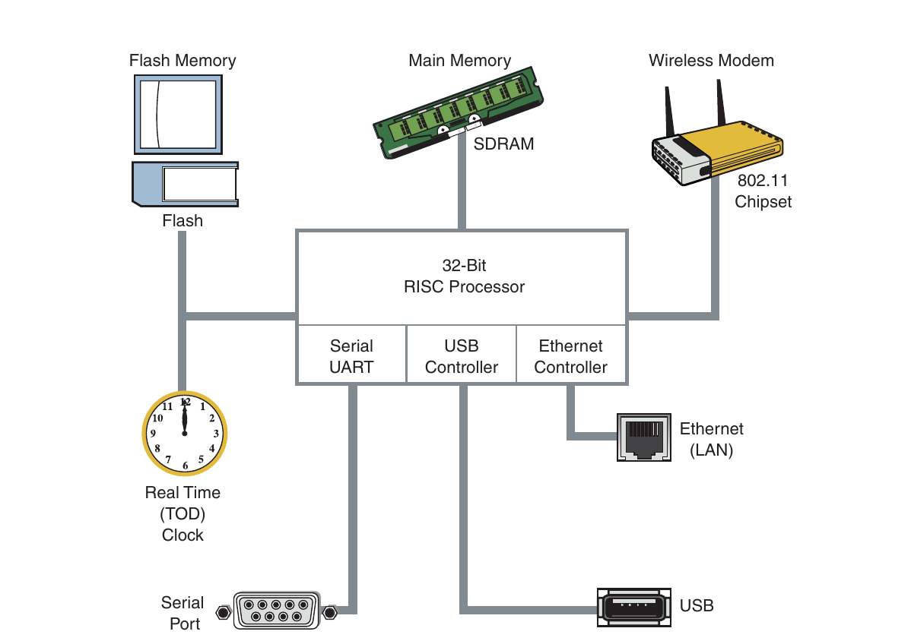
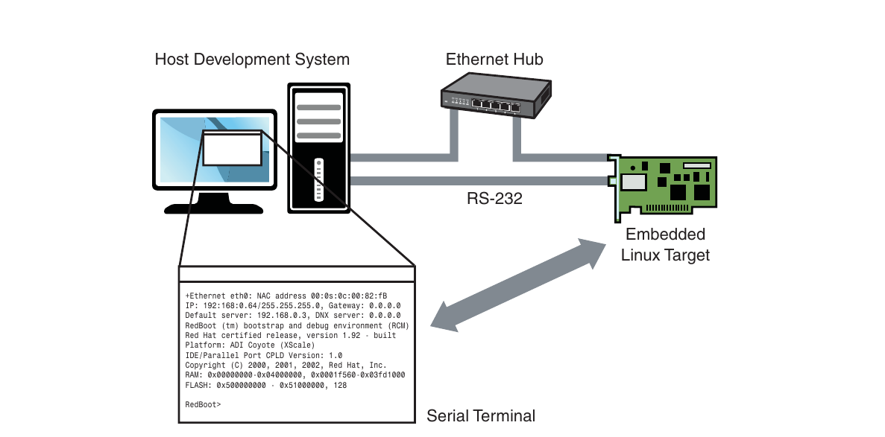
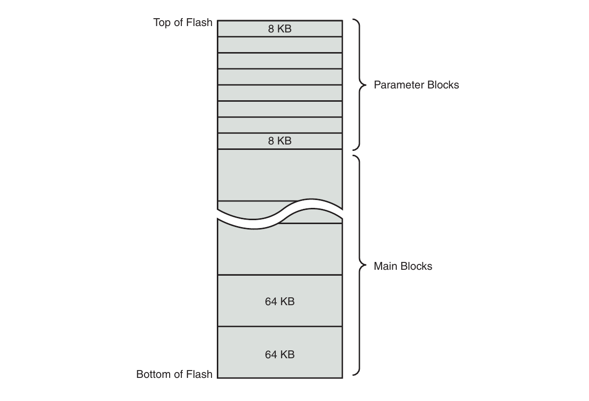
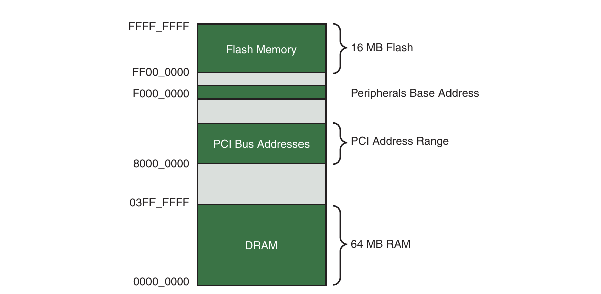
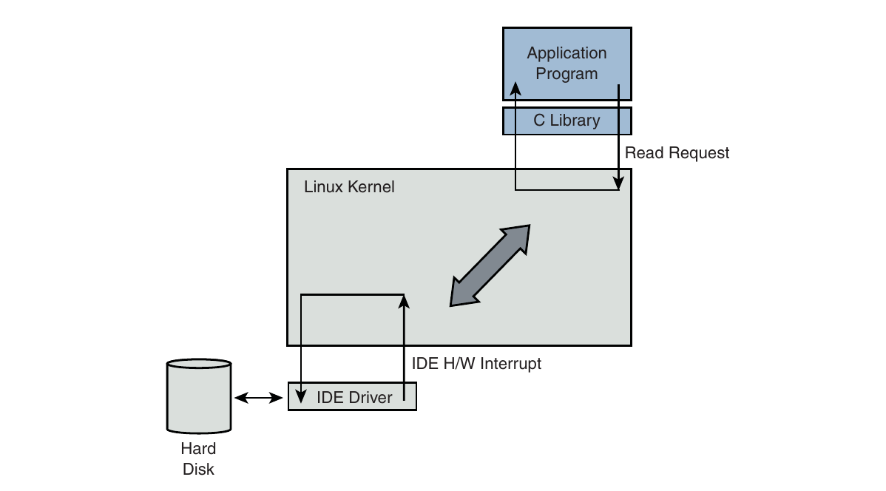

# Chương 2. Bức tranh tổng thể

## Trong chương này

- 2\.1 Embedded hay không? 10

- 2\.2 Cấu tạo Embedded System 12

- 2\.3 Cân nhắc về Storage 20

- 2\.4 Embedded Linux Distribution 32

- 2\.5 Tổng kết 34

Thông thường cách tốt nhất để hiểu một tác vụ là nắm vững

bức tranh tổng thể. Nhiều khái niệm nền tảng có thể gây khó khăn cho

người mới phát triển embedded system. Chương này đưa bạn

tham quan embedded system điển hình và development environment, đặc biệt

nhấn mạnh khái niệm và thành phần khiến việc phát triển các

hệ thống này khác biệt và thường nhiều thách thức.

## 2.1 Embedded hay không?

Embedded system gắn với một số thuộc tính chủ chốt. Bạn chưa chắc gọi desktop PC của mình là embedded system. Nhưng hãy xét desktop PC hardware platform trong remote data center thực hiện monitoring và alarm task quan trọng. Giả sử data center thường không có nhân viên. Điều này áp tập yêu cầu khác lên hardware platform. Ví dụ nếu mất rồi có điện lại, bạn kỳ vọng platform tiếp tục nhiệm vụ mà không cần operator can thiệp.

Embedded system có nhiều hình dạng và kích thước, từ hệ thống data storage hoặc networking multiple-rack lớn nhất đến module nhỏ như MP3 player hay cellular handset cá nhân. Sau đây là đặc điểm thường gặp:

- Chứa processing engine như microprocessor general-purpose.

- Thường thiết kế cho application hoặc mục đích cụ thể.

- Có user interface đơn giản (hoặc không có), như automotive engine ignition controller.

- Thường resource-limited. Ví dụ memory footprint nhỏ, không hard drive.

- Có thể hạn chế nguồn điện, như yêu cầu chạy bằng pin.

- Thường không dùng làm computing platform general-purpose.

- Thường application software tích hợp sẵn, không user-selected.

- Xuất xưởng với toàn bộ application hardware/software dự kiến đã tích hợp.

- Thường dành cho application không cần con người can thiệp.

Thông thường embedded system là resource-constrained so với desktop PC điển hình. Thường memory hạn chế, hard drive nhỏ hoặc không có, đôi khi không external network connectivity. Nhiều khi user interface duy nhất là serial port và vài LED. Những vấn đề này cùng vấn đề khác có thể thách thức embedded system developer.

### 2.1.1 BIOS và Bootloader

Khi desktop computer vừa cấp điện, software program tên BIOS lập tức điều khiển processor. (Trước đây BIOS viết tắt Basic Input/Output Software, nhưng có ý nghĩa riêng khi chức năng phức tạp hơn nhiều so với triển khai ban đầu.) BIOS có thể lưu trong Flash memory (sắp mô tả) để dễ field upgrade chính BIOS program.

BIOS là tập software routine system-configuration phức tạp, biết chi tiết low-level của hardware architecture. Phần lớn chúng ta không biết quy mô/chức năng BIOS, nhưng nó rất quan trọng cho desktop computer. BIOS giành quyền processor đầu tiên khi cấp điện. Trách nhiệm chính là khởi tạo hardware, đặc biệt memory subsystem, rồi load operating system từ hard drive PC.

Trong embedded system điển hình (giả sử không dựa trên x86 PC hardware platform industry-standard), bootloader là software program làm chức năng tương đương. Với custom embedded system, development plan phải gồm bootloader riêng cho board. May thay có nhiều bootloader mã nguồn mở tốt để tùy chỉnh cho dự án. Giới thiệu ở Chương 7, “Bootloader”.

Sau đây là tác vụ quan trọng bootloader làm khi power-up:

- Khởi tạo hardware component quan trọng như SDRAM controller, I/O controller và graphics controller.

- Khởi tạo system memory chuẩn bị giao quyền cho operating system.

- Cấp system resource như memory và interrupt circuit cho peripheral controller khi cần.

- Cung cấp cơ chế tìm và load operating system image.

- Load và giao quyền cho operating system cùng startup information cần thiết. Có thể gồm total memory size, clock rate, serial port speed và configuration data hardware-specific low-level khác.

Đây là tổng hợp đơn giản các tác vụ của bootloader embedded-system điển hình. Điểm quan trọng: nếu embedded system dựa trên platform custom-designed, chính bạn, system designer, phải cung cấp chức năng bootloader. Nếu dựa trên platform commercial off-the-shelf (COTS) như ATCA chassis,[^1] bootloader (và thường Linux kernel) thường có sẵn trên board. Chương 7 trình bày kỹ hơn.

## 2.2 Cấu tạo Embedded System

Hình 2-1 là block diagram embedded system điển hình. Ví dụ đơn giản về hardware architecture high-level trong wireless access point. Hệ thống xây quanh RISC processor 32-bit. Flash memory lưu program/data nonvolatile. Main memory là synchronous dynamic random-access memory (SDRAM), có thể từ vài đến hàng trăm megabyte tùy application. Module clock real-time, thường backup bằng pin, giữ giờ trong ngày (calendar/wall clock, gồm ngày). Ví dụ có Ethernet/USB interface cùng serial port truy cập console qua RS-232. Chipset/module 802.11 triển khai wireless modem.

Processor embedded system thường làm nhiều chức năng ngoài core instruction stream processing truyền thống. Processor giả định trong Hình 2-1 tích hợp UART cho serial interface, USB và Ethernet controller. Nhiều processor có integrated peripheral. Đôi khi gọi system on chip (SOC). Ta xem ví dụ integrated processor ở Chương 3, “Cơ bản về Processor”.



HÌNH 2-1 Embedded system

### 2.2.1 Thiết lập Embedded Linux điển hình

Câu đầu người mới embedded Linux thường hỏi là cần gì để bắt đầu phát triển? Để trả lời, Hình 2-2 cho thấy thiết lập phát triển điển hình.

Hình 2-2 là cách bố trí phổ biến. Host development system chạy desktop Linux distribution ưa thích như Red Hat, SUSE hoặc Ubuntu Linux. Embedded Linux target board nối development host qua serial cable RS-232. Cắm Ethernet interface target board vào local Ethernet hub/switch, development host cũng nối qua Ethernet. Development host chứa development tool/utility cùng target file, thường lấy từ embedded Linux distribution.



HÌNH 2-2 Thiết lập phát triển Embedded Linux

Trong ví dụ, kết nối chính tới embedded Linux target là RS-232. Serial terminal program dùng giao tiếp target board. Minicom là serial terminal application phổ biến nhất nhì, có trên gần như mọi desktop Linux distribution.[^2] Tác giả đã chuyển sang `screen` thay minicom. Linh hoạt hơn nhiều, nhất là capture trace, và chịu được serial line garbage thường gặp khi bringup hoặc troubleshooting tốt hơn. Để dùng `screen` với serial dongle USB-attached, chỉ gọi trên serial terminal và chỉ định speed:

```
$ screen /dev/ttyUSB0 115200
```

### 2.2.2 Khởi động Target Board

Khi vừa cấp điện, bootloader đi kèm target board lập tức điều khiển processor. Thực hiện hardware initialization rất low-level, gồm processor/memory setup, khởi tạo UART điều khiển serial port và Ethernet controller. Listing 2-1 hiển thị ký tự nhận từ serial port khi cấp điện target. Ví dụ chọn board Freescale Semiconductor, PowerQUICC III MPC8548 Configurable Development System (CDS). Chứa MPC8548 PowerQUICC III processor. Freescale xuất xưởng với bootloader U-Boot cài sẵn.

LISTING 2-1 Serial Output ban đầu của Bootloader

```
U-Boot 2009.01 (May 20 2009 - 09:45:35)

CPU:   8548E, Version: 2.1, (0x80390021)
Core:  E500, Version: 2.2, (0x80210022)
Clock Configuration:
       CPU:990  MHz, CCB:396  MHz,
       DDR:198  MHz (396 MT/s data rate), LBC:49.500 MHz
L1:    D-cache 32 kB enabled
       I-cache 32 kB enabled
Board: CDS Version 0x13, PCI Slot 1
CPU Board Revision 0.0 (0x0000)
I2C:   ready
DRAM:  Initializing
    SDRAM: 64 MB
    DDR: 256 MB
FLASH: 16 MB
L2:    512 KB enabled
Invalid ID (ff ff ff ff)
    PCI: 64 bit, unknown MHz, async, host, external-arbiter
               Scanning PCI bus 00
PCI on bus 00 - 02

    PCIE connected to slot as Root Complex (base address e000a000)
PCIE on bus 3 - 3
In:    serial
Out:   serial
Err:   serial
Net:   eTSEC0, eTSEC1, eTSEC2, eTSEC3
=>
```

Khi cấp điện board MPC8548CDS, U-Boot khởi tạo hardware low-level, gồm cấu hình serial port. Sau đó in banner như dòng đầu Listing 2-1. Tiếp theo hiển thị CPU/core, rồi configuration data mô tả clock và cache configuration. Sau đó là text string mô tả board.

Khi cấu hình hardware ban đầu xong, U-Boot cấu hình hardware subsystem theo static configuration. Ở đây thấy I2C, DRAM, FLASH, L2 cache, PCI và network subsystem được U-Boot cấu hình. Cuối cùng chờ input console qua serial port, như prompt `=>`.

### 2.2.3 Boot Kernel

Giờ U-Boot đã khởi tạo hardware, serial port và Ethernet network interface, chỉ còn một việc trong life span ngắn mà hữu ích: load và boot Linux kernel. Mọi bootloader có command load và thực thi operating system image. Listing 2-2 cho thấy cách phổ biến dùng U-Boot load/boot Linux kernel thủ công.

LISTING 2-2 Load Linux Kernel

```
=> tftp 600000 uImage
Speed: 1000, full duplex
Using eTSEC0 device
TFTP from server 192.168.0.103; our IP address is 192.168.0.18
Filename ‘uImage’.
Load address: 0x600000
Loading: #################################################################
         #############################################################
done
Bytes transferred = 1838553 (1c0dd9 hex)
=> tftp c00000 dtb
Speed: 1000, full duplex
Using eTSEC0 device
TFTP from server 192.168.0.103; our IP address is 192.168.0.18
Filename ‘dtb’.
Load address: 0xc00000
Loading: ##
done
Bytes transferred = 16384 (4000 hex)
=> bootm 600000 - c00000
## Booting kernel from Legacy Image at 00600000 ...
   Image Name:   MontaVista Linux 6/2.6.27/freesc
   Image Type:   PowerPC Linux Kernel Image (gzip compressed)
   Data Size:    1838489 Bytes =  1.8 MB
   Load Address: 00000000
   Entry Point:  00000000
   Verifying Checksum ... OK
## Flattened Device Tree blob at 00c00000
   Booting using the fdt blob at 0xc00000
   Uncompressing Kernel Image ... OK
   Loading Device Tree to 007f9000, end 007fffff ... OK
Using MPC85xx CDS machine description
Memory CAM mapping: CAM0=256Mb, CAM1=0Mb, CAM2=0Mb residual: 0Mb

...
< Lots of Linux kernel boot messages, removed for clarity >
...

freescale-8548cds login:  <<--- Linux login prompt
```

Lệnh `tftp` đầu Listing 2-2 bảo U-Boot load kernel image `uImage` vào memory qua mạng bằng protocol TFTP[^3]. Kernel image ở development workstation (thường machine nối serial port tới target board). Lệnh `tftp` nhận physical address trong target board memory nơi load kernel image. Chưa cần lo chi tiết; Chương 7 nói U-Boot kỹ hơn nhiều.

Lần gọi thứ hai lệnh `tftp` load board configuration file gọi device tree. Còn gọi flat device tree, device tree binary hay dtb. Bạn tìm hiểu thêm Chương 7. Hiện đủ biết file chứa thông tin board-specific kernel cần để boot board, như memory size, clock speed, onboard device, bus và Flash layout.

Tiếp theo lệnh `bootm` (boot from memory image) bảo U-Boot boot kernel vừa load từ địa chỉ lệnh `tftp` chỉ định. Ví dụ dùng `bootm`, yêu cầu U-Boot load kernel đặt tại `0x600000` và truyền device tree binary (dtb) tại `0xc00000` cho kernel. Lệnh chuyển quyền sang Linux kernel. Giả sử cấu hình đúng, Linux kernel boot tới console command prompt trên target board như login prompt thể hiện.

Lưu ý lệnh `bootm` báo kết thúc U-Boot. Khái niệm quan trọng. Khác BIOS desktop PC, phần lớn embedded system thiết kế sao cho Linux kernel tiếp quản thì bootloader không còn tồn tại. Kernel chiếm memory và system resource bootloader dùng trước đó. Chỉ có thể giao quyền lại bootloader bằng reboot board.

Một quan sát cuối đáng lưu ý. Mọi serial output Listing 2-2 đến và gồm dòng này do bootloader U-Boot tạo:

```
Loading Device Tree to 007f9000, end 007fffff ... OK
```

Boot message còn lại do Linux kernel tạo. Ta sẽ nói nhiều hơn sau, nhưng cần lưu ý nơi U-Boot dừng và Linux kernel image tiếp quản.

### 2.2.4 Tổng quan Kernel Initialization

Khi Linux kernel bắt đầu chạy, in nhiều status message trong boot process khá toàn diện. Ví dụ này hiển thị khoảng 200 dòng `printk`[^4] trước login prompt. (Đã bỏ khỏi listing để làm rõ điểm thảo luận.) Listing 2-3 tái hiện vài dòng cuối trước login prompt. Mục tiêu không đi sâu kernel initialization (Chương 5, “Kernel Initialization”), mà hiểu high-level điều đang xảy ra và component cần để boot Linux kernel trên embedded system.

LISTING 2-3 Boot Message cuối của Linux

```
...
Looking up port of RPC 100005/1 on 192.168.0.9
VFS: Mounted root (nfs filesystem).
Freeing unused kernel memory: 152k init
INIT: version 2.86 booting
...

freescale-8548cds login:
```

Ngay trước login prompt trên serial terminal, Linux mount root file system. Trong Listing 2-3, Linux thực hiện bước cần để mount root file system từ xa (qua Ethernet) từ server NFS[^5] trên machine IP 192.168.0.9. Thường là development workstation. Root file system chứa application program, system library và utility tạo Linux system.

Không được coi nhẹ điểm quan trọng: Linux cần file system. Nhiều embedded operating system cũ không cần. Điều này thường làm kỹ sư chuyển từ legacy embedded OS sang embedded Linux ngạc nhiên. File system gồm tập system directory/file định trước, theo layout cụ thể trên hard drive hoặc medium khác mà kernel mount làm root file system.

Lưu ý Linux mount được root file system từ device khác. Phổ biến nhất dĩ nhiên mount hard drive partition như Linux laptop/workstation. Thực tế NFS khá vô dụng khi xuất xưởng embedded Linux widget xa development environment. Nhưng qua sách bạn sẽ đánh giá sức mạnh và linh hoạt của NFS root mounting trong development environment.

### 2.2.5 User Space Process đầu tiên: init

Cần thêm điểm quan trọng trước tiếp tục. Chú ý dòng Listing 2-3:

```
INIT: version 2.86 booting
```

Đến đây kernel tự chạy code, làm nhiều initialization step trong context gọi kernel context. Trong state này kernel sở hữu mọi system memory, có toàn quyền system resource. Truy cập mọi physical memory và I/O subsystem. Chạy code trong kernel virtual address space, dùng stack kernel tự tạo và sở hữu.

Khi hoàn tất internal initialization và mount root file system, hành vi mặc định Linux kernel là spawn application program `init`. Khi kernel khởi động `init`, nói là chạy trong user space hay user space context. Trong mode này, user space process có truy cập hạn chế và phải dùng kernel system call yêu cầu kernel service như device/file I/O. Process hay program user space hoạt động trong virtual memory space chọn ngẫu nhiên[^6] và kernel quản lý. Kernel phối hợp hardware memory-management chuyên dụng trong processor, thực hiện chuyển đổi address virtual-to-physical cho user space process. Lợi ích lớn nhất là lỗi process này không phá memory space process khác. Đây là bẫy thường gặp trong legacy embedded OS, gây bug khó truy tìm nhất nhì.

Đừng lo nếu khái niệm xa lạ. Mục tiêu vẽ bức tranh rộng để xây kiến thức chi tiết khi đọc tiếp. Khái niệm này và khác trình bày kỹ ở chương sau.

## 2.3 Cân nhắc về Storage

Một thách thức lớn nhất phát triển embedded Linux là phần lớn embedded system hạn chế physical resource. Dù máy Core™ 2 Duo desktop có 500GB hard drive, embedded system có một phần nhỏ lượng đó không hiếm. Nhiều trường hợp thay hard drive bằng nonvolatile storage device nhỏ và rẻ hơn. Hard drive cồng kềnh, có bộ phận quay, nhạy physical shock, cần nhiều power supply voltage nên không hợp nhiều embedded system.

### 2.3.1 Flash Memory

Gần như ai cũng quen Compact Flash và SD card dùng trong nhiều consumer device như máy ảnh kỹ thuật số, PDA (đều là ví dụ embedded system tốt). Module dựa Flash memory có thể coi là hard drive solid-state, lưu nhiều megabyte, thậm chí gigabyte trong footprint nhỏ. Không bộ phận chuyển động, khá bền, chạy bằng một power supply voltage thông dụng.

Có nhiều nhà sản xuất Flash memory. Có nhiều electrical format, physical package và capacity. Không hiếm embedded system chỉ có 4MB/8MB nonvolatile storage. Nhu cầu thường hơn cho embedded Linux từ 16MB tới 256MB trở lên. Ngày càng nhiều hệ thống có nonvolatile storage mức gigabyte.

Flash memory ghi/xóa được dưới software control. Rotational hard drive vẫn là writable medium nhanh nhất. Flash write/erase speed cải thiện đáng kể theo thời gian nhưng vẫn chậm hơn nhiều. Phải hiểu khác biệt cơ bản giữa hard drive và Flash memory để dùng đúng.

Flash memory chia đơn vị xóa tương đối lớn gọi erase block. Đặc điểm quyết định là cách ghi/xóa dữ liệu. Trong chip NOR[^7] Flash điển hình, dữ liệu đổi từ binary 1 sang binary 0 dưới software control bằng data write đơn giản trực tiếp tới cell address, mỗi lần một bit hoặc word. Nhưng đổi bit từ 0 về 1 phải xóa toàn erase block bằng chuỗi control instruction đặc biệt tới Flash chip.

NOR Flash device điển hình có nhiều erase block. Ví dụ chip 4MB có 64 block, mỗi block 64KB. Cũng có Flash với erase block size không đều để linh hoạt data-storage layout, thường gọi boot block hoặc boot sector Flash chip. Bootloader thường lưu block nhỏ, kernel và dữ liệu cần khác trong block lớn. Hình 2-3 minh họa block size layout cho top boot Flash điển hình.



HÌNH 2-3 Boot block Flash architecture

Để sửa dữ liệu trong Flash memory array, block chứa dữ liệu sửa phải xóa toàn bộ. Dù chỉ đổi 1 byte, vẫn phải xóa và ghi lại toàn block.[^8] Flash block size khá lớn so với hard-drive sector truyền thống. So sánh hard drive high-performance điển hình có writable sector 512/1024 byte. Hệ quả rõ ràng: thời gian cập nhật Flash có thể gấp nhiều lần hard drive, một phần vì phải xóa/ghi lại lượng dữ liệu tương đối lớn cho mỗi update. Tệ nhất write cycle mất vài giây.

Giới hạn khác cần tính là write lifetime của Flash memory cell. NOR Flash cell có số write cycle hữu hạn trước khi hỏng. Dù khá lớn (thường 100.000 cycle mỗi block), dễ hình dung Flash storage algorithm thiết kế tệ (hoặc bug) nhanh chóng phá device. Dĩ nhiên tránh cấu hình system logger xuất ra device Flash-based.

### 2.3.2 NAND Flash

NAND Flash là Flash technology tương đối mới. Khi xuất hiện, Flash truyền thống như phần trước được gọi NOR Flash. Phân biệt liên quan internal memory cell architecture. NAND cải thiện hạn chế NOR bằng block nhỏ hơn, ghi nhanh/hiệu quả hơn và thường dùng Flash array hiệu quả hơn.

NOR Flash interface với microprocessor tương tự peripheral khác: parallel data/address bus nối trực tiếp[^9] microprocessor data/address bus. Mỗi byte/word trong array định địa chỉ riêng ngẫu nhiên được. Ngược lại NAND truy cập tuần tự qua complex interface khác theo vendor. Operational model giống hard drive truyền thống và controller hơn. Dữ liệu truy cập theo serial burst nhỏ hơn NOR block nhiều. Write cycle lifetime NAND lớn hơn NOR một bậc độ lớn, dù erase time nhỏ hơn đáng kể.

Tóm lại microprocessor truy cập trực tiếp NOR Flash, thậm chí chạy code trực tiếp từ đó. (Tuy nhiên hiếm vì hiệu năng, chỉ trên hệ thống resource cực ít.) Thực tế nhiều processor không cache instruction access Flash như DRAM, giảm thêm execution speed. Ngược lại NAND phù hợp bulk storage dạng file system hơn raw binary executable code/data storage.

### 2.3.3 Sử dụng Flash

Embedded system designer có nhiều lựa chọn bố trí/dùng Flash memory. Trong hệ thống đơn giản nhất, resource không quá hạn chế, có thể lưu raw binary data (có thể nén) trên Flash. Khi boot, file system image trong Flash đọc vào Linux ramdisk block device, mount làm file system, chỉ truy cập từ RAM. Thường là lựa chọn tốt khi dữ liệu Flash hiếm update. Dữ liệu cần update tương đối nhỏ so với ramdisk. Phải hiểu mọi sửa đổi file trong ramdisk mất khi reboot hoặc power cycle.

Hình 2-4 minh họa tổ chức Flash phổ biến cho embedded system đơn giản với nhu cầu nonvolatile storage cho dynamic data ít và không thường xuyên.


HÌNH 2-4 Flash memory layout điển hình

Bootloader thường đặt đầu hoặc cuối Flash memory array. Sau bootloader cấp chỗ Linux kernel image và ramdisk file system image[^10] chứa root file system. Thường cả hai image được nén, bootloader xử lý giải nén trong boot cycle.

Với dynamic data cần giữ qua reboot/power cycle, có thể dành vùng Flash nhỏ khác hoặc dùng nonvolatile storage type khác.[^11] Cấu hình điển hình cho embedded system cần lưu configuration data, ví dụ wireless access point thị trường consumer.

### 2.3.4 Flash File System

Giới hạn Flash layout đơn giản trên khắc phục được bằng Flash file system quản lý dữ liệu tương tự hard drive. Triển khai sớm gồm block device layer đơn giản mô phỏng sector layout 512-byte của hard drive thông dụng. Emulation layer cho truy cập file format thay unformatted bulk storage nhưng hạn chế hiệu năng.

Cải tiến đầu tiên của Flash file system là tích hợp wear leveling. Như đã nói Flash block có write lifetime hữu hạn. Algorithm Wear-leveling phân phối write đều trên physical erase block để kéo dài tuổi thọ chip.

Giới hạn khác do Flash architecture là nguy cơ mất dữ liệu khi mất điện/shutdown sớm. Flash block khá lớn, file size trung bình ghi thường nhỏ hơn nhiều. Đã biết phải ghi Flash từng block. Vì vậy ghi file nhỏ 8KB phải xóa/ghi toàn block có thể 64KB/128KB; tệ nhất mất vài giây. Tạo khoảng thời gian rủi ro mất dữ liệu đáng kể do mất điện.

Flash file system phổ biến hiện nay là JFFS2, Journaling Flash File System 2. Có feature quan trọng cải thiện overall performance, tăng Flash lifetime, giảm mất dữ liệu khi mất điện. Cải tiến đáng kể trong JFFS2 mới nhất gồm wear leveling tốt hơn, compression/decompression nhét nhiều dữ liệu vào cùng size Flash, hỗ trợ Linux hard link. Trình bày kỹ Chương 9 và Chương 10, “MTD Subsystem”, khi nói Memory Technology Device (MTD) subsystem.

### 2.3.5 Memory Space

Gần như mọi legacy embedded operating system xem/quản lý system memory như một flat address space lớn. Tức microprocessor address space từ 0 đến đầu trên physical address range. Ví dụ microprocessor có 24 physical address line, top memory là 16MB. Hex address từ `0x00000000` tới `0x00ffffff`. Hardware design thường đặt DRAM từ dưới, Flash từ trên xuống. Address range chưa dùng giữa top DRAM và bottom Flash cấp cho peripheral chip trên board. Cách thiết kế thường do microprocessor được chọn quyết định. Hình 2-5 cho memory layout điển hình embedded system đơn giản.



HÌNH 2-5 Memory map embedded system điển hình

Trong embedded system truyền thống dựa legacy OS, OS và mọi task[^12] có quyền truy cập bằng nhau tới mọi resource. Bug trong process có thể xóa memory content bất cứ đâu, thuộc nó, OS, task khác hay hardware register trong address space. Dù đơn giản là ưu điểm lớn nhất, dẫn tới bug khó chẩn đoán.

Microprocessor High-performance chứa hardware engine phức tạp gọi Memory Management Unit (MMU). Mục đích cho OS mức quản lý/điều khiển cao với address space của nó và address space cấp process. Hai dạng chính: access right và memory translation. Access right cho OS gán privilege memory-access cụ thể tới task cụ thể. Memory translation cho OS virtualize address space, mang nhiều lợi ích.

Linux kernel tận dụng hardware MMU tạo virtual memory operating system. Lợi ích lớn là dùng physical memory hiệu quả hơn, tạo cảm giác hệ thống có nhiều memory hơn thực có. Lợi ích khác là kernel áp access right từng system memory range cấp task/process, ngăn process truy cập sai memory/resource thuộc process khác hoặc kernel.

Phần tiếp theo xem kỹ cách hoạt động. Hướng dẫn độ phức tạp virtual memory system ngoài phạm vi sách.[^13] Thay vào đó xem hệ quả đối với embedded system developer.

### 2.3.6 Execution Context

Một việc đầu Linux làm là cấu hình hardware MMU processor cùng data structure hỗ trợ, bật address translation. Xong bước này kernel chạy trong virtual memory space riêng. Virtual kernel address developer chọn trong Linux kernel version gần đây mặc định `0xC0000000`. Phần lớn architecture cấu hình được.[^14] Xem kernel symbol table sẽ thấy symbol link tại address bắt đầu `0xC0xxxxxx`. Vì vậy bất cứ khi kernel chạy code trong kernel space, instruction pointer (program counter) chứa giá trị trong range này.

Trong Linux có hai operational context tách biệt theo môi trường thread[^15] đang chạy. Thread hoàn toàn trong kernel gọi hoạt động kernel context. Application program trong user space context. User space process chỉ truy cập memory sở hữu, phải dùng kernel system call để truy cập privileged resource như file/device I/O. Ví dụ có thể làm rõ.

Xét application mở file và read request như Hình 2-6. Read function call bắt đầu trong user space, tại function `read()` của C library. C library gửi read request tới kernel, dẫn context switch từ user program vào kernel để phục vụ yêu cầu file data. Trong kernel, read request dẫn truy cập hard-drive yêu cầu sector chứa file data.



HÌNH 2-6 File read request đơn giản

Thường read request hard-drive gửi bất đồng bộ tới hardware. Tức request post tới hardware, khi dữ liệu sẵn sàng hardware interrupt processor. Application chờ bị block trên wait queue đến khi có dữ liệu. Sau đó hard disk sẵn sàng thì post hardware interrupt. (Mô tả cố ý đơn giản cho minh họa.) Kernel nhận interrupt thì suspend process đang chạy và đọc dữ liệu chờ từ drive.

Tổng hợp lại có hai execution context chung: user space và kernel space. Khi application chạy system call gây context switch vào kernel, đang chạy kernel code thay mặt process. Thường gọi process context trong kernel. Ngược lại interrupt service routine (ISR) xử lý IDE drive (hay ISR khác) là kernel code không chạy thay mặt process cụ thể. Thường gọi interrupt context.

Có giới hạn trong context này, gồm ISR không được block (sleep) hoặc gọi kernel function có thể block. Đọc thêm tham khảo cuối chương.

### 2.3.7 Process Virtual Memory

Khi spawn process—ví dụ user gõ `ls` tại Linux command prompt—kernel cấp memory và gán dải address virtual-memory. Giá trị address không có quan hệ cố định với kernel hay process khác. Hơn nữa không có tương quan trực tiếp giữa physical memory address trên board và virtual memory process thấy. Thực tế process chiếm nhiều physical address khác nhau trong main memory suốt lifetime do paging/swapping không hiếm.

Listing 2-4 là “Hello World” quen thuộc, sửa để minh họa khái niệm trên. Mục tiêu thể hiện address space kernel gán process. Code compile/chạy trên embedded system có DRAM 256MB.

LISTING 2-4 Hello World, kiểu Embedded

```
#include <stdio.h>

int bss_var;        /* Uninitialized global variable */

int data_var = 1;   /* Initialized global variable */

int main(int argc, char **argv)
{
  void *stack_var;            /* Local variable on the stack */

  stack_var = (void *)main;   /* Don’t let the compiler */
                              /* optimize it out */

  printf(“Hello, World! Main is executing at %p\n”, stack_var);
  printf(“This address (%p) is in our stack frame\n”, &stack_var);

  /* bss section contains uninitialized data */
  printf(“This address (%p) is in our bss section\n”, &bss_var);

  /* data section contains initializated data */
  printf(“This address (%p) is in our data section\n”, &data_var);

  return 0;
}
```

Listing 2-5 là console output chương trình. Chú ý process `hello` tưởng chạy ở high RAM ngay trên boundary 256MB (`0x10000418`). Stack address cũng khoảng giữa address space 32-bit, vượt xa RAM 256MB (`0x7ff8ebb0`). Sao có thể? DRAM thường liên tục trong hệ thống này. Nhìn qua tưởng có gần 2GB DRAM dùng được. Virtual address do kernel gán, được physical RAM hỗ trợ đâu đó trong 256MB memory khả dụng trên board.

LISTING 2-5 Output của Hello

```
root@192.168.4.9:~# ./hello
Hello, World! Main is executing at 0x10000418
This address (0x7ff8ebb0) is in our stack frame
This address (0x10010a1c) is in our bss section
This address (0x10010a18) is in our data section
root@192.168.4.9:~#
```

Đặc điểm virtual memory system là khi physical RAM khả dụng dưới threshold chỉ định, kernel swap out memory page ra bulk storage medium, thường hard disk nếu có. Kernel xem active memory region, xác định vùng ít dùng gần đây nhất, swap out ra disk để giải phóng cho current process. Embedded system developer thường tắt swapping vì performance/resource constraint. Ví dụ phần lớn trường hợp dùng Flash device tương đối chậm, write lifetime hạn chế làm swap device là vô lý. Không swap device, phải thiết kế application cẩn thận trong giới hạn physical memory khả dụng.

### 2.3.8 Môi trường Cross-Development

Trước phát triển application/device driver cho embedded system, cần tool (compiler, utility, v.v.) sinh binary executable format đúng cho target. Xét application đơn giản viết trên desktop PC như “Hello World”. Sau tạo source code, gọi compiler đi kèm desktop (thường GNU `gcc`) sinh binary executable image. Image format đúng để chạy trên chính machine compile. Gọi native compilation. Tức compiler trên desktop sinh code chạy trên desktop đó.

Lưu ý native không hàm ý architecture. Nếu có toolchain chạy trên target board, có thể native compile application cho architecture target. Thực tế cách stress-test embedded kernel mới và custom board tốt là compile Linux kernel lặp lại trên đó.

Phát triển software trong môi trường cross-development yêu cầu compiler trên development host xuất binary executable không tương thích desktop development workstation dùng compile. Lý do chính có tool này là thường không thực tế hoặc không thể phát triển/compile natively trên embedded system vì resource constraint (thường memory và CPU horsepower).

Nhiều bẫy ẩn dễ bắt người mới bất cẩn. Khi compile program, compiler thường biết tìm include file và library cần để thành công. Minh họa bằng “Hello World” lần nữa. Ví dụ Listing 2-4 compile với command line:

```
gcc -Wall -o hello hello.c
```

Listing 2-4 có include file `stdio.h`. Không nằm cùng directory với file `hello.c` trên command line `gcc`. Compiler tìm thế nào? Function `printf()` cũng không định nghĩa trong `hello.c`. Vì vậy khi compile `hello.c` sẽ có unresolved reference cho symbol này. Linker resolve reference tại link time thế nào?

Compiler có default built-in tìm include file. Khi gặp reference include file, tìm default location list. Linker có quá trình tương tự resolve external symbol `printf()`. Mặc định biết tìm C library (`libc-*`) cho unresolved reference, biết nơi tìm reference trên hệ thống. Hành vi mặc định cũng built vào toolchain.

Giả sử build application target Power Architecture embedded system. Cần cross-compiler sinh binary executable tương thích processor. Nếu dùng cross-compiler với command tương tự compile `hello.c` trên, binary có thể vô tình link với C library x86 trên development system để resolve `printf()`. Dĩ nhiên chạy hybrid executable sai, trộn binary instruction Power Architecture/x86,[^16] kết quả đoán được: crash!

Giải pháp là bảo cross-compiler tìm ở nonstandard location để lấy header file và target specific library. Chương 12 nói kỹ hơn. Ví dụ nhằm minh họa khác biệt native development environment và environment cross-compilation cho embedded system. Chỉ là một phức tạp của cross-development. Vấn đề/giải pháp tương tự áp cross-debugging như từ Chương 14, “Kỹ thuật Kernel Debugging”. Môi trường cross-development đúng rất quan trọng và hơn nhiều so với compiler, như Chương 12 sẽ thấy.

## 2.4 Embedded Linux Distribution

Linux distribution chính xác là gì? Sau Linux kernel boot, kỳ vọng tìm/mount root file system. Khi mount phù hợp, startup script khởi chạy program/utility hệ thống cần. Program thường gọi program khác làm tác vụ cụ thể như spawn login shell, khởi tạo network interface, chạy application user. Mỗi program có yêu cầu riêng (dependency) cần component khác đáp ứng. Phần lớn Linux application phụ thuộc một hoặc nhiều system library. Program khác cần configuration/log file, v.v. Tóm lại ngay embedded Linux system nhỏ cần hàng chục file trong directory structure phù hợp trên root file system.

Desktop system Full-blown có hàng nghìn file trên root file system. Từ package thường nhóm theo chức năng. Package thường cài/quản lý bằng package manager. Red Hat’s Package Manager (`rpm`) là ví dụ phổ biến dùng rộng cài, xóa, update package Linux. Nếu workstation dựa Red Hat gồm Fedora, gõ `rpm -qa` liệt kê mọi package cài. Nếu distribution Debian như Ubuntu, `dpkg -l` cùng kết quả.

Package có nhiều file; một số hàng trăm file. Linux distribution hoàn chỉnh có hàng trăm/nghìn package. Ví dụ package trong embedded Linux distribution và mục đích:

- `initscripts` chứa basic system startup/shutdown script.

- `apache` triển khai Apache web server phổ biến.

- `telnet-server` chứa file cần cho telnet server, cho phép thiết lập telnet session tới embedded target.

- `glibc` triển khai Standard C library.

- `busybox` chứa version gọn của hàng chục command-line utility phổ biến trên UNIX/Linux.[^17]

Đó là mục đích Linux distribution theo cách thuật ngữ được dùng. Distribution điển hình kèm nhiều CD-ROMs đầy program, library, tool, utility, tài liệu hữu ích. Cài đặt thường cho user hệ thống đầy đủ chức năng dựa default configuration option hợp lý, tùy chỉnh theo yêu cầu cụ thể. Có thể bạn quen desktop Linux distribution phổ biến như Red Hat/Ubuntu.

Linux distribution cho embedded target khác đáng kể vài điểm. Đầu tiên executable target binary không chạy trên PC mà target architecture/processor embedded system. (Dĩ nhiên nếu target x86 thì chưa chắc đúng.) Desktop distribution thường nhiều GUI tool cho user như graphical clock đẹp, calculator, tool time-management cá nhân, client e-mail, v.v. Embedded distribution thường bỏ để thay bằng tool chuyên cho developer như memory analysis, remote debug facility và nhiều thứ khác.

Khác biệt đáng kể khác là embedded distribution thường chứa cross tool thay native tool. Ví dụ toolchain `gcc` đi kèm chạy trên desktop PC x86 nhưng sinh binary code chạy target system, thường architecture non-x86. Tool khác cũng cấu hình tương tự: chạy development host (thường PC x86), nhưng sinh/thao tác object target architecture khác như ARM/Power Architecture.

### 2.4.1 Linux Distribution thương mại

Có nhiều vendor embedded Linux distribution thương mại. Vendor hàng đầu đã xuất distribution nhiều năm. Dễ tìm thông tin về họ. Tìm Internet nhanh “embedded Linux distributions” cho nhiều danh sách. Một danh sách đặc biệt tốt tại http://elinux.org/Embedded\_Linux\_Distributions.

### 2.4.2 Linux Distribution Do-It-Yourself

Có thể tự ghép mọi component cần cho dự án embedded. Phải quyết định rủi ro có đáng công. Nếu chỉ vì vui như hobby hoặc college project, có thể tốt. Nhưng dự kiến dành nhiều thời gian ghép tool/utility dự án cần và bảo đảm tương tác được.

Đầu tiên cần toolchain. `gcc` và `binutils` tại www.fsf.org và mirror toàn cầu, đều cần compile kernel/userspace application. Chủ yếu phân phối source code, phải compile tool phù hợp môi trường cross-development. Thường cần patch source tree “stable” mới nhất, đặc biệt dùng ngoài x86/IA32. Patch thường cùng chỗ base package. Thách thức tìm tập patch cần cho vấn đề/architecture của bạn.

Khi toolchain hoạt động, cần tải/compile nhiều application package cùng dependency. Thách thức đáng kể vì nhiều package đến nay không dễ cross-compiling. Nhiều cái còn build issue hoặc vấn đề khác khi rời native x86 environment nơi phát triển.

Ngoài ra có thể muốn ghép development environment tốt gồm graphical debugger, memory analysis tool, system tracing/profiling tool, v.v. Qua đây thấy tự build embedded Linux distribution khá khó.

## 2.5 Tổng kết

Chương bao quát nhiều chủ đề. Giờ bạn có góc nhìn phù hợp cho nội dung tiếp theo. Các chương sau mở rộng, giúp xây kỹ năng/kiến thức cần để thành công dự án embedded kế tiếp.

- Embedded system chung vài thuộc tính. Thường resource hạn chế, user interface đơn giản/không có và thường thiết kế mục đích cụ thể.

- Bootloader là component quan trọng. Nếu embedded system dựa board custom-designed phải cung cấp bootloader trong thiết kế. Thường chỉ port bootloader hiện có.

- Cần nhiều software component để boot custom board, gồm bootloader, kernel và file system image.

- Flash memory dùng rộng làm storage medium embedded Linux. Chương giới thiệu khái niệm, Chương 9/10 mở rộng.

- Application program, còn gọi process, sống trong virtual memory space riêng kernel gán. Nói application chạy trong user space.

- Môi trường cross-development environment trang bị/cấu hình đúng rất quan trọng với embedded developer. Chương 12 dành riêng chủ đề này.

- Cần embedded Linux distribution để bắt đầu phát triển target. Chứa nhiều component compile/tối ưu cho architecture chọn.

### 2.5.1 Gợi ý đọc thêm

Linux Kernel Development, 3rd Edition Robert Love Addison-Wesley, 2010

Understanding the Linux Kernel Daniel P. Bovet and Marco Cesati O’Reilly \& Associates, Inc., 2002

Understanding the Linux Virtual Memory Manager Bruce Perens Prentice Hall, 2004 Trang này cố ý để trống

[^1]: ATCA platform giới thiệu Chương 3.

[^2]: Có thể phải cài minicom từ distribution repository. Ví dụ Ubuntu chạy `sudo` `apt-get install minicom` để cài trên desktop.

[^3]: Server này và server khác bạn dùng trình bày kỹ trong Chương 12, “Embedded Development Environment”.

[^4]: `printk()` là function kernel chịu trách nhiệm hiển thị message lên system console.

[^5]: NFS và server cần khác trình bày Chương 12.

[^6]: Không thật ngẫu nhiên nhưng với mục đích thảo luận có thể coi vậy. Sẽ nói kỹ sau.

[^7]: Có vài Flash technology. NOR Flash phổ biến nhất nhì trong embedded system nhỏ.

[^8]: Nhớ có thể đổi 1 thành 0 mỗi lần một byte, nhưng phải xóa toàn block để đổi bit bất kỳ từ 0 thành 1.

[^9]: Trực tiếp theo nghĩa logic. Mạch thực có thể có bus buffer hoặc bridge device, v.v.

[^10]: Ramdisk file system nói kỹ ở Chương 9, “File System”.

[^11]: Module clock Real-time và serial EEPROM thường chọn làm nonvolatile storage cho ít dữ liệu.

[^12]: Trong phần này task chỉ thread execution bất kỳ, không phụ thuộc cơ chế spawn, manage hay schedule.

[^13]: Nhiều sách tốt trình bày chi tiết virtual memory system. Xem phần cuối chương để gợi ý.

[^14]: Tuy nhiên hiếm lý do tốt để đổi.

[^15]: Thuật ngữ thread dùng nghĩa chung chỉ sequential flow of instruction bất kỳ.

[^16]: Thực tế còn không compile/link được, nói gì chạy. Chỉ cố minh họa!

[^17]: Package quan trọng đủ có chương riêng. Chương 11, “BusyBox”, trình bày chi tiết.
