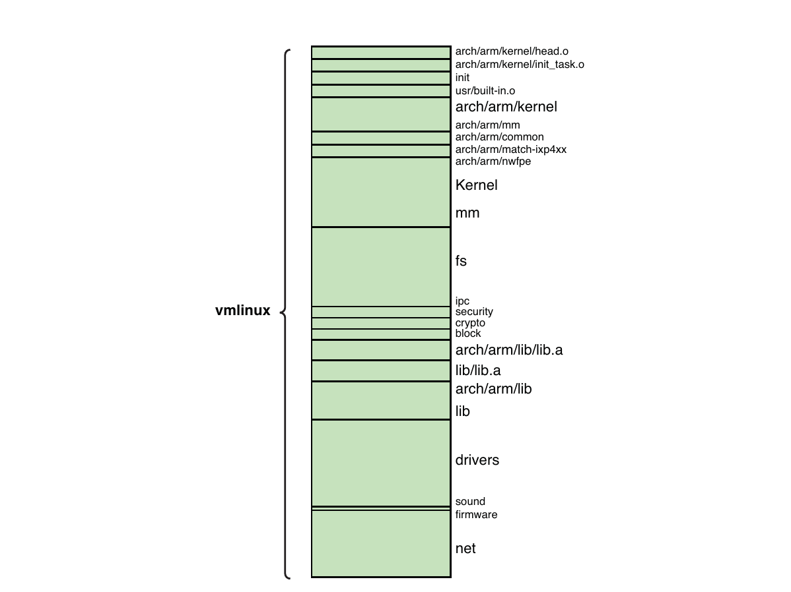
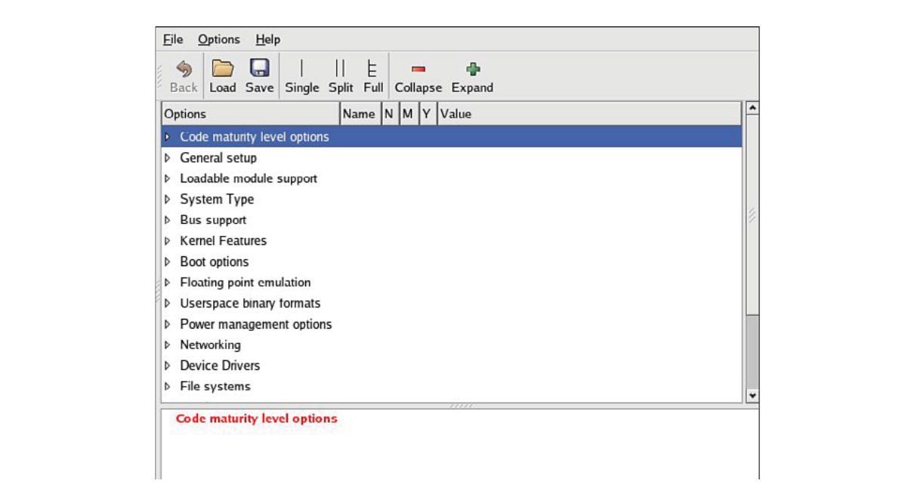
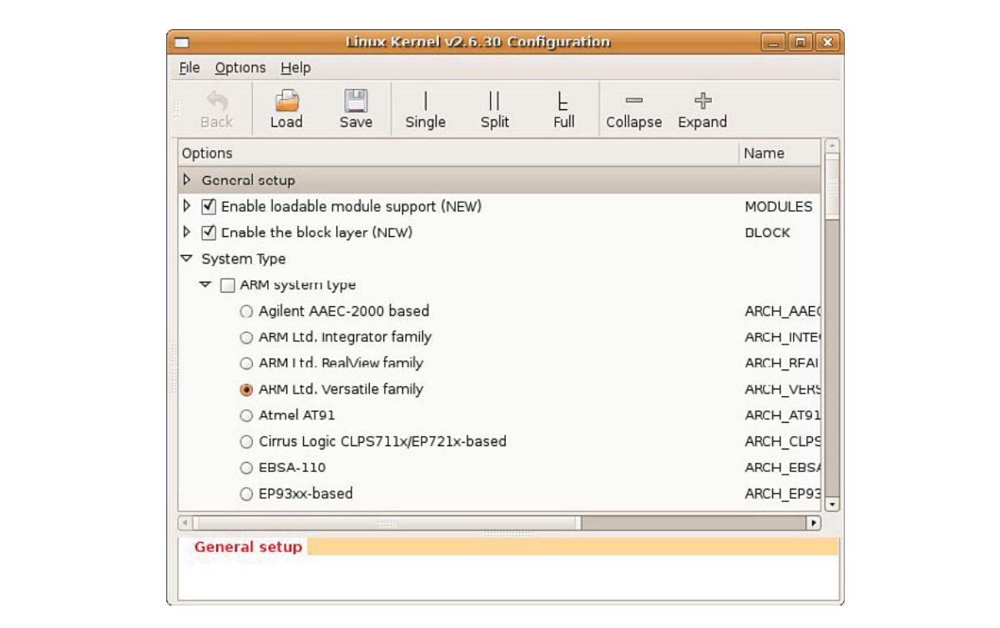
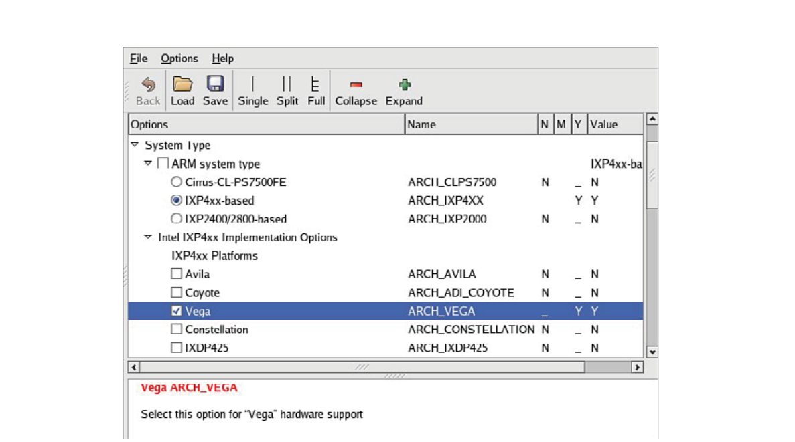

# Chương 4. Linux Kernel: Góc nhìn khác

## Trong chương này

- 4\.1 Bối cảnh 64

- 4\.2 Cấu tạo Linux Kernel 68

- 4\.3 Kernel Build System 78

- 4\.4 Kernel Configuration 89

- 4\.5 Kernel Documentation 96

- 4\.6 Lấy Custom Linux Kernel 96

- 4\.7 Tổng kết 97

Nếu muốn tìm hiểu kernel internals, có nhiều sách tốt về kernel design

và hoạt động. Một số được giới thiệu ở phần cuối chương này

cũng như chương khác. Tuy nhiên rất ít tài liệu nói cách

tổ chức và cấu trúc kernel từ góc nhìn dự án. Nếu bạn đang

tìm đúng nơi thêm custom support cho dự án embedded mới

thì sao? Làm thế nào biết file nào quan trọng với architecture của mình?

Thoạt nhìn có vẻ gần như bất khả thi để hiểu Linux

kernel và cách cấu hình cho platform hoặc application cụ thể. Trong một

Linux kernel snapshot gần đây, kernel source tree gồm hơn

28.000[^1] file chứa khoảng 10 đến 11 triệu[^2] dòng code,

tùy cách đếm dòng code thực tế.[^3] Đó mới chỉ là bắt đầu.

Bạn còn cần tool (rõ nhất là compiler) và root file system

chứa nhiều Linux application để dựng hệ thống dùng được.

Chương giới thiệu Linux kernel, trình bày cách tổ chức kernel và

cấu trúc source tree. Sau đó xem thành phần tạo

kernel image và bàn kernel source tree layout. Tiếp theo,

trình bày chi tiết kernel build system và file điều khiển kernel

configuration/build system. Cuối chương xem các yêu

cầu cho embedded Linux system hoàn chỉnh.

## 4.1 Bối cảnh

Linus Torvalds viết version Linux đầu tiên khi còn là sinh viên University of Helsinki ở Phần Lan. Công việc bắt đầu năm 1991. Tháng 8 năm đó, Torvalds đăng thông báo nay đã now-famous trên `comp.os.minix`:

```
From: torvalds@klaava.Helsinki.FI (Linus Benedict Torvalds)
Newsgroups: comp.os.minix
Subject: What would you like to see most in minix?
Summary: small poll for my new operating system
Message-ID: <1991Aug25.205708.9541@klaava.Helsinki.FI>
Date: 25 Aug 91 20:57:08 GMT
Organization: University of Helsinki


Hello everybody out there using minix -

I’m doing a (free) operating system (just a hobby, won’t be big and profession-
al like gnu) for 386(486) AT clones.  This has been brewing since april, and is
starting to get ready.  I’d like any feedback on things people like/dislike in
minix, as my OS resembles it somewhat(same physical layout of the file-system (due
to practical reasons) among other things).

I’ve currently ported bash(1.08) and gcc(1.40), and things seem to work. This im-
plies that I’ll get something practical within a few months, and I’d like to know
what features most people would want.  Any suggestions are welcome, but I won’t
promise I’ll implement them :-)

              Linus (torvalds@kruuna.helsinki.fi)

PS.  Yes - it’s free of any minix code, and it has a multi-threaded fs.
It is NOT protable (uses 386 task switching etc), and it probably never
will support anything other than AT-harddisks, as that’s all I have :-(.
```

Kể từ lần phát hành đầu tiên đó, Linux đã trưởng thành thành một operating system full-featured, có tính vững chắc, độ tin cậy và các tính năng high-end sánh ngang những operating system thương mại tốt nhất. Theo một số ước tính, hơn một nửa số Internet server trên Web sử dụng Linux server. Việc gã khổng lồ tìm kiếm trực tuyến Google dùng một tập hợp lớn các PC low-cost chạy phiên bản Linux fault-tolerant để triển khai search engine phổ biến của mình không phải điều bí mật.

### 4.1.1 Kernel Version

Bạn có thể lấy source code của Linux kernel và các thành phần bổ sung từ nhiều nơi. Hiệu sách địa phương có thể có một số phiên bản trên các CD-ROMs đi kèm sách về Linux. Bạn cũng có thể download chính kernel hoặc thậm chí toàn bộ Linux distribution từ nhiều địa chỉ trên Internet. Trang chủ chính thức của Linux kernel là iswww.kernel.org. Bạn sẽ thường nghe các thuật ngữ mainline source hoặc mainline kernel, chỉ những source tree có tại kernel.org.

Trong một thời gian khá dài, Linux phiên bản 2.6 là phiên bản hiện hành. Ngay từ đầu chu kỳ phát triển, các nhà phát triển đã chọn một hệ thống đánh số để phân biệt các kernel source tree dành cho phát triển và thử nghiệm với các source tree dành cho kernel ổn định, production-ready. Sơ đồ đánh số gồm major version number, minor version number và sequence number. Trước Linux phiên bản 2.6, minor version number chẵn biểu thị production kernel, còn số lẻ biểu thị development kernel. Ví dụ:

- Linux 2.4.x—Production kernel

- Linux 2.5.x—Thử nghiệm (phát triển)

- Linux 2.6.x—Production kernel

Hiện kernel Linux 2.6 không có development branch riêng. Mọi feature mới, enhancement và bug fix đi qua một loạt gatekeeper, cuối cùng lọc/đẩy thay đổi lên Linux source tree top-level do Andrew Morton và Linus Torvalds duy trì.

Có thể dễ dàng xác định kernel version mà bạn đang làm việc. Một vài dòng đầu của makefile top-level[^4] trong kernel source tree nêu chi tiết kernel version chính xác của tree đó. Với kernel release 2.6.30, nội dung như sau:

```
VERSION = 2
PATCHLEVEL = 6
SUBLEVEL = 30
EXTRAVERSION =
NAME=Man-Eating Seals of Antiquity
```

Sau đó trong cùng makefile, các macro tạo macro version-level như:

```
KERNELVERSION=$(VERSION).$(PATCHLEVEL).$(SUBLEVEL)$(EXTRAVERSION)
```

Macro này được sử dụng ở một số vị trí trong kernel build system để chỉ kernel version. Trong các kernel gần đây hơn, việc sử dụng nó đã giảm xuống chỉ còn vài vị trí trong thư mục scripts. Nó được thay thế bằng một chuỗi mô tả đầy đủ hơn tên là `KERNELRELEASE`. Chuỗi này chứa kernel version cùng một tag tương ứng với mức revision của source control, lấy từ `git`, hệ thống source control được Linux sử dụng.

`KERNELRELEASE` được sử dụng ở một số vị trí trong kernel source tree. Macro này cũng được build vào kernel image để có thể truy vấn từ console. Bạn có thể kiểm tra kernel release string từ command prompt trên một Linux system đang chạy như sau:

```
$ cat /proc/version
Linux version 2.6.13 (chris@pluto) (gcc version 4.0.0 (DENX ELDK 4.0
4.0.0)) #2 Thu Feb 16 19:30:13 EST 2006
```

Một lưu ý cuối về kernel version: bạn có thể giúp việc theo dõi kernel version trong dự án kernel riêng dễ dàng hơn bằng cách tùy chỉnh field `EXTRAVERSION`. Ví dụ, nếu đang phát triển các cải tiến cho một kernel feature mới, bạn có thể đặt `EXTRAVERSION` thành một giá trị như sau:

```
EXTRAVERSION=-foo
```

Sau đó dùng `cat /proc/version` sẽ thấy `Linux version 2.6.13-foo`, giúp phân biệt development version của kernel riêng.

### 4.1.2 Kernel Source Repository

Nơi lưu trữ chính thức Linux kernel source code là www.kernel.org. Tại đó, bạn có thể tìm các phiên bản Linux kernel hiện tại và trước đây cùng nhiều patch. FTP repository chính tại ftp.kernel.org chứa các subdirectory từ tận Linux phiên bản 1.0. kernel.org là trung tâm chính của các hoạt động phát triển đang diễn ra trong Linux kernel.

Nếu download một Linux kernel gần đây từ kernel.org, bạn sẽ tìm thấy các file trong source tree dành cho hơn 20 architecture và subarchitecture khác nhau. Một số development tree khác hỗ trợ các architecture chính. Một lý do đơn giản là số lượng nhà phát triển và thay đổi đối với kernel quá lớn. Nếu mọi nhà phát triển trên mọi architecture đều gửi patch vào cùng một source tree, maintainer sẽ ngập trong các thay đổi và công việc quản lý patch, không còn thời gian phát triển feature. Như bất kỳ ai tham gia kernel development đều có thể nói với bạn, công việc hiện đã rất bận rộn!

Một số public source tree khác tồn tại bên ngoài source của mainline kernel.org, chủ yếu dành cho phát triển architecture-specific. Ví dụ, nhà phát triển làm việc với MIPS architecture có thể tìm kernel phù hợp tại atwww.linux-mips.org. Thông thường, công việc thực hiện trong architecture tree cuối cùng được gửi đến mainline kernel maintainer. Phần lớn nhà phát triển architecture cố gắng đồng bộ thường xuyên với mainline kernel để theo kịp các phát triển mới khi có thể. Tuy nhiên, việc đưa patch vào mainline kernel không phải lúc nào cũng đơn giản. Thực tế, tại bất kỳ thời điểm nào cũng luôn có khác biệt giữa architecture kernel tree và mainline.

Nếu đang băn khoăn cách tìm kernel cho ứng dụng cụ thể, cách tốt nhất là lấy Linux source tree stable mới nhất. Hãy kiểm tra xem processor của bạn đã được hỗ trợ hay chưa, rồi tìm trong các Linux kernel mailing list những patch hoặc vấn đề liên quan đến ứng dụng. Đồng thời, hãy tìm mailing list phù hợp nhất với mối quan tâm của bạn và tra cứu archive của nó.

Phụ lục E, “Tài nguyên mã nguồn mở”, chứa tham khảo/nguồn thông tin tốt về kernel source repository, mailing list, v.v.

### 4.1.3 Dùng git tải Kernel

Cách đơn giản nhất để download Linux kernel mới nhất là sử dụng `git`. Tiện ích này đã trở thành công cụ được cộng đồng Linux kernel lựa chọn để quản lý source control. Repository của phần lớn desktop distribution hiện đại có một phiên bản `git`. Ví dụ, trên Ubuntu,[^5] nhập lệnh sau để cài đặt `git` trên desktop hoặc laptop PC:

```
$ sudo apt-get install git-core
```

[^6]

Sau khi cài đúng `git`, dùng lệnh `git clone` clone source tree `git`:

```
$ git clone
git://git.kernel.org/pub/scm/linux/kernel/git/torvalds/linux-2.6.git linux-2.6
```

Kết quả là một thư mục mới tên `linux-2.6` được tạo bên dưới thư mục hiện tại nơi bạn thực hiện lệnh. Nó chứa tree được clone từ kernel.org. Có nhiều bài hướng dẫn và trang web dành cho việc học `git`. Bạn có thể bắt đầu bằng bài hướng dẫn này trên website của Jeff Garzik: http://linux.yyz.us/git-howto.html.

## 4.2 Cấu tạo Linux Kernel

Các mục tiếp theo khảo sát cách bố trí, tổ chức và cấu tạo Linux kernel. Với kiến thức này, bạn sẽ dễ dàng hơn nhiều khi tìm hiểu source code base lớn và phức tạp này. Theo thời gian, cách tổ chức source tree đã được cải thiện đáng kể, đặc biệt ở architecture branch chứa hỗ trợ cho nhiều architecture và machine type.

### 4.2.1 Source Directory Top-Level

Cuốn sách này thường nhắc đến source directory top-level. Trong mọi trường hợp, chúng tôi đang nói đến thư mục highest-level trong kernel source tree. Trên một máy bất kỳ, nó có thể nằm ở bất cứ đâu, nhưng trên desktop Linux workstation, nó thường nằm tại `/usr/src/linux-x.y.z`, trong đó `x.y.z` biểu diễn kernel version. Trong suốt cuốn sách, chúng tôi dùng ký hiệu viết tắt `.../` để biểu diễn kernel source directory top-level.

Kernel source directory top-level chứa các subdirectory sau. (Để rõ ràng và ngắn gọn, chúng tôi đã bỏ các entry không phải thư mục cũng như những thư mục dùng cho source control khỏi listing này.)

```
arch/           firmware/  kernel/   scripts/
block/          fs/        lib/      security/
crypto/         include/   mm/       sound/
Documentation/  init/      net/      usr/
drivers/        ipc/       samples/  virt/
```

Nhiều thư mục trong số này chứa thêm vài cấp subdirectory với source code, makefile và configuration file. Nhánh lớn nhất của Linux kernel source tree nằm dưới `.../drivers`. Tại đây, bạn có thể tìm hỗ trợ cho nhiều Ethernet network card, USB controller và vô số hardware device mà Linux kernel hỗ trợ. Như bạn có thể hình dung, subdirectory `.../arch` lớn thứ hai, chứa hỗ trợ cho hơn 20 processor architecture riêng biệt.

File khác trong Linux subdirectory top-level gồm makefile top-level, hidden configuration file (dot-config, giới thiệu mục 4.3.1, “The Dot-Config”), và informational file không tham gia build. Cuối cùng sau build thành công có hai build target quan trọng ở kernel source tree top-level: `System.map` và kernel thực sự `vmlinux`. Phần tiếp mô tả cả hai.

### 4.2.2 Compile Kernel

Hiểu một khối software lớn như Linux có thể là một tác vụ khó khăn. Nó quá lớn để chỉ đơn giản “step through” code nhằm theo dõi điều đang xảy ra. Multithreading và preemption làm việc phân tích thêm phức tạp. Thực tế, ngay cả xác định entry point, dòng code đầu tiên được thực thi khi đi vào kernel, cũng có thể khó khăn. Một cách hữu ích để hiểu cấu trúc của binary image lớn là xem xét các thành phần build của nó.

Output của kernel build system gồm một số file chung cùng một hoặc nhiều binary module architecture-specific. Các file chung luôn được build bất kể architecture. Hai file trong số đó là `System.map` và `vmlinux`. File thứ nhất hữu ích khi kernel debug và đặc biệt đáng chú ý: nó chứa danh sách kernel symbol human-readable cùng địa chỉ tương ứng. File thứ hai là một file ELF [^7] architecture-specific ở định dạng executable. Nó được kernel makefile top-level tạo cho mọi architecture. Nếu kernel được compile với symbolic debug information, thông tin đó nằm trong image `vmlinux`. Trong thực tế, mặc dù là ELF executable, file này gần như không bao giờ được boot trực tiếp, như bạn sẽ sớm thấy.

Listing 4-1 là một đoạn output tạo ra khi thực thi `make` trong một kernel tree gần đây được cấu hình cho ARM XScale architecture. Kernel source tree được cấu hình cho reference board Coyote của ADI Engineering, dựa trên network processor Intel IXP425, bằng lệnh sau:

```
$ make ARCH=arm CROSS_COMPILE=xscale_be- ixp4xx_defconfig
```

Lệnh này không build kernel; nó chuẩn bị kernel source tree cho XScale architecture, bao gồm một cấu hình mặc định ban đầu cho architecture và processor này. Nó tạo cấu hình mặc định, file dot-config, điều khiển kernel build dựa trên các giá trị mặc định trong file `ixp4xx_defconfig`. Chúng ta sẽ thảo luận thêm quá trình cấu hình trong Mục 4.3, “Kernel Build System”.

Listing 4-1 chỉ hiển thị vài dòng đầu/cuối build output để thảo luận.

LISTING 4-1 Kernel Build Output

```
$ make ARCH=arm CROSS_COMPILE=xscale_be- zImage
  CHK     include/linux/version.h
  UPD     include/linux/version.h
  Generating include/asm-arm/mach-types.h
  CHK     include/linux/utsrelease.h
  UPD     include/linux/utsrelease.h
  SYMLINK include/asm -> include/asm-arm
  CC      kernel/bounds.s
  GEN     include/linux/bounds.h
  CC      arch/arm/kernel/asm-offsets.s
  .
  . <hundreds of lines of output omitted here>
  .
  LD      vmlinux
  SYSMAP  System.map
  SYSMAP  .tmp_System.map
  OBJCOPY arch/arm/boot/Image
  Kernel: arch/arm/boot/Image is ready
  AS      arch/arm/boot/compressed/head.o
  GZIP    arch/arm/boot/compressed/piggy.gz
  AS      arch/arm/boot/compressed/piggy.o
  CC      arch/arm/boot/compressed/misc.o
  AS      arch/arm/boot/compressed/head-xscale.o
  AS      arch/arm/boot/compressed/big-endian.o
  LD      arch/arm/boot/compressed/vmlinux
  OBJCOPY arch/arm/boot/zImage
  Kernel: arch/arm/boot/zImage is ready

  ...
```

Trước tiên, hãy chú ý cách gọi build. Cả architecture mong muốn (`ARCH=arm`) lẫn toolchain[^8] (`CROSS_COMPILE=xscale_be-`) đều được chỉ định trên command line. Điều này buộc tiện ích `make` sử dụng XScale toolchain[^9] để build kernel image và sử dụng nhánh arm-specific của kernel source tree cho các phần architecture-dependent của quá trình build. Chúng ta cũng chỉ định một target tên là zImage. Target này phổ biến trên nhiều architecture và được mô tả trong Chương 5, “Kernel Initialization”. Các kernel hiện đại tự build đúng default target mà không cần chỉ định target của `make`, nên bạn có thể không cần chỉ định zImage hay target nào khác.

Điều tiếp theo bạn có thể nhận thấy là các command thực tế dùng cho mỗi bước đã được ẩn và thay bằng ký hiệu viết tắt. Mục đích là làm output của build gọn hơn để các vấn đề ở bước trung gian, đặc biệt compiler warning, dễ được chú ý. Trong các kernel source tree trước đây, mỗi command compile hoặc link đều được in chi tiết ra console, thường cần vài dòng cho mỗi bước. Kết quả gần như không thể đọc được, và compiler warning dễ bị bỏ qua giữa lượng output lớn. Hệ thống mới rõ ràng là một cải tiến vì mọi bất thường trong quá trình build đều dễ nhận thấy. Nếu muốn hoặc cần xem đầy đủ một bước build, bạn có thể buộc hiển thị verbose output bằng cách định nghĩa `V=1` trên command line của `make`:

```
$ make ARCH=arm CROSS_COMPILE=xscale_be- V=1 zImage
```

Chúng tôi đã bỏ phần lớn các bước compile và link thực tế trong Listing 4-1 để dễ theo dõi. (Lần build cụ thể này có hơn 1.000 command compile, link và các command khác; nếu đưa vào thì listing sẽ rất dài.) Sau khi mọi intermediate file và library archive được build và compile, chúng được kết hợp thành một ELF build target lớn tên là `vmlinux`. Mặc dù là architecture-specific, `vmlinux` vẫn là một target chung. Nó được tạo cho mọi Linux architecture được hỗ trợ và nằm trong kernel source directory top-level để thuận tiện tham chiếu.

### 4.2.3 Kernel thực sự: vmlinux

Chú ý dòng Listing 4-1:

```
LD vmlinux
```

File `vmlinux` chính là kernel thực sự. Nó là một ELF image monolithic, hoàn toàn stand-alone. Nghĩa là binary `vmlinux` không chứa tham chiếu bên ngoài nào chưa được resolve. Khi được thực thi trong context phù hợp bởi một bootloader được thiết kế để boot Linux kernel, nó boot board mà nó chạy trên đó và cung cấp một kernel đầy đủ chức năng. (Thực tế, ELF target `vmlinux` hiếm khi được sử dụng trực tiếp. Nó gần như luôn được dùng ở dạng nén, được tạo từ các bước cuối trong Listing 4-1. Chúng ta sẽ sớm thảo luận thêm nhiều về điều này.)

Theo quan điểm muốn hiểu một hệ thống thì trước tiên phải hiểu các thành phần của nó, hãy xem cách tạo kernel object `vmlinux`. Listing 4-2 trình bày lại link stage thực tế của quá trình build đã tạo ELF object `vmlinux`. Chúng tôi đã định dạng nó với các ngắt dòng, được biểu thị bằng ký tự UNIX line-continuation `\`, để dễ đọc hơn; ngoài thay đổi đó, đây là output chính xác do link step `vmlinux` tạo ra trong quá trình build ở Listing 4-1. Nếu build kernel thủ công, đây là link command bạn sẽ thực hiện từ command line.

LISTING 4-2 Link Stage: `vmlinux`

```
$ xscale_be-ld -EB  -p --no-undefined -X  -o vmlinux \
-T arch/arm/kernel/vmlinux.lds    \
arch/arm/kernel/head.o            \
arch/arm/kernel/init_task.o       \
init/built-in.o                   \
--start-group                     \
  usr/built-in.o                  \
  arch/arm/kernel/built-in.o      \
  arch/arm/mm/built-in.o          \
  arch/arm/common/built-in.o      \
  arch/arm/mach-ixp4xx/built-in.o \
  arch/arm/nwfpe/built-in.o       \
  kernel/built-in.o               \
  mm/built-in.o                   \
  fs/built-in.o                   \
  ipc/built-in.o                  \
  security/built-in.o             \
  crypto/built-in.o               \
  block/built-in.o                \
  arch/arm/lib/lib.a              \
  lib/lib.a                       \
  arch/arm/lib/built-in.o         \
  lib/built-in.o                  \
  drivers/built-in.o              \
  sound/built-in.o                \
  firmware/built-in.o             \
  net/built-in.o                  \
--end-group                       \
.tmp_kallsyms2.o
```

### 4.2.4 Kernel Image Component

Từ Listing 4-2, bạn có thể thấy image `vmlinux` gồm nhiều binary image thành phần. Lúc này, chưa cần hiểu mục đích của từng thành phần. Điều quan trọng là hiểu góc nhìn top-level về những thành phần tạo nên kernel. Dòng đầu tiên của link command trong Listing 4-2 chỉ định output file (`-o vmlinux`). Dòng thứ hai chỉ định linker script file (`-T vmlinux.lds`), một bản hướng dẫn chi tiết về cách link kernel binary image.[^10]

Dòng thứ ba và các dòng sau trong Listing 4-2 chỉ định những object module tạo thành binary image kết quả. Lưu ý object đầu tiên là `head.o`. Object này được assemble từ `.../arch/arm/kernel/head.S`, một source file assembly language architecture-specific thực hiện khởi tạo kernel rất low-level. Nếu đang tìm dòng code đầu tiên kernel thực thi, bạn nên bắt đầu ở đây vì cuối cùng đây sẽ là code đầu tiên trong binary image được link stage này tạo ra. Chúng ta xem xét chi tiết việc khởi tạo kernel trong Chương 5.

Object tiếp theo, `init_task.o`, thiết lập các thread và task structure ban đầu mà kernel cần. Theo sau là một tập lớn object module có chung tên `built-in.o`. Tuy nhiên, bạn sẽ thấy mỗi object `built-in.o` đến từ một phần cụ thể của kernel source tree, như thành phần path đứng trước tên object `built-in.o` cho biết. Đây là các binary object được đưa vào kernel image. Một hình minh họa có thể giúp làm rõ hơn.

Hình 4-1 minh họa các thành phần binary của image `vmlinux`. Nó chứa một section cho mỗi dòng trong link stage. Do giới hạn chỗ trình bày, hình không theo đúng tỷ lệ, nhưng bạn có thể thấy kích thước tương đối của từng thành phần chức năng. Một số thành phần rất nhỏ. Ví dụ, sound và firmware mỗi phần chỉ dài 8 byte trong lần build này vì chúng là các object file rỗng. (Sound được compile thành module, và lần build này không có firmware.)

Có lẽ không có gì ngạc nhiên khi ba binary component lớn nhất là file system code, network code và toàn bộ driver built-in. Nếu gộp kernel code với kernel code architecture-specific, đây sẽ là binary component next-largest. Ở đó, bạn sẽ tìm thấy scheduler, phần quản lý process và thread, quản lý timer cùng các chức năng kernel cốt lõi khác. Dĩ nhiên, kernel chứa một số chức năng architecture-specific, chẳng hạn context switching low-level, xử lý interrupt và timer ở hardware-level, xử lý processor exception, v.v. Phần này nằm trong `.../arch/arm/kernel`.

Hãy nhớ rằng chúng ta đang xem một ví dụ kernel build cụ thể. Trong ví dụ này, chúng ta build kernel riêng cho ARM XScale architecture, cụ thể hơn là network processor Intel IXP425 trên reference board của ADI Engineering. Bạn có thể thấy các binary component machine-specific trong Hình 4-1 dưới tên `arch/arm/mach-ixp4xx`. Mỗi architecture và machine type (processor/reference board) có các thành phần khác nhau trong những phần architecture-specific của kernel, nên cấu tạo image `vmlinux` hơi khác. Khi hiểu một ví dụ, bạn sẽ dễ dàng tìm hiểu các ví dụ khác.



HÌNH 4-1 Component của image `vmlinux`

Để hiểu phân chia chức năng source tree, Bảng 4-1 liệt kê từng component Hình 4-1 và mô tả binary element tạo image `vmlinux`.

BẢNG 4-1 Component của Image `vmlinux`

| Component | Mô tả |
|---|---|
| `arch/arm/kernel/head.o` | Startup code Kernel-architecture-specific. |
| `arch/arm/kernel/init_task.o` | Initial thread và task struct kernel cần. |
| `init/built-in.o` | Main kernel initialization code. Xem Chương 5. |
| `usr/built-in.o` | Image initramfs Built-in. Xem Chương 6. |
| `arch/arm/kernel/built-in.o` | Kernel code Architecture-specific. |
| `arch/arm/mm/built-in.o` | Code memory-management Architecture-specific. |
| `arch/arm/common/built-in.o` | Generic code Architecture-specific. Khác theo architecture. |
| `arch/arm/mach-ixp4xx/built-in.o` | Code Machine-specific, thường initialization. |
| `arch/arm/nwfpe/built-in.o` | Code mô phỏng floating-point Architecture-specific. |
| `kernel/built-in.o` | Common component của chính kernel. |
| `mm/built-in.o` | Common component của code memory-management. |
| `fs/built-in.o` | File system code. |
| `ipc/built-in.o` | Interprocess communication như SysV IPC. |
| `security/built-in.o` | Linux security component. |
| `crypto/built-in.o` | Cryptographic API. |
| `block/built-in.o` | Core code kernel block layer. |
| `arch/arm/lib/lib.a` | Common facility Architecture-specific. Khác theo architecture. |
| `lib/lib.a` | Common kernel helper function. |
| `arch/arm/lib/built-in.o` | Helper routine Architecture-specific. |
| `lib/built-in.o` | Common library function. |
| `drivers/built-in.o` | Mọi driver built-in. Không gồm loadable module. |
| `sound/built-in.o` | Sound driver. |
| `firmware/built-in.o` | Driver firmware object. |
| `net/built-in.o` | Linux networking. |
| `.tmp_kallsyms2.o` | Kernel Symbol table. |

Khi nói đến kernel thực sự, chúng ta đang đề cập image `vmlinux` nằm trong kernel directory top-level. Như đã nói, rất ít platform boot trực tiếp image này. Trước hết, image dùng để boot hầu như luôn được nén. Ít nhất, bootloader phải giải nén image. Nhiều platform yêu cầu một dạng stub gắn vào image để thực hiện giải nén. Trong Chương 5, bạn sẽ tìm hiểu cách đóng gói image này cho các architecture, machine type và bootloader khác nhau, cùng những yêu cầu để boot nó.

### 4.2.5 Subdirectory Layout

Bây giờ bạn đã thấy các thành phần tạo nên kernel image, hãy xem một kernel subdirectory tiêu biểu. Listing 4-3 trình bày chi tiết nội dung subdirectory `mach-ix-p4xx`. Thư mục này nằm dưới nhánh architecture-specific `.../arch/arm` của source tree.

LISTING 4-3 Kernel Subdirectory

```
$ ls -l ./arch/arm/mach-ixp4xx
total 204
-rw-r--r-- 1 chris chris  1817 2009-11-19 17:12 avila-pci.c
-rw-r--r-- 1 chris chris  4610 2009-11-19 17:12 avila-setup.c
-rw-r--r-- 1 chris chris 11812 2009-11-19 17:12 common.c
-rw-r--r-- 1 chris chris 12979 2009-11-19 17:12 common-pci.c
-rw-r--r-- 1 chris chris  1459 2009-11-19 17:12 coyote-pci.c
-rw-r--r-- 1 chris chris  3158 2009-11-19 17:12 coyote-setup.c
-rw-r--r-- 1 chris chris  1898 2009-11-19 17:12 dsmg600-pci.c
-rw-r--r-- 1 chris chris  7030 2009-11-19 17:12 dsmg600-setup.c
-rw-r--r-- 1 chris chris  1625 2009-11-19 17:12 fsg-pci.c
-rw-r--r-- 1 chris chris  6622 2009-11-19 17:12 fsg-setup.c
-rw-r--r-- 1 chris chris  1490 2009-11-19 17:12 gateway7001-pci.c
-rw-r--r-- 1 chris chris  2646 2009-11-19 17:12 gateway7001-setup.c
-rw-r--r-- 1 chris chris 12280 2009-11-19 17:12 goramo_mlr.c
-rw-r--r-- 1 chris chris  2623 2009-11-19 17:12 gtwx5715-pci.c
-rw-r--r-- 1 chris chris  3935 2009-11-19 17:12 gtwx5715-setup.c
drwxr-xr-x 3 chris chris  4096 2009-11-19 17:12 include
-rw-r--r-- 1 chris chris  1794 2009-11-19 17:12 ixdp425-pci.c
-rw-r--r-- 1 chris chris  7430 2009-11-19 17:12 ixdp425-setup.c
-rw-r--r-- 1 chris chris  1354 2009-11-19 17:12 ixdpg425-pci.c
-rw-r--r-- 1 chris chris 21560 2009-11-19 17:12 ixp4xx_npe.c
-rw-r--r-- 1 chris chris  9350 2009-11-19 17:12 ixp4xx_qmgr.c
-rw-r--r-- 1 chris chris  6422 2009-11-19 17:12 Kconfig
-rw-r--r-- 1 chris chris  1319 2009-11-19 17:12 Makefile
-rw-r--r-- 1 chris chris    57 2009-11-19 17:12 Makefile.boot
-rw-r--r-- 1 chris chris  1751 2009-11-19 17:12 nas100d-pci.c
-rw-r--r-- 1 chris chris  7764 2009-11-19 17:12 nas100d-setup.c
-rw-r--r-- 1 chris chris  1561 2009-11-19 17:12 nslu2-pci.c
-rw-r--r-- 1 chris chris  6732 2009-11-19 17:12 nslu2-setup.c
-rw-r--r-- 1 chris chris  1468 2009-11-19 17:12 wg302v2-pci.c
-rw-r--r-- 1 chris chris  2585 2009-11-19 17:12 wg302v2-setup.c
```

Nội dung thư mục trong Listing 4-3 có các thành phần chung xuất hiện trong nhiều kernel source subdirectory: `Makefile` và `Kconfig`. Hai file này điều khiển quá trình cấu hình và build kernel. Hãy xem cơ chế đó hoạt động như thế nào.

## 4.3 Kernel Build System

Linux kernel configuration và build system khá phức tạp, đúng như bạn có thể mong đợi ở một dự án software chứa hơn 10 triệu dòng code! Mục này trình bày nền tảng kernel build system để bạn có thể tùy chỉnh build environment khi cần.

Một Linux kernel snapshot gần đây cho thấy hơn 1.200 makefile[^11] trong kernel source tree. (Ấn bản đầu của cuốn sách chỉ ghi nhận 800 makefile. Đây là mức tăng 50% so với thời Linux 2.6.10!) Con số này có vẻ khá lớn, nhưng có thể không còn như vậy khi bạn hiểu cấu trúc và cách hoạt động của build system. Linux kernel build system đã được cập nhật đáng kể so với thời Linux 2.4 trở về trước. Nếu quen với kernel build system cũ, chắc chắn bạn sẽ thấy hệ thống Kbuild mới là một cải tiến rất lớn.

### 4.3.1 The Dot-Config

File dot-config đã được giới thiệu trước đó là bản thiết kế cấu hình để build Linux kernel image. Khi bắt đầu dự án Linux, bạn có thể phải bỏ nhiều công sức xây dựng một cấu hình phù hợp với embedded platform. Có nhiều editor, cả text-based lẫn graphical, được thiết kế để chỉnh sửa kernel configuration. Kết quả của việc cấu hình này được ghi vào configuration file tên là `.config`, nằm trong Linux source directory top-level và điều khiển kernel build.

Bạn có thể đã đầu tư một lượng thời gian đáng kể để hoàn thiện kernel configuration, vì vậy cần bảo vệ nó. Một số command `make` xóa configuration file này mà không cảnh báo. Phổ biến nhất là `make distclean`. Target `make` này được thiết kế để đưa kernel source tree về trạng thái nguyên sơ, chưa được cấu hình. Điều đó bao gồm xóa mọi dữ liệu cấu hình khỏi source tree, và đúng vậy, nó xóa cả `.config` đã có của bạn.

Như bạn có thể biết, bất kỳ filename nào bắt đầu bằng dấu chấm trong Linux file system đều là hidden file. Thật không may khi một file quan trọng như vậy lại được đánh dấu ẩn; điều này đã gây khó khăn đáng kể cho nhiều nhà phát triển. Nếu thực thi `make` `distclean` hoặc `make mrproper` mà chưa có bản sao lưu file `.config`, bạn cũng sẽ gặp khó khăn tương tự. (Bạn đã được nhắc: hãy sao lưu file `.config`!)

File `.config` là tập definition format đơn giản. Listing 4-4 là đoạn `.config` từ release gần đây.

LISTING 4-4 Đoạn trích .config Linux 2.6

```
...
# USB support
#
CONFIG_USB=m
# CONFIG_USB_DEBUG is not set

# Miscellaneous USB options
#
CONFIG_USB_DEVICEFS=y
# CONFIG_USB_BANDWIDTH is not set
# CONFIG_USB_DYNAMIC_MINORS is not set

# USB Host Controller Drivers
#
CONFIG_USB_EHCI_HCD=m
# CONFIG_USB_EHCI_SPLIT_ISO is not set
# CONFIG_USB_EHCI_ROOT_HUB_TT is not set
CONFIG_USB_OHCI_HCD=m
CONFIG_USB_UHCI_HCD=m
...
```

Để hiểu file `.config`, bạn cần hiểu một đặc điểm nền tảng của Linux kernel. Linux có cấu trúc monolithic. Nói cách khác, toàn bộ kernel được compile và link thành một executable được link tĩnh duy nhất. Tuy nhiên, có thể compile và link tăng dần[^12] một tập source thành một object module duy nhất phù hợp để được chèn động vào kernel đang chạy. Đây là cách thường dùng để hỗ trợ phần lớn device driver phổ biến. Trong Linux, chúng được gọi là loadable module. Chúng cũng được gọi chung là device driver. Sau khi kernel boot, một chương trình ứng dụng đặc biệt được gọi để chèn loadable module vào kernel đang chạy.

Với kiến thức đó, hãy xem lại Listing 4-4. Đoạn configuration file (`.config`) này cho thấy một phần cấu hình USB subsystem. Configuration option đầu tiên, `CONFIG_USB=m`, khai báo rằng USB subsystem được đưa vào kernel configuration này và sẽ được compile thành dynamically loadable module (`=m`), được load vào một thời điểm sau khi kernel đã boot. Lựa chọn khác là `=y`, khi đó USB module được compile và link tĩnh thành một phần của chính kernel image. Nó sẽ nằm trong composite binary `.../drivers/built-in.o` mà bạn đã thấy ở Listing 4-2 và Hình 4-1. Độc giả tinh ý sẽ nhận ra rằng nếu driver được cấu hình thành loadable module, code của nó không nằm trong kernel thực sự mà tồn tại như một object module stand-alone, một loadable module được chèn vào kernel đang chạy sau khi boot.

Lưu ý khai báo `CONFIG_USB_DEVICEFS=y` trong Listing 4-4. Configuration option này hoạt động hơi khác. Trong trường hợp này, `USB_DEVICEFS`, theo cách configuration option thường được viết tắt, không phải module stand-alone mà là một feature có thể bật hoặc tắt trong USB driver. Nó không nhất thiết tạo ra một module được compile vào kernel thực sự (`=y`). Thay vào đó, nó bật một hoặc nhiều feature, thường được biểu diễn bằng các object module bổ sung được đưa vào USB device driver module tổng thể. Thông thường, phần trợ giúp trong configuration editor hoặc hierarchy mà editor trình bày sẽ làm rõ sự phân biệt này.

### 4.3.2 Configuration Editor

Các kernel ban đầu sử dụng một script command-line-driven đơn giản để cấu hình kernel. Cách này đã cồng kềnh ngay cả với các kernel đầu tiên, khi số configuration parameter nhỏ hơn nhiều. Interface command-line-style này vẫn được hỗ trợ, nhưng nói nhẹ đi thì sử dụng nó rất tẻ nhạt. Một cấu hình điển hình từ kernel gần đây yêu cầu bạn trả lời hơn 900 câu hỏi từ command line. Bạn nhập lựa chọn rồi nhấn Enter cho mỗi câu hỏi trong script. Hơn nữa, nếu mắc lỗi, không có cách quay lại; bạn phải bắt đầu từ đầu. Điều đó có thể rất khó chịu nếu bạn mắc lỗi ở mục thứ 899!

Trong một số tình huống, chẳng hạn build kernel trên embedded system không có graphics, có thể không tránh được việc sử dụng tiện ích cấu hình command-line, nhưng tác giả này sẽ cố gắng rất nhiều để tìm cách khác.

Kernel configuration subsystem có một số configuration target. Thực tế, một Linux kernel release gần đây có 11 configuration target như vậy. Chúng được tổng hợp dưới đây từ nội dung output của `make help`:

- `config`—Cập nhật current config bằng chương trình line-oriented

- `menuconfig`—Cập nhật current config bằng chương trình menu-based

- `xconfig`—Cập nhật current config bằng front end QT-based

- `gconfig`—Cập nhật current config bằng front end GTK-based

- `oldconfig`—Cập nhật current config dựa trên `.config` cung cấp

- `silentoldconfig`—Giống `oldconfig` nhưng im lặng

- `randconfig`—Config mới với câu trả lời ngẫu nhiên mọi option

- `defconfig`—Config mới với câu trả lời mặc định mọi option

- `allmodconfig`—Config mới chọn module khi có thể

- `allyesconfig`—Config mới chấp nhận mọi option bằng `yes`

- `allnoconfig`—Config tối thiểu mới

Bốn configuration target đầu tiên của makefile gọi một dạng configuration editor, như mô tả trong danh sách. Do giới hạn chỗ trình bày, chương này và phần còn lại của cuốn sách chỉ tập trung vào graphical front end GTK-based. Bạn cần hiểu rằng có thể sử dụng configuration editor mình lựa chọn và vẫn có cùng kết quả.

Bạn gọi configuration editor bằng cách nhập lệnh `make gconfig` từ kernel directory top-level.[^13] Hình 4-2 cho thấy configuration menu top-level được trình bày cho nhà phát triển khi chạy `gconfig`. Từ đây, bạn có thể truy cập mọi configuration parameter có sẵn để tạo một kernel configuration tùy chỉnh.



HÌNH 4-2 Kernel configuration Top-level

Khi thoát configuration editor, bạn được hỏi có lưu thay đổi hay không. Nếu chọn lưu, global configuration file `.config` được cập nhật, hoặc được tạo nếu chưa tồn tại. File `.config` đã giới thiệu trước đó điều khiển kernel build thông qua makefile top-level.

Phần lớn kernel software module cũng đọc configuration gián tiếp qua file `.config` như sau. Trong build process, file `.config` được xử lý thành một C header file trong directory `.../include/linux`, có tên là `autoconf.h`. File này được sinh tự động. Bạn không bao giờ nên sửa trực tiếp file này, vì các chỉnh sửa sẽ mất mỗi khi configuration thay đổi và một lượt build mới bắt đầu. Nhiều kernel source file include trực tiếp file này bằng preprocessor directive `#include`. Listing 4-5 tái hiện một phần của header file này liên quan đến hỗ trợ USB. Các kernel build file include file `autoconf.h` này vào mọi kernel compile command line, bằng directive `-include` của gcc như sau:

```
gcc ... -include include/linux/autoconf.h ... <somefile.c>
```

Đó là cách các module truy cập kernel config.

LISTING 4-5 Linux `autoconf.h`

```
$ cat include/linux/autoconf.h | grep CONFIG_USB
#define CONFIG_USB_ARCH_HAS_EHCI 1
#define CONFIG_USB_HID 1
#define CONFIG_USB_EHCI_BIG_ENDIAN_DESC 1
#define CONFIG_USB_ARCH_HAS_OHCI 1
#define CONFIG_USB_EHCI_BIG_ENDIAN_MMIO 1
#define CONFIG_USB_STORAGE 1
#define CONFIG_USB_SUPPORT 1
#define CONFIG_USB_EHCI_HCD 1
#define CONFIG_USB_DEVICEFS 1
#define CONFIG_USB_OHCI_HCD 1
#define CONFIG_USB_UHCI_HCD 1
#define CONFIG_USB_OHCI_LITTLE_ENDIAN 1
#define CONFIG_USB_ARCH_HAS_HCD 1
#define CONFIG_USB 1
```

Nếu chưa thực hiện, hãy chạy `make gconfig` trong kernel source directory top-level và khám phá tiện ích cấu hình này để thấy số lượng lớn subsection và configuration option dành cho nhà phát triển Linux. Miễn là không chủ động lưu, các thay đổi sẽ mất khi bạn thoát configuration editor, nên bạn có thể khám phá an toàn mà không sửa kernel configuration.[^14] Nhiều configuration parameter chứa phần giải thích hữu ích giúp bạn hiểu rõ hơn các configuration option khác nhau.

### 4.3.3 Makefile Target

Nếu gõ `make help` tại Linux source directory top-level, bạn sẽ nhận được danh sách các target có thể được tạo từ source tree. Cách dùng `make` phổ biến nhất là không chỉ định target. Thao tác này tạo kernel ELF file `vmlinux` và binary image mặc định cho architecture đã chọn (chẳng hạn `bzImage` cho x86). Chạy `make` không có target cũng build toàn bộ device driver module (kernel loadable module) được chỉ định trong configuration.

Nhiều architecture và machine type yêu cầu các binary target riêng cho architecture và bootloader đang sử dụng. Một trong những target architecture-specific phổ biến hơn là `zImage`. Trong nhiều architecture, đây là target image mặc định có thể được load và chạy trên embedded system đích. Một lỗi phổ biến của người mới là chỉ định `bzImage` làm target của `make`. Target `bzImage` dành riêng cho architecture x86/PC. Trái với quan niệm phổ biến, `bzImage` không phải image được nén bằng `bzip2`. Nó là một `zImage` lớn. Không đi sâu vào chi tiết của legacy PC architecture, bạn chỉ cần biết rằng `bzImage` chỉ phù hợp với các machine PC-compatible có BIOS PC-style theo chuẩn industry-standard.

Listing 4-6 chứa output của `make help` từ một Linux kernel gần đây. Bạn có thể thấy có nhiều target được cung cấp, mỗi target được liệt kê cùng mô tả ngắn về công dụng. Cần hiểu rằng ngay cả target `help make` như trong `make help` cũng là architecture-specific. Bạn nhận được danh sách target architecture-specific khác nhau tùy architecture được chỉ định khi gọi `make`. Listing 4-6 minh họa một lần gọi chỉ định ARM architecture, như bạn có thể thấy trên command line.

LISTING 4-6 Makefile Target

```
$ make ARCH=arm help
Cleaning targets:
  Clean          - Remove most generated files but keep the config and
                    enough build support to build external modules
  mrproper       - Remove all generated files + config + various backup files
  distclean      - mrproper + remove editor backup and patch files

Configuration targets:
  Config         - Update current config utilising a line-oriented program
  Menuconfig     - Update current config utilising a menu based program
  Xconfig        - Update current config utilising a QT based front-end
  Gconfig        - Update current config utilising a GTK based front-end
  Oldconfig      - Update current config utilising a provided .config as base
  silentoldconfig - Same as oldconfig, but quietly
  randconfig     - New config with random answer to all options
  defconfig      - New config with default answer to all options
  allmodconfig   - New config selecting modules when possible
  allyesconfig   - New config where all options are accepted with yes
  allnoconfig    - New config where all options are answered with no

Other generic targets:
  All            - Build all targets marked with [*]
* vmlinux        - Build the bare kernel
* modules        - Build all modules
  modules_install - Install all modules to INSTALL_MOD_PATH (default: /)
  firmware_install- Install all firmware to INSTALL_FW_PATH
                    (default: $(INSTALL_MOD_PATH)/lib/firmware)
  dir/            - Build all files in dir and below
  dir/file.[ois]  - Build specified target only
  dir/file.ko     - Build module including final link
  modules_prepare - Set up for building external modules
  tags/TAGS      - Generate tags file for editors
  cscope         - Generate cscope index
  kernelrelease  - Output the release version string
  kernelversion  - Output the version stored in Makefile
  headers_install - Install sanitised kernel headers to INSTALL_HDR_PATH
                    (default: /home/chris/temp/linux-2.6/usr)

Static analysers
  checkstack      - Generate a list of stack hogs
  namespacecheck  - Name space analysis on compiled kernel
  versioncheck    - Sanity check on version.h usage
   includecheck    - Check for duplicate included header files
  export_report   - List the usages of all exported symbols
  headers_check   - Sanity check on exported headers
  headerdep       - Detect inclusion cycles in headers

Kernel packaging:
  rpm-pkg         - Build both source and binary RPM kernel packages
  binrpm-pkg      - Build only the binary kernel package
  deb-pkg         - Build the kernel as an deb package
  tar-pkg         - Build the kernel as an uncompressed tarball
  targz-pkg       - Build the kernel as a gzip compressed tarball
  tarbz2-pkg      - Build the kernel as a bzip2 compressed tarball

Documentation targets:
 Linux kernel internal documentation in different formats:
  htmldocs        - HTML
  pdfdocs         - PDF
  psdocs          - Postscript
  xmldocs         - XML DocBook
  mandocs         - man pages
  installmandocs  - install man pages generated by mandocs
  cleandocs       - clean all generated DocBook files

Architecture specific targets (arm):
* zImage        - Compressed kernel image (arch/arm/boot/zImage)
  Image         - Uncompressed kernel image (arch/arm/boot/Image)
* xipImage      - XIP kernel image, if configured (arch/arm/boot/xipImage)
  uImage        - U-Boot wrapped zImage
  bootpImage    - Combined zImage and initial RAM disk
                  (supply initrd image via make variable INITRD=<path>)
  install       - Install uncompressed kernel
  zinstall      - Install compressed kernel
                  Install using (your) ~/bin/installkernel or
                  (distribution) /sbin/installkernel or
                  install to $(INSTALL_PATH) and run lilo

  acs5k_defconfig          - Build for acs5k
  acs5k_tiny_defconfig     - Build for acs5k_tiny
  afeb9260_defconfig       - Build for afeb9260
  am200epdkit_defconfig    - Build for am200epdkit
  ams_delta_defconfig      - Build for ams_delta
  assabet_defconfig        - Build for assabet
  at91cap9adk_defconfig    - Build for at91cap9adk
  at91rm9200dk_defconfig   - Build for at91rm9200dk
  at91rm9200ek_defconfig   - Build for at91rm9200ek
  at91sam9260ek_defconfig  - Build for at91sam9260ek
  at91sam9261ek_defconfig  - Build for at91sam9261ek
  at91sam9263ek_defconfig  - Build for at91sam9263ek
  at91sam9g20ek_defconfig  - Build for at91sam9g20ek
  at91sam9rlek_defconfig   - Build for at91sam9rlek
  ateb9200_defconfig       - Build for ateb9200
  badge4_defconfig         - Build for badge4
  cam60_defconfig          - Build for cam60
  carmeva_defconfig        - Build for carmeva
  cerfcube_defconfig       - Build for cerfcube
  cm_x2xx_defconfig        - Build for cm_x2xx
  cm_x300_defconfig        - Build for cm_x300
  colibri_pxa270_defconfig - Build for colibri_pxa270
  colibri_pxa300_defconfig - Build for colibri_pxa300
  collie_defconfig         - Build for collie
  corgi_defconfig          - Build for corgi
  csb337_defconfig         - Build for csb337
  csb637_defconfig         - Build for csb637
  davinci_all_defconfig    - Build for davinci_all
  ebsa110_defconfig        - Build for ebsa110
  ecbat91_defconfig        - Build for ecbat91
  edb7211_defconfig        - Build for edb7211
  em_x270_defconfig        - Build for em_x270
  ep93xx_defconfig         - Build for ep93xx
  eseries_pxa_defconfig    - Build for eseries_pxa
  ezx_defconfig            - Build for ezx
  footbridge_defconfig     - Build for footbridge
  fortunet_defconfig       - Build for fortunet
  h3600_defconfig          - Build for h3600
  h5000_defconfig          - Build for h5000
  h7201_defconfig          - Build for h7201
  h7202_defconfig          - Build for h7202
  hackkit_defconfig        - Build for hackkit
  integrator_defconfig     - Build for integrator
  iop13xx_defconfig        - Build for iop13xx
  iop32x_defconfig         - Build for iop32x
  iop33x_defconfig         - Build for iop33x
  ixp2000_defconfig        - Build for ixp2000
  ixp23xx_defconfig        - Build for ixp23xx
  ixp4xx_defconfig         - Build for ixp4xx
  jornada720_defconfig     - Build for jornada720
  kafa_defconfig           - Build for kafa
  kb9202_defconfig         - Build for kb9202
  kirkwood_defconfig       - Build for kirkwood
  ks8695_defconfig         - Build for ks8695
  lart_defconfig           - Build for lart
  littleton_defconfig      - Build for littleton
  loki_defconfig           - Build for loki
  lpd270_defconfig         - Build for lpd270
  lpd7a400_defconfig       - Build for lpd7a400
  lpd7a404_defconfig       - Build for lpd7a404
  lubbock_defconfig        - Build for lubbock
  lusl7200_defconfig       - Build for lusl7200
  magician_defconfig       - Build for magician
  mainstone_defconfig      - Build for mainstone
  msm_defconfig            - Build for msm
  mv78xx0_defconfig        - Build for mv78xx0
  mx1ads_defconfig         - Build for mx1ads
  mx1_defconfig            - Build for mx1
  mx27_defconfig           - Build for mx27
  mx31pdk_defconfig        - Build for mx31pdk
  mx3_defconfig            - Build for mx3
  n770_defconfig           - Build for n770
  neocore926_defconfig     - Build for neocore926
  neponset_defconfig       - Build for neponset
  netwinder_defconfig      - Build for netwinder
  netx_defconfig           - Build for netx
  ns9xxx_defconfig         - Build for ns9xxx
  omap_2430sdp_defconfig   - Build for omap_2430sdp
  omap_3430sdp_defconfig   - Build for omap_3430sdp
  omap3_beagle_defconfig   - Build for omap3_beagle
  omap3_pandora_defconfig  - Build for omap3_pandora
  omap_apollon_2420_defconfig - Build for omap_apollon_2420
  omap_generic_1510_defconfig - Build for omap_generic_1510
  omap_generic_1610_defconfig - Build for omap_generic_1610
  omap_generic_1710_defconfig - Build for omap_generic_1710
  omap_generic_2420_defconfig - Build for omap_generic_2420
  omap_h2_1610_defconfig   - Build for omap_h2_1610
  omap_h4_2420_defconfig   - Build for omap_h4_2420
  omap_innovator_1510_defconfig - Build for omap_innovator_1510
  omap_innovator_1610_defconfig - Build for omap_innovator_1610
  omap_ldp_defconfig       - Build for omap_ldp
  omap_osk_5912_defconfig  - Build for omap_osk_5912
  omap_perseus2_730_defconfig - Build for omap_perseus2_730
  onearm_defconfig         - Build for onearm
  orion5x_defconfig        - Build for orion5x
  overo_defconfig          - Build for overo
  palmte_defconfig         - Build for palmte
  palmtt_defconfig         - Build for palmtt
  palmz71_defconfig        - Build for palmz71
  palmz72_defconfig        - Build for palmz72
  pcm027_defconfig         - Build for pcm027
  picotux200_defconfig     - Build for picotux200
  pleb_defconfig           - Build for pleb
  pnx4008_defconfig        - Build for pnx4008
  pxa168_defconfig         - Build for pxa168
  pxa255-idp_defconfig     - Build for pxa255-idp
  pxa910_defconfig         - Build for pxa910
  qil-a9260_defconfig      - Build for qil-a9260
  realview_defconfig       - Build for realview
  realview-smp_defconfig   - Build for realview-smp
  rpc_defconfig            - Build for rpc
  rx51_defconfig           - Build for rx51
  s3c2410_defconfig        - Build for s3c2410
  s3c6400_defconfig        - Build for s3c6400
  sam9_l9260_defconfig     - Build for sam9_l9260
  shannon_defconfig        - Build for shannon
  shark_defconfig          - Build for shark
  simpad_defconfig         - Build for simpad
  spitz_defconfig          - Build for spitz
  sx1_defconfig            - Build for sx1
  tct_hammer_defconfig     - Build for tct_hammer
  trizeps4_defconfig       - Build for trizeps4
  usb-a9260_defconfig      - Build for usb-a9260
  usb-a9263_defconfig      - Build for usb-a9263
  versatile_defconfig      - Build for versatile
  viper_defconfig          - Build for viper
  w90p910_defconfig        - Build for w90p910
  yl9200_defconfig         - Build for yl9200
  zylonite_defconfig       - Build for zylonite

  make V=0|1 [targets] 0 => quiet build (default), 1 => verbose build
  make V=2   [targets] 2 => give reason for rebuild of target
  make O=dir [targets] Locate all output files in “dir”, including .config
  make C=1   [targets] Check all c source with $CHECK (sparse by default)
  make C=2   [targets] Force check of all c source with $CHECK

Execute “make” or “make all” to build all targets marked with [*]
For further info see the ./README file
```

Bạn có thể không bao giờ sử dụng nhiều target trong số này, nhưng biết chúng tồn tại vẫn hữu ích. Như trong Listing 4-6, các target được đánh dấu hoa thị được build mặc định. Hãy chú ý nhiều cấu hình mặc định được liệt kê dưới dạng `*_defconfig`. Nhớ lại lệnh trong Mục 4.2.2, “Compile Kernel”, dùng để cấu hình trước một kernel source tree nguyên sơ: chúng ta gọi `make` với một architecture và một cấu hình mặc định. Cấu hình mặc định là `ixp4xx_defconfig`, có trong danh sách ARM target này. Đây là cách hữu ích để tìm mọi cấu hình mặc định có sẵn cho một kernel release và architecture cụ thể.

## 4.4 Kernel Configuration

`Kconfig` (hoặc file có phần tên gốc tương tự, theo sau là extension, chẳng hạn `Kconfig.ext`) tồn tại trong gần 300 kernel subdirectory. `Kconfig` điều khiển configuration process cho các feature nằm trong subdirectory của nó. Nội dung của `Kconfig` được configuration subsystem parse; subsystem này trình bày các lựa chọn configuration cho người dùng và chứa help text gắn với một configuration parameter nhất định.

Configuration utility (chẳng hạn `gconf` đã trình bày trước đó) đọc các file `Kconfig`, bắt đầu từ file trong subdirectory `arch` có tên `Kconfig`. Nó được gọi từ makefile `Kconfig` bằng một entry có dạng như sau:

```
ifdef KBUILD_KCONFIG
Kconfig := $(KBUILD_KCONFIG)
else
Kconfig := arch/$(SRCARCH)/Kconfig
endif
...
gconfig: $(obj)/gconf
        $< $(Kconfig)
```

Tùy architecture đang được build, `gconf` đọc `Kconfig` architecture-specific này làm định nghĩa cấu hình top-level. Trong `Kconfig` có một số dòng như sau:

```
source  “drivers/pci/Kconfig”
```

Directive này yêu cầu tiện ích configuration editor đọc thêm một file `Kconfig` từ vị trí khác trong kernel source tree. Mỗi architecture chứa nhiều file `Kconfig` như vậy; khi kết hợp, chúng xác định toàn bộ tập menu option được trình bày cho người dùng khi cấu hình kernel. Mỗi file `Kconfig` có thể source thêm các file `Kconfig` ở những phần khác của source tree. Tiện ích cấu hình, trong trường hợp này là `gconf`, đọc đệ quy chuỗi file `Kconfig` và xây dựng cấu trúc configuration menu.

Listing 4-7 là tree view một phần các file `Kconfig` liên quan đến ARM architecture. Trong Linux 2.6 source tree gần đây dùng cho ví dụ này, kernel configuration được định nghĩa bởi 473 file `Kconfig` riêng biệt. Listing bỏ phần lớn các file đó để tiết kiệm chỗ và dễ theo dõi; mục tiêu là cho thấy cấu trúc tổng thể. Liệt kê tất cả trong tree view này sẽ cần vài trang.

LISTING 4-7 Danh sách một phần `Kconfig` cho ARM Architecture

```
arch/arm/Kconfig <<<<<< (top level Kconfig)
 |->  init/Kconfig
 |  ...
 |->  arch/arm/mach-iop3xx/Kconfig
 |->  arch/arm/mach-ixp4xx/Kconfig
 |    ...
 |->  net/Kconfig
 |    |-->  net/ipv4/Kconfig
 |    |     |-->  net/ipv4/ipvs/Kconfig
 |    ...
 |->  drivers/pci/Kconfig
 |    ...
 |->  drivers/usb/Kconfig
 |    |-->  drivers/usb/core/Kconfig
 |    |-->  drivers/usb/host/Kconfig
 | ...
 |->  lib/Kconfig
```

Xem Listing 4-7, file `.../arch/arm/Kconfig` chứa dòng như:

```
source “net/Kconfig”
```

File `net/Kconfig` chứa dòng như:

```
source “net/ipv4/Kconfig”
```

và cứ tiếp tục vậy.

Như đã đề cập, các file `Kconfig` này kết hợp với nhau để xác định cấu trúc configuration menu và các configuration option được trình bày cho người dùng trong quá trình cấu hình kernel. Hình 4-3 là một ví dụ tiện ích cấu hình (`gconf`) cho ARM architecture.



HÌNH 4-3 Màn hình configuration `gconf`

### 4.4.1 Configuration Option tùy chỉnh

Nhiều nhà phát triển embedded bổ sung feature support vào Linux kernel để hỗ trợ hardware tùy chỉnh cụ thể của họ. Kiến trúc quản lý cấu hình vừa mô tả giúp việc tùy chỉnh và thêm feature trở nên dễ dàng. Xem nhanh một file `Kconfig` điển hình sẽ thấy cấu trúc của ngôn ngữ configuration script. Ví dụ, giả sử bạn có hai hardware platform dựa trên network processor IXP425 và đội kỹ thuật đặt tên chúng là Vega và Constellation. Mỗi board có hardware chuyên biệt phải được khởi tạo sớm trong kernel boot phase. Hãy xem việc thêm các configuration option này vào tập lựa chọn trình bày cho nhà phát triển khi cấu hình kernel dễ dàng như thế nào. Listing 4-8 là một đoạn trong file ARM `Kconfig` top-level.

LISTING 4-8 Đoạn trích `.../arch/arm/Kconfig`

```
source “init/Kconfig”

menu “System Type”

choice
        prompt “ARM system type”
        default ARCH_RPC

config ARCH_CLPS7500
        bool “Cirrus-CL-PS7500FE”

config ARCH_CLPS711X
        bool “CLPS711x/EP721x-based”

...

source “arch/arm/mach-ixp4xx/Kconfig”
```

Trong đoạn `Kconfig` này, bạn thấy menu item System Type được định nghĩa. Sau prompt `ARM System type` là một danh sách lựa chọn liên quan đến ARM architecture. Ở phần sau của file, bạn thấy các định nghĩa `Kconfig` IXP4xx-specific được đưa vào. Trong file đó, bạn thêm các configuration switch tùy chỉnh. Listing 4-9 trình bày lại một đoạn của file này. Một lần nữa, để dễ đọc và thuận tiện, chúng tôi đã bỏ phần văn bản không liên quan, như dấu ba chấm thể hiện.

LISTING 4-9 Đoạn trích `.../arch/arm/mach-ixp4xx/Kconfig`

```
menu “Intel IXP4xx Implementation Options”

comment “IXP4xx Platforms”

config ARCH_AVILA
        bool “Avila”
        help
          Say ‘Y’ here if you want your kernel to support...

config ARCH_ADI_COYOTE
        bool “Coyote”
        help
          Say ‘Y’ here if you want your kernel to support
         the ADI Engineering Coyote...

# (These are our new custom options)
config ARCH_VEGA
        bool “Vega”
        help
          Select this option for “Vega” hardware support

config ARCH_CONSTELLATION
        bool “Constellation”
        help
          Select this option for “Constellation”
          hardware support
...
```

Hình 4-4 cho thấy kết quả của những thay đổi này khi chạy tiện ích `gconf` thông qua `make ARCH=arm gconfig`. Nhờ các thay đổi đơn giản này, configuration editor hiện có các option dành cho hai hardware platform mới.[^15] Bạn sẽ sớm thấy cách sử dụng thông tin cấu hình này trong source tree để lựa chọn có điều kiện các object chứa hỗ trợ cho những board mới.

Sau khi chạy configuration editor (`gconf` trong các ví dụ này) và chọn hỗ trợ một trong các hardware platform tùy chỉnh, file `.config` đã giới thiệu trước đó chứa các macro cho option mới. Giống mọi option kernel-configuration, mỗi option có prefix `CONFIG_` để nhận diện nó là một option kernel-configuration. Kết quả là hai configuration option mới được định nghĩa và trạng thái của chúng được ghi trong file `.config`. Listing 4-10 trình bày file `.config` mới với các configuration option bạn vừa bổ sung.



HÌNH 4-4 Configuration option tùy chỉnh

LISTING 4-10 Đoạn trích file `.config` tùy chỉnh

```
...
#
# IXP4xx Platforms
#
# CONFIG_ARCH_AVILA is not set
# CONFIG_ARCH_ADI_COYOTE is not set
CONFIG_ARCH_VEGA=y
# CONFIG_ARCH_CONSTELLATION is not set
# CONFIG_ARCH_IXDP425 is not set
# CONFIG_ARCH_PRPMC1100 is not set
...
```

Hãy chú ý hai configuration option mới liên quan đến các hardware platform Vega và Constellation. Như trong Hình 4-4, bạn đã chọn hỗ trợ Vega; trong file `.config`, bạn có thể thấy option `CONFIG_` mới biểu diễn Vega board được chọn và đặt thành giá trị `y`. Cũng lưu ý rằng option `CONFIG_` liên quan đến Constellation có xuất hiện nhưng không được chọn.

### 4.4.2 Kernel Makefile

Khi build kernel, các makefile quét configuration để quyết định cần đi vào những subdirectory nào và compile những source file nào cho configuration cụ thể. Để hoàn tất ví dụ bổ sung hỗ trợ cho hai hardware platform tùy chỉnh Vega và Constellation, hãy xem makefile đọc configuration này và thực hiện thao tác dựa trên các tùy chỉnh.

Vì đang làm việc với các option hardware-specific trong ví dụ này, giả sử các tùy chỉnh được biểu diễn bằng hai module hardware-setup tên là `vega_setup.c` và `constellation_setup.c`. Chúng ta đặt các C source file này trong subdirectory `.../arch/arm/mach-ixp4xx` của kernel source tree. Listing 4-11 chứa makefile đầy đủ của thư mục này từ một Linux release gần đây.

LISTING 4-11 Makefile từ Kernel Subdirectory `.../arch/arm/mach-ixp4xx`

```
#
# Makefile for the linux kernel.
#

obj-y   += common.o common-pci.o

obj-$(CONFIG_ARCH_IXDP4XX)    += ixdp425-pci.o ixdp425-setup.o
obj-$(CONFIG_MACH_IXDPG425)    += ixdpg425-pci.o coyote-setup.o
obj-$(CONFIG_ARCH_ADI_COYOTE)  += coyote-pci.o coyote-setup.o
obj-$(CONFIG_MACH_GTWX5715)    += gtwx5715-pci.o gtwx5715-setup.o
```

Bạn có thể ngạc nhiên vì makefile này đơn giản. Nhiều công sức đã được đầu tư phát triển kernel build system chính vì lý do đó. Với nhà phát triển thông thường chỉ cần thêm hỗ trợ cho hardware tùy chỉnh, thiết kế kernel build system giúp các kiểu tùy chỉnh này rất dễ thực hiện.[^16]

Khi xem makefile này, bạn có thể dễ dàng thấy cần làm gì để đưa các hardware setup routine mới vào theo điều kiện dựa trên configuration option. Chỉ cần thêm hai dòng sau ở cuối makefile là hoàn tất:

```
obj-$(CONFIG_ARCH_VEGA)   += vega_setup.o
obj-$(CONFIG_ARCH_CONSTELLATION)   += costellation_setup.o
```

Các bước này hoàn tất việc bổ sung đơn giản các setup module riêng cho hardware tùy chỉnh giả định trong ví dụ. Sử dụng logic tương tự, bây giờ bạn có thể tự sửa đổi kernel configuration/build system.

## 4.5 Kernel Documentation

Linux source tree có rất nhiều thông tin. Khó có thể đọc hết vì thư mục `.../Documentation` chứa gần 1.300 file tài liệu trong 118 subdirectory. Hãy thận trọng khi đọc: với tốc độ phát triển và phát hành kernel nhanh chóng, tài liệu này có xu hướng nhanh lỗi thời. Tuy vậy, nó thường là điểm khởi đầu rất tốt để xây dựng nền tảng kiến thức về một kernel subsystem hoặc khái niệm cụ thể.

Đừng bỏ qua theLinux Documentation Project tại www.tldp.org, nơi bạn có thể tìm thấy phiên bản up-to-date nhất của một tài liệu hoặc man page cụ thể.[^17] Đặc biệt liên quan đến phần thảo luận trước là tài liệu Kbuild, nằm trong kernel subdirectory `.../Documentation/kbuild`.

Không phần thảo luận nào về kernel documentation có thể đầy đủ nếu không nhắc Google. Một ngày không xa, Google sẽ xuất hiện trong Merriam-Webster’s như một động từ! Nhiều khả năng, không ít vấn đề bạn gặp và câu hỏi bạn đặt ra đã được xử lý và trả lời. Hãy dành thời gian thành thạo việc tìm câu trả lời trên Internet. Bạn sẽ khám phá nhiều mailing list và kho thông tin chứa đầy nội dung vô giá liên quan đến dự án hoặc vấn đề cụ thể của mình. Phụ lục E chứa một danh sách tài nguyên open-source hữu ích.

## 4.6 Lấy Custom Linux Kernel

Nhìn chung, bạn có thể lấy embedded Linux kernel cho hardware platform theo ba cách: mua một embedded Linux distribution thương mại phù hợp; download một embedded distribution miễn phí hỗ trợ hardware platform nếu tìm được bản phù hợp với architecture và processor; hoặc tìm Linux kernel open-source gần với ứng dụng nhất rồi tự port.

Mặc dù port một kernel open source sang custom board của bạn không nhất thiết là việc khó, nó vẫn đòi hỏi đầu tư đáng kể về nguồn lực kỹ thuật và phát triển. Cách tiếp cận này cho phép bạn tiếp cận phần mềm tự do, nhưng việc triển khai Linux trong dự án phát triển hoàn toàn không miễn phí, như chúng ta đã thảo luận trong Chương 1, “Giới thiệu”. Ngay cả với hệ thống nhỏ có yêu cầu ứng dụng tối thiểu, bạn cũng cần nhiều thành phần khác ngoài Linux kernel.

### 4.6.1 Còn cần gì?

Chương này tập trung vào cách bố trí và cấu tạo của chính Linux kernel. Như bạn có thể đã nhận ra, Linux chỉ là một thành phần nhỏ của embedded system dựa trên Linux. Ngoài Linux kernel, bạn cần các thành phần sau để phát triển, kiểm thử và đưa thiết bị embedded Linux vào hoạt động:

- Bootloader port và cấu hình cho hardware platform cụ thể

- Một cross-compiler và toolchain đi kèm cho architecture bạn đã chọn

- File system chứa nhiều package—binary executable/library compile cho native hardware architecture/processor

- Device driver cho custom device trên board

- Development environment gồm host tool/utility

- Linux kernel source tree hỗ trợ processor và board cụ thể

Đó là component embedded Linux distribution.

## 4.7 Tổng kết

Chương này đã trình bày kernel build system và quá trình sửa đổi build system để hỗ trợ các thay đổi. Chúng tôi để các cuốn sách hay khác mô tả lý thuyết và cách hoạt động của Linux kernel. Ở đây, chúng ta thảo luận cách build nó và xác định các thành phần tạo nên image. Chia kernel thành các phần dễ hiểu là chìa khóa để tìm hiểu dự án software lớn này.

- Linux kernel gần 20 tuổi, đã thành operating system chủ lưu, well-supported cho nhiều architecture.

- Địa chỉ Linux mã nguồn mở www.kernel.org. Gần như mọi release từ Linux 1.0 có ở đó.

- Có nhiều configuration editor. Ta chọn một, xem cách điều khiển và sửa menu/menu item. Khái niệm áp dụng mọi graphical front end.

- Kernel có cả directory structure đầy documentation hữu ích, giúp hiểu/điều hướng kernel và hoạt động.

- Chương kết thúc giới thiệu ngắn lựa chọn lấy embedded Linux distribution.

### 4.7.1 Gợi ý đọc thêm

Linux Kernel HOWTO www.linuxdocs.org/HOWTOs/Kernel-HOWTO.html

Kbuild documentation của Kernel Linux kernel source tree

```
.../Documentation/kbuild/*
```

The Linux Documentation Project: www.tldp.org

Tool Interface Standard (TIS) Executable and Linking Format (ELF) Specification, Version 1.2 TIS Committee, May 1995 http://refspecs.freestandards.org/elf/elf.pdf

Linux kernel source tree

```
.../Documentation/kbuild/makefiles.txt
```

Linux kernel source tree

```
.../Documentation/kbuild/kconfig-language.txt
```

Linux Kernel Development, 3rd Edition Robert Love Addison-Wesley, 2010

[^1]: Thú vị là nhiều hơn 8.000 file so với lúc chuẩn bị ấn bản đầu!

[^2]: Nhiều hơn 4 triệu dòng code so với ấn bản đầu!

[^3]: Con số gần đúng này được tính bằng cách đếm các dòng thô trong header file, source code C và assembler, makefile cùng các file Kconfig. Các script không được tính vào.

[^4]: Sắp nói build system/makefile.

[^5]: Hãy tham khảo tài liệu của Linux distribution bạn đang dùng để biết cách cài `git` trên hệ thống của mình.

[^6]: Lưu ý rằng distribution của bạn có thể dùng một tên khác. Đáng tiếc là tên `git` trùng với một package khác có cùng tên: GNU Interactive Tools!

[^7]: Executable and Linking Format, format tiêu chuẩn thực tế cho binary executable file.

[^8]: Dĩ nhiên toolchain prefix của bạn có thể khác.

[^9]: Thực ra chỉ thêm giá trị `CROSS_COMPILE` trước `CC`, `LD`, `AR`, v.v. trong makefile.

[^10]: Linker script file có cú pháp riêng khá đặc biệt. Bạn có thể tìm hiểu chi tiết trong tài liệu của GNU linker.

[^11]: Không phải tất cả các makefile này đều trực tiếp tham gia build kernel. Chẳng hạn, một số makefile được dùng để build các file tài liệu.

[^12]: Incremental linking là kỹ thuật được dùng để tạo một object module với mục đích tiếp tục link nó vào một object khác. Theo cách này, các unresolved symbol còn lại sau incremental linking không gây ra lỗi; chúng sẽ được resolve ở giai đoạn link tiếp theo.

[^13]: Như đã đề cập, bạn có thể sử dụng configuration editor mà mình lựa chọn, chẳng hạn `make xconfig` hoặc `make menuconfig.`

[^14]: Tốt hơn hãy backup file `.config`.

[^15]: Chúng tôi đã bỏ nhiều option trong ARM system type và Intel IXP4xx Implementation Options để hình vừa với trang sách.

[^16]: Thực tế, kernel build system rất phức tạp, nhưng phần lớn sự phức tạp đó được che giấu khéo léo khỏi developer thông thường. Nhờ vậy, việc thêm, sửa hoặc xóa configuration tương đối dễ dàng mà không đòi hỏi bạn phải là chuyên gia.

[^17]: Hãy luôn giả định rằng các tính năng phát triển nhanh hơn tài liệu tương ứng, vì vậy hãy coi tài liệu là hướng dẫn thay vì những sự thật không thể tranh cãi.
