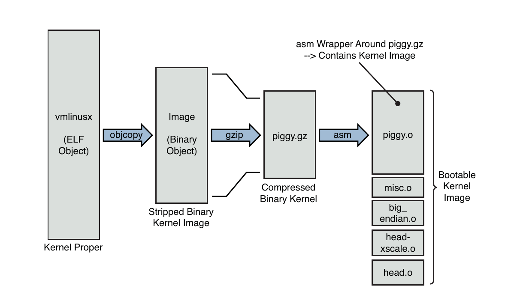
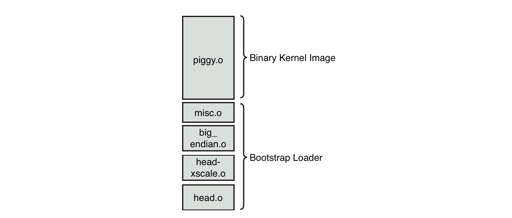
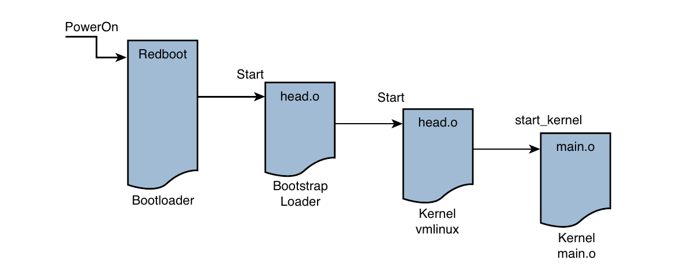

# Chương 5. Khởi tạo kernel

## Trong chương này

- 5\.1 Kernel image tổng hợp: Piggy và những thành phần liên quan 100

- 5\.2 Luồng điều khiển khi khởi tạo 109

- 5\.3 Xử lý Command-Line của kernel 115

- 5\.4 Khởi tạo subsystem 122

- 5\.5 Thread `init` 125

- 5\.6 Tổng kết 129

Khi cấp nguồn cho một hệ thống embedded Linux, một chuỗi sự kiện phức tạp

bắt đầu. Sau vài chục giây, Linux kernel

đã hoạt động và sinh ra một loạt chương trình ứng dụng theo chỉ định của

các init script của hệ thống. Một phần đáng kể những hoạt động này được chi phối bởi

cấu hình hệ thống và nằm dưới sự kiểm soát của lập trình viên embedded.

Chương này khảo sát chuỗi sự kiện ban đầu trong Linux kernel. Chúng ta

xem xét chi tiết các cơ chế và quá trình được dùng trong quá trình khởi tạo

kernel. Sau đó, chúng ta mô tả command line của Linux kernel và cách dùng nó để tùy chỉnh

môi trường Linux khi khởi động. Với kiến thức này, bạn sẽ có thể

tùy chỉnh và kiểm soát chuỗi khởi tạo để đáp ứng yêu cầu của

hệ thống embedded cụ thể của mình.

## 5.1 Kernel image tổng hợp: Piggy và những thành phần liên quan

Khi power-on, bootloader trong hệ thống embedded là phần mềm đầu tiên giành quyền điều khiển processor. Sau khi bootloader thực hiện một số khởi tạo phần cứng low-level, quyền điều khiển được chuyển cho Linux kernel. Đây có thể là một chuỗi sự kiện thủ công để hỗ trợ quá trình phát triển (ví dụ, người dùng gõ các lệnh load/boot tương tác tại dấu nhắc bootloader), hoặc một chuỗi khởi động tự động điển hình của môi trường vận hành thực tế. Chúng ta dành riêng Chương 7, “Bootloader”, cho chủ đề này, nên sẽ để phần thảo luận chi tiết về bootloader đến chương đó.

Trong Chương 4, “Linux kernel: Một góc nhìn khác”, chúng ta đã khảo sát các thành phần tạo nên Linux kernel image. Nhớ rằng một trong các file phổ biến được build cho mọi architecture là ELF binary có tên `vmlinux`. Binary file này chính là monolithic kernel, hay thứ chúng ta vẫn gọi là kernel chính. Thực tế, khi xem cách tạo nó ở link stage của `vmlinux`, chúng ta đã chỉ ra nơi có thể tìm dòng code đầu tiên. Trong hầu hết architecture, nó nằm trong một assembly language source file có tên `head.S` hoặc một tên file tương tự. Trong nhánh Power Architecture (powerpc) của kernel, có nhiều phiên bản `head.S`, tùy theo processor. Ví dụ, các processor dòng AMCC 440 được khởi tạo từ file có tên `head_44x.S`.

Một số architecture và bootloader có thể boot trực tiếp kernel image `vmlinux`. Ví dụ, các platform dựa trên Power Architecture và bootloader U-Boot thường có thể boot trực tiếp image `vmlinux`[^1] (sau khi chuyển từ ELF sang binary, như bạn sẽ thấy ngay sau đây). Với những tổ hợp architecture và bootloader khác, có thể cần thêm chức năng để thiết lập context thích hợp và cung cấp các tiện ích cần thiết để load và boot kernel.

Listing 5-1 trình bày chi tiết chuỗi bước cuối trong kernel build process cho một hardware platform dựa trên ADI Engineering Coyote Reference Platform, chứa Intel IXP425 network processor. Listing này dùng dạng output rút gọn của kernel build system, cũng là dạng mặc định. Như đã chỉ ra trong Chương 4, đây là cách ký hiệu ngắn gọn hữu ích, cho phép tập trung hơn vào lỗi và cảnh báo trong build process.

LISTING 5-1 Chuỗi build kernel cuối cùng: ARM/IXP425 (Coyote)

```
$ make ARCH=arm CROSS_COMPILE=xscale_be- zImage
...   < many build steps omitted for clarity>
  LD      vmlinux
  SYSMAP  System.map
  SYSMAP  .tmp_System.map
  OBJCOPY arch/arm/boot/Image
  Kernel: arch/arm/boot/Image is ready
  AS      arch/arm/boot/compressed/head.o
  GZIP    arch/arm/boot/compressed/piggy.gz
  AS      arch/arm/boot/compressed/piggy.o
  CC      arch/arm/boot/compressed/misc.o
  AS      arch/arm/boot/compressed/head-xscale.o
  AS      arch/arm/boot/compressed/big-endian.o
  LD      arch/arm/boot/compressed/vmlinux
  OBJCOPY arch/arm/boot/zImage
  Kernel: arch/arm/boot/zImage is ready
```

Ở dòng thứ ba của Listing 5-1, image `vmlinux` (kernel chính) được link. Sau đó, một số object module bổ sung được xử lý. Chúng bao gồm `head.o`, `piggy.o`,[^2] và `head-xscale.o` thuộc loại architecture-specific, cùng các module khác. (Các nhãn cho biết điều đang xảy ra trên mỗi dòng. Ví dụ, `AS` cho biết assembler được gọi, `GZIP` chỉ thao tác nén, v.v.) Nhìn chung, các object module này dành riêng cho một architecture nhất định (ARM/XScale trong ví dụ này) và chứa các utility routine low-level cần để boot kernel trên architecture cụ thể đó. Bảng 5-1 trình bày chi tiết các thành phần trong Listing 5-1.

BẢNG 5-1 Các architecture object Low-Level của ARM/XScale

| Thành phần | Mô tả |
|---|---|
| `vmlinux` | Kernel chính, ở định dạng ELF, bao gồm symbol, comment, thông tin debug (nếu compile với `-g`) và các thành phần architecture-generic. |
| `System.map` | Kernel symbol table dạng Text-based cho module `vmlinux`. |
| `.tmp_System.map` | Chỉ được sinh để sanity-check `System.map`; ngoài ra không được dùng trong build image cuối cùng. |
| `Image` | Binary kernel module đã loại bỏ symbol, note và comment. |
| `head.o` | Startup code ARM-specific dùng chung cho các ARM processor. Bootloader chuyển quyền điều khiển cho object này. |
| `piggy.gz` | File `Image` được nén bằng `gzip`. |
| `piggy.o` | File `piggy.gz` ở định dạng assembly language để có thể link với object tiếp theo là `misc.o` (xem phần nội dung). |
| `misc.o` | Các routine dùng để giải nén kernel image (`piggy.gz`) và là nguồn của thông báo boot quen thuộc `Uncompressing Linux . . . Done` trên một số architecture. |
| `head-xscale.o` | Khởi tạo processor dành riêng cho họ XScale processor. |
| `big-endian.o` | Assembly language routine nhỏ để chuyển XScale processor sang chế độ big-endian. |
| `vmlinux` | Kernel image tổng hợp. Cách đặt tên này không hay vì trùng tên với kernel chính; hai thứ này không giống nhau. Binary image này là kết quả của việc link kernel chính với các object trong bảng. Xem phần nội dung để biết giải thích. |
| `zImage` | Kernel image tổng hợp cuối cùng được bootloader load. Xem phần nội dung tiếp theo. |

Một hình minh họa sẽ giúp bạn hiểu cấu trúc này và phần thảo luận tiếp theo. Hình

5-1 cho thấy các thành phần image và sự biến đổi của chúng trong build process dẫn

đến một kernel image có thể boot. Các phần tiếp theo mô tả chi tiết những thành phần và quá trình này.



HÌNH 5-1 Tạo kernel image tổng hợp

### 5.1.1 Object Image

Sau khi ELF file của kernel `vmlinux` được build, kernel build system tiếp tục xử lý các target được mô tả trong Bảng 5-1. Object `Image` được tạo từ object `vm-linux`. Về cơ bản, `Image` là ELF file `vmlinux` đã loại bỏ các section dư thừa (note và comment), đồng thời loại bỏ mọi debugging symbol có thể đã hiện diện. Lệnh sau được dùng cho mục đích này:

```
xscale_be-objcopy -O binary -R .note -R .note.gnu.build-id -R .comment -S
 vmlinux arch/arm/boot/Image
```

Option `-O` yêu cầu `objcopy` sinh một binary file; option `-R` loại bỏ các ELF section có tên `.note`, `.note.gnu.build-id` và `.comment`; còn option `-S` là flag để loại bỏ debugging symbol. Chú ý rằng `objcopy` nhận ELF image `vmlinux` làm input và sinh target binary file có tên `Image`. Tóm lại, `Image` chỉ là kernel chính được chuyển từ dạng ELF sang binary, đã loại bỏ debug symbol và các section `.note*` cùng `.comment` nói trên.

### 5.1.2 Architecture object

Tiếp tục theo dõi chuỗi build, một số module nhỏ được compile. Chúng bao gồm một số assembly language file (`head.o`, `head-xscale.o`, v.v.) thực hiện các tác vụ architecture low-level và processor-specific. Mỗi object này được tóm tắt trong Bảng 5-1. Đặc biệt đáng chú ý là chuỗi thao tác tạo object có tên `piggy.o`. Đầu tiên, file `Image` (binary kernel image) được nén bằng lệnh `gzip` này:

```
cat Image | gzip -f -9 > piggy.gz
```

Thao tác này tạo một file mới có tên `piggy.gz`, đơn giản là phiên bản nén của binary kernel `Image`. Bạn có thể thấy điều này qua hình minh họa trong Hình 5-1. Điều xảy ra tiếp theo khá thú vị. Một assembly language file có tên `piggy.S` được assemble, chứa tham chiếu đến `piggy.gz` đã nén. Về bản chất, binary kernel image được mang kèm như payload bên trong một bootstrap loader viết bằng assembly language low-level.[^3] Bootstrap loader này khởi tạo processor và các vùng nhớ cần thiết, giải nén binary kernel image và load nó vào vị trí thích hợp trong system memory trước khi chuyển quyền điều khiển cho nó. Listing 5-2 tái hiện toàn bộ `.../arch/arm/boot/compressed/piggy.S`.

LISTING 5-2 Assembly file `Piggy.S`

```
  .section .piggydata,#alloc
  .globl    input_data
input_data:
  .incbin   “arch/arm/boot/compressed/piggy.gz”
  .globl    input_data_end
input_data_end:
```

File assembly-language nhỏ này đơn giản nhưng tạo ra một sự phức tạp không hiển nhiên ngay lập tức. Mục đích của file là khiến assembler xuất binary kernel image đã nén thành một ELF section có tên `.piggydata`. Điều này được kích hoạt bởi assembler preprocessor directive `.incbin`, có thể xem là phiên bản file `#include` của assembler, ngoại trừ việc nó nhận binary data. Tóm lại, kết quả cuối cùng của assembly language file này là chứa binary kernel image đã nén như payload bên trong một image khác—bootstrap loader. Chú ý các label `input_data` và `input_data_end`. Bootstrap loader dùng chúng để xác định ranh giới của binary payload—chính kernel image.

### 5.1.3 Bootstrap loader

Đừng nhầm với bootloader: nhiều architecture dùng bootstrap loader (hay second-stage loader) để load Linux kernel image vào memory. Một số bootstrap loader thực hiện xác minh checksum của kernel image, và phần lớn giải nén rồi relocate kernel image. Sự khác biệt giữa bootloader và bootstrap loader trong context này rất đơn giản: bootloader điều khiển board khi power-up và không phụ thuộc vào Linux kernel theo bất kỳ cách nào. Ngược lại, mục đích chính của bootstrap loader là làm cầu nối giữa bare metal bootloader và Linux kernel. Bootstrap loader chịu trách nhiệm cung cấp context thích hợp để kernel chạy, đồng thời thực hiện các bước cần thiết để giải nén và relocate kernel binary image. Nó tương tự khái niệm primary loader và secondary loader trong PC architecture.

Hình 5-2 làm rõ khái niệm này. Bootstrap loader được nối với kernel image để load.



HÌNH 5-2 Kernel image tổng hợp cho ARM XScale

Trong ví dụ đang khảo sát, bootstrap loader gồm các binary image được thể hiện trong Hình 5-2. Các chức năng do bootstrap loader này thực hiện bao gồm:

- Khởi tạo processor Low-level bằng assembly language, bao gồm hỗ trợ bật instruction cache và data cache nội bộ của processor, tắt interrupt và thiết lập C runtime environment. Chúng bao gồm `head.o` và `head-xscale.o`.

- Code giải nén và relocation, nằm trong `misc.o`.

- Các khởi tạo processor-specific khác, như `big-endian.o`, bật chế độ big endian cho processor cụ thể này.

Cần lưu ý rằng các chi tiết đang khảo sát dành riêng cho kernel implementation ARM/XScale. Mỗi architecture có các chi tiết khác nhau, dù các khái niệm tương tự. Dùng cách phân tích tương tự như được trình bày ở đây, bạn có thể tìm hiểu yêu cầu của architecture của mình.

### 5.1.4 Thông báo boot

Có lẽ bạn đã thấy một PC workstation boot desktop Linux distribution như Red Hat hoặc SUSE Linux. Sau các thông báo BIOS của chính PC, bạn thấy Linux hiển thị hàng loạt console message khi khởi tạo các kernel subsystem. Nhiều phần đáng kể của output giống nhau giữa những architecture và machine khác biệt. Hai thông báo early boot thú vị hơn cả là kernel version string và kernel command line, được mô tả ngay sau đây. Listing 5-3 tái hiện các kernel boot message của ADI Engineering Coyote Reference Platform khi boot Linux trên Intel XScale IXP425 processor. Listing đã được thêm số dòng để dễ tham chiếu.

LISTING 5-3 Thông báo boot Linux trên IPX425

```
 1  Using base address 0x01000000 and length 0x001ce114
 2  Uncompressing Linux....... done, booting the kernel.
 3  Linux version 2.6.32-07500-g8bea867 (chris@brutus2) (gcc version 4.2.0
20070126 (prerelease) (MontaVista 4.2.0-3.0.0.0702771 2007-03-10)) #12 Wed Dec 16
23:07:01 EST 2009
 4  CPU: XScale-IXP42x Family [690541c1] revision 1 (ARMv5TE), cr=000039ff
 5  CPU: VIVT data cache, VIVT instruction cache
 6  Machine: ADI Engineering Coyote
 7  Memory policy: ECC disabled, Data cache writeback
 8  Built 1 zonelists in Zone order, mobility grouping on.  Total pages: 16256
 9  Kernel command line: console=ttyS0,115200 root=/dev/nfs ip=dhcp
10  PID hash table entries: 256 (order: -2, 1024 bytes)
11  Dentry cache hash table entries: 8192 (order: 3, 32768 bytes)
12  Inode-cache hash table entries: 4096 (order: 2, 16384 bytes)
13  Memory: 64MB = 64MB total
14  Memory: 61108KB available (3332K code, 199K data, 120K init, 0K highmem)
15  SLUB: Genslabs=11, HWalign=32, Order=0-3, MinObjects=0, CPUs=1, Nodes=1
16  Hierarchical RCU implementation.
17  RCU-based detection of stalled CPUs is enabled.
18  NR_IRQS:64
19  Calibrating delay loop... 532.48 BogoMIPS (lpj=2662400)
20  Mount-cache hash table entries: 512
21  CPU: Testing write buffer coherency: ok
22  NET: Registered protocol family 16
23  IXP4xx: Using 16MiB expansion bus window size
24  PCI: IXP4xx is host
25  PCI: IXP4xx Using direct access for memory space
26  PCI: bus0: Fast back to back transfers enabled
27  SCSI subsystem initialized
28  usbcore: registered new interface driver usbfs
29  usbcore: registered new interface driver hub
30  usbcore: registered new device driver usb
31  NET: Registered protocol family 8
32  NET: Registered protocol family 20
33  NET: Registered protocol family 2
34  IXP4xx Queue Manager initialized.
35  NetWinder Floating Point Emulator V0.97 (double precision)
36  JFFS2 version 2.2. (NAND) (c) 2001-2006 Red Hat, Inc.
37  io scheduler noop registered
38  io scheduler deadline registered
39  io scheduler cfq registered (default)
40  Serial: 8250/16550 driver, 2 ports, IRQ sharing disabled
41  serial8250.0: ttyS0 at MMIO 0xc8001000 (irq = 13) is a XScale
42  console [ttyS0] enabled
43  Uniform Multi-Platform E-IDE driver
44  ide-gd driver 1.18
45  IXP4XX-Flash.0: Found 1 x16 devices at 0x0 in 16-bit bank
46   Intel/Sharp Extended Query Table at 0x0031
47   Intel/Sharp Extended Query Table at 0x0031
48  Using buffer write method
49  Searching for RedBoot partition table in IXP4XX-Flash.0 at offset 0xfe0000
50  5 RedBoot partitions found on MTD device IXP4XX-Flash.0
51  Creating 5 MTD partitions on “IXP4XX-Flash.0”:
52  0x000000000000-0x000000060000 : “RedBoot”
53  0x000000100000-0x000000260000 : “MyKernel”
54  0x000000300000-0x000000900000 : “RootFS”
55  0x000000fc0000-0x000000fc1000 : “RedBoot config”
56  0x000000fe0000-0x000001000000 : “FIS directory”
57  e100: Intel(R) PRO/100 Network Driver, 3.5.24-k2-NAPI
58  e100: Copyright(c) 1999-2006 Intel Corporation
59  ehci_hcd: USB 2.0 ‘Enhanced’ Host Controller (EHCI) Driver
60  ohci_hcd: USB 1.1 ‘Open’ Host Controller (OHCI) Driver
61  uhci_hcd: USB Universal Host Controller Interface driver
62  Initializing USB Mass Storage driver...
63  usbcore: registered new interface driver usb-storage
64  USB Mass Storage support registered.
65  IXP4xx Watchdog Timer: heartbeat 60 sec
66  usbcore: registered new interface driver usbhid
67  usbhid: USB HID core driver
68  TCP cubic registered
69  NET: Registered protocol family 17
70  XScale DSP coprocessor detected.
71  drivers/rtc/hctosys.c: unable to open rtc device (rtc0)
72  e100 0000:00:0f.0: firmware: using built-in firmware e100/d101m_ucode.bin
73  e100: eth0 NIC Link is Up 100 Mbps Full Duplex
74  IP-Config: Complete:
75       device=eth0, addr=192.168.0.29, mask=255.255.255.0, gw=255.255.255.255,
76       host=coyote1, domain=, nis-domain=(none),
77       bootserver=192.168.0.103, rootserver=192.168.0.103, rootpath=
78  Looking up port of RPC 100003/2 on 192.168.0.103
79  Looking up port of RPC 100005/1 on 192.168.0.103
80  VFS: Mounted root (nfs filesystem) on device 0:11.
81  Freeing init memory: 120K
82  INIT: version 2.86 booting
83  ... <some userland init messages omitted>
84  coyote1 login:
```

Kernel tạo nhiều thông tin hữu ích khi khởi động, như trong Listing 5-3. Chúng ta sẽ nghiên cứu khá chi tiết output này trong vài phần tiếp theo. Dòng 1 do Redboot bootloader trên board tạo ra. Dòng 2 do bootstrap loader đã trình bày trước đó trong chương này tạo ra. Thông báo này đến từ decompression loader trong `.../arch/arm/boot/compressed/misc.c`, ở function có tên `decompress_kernel()`.

Dòng 3 của Listing 5-3 là kernel version string. Đây là dòng output đầu tiên từ chính kernel. Một trong những dòng code C đầu tiên được kernel thực thi (trong `.../init/main.c`) khi vào `start_kernel()` như sau:

```
printk(KERN_NOTICE “%s”, linux_banner);
```

Dòng này tạo output vừa được mô tả, tức kernel version string ở dòng 3 của Listing 5-3. Version string này chứa một số thông tin đáng chú ý liên quan đến kernel image:

- Kernel version: Linux version 2.6.32-07500-g8bea867[^4]

- Username/tên machine nơi kernel được compile

- Thông tin toolchain: gcc version 4.2.0, do MontaVista Software cung cấp

- Build number

- Ngày và giờ kernel image được compile

Thông tin này hữu ích cả trong quá trình phát triển lẫn khi vận hành thực tế sau đó. Ngoại trừ một mục, các entry đều self-explanatory. Build number đơn giản là công cụ được các lập trình viên thêm vào version string để cho biết có thứ quan trọng hơn ngày giờ đã thay đổi giữa hai lần build. Đây là cách để lập trình viên theo dõi lần build một cách chung và tự động. Trong ví dụ này, bạn sẽ nhận thấy đây là lần build thứ mười hai trong chuỗi, được thể hiện bởi #12 ở dòng 3 của Listing 5-3. Build number được lưu trong hidden file có tên `.version` ở Linux directory top-level. Nó được tự động tăng bởi build script trong `.../scripts/mkversion`. Tóm lại, đây là một nhãn numeric string được tự động tăng mỗi khi bất kỳ phần đáng kể nào trong kernel được build lại. Chú ý rằng nó được đặt lại thành #1 khi thực thi `make mrproper`.

## 5.2 Luồng điều khiển khi khởi tạo

Bây giờ bạn đã hiểu cấu trúc và các thành phần của kernel image tổng hợp, hãy khảo sát luồng điều khiển từ bootloader đến kernel trong một chu kỳ boot hoàn chỉnh. Như đã thảo luận trong Chương 2, “Bức tranh tổng thể”, bootloader là thành phần low-level nằm trong nonvolatile memory của hệ thống (Flash hoặc ROM). Nó giành quyền điều khiển ngay sau khi cấp nguồn. Thông thường, đây là một tập hợp routine nhỏ, đơn giản, được thiết kế chủ yếu để thực hiện khởi tạo low-level, load operating system image và chẩn đoán hệ thống. Nó có thể chứa các routine memory dump và fill để khảo sát và sửa đổi nội dung memory. Nó cũng có thể chứa các routine self-test board low-level, bao gồm kiểm tra memory và I/O. Cuối cùng, bootloader chứa logic để load và chuyển quyền điều khiển cho một chương trình khác, thường là operating system như Linux.

Platform ARM XScale dùng làm cơ sở cho các ví dụ trong chương này chứa Redboot bootloader. Khi mới cấp nguồn, bootloader này được gọi và tiến hành load operating system (OS). Khi bootloader tìm thấy và load OS image (có thể nằm cục bộ trong Flash, trên hard drive, hoặc thông qua local area network hay thiết bị khác), quyền điều khiển được chuyển cho image đó.

Trên platform XScale cụ thể này, bootloader chuyển quyền điều khiển cho module `head.o` của chúng ta tại label `start` trong bootstrap loader, như Hình 5-3.



HÌNH 5-3 Luồng điều khiển boot ARM

Như đã thảo luận trước đó, bootstrap loader được ghép phía trước kernel image có một trách nhiệm chính: tạo môi trường thích hợp để giải nén và relocate kernel rồi chuyển quyền điều khiển cho nó. Quyền điều khiển được chuyển trực tiếp từ bootstrap loader đến kernel chính, tới module có tên `head.o` trên hầu hết architecture. Việc cả bootstrap loader lẫn kernel chính đều chứa module có tên `head.o` là một di sản lịch sử không may, vì nó gây nhầm lẫn cho lập trình viên embedded Linux mới. Module `head.o` trong bootstrap loader có lẽ nên được gọi là `kernel_bootstrap_loader_head.o`, dù tôi nghi ngờ các lập trình viên kernel sẽ chấp nhận patch này! Thực tế, một Linux 2.6 source tree gần đây chứa hơn 25 source file có tên `head.S` và gần 70 file có tên `head*.S` Đây là một lý do nữa khiến bạn cần nắm rõ đường đi trong kernel source tree.

Tham khảo Hình 5-3 để xem minh họa luồng điều khiển. Khi bootstrap loader hoàn thành nhiệm vụ, quyền điều khiển được chuyển đến `head.o` của kernel chính, rồi từ đó đến `start_kernel()` trong `main.c`.

### 5.2.1 Kernel entry point: head.o

Ý định của các lập trình viên kernel là giữ cho module `head.o` architecture-specific thật tổng quát, không có phụ thuộc vào machine[^5] cụ thể nào. Module này, được tạo từ assembly language file `head.S`, nằm ở `.../arch/<ARCH>/kernel/head.S`, trong đó `<ARCH>` được thay bằng architecture tương ứng. Như bạn đã thấy, các ví dụ trong chương này dựa trên ARM/XScale, với `<ARCH>=arm`.

Module `head.o` thực hiện khởi tạo architecture- và thường cả CPU-specific để chuẩn bị cho phần chính của kernel. Các tác vụ CPU-specific được giữ chung nhất có thể giữa các họ processor. Khởi tạo Machine-specific được thực hiện ở nơi khác, như bạn sẽ thấy ngay sau đây. Ngoài những tác vụ low-level khác, `head.o` thực hiện:

- Kiểm tra processor và architecture hợp lệ

- Tạo các page table entry ban đầu

- Bật memory management unit (MMU) của processor

- Thiết lập khả năng phát hiện và báo lỗi hạn chế

- Nhảy đến điểm bắt đầu kernel chính, `start_kernel()` trong `main.c`

Các chức năng này chứa một số điểm phức tạp khó thấy. Nhiều lập trình viên embedded mới đã thử single-step qua các phần của code này, rồi chỉ nhận ra debugger bị lạc hoàn toàn. Dù việc thảo luận sự phức tạp của assembly language và chi tiết phần cứng của virtual memory nằm ngoài phạm vi cuốn sách, một vài điểm về module phức tạp này đáng được lưu ý.

Khi quyền điều khiển lần đầu được chuyển từ bootstrap loader đến `head.o` của kernel, processor đang hoạt động trong chế độ trước đây gọi là real mode theo thuật ngữ x86. Thực tế, logical address chứa trong program counter [^6] của processor (hay bất kỳ register nào khác) chính là physical address thực được đưa lên các chân tín hiệu memory address của processor. Ngay sau khi các processor register và kernel data structure được khởi tạo để cho phép memory translation, MMU của processor được bật. Đột nhiên, address space mà processor nhìn thấy bị thay thế bằng một cơ chế virtual addressing tùy ý do các lập trình viên kernel quyết định. Điều này tạo ra sự phức tạp chỉ có thể thực sự hiểu được bằng việc phân tích chi tiết cả các cấu trúc assembly language và luồng logic, cùng kiến thức chi tiết về CPU và cơ chế hardware address translation của nó. Tóm lại, physical address được thay bằng logical address ngay khi MMU được bật. Đó là lý do debugger không thể single-step qua phần code này như với code thông thường.

Điểm thứ hai đáng lưu ý là mapping sẵn có còn hạn chế ở giai đoạn sớm này của kernel boot process. Nhiều lập trình viên đã vấp phải giới hạn này khi cố sửa `head.o` cho platform cụ thể của mình.[^7] Một tình huống như vậy có thể diễn ra như sau. Giả sử bạn có hardware device cần load firmware rất sớm trong chu kỳ boot. Một giải pháp có thể là compile tĩnh firmware cần thiết vào kernel image, rồi tham chiếu nó qua pointer để download đến device. Tuy nhiên, do memory mapping được thực hiện ở thời điểm này còn hạn chế, rất có thể firmware image của bạn nằm ngoài phạm vi đã được map trong giai đoạn sớm này của chu kỳ boot. Khi code thực thi, nó tạo page fault, vì bạn đã thử truy cập một vùng memory chưa có mapping hợp lệ bên trong processor. Tệ hơn nữa, page fault handler chưa được cài đặt ở giai đoạn sớm này, nên tất cả những gì bạn nhận được là một system crash không rõ nguyên nhân. Ở thời điểm sớm này trong chu kỳ boot, gần như chắc chắn bạn không có error message nào để tìm ra điều gì sai.

Nếu có thể, bạn nên cân nhắc trì hoãn mọi khởi tạo custom hardware cho đến sau khi kernel đã boot. Bằng cách đó, bạn có thể dựa vào device driver model well-known để truy cập custom hardware thay vì cố tùy chỉnh startup code assembly language phức tạp hơn nhiều. Nhiều kỹ thuật không được ghi lại trong tài liệu được dùng ở cấp độ này. Một ví dụ phổ biến là khắc phục hardware errata có thể được hoặc không được ghi lại trong tài liệu. Bạn sẽ phải trả giá cao hơn nhiều về thời gian phát triển, chi phí và độ phức tạp nếu phải thay đổi code assembly language khởi động sớm. Các kỹ sư phần cứng và phần mềm nên thảo luận những điều này ngay từ giai đoạn đầu phát triển phần cứng, khi một thay đổi phần cứng nhỏ thường có thể tiết kiệm đáng kể thời gian phát triển phần mềm.

Điều quan trọng là nhận ra các giới hạn đặt ra cho lập trình viên trong môi trường virtual memory. Nhiều lập trình viên embedded có kinh nghiệm lại có ít hoặc không có kinh nghiệm trong môi trường này, và tình huống vừa trình bày chỉ là một ví dụ nhỏ về các cạm bẫy chờ đợi người mới tiếp cận virtual memory architecture. Gần như mọi microprocessor 32-bit và lớn hơn hiện đại đều có phần cứng memory-management để triển khai virtual memory architecture. Một trong các ưu điểm đáng kể nhất của virtual memory machine là chúng giúp tách biệt các nhóm lập trình viên viết những ứng dụng lớn, phức tạp, đồng thời bảo vệ các software module khác và chính kernel khỏi lỗi lập trình.

### 5.2.2 Khởi động kernel: main.c

Tác vụ cuối của module `head.o` thuộc chính kernel là chuyển quyền điều khiển đến file khởi động kernel chính viết bằng C. Chúng ta dành phần lớn nội dung còn lại của chương cho file quan trọng này.

Mỗi architecture có cú pháp và phương pháp khác nhau, nhưng module `head.o` của mọi architecture đều có cấu trúc tương tự để chuyển quyền điều khiển cho kernel chính. Với ARM architecture, nó trông đơn giản như sau:

```
b     start_kernel
```

[^8]

Với Power Architecture, nó có dạng tương tự như sau:

```
lis     r4,start_kernel@h
ori     r4,r4,start_kernel@l
lis     r3,MSR_KERNEL@h
ori     r3,r3,MSR_KERNEL@l
mtspr   SRR0,r4
mtspr   SRR1,r3
rfi
```

Không đi sâu vào cú pháp assembly language cụ thể, cả hai ví dụ này đều dẫn đến cùng một kết quả. Quyền điều khiển được chuyển từ object module đầu tiên của kernel (`head.o`) đến routine ngôn ngữ C `start_kernel()` nằm trong `.../init/main.c`. Tại đây, kernel bắt đầu có sự sống của riêng mình.

Bất kỳ ai muốn hiểu sâu hơn về Linux kernel, các thành phần tạo nên nó và cách chúng được khởi tạo và/hoặc tạo instance đều nên nghiên cứu kỹ file `main.c`. `main.c` thực hiện phần lớn công việc khởi động post-assembly-language của Linux kernel, từ khởi tạo kernel thread đầu tiên cho đến mount root file system và thực thi chương trình ứng dụng Linux đầu tiên trong user space.

Function `start_kernel()` lớn hơn hẳn mọi function khác trong `main.c`. Phần lớn quá trình khởi tạo Linux kernel diễn ra trong routine này. Mục đích ở đây là nhấn mạnh những phần cụ thể hữu ích trong context phát triển embedded system. Cần nhắc lại rằng dành thời gian nghiên cứu `main.c` rất có giá trị nếu bạn muốn hiểu rõ hơn Linux kernel như một hệ thống.

### 5.2.3 Thiết lập architecture

Một trong những việc đầu tiên diễn ra trong `.../init/main.c`, tại function `start_kernel()`, là gọi `setup_arch()` nằm trong `.../arch/arm/kernel/setup.c`. Function này nhận một parameter duy nhất—pointer đến kernel command line (đã giới thiệu trước đó và được trình bày chi tiết trong phần tiếp theo):

```
setup_arch(&command_line);
```

Câu lệnh này gọi một setup routine architecture-specific chịu trách nhiệm thực hiện các tác vụ khởi tạo chung cho từng architecture chính. Trong số các chức năng khác, `setup_arch()` gọi những function nhận diện CPU cụ thể và cung cấp cơ chế gọi các initialization routine high-level CPU-specific. Một function như vậy, được `setup_arch()` gọi trực tiếp, là `setup_processor()`, nằm trong `.../arch/arm/kernel/setup.c`. Function này xác minh CPU ID và revision, gọi các initialization function CPU-specific và hiển thị một số dòng thông tin trên console khi boot.

Một ví dụ của output này nằm trong Listing 5-3, dòng 4 đến 6, được tái hiện ở đây để bạn tiện theo dõi:

```
4  CPU: XScale-IXP42x Family [690541c1] revision 1 (ARMv5TE), cr=000039ff
5  CPU: VIVT data cache, VIVT instruction cache
6  Machine: ADI Engineering Coyote
```

Ở đây, bạn thấy CPU type, ID string và revision được đọc trực tiếp từ processor core. Tiếp theo là chi tiết về processor cache và machine type. Trong ví dụ này, board Coyote IXP425-based có processor XScale-IXP42x revision 1, architecture ARMv5TE, cùng data cache và instruction cache virtually indexed, virtually tagged (VIVT).

Một trong các hành động cuối của architecture setup routine là thực hiện mọi khởi tạo machine-dependent. Cơ chế chính xác thay đổi giữa các architecture khác nhau. Với ARM, bạn sẽ tìm thấy khởi tạo machine-specific trong dãy directory `.../arch/arm/mach-*`, tùy machine type. MIPS architecture cũng chứa các directory dành riêng cho những reference platform được hỗ trợ. Với Power Architecture, directory `platforms` chứa các routine machine-specific.

## 5.3 Xử lý Command-Line của kernel

Sau khi thiết lập architecture, `main.c` thực hiện khởi tạo kernel sớm dùng chung rồi hiển thị kernel command line. Dòng 9 của Listing 5-3 được tái hiện ở đây để bạn tiện theo dõi:

```
Kernel command line: console=ttyS0,115200 root=/dev/nfs ip=dhcp
```

Trong ví dụ đơn giản này, kernel đang boot được yêu cầu mở console device trên serial port device `ttyS0` (thường là serial port đầu tiên) với baud rate 115Kbps. Nó được yêu cầu lấy thông tin IP address ban đầu từ DHCP server và mount root file system qua giao thức NFS. (Chúng ta trình bày DHCP trong Chương 12, “Môi trường phát triển embedded”, và NFS trong Chương 9, “File system”, cùng Chương 12. Hiện tại, chúng ta giới hạn thảo luận ở cơ chế command-line của kernel.)

Linux thường được bootloader (hoặc bootstrap loader) khởi chạy với một loạt parameter được gọi là kernel command line. Dù bạn không thực sự gọi kernel bằng command prompt từ shell, nhiều bootloader có thể truyền parameter cho kernel theo cách giống mô hình well-known này. Trên một số platform có bootloader không Linux-aware, kernel command line có thể được xác định lúc compile và trở thành một phần hard-coded của kernel binary image. Trên các platform khác (như desktop PC chạy Red Hat Linux), người dùng có thể sửa command line mà không phải compile lại kernel. Bootstrap loader (Grub hoặc Lilo trong trường hợp desktop PC) tạo kernel command line từ configuration file và truyền nó cho kernel trong boot process. Các parameter command-line này là cơ chế boot để đặt cấu hình ban đầu cần cho việc boot đúng trên một machine nhất định.

Nhiều parameter command-line được định nghĩa khắp kernel. Subdirectory `.../Documentation` trong kernel source chứa file có tên `kernel-parameters.txt`, trong đó liệt kê các parameter command-line của kernel theo thứ tự từ điển. Hãy nhớ cảnh báo trước đó về kernel documentation: kernel thay đổi nhanh hơn tài liệu rất nhiều. Hãy dùng file này làm hướng dẫn, nhưng không phải tài liệu tham chiếu có tính quyết định. Hàng trăm parameter command-line riêng biệt của kernel được ghi trong file này, nhưng không thể coi đó là danh sách đầy đủ. Muốn có danh sách đầy đủ, bạn phải tham khảo trực tiếp source code.

Cú pháp cơ bản của parameter command-line của kernel khá đơn giản và phần lớn đã rõ qua ví dụ ở dòng 9 của Listing 5-3. Parameter command-line của kernel có thể là một từ văn bản đơn, một cặp `key=value`, hoặc định dạng key và nhiều giá trị `key=value1,value2,....`. Thành phần sử dụng thông tin này chịu trách nhiệm xử lý dữ liệu được cung cấp. Command line có sẵn trên toàn hệ thống và được bao nhiêu module cần thì bấy nhiêu module xử lý. Như đã lưu ý trước đó, `setup_arch()` trong `main.c` được gọi với kernel command line làm argument duy nhất. Việc này nhằm truyền các parameter architecture-specific và chỉ thị cấu hình đến các phần code architecture- và machine-specific liên quan.

Người viết device driver và lập trình viên kernel có thể thêm các parameter command-line của kernel theo nhu cầu cụ thể của mình. Hãy xem cơ chế này. Tiếc rằng có một số điểm phức tạp khi dùng và xử lý parameter command-line của kernel. Thứ nhất là cơ chế ban đầu đang bị deprecated để nhường chỗ cho implementation mạnh mẽ hơn nhiều. Thứ hai là bạn cần nắm được sự phức tạp của linker script file để hiểu đầy đủ cơ chế này.[^9]

### 5.3.1 Macro \_\_setup

Để lấy ví dụ về việc dùng parameter command-line của kernel, hãy xét cách chỉ định console device. Chúng ta muốn console được khởi tạo sớm trong chu kỳ boot để có nơi gửi thông báo trong quá trình boot. Việc khởi tạo này diễn ra trong kernel object có tên `printk.o`. Source file C của module này nằm ở `.../kernel/printk.c`. Console initialization routine có tên `console_setup()` và nhận parameter string command-line của kernel làm argument duy nhất.

Thách thức là truyền console parameter được chỉ định trên kernel command line đến các setup routine và device driver routine cần dữ liệu này theo cách tổng quát và có tính module. Vấn đề càng phức tạp hơn vì các parameter command-line thường cần có sớm, trước khi (hoặc kịp lúc) các module cần đến chúng. Startup code trong `main.c`, nơi thực hiện xử lý chính của kernel command line, không thể biết các destination function cho từng parameter trong hàng trăm parameter command-line của kernel nếu không bị lấp đầy bởi hiểu biết về mọi thành phần sử dụng chúng. Điều cần có là cách linh hoạt, tổng quát để truyền các parameter command-line của kernel đến các thành phần sử dụng.

Một macro đặc biệt được định nghĩa trong `.../include/linux/init.h` dùng để liên kết một phần của kernel command-line string với function xử lý phần string đó. Bây giờ, chúng ta minh họa cách macro `__setup` hoạt động, lấy kernel command line trong Listing 5-3 làm ví dụ.

Từ kernel command line trước đó (dòng 9 của Listing 5-3), đây là parameter command-line hoàn chỉnh đầu tiên được truyền cho kernel:

```
console=ttyS0,115200
```

Trong ví dụ này, ý nghĩa thực sự của các parameter không quan trọng. Mục tiêu ở đây là minh họa cơ chế, nên đừng bận tâm nếu bạn chưa hiểu argument hoặc các giá trị của nó.

Listing 5-4 là một đoạn code từ `.../kernel/printk.c`. Phần thân function đã được bỏ đi vì không liên quan đến thảo luận. Phần liên quan nhất của Listing 5-4 là dòng cuối, nơi gọi macro `__setup`. Macro này nhận hai argument; trong trường hợp này, nó được truyền một string literal và một function pointer. Không phải ngẫu nhiên mà string literal truyền cho macro `__setup` giống tám ký tự đầu tiên của phần kernel command line liên quan đến console: `console=`.

LISTING 5-4 Đoạn code thiết lập console

```
/*
 *    Setup a list of consoles. Called from init/main.c
 */
static int __init console_setup(char *str)
{
    char buf[sizeof(console_cmdline[0].name) + 4]; /* 4 for index */
    char *s, *options, *brl_options = NULL;
    int idx;

    ...
    <body omitted for clarity...>
    ...
    return 1;
}

__setup(“console=”, console_setup);
```

Bạn có thể xem macro `__setup` như một registration function cho console parameter command-line của kernel. Thực chất, nó nói: khi gặp string `console=` trên kernel command line, gọi function được biểu diễn bởi argument thứ hai của macro `_ _setup`—trong trường hợp này là function `console_setup()`. Nhưng thông tin này được truyền thế nào đến early setup code ở ngoài module, vốn không biết các console function? Cơ chế này vừa khéo léo vừa có phần phức tạp, và dựa vào các danh sách do linker tạo.

Chi tiết được ẩn trong một tập macro nhằm che đi sự rườm rà về cú pháp khi thêm section attribute (và các attribute khác) vào một phần object code. Mục tiêu là tạo một danh sách tĩnh gồm các string literal gắn với function pointer. Compiler xuất danh sách này vào một ELF section có tên riêng trong ELF image `vmlinux` cuối cùng. Hiểu kỹ thuật này là điều quan trọng; nó được dùng ở nhiều nơi trong kernel để xử lý special-purpose.

Bây giờ hãy khảo sát cách thực hiện trong trường hợp macro `__setup`. Listing 5-5 là một phần code từ header file `.../include/linux/init.h` định nghĩa họ macro `__setup`.

LISTING 5-5 Họ định nghĩa macro `__setup` từ `init.h`

```
...
#define __setup_param(str, unique_id, fn, early)            \
    static const char __setup_str_##unique_id[] __initconst \
        __aligned(1) = str; \
    static struct obs_kernel_param __setup_##unique_id  \
        __used __section(.init.setup)           \
        __attribute__((aligned((sizeof(long)))))    \
        = { __setup_str_##unique_id, fn, early }

#define __setup(str, fn)                    \
    __setup_param(str, fn, fn, 0)
...
```

Listing 5-5 chính là cách tác giả định nghĩa sự rườm rà về cú pháp! Nhớ lại từ Listing 5-4 rằng lời gọi macro `__setup` ban đầu của chúng ta như sau:

```
__setup(“console=”, console_setup);
```

Sau khi đơn giản hóa đôi chút, đây là những gì preprocessor của compiler tạo ra sau macro expansion:

```
static const char __setup_str_console_setup[] __initconst \
__aligned(1) = “console=”;

static struct obs_kernel_param __setup_console_setup __used  \
__section(.init.setup) __attribute__ ((aligned((sizeof(long))))) \
= { __setup_str_console_setup, console_setup, early};
```

Để dễ đọc hơn, chúng ta đã tách các dòng, được thể hiện bởi ký tự line-continuation UNIX (`\`).

Một số macro được dùng ở đây, và chúng ta sẽ chỉ mô tả ngắn gọn. Macro `__used` yêu cầu compiler xuất function hoặc variable ngay cả khi optimizer xác định nó không được dùng.[^10] `__attribute__` `((aligned))` yêu cầu compiler căn chỉnh các structure theo một boundary cụ thể—trong trường hợp này là `sizeof(long)`. Nếu bỏ những phần này để đơn giản hóa, chúng ta còn lại:

```
static struct obs_kernel_param __setup_console_setup \
__section(.init.setup) = { __setup_str_console_setup, console_setup, early};
```

Những gì còn lại sau khi đơn giản hóa là cốt lõi của cơ chế. Đầu tiên, compiler sinh một array ký tự (string pointer) có tên `__setup_str_console_setup[]`, được khởi tạo để chứa string `console=`. Tiếp theo, compiler sinh một structure chứa ba member: pointer đến kernel command-line string (array vừa khai báo), pointer đến chính setup function và một flag đơn giản. Chìa khóa của điều kỳ diệu ở đây là section attribute gắn với structure. Attribute này yêu cầu compiler xuất structure vào một section đặc biệt trong ELF object module, có tên `.init.setup`. Trong link stage, tất cả structure được định nghĩa bằng macro `__setup` được thu thập và đặt vào section `.init.setup` này, thực chất tạo ra một array gồm các structure đó. Listing 5-6, một đoạn code từ `.../init/main.c`, cho thấy cách truy cập và sử dụng dữ liệu này.

LISTING 5-6 Xử lý Command-Line của kernel

```
1  extern struct obs_kernel_param __setup_start[], __setup_end[];
2
3  static int __init obsolete_checksetup(char *line)
4  {
5      struct obs_kernel_param *p;
6      int had_early_param = 0;
7
8      p = __setup_start;
9      do {
10          int n = strlen(p->str);
11          if (!strncmp(line, p->str, n)) {
12              if (p->early) {
13                  /* Already done in parse_early_param?
14                   * (Needs exact match on param part).
15                   * Keep iterating, as we can have early
16                   * params and __setups of same names 8( */
17                  if (line[n] == ‘\0’ || line[n] == ‘=’)
18                      had_early_param = 1;
19              } else if (!p->setup_func) {
20                  printk(KERN_WARNING “Parameter %s is obsolete,”
21                         “ ignored\n”, p->str);
22                  return 1;
23              } else if (p->setup_func(line + n))
24                  return 1;
25          }
26          p++;
27      } while (p < __setup_end);
28
29      return had_early_param;
30  }
31
```

Việc khảo sát code này khá dễ hiểu, chỉ cần thêm vài giải thích. Function được gọi với một argument duy nhất là kernel command line, được parse trong `.../kernel/params.c`. Trong ví dụ đang thảo luận, `line` trỏ đến string `“console=ttyS0”`, một phần của kernel command line. Hai external structure pointer `__setup_start` và `__setup_end` được định nghĩa trong linker script file, không phải trong source file C hoặc header file. Các label này đánh dấu điểm bắt đầu và kết thúc của array gồm các structure `obs_kernel_param` đã được đặt trong section `.init.setup` của object file.

Code trong Listing 5-6 quét tất cả structure này qua pointer `p` để tìm đối sánh cho parameter command-line cụ thể này của kernel. Trong trường hợp này, code tìm string `console=` và tìm thấy đối sánh. Từ structure tương ứng, phần tử function pointer trả về pointer đến function `console_setup()`, function này được gọi với phần còn lại của parameter (string `ttyS0,115200`) làm argument duy nhất. Quá trình này lặp lại với từng phần tử trong kernel command line cho đến khi xử lý hết kernel command line.

Kỹ thuật vừa mô tả, thu thập object vào danh sách trong các ELF section có tên riêng biệt, được dùng ở nhiều nơi trong kernel. Một ví dụ khác là dùng họ macro `__init` để đặt các initialization routine one-time vào một section chung trong object file. Macro liên quan `__initconst`, dùng để đánh dấu data item one-time-use, được macro `__setup` sử dụng. Function và data được đánh dấu là phần khởi tạo bằng các macro này được thu thập vào các ELF section có tên đặc biệt. Sau đó, khi các initialization function và data object one-time này đã được dùng, kernel giải phóng memory mà chúng chiếm. Bạn có thể đã thấy thông báo kernel quen thuộc gần cuối boot process: `Freeing init memory: 296K.` Kết quả của bạn có thể khác, nhưng một phần ba megabyte rất xứng đáng với công sức dùng họ macro `__init`. Đây chính là mục đích của macro `__initconst` trong khai báo `__setup_str_console_setup[]` trước đó.

Có thể bạn thắc mắc về việc dùng các symbol name có tiền tố `obsolete_`. Lý do là các lập trình viên kernel đang thay cơ chế xử lý kernel command-line bằng cơ chế tổng quát hơn để đăng ký cả parameter lúc boot lẫn parameter của loadable module. Hiện tại, hàng trăm parameter được khai báo bằng macro `__setup`. Tuy nhiên, phần phát triển mới được kỳ vọng dùng họ function được định nghĩa trong kernel header file `.../include/linux/moduleparam.h`—đáng chú ý nhất là họ macro `module_param*`. Chúng được giải thích chi tiết hơn trong Chương 8, “Kiến thức cơ bản về device driver”, khi chúng ta giới thiệu device driver.

Cơ chế mới duy trì backward compatibility bằng cách đưa một argument function pointer xử lý parameter không xác định vào parsing routine. Do đó, các parameter mà hạ tầng `module_param*` không nhận biết được coi là không xác định, và việc xử lý quay về cơ chế cũ dưới sự kiểm soát của lập trình viên. Có thể dễ dàng hiểu điều này bằng cách khảo sát code well-written trong `.../kernel/params.c` và các lời gọi `parse_args()` trong `.../init/main.c`.

Điểm cuối đáng đề cập là mục đích của flag member trong structure `obs_kernel_param` được macro `__setup` tạo ra. Khảo sát code trong Listing 5-6 sẽ làm rõ điều này. Flag trong structure có tên `early`, dùng để chỉ ra parameter command-line cụ thể này đã được xử lý trước đó trong boot process hay chưa. Một số parameter command-line được dành để xử lý rất sớm trong boot process, và flag này cung cấp cơ chế cho một early parsing algorithm. Bạn sẽ tìm thấy function trong `main.c` có tên `do_early_param()`, duyệt array do linker-generated gồm các structure `__setup`-generated và xử lý từng structure được đánh dấu để xử lý sớm. Điều này cho lập trình viên một mức kiểm soát đối với thời điểm thực hiện việc xử lý trong boot process.

## 5.4 Khởi tạo subsystem

Nhiều kernel subsystem được khởi tạo bởi code trong `main.c`. Một số được khởi tạo tường minh, như các lời gọi `init_timers()` và `console_init()`, vốn cần được gọi rất sớm. Những subsystem khác được khởi tạo bằng kỹ thuật rất giống kỹ thuật đã mô tả trước đó cho macro `__setup`. Tóm lại, linker tạo các danh sách function pointer đến những initialization routine khác nhau, và một vòng lặp đơn giản được dùng để thực thi lần lượt từng routine. Listing 5-7 cho thấy cách hoạt động.

LISTING 5-7 Initialization routine mẫu

```
static int __init customize_machine(void)
{
    /* customizes platform devices, or adds new ones */
    if (init_machine)
        init_machine();
    return 0;
}
arch_initcall(customize_machine);
```

Đoạn code này đến từ `.../arch/arm/kernel/setup.c`. Đây là một routine đơn giản được thiết kế để cung cấp customization hook cho một board cụ thể.

### 5.4.1 Các macro \*\_\_initcall

Chú ý hai điểm quan trọng về initialization routine trong Listing 5-7. Thứ nhất, nó được định nghĩa với macro `__init`. Như đã thấy trước đó, macro này áp dụng attribute `section` để khai báo rằng function được đặt trong section có tên `.init.text` của ELF file `vmlinux`. Nhớ rằng mục đích đặt function này trong section đặc biệt của object file là để có thể thu hồi vùng memory nó chiếm khi không còn cần thiết.

Điểm thứ hai cần chú ý là macro ngay sau định nghĩa function: `arch_initcall(customize_machine)`. Macro này thuộc một họ macro được định nghĩa trong `.../include/linux/init.h`. Các macro này được tái hiện ở đây trong Listing 5-8.

LISTING 5-8 Họ macro `initcall`

```
#define __define_initcall(level,fn,id) \
    static initcall_t __initcall_##fn##id __used \
    __attribute__((__section__(“.initcall” level “.init”))) = fn

/*
 * Early initcalls run before initializing SMP.
 *
 * Only for built-in code, not modules.
 */
#define early_initcall(fn)      __define_initcall(“early”,fn,early)

/*
 * A “pure” initcall has no dependencies on anything else, and purely
 * initializes variables that couldn’t be statically initialized.
 *
 * This only exists for built-in code, not for modules.
 */
#define pure_initcall(fn)       __define_initcall(“0”,fn,0)

#define core_initcall(fn)       __define_initcall(“1”,fn,1)
#define core_initcall_sync(fn)      __define_initcall(“1s”,fn,1s)
#define postcore_initcall(fn)       __define_initcall(“2”,fn,2)
#define postcore_initcall_sync(fn)  __define_initcall(“2s”,fn,2s)
#define arch_initcall(fn)       __define_initcall(“3”,fn,3)
#define arch_initcall_sync(fn)      __define_initcall(“3s”,fn,3s)
#define subsys_initcall(fn)     __define_initcall(“4”,fn,4)
#define subsys_initcall_sync(fn)    __define_initcall(“4s”,fn,4s)
#define fs_initcall(fn)         __define_initcall(“5”,fn,5)
#define fs_initcall_sync(fn)        __define_initcall(“5s”,fn,5s)
#define rootfs_initcall(fn)     __define_initcall(“rootfs”,fn,rootfs)
#define device_initcall(fn)     __define_initcall(“6”,fn,6)
#define device_initcall_sync(fn)    __define_initcall(“6s”,fn,6s)
#define late_initcall(fn)       __define_initcall(“7”,fn,7)
#define late_initcall_sync(fn)      __define_initcall(“7s”,fn,7s)

#define __initcall(fn) device_initcall(fn)
...
```

Tương tự macro `__setup` đã mô tả trước đó, các macro này khai báo một data item dựa trên tên function. Chúng cũng dùng attribute `section` để đặt data item này vào section có tên riêng biệt của ELF file `vmlinux`. Lợi ích của cách tiếp cận này là `main.c` có thể gọi initialization function bất kỳ cho một subsystem mà nó không biết đến. Như đã đề cập trước đó, lựa chọn duy nhất khác là làm `main.c` chứa thông tin về mọi subsystem trong kernel.

Bạn có thể suy ra tên section từ Listing 5-8. Tên section là `.initcallN.init`, trong đó `N` là level được định nghĩa, từ 1 đến 7. Cũng chú ý rằng mỗi trong bảy level có một section tương ứng với ký tự `s` được thêm vào cuối tên. Đây là `initcall` đồng bộ. Data item được gán địa chỉ của function có tên trong macro. Trong ví dụ được định nghĩa bởi Listing 5-7 và 5-8, data item như sau (đã đơn giản hóa bằng cách bỏ attribute `section`):

```
static initcall_t __initcall_customize_machine = customize_machine;
```

Data item này được đặt trong object file của kernel ở section có tên `.initcall3.` `init`.

Level (`N`) được dùng để quy định thứ tự các lời gọi khởi tạo. Các function khai báo bằng macro `core_initcall()` được gọi trước tất cả function khác. Các function khai báo bằng macro `postcore_initcall()` được gọi tiếp theo, v.v.; những function khai báo bằng `late_initcall()` là các initialization function cuối cùng được gọi.

Tương tự macro `__setup`, bạn có thể xem họ macro `*_initcall` này như các registration function cho kernel subsystem initialization routine cần chạy một lần khi kernel khởi động và không bao giờ dùng lại. Các macro này cung cấp cơ chế khiến initialization routine được thực thi khi hệ thống khởi động, đồng thời cung cấp cơ chế loại bỏ code và thu hồi memory sau khi routine đã thực thi. Lập trình viên cũng được cung cấp tối đa bảy level để quyết định thời điểm thực hiện các initialization routine.[^11] Vì thế, nếu có subsystem phụ thuộc vào sự sẵn có của subsystem khác, bạn có thể dùng các level này để bảo đảm thứ tự đó. Nếu grep (tìm kiếm) string `[a-z]*_initcall` trong kernel, bạn sẽ thấy họ macro này được dùng rất rộng rãi.

Một lưu ý cuối về họ macro `*_initcall`: việc dùng nhiều level được đưa vào trong quá trình phát triển dòng kernel 2.6. Các phiên bản kernel trước đó dùng macro `__initcall()` cho mục đích này. Macro này vẫn được dùng rộng rãi, đặc biệt trong device driver. Để duy trì backward compatibility, macro này được định nghĩa thành `device_initcall()`, vốn được định nghĩa là initcall level 6.

## 5.5 Thread init

Code trong `.../init/main.c` chịu trách nhiệm đưa kernel vào hoạt động. Sau khi `start_kernel()` thực hiện một số khởi tạo kernel cơ bản, gọi tường minh các early initialization function theo tên, kernel thread đầu tiên được sinh ra. Thread này cuối cùng trở thành kernel thread có tên `init()`, với process ID (PID) bằng 1. Như bạn sẽ học, `init()` trở thành parent của tất cả Linux process trong user space. Tại thời điểm này trong boot sequence, hai thread riêng biệt đang chạy: thread được biểu diễn bởi `start_kernel()`, và giờ là `init()`. Thread trước tiếp tục trở thành idle process, sau khi hoàn thành công việc. Thread sau trở thành process `init`. Điều này được thể hiện trong Listing 5-9.

LISTING 5-9 Tạo kernel thread `init`

```
static noinline void __init_refok rest_init(void)
    __releases(kernel_lock)
{
    int pid;

    rcu_scheduler_starting();
    kernel_thread(kernel_init, NULL, CLONE_FS | CLONE_SIGHAND);
    numa_default_policy();
    pid = kernel_thread(kthreadd, NULL, CLONE_FS | CLONE_FILES);
    kthreadd_task = find_task_by_pid_ns(pid, &init_pid_ns);
    unlock_kernel();

    /*
     * The boot idle thread must execute schedule()
     * at least once to get things moving:
     */
    init_idle_bootup_task(current);
    preempt_enable_no_resched();
    schedule();
    preempt_disable();

    /* Call into cpu_idle with preempt disabled */
    cpu_idle();
}
```

Function `start_kernel()` gọi `rest_init()`, được tái hiện trong Listing 5-9. Process `init` của kernel được sinh ra bởi lời gọi `kernel_thread()`, với function `kernel_init` làm parameter đầu tiên. `init` tiếp tục hoàn thành phần khởi tạo hệ thống còn lại, trong khi luồng thực thi bắt đầu bởi `start_kernel()` lặp vô hạn trong lời gọi `cpu_idle()`.

Lý do cho cấu trúc này khá thú vị. Có thể bạn đã nhận thấy `start_kernel()`, một function tương đối lớn, được đánh dấu bằng macro `__init`. Điều này nghĩa là memory nó chiếm sẽ được thu hồi trong các giai đoạn cuối của quá trình khởi tạo kernel. Cần thoát khỏi function này và address space nó chiếm trước khi thu hồi memory. Giải pháp là để `start_kernel()` gọi `rest_init()`, được thể hiện trong Listing 5-9, một phần memory nhỏ hơn nhiều sẽ trở thành idle process.

### 5.5.1 Khởi tạo qua initcall

Khi `kernel_init()` được sinh ra, cuối cùng nó gọi `do_initcalls()`, function chịu trách nhiệm gọi phần lớn initialization function được đăng ký bằng họ macro `*_initcall`. Code được tái hiện trong Listing 5-10.

LISTING 5-10 Khởi tạo qua `initcalls`

```
extern initcall_t __initcall_start[], __initcall_end[], __early_initcall_end[];

static void __init do_initcalls(void)
{
    initcall_t *fn;

    for (fn = __early_initcall_end; fn < __initcall_end; fn++)
        do_one_initcall(*fn);

    /* Make sure there is no pending stuff from the initcall sequence */
    flush_scheduled_work();
}
```

Chú ý rằng có hai khối code tương tự nhau. Sớm hơn trong initialization process, function tương tự có tên `do_pre_smp_initcalls()` xử lý một phần danh sách, từ `__initcall_start` đến `__early_initcall_end`. Code này self-explanatory, ngoại trừ hai label đánh dấu ranh giới vòng lặp: `__initcall_start` và `__initcall_end`. Các label này không nằm trong source file C hay header file nào. Chúng được định nghĩa trong linker script file dùng ở link stage của `vmlinux`. Chúng đánh dấu điểm bắt đầu và kết thúc danh sách các initialization function được điền bằng họ macro `*_initcall`. Bạn có thể thấy từng label bằng cách xem file `System.map` trong kernel directory top-level. Tất cả đều bắt đầu bằng string `__initcall`, như trong Listing 5-8.

### 5.5.2 initcall\_debug

Một parameter command-line của kernel rất thú vị cho phép bạn theo dõi các lời gọi này được thực thi khi boot. Nó được bật bằng cách đặt parameter command-line của kernel `initcall_debug`. Chỉ cần khởi động kernel với parameter command-line của kernel `initcall_debug` để bật diagnostic output này.[^12]

Đây là ví dụ những gì bạn sẽ thấy khi bật các debug statement này:

```
...
calling  uhci_hcd_init+0x0/0x100 @ 1
uhci_hcd: USB Universal Host Controller Interface driver
initcall uhci_hcd_init+0x0/0x100 returned 0 after 5639 usecs
...
```

Ở đây, bạn thấy USB Universal Host Controller Interface driver được gọi. Dòng đầu thông báo ý định gọi function `uhci_hcd_init`, vốn là một lời gọi khởi tạo device driver từ USB driver. Sau thông báo này, lời gọi function được thực thi. Dòng thứ hai do chính driver in ra. Trace information trên dòng thứ ba bao gồm kết quả trả về và thời lượng của lời gọi.

Đây là cách hữu ích để thấy chi tiết khởi tạo kernel, đặc biệt là thứ tự gọi các subsystem và module khác nhau. Thú vị hơn là thời lượng của lời gọi. Nếu quan tâm đến thời gian boot của hệ thống, đây là cách rất tốt để xác định phần nào tiêu tốn thời gian trong quá trình boot.

Ngay cả trên embedded system có cấu hình vừa phải, hàng chục initialization function này được gọi theo cách đó. Ví dụ này lấy từ một embedded target ARM XScale, được compile với cấu hình mặc định. Cấu hình mặc định dẫn đến 206 lời gọi như vậy đến các kernel initialization routine khác nhau.

### 5.5.3 Các bước boot cuối cùng

Sau khi sinh thread `kernel_init()`, và sau khi tất cả các lời gọi khởi tạo khác nhau đã hoàn tất, kernel thực hiện các bước cuối của boot sequence. Chúng bao gồm giải phóng memory dùng bởi các initialization function và data, mở system console device và khởi động user space process đầu tiên. Listing 5-11 tái hiện các bước cuối trong process `init` của kernel từ `main.c`.

LISTING 5-11 Các bước boot kernel cuối cùng từ `main.c`

```
static noinline int init_post(void)
    __releases(kernel_lock)
{
<... lines trimmed for clarity ...>
...
if (execute_command) {
      run_init_process(execute_command);
      printk(KERN_WARNING “Failed to execute %s.  Attempting “
                        “defaults...\n”, execute_command);
}

run_init_process(“/sbin/init”);
run_init_process(“/etc/init”);
run_init_process(“/bin/init”);
run_init_process(“/bin/sh”);

panic(“No init found.  Try passing init= option to kernel.”);
```

Chú ý rằng nếu code chạy đến cuối function này (`init_post()`), kernel panic sẽ xảy ra. Nếu đã dành thời gian thử nghiệm embedded system hoặc custom root file system, chắc chắn bạn đã gặp error message rất phổ biến này ở dòng output cuối cùng trên console. Đây là một trong những câu hỏi thường gặp (FAQ) phổ biến nhất trên nhiều diễn đàn công khai liên quan đến Linux và embedded system.

Bằng cách này hay cách khác, một trong các lệnh `run_init_process()` này phải thực hiện thành công mà không có lỗi. Function `run_init_process()` không return khi được gọi thành công. Nó ghi đè calling process bằng process mới, thực chất thay current process bằng process mới. Nó dùng system call quen thuộc `execve()` cho chức năng này. Những cấu hình hệ thống phổ biến nhất sinh `/sbin/init` làm initialization process của userland[^13]. Chúng ta sẽ nghiên cứu sâu chức năng này trong chương tiếp theo.

Một lựa chọn cho lập trình viên embedded system là dùng chương trình khởi tạo userland tùy chỉnh. Đó là mục đích của câu lệnh điều kiện trong đoạn code trước. Nếu `execute_command` là non-null, nó trỏ đến string chứa lệnh tùy chỉnh user-supplied để thực thi trong user space. Lập trình viên chỉ định lệnh này trên kernel command line, và nó được đặt qua macro `__setup` mà chúng ta đã khảo sát trước đó trong chương. Một kernel command line mẫu kết hợp một số khái niệm đã thảo luận trong chương có thể như sau:

```
initcall_debug init=/sbin/myinit console=ttyS1,115200 root=/dev/hda1
```

Kernel command line này yêu cầu kernel hiển thị mọi initialization routine khi chúng được gọi, cấu hình console device ban đầu thành `/dev/ttyS1` ở 115Kbps, và thực thi một user space initialization process tùy chỉnh có tên `myinit`, nằm trong directory `/sbin` trên root file system. Nó yêu cầu kernel mount root file system từ device `/dev/hda1`, là IDE hard drive đầu tiên. Chú ý rằng nhìn chung thứ tự các parameter trên kernel command line không quan trọng. Chương tiếp theo trình bày chi tiết quá trình khởi tạo hệ thống trong user space.

## 5.6 Tổng kết

- Dự án Linux kernel lớn và phức tạp. Hiểu cấu trúc và thành phần của image cuối cùng là chìa khóa để học cách tùy chỉnh dự án embedded của chính bạn.

- Nhiều architecture nối một bootstrap loader architecture-specific vào kernel binary image để thiết lập execution environment thích hợp mà Linux kernel yêu cầu. Chúng ta đã trình bày các bước build bootstrap loader để phân biệt chức năng này với kernel chính.

- Hiểu luồng điều khiển trong quá trình khởi tạo sẽ giúp bạn hiểu sâu hơn Linux kernel và biết cách tùy chỉnh nó cho các yêu cầu cụ thể của mình.

- Chúng ta đã tìm kernel entry point trong `head.o` và lần theo luồng điều khiển vào logic khởi tạo kernel chính, `main.c`. Chúng ta đã xem xét một hệ thống đang boot và các thông báo nó tạo ra, cùng phần tổng quan về nhiều khái niệm khởi tạo quan trọng.

- Việc xử lý kernel command-line và các cơ chế dùng để khai báo, xử lý parameter command-line của kernel đã được trình bày. Nội dung này bao gồm khảo sát chi tiết một số kỹ thuật lập trình nâng cao để gọi các setup routine bất kỳ chưa biết bằng các bảng linker-produced.

- Các bước boot kernel cuối cùng tạo ra những user space process đầu tiên. Hiểu cơ chế này và các lựa chọn của nó cho phép bạn tùy chỉnh và khắc phục sự cố khởi động embedded Linux.

### 5.6.1 Gợi ý đọc thêm

Tài liệu GNU Compiler Collection http://gcc.gnu.org/onlinedocs/gcc[^14]

Using LD, the GNU linker http://sourceware.org/binutils/docs/ld/index.html

Tài liệu kernel

```
.../Documentation/kernel-parameters.txt
```

[^1]: Kernel image gần như luôn được lưu ở định dạng nén, trừ khi thời gian boot là vấn đề quan trọng. Trong trường hợp này, image có thể được gọi là `uImage`, một file `vmlinux` được nén với U-Boot header. Xem Chương 7.

[^2]: Thuật ngữ piggy ban đầu dùng để mô tả khái niệm “piggyback”. Trong trường hợp này, binary kernel image được mang kèm với bootstrap loader để tạo kernel image tổng hợp.

[^3]: Đừng nhầm với bootloader: bootstrap loader có thể được coi là second-stage loader, còn chính bootloader có thể được xem là first-stage loader.

[^4]: Các số theo sau 2.6.32 là những nhãn do build system đặt vào version string; chúng không liên quan đến thảo luận hiện tại. Chương 4, Phần 4.1.1, giải thích cơ chế này.

[^5]: Thuật ngữ machine dùng ở đây chỉ một hardware platform cụ thể.

[^6]: Thường được gọi là Instruction Pointer, register giữ địa chỉ của machine instruction tiếp theo trong memory.

[^7]: Rất không khuyến khích sửa `head.S` cho custom platform của bạn. Gần như luôn có một cách tốt hơn.

[^8]: Linux kernel hiện đại tách một số code chung vào `head-common.S`, được đưa vào `head.S` bằng directive `include`. Đây là nơi có lời gọi `start_kernel()`.

[^9]: Nó không nhất thiết phức tạp đến thế, nhưng phần lớn chúng ta không bao giờ cần hiểu một linker script file. Kỹ sư embedded thì cần. Nó được ghi chép đầy đủ trong GNU LD manual được tham chiếu ở cuối chương này.

[^10]: Thông thường, compiler phàn nàn nếu một variable được định nghĩa static nhưng không bao giờ được tham chiếu trong compilation unit. Vì các variable này không được tham chiếu tường minh, cảnh báo sẽ được phát ra nếu không có directive này.

[^11]: Bảy biến thể của mỗi level cũng được đánh dấu là synchronous.

[^12]: Bạn có thể phải giảm loglevel mặc định trên hệ thống để thấy các debug message này. Điều này được mô tả trong nhiều tài liệu tham khảo về quản trị hệ thống Linux. Trong mọi trường hợp, bạn sẽ thấy chúng trong kernel log file.

[^13]: Userland là thuật ngữ often-used chỉ bất kỳ chương trình, library, script hay bất cứ thứ gì khác trong user space.

[^14]: Đặc biệt là các phần về function attribute, type attribute và variable attribute.
