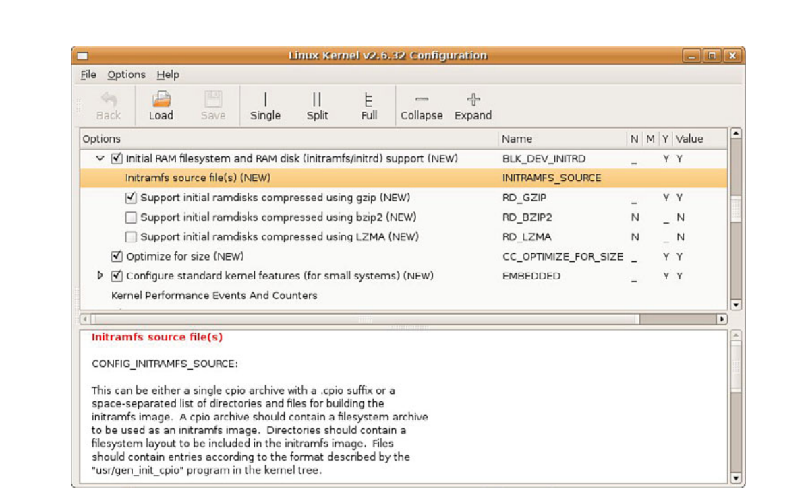

# Chương 6. Khởi tạo user space

## Trong chương này

- 6\.1 Root file system 132

- 6\.2 Các bước boot cuối của kernel 137

- 6\.3 Process `init` 140

- 6\.4 Initial RAM disk 146

- 6\.5 Sử dụng `initramfs` 153

- 6\.6 Tắt hệ thống 156

- 6\.7 Tổng kết 156

Trong Chương 2, “Bức tranh tổng thể”, chúng ta đã chỉ ra rằng bản thân Linux kernel

chỉ là một phần nhỏ của bất kỳ hệ thống embedded Linux nào. Sau khi kernel

tự khởi tạo, nó phải mount root file system và thực thi một tập hợp initialization routine

do lập trình viên định nghĩa. Trong chương này, chúng ta khảo sát chi tiết quá trình khởi tạo

hệ thống sau kernel.

Chúng ta bắt đầu bằng việc xem xét root file system và cách bố trí của nó. Tiếp theo, chúng ta xây dựng và

nghiên cứu cấu hình hệ thống tối thiểu. Ở phần sau của chương, chúng ta bổ sung chức năng

vào cấu hình tối thiểu để tạo ra những cấu hình embedded system mẫu

hữu ích. Chúng ta hoàn tất nội dung khởi tạo hệ thống bằng việc

giới thiệu initial ramdisk, `initrd` và `initramfs`, cùng hoạt động và cách sử dụng chúng.

Chương kết thúc bằng phần xem xét ngắn gọn logic tắt hệ thống Linux.

## 6.1 Root file system

Trong Chương 5, “Khởi tạo kernel”, chúng ta đã khảo sát hành vi của Linux kernel trong initialization process. Chúng ta nhiều lần đề cập đến việc mount root file system. Linux, như nhiều operating system tiên tiến khác, cần root file system để phát huy lợi ích từ các dịch vụ của nó. Dù hoàn toàn có thể dùng Linux trong môi trường không có file system, việc đó ít có ý nghĩa vì phần lớn tính năng và giá trị của Linux sẽ mất đi. Nó tương tự việc đưa toàn bộ ứng dụng hệ thống vào một device driver hoặc kernel thread cồng kềnh. Và bạn có thể tưởng tượng chạy Windows PC mà không có file system không?

Root file system chỉ file system được mount tại gốc của file system hierarchy, được ký hiệu đơn giản là `/`. Như bạn sẽ thấy trong Chương 9, “File system”, ngay cả embedded Linux system nhỏ cũng thường mount nhiều file system ở các vị trí khác nhau trong file system hierarchy. Chúng gồm cả real file system và virtual file system như `/proc` và `/sys`. File system `proc`, được giới thiệu trong Chương 9, là một ví dụ. Đây là file system special-purpose được mount tại `/proc` bên dưới root file system. Root file system đơn giản là file system đầu tiên được mount ở đỉnh của file system hierarchy.

Như bạn sẽ thấy ngay sau đây, root file system có những yêu cầu đặc biệt đối với hệ thống Linux. Linux kỳ vọng root file system chứa chương trình và tiện ích để boot hệ thống, khởi tạo dịch vụ như networking và system console, load device driver và mount các file system bổ sung.

### 6.1.1 FHS: File System Hierarchy Standard

Một số lập trình viên kernel đã biên soạn tiêu chuẩn quy định tổ chức và cách bố trí UNIX file system. File System Hierarchy Standard (FHS) thiết lập mức tương thích cơ sở tối thiểu giữa Linux distribution và chương trình ứng dụng. Bạn sẽ tìm thấy tham chiếu đến tiêu chuẩn này trong phần cuối chương. Bạn nên xem FHS để hiểu rõ hơn cách bố trí và lý do tổ chức UNIX file system.

Nhiều Linux distribution có cách bố trí directory gần giống mô tả trong tiêu chuẩn FHS. Tiêu chuẩn tồn tại để cung cấp một thành phần của nền tảng chung giữa những UNIX distribution và Linux distribution khác nhau. Tiêu chuẩn FHS cho phép phần mềm ứng dụng (và lập trình viên) dự đoán nơi tìm thấy những thành phần hệ thống nhất định, bao gồm file và directory, trong file system.

### 6.1.2 Bố trí file system

Khi dung lượng là mối quan tâm, nhiều lập trình viên embedded system tạo root file system rất nhỏ trên thiết bị có thể boot (như Flash memory). Sau đó, một file system lớn hơn được mount từ thiết bị khác, có thể là hard disk hoặc network file system (NFS) server. Thực tế, việc mount root file system lớn hơn lên trên root file system nhỏ ban đầu không phải hiếm. Bạn sẽ thấy một ví dụ khi chúng ta khảo sát initial ramdisk (`initrd` và `initramfs`) ở phần sau chương này.

Một Linux root file system đơn giản có thể chứa các directory entry top-level sau:

```
 .
|
|--bin
|--dev
|--etc
|--home
|--lib
|--sbin
|--usr
|--var
|--tmp
```

Bảng 6-1 liệt kê nội dung phổ biến nhất của từng root directory entry này.

BẢNG 6-1 Các directory Top-Level

| Directory | Nội dung |
|---|---|
| `bin` | Binary executable mà mọi user trên hệ thống đều có thể dùng[^1] |
| `dev` | Device node (xem Chương 8, “Kiến thức cơ bản về device driver”) |
| `etc` | Các configuration file của hệ thống cục bộ |
| `home` | Các file của user account |
| `lib` | System library, như standard C library và nhiều library khác |
| `sbin` | Binary executable thường dành riêng cho superuser account trên hệ thống |
| `tmp` | File tạm thời |
| `usr` | File system hierarchy thứ cấp cho chương trình ứng dụng, thường là read-only |
| `var` | Chứa các file thay đổi, như system log và configuration file tạm thời |

Đỉnh của Linux file system hierarchy được tham chiếu chỉ bằng ký tự slash (`/`). Ví dụ, để liệt kê nội dung root directory, bạn gõ:

```
$ ls /
```

Lệnh này tạo danh sách tương tự như sau:

```
root@coyote:/# ls /
bin  dev  etc  home  lib  mnt  opt  proc  root  sbin  tmp  usr  var
root@coyote:/#
```

Danh sách directory này chứa các directory entry cho chức năng bổ sung, bao gồm `/mnt` và `/proc`. Như đã lưu ý, `/proc` là file system đặc biệt chứa thông tin hệ thống, còn `/mnt` là vị trí dành cho các device và file system user-mounted. Chú ý rằng chúng ta tham chiếu các directory entry này với slash phía trước, cho biết đường dẫn đến các directory top-level này bắt đầu từ root directory.

### 6.1.3 File system tối thiểu

Để minh họa yêu cầu của root file system, chúng ta đã tạo một root file system tối thiểu. Ví dụ này được tạo trên ADI Engineering Coyote Reference board dùng XScale processor. Listing 6-1 là output của lệnh `tree` trên root file system tối thiểu này.

LISTING 6-1 Nội dung root file system tối thiểu

```
.
|-- bin
|   |-- busybox
|   ‘-- sh -> busybox
|-- dev
|   ‘-- console
|-- etc
|   ‘-- init.d
|       ‘-- rcS
‘-- lib
    |-- ld-2.3.2.so
    |-- ld-linux.so.2 -> ld-2.3.2.so
    |-- libc-2.3.2.so
    ‘-- libc.so.6 -> libc-2.3.2.so

5 directories, 8 files
```

Cấu hình root này sử dụng `busybox`, một bộ công cụ phổ biến với tên gọi phù hợp cho embedded system. Tóm lại, `busybox` là binary stand-alone hỗ trợ nhiều tiện ích command-line Linux thông dụng. `busybox` phù hợp với embedded system đến mức chúng ta dành Chương 11, “BusyBox”, cho tiện ích linh hoạt này.

Chú ý rằng file system tối thiểu mẫu trong Listing 6-1 chỉ có tám file trong năm directory. Root file system nhỏ bé này boot được và cung cấp command prompt đầy đủ chức năng trên serial console. Mọi lệnh đã được bật trong `busybox` đều có sẵn cho user.

Bắt đầu từ `/bin`, chúng ta có executable `busybox` và một soft link tên `sh` trỏ lại `busybox`. Bạn sẽ thấy ngay sau đây vì sao điều này cần thiết. File trong `/dev` là device node[^2] cần để mở console device phục vụ input và output. Dù không bắt buộc tuyệt đối, file `rcS` trong directory `/etc/init.d` là initialization script mặc định được `busybox` xử lý khi khởi động. Việc thêm `rcS` ngăn thông báo cảnh báo mà `busybox` phát ra mỗi khi thiếu `rcS`.

Directory entry và tập file cuối cùng cần có là hai library, glibc (`libc-2.3.2.so`) và Linux dynamic loader (`ld-2.3.2.so`). glibc chứa các standard C library function như `printf()` và nhiều function khác mà phần lớn chương trình ứng dụng phụ thuộc vào. Linux dynamic loader chịu trách nhiệm load binary executable vào memory và thực hiện dynamic linking cần thiết do ứng dụng tham chiếu đến các shared library function. Hai soft link bổ sung được đưa vào—`ld-linux.` `so.2`, trỏ lại `ld-2.3.2.so`, và `libc.so.6`, tham chiếu `libc-2.3.2.so`. Các link này giúp tránh phụ thuộc phiên bản và cung cấp backward compatibility cho chính các library, và có trên mọi hệ thống Linux.

Root file system đơn giản này tạo ra một hệ thống đầy đủ chức năng. Trên board ARM/XScale dùng để kiểm tra, kích thước root file system nhỏ này khoảng 1,7MB. Điều thú vị là hơn 80 phần trăm kích thước đó nằm trong chính C library. Nếu cần giảm kích thước cho embedded system, bạn có thể tìm hiểu Library Optimizer Tool tạihttp://libraryopt.sourceforge. net/.

### 6.1.4 Thách thức với embedded root FS

Thách thức của root file system cho embedded device dễ giải thích nhưng không dễ vượt qua. Trừ khi may mắn phát triển embedded system có hard drive tương đối lớn hoặc Flash storage lớn trên board, bạn có thể thấy khó đưa ứng dụng và tiện ích vào một Flash memory device duy nhất. Dù chi phí Flash storage tiếp tục giảm, áp lực cạnh tranh nhằm giảm chi phí và rút ngắn thời gian đưa sản phẩm ra thị trường sẽ luôn tồn tại. Một trong những lý do lớn nhất khiến Linux tiếp tục phổ biến hơn với vai trò embedded OS là kho phần mềm ứng dụng Linux khổng lồ và ngày càng phát triển.

Việc thu gọn root file system để vừa yêu cầu dung lượng lưu trữ có thể rất khó khăn. Nhiều package và subsystem gồm hàng chục hoặc thậm chí hàng trăm file. Ngoài chính ứng dụng, nhiều package gồm configuration file, library, configuration utility, icon, documentation file, locale file liên quan đến quốc tế hóa, database file và nhiều thứ khác. Apache web server của Apache Software Foundation là ví dụ về một ứng dụng well-known thường gặp trong embedded system. Base Apache package của một embedded Linux distribution phổ biến chứa 254 file khác nhau. Hơn nữa, không phải tất cả đều chỉ được copy vào một directory trên file system. Chúng cần được đặt ở nhiều vị trí khác nhau trong file system để ứng dụng Apache hoạt động mà không cần sửa đổi.

Những khái niệm này là một số khía cạnh nền tảng của distribution engineering và có thể khá tẻ nhạt. Các công ty Linux distribution như Red Hat (ở phân khúc desktop và enterprise) và Mentor Graphics (ở phân khúc embedded) dành nguồn lực kỹ thuật đáng kể cho chính việc này: đóng gói một tập hợp chương trình, library, tool, utility và ứng dụng cùng tạo nên Linux distribution. Do tính chất công việc, xây dựng root file system phải dùng các thành phần của distribution engineering ở quy mô nhỏ hơn.

### 6.1.5 Phương pháp Trial-and-Error

Cho đến gần đây, cách duy nhất để tạo nội dung root file system là dùng phương pháp trial-and-error. Có lẽ có thể tự động hóa quá trình bằng cách tạo tập script cho mục đích này, nhưng kiến thức về những file cần cho một chức năng nhất định vẫn phải đến từ lập trình viên. Các công cụ như Red Hat Package Manager (`rpm`) có thể dùng để cài package vào root file system. `rpm` giải quyết dependency tương đối tốt trong những package nhất định, nhưng phức tạp và đòi hỏi nhiều công sức học. Hơn nữa, dùng `rpm` không thuận tiện để tạo root file system nhỏ. Khả năng loại bỏ file không cần thiết khỏi bản cài đặt, như tài liệu và tiện ích không dùng đến của một package, còn hạn chế.

### 6.1.6 Công cụ build file system tự động

Các nhà cung cấp embedded Linux distribution hàng đầu cung cấp những công cụ rất mạnh được thiết kế để tự động hóa việc tạo root file system trong Flash hoặc thiết bị khác. Các công cụ này thường có giao diện đồ họa, cho phép lập trình viên chọn file theo ứng dụng hoặc chức năng. Chúng có tính năng loại bỏ file không cần thiết như tài liệu khỏi package. Nhiều công cụ cho phép chọn ở cấp từng file. Chúng có thể tạo nhiều định dạng file system để cài sau đó trên thiết bị bạn chọn. Hãy liên hệ nhà cung cấp embedded Linux distribution ưa thích để biết chi tiết về những công cụ mạnh này.

Một số open source build tool tự động hóa việc tạo root file system hoạt động được. Những công cụ đáng chú ý gồm `bitbake` từ dự án OpenEmbedded (www.openembedded.org/) và buildroot (http://buildroot.uclibc.org/.) Chương 16, “Open source build system”, trình bày chi tiết một số build system phổ biến.

## 6.2 Các bước boot cuối của kernel

Chương trước giới thiệu các bước kernel thực hiện trong giai đoạn cuối của system boot. Đoạn code cuối từ `.../init/main.c` được tái hiện trong Listing 6-2 để bạn tiện theo dõi.

LISTING 6-2 Các bước boot cuối từ `main.c`

```
  ...
    if (execute_command) {
            run_init_process(execute_command);
            printk(KERN_WARNING “Failed to execute %s.  Attempting “
                               “defaults...\n”, execute_command);
    }

    run_init_process(“/sbin/init”);
    run_init_process(“/etc/init”);
    run_init_process(“/bin/init”);
    run_init_process(“/bin/sh”);

    panic(“No init found.  Try passing init= option to kernel.”);
```

Đây là chuỗi sự kiện cuối cho kernel thread có tên `kernel_init`, được kernel sinh ra trong giai đoạn boot cuối. `run_init_process()` là wrapper nhỏ bao quanh function `execve()`, một kernel system call có hành vi khá thú vị. Function `execve()` không bao giờ return nếu không gặp lỗi trong lời gọi. Memory space nơi calling thread thực thi được ghi đè bằng memory image của chương trình được gọi. Thực chất, chương trình được gọi trực tiếp thay thế calling thread, bao gồm kế thừa Process ID (PID) của nó.

Cấu trúc cơ bản của chuỗi khởi tạo này không thay đổi từ lâu trong quá trình phát triển Linux kernel. Thực tế, Linux version 1.0 đã chứa cấu trúc tương tự. Về bản chất, đây là điểm bắt đầu xử lý user space[^3]. Như bạn thấy trong Listing 6-2, trừ khi Linux kernel thực thi thành công một trong các process này, kernel sẽ dừng và hiển thị thông báo truyền vào system call `panic()`. Nếu đã làm việc với embedded system một thời gian, đặc biệt nếu có kinh nghiệm làm root file system, bạn hẳn quá quen với kernel `panic()` này và thông báo của nó. Nếu tìm error message `panic()` này trên Internet, bạn sẽ thấy hết trang kết quả này đến trang khác. Khi hoàn thành chương này, bạn sẽ thành thạo việc khắc phục lỗi phổ biến này.

Chú ý một yếu tố then chốt của các process này: tất cả đều là chương trình được kỳ vọng nằm trên root file system có cấu trúc tương tự Listing 6-1. Vì vậy, chúng ta biết ít nhất phải đáp ứng yêu cầu của kernel về một process `init` có thể thực thi trong môi trường riêng của nó.

Nhìn vào Listing 6-2, điều này nghĩa là ít nhất một lời gọi function `run_init_process()` phải thành công. Bạn thấy kernel cố thực thi một trong bốn chương trình theo thứ tự chúng xuất hiện. Bạn cũng thấy rằng nếu không chương trình nào trong bốn chương trình thành công, kernel đang boot gọi function `panic()` đáng sợ và dừng ngay tại đó. Nhớ rằng đoạn code này từ `.../init/main.c` chỉ được thực thi một lần khi boot. Nếu không thành công, kernel chẳng làm được gì ngoài báo lỗi và dừng, thông qua lời gọi function `panic()`.

### 6.2.1 Chương trình user space đầu tiên

Trên phần lớn hệ thống Linux, `/sbin/init` được kernel sinh ra khi boot. Đó là lý do nó được thử đầu tiên trong Listing 6-2. Thực chất, đây trở thành chương trình user space đầu tiên chạy. Nhắc lại, trình tự là:

1\. Mount root file system.

2\. Sinh chương trình user space đầu tiên, trong thảo luận này là `/sbin/init`.

Trong root file system tối thiểu mẫu của Listing 6-1, ba lần thử đầu để sinh user space process đều thất bại, vì chúng ta không cung cấp executable file tên `init` ở bất kỳ đâu trong file system. Nhớ rằng trong Listing 6-1, có soft link tên `sh` trỏ lại `busybox`. Bây giờ bạn hẳn hiểu mục đích của soft link đó: nó khiến kernel thực thi `busybox` làm initial process, đồng thời đáp ứng yêu cầu thông thường về shell executable từ user space.[^4]

### 6.2.2 Giải quyết dependency

Chỉ đưa executable như `init` vào file system và mong nó boot được là chưa đủ. Với mỗi process đặt trên root file system, bạn cũng phải đáp ứng các dependency của nó. Phần lớn process có hai loại dependency: những thứ cần để giải quyết unresolved reference bên trong dynamically linked executable, và các configuration file hoặc data file bên ngoài mà ứng dụng có thể cần. Chúng ta có công cụ tìm loại đầu, nhưng loại sau chỉ có thể được cung cấp khi ít nhất hiểu sơ bộ ứng dụng đang xét.

Một ví dụ sẽ giúp làm rõ. Process `init` là dynamically linked executable. Để chạy `init`, chúng ta cần đáp ứng library dependency của nó. Một công cụ đã được phát triển cho mục đích này: `ldd`. Để hiểu ứng dụng nhất định cần library nào, chỉ cần chạy phiên bản cross-version của `ldd` trên binary:

```
$ ppc_4xx-ldd init
        libc.so.6 => /opt/eldk/ppc_4xxFP/lib/libc.so.6
        ld.so.1 => /opt/eldk/ppc_4xxFP/lib/ld.so.1
$
```

Từ output `ldd` này, chúng ta thấy executable `init` cho Power Architecture trong ví dụ phụ thuộc vào hai library—standard C library (`libc.so.6`) và Linux dynamic loader (`ld.so.1`).

Để đáp ứng loại dependency thứ hai của executable, tức các configuration file và data file nó có thể cần, khó có gì thay thế được kiến thức về cách subsystem hoạt động. Ví dụ, `init` kỳ vọng đọc cấu hình hoạt động từ data file tên `inittab` nằm ở `/etc`. Trừ khi dùng công cụ đã tích hợp kiến thức này, như các công cụ mô tả trong Chương 16, bạn phải tự cung cấp kiến thức đó.

### 6.2.3 Initial process tùy chỉnh

Cần lưu ý rằng user của hệ thống có thể kiểm soát initial process nào được thực thi khi khởi động. Điều này được thực hiện bằng một parameter command-line của kernel. Nó được gợi ý trong Listing 6-2 qua nội dung của lời gọi function `panic()`. Tiếp nối kernel command line từ Chương 5, dưới đây là dạng của nó với process `init` user-specified:

```
console=ttyS0,115200 ip=bootp root=/dev/nfs init=/sbin/myinit
```

Khi chỉ định `init=` trên kernel command line theo cách này, bạn phải cung cấp binary executable trong directory `/sbin` trên root file system, có tên `myinit`. Đây sẽ là process đầu tiên giành quyền điều khiển khi kernel boot process hoàn tất.

## 6.3 Process init

Trừ khi đang làm điều hết sức khác thường, bạn sẽ không bao giờ cần cung cấp initial process tùy chỉnh, vì khả năng của process `init` chuẩn rất linh hoạt. Chương trình `init`, cùng họ startup script chúng ta sắp khảo sát, triển khai thứ thường gọi là System V Init, bắt nguồn từ UNIX System V ban đầu dùng mô hình này. Bây giờ chúng ta khảo sát tiện ích cấu hình và điều khiển hệ thống mạnh mẽ này.

Ở phần trước, bạn đã thấy `init` là user space process đầu tiên do kernel sinh ra sau khi boot process hoàn tất. Như bạn sẽ học, mọi process trong hệ thống Linux đang chạy đều có quan hệ child-parent với process khác đang chạy trong hệ thống. `init` là parent gốc của tất cả user space process trong hệ thống Linux. Hơn nữa, `init` cung cấp tập environment parameter mặc định để mọi process khác kế thừa, chẳng hạn `PATH` ban đầu của hệ thống.

Vai trò chính của nó là sinh các process bổ sung theo chỉ dẫn của configuration file đặc biệt. Configuration file này thường được lưu là `/etc/inittab`. `init` có khái niệm runlevel. Có thể xem runlevel là một trạng thái hệ thống. Mỗi runlevel được xác định bởi những dịch vụ được bật và chương trình được sinh ra khi vào runlevel đó.

`init` chỉ có thể ở một runlevel tại bất kỳ thời điểm nào. Những runlevel mà `init` dùng gồm từ 0 đến 6 và một runlevel đặc biệt có tên `S`. Runlevel 0 yêu cầu `init` halt hệ thống, còn runlevel 6 dẫn đến reboot hệ thống. Với mỗi runlevel, thường có tập startup script và shutdown script xác định hành động hệ thống nên thực hiện cho từng runlevel. Các hành động của một runlevel được xác định bởi configuration file `/etc/inittab`, sẽ mô tả ngay sau đây.

Một số runlevel đã được dành cho mục đích cụ thể trong nhiều distribution. Bảng 6-2 mô tả runlevel và mục đích thường dùng của chúng trong nhiều Linux distribution.

BẢNG 6-2 Runlevel

| Runlevel | Mục đích |
|---|---|
| 0 | Tắt hệ thống (halt) |
| 1 | Cấu hình hệ thống Single-user để bảo trì |
| 2 | User-defined |
| 3 | Cấu hình multiuser General-purpose |
| 4 | User-defined |
| 5 | Multiuser với giao diện đồ họa khi khởi động |
| 6 | Khởi động lại hệ thống (reboot) |

Các runlevel script thường nằm dưới directory tên `/etc/rc.d/init.d`. Tại đây, bạn sẽ tìm thấy phần lớn script bật và tắt từng dịch vụ. Có thể cấu hình dịch vụ thủ công bằng cách gọi script và truyền một argument thích hợp như `start`, `stop` hoặc `restart`. Listing 6-3 cho thấy ví dụ khởi động lại dịch vụ NFS.

LISTING 6-3 Khởi động lại NFS

```
$ /etc/init.d/nfs-kernel-server
Shutting down NFS mountd:                           [  OK  ]
Shutting down NFS daemon:                           [  OK  ]
Shutting down NFS quotas:                           [  OK  ]
Shutting down NFS services:                         [  OK  ]
Starting NFS services:                              [  OK  ]
Starting NFS quotas:                                [  OK  ]
Starting NFS daemon:                                [  OK  ]
Starting NFS mountd:                                [  OK  ]
```

Nếu đã dành thời gian dùng desktop Linux distribution như Red Hat hoặc Fedora, chắc chắn bạn đã thấy các dòng như thế này khi hệ thống khởi động.

Runlevel được xác định bởi các dịch vụ được bật ở runlevel đó. Phần lớn Linux distribution chứa directory structure dưới `/etc`, trong đó có symbolic link đến các service script trong `/etc/rc.d/init.d`. Những runlevel directory này thường có gốc tại `/etc/rc.d`. Dưới directory này, bạn sẽ tìm thấy một loạt runlevel directory chứa chỉ định startup và shutdown cho từng runlevel. `init` đơn giản thực thi các script này khi vào và rời runlevel. Các script xác định trạng thái hệ thống, còn `inittab` chỉ dẫn `init` script nào gắn với runlevel nhất định. Listing 6-4 chứa directory structure bên dưới `/etc/rc.d`, điều khiển hành vi startup và shutdown của runlevel tương ứng khi vào hoặc rời runlevel chỉ định.

LISTING 6-4 Directory structure của runlevel

```
$ ls -l /etc/rc.d
total 96
drwxr-xr-x  2 root root  4096 Oct 20 10:19 init.d
-rwxr-xr-x  1 root root  2352 Mar 16  2009 rc
drwxr-xr-x  2 root root  4096 Mar 22  2009 rc0.d
drwxr-xr-x  2 root root  4096 Mar 22  2009 rc1.d
drwxr-xr-x  2 root root  4096 Mar 22  2009 rc2.d
drwxr-xr-x  2 root root  4096 Mar 22  2009 rc3.d
drwxr-xr-x  2 root root  4096 Mar 22  2009 rc4.d
drwxr-xr-x  2 root root  4096 Mar 22  2009 rc5.d
drwxr-xr-x  2 root root  4096 Mar 22  2009 rc6.d
-rwxr-xr-x  1 root root   943 Dec 31 16:36 rc.local
-rwxr-xr-x  1 root root 25509 Jan 11  2009 rc.sysinit
```

Mỗi runlevel được xác định bởi các script nằm trong `rcN.d`, với `N` là runlevel. Trong mỗi directory `rcN.d`, bạn sẽ tìm thấy nhiều symlink được sắp theo thứ tự cụ thể. Các symbolic link này bắt đầu bằng `K` hoặc `S`. Những link bắt đầu bằng `S` trỏ đến service script được gọi với chỉ dẫn startup. Những link bắt đầu bằng `K` trỏ đến service script được gọi với chỉ dẫn shutdown. Ví dụ với số dịch vụ rất ít có thể như Listing 6-5.

LISTING 6-5 Runlevel directory mẫu

```
lrwxrwxrwx  1 root root 17 Nov 25  2009 S10network -> ../init.d/network
lrwxrwxrwx  1 root root 16 Nov 25  2009 S12syslog  -> ../init.d/syslog
lrwxrwxrwx  1 root root 16 Nov 25  2009 S56xinetd  -> ../init.d/xinetd
lrwxrwxrwx  1 root root 16 Nov 25  2009 K50xinetd  -> ../init.d/xinetd
lrwxrwxrwx  1 root root 16 Nov 25  2009 K88syslog  -> ../init.d/syslog
lrwxrwxrwx  1 root root 17 Nov 25  2009 K90network -> ../init.d/network
```

Code này yêu cầu startup script khởi động ba dịch vụ khi vào runlevel giả định này: `network`, `syslog` và `xinetd`. Vì các script `S*` được sắp bằng nhãn số, chúng sẽ được khởi động theo thứ tự đó. Tương tự, khi rời runlevel này, ba dịch vụ sẽ bị kết thúc: `xinetd`, `syslog` và `network`. Cũng theo cách đó, các dịch vụ bị kết thúc theo thứ tự thể hiện bằng số two-digit sau `K` trong tên file symlink. Trong hệ thống thực, chắc chắn sẽ có nhiều entry hơn nữa. Bạn cũng có thể thêm entry riêng cho các ứng dụng tùy chỉnh của mình.

Script top-level thực thi các service startup script và shutdown script này được định nghĩa trong configuration file của `init`, mà chúng ta sẽ khảo sát ngay bây giờ.

### 6.3.1 inittab

Khi `init` được khởi động, nó đọc system configuration file `/etc/inittab`. File này chứa các directive cho từng runlevel, cũng như các directive áp dụng cho mọi runlevel. File này và hành vi của `init` được ghi chép đầy đủ trong man page trên phần lớn Linux workstation, cũng như nhiều sách về quản trị hệ thống. Chúng ta không cố lặp lại các tài liệu đó; chúng ta tập trung vào cách lập trình viên có thể cấu hình `inittab` cho embedded system. Để có giải thích chi tiết về cách `inittab` và `init` phối hợp, xem man page trên phần lớn Linux workstation bằng cách gõ `man init` và `man inittab`.

Hãy xem `inittab` điển hình cho embedded system đơn giản. Listing 6-6 chứa ví dụ `inittab` đơn giản cho hệ thống hỗ trợ một runlevel cùng với shutdown và reboot.

LISTING 6-6 `inittab` đơn giản

```
# /etc/inittab

# The default runlevel (2 in this example)
id:2:initdefault:
# This is the first process (actually a script) to be run.
si::sysinit:/etc/rc.sysinit

# Execute our shutdown script on entry to runlevel 0
l0:0:wait:/etc/init.d/sys.shutdown

# Execute our normal startup script on entering runlevel 2
l2:2:wait:/etc/init.d/runlvl2.startup

# This line executes a reboot script (runlevel 6)
l6:6:wait:/etc/init.d/sys.reboot

# This entry spawns a login shell on the console
# Respawn means it will be restarted each time it is killed
con:2:respawn:/bin/sh
```

Script `inittab` rất đơn giản[^5] này mô tả ba runlevel riêng biệt. Mỗi runlevel gắn với một script mà lập trình viên phải tạo để thực hiện các hành động mong muốn trong từng runlevel. Khi `init` đọc file này, script đầu tiên được thực thi là `/etc/rc.sysinit`. Điều này được biểu thị bằng nhãn `sysinit`. Sau đó `init` vào runlevel 2 và thực thi script định nghĩa cho runlevel 2. Trong ví dụ này, đó là `/etc/init.d/runlvl2.startup`. Như bạn có thể đoán từ nhãn `:wait:` trong Listing 6-6, `init` đợi script hoàn tất trước khi tiếp tục. Khi script runlevel 2 hoàn tất, `init` sinh shell trên console (qua symbolic link `/bin/sh`), như dòng cuối Listing 6-6. Keyword `respawn` yêu cầu `init` khởi động lại shell mỗi khi phát hiện nó đã thoát. Listing 6-7 cho thấy biểu hiện khi boot.

LISTING 6-7 Thông báo khởi động mẫu

```
...
VFS: Mounted root (nfs filesystem).
Freeing init memory: 304K
INIT: version 2.78 booting
This is rc.sysinit
INIT: Entering runlevel: 2
This is runlvl2.startup

#
```

Các startup script trong ví dụ không làm gì ngoài thông báo sự hiện diện của chúng để minh họa. Tất nhiên, trong hệ thống thực, chúng bật những tính năng và dịch vụ làm công việc hữu ích! Với cấu hình đơn giản trong ví dụ, bạn sẽ bật dịch vụ và ứng dụng cho thiết bị cụ thể của mình trong script `/etc/init.d/runlvl2.startup`. Bạn sẽ làm ngược lại—tắt ứng dụng, dịch vụ và device—trong shutdown script và/hoặc reboot script. Phần tiếp theo xem xét một số cấu hình hệ thống điển hình và các entry cần có trong startup script để bật những cấu hình này.

### 6.3.2 Startup script web server mẫu

Dù đơn giản, startup script mẫu này được thiết kế để minh họa cơ chế và hướng dẫn bạn thiết kế hành vi startup và shutdown cho hệ thống riêng. Ví dụ này dựa trên `busybox`, có hành vi khởi tạo hơi khác `init`. Các khác biệt được trình bày chi tiết trong Chương 11.

Trong embedded appliance điển hình có web server, bạn có thể muốn một số server có sẵn để bảo trì và truy cập từ xa. Trong ví dụ này, chúng ta bật server cho truy cập HTTP và Telnet (qua `inetd`). Listing 6-8 chứa script `rc.sysinit` đơn giản cho web server appliance giả định.

LISTING 6-8 `rc.sysinit` cho web server

```
#!/bin/sh

echo “This is rc.sysinit”

busybox mount -t proc none /proc

# Load the system loggers
/sbin/syslogd
/sbin/klogd

# Enable legacy PTY support for telnetd
busybox mkdir /dev/pts
busybox mknod /dev/ptmx c 5 2
busybox mount -t devpts devpts /dev/pts
```

Trong initialization script đơn giản này, đầu tiên chúng ta bật proc file system. Chi tiết về subsystem hữu ích này được trình bày trong Chương 9. Tiếp theo, chúng ta bật system logger để có thể thu thập thông tin hệ thống trong khi hoạt động. Điều này đặc biệt hữu ích khi gặp sự cố. Các entry cuối bật hỗ trợ UNIX PTY subsystem, cần cho implementation của Telnet server dùng trong ví dụ.

Listing 6-9 chứa các lệnh trong startup script của runlevel 2. Script này chứa các lệnh bật bất kỳ dịch vụ nào chúng ta muốn hoạt động trên appliance.

LISTING 6-9 Startup script runlevel 2 mẫu

```
#!/bin/sh

echo “This is runlvl2.startup”

echo “Starting Internet Superserver”
inetd

echo “Starting web server”
webs &
```

Chú ý startup script runlevel 2 này đơn giản đến mức nào. Trước hết, chúng ta bật Internet superserver so-called `inetd`, tiếp nhận và sinh dịch vụ cho các TCP/IP request thông dụng. Trong ví dụ, chúng ta bật dịch vụ Telnet qua configuration file có tên `/etc/inetd.conf`. Sau đó thực thi web server, ở đây tên là `webs`. Chỉ có vậy. Dù tối thiểu, đây là cấu hình hoạt động được cho dịch vụ Telnet và web.

Để hoàn tất cấu hình này, bạn có thể cung cấp shutdown script (tham khảo Listing 6-6), trong trường hợp này sẽ kết thúc web server và Internet superserver trước khi tắt hệ thống. Trong tình huống mẫu, như vậy đủ để shutdown sạch.

## 6.4 Initial RAM disk

Linux kernel chứa hai cơ chế mount early root file system để thực hiện một số khởi tạo và cấu hình hệ thống startup-related. Đầu tiên, chúng ta thảo luận phương pháp cũ, initial ramdisk, hay `initrd`. Phần tiếp theo trình bày phương pháp mới hơn có tên `initramfs`.

Phương pháp cũ để bật xử lý early user space được biết đến là initial RAM disk, hay đơn giản là `initrd`. Hỗ trợ chức năng này phải được compile vào kernel. Kernel configuration option này nằm dưới General Setup, RAM disk support trong kernel configuration utility. Hình 6-1 cho thấy ví dụ cấu hình cho `initrd` và `initramfs`.



HÌNH 6-1 Linux kernel configuration utility

Initial RAM disk là root file system nhỏ, self-contained, thường chứa các directive để load device driver cụ thể trước khi chu kỳ boot hoàn tất. Trong Linux workstation distribution như Red Hat và Ubuntu, initial RAM disk được dùng để load device driver cho EXT3 file system trước khi mount root file system thực. `initrd` thường được dùng để load device driver cần thiết cho việc truy cập root file system thực.

### 6.4.1 Boot với initrd

Để dùng chức năng `initrd`, trên phần lớn architecture bootloader tham gia truyền image `initrd` cho kernel. Tình huống phổ biến là bootloader load compressed kernel image vào memory, rồi load image `initrd` vào phần memory khả dụng khác. Khi đó, bootloader có trách nhiệm truyền load address của image `initrd` cho kernel trước khi chuyển quyền điều khiển cho nó. Cơ chế chính xác khác nhau tùy architecture, bootloader và platform implementation. Tuy nhiên, kernel phải biết image `initrd` nằm ở đâu để load nó.

Một số architecture và platform tạo một binary image tổng hợp duy nhất. Mô hình này được dùng khi bootloader không có hỗ trợ Linux cụ thể để load image `initrd`. Trong trường hợp đó, kernel và image `initrd` đơn giản được nối thành một image tổng hợp duy nhất. Bạn sẽ thấy tham chiếu đến loại image tổng hợp này trong các kernel makefile với tên `bootpImage`. Hiện tại, nó chỉ được dùng cho ARM architecture.[^6]

Vậy làm sao kernel biết nơi tìm image `initrd`? Trừ khi bootloader có cơ chế đặc biệt nào đó, thường chỉ cần truyền start address và kích thước image `initrd` cho kernel qua kernel command line. Đây là ví dụ kernel command line cho một reference board ARM-based phổ biến chứa TI OMAP 5912 processor:

```
console=ttyS0,115200 root=/dev/nfs                        \
   nfsroot=192.168.1.9:/home/chris/sandbox/omap-target    \
   initrd=0x10800000,0x14af47
```

Kernel command line này được tách thành nhiều dòng để vừa phần không gian trình bày. Trong thực tế, nó là một dòng duy nhất với các phần tử riêng biệt ngăn bằng khoảng trắng. Kernel command line này xác định hành vi kernel sau:

- Chỉ định một console duy nhất trên device `ttyS0` ở 115 kilobaud.

- Mount root file system qua NFS, network file system.

- Tìm NFS root file system trên host 192.168.1.9 (từ directory `/home/chris/sandbox/omap-target`).

- Load và mount initial ramdisk từ vị trí physical memory `0x10800000`, có kích thước `0x14AF47` (1.355.591 byte).

Một lưu ý bổ sung về ví dụ này: gần như trong mọi trường hợp, image `initrd` đều được nén. Kích thước chỉ định trên kernel command line là kích thước image đã nén.

### 6.4.2 Hỗ trợ initrd trong bootloader

Hãy xem ví dụ đơn giản dựa trên bootloader U-Boot phổ biến chạy trên ARM processor. Bootloader này được thiết kế hỗ trợ boot trực tiếp Linux kernel. Với U-Boot, việc thêm image `initrd` cùng kernel image rất dễ dàng. Listing 6-10 cho thấy boot sequence điển hình chứa initial ramdisk image.

LISTING 6-10 Boot kernel với hỗ trợ ramdisk

```
[uboot]> tftp 0x10000000 kernel-uImage
...
Load address: 0x10000000
Loading: ############################ done
Bytes transferred = 1069092 (105024 hex)

[uboot]> tftp 0x10800000 initrd-uboot
...
Load address: 0x10800000
Loading: ########################################### done
Bytes transferred = 282575 (44fcf hex)

[uboot]> bootm 0x10000000 0x10800040
Uncompressing kernel.................done.
...
RAMDISK driver initialized: 16 RAM disks of 16384K size 1024 blocksize
...
RAMDISK: Compressed image found at block 0
VFS: Mounted root (ext2 filesystem).
Greetings: this is linuxrc from Initial RAMDisk
Mounting /proc filesystem

BusyBox v1.00 (2005.03.14-16:37+0000) Built-in shell (ash)
Enter ‘help’ for a list of built-in commands.

# (<<<< Busybox command prompt)
```

Ở đây, chúng ta có cái nhìn sơ lược về bootloader U-Boot, sẽ khảo sát chi tiết hơn trong chương tiếp theo. Lệnh `tftp` khiến U-Boot download kernel image từ TFTP server. Kernel image được download và đặt vào đầu memory của target system này tại địa chỉ 256MB (`0x10000000` dạng hex[^7]). Sau đó, image thứ hai, initial ramdisk image, được download từ TFTP server vào memory tại địa chỉ cao hơn (256MB + 8MB trong ví dụ). Cuối cùng, chúng ta gọi lệnh `bootm` của U-Boot, nghĩa là “boot từ memory”. Lệnh `bootm` nhận hai argument: địa chỉ Linux kernel image, có thể theo sau bởi địa chỉ biểu thị vị trí initial ramdisk image.

Đặc biệt chú ý một tính năng của bootloader U-Boot: nó hỗ trợ đầy đủ việc load kernel image và ramdisk image qua Ethernet connection. Đây là cấu hình phát triển rất hữu ích. Bạn cũng có thể đưa kernel image và ramdisk image lên board bằng cách khác. Bạn có thể ghi chúng vào Flash memory bằng công cụ lập trình Flash hardware-based, hoặc dùng serial port và download kernel image cùng file system image qua RS-232. Tuy nhiên, vì các image này thường lớn (kernel có thể khoảng một megabyte, còn ramdisk có thể hàng chục megabyte), bạn sẽ tiết kiệm đáng kể thời gian kỹ thuật nếu đầu tư vào phương pháp download TFTP Ethernet-based này. Dù chọn bootloader nào, hãy bảo đảm nó hỗ trợ network download các development image.

### 6.4.3 Cơ chế kỳ diệu của initrd: linuxrc

Khi kernel boot, đầu tiên nó phát hiện sự hiện diện của image `initrd`. Sau đó, nó copy compressed binary file từ vị trí physical memory chỉ định trong RAM vào kernel ramdisk thích hợp và mount làm root file system. Điều kỳ diệu của `initrd` đến từ nội dung file đặc biệt bên trong image `initrd`. Khi kernel mount initial ramdisk, nó tìm file cụ thể có tên `linuxrc`. Nó xử lý file này như script file và tiến hành thực thi các lệnh bên trong. Cơ chế này cho phép người thiết kế hệ thống chỉ định hành vi của `initrd`. Listing 6-11 cho thấy file `linuxrc` mẫu.

LISTING 6-11 File `linuxrc` mẫu

```
#!/bin/sh

echo ‘Greetings: this is ‘linuxrc’ from Initial Ramdisk’
echo ‘Mounting /proc filesystem’
mount -t proc /proc /proc

busybox sh
```

Trong thực tế, file này chứa các directive cần thiết trước khi mount root file system thực. Một ví dụ là load CompactFlash driver để lấy root file system thực từ CompactFlash device. Với mục đích của ví dụ này, chúng ta chỉ sinh shell `busybox` và dừng boot process để khảo sát. Bạn có thể thấy command prompt `#` trong Listing 6-10 xuất phát từ shell `busybox` này. Nếu gõ lệnh `exit` ở đây, kernel sẽ tiếp tục boot process cho đến khi hoàn tất.

Sau khi kernel copy ramdisk từ physical memory vào kernel ramdisk, nó trả physical memory này về available memory pool. Bạn có thể xem đó là chuyển image `initrd` từ physical memory tại địa chỉ hard-coded vào virtual memory của chính kernel (dưới dạng kernel ramdisk device).

Một nhận xét cuối về Listing 6-11: lệnh `mount` để mount file system `/proc` có vẻ dư thừa khi dùng từ `proc`. Lệnh này cũng hoạt động:

```
mount -t proc none /proc
```

Chú ý rằng trường `device` của lệnh `mount` đã được đổi thành `none`. Lệnh `mount` bỏ qua trường `device` vì không có physical device gắn với file system `proc`. Chỉ `-t proc` đã đủ để yêu cầu `mount` mount file system `/proc` tại mount point `/proc`. Tôi dùng lời gọi trước như lời nhắc rằng thực ra chúng ta đang mount kernel pseudo device (file system `/proc`) tại `/proc`. Lệnh `mount` bỏ qua argument này. Hãy dùng cách bạn thích. Sau đó, khi gõ `mount` tại command line, trường device sẽ hiển thị `proc` thay vì `none`, nhắc bạn rằng đây là virtual file system.

### 6.4.4 Cơ chế bên trong initrd

Là một phần của Linux boot process, kernel phải định vị và mount root file system. Cuối boot process, kernel quyết định mount thứ gì và ở đâu trong function `prepare_namespace()`, nằm trong `.../init/do_mounts.c`. Nếu hỗ trợ `initrd` được bật trong kernel như minh họa ở Hình 6-1, và kernel command line được cấu hình tương ứng, kernel giải nén image `initrd` đã nén từ physical memory và cuối cùng copy nội dung file này vào ramdisk device (`/dev/ram`). Lúc này, chúng ta có file system đúng nghĩa trên kernel ramdisk. Sau khi file system được đọc vào ramdisk, kernel thực chất mount ramdisk device này làm root file system. Cuối cùng, kernel sinh kernel thread để thực thi file `linuxrc` trên image `initrd`.[^8]

Khi script `linuxrc` thực thi xong, kernel unmount `initrd` và tiếp tục các giai đoạn cuối của system boot. Nếu root device thực có directory tên `/initrd`, Linux mount file system `initrd` trên đường dẫn này (trong context này gọi là mount point). Nếu directory không tồn tại trong root file system cuối cùng, image `initrd` đơn giản bị loại bỏ.

Nếu kernel command line chứa parameter `root=` chỉ định ramdisk (ví dụ `root=/dev/ram0`), hành vi `initrd` đã mô tả thay đổi theo hai cách quan trọng. Thứ nhất, bỏ qua xử lý executable `linuxrc`. Thứ hai, không thử mount file system khác làm root. Điều này nghĩa là bạn có thể có hệ thống Linux với `initrd` là root file system duy nhất. Nó hữu ích cho cấu hình hệ thống tối thiểu mà root file system duy nhất là ramdisk. Đặt `/dev/ram0` trên kernel command line cho phép hoàn tất toàn bộ khởi tạo hệ thống với `initrd` là root file system cuối cùng.

### 6.4.5 Tạo image initrd

Tạo root file system image thích hợp là một trong các khía cạnh khó hơn của embedded system. Tạo image `initrd` phù hợp còn khó hơn, vì nó cần nhỏ và chuyên biệt. Phần này khảo sát yêu cầu của `initrd` và nội dung file system.

Listing 6-12 được tạo bằng cách chạy tiện ích `tree` trên image `initrd` mẫu trong chương này.

LISTING 6-12 Nội dung `initrd` mẫu

```
.
|-- bin
|   |-- busybox
|   |-- echo -> busybox
|   |-- mount -> busybox
|   ‘-- sh -> busybox
|-- dev
|   |-- console
|   |-- ram0
|   ‘-- ttyS0
|-- etc
|-- linuxrc
‘-- proc

4 directories, 8 files
```

Như bạn thấy, nó thực sự rất nhỏ; chỉ chiếm hơn 500KB một chút ở dạng chưa nén. Vì dựa trên `busybox`, nó có nhiều khả năng. Do `busybox` được link tĩnh cho bài thực hành này, nó không phụ thuộc vào system library nào. Bạn sẽ tìm hiểu thêm về `busybox` trong Chương 11.

## 6.5 Sử dụng initramfs

`initramfs` là cơ chế được ưu tiên để thực thi các chương trình early user space. Về khái niệm, nó tương tự `initrd` đã mô tả ở phần trước. Nó được bật bằng cùng các lựa chọn cấu hình trong Hình 6-1. Mục đích cũng tương tự: cho phép load các driver có thể cần trước khi mount root file system thực (cuối cùng). Tuy nhiên, nó khác cơ chế `initrd` ở những điểm quan trọng.

Chi tiết triển khai kỹ thuật khác nhau đáng kể giữa `initrd` và `initramfs`. Ví dụ, `initramfs` được load trước lời gọi `do_basic_setup()`,[^9] cung cấp cơ chế load firmware cho device trước khi driver của nó được load. Để biết thêm chi tiết, xem Linux kernel documentation cho subsystem này tại `.../Documentation/filesystems/ramfs-rootfs-initramfs.txt`.

Ở góc độ thực tế, `initramfs` dễ dùng hơn nhiều. `initramfs` là cpio archive, trong khi `initrd` là file system image được gzip. Khác biệt đơn giản này giúp `initramfs` dễ dùng và loại bỏ yêu cầu phải là root để tạo nó. Nó được tích hợp vào Linux kernel source tree, và một image mặc định nhỏ (gần như trống) được build tự động khi bạn build kernel image. Sửa đổi nó dễ hơn nhiều so với tạo và load một image `initrd` mới.

Listing 6-13 cho thấy nội dung directory `.../usr` của Linux kernel, nơi image `initramfs` được build. Nội dung trong Listing 6-13 được hiển thị sau khi kernel đã được build.

LISTING 6-13 Build directory `initramfs` của kernel

```
$ ls -l usr
total 72
-rw-r--r-- 1 chris chris  1146 2009-12-16 12:36 built-in.o
-rwxr-xr-x 1 chris chris 15567 2009-12-16 12:36 gen_init_cpio
-rw-r--r-- 1 chris chris 12543 2009-12-16 12:35 gen_init_cpio.c
-rw-r--r-- 1 chris chris  1024 2009-06-24 10:57 initramfs_data.bz2.S
-rw-r--r-- 1 chris chris   512 2009-12-16 12:36 initramfs_data.cpio
-rw-r--r-- 1 chris chris  1023 2009-06-24 10:57 initramfs_data.gz.S
-rw-r--r-- 1 chris chris  1025 2009-06-24 10:57 initramfs_data.lzma.S
-rw-r--r-- 1 chris chris  1158 2009-12-16 12:36 initramfs_data.o
-rw-r--r-- 1 chris chris  1021 2009-06-24 10:57 initramfs_data.S
-rw-r--r-- 1 chris chris  4514 2009-06-24 10:57 Kconfig
-rw-r--r-- 1 chris chris  2154 2009-12-16 12:35 Makefile
```

Một build script trong `.../scripts` tên `gen_initramfs_list.sh` định nghĩa danh sách file mặc định được đưa vào archive `initramfs`. Mặc định của những Linux kernel gần đây có dạng như Listing 6-14.

LISTING 6-14 Đặc tả file `initramfs` mẫu

```
dir /dev 0755 0 0
nod /dev/console 0600 0 0 c 5 1
dir /root 0700 0 0
```

Điều này tạo directory structure mặc định nhỏ chứa các directory top-level `/root` và `/dev`, cùng một device node duy nhất biểu diễn console. Chi tiết cách chỉ định các mục cho file system `initramfs` được mô tả trong kernel documentation tại `.../Documentation/filesystems/ramfs-rootfs-initramfs.txt`. Tóm lại, listing trên tạo directory entry (`dir`) tên `/dev`, với file permission 0755 cùng user-id và group-id bằng 0 (root.) Dòng thứ hai định nghĩa device node (`nod`) tên `/dev/console`, với file permission 0600, user ID và group ID bằng 0 (root), là character device (`c`) có major number 5 và minor number 1.[^10] Dòng thứ ba tạo directory khác tên `/root` tương tự chỉ định `/dev`.

### 6.5.1 Tùy chỉnh initramfs

Có hai cách tùy chỉnh `initramfs` theo yêu cầu cụ thể của bạn. Hoặc tạo cpio archive chứa các file cần thiết, hoặc chỉ định danh sách directory và file có nội dung được hợp nhất với phần mặc định do `gen_initramfs_list.sh` tạo. Bạn chỉ định nguồn cho các file `initramfs` qua cơ chế kernel-configuration. Bật `INITRAMFS_SOURCE` trong kernel configuration và trỏ nó đến vị trí trên development workstation. Configuration parameter này được làm nổi bật trong Hình 6-1. Kernel build system sẽ dùng các file đó làm nguồn cho image `initramfs`. Hãy xem điều này với file system tối thiểu tương tự file system đã tạo trong Listing 6-1.

Đầu tiên, chúng ta tạo tập file chứa những file mong muốn cho hệ thống tối thiểu. Vì `initramfs` cần nhỏ và gọn, chúng ta sẽ xây dựng nó quanh `busybox` được compile tĩnh. Compile tĩnh `busybox` nghĩa là nó không phụ thuộc vào system library nào. Ngoài `busybox`, chúng ta cần rất ít: device node cho console trong directory tên `/dev` và một symlink trỏ lại `busybox` có tên `init`. Cuối cùng, chúng ta thêm startup script `busybox` để sinh shell tương tác sau khi boot vào `initramfs` này. Listing 6-15 trình bày chi tiết file system tối thiểu đó.

LISTING 6-15 Nội dung `initramfs` tối thiểu

```
$ tree ./usr/myinitramfs_root/
.
|-- bin
|   |-- busybox
|   ‘-- sh -> busybox
|-- dev
|   ‘-- console
|-- etc
|   ‘-- init.d
|       ‘-- rcS
‘-- init -> /bin/sh

4 directories, 5 files
```

Khi trỏ kernel configuration parameter `INITRAMFS_SOURCE` đến directory chứa file structure này, nó tự động tạo compressed cpio archive `initramfs` và link vào kernel image.

Cần lưu ý lý do có symlink `init`. Khi kernel được cấu hình cho `initramfs`, nó tìm executable file tên `/init` tại gốc image `initramfs`. Nếu tìm thấy, nó thực thi file đó làm process `init` với PID (process ID) bằng 1. Nếu không tìm thấy, nó bỏ qua `initramfs` và tiếp tục xử lý root file system bình thường. Logic này nằm trong `.../init/main.c`. Character pointer tên `ramdisk_execute_command` chứa pointer đến initialization command này. Theo mặc định, nó được đặt thành string `“/init”`.

Parameter command-line của kernel có tên `rdinit=`, khi được đặt, ghi đè chỉ định `init` này tương tự cách `init=` hoạt động. Để dùng, chỉ cần thêm nó vào kernel command line. Ví dụ, chúng ta có thể đặt `rdinit=/bin/sh` trên kernel command line để gọi trực tiếp shell applet của `busybox`.

## 6.6 Tắt hệ thống

Shutdown embedded system theo trình tự thường bị bỏ qua khi thiết kế. Shutdown không đúng có thể ảnh hưởng thời gian khởi động, thậm chí làm hỏng một số loại file system. Một trong những phàn nàn phổ biến hơn về EXT2 file system (mặc định trong nhiều desktop Linux distribution suốt nhiều năm) là thời gian `fsck` (file system check) khi khởi động sau mất điện bất ngờ. Server có disk system lớn có thể mất nhiều giờ để `fsck` đúng cách toàn bộ tập hợp EXT2 partition lớn.

Mỗi dự án embedded có thể có chiến lược shutdown riêng. Cách hiệu quả với dự án này có thể hiệu quả hoặc không với dự án khác. Phạm vi shutdown có thể từ mô hình System V shutdown đầy đủ, đến script đơn giản, đến halt hoặc reboot. Một số tiện ích Linux có sẵn để hỗ trợ shutdown process, bao gồm các lệnh `shutdown`, `halt` và `reboot`. Tất nhiên, chúng phải có sẵn cho architecture bạn chọn.

Shutdown script nên kết thúc mọi user space process, dẫn đến đóng mọi file đang mở mà các process đó dùng. Nếu dùng `init`, gọi lệnh `init 0` sẽ halt hệ thống. Nhìn chung, shutdown process trước tiên gửi signal `SIGTERM` đến mọi process để thông báo hệ thống đang tắt. Một khoảng đợi ngắn bảo đảm mọi process có cơ hội thực hiện các hành động shutdown, như đóng file, lưu trạng thái, v.v. Sau đó, mọi process được gửi signal `SIGKILL`, khiến chúng kết thúc. Shutdown process nên cố unmount mọi file system đã mount và gọi các halt routine hoặc reboot routine architecture-specific. Lệnh Linux `shutdown` kết hợp với `init` có hành vi này.

## 6.7 Tổng kết

Chương này trình bày tổng quan in-depth về khởi tạo user space trên hệ thống Linux kernel. Với kiến thức này, bạn có thể tùy chỉnh hành vi khởi động embedded system riêng.

- Mọi hệ thống Linux đều cần root file system. Tạo từ đầu có thể khó vì dependency phức tạp của từng ứng dụng.

- File System Hierarchy standard hướng dẫn lập trình viên bố trí file system để đạt tính tương thích và linh hoạt tối đa.

- Chúng ta đã trình bày file system tối thiểu làm ví dụ về cách tạo root file system.

- Các bước boot cuối của Linux kernel xác định và kiểm soát hành vi khởi động hệ thống Linux. Có nhiều cơ chế, tùy yêu cầu của embedded Linux system.

- Process `init` là tiện ích cấu hình và điều khiển hệ thống mạnh, có thể làm nền tảng cho embedded Linux system của bạn. Khởi tạo hệ thống dựa trên `init` đã được trình bày, cùng các cấu hình startup script mẫu.

- Initial ramdisk (`initrd`) là tính năng Linux kernel cho phép tùy chỉnh thêm hành vi khởi động trước khi mount root file system cuối cùng và sinh `init`. Chúng ta đã trình bày cơ chế cùng cấu hình mẫu để dùng tính năng mạnh mẽ này.

- `initramfs` đơn giản hóa cơ chế initial ramdisk đồng thời cung cấp khả năng khởi động sớm tương tự. Nó dễ dùng hơn, không cần load image riêng và được build tự động trong mỗi lần build kernel.

### 6.7.1 Gợi ý đọc thêm

File System Hierarchy Standard Do freestandards.org duy trì www.pathname.com/fhs/

Boot process, init, and shutdown Linux Documentation Project http://tldp.org/LDP/intro-linux/html/sect\_04\_02.html

Init man page Linux Documentation Project http://tldp.org/LDP/sag/html/init-intro.html

Mô tả ngắn gọn System V `init` http://docs.kde.org/en/3.3/kdeadmin/ksysv/what-is-sysv-init.html

“Booting Linux: The History and the Future” Werner Almesberger www.almesberger.net/cv/papers/ols2k-9.ps Trang này được cố ý để trống

[^1]: Embedded system thường không có user account nào ngoài một root user duy nhất.

[^2]: Device node được giải thích chi tiết trong Chương 8.

[^3]: Thực tế, Linux kernel hiện đại tạo môi trường userspace-like sớm hơn trong boot sequence cho các hoạt động chuyên biệt, nằm ngoài phạm vi cuốn sách này.

[^4]: Khi busybox được gọi qua symbolic link `sh`, nó sinh shell. Chúng ta trình bày chi tiết trong Chương 11.

[^5]: `inittab` này là ví dụ hay về embedded system nhỏ, purpose-built.

[^6]: Kỹ thuật này phần lớn đã bị deprecated để chuyển sang dùng `initramfs`, như giải thích tiếp theo.

[^7]: Tình cờ là trên board cụ thể này, physical SDRAM bắt đầu tại 256MB.

[^8]: Do giới hạn dung lượng trình bày, đây là mô tả rất đơn giản hóa về chuỗi sự kiện. Cơ chế thực tương tự về khái niệm, nhưng một số chi tiết quan trọng đã được lược bỏ cho rõ ràng. Bạn nên tham khảo kernel source code để biết thêm chi tiết. Xem `.../init/main.c` và `.../init/do_mounts*.c`.

[^9]: `do_basic_setup` được gọi từ `.../init/main.c` và gọi `do_initcalls()`. Điều này khiến các driver module initialization routine được gọi. Nội dung đã được mô tả chi tiết trong Chương 5 và thể hiện trong Listing 5-10.

[^10]: Nếu chưa quen với device node và khái niệm major number, minor number, các chủ đề này được trình bày trong Chương 8.
