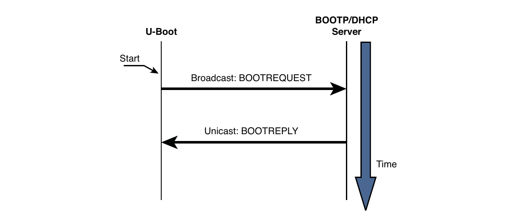

# Chương 7. Bootloader

## Trong chương này

- 7\.1 Vai trò của bootloader 160

- 7\.2 Những thách thức với bootloader 161

- 7\.3 Bootloader đa dụng: Das U-Boot 166

- 7\.4 Port U-Boot 174

- 7\.5 Device Tree Blob (Flat Device Tree) 187

- 7\.6 Các bootloader khác 194

- 7\.7 Tổng kết 197

Các chương trước đã đề cập và thậm chí cung cấp ví dụ về hoạt động của bootloader.

Là thành phần thiết yếu của embedded system, bootloader

cung cấp nền tảng để phần mềm hệ thống chính được sinh ra.

Chương này bắt đầu bằng việc khảo sát vai trò của bootloader trong hệ thống. Tiếp theo

là phần giới thiệu một số tính năng phổ biến của bootloader. Với

nền tảng này, chúng ta xem xét chi tiết một bootloader phổ biến dùng cho

embedded system. Chúng ta kết thúc chương bằng việc giới thiệu một vài bootloader

phổ biến hơn cả.

Ngày nay có nhiều bootloader được sử dụng. Việc đi sâu

vào ngay cả những bootloader phổ biến nhất cũng không thực tế. Vì vậy, chúng ta chọn giải thích

các khái niệm và dùng ví dụ dựa trên một trong các bootloader phổ biến hơn trong

cộng đồng open source cho Power Architecture, MIPS, ARM và những architecture

khác: bootloader U-Boot.

## 7.1 Vai trò của bootloader

Khi mới cấp nguồn cho processor board, nhiều thành phần phần cứng phải được khởi tạo trước khi ngay cả chương trình đơn giản nhất có thể chạy. Mỗi architecture và processor có tập hành động và cấu hình định sẵn khi thoát reset, bao gồm fetch initialization code từ thiết bị lưu trữ trên board (thường là Flash memory). Early initialization code này thuộc bootloader và chịu trách nhiệm đưa processor cùng các thành phần phần cứng liên quan vào hoạt động.

Phần lớn processor có địa chỉ mặc định để fetch những byte code đầu tiên khi cấp nguồn và thoát reset. Người thiết kế phần cứng dùng thông tin này để bố trí Flash memory trên board và chọn dải địa chỉ mà Flash memory đáp ứng. Nhờ đó, khi mới cấp nguồn, code được fetch từ địa chỉ well-known và có thể dự đoán, cho phép thiết lập quyền điều khiển bằng phần mềm.

Bootloader cung cấp early initialization code này và chịu trách nhiệm khởi tạo board để các chương trình khác có thể chạy. Early initialization code gần như luôn được viết bằng assembly language riêng của processor. Chỉ riêng điều này đã đặt ra nhiều thách thức, một số sẽ được khảo sát ở đây.

Tất nhiên, sau khi bootloader thực hiện khởi tạo processor và platform cơ bản này, vai trò chính của nó là fetch và boot một operating system full-blown. Nó chịu trách nhiệm định vị, load và chuyển quyền điều khiển cho operating system chính. Ngoài ra, bootloader có thể có tính năng nâng cao như xác thực OS image, nâng cấp chính nó hoặc OS image, hay chọn giữa nhiều OS image dựa trên chính sách developer-defined. Khác mô hình PC-BIOS truyền thống, khi OS giành quyền điều khiển, bootloader bị ghi đè và không còn tồn tại.[^1]

## 7.2 Những thách thức với bootloader

Ngay cả chương trình “Hello World” đơn giản viết bằng C cũng cần tài nguyên phần cứng và phần mềm đáng kể. Lập trình viên ứng dụng không cần biết hoặc quan tâm nhiều đến những chi tiết này, vì C runtime environment cung cấp hạ tầng đó một cách trong suốt. Lập trình viên bootloader không có sự thuận tiện ấy. Mọi tài nguyên bootloader cần đều phải được khởi tạo và cấp phát cẩn thận trước khi dùng. Một trong các ví dụ rõ nhất là Dynamic Random Access Memory (DRAM).

### 7.2.1 DRAM controller

DRAM chip không thể được đọc hoặc ghi trực tiếp như các tài nguyên microprocessor bus khác. Chúng cần hardware controller chuyên biệt để cho phép read cycle và write cycle. Phức tạp hơn nữa, DRAM phải được refresh liên tục, nếu không dữ liệu bên trong sẽ mất. Refresh được thực hiện bằng cách đọc tuần tự từng vị trí trong DRAM một cách có hệ thống, trong phạm vi timing specification do nhà sản xuất DRAM quy định. DRAM chip hiện đại hỗ trợ nhiều chế độ hoạt động như burst mode và dual data rate cho ứng dụng high-performance. DRAM controller chịu trách nhiệm cấu hình DRAM, duy trì refresh trong phạm vi timing specification của nhà sản xuất và đáp ứng các lệnh đọc, ghi khác nhau từ processor.

Thiết lập DRAM controller gây nhiều bối rối cho người mới phát triển embedded. Nó đòi hỏi hiểu biết chi tiết về DRAM architecture, chính controller, các DRAM chip cụ thể đang dùng và thiết kế phần cứng tổng thể. Chủ đề này nằm ngoài phạm vi cuốn sách, nhưng bạn có thể tìm hiểu thêm khái niệm quan trọng này qua tài liệu tham khảo cuối chương. Phụ lục D, “Các cân nhắc về SDRAM interface”, cung cấp thêm nền tảng về chủ đề quan trọng này.

Rất ít việc có thể diễn ra trong embedded system cho đến khi DRAM controller và chính DRAM được khởi tạo đúng. Một trong những việc đầu bootloader phải làm là bật memory subsystem. Sau khi khởi tạo, memory có thể được dùng như tài nguyên. Thực tế, một trong các hành động đầu tiên của nhiều bootloader sau khi khởi tạo memory là copy chính chúng vào DRAM để thực thi nhanh hơn.

### 7.2.2 Flash so với RAM

Một điểm phức tạp vốn có khác của bootloader là nó phải được lưu trong nonvolatile storage nhưng thường được load vào RAM để thực thi. Một lần nữa, độ phức tạp đến từ mức tài nguyên sẵn có mà bootloader có thể dựa vào. Trong hệ thống máy tính hoạt động đầy đủ chạy operating system như Linux, việc compile chương trình rồi gọi từ nonvolatile storage tương đối dễ. Runtime library, operating system và compiler phối hợp tạo hạ tầng cần để load chương trình từ nonvolatile storage vào memory và chuyển quyền điều khiển cho nó. Chương trình “Hello World” nói trên là ví dụ hoàn hảo. Sau khi compile, có thể load nó vào memory và thực thi chỉ bằng cách gõ tên executable (`hello`) tại command line (tất nhiên giả sử executable tồn tại ở đâu đó trên PATH).

Hạ tầng này không tồn tại khi bootloader giành quyền điều khiển lúc power-on. Thay vào đó, bootloader phải tạo context hoạt động riêng và tự di chuyển đến vị trí thích hợp trong RAM nếu cần. Hơn nữa, yêu cầu thực thi từ môi trường read-only làm tăng thêm độ phức tạp.

### 7.2.3 Độ phức tạp của image

Là lập trình viên ứng dụng, chúng ta không cần quan tâm cách bố trí binary executable file khi phát triển ứng dụng cho platform ưa thích. Compiler và binary utility được cấu hình sẵn để tạo binary executable image chứa các thành phần thích hợp cần cho architecture nhất định. Linker đặt startup code (prologue) và shutdown code (epilogue) vào image. Các object này thiết lập execution context phù hợp cho ứng dụng, thường bắt đầu tại `main()`.

Điều này hoàn toàn không đúng với bootloader điển hình. Khi bootloader giành quyền điều khiển, không có context hay execution environment từ trước. Hệ thống điển hình có thể không có DRAM nào cho đến khi bootloader khởi tạo processor và phần cứng liên quan. Hãy xét ý nghĩa của điều này. Trong function C điển hình, mọi local variable được lưu trên stack, vì vậy function đơn giản như Listing 7-1 không dùng được.

LISTING 7-1 Function C đơn giản với local variable

```
int setup_memory_controller(board_info_t *p)
    {
    unsigned int *dram_controller_register = p->dc_reg;
...
```

Khi bootloader giành quyền điều khiển lúc power-on, không có stack và stack pointer. Do đó, function C đơn giản tương tự Listing 7-1 rất có thể làm processor crash, vì compiler sinh code tạo và khởi tạo pointer `dram_controller_register` trên stack chưa tồn tại. Bootloader phải tạo execution context này trước khi gọi bất kỳ function C nào.

Khi bootloader được compile và link, lập trình viên phải kiểm soát hoàn toàn cách tạo và link image. Điều này đặc biệt đúng nếu bootloader tự relocate từ Flash sang RAM. Compiler và linker phải được truyền một số parameter xác định đặc tính và cách bố trí executable image cuối. Hai đặc tính chính cùng làm tăng độ phức tạp của binary executable image cuối: tổ chức code tương thích yêu cầu boot của processor và execution context, được mô tả ngay sau đây.

Đặc tính đầu tiên gây phức tạp là cần tổ chức startup code theo định dạng tương thích boot sequence của processor. Các executable instruction đầu tiên phải nằm ở vị trí định sẵn trong Flash, tùy processor và hardware architecture. Ví dụ, AMCC Power Architecture 405GP processor tìm machine instruction đầu tiên từ địa chỉ hard-coded `0xFFFF_FFFC`. Processor khác dùng phương pháp tương tự với chi tiết khác. Một số processor có thể được cấu hình lúc power-on để tìm code từ một trong nhiều vị trí định sẵn, tùy hardware configuration signal.

Lập trình viên chỉ định cách bố trí binary image như thế nào? Linker được truyền linker description file, còn gọi là linker command script. Có thể xem file đặc biệt này như công thức tạo binary executable image. Listing 7-2 là đoạn trích từ linker description file hiện có dùng trong bootloader U-Boot, sẽ được thảo luận ngay sau đây.

LISTING 7-2 Linker command script: Đặt reset vector

```
SECTIONS
{
  .resetvec 0xFFFFFFFC :
  {
    *(.resetvec)
  } = 0xffff
...
```

Mô tả đầy đủ cú pháp linker command script nằm ngoài phạm vi cuốn sách. Hãy tham khảo GNU LD manual được dẫn cuối chương. Nhìn Listing 7-2, chúng ta thấy phần bắt đầu định nghĩa output section của binary ELF image. Nó yêu cầu linker đặt section code có tên `.resetvec` tại địa chỉ cố định trong output image, bắt đầu ở `0xFFFF_FFFC`. Hơn nữa, nó chỉ định phần còn lại của section được điền toàn bit 1 (`0xffff`.) Lý do là Flash memory array đã xóa chứa toàn bit 1. Kỹ thuật này không chỉ giảm hao mòn Flash memory mà còn tăng đáng kể tốc độ lập trình sector đó.

Listing 7-3 là toàn bộ assembly language file từ U-Boot distribution gần đây định nghĩa code section `.resetvec`. Nó nằm trong assembly language file tên `.../cpu/ppc4xx/resetvec.S`. Chú ý code section này không thể dài quá 4 byte trên machine chỉ có 32 address bit, vì chỉ một instruction được định nghĩa trong section này, bất kể có những configuration option nào.

LISTING 7-3 Định nghĩa source của `.resetvec`

```
/* Copyright MontaVista Software Incorporated, 2000 */
#include <config.h>
      .section .resetvec,”ax”
#if defined(CONFIG_440)
      b _start_440
#else
#if defined(CONFIG_BOOT_PCI) && defined(CONFIG_MIP405)
      b _start_pci
#else
      b _start
#endif
#endif
```

Assembly language file này dễ hiểu ngay cả khi bạn không có kinh nghiệm lập trình assembly language. Tùy cấu hình cụ thể (được chỉ định bởi các macro `CONFIG_*`), unconditional branch instruction (`b` trong cú pháp Power Architecture assembler) được sinh đến vị trí bắt đầu thích hợp trong phần code chính. Branch location này là một Power Architecture instruction 4-byte. Như đã thấy trong đoạn linker command script ở Listing 7-2, branch instruction đơn giản này được đặt tại absolute Flash address `0xFFFF_FFFC` trong output image. Như đã đề cập, 405GP processor fetch instruction đầu tiên từ địa chỉ hard-coded này. Đó là cách lập trình viên định nghĩa và cung cấp chuỗi code đầu tiên cho tổ hợp architecture và processor cụ thể này.

### 7.2.4 Execution context

Lý do chính còn lại khiến bootloader image phức tạp là thiếu execution context. Khi chuỗi instruction trong Listing 7-3 bắt đầu thực thi (nhớ rằng đây là các machine instruction đầu tiên sau power-on), tài nguyên sẵn có cho chương trình đang chạy gần như bằng không. Các giá trị mặc định được thiết kế vào phần cứng bảo đảm fetch từ Flash memory hoạt động đúng. Điều này cũng bảo đảm system clock có một số giá trị mặc định, nhưng khó có thể giả định gì khác.[^2] Reset state của từng processor thường được nhà sản xuất định nghĩa rõ, còn reset state của board do người thiết kế phần cứng xác định.

Thực vậy, phần lớn processor không có DRAM sẵn lúc khởi động để lưu variable tạm thời, hoặc tệ hơn, để tạo stack cần cho calling convention của chương trình C. Nếu buộc phải viết “Hello World” mà không có DRAM, do đó không có stack, nó sẽ rất khác ví dụ “Hello World” truyền thống.

Giới hạn này đặt ra thách thức đáng kể cho phần code ban đầu dùng khởi tạo phần cứng. Vì thế, một trong các tác vụ đầu bootloader thực hiện khi khởi động là cấu hình đủ phần cứng để bật ít nhất một lượng RAM tối thiểu. Một số processor thiết kế cho embedded có sẵn lượng static RAM on-chip nhỏ. Đó là trường hợp 405GP đang thảo luận. Khi RAM sẵn có, có thể cấp phát stack bằng một phần RAM và xây dựng context phù hợp để chạy ngôn ngữ higher-level như C. Điều này cho phép viết phần khởi tạo processor và platform còn lại bằng ngôn ngữ khác assembly language.

## 7.3 Bootloader đa dụng: Das U-Boot

Có nhiều bootloader open source và thương mại, cùng nhiều thiết kế tự phát triển one-of-a-kind đang được dùng rộng rãi. Phần lớn có những tính năng chung ở mức độ nào đó. Ví dụ, tất cả đều có khả năng load và thực thi chương trình khác, đặc biệt operating system. Phần lớn tương tác với user qua serial port. Hỗ trợ nhiều networking subsystem (như Ethernet) là tính năng rất mạnh nhưng ít phổ biến hơn.

Nhiều bootloader dành riêng cho architecture cụ thể. Khả năng hỗ trợ nhiều architecture và processor của bootloader có thể quan trọng với tổ chức phát triển lớn. Một tổ chức phát triển dùng nhiều processor thuộc hơn một architecture không phải hiếm. Đầu tư vào một bootloader duy nhất trên nhiều platform cuối cùng giúp giảm chi phí phát triển.

Phần này nghiên cứu bootloader hiện có đã trở nên rất phổ biến trong cộng đồng embedded Linux. Tên chính thức là Das U-Boot. Nó do Wolfgang Denx duy trì và được lưu trữ tại www.denx.de/wiki/U-Boot. U-Boot hỗ trợ nhiều architecture và có đông đảo lập trình viên embedded cùng nhà sản xuất phần cứng sử dụng trong dự án và đóng góp phát triển.

### 7.3.1 Lấy U-Boot

Cách đơn giản nhất để lấy source code U-Boot là qua `git`. Nếu đã cài `git` trên desktop hoặc laptop, chỉ cần gọi lệnh này:

```
$ git clone git://git.denx.de/u-boot.git
```

Thao tác này tạo directory tên `u-boot` trong directory nơi bạn thực thi lệnh.

Nếu không có `git`, hoặc muốn download snapshot, bạn có thể làm qua server `git` tại denx.de. Trỏ trình duyệt đến http://git.denx.de/ và nhấp link “summary” ở dự án đầu tiên, `u-boot.git`. Nó đưa bạn đến màn hình tổng quan và cung cấp link “snapshot”, sinh và download tarball mà bạn có thể cài trên hệ thống. Chọn snapshot mới nhất ở đầu danh sách “shortlog”.

### 7.3.2 Cấu hình U-Boot

Để bootloader hữu ích trên nhiều processor và architecture, cần có phương pháp cấu hình. Như chính Linux kernel, bootloader được cấu hình lúc compile. Phương pháp này giảm đáng kể độ phức tạp của binary bootloader image, vốn cũng là đặc tính quan trọng.

Với U-Boot, cấu hình board-specific được điều khiển bởi một header file riêng cho target platform, cùng một vài soft link trong source tree chọn đúng subdirectory dựa trên target board, architecture và CPU. Khi cấu hình U-Boot cho một platform được hỗ trợ, gọi lệnh:

```
$ make <platform>_config
```

Ở đây, `platform` là một trong nhiều platform U-Boot hỗ trợ. Các platform configuration target này được liệt kê trong makefile top-level của U-Boot. Ví dụ, để cấu hình cho Spectrum Digital OSK chứa TI OMAP 5912 processor, gọi lệnh:

```
$ make omap5912osk_config
```

Điều này cấu hình U-Boot source tree với các soft link phù hợp để chọn ARM làm target architecture, ARM926 core và 5912 OSK làm target platform.

Bước cấu hình U-Boot tiếp theo cho platform này là sửa configuration file riêng của board. File nằm trong subdirectory `../include/configs` của U-Boot và có tên `omap5912osk.h`. README file đi kèm source code U-Boot mô tả chi tiết cấu hình và là nguồn thông tin tốt nhất. (Với board hiện có đã được U-Boot hỗ trợ, có thể không cần sửa configuration file board-specific này. Giá trị mặc định có thể đủ cho nhu cầu. Đôi khi cần chỉnh nhẹ memory size hoặc flash size, vì nhiều reference board được bán với các cấu hình khác nhau.)

U-Boot được cấu hình bằng configuration variable định nghĩa trong header file board-specific. Configuration variable có hai dạng. Configuration option được chọn bằng macro dạng `CONFIG_XXXX`. Configuration setting được chọn bằng macro dạng `CONFIG_SYS_XXXX`. Nhìn chung, configuration option (`CONFIG_XXX`) là user-configurable và bật các tính năng hoạt động cụ thể của U-Boot. Configuration setting (`CONFIG_SYS_XXX`) thường là hardware-specific và cần hiểu biết chi tiết về processor và/hoặc hardware platform bên dưới. Cấu hình Board-specific của U-Boot được điều khiển bằng header file dành riêng cho platform cụ thể, chứa configuration option và setting phù hợp với platform đó. U-Boot source tree có directory chứa các configuration header file board-specific này. Có thể tìm tại `.../include/configs` từ U-Boot source directory top-level.

Bạn có thể chọn nhiều tính năng và chế độ hoạt động bằng cách thêm định nghĩa vào file board-configuration. Listing 7-4 là một phần configuration header file cho board Yosemite dựa trên AMCC 440EP processor.

LISTING 7-4 Các phần của U-Boot header file Board-Configuration

```
/*---------------------------------------------------------------
 * High Level Configuration Options
 *---------------------------------------------------------------*/
/* This config file is used for Yosemite (440EP) and Yellowstone (440GR)*/
#ifndef CONFIG_YELLOWSTONE
#define CONFIG_440EP        1   /* Specific PPC440EP support    */
#define CONFIG_HOSTNAME     yosemite
#else
#define CONFIG_440GR        1   /* Specific PPC440GR support    */
#define CONFIG_HOSTNAME     yellowstone
#endif
#define CONFIG_440      1   /* ... PPC440 family        */
#define CONFIG_4xx      1   /* ... PPC4xx family        */
#define CONFIG_SYS_CLK_FREQ 66666666    /* external freq to pll */
<...>
/*-----------------------------------------------------------------------
 * Base addresses -- Note these are effective addresses where the
 * actual resources get mapped (not physical addresses)
 *-------------------------------------------------------------------*/
#define CONFIG_SYS_FLASH_BASE      0xfc000000    /* start of FLASH   */
#define CONFIG_SYS_PCI_MEMBASE     0xa0000000    /* mapped pci memory*/
#define CONFIG_SYS_PCI_MEMBASE1    CONFIG_SYS_PCI_MEMBASE  + 0x10000000
#define CONFIG_SYS_PCI_MEMBASE2    CONFIG_SYS_PCI_MEMBASE1 + 0x10000000
#define CONFIG_SYS_PCI_MEMBASE3    CONFIG_SYS_PCI_MEMBASE2 + 0x10000000
<...>
#ifdef CONFIG_440EP
    #define CONFIG_CMD_USB
    #define CONFIG_CMD_FAT
    #define CONFIG_CMD_EXT2
#endif
<...>
/*----------------------------------------------------
 * External Bus Controller (EBC) Setup
 *----------------------------------------------------*/
#define CONFIG_SYS_FLASH        CONFIG_SYS_FLASH_BASE
#define CONFIG_SYS_CPLD     0x80000000

/* Memory Bank 0 (NOR-FLASH) initialization                 */
#define CONFIG_SYS_EBC_PB0AP        0x03017300
#define CONFIG_SYS_EBC_PB0CR        (CONFIG_SYS_FLASH | 0xda000)

/* Memory Bank 2 (CPLD) initialization                      */
#define CONFIG_SYS_EBC_PB2AP        0x04814500
#define CONFIG_SYS_EBC_PB2CR        (CONFIG_SYS_CPLD | 0x18000)
<...>
```

Listing 7-4 cho bạn hình dung cách cấu hình chính U-Boot cho một board nhất định. File board-configuration thực có thể chứa hàng trăm dòng tương tự ở đây. Trong ví dụ, bạn thấy định nghĩa cho CPU (`CONFIG_440EP`), board name (`CONFIG_HOSTNAME`), clock frequency và base memory address của Flash cùng PCI. Chúng ta đã đưa vào ví dụ configuration variable (`CONFIG_XXX`) và configuration setting (`CONFIG_SYS_XXX`). Vài dòng cuối là các giá trị processor register thực cần để khởi tạo external bus controller cho memory bank 0 và 1. Bạn thấy những giá trị này chỉ có thể đến từ hiểu biết chi tiết về board và processor.

Nhiều khía cạnh U-Boot có thể được cấu hình bằng các cơ chế này, bao gồm chức năng được compile vào U-Boot (hỗ trợ DHCP, memory test, hỗ trợ debug, v.v.). Cơ chế có thể cho U-Boot biết board có bao nhiêu memory, loại nào và được map ở đâu. Bạn có thể học thêm nhiều bằng cách xem trực tiếp code U-Boot, đặc biệt README file rất tốt.

### 7.3.3 Các monitor command của U-Boot

U-Boot hỗ trợ hơn 70 command set chuẩn, cho phép hơn 150 lệnh riêng biệt qua các macro `CONFIG_CMD_*`. Command set được bật trong U-Boot bằng các configuration setting macro (`CONFIG_*`). Để có danh sách đầy đủ từ U-Boot snapshot gần đây, tham khảo Phụ lục B, “Các lệnh có thể cấu hình của U-Boot”. Bảng 7-1 chỉ cho thấy vài lệnh để bạn hình dung các khả năng sẵn có.

BẢNG 7-1 Một số lệnh U-Boot có thể cấu hình

| Command set | Mô tả lệnh |
|---|---|
| `CONFIG_CMD_FLASH` | Các lệnh Flash memory |
| `CONFIG_CMD_MEMORY` | Memory dump, fill, copy, compare, v.v. |
| `CONFIG_CMD_DHCP` | Hỗ trợ DHCP |
| `CONFIG_CMD_PING` | Hỗ trợ Ping |
| `CONFIG_CMD_EXT2` | Hỗ trợ EXT2 file system |

Để bật lệnh cụ thể, định nghĩa macro tương ứng với lệnh bạn muốn. Các macro được định nghĩa trong configuration file board-specific. Listing 7-4 cho thấy một số

lệnh được bật trong configuration file board-specific. Ở đó, bạn thấy `CONFIG_CMD_USB`, `CONFIG_CMD_FAT` và `CONFIG_CMD_EXT2` được định nghĩa có điều kiện nếu board là 440EP.

Thay vì chỉ định từng macro `CONFIG_CMD_*` trong configuration header board-specific riêng, bạn có thể bắt đầu từ tập lệnh đầy đủ trong `.../include/config_cmd_all.h`. Header file này định nghĩa mọi lệnh sẵn có. Header file thứ hai, `.../include/config_cmd_default.h`, định nghĩa danh sách command set mặc định hữu ích của U-Boot như `tftpboot` (boot image từ tftpserver), `bootm` (boot image từ memory), memory utility như `md` (hiển thị memory), v.v. Để bật tổ hợp lệnh cụ thể, bạn có thể bắt đầu với mặc định rồi thêm bớt khi cần. Listing 7-4 thêm các command set `USB`, `FAT` và `EXT2` vào mặc định. Bạn có thể loại bớt theo cách tương tự, bắt đầu từ `config_cmd_all.h`:

```
#include “condif_cmd_all.h”
#undef CONFIG_CMD_DHCP
#undef CONFIG_CMD_FAT
#undef CONFIG_CMD_FDOS
<...>
```

Xem bất kỳ header file board-configuration nào trong `.../include/configs/` để có ví dụ.

### 7.3.4 Hoạt động network

Nhiều bootloader hỗ trợ Ethernet interface. Trong môi trường phát triển, điều này tiết kiệm rất nhiều thời gian. Load ngay cả kernel image vừa phải qua serial port có thể mất nhiều phút, so với vài giây qua Ethernet link, đặc biệt nếu board hỗ trợ Fast hoặc Gigabit Ethernet. Hơn nữa, serial link dễ gặp lỗi hơn do serial terminal hoạt động không tốt, nhiễu đường truyền, v.v.

Một số tính năng quan trọng hơn cần tìm ở bootloader là hỗ trợ các giao thức BOOTP, DHCP và TFTP. Nếu chưa quen, BOOTP (Bootstrap Protocol) và DHCP (Dynamic Host Configuration Protocol) cho phép target device có Ethernet port lấy IP address cùng thông tin cấu hình network-related khác từ central server. TFTP (Trivial File Transfer Protocol) cho phép target device download file (như Linux kernel image) từ TFTP server. Tham chiếu đến đặc tả giao thức được liệt kê cuối chương. Server cho các dịch vụ này được mô tả trong Chương 12, “Môi trường phát triển embedded”.

Hình 7-1 minh họa luồng thông tin giữa target device và BOOTP server. Client (U-Boot trong trường hợp này) bắt đầu trao đổi bằng cách gửi broadcast packet tìm BOOTP server. Server phản hồi bằng reply packet gồm IP address của client và thông tin khác. Dữ liệu hữu ích nhất bao gồm tên file dùng để download kernel image.



HÌNH 7-1 BOOTP client/server handshake

Trong thực tế, BOOTP server chuyên dụng không còn tồn tại dưới dạng server stand-alone. DHCP server đi kèm Linux distribution ưa thích cũng hỗ trợ BOOTP protocol packet và gần như được dùng phổ biến cho các hoạt động BOOTP.

Giao thức DHCP phát triển dựa trên BOOTP. Nó có thể cung cấp cho target nhiều loại thông tin cấu hình. Trong thực tế, trao đổi thông tin thường bị giới hạn bởi DHCP client implementation của target/bootloader. Listing 7-5 cho thấy DHCP server configuration block xác định một target device. Đây là đoạn trích DHCP configuration file từ DHCP implementation của Fedora Core 2.

LISTING 7-5 Đặc tả DHCP target

```
host coyote {
      hardware ethernet 00:0e:0c:00:82:f8;
      netmask 255.255.255.0;
      fixed-address 192.168.1.21;
      server-name 192.168.1.9;
      filename “coyote-zImage”;
      option root-path “/home/sandbox/targets/coyote-target”;
}
...
```

Khi DHCP server này nhận packet từ device khớp hardware Ethernet address trong Listing 7-5, nó phản hồi bằng cách gửi cho device các parameter trong target specification. Bảng 7-2 mô tả các field trong target specification.

BẢNG 7-2 DHCP target parameter

| DHCP target parameter | Mục đích | Mô tả |
|---|---|---|
| `host` | Hostname | Nhãn ký hiệu trong DHCP configuration file |
| `hardware ethernet` | Ethernet hardware address | Ethernet hardware address Low-level của Ethernet interface trên target |
| `fixed-address` | IP address của target | IP address mà target sẽ dùng |
| `netmask` | Netmask của target | IP netmask mà target sẽ dùng |
| `server-name` | IP address của TFTP server | IP address mà target gửi request truyền file, root file system, v.v. đến |
| `filename` | Tên file TFTP | Tên file bootloader có thể dùng để boot secondary image (thường là Linux kernel) |
| `root-path` | NFS root path | Xác định network path cho remote NFS root mount |

Khi bootloader trên target board hoàn tất trao đổi BOOTP hoặc DHCP, các parameter này được dùng để cấu hình thêm. Ví dụ, bootloader dùng IP address của target (`fixed-address`) để bind Ethernet port với IP address đó. Sau đó, bootloader dùng field `server-name` làm destination IP address để request file trong field `filename`, mà phần lớn là Linux kernel image. Dù đây là cách dùng phổ biến nhất, cùng tình huống này có thể dùng để download và thực thi firmware kiểm tra sản xuất và chẩn đoán.

Cần lưu ý giao thức DHCP hỗ trợ nhiều parameter hơn những gì trình bày chi tiết trong Bảng 7-2. Đây chỉ là các parameter phổ biến hơn bạn có thể gặp trong embedded system. Xem DHCP specification được tham chiếu cuối chương để biết đầy đủ chi tiết.

### 7.3.5 Storage subsystem

Nhiều bootloader hỗ trợ boot image từ nhiều nonvolatile storage device ngoài Flash memory thông thường. Khó khăn khi hỗ trợ những device này là sự phức tạp tương đối của cả phần cứng và phần mềm. Ví dụ, để truy cập dữ liệu trên hard drive, bootloader phải có device driver code cho IDE controller interface, cùng hiểu biết về partition scheme và file system bên dưới. Đây không phải việc đơn giản và phù hợp hơn với operating system full-blown.

Ngay cả với sự phức tạp bên dưới, vẫn có phương pháp load image từ loại device này. Đơn giản nhất là chỉ hỗ trợ phần cứng. Trong mô hình này, không giả định có hiểu biết về file system. Bootloader chỉ raw-loads từ các absolute sector trên device. Có thể dùng mô hình này bằng cách dành một partition chưa format từ sector 0 trên device IDE-compatible (như CompactFlash) rồi load dữ liệu ở đó mà không áp đặt cấu trúc nào. Đây là cấu hình đơn giản để load kernel image hoặc binary image khác từ block storage device. Các partition bổ sung trên device có thể được format cho file system nhất định và chứa file system hoàn chỉnh. Sau khi kernel boot, Linux device driver có thể truy cập các partition bổ sung.

U-Boot có thể load image từ raw partition chỉ định hoặc partition có file system structure. Tất nhiên, board phải có hardware device được hỗ trợ (IDE subsystem), và U-Boot phải được cấu hình tương ứng. Thêm `CONFIG_CMD_IDE` vào configuration file board-specific bật hỗ trợ IDE interface, còn thêm `CONFIG_CMD_BOOTD` bật hỗ trợ boot từ raw partition. Nếu port U-Boot sang custom board, có thể bạn phải sửa U-Boot để hiểu phần cứng cụ thể của mình.

### 7.3.6 Boot từ disk

Như vừa mô tả, U-Boot hỗ trợ nhiều phương pháp boot kernel image từ disk subsystem. Lệnh đơn giản này minh họa một phương pháp được hỗ trợ:

```
=> diskboot 0x400000 0:0
```

Để hiểu cú pháp này, trước tiên phải hiểu cách U-Boot đánh số disk device. 0:0 trong ví dụ chỉ định device và partition. Trong ví dụ đơn giản, U-Boot thực hiện raw binary load image trên IDE device đầu tiên (IDE device 0) từ partition đầu tiên (partition 0) trên device đó. Image được load vào system memory tại physical address `0x400000`.

Sau khi kernel image được load vào memory, lệnh `bootm` của U-Boot (boot từ memory) được dùng để boot kernel:

```
=> bootm 0x400000
```

## 7.4 Port U-Boot

Một lý do U-Boot phổ biến là dễ bổ sung hỗ trợ platform mới. Mỗi board port phải cung cấp subordinate makefile chứa các định nghĩa board-specific cho build process. Tất cả file này có tên `config.mk`. Chúng nằm trong subdirectory `.../board/vendor/boardname` dưới U-Boot source directory top-level, với `boardname` chỉ board cụ thể.

Trong một U-Boot snapshot gần đây, hơn 460 board configuration file khác nhau có tên `config.mk` nằm dưới subdirectory `.../boards`. Cùng phiên bản U-Boot này hỗ trợ 49 cấu hình CPU khác nhau (đếm cùng cách). Chú ý rằng đôi khi CPU configuration bao phủ cả họ chip, như `ppc4xx` hỗ trợ một số processor thuộc họ Power Architecture 4xx. U-Boot hỗ trợ rất nhiều CPU và họ CPU phổ biến đang dùng, cùng tập hợp reference board dựa trên các processor này lớn hơn nhiều.

Nếu board chứa CPU đã được hỗ trợ, port U-Boot khá đơn giản. Nếu phải thêm CPU mới, hãy dự tính công sức nhiều hơn đáng kể. Tin tốt là người đi trước có lẽ đã làm phần lớn công việc. Dù port sang CPU mới hay board mới dựa trên CPU hiện có, hãy nghiên cứu source code hiện có để được hướng dẫn cụ thể. Xác định CPU gần nhất với CPU của bạn rồi clone chức năng trong directory CPU-specific đó. Cuối cùng, sửa các source thu được để thêm hỗ trợ cụ thể theo yêu cầu CPU mới.

### 7.4.1 Port U-Boot cho EP405

Logic dùng để port sang CPU khác cũng áp dụng khi port U-Boot sang board mới. Hãy xem ví dụ. Chúng ta dùng board Embedded Planet EP405 chứa AMCC Power Architecture 405GP processor. Board cụ thể dùng trong ví dụ được Embedded Planet cung cấp và đi kèm 64MB SDRAM, 16MB Flash on-board. Nhiều device khác hoàn thiện thiết kế.

Bước đầu là xem mức độ gần với board hiện có. Nhiều board trong U-Boot source tree hỗ trợ 405GP processor. Một lệnh grep nhanh trên các header file board-configuration thu hẹp lựa chọn xuống những file hỗ trợ 405GP processor:

```
$ cd .../u-boot/include/configs
$ grep -l CONFIG_405GP *
```

Trong U-Boot snapshot gần đây, 28 board configuration file được cấu hình cho 405GP. Sau khi khảo sát một số file, chúng ta chọn cấu hình AR405.h làm cơ sở. Nó hỗ trợ LXT971 Ethernet transceiver, cũng có trên EP405. Mục tiêu là giảm thiểu công việc phát triển bằng cách tận dụng architecture tương tự theo tinh thần open source.

Chúng ta làm những bước dễ trước. Cần custom board configuration header file cho board EP405. Copy board configuration file sang file mới có tên phù hợp board của bạn. Chúng ta gọi file của mình là `EP405.h`. Các lệnh này được gọi từ U-Boot source tree top-level:

```
$ cp .../include/configs/AR405.h .../include/configs/EP405.h
```

Sau khi copy configuration header file, bạn phải tạo directory board-specific và copy các file của board AR405. Chúng ta chưa biết có cần tất cả hay không. Bước đó đến sau. Sau khi copy file vào board directory mới, sửa tên file phù hợp tên board:

```
$ cd board   <<< from top-level U-Boot source directory
$ mkdir ep405
$ cp esd/ar405/* ep405
```

Giờ đến phần khó. Jerry Van Baren, lập trình viên và người đóng góp U-Boot, đã trình bày quy trình port U-Boot hài hước nhưng thực tế trong một bài e-mail gửi U-Boot mailing list. Quy trình đầy đủ, được ghi bằng pseudo-C, nằm trong U-Boot README file. Phần sau tóm tắt phần khó của porting process theo phong cách và tinh thần Jerry:

```
while (!running) {
      do {
            Add / modify source code
      } until (compiles);
      Debug;
...
}
```

Quy trình Jerry được tóm tắt ở đây là sự thật đơn giản. Khi đã chọn cơ sở để port, bạn phải thêm, xóa và sửa source code đến khi compile được, rồi debug đến khi chạy không lỗi! Không có công thức thần kỳ. Port bất kỳ bootloader nào sang board mới đều cần kiến thức nhiều lĩnh vực phần cứng và phần mềm. Một số lĩnh vực như thiết lập SDRAM controller khá chuyên biệt và phức tạp. Hầu như toàn bộ công việc đòi hỏi hiểu biết chi tiết về phần cứng bên dưới. Vì thế, hãy chuẩn bị dành nhiều giờ thú vị để nghiền ngẫm hardware reference manual của processor, cùng data sheet của nhiều thành phần khác trên board.

### 7.4.2 Configuration target trong U-Boot makefile

Giờ có code base để bắt đầu, chúng ta phải sửa makefile top-level của U-Boot để thêm các bước cấu hình cho board mới. Khảo sát makefile này, chúng ta thấy phần cấu hình U-Boot source tree cho các board được hỗ trợ. Phần này bắt đầu từ target `unconfig` trong makefile top-level. Giờ thêm hỗ trợ board mới để cấu hình được nó. Vì board được phát triển từ ESD AR405, chúng ta dùng rule đó làm mẫu tạo rule riêng. Nếu theo dõi source code U-Boot, bạn sẽ thấy các rule được đặt trong makefile theo thứ tự chữ cái của configuration name. Chúng ta sẽ là thành viên open-source có ý thức và làm theo. Chúng ta gọi configuration target là `EP405_config`, một lần nữa tuân theo quy ước U-Boot. Listing 7-6 trình bày chi tiết chỉnh sửa cần làm trong makefile top-level.

LISTING 7-6 Chỉnh sửa makefile

```
ebony_config:    unconfig
      @$(MKCONFIG) $(@:_config=) ppc ppc4xx ebony amcc

+EP405_config:    unconfig
+     @$(MKCONFIG) $(@:_config=) ppc ppc4xx ep405 ep
+
ERIC_config:      unconfig
      @./mkconfig $(@:_config=) ppc ppc4xx eric
```

Configuration rule mới được chèn như thể hiện trong ba dòng bắt đầu bằng ký tự `+` (unified diff format). Sửa makefile top-level bằng editor ưa thích.

Hoàn thành các bước vừa mô tả, chúng ta có U-Boot source tree làm điểm khởi đầu. Có thể nó chưa compile sạch, nên đó là bước đầu cần làm. Ít nhất compiler có thể hướng dẫn nơi bắt đầu.

### 7.4.3 Build EP405 lần đầu

Giờ chúng ta có U-Boot source tree với các file ứng viên. Bước đầu là cấu hình build tree cho board EP405 mới thêm. Dùng configuration target vừa thêm vào makefile top-level, chúng ta cấu hình tree. Listing 7-7 cho bạn điểm bắt đầu để tập trung công sức.

LISTING 7-7 Cấu hình và build cho EP405

```
$ make ARCH=ppc CROSS_COMPILE=ppc_405- EP405_config
Configuring for EP405 board...
$ # Now do the build
$ make ARCH=ppc CROSS_COMPILE=ppc_405-
<...lots of build steps...>
make[1]: Entering directory ‘/home/chris/sandbox/u-boot/board/ep/ep405’
ppc_440ep-gcc  -g  -Os   -mrelocatable -fPIC -ffixed-r14 -meabi -D__KERNEL__
-DTEXT_BASE=0xFFFC0000 -I/home/chris/sandbox/u-boot/include -fno-builtin -ffree-
standing -nostdinc -isystem /opt/pro5/montavista/pro/devkit/ppc/440ep/bin/../lib/
gcc/powerpc-montavista-linux-gnu/4.2.0/include -pipe  -DCONFIG_PPC -D__powerpc__
-DCONFIG_4xx -ffixed-r2 -mstring -msoft-float -Wa,-m405 -mcpu=405 -Wall -Wstrict-
prototypes -fno-stack-protector   -o ep405.o ep405.c -c
ep405.c:25:19: error: ar405.h: No such file or directory
ep405.c:44:22: error: fpgadata.c: No such file or directory
ep405.c:48:27: error: fpgadata_xl30.c: No such file or directory
ep405.c:54:28: error: ../common/fpga.c: No such file or directory
ep405.c: In function ‘board_early_init_f’:
ep405.c:75: warning: implicit declaration of function ‘fpga_boot’
ep405.c:91: error: ‘ERROR_FPGA_PRG_INIT_LOW’ undeclared (first use in this func-
tion)
ep405.c:91: error: (Each undeclared identifier is reported only once
ep405.c:91: error: for each function it appears in.)
ep405.c:94: error: ‘ERROR_FPGA_PRG_INIT_HIGH’ undeclared (first use in this func-
tion)
ep405.c:97: error: ‘ERROR_FPGA_PRG_DONE’ undeclared (first use in this function)
make[1]: *** [ep405.o] Error 1
make[1]: Leaving directory ‘/home/chris/sandbox/u-boot/board/ep/ep405’
make: *** [board/ep/ep405/libep405.a] Error 2
```

Thoạt nhìn, chúng ta thấy cần sửa file `ep405.c` đã clone và chỉnh vài tham chiếu, gồm board header file và tham chiếu FPGA. Có thể loại bỏ chúng vì board EP405 không chứa FPGA như AR405 được dùng làm cơ sở. Các chỉnh sửa khá đơn giản nên để làm bài tập cho người đọc. Một lần nữa, không có công thức tốt hơn của Jerry: edit-compile-repeat đến khi file compile sạch. Rồi đến phần khó—thực sự làm nó hoạt động. Việc đó không khó. Chưa đầy một giờ chỉnh sửa đã khiến file compile không lỗi.

### 7.4.4 Khởi tạo processor EP405

Tác vụ đầu mà U-Boot port mới phải thực hiện đúng là khởi tạo processor và memory subsystem (DRAM). Sau reset, core của 405GP processor được thiết kế fetch instruction bắt đầu từ `0xFFFF_FFFC`. Core cố thực thi instruction ở đây. Vì đây là đỉnh memory range, instruction tìm thấy phải là unconditional branch instruction.

Processor core này cũng được hard-coded để cấu hình vùng memory 2MB trên cùng có thể truy cập mà không cần lập trình external bus controller, nơi Flash memory thường được nối vào. Điều đó buộc phải branch đến vị trí trong address space này, vì processor không thể address memory ở nơi khác cho đến khi bootloader code khởi tạo các memory region bổ sung. Chúng ta phải branch đến vị trí bằng hoặc trên `0xFFE0_0000`. Làm sao biết tất cả điều này? Vì chúng ta đã đọc 405GP user manual!

Hành vi của core 405GP processor vừa mô tả đặt yêu cầu cho người thiết kế phần cứng phải bảo đảm khi power-up, nonvolatile memory (Flash) được map vào vùng memory 2MB trên cùng. Một số attribute của vùng memory ban đầu nhận giá trị mặc định khi reset. Ví dụ, vùng 2MB trên cùng được cấu hình với 256 wait state, ba cycle address to chip select delay, ba cycle chip select to output enable delay và bảy cycle hold time.[^3] Điều này cho người thiết kế phần cứng mức tự do tối đa để chọn device hoặc phương pháp thích hợp đưa instruction code đến processor ngay sau reset.

Chúng ta đã thấy cách cài reset vector vào đỉnh Flash trong Listing 7-2. Khi cấu hình cho 405GP, những dòng code đầu nằm trong file `.../cpu/ppc4xx/start.S`. Các lập trình viên U-Boot muốn code này là processor-generic. Về lý thuyết không cần code board-specific trong file. Bạn sẽ thấy cách thực hiện.

Không cần hiểu sâu Power Architecture assembly language để hiểu luồng logic trong `start.S`. Nhiều câu hỏi thường gặp (FAQ) đã được đăng trên U-Boot mailing list về sửa assembly code low-level. Gần như mọi trường hợp, không cần sửa code này nếu port sang một trong nhiều processor được hỗ trợ. Đây là code trưởng thành, có nhiều port thành công đang chạy. Bạn cần sửa code board-specific (ở mức tối thiểu) cho port của mình. Nếu đang khắc phục sự cố hoặc sửa early startup assembler code cho processor đã tồn tại một thời gian, rất có thể bạn đang đi sai hướng.

Listing 7-8 tái hiện một phần `start.S` cho architecture 4xx.

LISTING 7-8 Startup code 4xx của U-Boot

```
...
#if defined(CONFIG_405GP) || defined(CONFIG_405CR) ||
 defined(CONFIG_405) || defined(CONFIG_405EP)
     /*--------------------------------- */
     /* Clear and set up some registers. */
     /*--------------------------------- */
     addi    r4,r0,0x0000
     mtspr   sgr,r4
     mtspr   dcwr,r4
     mtesr   r4             /* clear Exception Syndrome Reg */
     mttcr   r4             /* clear Timer Control Reg */
     mtxer   r4             /* clear Fixed-Point Exception Reg */
     mtevpr  r4           /* clear Exception Vector Prefix Reg */
     addi    r4,r0,0x1000   /* set ME bit (Machine Exceptions) */
     oris    r4,r4,0x0002            /* set CE bit (Critical Exceptions) */
     mtmsr   r4                      /* change MSR */
     addi    r4,r0,(0xFFFF-0x10000)  /* set r4 to 0xFFFFFFFF (status in the */
                                /* dbsr is cleared by setting bits to 1) */
     mtdbsr  r4                      /* clear/reset the dbsr */

     /*---------------------------------- */
     /* Invalidate I and D caches. Enable I cache for defined memory regions */
     /* to speed things up. Leave the D cache disabled for now. It will be */
     /* enabled/left disabled later based on user-selected menu options. */
     /* Be aware that the I cache may be disabled later based on the menu */
     /* options as well. See miscLib/main.c. */
     /*------------------------------------- */
     bl      invalidate_icache
     bl      invalidate_dcache

     /*-------------------------------------- */
     /* Enable two 128MB cachable regions.    */
     /*-----------------------------------    */
     addis   r4,r0,0x8000
     addi    r4,r4,0x0001
     mticcr  r4                      /* instruction cache */
     isync

     addis   r4,r0,0x0000
     addi    r4,r4,0x0000
     mtdccr  r4                      /* data cache */
```

Code đầu tiên thực thi trong `start.S` cho 405GP processor bắt đầu ở khoảng một phần ba source file, nơi một số processor register được xóa hoặc đặt giá trị ban đầu hợp lý. Sau đó instruction cache và data cache được invalidate, rồi instruction cache được bật để tăng tốc initial load. Hai cacheable region 128MB được thiết lập—một ở đầu trên memory (vùng Flash), một ở đáy (thường là đầu system DRAM). Cuối cùng U-Boot được copy vào RAM trong vùng này và thực thi từ đó. Lý do là hiệu năng: raw read từ RAM nhanh hơn đọc Flash một bậc độ lớn (hoặc hơn). Tuy nhiên với CPU 4xx, còn lý do tinh tế khác để bật instruction cache, như bạn sẽ thấy ngay sau đây.

### 7.4.5 Khởi tạo Board-Specific

Cơ hội đầu để khởi tạo board-specific nằm trong `.../cpu/ppc4xx/start.S`, ngay sau khi các cacheable region được khởi tạo. Ở đây có lời gọi external assembler language routine tên `ext_bus_cntlr_init`:

```
bl ext_bus_cntlr_init   /* Board-specific bus cntrl init */
```

Routine này được định nghĩa trong `.../board/ep405/init.S`, thuộc directory board-specific mới cho board của chúng ta. Nó cung cấp hook cho khởi tạo hardware-based rất sớm. Đây là một trong những file được tùy chỉnh cho platform EP405. File chứa code board-specific để khởi tạo external bus controller của 405GP cho ứng dụng. Listing 7-9 chứa phần chức năng cốt lõi của file. Đây là code khởi tạo external bus controller của 405GP.

LISTING 7-9 Khởi tạo external bus controller

```
       .globl  ext_bus_cntlr_init
   ext_bus_cntlr_init:
       mflr    r4            /* save link register          */
       bl      ..getAddr
   ..getAddr:
       mflr    r3           /* get _this_ address           */
       mtlr    r4           /* restore link register        */
       addi    r4,0,14      /* prefetch 14 cache lines...   */
       mtctr   r4           /* ...to fit this function      */
                            /* cache (8x14=112 instr)       */
   ..ebcloop:
       icbt    r0,r3        /* prefetch cache line for [r3] */
       addi    r3,r3,32     /* move to next cache line      */
       bdnz    ..ebcloop    /* continue for 14 cache lines  */

       /*--------------------------------------------------- */
       /* Delay to ensure all accesses to ROM are complete  */
       /* before changing  bank 0 timings                  */
       /* 200usec should be enough.                         */
       /* 200,000,000 (cycles/sec) X .000200 (sec) =        */
       /* 0x9C40 cycles                                     */
       /*--------------------------------------------------- */

       addis   r3,0,0x0
       ori     r3,r3,0xA000 /* ensure 200usec have passed t */
    mtctr   r3

..spinlp:
    bdnz    ..spinlp     /* spin loop                    */

    /*----------------------------------------------------*/
    /* Now do the real work of this function             */
    /* Memory Bank 0 (Flash and SRAM) initialization     */
    /*----------------------------------------------------*/

    addi    r4,0,pb0ap         /* *ebccfga = pb0ap;      */
    mtdcr   ebccfga,r4
    addis   r4,0,EBC0_B0AP@h   /* *ebccfgd = EBC0_B0AP;  */
    ori     r4,r4,EBC0_B0AP@l
    mtdcr   ebccfgd,r4

    addi    r4,0,pb0cr         /* *ebccfga = pb0cr;      */
    mtdcr   ebccfga,r4
    addis   r4,0,EBC0_B0CR@h   /* *ebccfgd = EBC0_B0CR;  */
    ori     r4,r4,EBC0_B0CR@l
    mtdcr   ebccfgd,r4

    /*----------------------------------------------------*/
    /* Memory Bank 4 (NVRAM & BCSR) initialization       */
    /*----------------------------------------------------*/

    addi    r4,0,pb4ap         /* *ebccfga = pb4ap;      */
    mtdcr   ebccfga,r4
    addis   r4,0,EBC0_B4AP@h   /* *ebccfgd = EBC0_B4AP;  */
    ori     r4,r4,EBC0_B4AP@l
    mtdcr   ebccfgd,r4

    addi    r4,0,pb4cr         /* *ebccfga = pb4cr;      */
    mtdcr   ebccfga,r4
    addis   r4,0,EBC0_B4CR@h   /* *ebccfgd = EBC0_B4CR;  */
    ori     r4,r4,EBC0_B4CR@l
    mtdcr   ebccfgd,r4

    blr                        /* return                 */
```

Listing 7-9 được chọn vì điển hình cho những phức tạp tinh tế trong khởi tạo processor low-level. Điều quan trọng là nhận ra context mà

code này đang chạy. Nó thực thi từ Flash, trước khi DRAM sẵn có. Không có stack. Code đang chuẩn bị thay đổi căn bản controller chi phối truy cập chính Flash mà nó đang thực thi từ đó. Tài liệu processor cụ thể này nêu rõ thực thi code từ Flash trong khi sửa external bus controller nối với Flash có thể dẫn đến đọc sai và khiến processor crash.

Giải pháp nằm trong assembly language routine này. Bắt đầu tại label `..getAddr`, và trong bảy assembly language instruction tiếp theo, code thực chất prefetch chính nó vào instruction cache bằng instruction `icbt`. Khi toàn bộ subroutine được đọc thành công vào instruction cache, nó có thể thực hiện thay đổi cần thiết với external bus controller mà không lo crash, vì đang thực thi trực tiếp từ internal instruction cache. Tinh tế nhưng khéo léo! Tiếp theo là một khoảng đợi ngắn để bảo đảm mọi thao tác đọc i-cache được yêu cầu đã hoàn tất.

Khi prefetch và khoảng đợi hoàn tất, code tiến hành cấu hình Memory Bank 0 và Memory Bank 4 phù hợp board. Các giá trị đến từ hiểu biết chi tiết về thành phần bên dưới và cách nối trên board. Tham khảo phần cuối chương để biết đầy đủ về Power Architecture assembler và 405GP processor dùng làm cơ sở cho ví dụ.

Hãy cân nhắc việc sửa code này khi chưa hiểu hoàn toàn điều đang xảy ra. Có thể bạn thêm vài dòng khiến kích thước vượt phạm vi đã prefetch vào cache. Nó rất có thể crash (tệ hơn, có thể chỉ crash đôi lúc), nhưng step qua code bằng debugger cũng không cho một manh mối nào về lý do.

Cơ hội khởi tạo board-specific tiếp theo đến sau khi temporary stack được cấp phát từ data cache của processor. Đây là branch để khởi tạo SDRAM controller khoảng dòng 727 trong `.../cpu/ppc4xx/start.S`:

```
bl sdram_init
```

Execution context giờ gồm stack pointer và một ít temporary memory để lưu local data—tức một C context chưa đầy đủ, cho phép lập trình viên dùng C cho tác vụ tương đối phức tạp là thiết lập system SDRAM controller và các tác vụ khởi tạo khác. Trong port EP405, code `sdram_init()` nằm trong `.../board/ep405/ep405.c` và được tùy chỉnh cho board cùng DRAM configuration này. Vì board không dùng memory SIMM thương mại, không thể xác định cấu hình DRAM động như nhiều board khác được U-Boot hỗ trợ. Nó được hard-coded trong `sdram_init`.

Nhiều DDR memory module off-the-shelf có SPD (Serial Presence Detect) PROM chứa parameter nhận diện memory module cùng architecture và cách tổ chức. Có thể đọc các parameter bằng chương trình qua I2C và dùng làm input xác định parameter phù hợp cho memory controller. U-Boot hỗ trợ kỹ thuật này nhưng có thể cần sửa để hoạt động với board cụ thể. Nhiều ví dụ sử dụng nằm trong source code U-Boot. Configuration option `CONFIG_SPD_EEPROM` bật tính năng. Bạn có thể grep option này để tìm ví dụ sử dụng.

### 7.4.6 Tổng kết việc port

Đến đây, bạn có thể hiểu một số khó khăn khi port bootloader sang hardware platform. Không gì thay thế được hiểu biết chi tiết về phần cứng bên dưới. Tất nhiên, chúng ta muốn giảm thời gian đầu tư cho tác vụ này. Xét cho cùng, chúng ta thường không được trả công theo mức hiểu từng chi tiết phần cứng của processor, mà theo khả năng cung cấp giải pháp hoạt động kịp thời. Thực vậy, đây là một lý do chính khiến open source phát triển mạnh. Bạn vừa thấy port U-Boot sang hardware platform mới dễ thế nào—không phải vì bạn là chuyên gia processor, mà vì nhiều người đi trước đã làm phần lớn công việc khó.

Listing 7-10 là danh sách đầy đủ file mới hoặc được sửa để hoàn tất port EP405 cơ bản cho U-Boot. Tất nhiên, nếu có hardware device mới chưa được U-Boot hỗ trợ, hoặc nếu port sang CPU mới chưa được hỗ trợ, công sức sẽ lớn hơn nhiều. Điểm cần nhấn mạnh, dù có nguy cơ lặp lại, là không gì thay thế hiểu biết chi tiết cả phần cứng (CPU và subsystem) lẫn phần mềm bên dưới (U-Boot) để hoàn tất port thành công trong thời gian hợp lý. Nếu bắt đầu dự án với cách nghĩ đó, bạn sẽ có kết quả thành công.

LISTING 7-10 File mới hoặc thay đổi cho U-Boot port EP405

```
$ git diff HEAD --stat
 Makefile                 |    3 +
 board/ep/ep405/Makefile  |   53 ++++
 board/ep/ep405/config.mk |   30 ++
 board/ep/ep405/ep405.c   |  329 ++++++++++++++++++++
 board/ep/ep405/ep405.h   |   44 +++
 board/ep/ep405/flash.c   |  749 ++++++++++++++++++++++++++++++++++++++++++++++
 include/configs/EP405.h  |  272 +++++++++++++++++
 7 files changed, 1480 insertions(+), 0 deletions(-)
```

Nhớ rằng chúng ta lấy tất cả file trong directory `.../board/ep405` từ directory khác. Thực vậy, không tạo file nào từ đầu cho port này. Chúng ta tận dụng công việc của người khác và tùy chỉnh nơi cần để đạt mục tiêu.

### 7.4.7 Định dạng U-Boot image

Giờ có bootloader hoạt động cho board EP405, chúng ta có thể load và chạy chương trình trên đó. Lý tưởng là chạy operating system như Linux. Để làm vậy, cần hiểu image format U-Boot yêu cầu. U-Boot kỳ vọng một header nhỏ trên image file nhận diện một số attribute của image. U-Boot cung cấp công cụ `mkimage` (thuộc source code U-Boot) để tạo image header.

Các Linux kernel distribution gần đây có hỗ trợ built-in để tạo image mà U-Boot boot trực tiếp được. Cả nhánh `arm` và `powerpc` của kernel source tree đều hỗ trợ target tên `uImage`. Hãy xem trường hợp Power Architecture.

Duyệt makefile `.../arch/powerpc/boot/Makefile`, chúng ta thấy target `uImage` định nghĩa lời gọi external wrapper script có tên, đúng như bạn đoán, `wrapper`. Không đi sâu vào cú pháp rườm rà, wrapper script thiết lập một số giá trị variable mặc định và cuối cùng gọi `mkimage`. Listing 7-11 tái hiện phần xử lý này từ wrapper script.

LISTING 7-11 `mkimage` từ wrapper script

```
case “$platform” in
uboot)
    rm -f “$ofile”
    mkimage -A ppc -O linux -T kernel -C gzip -a $membase -e $membase \
    $uboot_version -d “$vmz” “$ofile”
    if [ -z “$cacheit” ]; then
    rm -f “$vmz”
    fi
    exit 0
    ;;
esac
```

Tiện ích `mkimage` tạo U-Boot header và ghép vào trước kernel image được cung cấp. Nó ghi image kết quả vào parameter cuối truyền cho `mkimage`—ở đây là giá trị variable `$ofile`, trong ví dụ sẽ có tên `uImage`. Các parameter như sau:

- `-A` chỉ định architecture của target image.

- `-O` chỉ định OS của target image—ở đây là Linux.

- `-T` chỉ định type của target image—ở đây là kernel.

- `-C` chỉ định compression type của target image—ở đây là `gzip`.

- `-a` đặt `loadaddress` của U-Boot thành giá trị chỉ định.

- `-e` đặt U-Boot image entry point thành giá trị được cung cấp.

- `-n` là text field dùng nhận diện image cho người dùng (được cung cấp trong variable `uboot_version`).

- `-d` là executable image file được ghép header vào trước.

Một số lệnh U-Boot dùng header data này vừa để xác minh tính toàn vẹn image (U-Boot còn đặt CRC signature trong header), vừa để nhận diện image type. U-Boot có lệnh tên `iminfo` đọc image header và hiển thị các image attribute từ target image. Listing 7-12 chứa kết quả load `uImage` (Linux kernel image boot được, định dạng cho U-Boot) vào board EP405 qua lệnh `tftp` của U-Boot rồi thực thi lệnh `iminfo` trên image.[^4]

LISTING 7-12 Lệnh `iminfo` của U-Boot

```
=> tftp 400000 uImage-ep405
ENET Speed is 100 Mbps - FULL duplex connection
TFTP from server 192.168.1.9; our IP address is 192.168.1.33
Filename ‘uImage-ep405’.
Load address: 0x400000
Loading: ##########  done
Bytes transferred = 891228 (d995c hex)
=> iminfo

## Checking Image at 00400000 ...
   Image Name:   Linux-2.6.11.6
   Image Type:   PowerPC Linux Kernel Image (gzip compressed)
   Data Size:    891164 Bytes = 870.3 kB
   Load Address: 00000000
   Entry Point:  00000000
   Verifying Checksum ... OK
=>
```

## 7.5 Device Tree Blob (Flat Device Tree)

Một trong những khía cạnh khó hơn khi port Linux (và U-Boot) sang board mới là yêu cầu gần đây về device tree blob (DTB). Nó còn được gọi là flat device tree, device tree binary hoặc đơn giản device tree. Trong phần thảo luận này, các thuật ngữ được dùng thay thế nhau. DTB là database biểu diễn các thành phần phần cứng trên board nhất định. Nó bắt nguồn từ các IBM OpenFirmware specification và được chọn làm cơ chế mặc định truyền thông tin phần cứng low-level từ bootloader đến kernel.

Trước yêu cầu DTB, U-Boot truyền board information structure cho kernel, lấy từ header file trong U-Boot phải khớp chính xác nội dung header file tương tự trong kernel. Rất khó giữ chúng đồng bộ và cách này khó mở rộng. Đây là một phần động lực đưa flat device tree vào làm phương pháp truyền chi tiết phần cứng low-level từ bootloader đến kernel.

Tương tự U-Boot hay firmware low-level khác, làm chủ DTB đòi hỏi hiểu biết đầy đủ phần cứng bên dưới. Bạn có thể tìm trên Internet một số tài liệu nhập môn mô tả device tree. Điểm khởi đầu rất tốt là trang wiki của Denx Software Engineering. Các tham chiếu được cung cấp cuối chương.

Đầu tiên, hãy xem DTB được dùng trong boot sequence điển hình thế nào. Listing 7-13 cho thấy boot sequence trên Power Architecture target dùng U-Boot. Hệ thống Freescale MPC8548CDS được dùng cho ví dụ.

LISTING 7-13 Boot Linux với device tree blob từ U-Boot

```
=> tftp $loadaddr 8548/uImage
Speed: 1000, full duplex
Using eTSEC0 device
TFTP from server 192.168.11.103; our IP address is 192.168.11.18
Filename ‘8548/uImage’.
Load address: 0x600000
Loading:  #####################################################
          #####################################################
done
Bytes transferred = 1838553 (1c0dd9 hex)
=> tftp $fdtaddr 8548/dtb
Speed: 1000, full duplex
Using eTSEC0 device
TFTP from server 192.168.11.103; our IP address is 192.168.11.18
Filename ‘8548/dtb’.
Load address: 0xc00000
Loading: ##
done
Bytes transferred = 16384 (4000 hex)
=> bootm $loadaddr - $fdtaddr
## Booting kernel from Legacy Image at 00600000 ...
   Image Name:   MontaVista Linux 6/2.6.27/freesc
   Image Type:   PowerPC Linux Kernel Image (gzip compressed)
   Data Size:    1838489 Bytes =  1.8 MB
   Load Address: 00000000
   Entry Point:  00000000
   Verifying Checksum ... OK
## Flattened Device Tree blob at 00c00000
   Booting using the fdt blob at 0xc00000
   Uncompressing Kernel Image ... OK
   Loading Device Tree to 007f9000, end 007fffff ... OK
   <... Linux begins booting here...>
...and away we go!!
```

Khác biệt chính ở đây là chúng ta load hai image. Image lớn (1,8MB) là kernel image. Image nhỏ hơn (16KB) là flat device tree. Chú ý chúng ta đặt kernel và DTB lần lượt tại địa chỉ `0x600000` và `0xc00000`. Mọi thông báo trong Listing 7-13 đều do U-Boot tạo. Khi dùng lệnh `bootm` để boot kernel, chúng ta thêm parameter thứ ba cho U-Boot biết nơi đã load DTB.

Đến đây, có lẽ bạn tự hỏi DTB đến từ đâu. Câu trả lời dễ là các lập trình viên board/architecture đã cung cấp nó như một phần Linux kernel source tree. Nếu xem nhánh `powerpc` của Linux kernel tree gần đây, bạn sẽ thấy directory tên `.../arch/powerpc/boot/dts`. Đây là nơi chứa “source code” của DTB.

Câu trả lời khó là bạn phải cung cấp DTB cho custom board. Bắt đầu từ thứ gần với platform của mình rồi sửa từ đó. Dù có nguy cơ lặp lại, không có con đường dễ dàng. Bạn phải đi sâu tìm hiểu chi tiết hardware platform và thành thạo viết device node cùng các property tương ứng. Hy vọng phần này giúp bạn bắt đầu con đường đạt sự thành thạo đó.

### 7.5.1 Device tree source

Device tree blob được “compile” bằng compiler đặc biệt tạo binary ở dạng thích hợp để U-Boot và Linux hiểu. Compiler `dtc` thường được cung cấp cùng embedded Linux distribution, hoặc có thể tìm tạihttp://jdl.com/software. Listing 7-14 cho thấy đoạn device tree source (DTS) từ kernel source tree gần đây.

LISTING 7-14 Một phần device tree source

```
/*
 * MPC8548 CDS Device Tree Source
 *
 * Copyright 2006, 2008 Freescale Semiconductor Inc.
 *
 * This program is free software; you can redistribute it and/or modify it
 * under  the terms of  the GNU General Public License as published by the
 * Free Software Foundation;  either version 2 of the License, or (at your
 * option) any later version.
 */

/dts-v1/;

/ {
    model = “MPC8548CDS”;
    compatible = “MPC8548CDS”, “MPC85xxCDS”;
    #address-cells = <1>;
    #size-cells = <1>;

    aliases {
        ethernet0 = &enet0;
        ethernet1 = &enet1;
        ethernet2 = &enet2;
        ethernet3 = &enet3;
        serial0 = &serial0;
        serial1 = &serial1;
        pci0 = &pci0;
        pci1 = &pci1;
        pci2 = &pci2;
        rapidio0 = &rio0;
    };

    cpus {
        #address-cells = <1>;
        #size-cells = <0>;

        PowerPC,8548@0 {
            device_type = “cpu”;
            reg = <0x0>;
            d-cache-line-size = <32>;   // 32 bytes
            i-cache-line-size = <32>;   // 32 bytes
            d-cache-size = <0x8000>;        // L1, 32K
            i-cache-size = <0x8000>;        // L1, 32K
            timebase-frequency = <0>;   //  33 MHz, from uboot
            bus-frequency = <0>;    // 166 MHz
            clock-frequency = <0>;  // 825 MHz, from uboot
            next-level-cache = <&L2>;
        };
    };

    memory {
        device_type = “memory”;
        reg = <0x0 0x8000000>;  // 128M at 0x0
    };

    localbus@e0000000 {
        #address-cells = <2>;
        #size-cells = <1>;
        compatible = “simple-bus”;
        reg = <0xe0000000 0x5000>;
        interrupt-parent = <&mpic>;

        ranges = <0x0 0x0 0xff000000 0x01000000>;   /*16MB Flash*/

        flash@0,0 {
            #address-cells = <1>;
            #size-cells = <1>;
            compatible = “cfi-flash”;
            reg = <0x0 0x0 0x1000000>;
            bank-width = <2>;
            device-width = <2>;
            partition@0x0 {
                label = “free space”;
                reg = <0x00000000 0x00f80000>;
            };
            partition@0x100000 {
                label = “bootloader”;
                reg = <0x00f80000 0x00080000>;
                read-only;
            };
        };
    };
<...truncated here...>
```

Đây là listing dài nhưng rất đáng dành thời gian nghiên cứu. Dù có vẻ hiển nhiên, cần lưu ý device tree source này dành riêng cho Freescale MPC8548CDS Configurable Development System. Một phần công việc của lập trình viên custom embedded Linux là điều chỉnh DTS này cho hệ thống MPC8548-based riêng.

Một số dữ liệu trong Listing 7-14 là self-explanatory. Flat device tree được tạo từ device node. Device node là một entry trong device tree, thường mô tả một device hoặc bus. Mỗi node chứa tập property mô tả nó. Thực tế đây là tree structure. Có thể dễ dàng biểu diễn bằng tree view quen thuộc, như Listing 7-15.

LISTING 7-15 Tree view của DTS

```
|-/ Model: model = “MPC8548CDS”, etc.
|
|---- cpus: #address-cells = <1>, etc.
|   |
|   |----  PowerPC,8548@0, etc.
|
|--- Memory: device_type = “memory”, etc.
|
|----  localbus@e0000000: #address-cells = <2>, etc.
|   |
|   |---- flash@0,0: #address-cells = <1>, etc.
|
<...>
```

Trong vài dòng đầu Listing 7-14, chúng ta thấy processor model và property chỉ tính tương thích với processor khác cùng họ. Child node đầu mô tả CPU. Nhiều property của CPU device node là self-explanatory. Ví dụ, thấy CPU 8548 có data cache line size và instruction cache line size 32 byte, cả hai cache có kích thước 32KB (`0x8000` byte.) Chúng ta thấy một vài property cho biết clock frequency, như `timebase-frequency` và `clock-frequency`, cả hai đều chỉ rằng được U-Boot đặt. Điều này tự nhiên vì U-Boot cấu hình hardware clock.

Các property có tên `address-cells` và `size-cells` cần giải thích. “Cell” trong context này đơn giản là đại lượng 32-bit. `address-cells` và `size-cells` chỉ số cell (field 32-bit) cần để chỉ định address (hoặc size) trong child node.

Device node `memory` không có gì bí ẩn. Từ node này, rõ ràng platform chứa một memory bank duy nhất bắt đầu tại địa chỉ 0, kích thước 128MB.

Để biết đầy đủ cú pháp flat device tree, tham khảo tài liệu cuối chương. Một tài liệu hữu ích nhất do Power.org biên soạn, tại www.power.org/resources/downloads/Power\_ePAPR\_APPROVED\_v1.0.pdf.

### 7.5.2 Device tree compiler

Được giới thiệu trước đó, device tree compiler (`dtc`) chuyển device tree source human-readable thành binary machine-readable mà cả U-Boot và Linux kernel hiểu. Dù có `git` tree lưu trên kernel.org cho `dtc`, device tree source đã được hợp nhất vào kernel source tree và được build cùng mọi Power Architecture kernel từ nhánh `.../arch/powerpc`.

Dùng device tree compiler khá đơn giản. Lệnh điển hình chuyển source sang binary như sau:

```
$ dtc -O dtb -o myboard.dtb -b 0 myboard.dts
```

Trong lệnh này, `myboard.dts` là device tree source human-readable, còn `myboard.dtb` là binary do lời gọi lệnh tạo ra. Flag `-O` chỉ định output format—ở đây là device tree blob binary. Flag `-o` đặt tên output file, còn parameter `-b 0` chỉ định physical boot CPU trong trường hợp multicore.

Chú ý compiler `dtc` cho phép chuyển cả hai chiều. Ví dụ lệnh vừa nêu compile từ source sang device tree binary, trong khi lệnh như sau tạo source từ binary:

```
$ dtc -I dtb -O dts mpc8548.dtb >mpc8548.dts
```

Bạn cũng có thể build DTB cho nhiều reference board well-known trực tiếp từ kernel source. Lệnh tương tự như sau:

```
$ make ARCH=powerpc mpc8548cds.dtb
```

Điều này tạo binary device tree blob từ source file cùng tên gốc (`mpc8548cds`) và extension `dts`. Chúng nằm trong `.../arch/powerpc/boot/dts`. Kernel source tree gần đây có 120 device tree source file như vậy cho nhiều Power Architecture board.

### 7.5.3 Kernel image thay thế dùng DTB

Gõ `make ARCH=powerpc help` tại Linux kernel source tree top-level xuất nhiều dòng hướng dẫn hữu ích mô tả các build target sẵn có. Một số target architecture-specific kết hợp device tree blob với kernel image. Một lý do tốt để làm vậy là khi cố boot kernel mới hơn trên target có phiên bản U-Boot cũ không hỗ trợ device tree blob. Với Linux kernel gần đây, Listing 7-16 tái hiện các target `powerpc` được định nghĩa cho powerpc architecture.

LISTING 7-16 Các target Architecture-Specific cho Powerpc

```
* zImage          - Build default images selected by kernel config
  zImage.*        - Compressed kernel image (arch/powerpc/boot/zImage.*)
  uImage          - U-Boot native image format
  cuImage.<dt>    - Backwards compatible U-Boot image for older
                    versions which do not support device trees
  dtbImage.<dt>   - zImage with an embedded device tree blob
  simpleImage.<dt> - Firmware independent image.
  treeImage.<dt>  - Support for older IBM 4xx firmware (not U-Boot)
  install         - Install kernel using
                    (your) ~/bin/installkernel or
                    (distribution) /sbin/installkernel or
                    install to $(INSTALL_PATH) and run lilo
  *_defconfig     - Select default config from arch/powerpc/configs
```

`zImage` là mặc định nhưng nhiều target dùng `uImage`. Chú ý một số target có device tree binary trong kernel image tổng hợp. Bạn cần quyết định loại phù hợp nhất với platform và ứng dụng cụ thể.

## 7.6 Các bootloader khác

Ở đây chúng ta giới thiệu các bootloader phổ biến hơn, mô tả nơi có thể dùng và tóm tắt tính năng. Đây không phải hướng dẫn toàn diện; làm vậy cần một cuốn sách riêng. Tham khảo phần cuối chương để nghiên cứu thêm.

### 7.6.1 Lilo

Linux Loader, hay Lilo, từng được dùng rộng rãi trong Linux distribution thương mại cho desktop PC platform; vì vậy nó có nguồn gốc từ Intel x86/IA32 architecture. Lilo có một số thành phần. Nó có primary bootstrap program nằm trên sector đầu của disk drive có thể boot.[^5] Primary loader bị giới hạn bởi kích thước disk sector, thường 512 byte. Vì thế, mục đích chính chỉ là load và chuyển quyền điều khiển cho secondary loader. Secondary loader có thể trải trên nhiều sector và làm phần lớn công việc bootloader.

Lilo được điều khiển bởi configuration file và tiện ích thuộc Lilo executable. Configuration file chỉ có thể đọc hoặc ghi dưới sự kiểm soát host operating system. Tức là early boot code trong cả primary loader lẫn secondary loader không tham chiếu configuration file. Các entry được Lilo configuration utility đọc và xử lý trong lúc cài đặt hoặc quản trị hệ thống. Listing 7-17 cho thấy configuration file `lilo.conf` đơn giản mô tả cài đặt Linux và Windows dual-boot điển hình.

LISTING 7-17 Cấu hình Lilo mẫu: `lilo.conf`

```
# This is the global lilo configuration section
# These settings apply to all the “image” sections

boot = /dev/hda
timeout=50
default=linux

# This  describes the primary kernel boot image
# Lilo will display it with the label ‘linux’
image=/boot/myLinux-2.6.11.1
        label=linux
        initrd=/boot/myInitrd-2.6.11.1.img
        read-only
        append=”root=LABEL=/”

# This is the second OS in a dual-boot configuration
# This entry will boot a secondary image from /dev/hda1
other=/dev/hda1
        optional
        label=that_other_os
```

Configuration file này yêu cầu Lilo configuration utility dùng master boot record của hard drive đầu (`/dev/hda`). Nó chứa chỉ thị delay để đợi user nhấn phím trước timeout (5 giây ở đây). Điều này cho phép người vận hành chọn OS image để boot từ danh sách. Nếu nhấn Tab trước timeout, Lilo trình bày danh sách để chọn. Lilo dùng label tag làm văn bản hiển thị cho từng image.

Các image được định nghĩa bằng image tag trong configuration file. Trong Listing 7-17, image chính (mặc định) là Linux kernel image có tên file `myLinux-2.6.11.1`. Lilo load image từ hard drive. Sau đó load file thứ hai dùng làm initial ramdisk, là file `myInitrd-2.6.11.1.img`. Lilo tạo kernel command line chứa string `“root=LABEL=/”` và truyền cho Linux kernel khi thực thi. Điều này chỉ Linux nơi lấy root file system sau boot.

### 7.6.2 GRUB

Nhiều Linux distribution thương mại hiện đi kèm bootloader GRUB. GRUB, hay GRand Unified Bootloader, là dự án GNU. Nó có nhiều tính năng nâng cao không có trong Lilo. Khác biệt lớn nhất là khả năng GRUB hiểu file system và kernel image format. Hơn nữa, GRUB có thể đọc và sửa cấu hình lúc boot. GRUB cũng hỗ trợ boot qua network, có thể là lợi thế rất lớn trong môi trường embedded. GRUB cung cấp giao diện command-line lúc boot để sửa boot configuration.

Như Lilo, GRUB được điều khiển bằng configuration file. Tuy nhiên, khác cấu hình tĩnh của Lilo, bootloader GRUB đọc cấu hình lúc boot. Nghĩa là có thể sửa hành vi được cấu hình lúc boot cho các cấu hình hệ thống khác nhau.

Listing 7-18 là GRUB configuration file mẫu. Đây là configuration file từ PC dùng viết cuốn sách. GRUB configuration file có tên `grub.conf`[^6] và thường được đặt trong partition nhỏ dành lưu boot image. Trên machine lấy ví dụ này, directory đó tên `/boot`.

LISTING 7-18 GRUB configuration file mẫu: `grub.conf`

```
default=0
timeout=3
splashimage=(hd0,1)/grub/splash.xpm.gz

title Fedora Core 2 (2.6.9)
        root (hd0,1)
        kernel /bzImage-2.6.9 ro root=LABEL=/ rhgb proto=imps quiet
        initrd /initrd-2.6.9.img

title Fedora Core (2.6.5-1.358)
        root (hd0,1)
        kernel /vmlinuz-2.6.5-1.358 ro root=LABEL=/ rhgb quiet

title That Other OS
        rootnoverify (hd0,0)
        chainloader +1
```

Đầu tiên GRUB trình bày cho user danh sách image có thể boot. Các title entry trong Listing 7-18 là image name được trình bày. Default tag chỉ định image để boot nếu không nhấn phím nào trong timeout, ở đây là 3 giây. Image được đếm từ 0.

Khác Lilo, GRUB thực sự có thể đọc file system trên partition nhất định để load image. Tag `root` chỉ root partition làm gốc cho mọi tên file trong configuration file `grub.conf`. Trong cấu hình mẫu, root là partition số 1 trên hard disk drive đầu tiên, được chỉ định là `root(hd0,1)`. Partition được đánh số từ 0; đây là partition thứ hai trên hard disk đầu.

Các image được chỉ định bằng tên file tương đối so với root đã chỉ định. Trong Listing 7-18, default boot image là Linux 2.6.9 kernel với initial ramdisk image tương ứng tên `initrd-2.6.9.img`. Chú ý cú pháp GRUB có các kernel command-line parameter trên cùng dòng với kernel file specification.

### 7.6.3 Thêm các bootloader khác

Nhiều bootloader khác đã tìm được lĩnh vực sử dụng riêng. Ví dụ, Redboot là open source bootloader khác được Intel và cộng đồng XScale dùng trên nhiều evaluation board dựa trên họ Intel IXP và Marvel PXA processor. Micromonitor được các board vendor như Cogent và nơi khác dùng. YAMON[^7] trở nên phổ biến trong cộng đồng MIPs. LinuxBIOS chủ yếu dùng trong môi trường X86. Nhìn chung, khi cân nhắc boot loader, bạn nên xem trước một số yếu tố quan trọng:

- Nó có hỗ trợ processor tôi chọn không?

- Nó đã được port sang board tương tự board của tôi chưa?

- Nó có hỗ trợ tính năng tôi cần không?

- Nó có hỗ trợ hardware device tôi định dùng không?

- Có cộng đồng user lớn để tôi tìm hỗ trợ không?

- Có commercial vendor nào để tôi mua hỗ trợ không?

Đó là một số câu hỏi phải trả lời khi cân nhắc bootloader cho dự án embedded. Trừ khi làm việc ở “ranh giới tiên phong” công nghệ với processor brand-new, có thể bạn sẽ thấy người khác đã làm phần lớn công việc khó khi port bootloader sang platform đã chọn. Dùng các tài nguyên liệt kê cuối chương để hỗ trợ quyết định cuối.

## 7.7 Tổng kết

Chương này khảo sát vai trò bootloader và tìm hiểu execution context hạn chế mà bootloader phải tồn tại trong đó. Chúng ta trình bày khá chi tiết U-Boot, một trong các bootloader phổ biến nhất. Chúng ta đi qua các bước port điển hình sang board có hỗ trợ tương tự trong U-Boot. Chúng ta giới thiệu ngắn gọn các bootloader khác đang dùng để bạn lựa chọn sáng suốt theo yêu cầu cụ thể.

- Không thể nhấn mạnh quá mức vai trò bootloader trong embedded system. Đây là phần mềm đầu tiên giành quyền điều khiển khi cấp nguồn.

- Das U-Boot trở thành bootloader đa dụng phổ biến cho nhiều processor architecture. Nó hỗ trợ rất nhiều processor, reference hardware platform và custom board.

- U-Boot được cấu hình bằng một loạt configuration variable trong header file board-specific. Phụ lục B chứa danh sách mọi U-Boot command set chuẩn được hỗ trợ trong U-Boot release gần đây.

- Port U-Boot sang board mới dựa trên processor được hỗ trợ tương đối đơn giản.

- Không gì thay thế hiểu biết chi tiết về processor và hardware platform khi phải sửa hoặc port bootloader.

- Bạn có thể cần device tree binary cho board, đặc biệt nếu là Power Architecture và có lẽ sắp tới là ARM.

### 7.7.1 Gợi ý đọc thêm

Application Note: Introduction to Synchronous DRAM Maxwell Technologies www.maxwell.com/pdf/me/app\_notes/Intro\_to\_SDRAM.pdf

Using LD, the GNU linker Free Software Foundation http://sourceware.org/binutils/docs/ld/index.html

The DENX U-Boot and Linux Guide (DLUG) for TQM8xxL Wolfgang Denx, et al., Denx Software Engineering www.denx.de/twiki/bin/view/DULG/Manual

RFC 793, “Trivial File Transfer Protocol” The Internet Engineering Task Force www.ietf.org/rfc/rfc783.txt

RFC 951, “Bootstrap Protocol” The Internet Engineering Task Force www.ietf.org/rfc/rfc951.txt

RFC 1531, “Dynamic Host Control Protocol” The Internet Engineering Task Force www.ietf.org/rfc/rfc1531.txt PowerPC 405GP Embedded Processor user manual International Business Machines, Inc.

Programming Environments Manual for 32-bit Implementations of the PowerPC Architecture Freescale Semiconductor, Inc.

Lilo Bootloader www.tldp.org/HOWTO/LILO.html

GRUB Bootloader www.gnu.org/software/grub/

Tài liệu device tree Linux Kernel Source Tree

```
.../Documentation/powerpc/booting-without-of.txt
```

Device trees everywhere David Gibson, Benjamin Herrenschmidt http://ozlabs.org/people/dgibson/papers/dtc-paper.pdf

Danh sách tài liệu tham khảo flat device tree rất tốt www.denx.de/wiki/U-Boot/UBootFdtInfo#Background\_Information\_on\_Flatte Trang này được cố ý để trống

[^1]: Một số thiết kế embedded bảo vệ bootloader và cung cấp callback đến bootloader routine, nhưng đây gần như không bao giờ là cách thiết kế tốt. Linux mạnh hơn bootloader nhiều nên thường chẳng có lý do để làm vậy.

[^2]: Chi tiết thay đổi tùy architecture, processor và chi tiết thiết kế phần cứng.

[^3]: Dữ liệu này lấy trực tiếp từ 405GP user’s manual, được tham chiếu cuối chương.

[^4]: Chúng ta đổi tên uImage để phản ánh target tương ứng. Trong ví dụ, thêm `-ep405` để chỉ đây là kernel cho target đó.

[^5]: Điều này chủ yếu vì lý do lịch sử. Từ thời kỳ đầu PC, BIOS program chỉ load sector đầu disk drive rồi chuyển quyền điều khiển cho nó.

[^6]: Một số distribution mới hơn gọi file này là `menu.lst`.

[^7]: Như một sự thừa nhận số lượng bootloader đang tồn tại, YAMON user’s guide tự giới thiệu là Yet Another MONitor.
