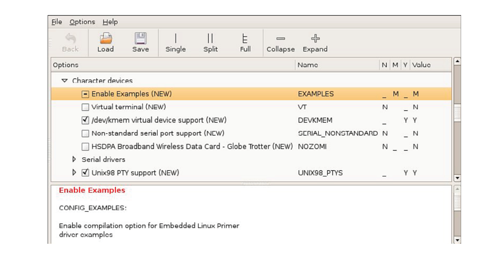

# Chương 8. Kiến thức cơ bản về device driver

## Trong chương này

- 8\.1 Các khái niệm device driver 202

- 8\.2 Module utility 212

- 8\.3 Driver method 217

- 8\.4 Kết hợp mọi thành phần 222

- 8\.5 Build driver Out-of-Tree 223

- 8\.6 Device driver và GPL 224

- 8\.7 Tổng kết 225

Một trong những khía cạnh khó hơn của thiết kế hệ thống là phân chia chức

năng hợp lý. Device driver model quen thuộc trong

UNIX và Linux cung cấp cách phân chia chức năng tự nhiên giữa

application code và hardware device hoặc kernel device. Chương này giúp bạn

hiểu model này và kiến thức cơ bản về Linux device driver architecture. Sau khi

đọc chương, bạn sẽ có nền tảng vững chắc để tiếp tục nghiên cứu

device driver qua một trong các tài liệu tham khảo cuối chương.

Chương bắt đầu bằng các khái niệm Linux device driver và mô tả

build system cho driver trong kernel source tree. Chúng ta khảo sát Linux

device driver architecture và trình bày ví dụ driver đơn giản hoạt động được. Chúng ta

giới thiệu user space utility để load và unload kernel module.[^1] Chúng ta

trình bày ứng dụng đơn giản minh họa interface giữa ứng dụng và

device driver. Chương kết thúc bằng thảo luận quan hệ

giữa device driver và GNU Public License.

## 8.1 Các khái niệm device driver

Nhiều lập trình viên embedded có kinh nghiệm ban đầu gặp khó với khái niệm device driver trong virtual memory operating system. Nguyên nhân là nhiều real-time operating system cũ phổ biến không có architecture tương tự. Khái niệm virtual memory cùng kernel space và user space thường đưa vào độ phức tạp xa lạ với lập trình viên embedded có kinh nghiệm.

Một mục đích nền tảng của device driver là cách ly user program khỏi việc truy cập trực tiếp các kernel data structure quan trọng và hardware device. Hơn nữa, device driver well-written che giấu độ phức tạp và khác biệt của hardware device khỏi user. Ví dụ, chương trình muốn ghi dữ liệu vào hard disk không cần biết disk drive dùng sector 512-byte hay 1024-byte. User chỉ mở file và gọi lệnh `write`. Device driver xử lý chi tiết và cách ly user khỏi độ phức tạp, rủi ro của lập trình hardware device. Device driver cung cấp user interface nhất quán cho nhiều hardware device. Nó là cơ sở cho quy ước UNIX/Linux quen thuộc rằng mọi thứ phải được biểu diễn như file.

### 8.1.1 Loadable module

Khác một số operating system, Linux cho phép thêm và bỏ kernel component lúc runtime. Linux có cấu trúc monolithic kernel với interface well-defined để thêm, bỏ device driver module động sau khi boot. Tính năng này không chỉ linh hoạt cho user mà còn vô giá với người phát triển device driver. Giả sử device driver hoạt động tương đối đúng, bạn có thể insert và remove nó tùy ý khỏi kernel đang chạy trong development cycle thay vì reboot kernel mỗi lần muốn kiểm tra thay đổi.

Loadable module đặc biệt quan trọng với embedded system. Chúng tăng khả năng nâng cấp tại hiện trường. Ví dụ, có thể cập nhật chính module trên hệ thống đang hoạt động mà không reboot. Module có thể được lưu trên media khác root device (boot device), vốn có thể bị space-constrained.

Tất nhiên device driver cũng có thể được compile tĩnh vào kernel, và điều này hoàn toàn phù hợp với nhiều driver. Ví dụ, xét kernel được cấu hình mount root file system từ NFS server network-attached. Trong tình huống này, bạn cấu hình các driver network-related (TCP/IP và network interface card driver) được compile vào kernel image chính để có sẵn khi boot nhằm mount remote root file system. Có thể dùng chức năng initial ramdisk như Chương 6, “Khởi tạo user space”, thay cho compile tĩnh các driver vào kernel chính. Khi đó, initial ramdisk image chứa các module cần thiết cùng script để load chúng.

Loadable module được cài sau khi kernel boot. Startup script có thể load device driver module, và module cũng có thể được “load theo yêu cầu” khi cần. Linux có thể request module khi một dịch vụ cần module cụ thể được yêu cầu.[^2]

Thuật ngữ thảo luận kernel module chưa bao giờ được chuẩn hóa. Nhiều thuật ngữ đã và tiếp tục được dùng thay thế nhau khi nói về Linux device driver. Trong chương này và các chương sau, device driver, loadable kernel module (LKM), loadable module và module đều được dùng để mô tả kernel device driver module.

### 8.1.2 Device driver architecture

Linux device driver model cơ bản quen thuộc với người phát triển hệ thống UNIX/Linux. Dù model tiếp tục tiến hóa, một số cấu trúc nền tảng gần như không đổi suốt quá trình phát triển UNIX/Linux. Device driver được chia rộng thành hai loại cơ bản: character device và block device. Có thể xem character device như serial stream gồm dữ liệu tuần tự. Ví dụ gồm serial port và keyboard. Block device đặc trưng bởi khả năng đọc, ghi block dữ liệu đến và từ vị trí bất kỳ trên media có thể định địa chỉ. Ví dụ gồm hard drive và USB Flash drive.

### 8.1.3 Ví dụ device driver tối thiểu

Vì Linux hỗ trợ loadable device driver, việc minh họa khung device driver đơn giản tương đối dễ. Listing 8-1 cho thấy loadable device driver module chứa cấu trúc tối thiểu để kernel đang chạy có thể load và unload.

LISTING 8-1 Device driver tối thiểu

```
/* Example Minimal Character Device Driver */
#include <linux/module.h>

static int __init hello_init(void)
{
    printk(KERN_INFO “Hello Example Init\n”);

    return 0;
}

static void __exit hello_exit(void)
{
    printk(“Hello Example Exit\n”);
}

module_init(hello_init);
module_exit(hello_exit);

MODULE_AUTHOR(“Chris Hallinan”);
MODULE_DESCRIPTION(“Hello World Example”);
MODULE_LICENSE(“GPL”);
```

Khung driver trong Listing 8-1 chứa đủ cấu trúc để kernel load, unload driver và gọi initialization routine, exit routine. Hãy xem cách thực hiện, vì nó minh họa một số khái niệm high-level quan trọng hữu ích cho phát triển device driver.

Device driver là loại binary module đặc biệt. Khác ứng dụng binary executable stand-alone, device driver không thể chỉ thực thi từ command prompt. Dòng kernel 2.6 yêu cầu binary ở định dạng “kernel object” đặc biệt. Khi build đúng, device driver binary module có hậu tố `.ko`. Build step và compiler option cần để tạo module object `.ko` có thể phức tạp. Ở đây chúng ta phác thảo các bước tận dụng Linux kernel build system mà không yêu cầu bạn trở thành chuyên gia, điều nằm ngoài phạm vi sách.

### 8.1.4 Hạ tầng build module

Device driver phải được compile theo kernel mà nó sẽ thực thi trên đó. Dù có thể load và thực thi kernel module build theo kernel version khác, điều này rủi ro trừ khi chắc chắn module không dựa vào tính năng nào của kernel mới. Cách dễ nhất là build module ngay trong source tree của kernel. Điều này bảo đảm khi lập trình viên đổi kernel configuration, custom driver tự động được build lại với cấu hình đúng. Hoàn toàn có thể build driver ngoài kernel source tree. Tuy nhiên, khi đó bạn chịu trách nhiệm bảo đảm device driver build configuration đồng bộ với kernel muốn chạy driver. Thường bao gồm compiler switch, vị trí kernel header file và kernel configuration option.

Với driver mẫu trong Listing 8-1, những thay đổi sau được áp dụng cho Linux kernel source tree nguyên bản để bật build driver mẫu. Chúng ta giải thích chi tiết từng bước:

1\. Từ Linux source directory top-level, tạo directory dưới `.../drivers/char` có tên `examples`.

2\. Thêm menu item vào kernel configuration để bật build `examples` và chỉ định built-in hoặc loadable kernel module.

3\. Thêm subdirectory `examples` mới vào `.../drivers/char/Makefile`, với điều kiện theo menu item tạo ở bước 2.

4\. Tạo makefile cho directory `examples` mới và thêm module object `hello1.o` để compile có điều kiện theo menu item ở bước 2.

5\. Tạo source file driver `hello1.c` từ Listing 8-1.

Việc thêm directory `examples` dưới subdirectory `.../drivers/char` là self-explanatory. Sau khi tạo directory, hai file được tạo bên trong: chính module source file từ Listing 8-1 và makefile cho directory `examples`. Makefile cho `examples` rất đơn giản, chỉ chứa dòng này:

```
obj-$(CONFIG_EXAMPLES) += hello1.o
```

Thêm menu item vào kernel configuration utility phức tạp hơn một chút. Listing 8-2 chứa patch mà khi áp dụng cho file `.../drivers/char/Kconfig` của Linux release gần đây sẽ thêm configuration menu item để bật configuration option `examples`. Nếu chưa quen unified diff format, mỗi dòng trong Listing 8-2 bắt đầu bằng một dấu cộng (+) được chèn vào file giữa các dòng chỉ định (không có dấu + đầu dòng).

LISTING 8-2 Patch `Kconfig` cho `examples`

```
diff --git a/drivers/char/Kconfig b/drivers/char/Kconfig
index 6f31c94..0805290 100644
--- a/drivers/char/Kconfig
+++ b/drivers/char/Kconfig
@@ -4,6 +4,13 @@

 menu “Character devices”

+config EXAMPLES
+       tristate “Enable Examples”
+       default M
+       ---help---
+         Enable compilation option for Embedded Linux Primer
+         driver examples
+
 config VT
        bool “Virtual terminal” if EMBEDDED
        depends on !S390
```

Khi áp dụng cho `Kconfig` trong subdirectory `.../drivers/char` của Linux kernel gần đây, patch này tạo kernel configuration option mới tên `CONFIG_EXAMPLES`. Nhắc lại thảo luận build Linux kernel ở Chương 4, “Linux kernel: Một góc nhìn khác”, configuration utility được gọi như sau (ví dụ giả định ARM architecture):

```
$ make ARCH=arm CROSS_COMPILE=xscale_be- gconfig
```

Sau khi gọi configuration utility bằng lệnh tương tự, configuration option `Enable Examples` mới xuất hiện dưới menu Character devices như patch chỉ ra. Vì được định nghĩa kiểu `tristate`, lập trình viên kernel có ba lựa chọn:

`(N)` Không. Không compile `examples`.

`(Y)` Có. Compile `examples` và link với kernel image cuối.

`(M)` Module. Compile `examples` thành dynamically loadable module.

Hình 8-1 cho thấy màn hình gconfig kết quả với configuration option mới. Dấu gạch (-) trong ô chọn chọn module, như cột M bên phải. Dấu kiểm chọn yes, nghĩa là driver module cần được compile thành phần của kernel chính. Ô trống nghĩa là option không được chọn.



HÌNH 8-1 Kernel configuration với module `examples`

Giờ đã thêm configuration option bật compile device driver module `examples`, chúng ta cần sửa makefile trong `.../drivers/char` để yêu cầu build system đi vào subdirectory `examples` mới nếu configuration option `CONFIG_EXAMPLES` có trong cấu hình. Listing 8-3 chứa patch cho việc này trên makefile của Linux release gần đây.

LISTING 8-3 Patch makefile cho `examples`

```
diff --git a/drivers/char/Makefile b/drivers/char/Makefile
index f957edf..f1b373d 100644
--- a/drivers/char/Makefile
+++ b/drivers/char/Makefile
@@ -102,6 +102,7 @@
 obj-$(CONFIG_MWAVE)            += mwave/
 obj-$(CONFIG_AGP)              += agp/
 obj-$(CONFIG_PCMCIA)           += pcmcia/
 obj-$(CONFIG_IPMI_HANDLER)     += ipmi/
+obj-$(CONFIG_EXAMPLES)         += examples/

 obj-$(CONFIG_HANGCHECK_TIMER)  += hangcheck-timer.o
 obj-$(CONFIG_TCG_TPM)          += tpm/
```

Patch trong Listing 8-3 thêm một dòng (bắt đầu bằng `+`) vào makefile trong `.../drivers/char`. Các dòng context bổ sung giúp patch utility xác định nơi chèn dòng mới. Directory `examples` mới được thêm vào cuối danh sách directory đã được tìm kiếm trong makefile này, nơi có vẻ hợp lý. Ngoài tính nhất quán và dễ đọc, vị trí không quan trọng.

Hoàn thành các bước trong phần này, hạ tầng để build device driver mẫu đã sẵn sàng. Điểm hay là driver được build tự động bất cứ khi nào gọi kernel build. Miễn configuration option định nghĩa trong Listing 8-3 được chọn (M hoặc Y), driver module được đưa vào build.

Build cho một hệ thống ARM bất kỳ, command line build module có thể như sau:

```
$ make ARCH=arm CROSS_COMPILE=xscale_be- modules
```

Listing 8-4 cho thấy build sau một phiên chỉnh sửa module điển hình (mọi module khác đã được build trong kernel source tree này).

LISTING 8-4 Output build module

```
$ make ARCH=arm CROSS_COMPILE=xscale_be- modules
  CHK     include/linux/version.h
make[1]: ‘include/asm-arm/mach-types.h’ is up to date.
  CHK     include/linux/utsrelease.h
  SYMLINK include/asm -> include/asm-arm
  CALL    scripts/checksyscalls.sh
  CC [M]  drivers/char/examples/hello1.o
  Building modules, stage 2.
  MODPOST 76 modules
  LD [M]  drivers/char/examples/hello1.ko
```

### 8.1.5 Cài device driver

Giờ driver đã build, có thể load và unload trên kernel đang chạy để quan sát hành vi. Trước khi load module, cần copy đến vị trí phù hợp trên target system. Dù có thể đặt bất cứ đâu, đã có quy ước vị trí kernel module trong hệ thống Linux đang chạy. Như compile module, dễ nhất để kernel build system làm giúp. Makefile target `modules_install` tự động đặt module trong hệ thống theo bố cục hợp lý. Bạn chỉ cần cung cấp vị trí mong muốn làm prefix cho đường dẫn mặc định.

Trong cài đặt Linux workstation chuẩn, có thể bạn đã biết device driver module nằm trong `/lib/modules/<kernel-version>/...`, theo thứ tự tương tự device driver directory hierarchy trong Linux kernel tree.[^3] String `<kernel-version>` được tạo bằng lệnh `uname -r` trên target Linux system. Nếu không cung cấp installation prefix cho kernel build system, mặc định module được cài trong directory `/lib/modules/...` của workstation. Vì là lập trình viên embedded và đang cross-compiling, đây có lẽ không phải điều bạn muốn. Có thể trỏ đến vị trí tạm trong home directory rồi copy module thủ công vào file system của target. Hoặc nếu target embedded system dùng NFS root mount tới directory trên local development workstation, có thể cài module trực tiếp vào target file system. Ví dụ sau giả định cách sau:

```
$ make ARCH=arm CROSS_COMPILE=xscale_be-                  \
   INSTALL_MOD_PATH=/home/chris/sandbox/coyote-target     \
   modules_install
```

Điều này đặt mọi module trong directory `coyote-target`, trên hệ thống mẫu được export qua NFS và mount làm root trên target system.[^4]

### 8.1.6 Load module

Hoàn thành mọi bước cần thiết, giờ có thể load và kiểm tra device driver module. Listing 8-5 cho thấy output khi load rồi unload device driver trên embedded system.

LISTING 8-5 Load và unload module

```
# modprobe hello1             <<< Load the driver, must be root
Hello Example Init
# modprobe -r hello1          <<< Unload the driver, must be root
Hello Example Exit
#
```

Bạn có thể liên hệ output với device driver source code trong Listing 8-1. Module không làm gì ngoài in thông báo tới kernel log system qua `printk()`, được thấy trên console.[^5] Khi load module, function module-initialization được gọi. Chúng ta chỉ định initialization function thực thi khi insert module bằng macro `module_init()`. Khai báo như sau:

```
module_init(hello_init);
```

Trong initialization function, chúng ta chỉ in thông báo hello quen thuộc rồi return. Trong device driver thực, đây là nơi cấp phát resource ban đầu cho module. Tương tự, khi unload module (bằng lệnh `modprobe -r`), module exit routine được gọi. Như Listing 8-1, exit routine được chỉ định bằng macro `module_exit()`. Trong driver thực, đây là nơi hoàn tác mọi thứ đã làm lúc vào, như giải phóng memory hoặc đưa device về trạng thái đã biết, vô hại.

Đó là tất cả những gì cần cho khung device driver có thể insert trực tiếp vào kernel thực. Các phần sau thêm chức năng cho loadable device driver module để minh họa cách user space program tương tác với device driver module.

### 8.1.7 Module parameter

Nhiều device driver module nhận parameter để sửa hành vi. Ví dụ gồm bật debug mode, đặt báo cáo chi tiết và chỉ định option module-specific. Tiện ích `insmod` (và `modprobe` sẽ giới thiệu sau) nhận module parameter (còn gọi option trong một số context) bằng cách chỉ định sau module name. Listing 8-6 cho thấy ví dụ `hello1.c` đã sửa, thêm một module parameter bật debug mode.

LISTING 8-6 Driver mẫu với parameter

```
/* Example Minimal Character Device Driver */
#include <linux/module.h>

static int debug_enable = 0;       /* Added driver parameter */
module_param(debug_enable, int, 0);  /* and these 2 lines */
MODULE_PARM_DESC(debug_enable, “Enable module debug mode.”);

static int __init hello_init(void)
{
    /* Now print value of new module parameter */
    printk(“Hello Example Init - debug mode is %s\n”,
           debug_enable ? “enabled” : “disabled”);

    return 0;
}

static void __exit hello_exit(void)
{
    printk(“Hello Example Exit\n”);
}

module_init(hello_init);
module_exit(hello_exit);

MODULE_AUTHOR(“Chris Hallinan”);
MODULE_DESCRIPTION(“Hello World Example”);
MODULE_LICENSE(“GPL”);
```

Ba dòng được thêm vào device driver module mẫu. Dòng đầu khai báo static integer giữ debug flag. Dòng thứ hai là macro trong `.../include/linux/moduleparam.h` (được `modules.h` include) đăng ký module parameter với kernel module subsystem. Dòng mới thứ ba là macro đăng ký description string gắn với parameter vào kernel module subsystem. Mục đích sẽ rõ khi xem lệnh `modinfo` ở phần sau chương.

Nếu giờ dùng `insmod` để insert module mẫu và thêm option `debug_enable`, sẽ thấy output kết quả dựa trên module `hello1.c` đã sửa của Listing 8-6.

```
$ insmod /lib/modules/.../examples/hello1.ko debug_enable=1
Hello Example Init - debug mode is enabled
```

Hoặc nếu bỏ module parameter tùy chọn:

```
$ insmod /lib/modules/.../examples/hello1.ko
Hello Example Init - debug mode is disabled
```

## 8.2 Module utility

Listing 8-5 giới thiệu ngắn gọn module utility. Ở đó dùng tiện ích `modprobe` để insert và remove device driver module khỏi Linux kernel đang chạy. Một số tiện ích nhỏ dùng để quản lý device driver module. Phần này giới thiệu chúng. Bạn nên tham khảo man page từng tiện ích để biết đầy đủ chi tiết. Nếu muốn hiểu thêm tương tác giữa loadable module và Linux kernel,, hãy xem source code các tiện ích. Phần cuối chương chỉ nơi tìm chúng.

### 8.2.1 insmod

Tiện ích `insmod` là cách đơn giản nhất insert module vào kernel đang chạy. Cung cấp pathname đầy đủ và `insmod` thực hiện công việc. Ví dụ:

```
$ insmod /lib/modules/’uname -r’/kernel/drivers/char/examples/hello1.ko
```

Điều này load module `hello1.ko` vào kernel. Output giống Listing 8-5—chính là thông báo Hello. Tiện ích `insmod` là chương trình đơn giản không yêu cầu hay nhận command-line option. Nó cần pathname đầy đủ vì không có logic tìm module. Thường bạn sẽ dùng `modprobe` mô tả ngay sau, vì có nhiều tính năng và khả năng hơn, gồm xác định và load mọi dependency cần cho module.

### 8.2.2 lsmod

Tiện ích `lsmod` cũng đơn giản. Nó chỉ hiển thị danh sách có định dạng các module đã insert vào kernel. Phiên bản gần đây không nhận parameter và chỉ định dạng output của `/proc/modules`.[^6] Listing 8-7 là ví dụ output từ `lsmod`.

LISTING 8-7 Định dạng output `lsmod`

```
$ lsmod
Module                  Size  Used by
ext3                  121096  0
jbd                    49656  1 ext3
loop                   12712  0
hello1                  1412  0
$
```

Chú ý cột ngoài cùng bên phải, “Used by”. Nó chỉ device driver module đang được dùng và cho thấy dependency chain. Trong ví dụ, module `jbd` (journaling routine cho journaling file system) được module `ext3` sử dụng, đây là journaling file system mặc định cho nhiều Linux desktop distribution phổ biến. Nghĩa là device driver `ext3` phụ thuộc sự hiện diện của `jbd`.

### 8.2.3 modprobe

Đây là nơi sự khéo léo của `modprobe` phát huy. Listing 8-7 cho thấy quan hệ giữa module `ext3` và `jbd`. Module `ext3` phụ thuộc module `jbd`. Tiện ích `modprobe` khám phá quan hệ này và load các module phụ thuộc đúng thứ tự. Lệnh sau load cả driver module `jbd.ko` và `ext3.ko`:

```
$ modprobe ext3
```

Tiện ích `modprobe` có một số command-line option điều khiển hành vi. Như đã thấy, `modprobe` có thể remove module, gồm các module mà module nhất định phụ thuộc vào. Đây là ví dụ remove cả `jbd.ko` và `ext3.ko`:

```
$ modprobe -r ext3
```

Tiện ích `modprobe` được điều khiển bởi configuration file tên `modprobe.conf`. Điều này cho người phát triển hệ thống liên kết device với device driver. Với embedded system đơn giản, `modprobe.conf` có thể trống hoặc rất ít dòng. Tiện ích `modprobe` được compile với tập default rule thiết lập mặc định khi không có `modprobe.conf` hợp lệ. Gọi `modprobe` chỉ với option `-c` hiển thị tập default rule mà `modprobe` dùng.

Listing 8-8 cho thấy `modprobe.conf` điển hình có thể gặp trên hệ thống hai Ethernet interface. Một là wireless adapter dựa trên Prism2 chipset, còn lại là PCI Ethernet card điển hình. Hệ thống còn có sound subsystem dựa trên Intel sound chipset tích hợp.

LISTING 8-8 File `modprobe.conf` điển hình

```
$ cat /etc/modprobe.conf
alias eth1 orinoci_pci
options eth1 orinoco_debug=9
alias eth0 e100
alias snd-card-0 snd-intel8x0
options snd-card-0 index=0
$
```

Khi kernel boot và phát hiện wireless chipset, configuration file yêu cầu `modprobe` load device driver orinoco\_pci, bind với kernel device eth1. Sau đó truyền module parameter tùy chọn orinoco\_debug=9 cho device driver. Hành động tương tự diễn ra khi phát hiện sound card hardware. Chú ý parameter tùy chọn gắn với sound driver snd-intel8x0.

Chú ý chức năng `modprobe.conf` phần lớn đã được thay bằng chức năng `udev`, trình bày trong Chương 19. Tuy nhiên, có thể gặp `modprobe.` `conf` trên embedded system cũ, nên biết cấu hình có thể hữu ích.

### 8.2.4 depmod

Làm sao `modprobe` biết dependency của module? Tiện ích `depmod` đóng vai trò then chốt. Khi `modprobe` thực thi, nó tìm file tên `modules.dep` trong cùng directory cài module. Tiện ích `depmod` tạo file module-dependency này.

File chứa danh sách mọi module mà kernel build system được cấu hình, cùng dependency information của từng module. Định dạng đơn giản, mỗi device driver module chiếm một dòng. Nếu module có dependency, chúng được liệt kê theo thứ tự sau module name. Ví dụ, Listing 8-7 cho thấy module `ext3` phụ thuộc module `jbd`. Dòng dependency trong `modules.dep` như sau:

```
ext3.ko: jbd.ko
```

Trong thực tế, mỗi module name có absolute path trong file system phía trước để tránh mơ hồ. Chúng ta bỏ path information cho dễ đọc. Dependency chain phức tạp hơn, như sound driver, có thể như sau:

```
snd-intel8x0.ko: snd-ac97-codec.ko snd-pcm.ko snd-timer.ko \
snd.ko soundcore.ko snd-page-alloc.ko
```

Một lần nữa, các path component đầu đã bỏ để dễ đọc. Mỗi module filename trong file `modules.dep` là absolute filename với đầy đủ path information và nằm trên một dòng. Ví dụ trước được đặt trên hai dòng để vừa chiều rộng trang.

Thông thường, `depmod` chạy tự động khi kernel build. Tuy nhiên trong môi trường cross-development, cần cross version của `depmod` hiểu cách đọc module được compile theo native format của target architecture. Hoặc phần lớn embedded distribution có phương pháp và init script entry chạy `depmod` mỗi lần boot để bảo đảm module dependency luôn cập nhật.

### 8.2.5 rmmod

Tiện ích `rmmod` cũng đơn giản, chỉ remove module khỏi kernel đang chạy. Truyền module name làm parameter. Không cần pathname hoặc file extension. Ví dụ:

```
# rmmod hello1      <<< Must be root
Hello Example Exit
```

Điểm thú vị duy nhất cần hiểu là khi dùng `rmmod`, nó thực thi function `*_exit()` của module như ở đây, từ ví dụ `hello1.c` trong Listing 8-1 và 8-6.

Cần lưu ý khác `modprobe`, `rmmod` không remove dependent module. Dùng `modprobe -r` cho việc đó.

### 8.2.6 modinfo

Có thể bạn chú ý ba dòng cuối của khung driver trong Listing 8-1 rồi Listing 8-6. Các macro đặt tag trong binary module để hỗ trợ quản trị và quản lý. Listing 8-9 là kết quả thực thi `modinfo` trên module `hello1.ko`.

LISTING 8-9 Output `modinfo`

```
$ modinfo hello1
filename:     /lib/modules/../kernel/drivers/char/examples/hello1.ko
license:      GPL
description:  Hello World Example
author:       Chris Hallinan
depends:
vermagic:     2.6.32-07500-g8bea867 mod_unload modversions ARMv5
parm:         debug_enable:Enable module debug mode. (int)
```

Field đầu hiển nhiên: tên file đầy đủ của device driver module. Để dễ đọc, chúng ta lại rút ngắn path. Các dòng tiếp là kết quả trực tiếp của descriptive macro cuối Listing 8-6—gồm filename, author và license information. Chúng chỉ là tag cho module utility dùng, không ảnh hưởng hành vi device driver. Có thể học thêm `modinfo` từ man page và source `modinfo`.

Một tính năng rất hữu ích của `modinfo` là biết module hỗ trợ parameter nào. Từ Listing 8-9 thấy module chỉ hỗ trợ một parameter, chính là `debug_enable` thêm trong Listing 8-6. Listing cho name, type (ở đây int) và descriptive text field đã nhập bằng macro `MODULE_PARM_DESC()`. Điều này rất tiện, đặc biệt với module khó truy cập source code.

## 8.3 Driver method

Chúng ta đã đi qua nhiều nội dung trong phần ngắn về module utility. Các phần còn lại mô tả cơ chế cơ bản giao tiếp với device driver từ user space program (application code của bạn).

Chúng ta đã giới thiệu hai method nền tảng chịu trách nhiệm khởi tạo one-time và xử lý exit của module. Nhớ Listing 8-1 rằng module init routine và exit routine được xác định bởi `module_init()` và `module_exit()`. Chúng ta biết các routine được gọi khi insert module vào hoặc remove khỏi kernel đang chạy. Giờ cần method để application program giao tiếp với device driver. Xét cho cùng, hai lý do quan trọng hơn để dùng device driver là cách ly user khỏi rủi ro viết code trong kernel space và cung cấp phương pháp thống nhất giao tiếp với hardware device hoặc kernel-level device.

### 8.3.1 Các file system operation của driver

Sau khi load device driver vào kernel đang hoạt động, hành động đầu cần làm là chuẩn bị driver cho các operation tiếp theo. Method `open()` dùng cho mục đích này. Sau khi mở driver, cần routine đọc và ghi vào driver. Routine `release()` được cung cấp để dọn dẹp sau khi operation hoàn tất (về cơ bản là lời gọi `close()`). Cuối cùng, có system call đặc biệt cho giao tiếp không chuẩn với driver, tên `ioctl()`. Listing 8-10 thêm hạ tầng này vào device driver mẫu.

LISTING 8-10 Thêm file system ops vào `hello.c`

```
#include <linux/module.h>
#include <linux/fs.h>

#define HELLO_MAJOR 234

static int debug_enable = 0;
module_param(debug_enable, int, 0);
MODULE_PARM_DESC(debug_enable, “Enable module debug mode.”);

struct file_operations hello_fops;

static int hello_open(struct inode *inode, struct file *file)
{
    printk(“hello_open: successful\n”);
    return 0;
}

static int hello_release(struct inode *inode, struct file *file)
{
    printk(“hello_release: successful\n”);
    return 0;
}

static ssize_t hello_read(struct file *file, char *buf, size_t count,
               loff_t *ptr)
{
    printk(“hello_read: returning zero bytes\n”);
    return 0;
}

static ssize_t hello_write(struct file *file, const char *buf,
               size_t count, loff_t * ppos)
{
    printk(“hello_write: accepting zero bytes\n”);
    return 0;
}

static int hello_ioctl(struct inode *inode, struct file *file,
               unsigned int cmd, unsigned long arg)
{
    printk(“hello_ioctl: cmd=%ld, arg=%ld\n”, cmd, arg);
    return 0;
}

static int __init hello_init(void)
{
    int ret;
    printk(“Hello Example Init - debug mode is %s\n”,
           debug_enable ? “enabled” : “disabled”);
    ret = register_chrdev(HELLO_MAJOR, “hello1”, &hello_fops);
        if (ret < 0) {
            printk(“Error registering hello device\n”);
            goto hello_fail1;
        }
    printk(“Hello: registered module successfully!\n”);
    /* Init processing here... */

    return 0;

hello_fail1:
    return ret;
}

static void __exit hello_exit(void)
{
    printk(“Hello Example Exit\n”);
}

struct file_operations hello_fops = {
    owner:   THIS_MODULE,
    read:    hello_read,
    write:   hello_write,
    ioctl:   hello_ioctl,
    open:    hello_open,
    release: hello_release,
};

module_init(hello_init);
module_exit(hello_exit);

MODULE_AUTHOR(“Chris Hallinan”);
MODULE_DESCRIPTION(“Hello World Example”);
MODULE_LICENSE(“GPL”);
```

Ví dụ device driver mở rộng này có nhiều dòng mới. Từ đầu, phải thêm kernel header file để lấy định nghĩa file system operation. Chúng ta cũng định nghĩa major number cho device driver. (Lưu ý cho người viết device driver: đây không phải cách cấp phát device driver major number đúng. Tham khảo Linux kernel documentation \[`.../Documentation/devices.txt]` hoặc một tài liệu device driver xuất sắc để được hướng dẫn cấp phát major device number. Với ví dụ đơn giản này, chúng ta chỉ chọn số biết rằng chưa được dùng trên hệ thống.)

Tiếp theo thấy định nghĩa bốn function mới—các method `open`, `close`, `read` và `write`. Theo thực hành lập trình tốt, chúng ta dùng naming scheme nhất quán giúp code dễ đọc và bảo trì. Các method mới lần lượt là `hello_open()`, `hello_release()`, `hello_read()` và `hello_write()`. Cho bài tập đơn giản này, chúng là function do-nothing chỉ in thông báo tới kernel log subsystem.

Chú ý cũng thêm function call mới vào routine `hello_init()`. Dòng này đăng ký device driver với kernel. Với registration call, chúng ta truyền structure chứa pointer tới các method cần thiết. Kernel dùng structure kiểu `struct file_operations` này để bind các device function cụ thể với request thích hợp từ file system. Khi ứng dụng mở device do device driver biểu diễn và request operation `read()`, file system liên kết request `read()` chung đó với function `hello_read()` của module. Các phần sau khảo sát chi tiết quá trình.

### 8.3.2 Cấp phát device number

Cần lưu ý các ví dụ trong sách nhằm cho bạn ý niệm tổng thể về device driver architecture và vị trí trong bức tranh chung. Đây không phải hướng dẫn phát triển device driver. Chủ đề được trình bày trong hai tài liệu xuất sắc liệt kê cuối chương.

Với lưu ý đó, phương pháp cấp phát major device number trong Listing 8-10 đã được thay bằng phương pháp mạnh hơn nhiều. Thường bạn không chỉ định device number trong driver mà dùng method cho phép kernel chỉ định giúp. Điều này tránh xung đột device number và mở rộng tốt hơn nhiều so với gán số thủ công. Quá trình được mô tả đầy đủ trong Chương 3 của Linux Device Drivers, 3rd Edition, tham chiếu cuối chương.

### 8.3.3 Device node và mknod

Để hiểu ứng dụng bind request đến device cụ thể do device driver biểu diễn thế nào, cần hiểu khái niệm device node. Đây là special file type trong Linux biểu diễn device. Gần như mọi Linux distribution giữ device node ở vị trí chung (theo Filesystem Hierarchy Standard[^7]), trong directory tên `/dev`. Tiện ích chuyên dụng tạo device node trên file system có tên `mknod`.

Ví dụ tạo node là cách tốt nhất minh họa chức năng và thông tin nó truyền đạt. Tiếp nối ví dụ device driver đơn giản, hãy tạo device node thích hợp để thử nó:

```
$ mknod /dev/hello1 c 234 0
```

Sau khi thực thi lệnh trên target embedded system, có file mới tên `/dev/hello1` biểu diễn device driver module. Nếu liệt kê file sẽ như sau:

```
$ ls -l /dev/hello1
crw-r--r--   1 root  root  234, 0 Jul 14 2005 /dev/hello1
```

Các parameter truyền cho `mknod` gồm name, type, major number và minor number cho device driver. Tên đã chọn là `hello1`. Vì minh họa character driver, dùng `c` để chỉ điều đó. Major number là 234, số chọn cho ví dụ, còn minor number là 0.

Riêng nó, device node chỉ là file khác trong file system. Tuy nhiên vì trạng thái đặc biệt là device node, chúng ta dùng nó bind với device driver đã cài. Nếu application process gọi system call `open()` với device node làm path parameter, kernel tìm device driver hợp lệ đã đăng ký major number khớp device node—ở đây 234. Đó là cơ chế kernel liên kết device cụ thể với device node.

Như phần lớn lập trình viên C biết, system call `open()` hoặc biến thể trả về reference (file descriptor) để ứng dụng gọi file system operation tiếp theo như read, write và close. Reference này sau đó được truyền cho các file system operation như read, write hoặc biến thể.

Nếu tò mò về minor number, đây là cơ chế xử lý nhiều device hoặc subdevice bằng một device driver. Operating system không dùng nó mà chỉ truyền cho device driver. Driver có thể dùng tùy ý. Ví dụ với multiport serial card, major number chỉ định driver, minor number có thể chỉ định một trong nhiều port do cùng driver xử lý trên card. Tham khảo tài liệu device driver xuất sắc để biết thêm chi tiết.

Một lưu ý cuối đáng đề cập. Thảo luận device node phía trước nhằm mục đích hướng dẫn. Trên phần lớn Linux system hiện đại, bạn không bao giờ thực sự tạo device node. Việc tạo được `udev` xử lý tự động. Chức năng này được giải thích đầy đủ trong Chương 19.

## 8.4 Kết hợp mọi thành phần

Giờ có khung device driver, có thể load và thử. Listing 8-11 là user space application đơn giản thử device driver. Chúng ta đã thấy cách load driver. Chỉ compile rồi gọi lệnh `make modules_install` đặt vào file system như mô tả trước đó.

LISTING 8-11 Thử device driver

```
#include <stdio.h>
#include <stdlib.h>
#include <sys/types.h>
#include <sys/stat.h>
#include <fcntl.h>
#include <unistd.h>

int main(int argc, char **argv)
{
    /* Our file descriptor */
    int fd;
    int rc = 0;
    char *rd_buf[16];

    printf(“%s: entered\n”, argv[0]);

    /* Open the device */
    fd = open(“/dev/hello1”, O_RDWR);
    if ( fd == -1 ) {
        perror(“open failed”);
        rc = fd;
        exit(-1);
    }
    printf(“%s: open: successful\n”, argv[0]);

    /* Issue a read */
    rc = read(fd, rd_buf, 0);
    if ( rc == -1 ) {
        perror(“read failed”);
        close(fd);
        exit(-1);
    }
    printf(“%s: read: returning %d bytes!\n”, argv[0], rc);

    close(fd);
    return 0;
}
```

File đơn giản này, compile trên ARM XScale system, minh họa việc bind ứng dụng với device driver qua device node. Như device driver, nó không làm công việc hữu ích nhưng minh họa khái niệm khi thử một số method đã giới thiệu trong device driver của Listing 8-10.

Đầu tiên gọi system call `open()`[^8] trên device node đã tạo. Nếu mở thành công, thông báo ra console. Tiếp theo gọi lệnh `read()` rồi lại in thông báo console nếu thành công. Chú ý đọc 0 byte là hoàn toàn chấp nhận được với kernel. Trong thực tế, điều này chỉ trạng thái end-of-file hoặc out-of-data. Device driver của bạn định nghĩa trạng thái đặc biệt đó. Khi hoàn tất, chỉ đóng file và thoát. Listing 8-12 ghi output chạy ứng dụng mẫu trên ARM XScale target.

LISTING 8-12 Dùng driver mẫu

```
$ modprobe hello1
Hello Example Init - debug mode is disabled
Hello: registered module successfully!
$ ./use-hello
./use-hello: entered
./use-hello: open: successful
./use-hello: read: returning zero bytes!
$
```

## 8.5 Build driver Out-of-Tree

Build device driver ngoài kernel source tree thường thuận tiện. Dùng makefile đơn giản theo mẫu một trong nhiều makefile trong kernel source tree giúp công việc dễ dàng. Driver makefile trong Linux kernel source tree thường rất đơn giản. Hơn nửa trong hơn 450 driver makefile có dưới mười dòng. Năm phần trăm chỉ có một dòng!

Nếu tạo makefile cho ví dụ `hello1` để build ngoài kernel tree, có thể như sau:

```
obj-$(CONFIG_EXAMPLES)          += hello1.o
```

Tạo makefile trong directory tùy chọn và đặt source code `hello1.c` ở đó. Tiếp theo tạo file mới tên `Makefile` trong cùng directory. Makefile cần chứa đúng dòng vừa nêu. Sau đó thực thi build command sau từ directory (vừa tạo) này:

```
$ make ARCH=arm CROSS_COMPILE=xscale_be- -C \
     <path/to/your/linux-2.6> SUBDIRS=$PWD modules
```

Tất nhiên thay `<path/to/your/linux-2.6>` bằng path đến Linux source tree riêng. Lệnh `make` này khi được gọi chuyển vào kernel source tree qua parameter `-C` và yêu cầu build các target định nghĩa trong `SUBDIRS`. Đơn giản vậy thôi.

Khi hiểu khái niệm, có thể tạo makefile thông minh hơn chút. Ví dụ nó định nghĩa `SUBDIRS` và path đến kernel nếu muốn. Quan trọng là kernel configuration phải định nghĩa `CONFIG_EXAMPLES` bằng `=m` hoặc `=y`. Có thể kiểm tra trong file `.config`. Như mong đợi, nếu `CONFIG_EXAMPLES` chưa định nghĩa, module `hello1.c` không được compile.

## 8.6 Device driver và GPL

Lưu ý Bạn có thể từng thấy từ viết tắt Internet IANAL. Nó áp dụng ở đây: tôi

không phải luật sư. Lời khuyên chắc chắn nhất là hỏi luật sư am hiểu

luật sở hữu trí tuệ và bản quyền, tốt nhất là người có kinh nghiệm nghề nghiệp

về open source license.

Có nhiều thảo luận và tranh luận về device driver và cách các điều khoản GNU Public License áp dụng cho chúng. Tiêu chí đầu được hiểu rõ: nếu device driver (hay bất kỳ phần mềm nào) dựa dù chỉ một phần trên phần mềm GPL hiện có, nó được coi là tác phẩm phái sinh. Ví dụ, nếu bắt đầu từ Linux device driver hiện có rồi sửa theo nhu cầu, chắc chắn được coi là tác phẩm phái sinh. Vì vậy bạn có nghĩa vụ cấp phép driver đã sửa theo điều khoản của tác phẩm gốc, có lẽ là GPL, tuân thủ mọi yêu cầu.

Đây là nơi nảy sinh tranh luận. Một số khái niệm chưa được kiểm chứng tại tòa. Quan điểm phổ biến của cộng đồng pháp lý và open source là nếu chứng minh được tác phẩm được phát triển độc lập,[^9] và device driver không giả định “hiểu biết sâu” về Linux kernel, người phát triển tự do cấp phép theo cách thấy phù hợp. Nếu sửa kernel để đáp ứng nhu cầu đặc biệt của driver, nó được coi là tác phẩm phái sinh và do đó chịu GPL.

Trong cộng đồng open source có lượng thông tin lớn, ngày càng tăng về các vấn đề này. Có vẻ trong tương lai những khái niệm sẽ được kiểm chứng tại tòa và tạo tiền lệ. Mất bao lâu là điều không ai biết. Nếu muốn hiểu rõ hơn vấn đề pháp lý quanh Linux và open source, bạn có thể thích www.open-bar.org.

## 8.7 Tổng kết

Chương này trình bày tổng quan high-level về kiến thức cơ bản device driver và vị trí trong architecture Linux system. Giờ có kiến thức cơ bản, nếu mới với device driver, bạn có thể đọc một trong các tài liệu xuất sắc dành cho người viết driver liệt kê phần cuối. Chương kết thúc bằng giới thiệu quan hệ giữa kernel device driver và Open Source GNU Public License.

- Device driver áp đặt phân tách hợp lý giữa unprivileged user application và kernel resource quan trọng như hardware cùng device khác. Chúng cung cấp interface thống nhất well-known cho ứng dụng.

- Hạ tầng tối thiểu để load device driver chỉ vài dòng code. Chúng ta trình bày hạ tầng tối thiểu rồi phát triển các khái niệm thành khung driver module đơn giản.

- Device driver cấu hình làm loadable module có thể insert vào và remove khỏi kernel đang chạy sau kernel boot.

- Module utility dùng quản lý insert, remove và liệt kê device driver module. Chúng ta trình bày chi tiết các utility dùng cho chức năng này.

- Device node trên file system cung cấp cầu nối giữa user space application và device driver.

- Driver method triển khai chức năng open, read, write, close quen thuộc trong UNIX/Linux device driver. Cơ chế được giải thích qua ví dụ gồm user application đơn giản để thử các driver method.

### 8.7.1 Gợi ý đọc thêm

Linux Device Drivers, 3rd Edition Alessandro Rubini and Jonathan Corbet O’Reilly Publishing, 2005

Essential Linux Device Drivers Sreekrishnan Venkateswaran Prentice Hall, 2008

Filesystem Hierarchy Standard http://en.wikipedia.org/wiki/Filesystem\_Hierarchy\_Standard

Rusty’s Linux Kernel Page Module Utilities for 2.6 Rusty Russell http://kernel.org/pub/linux/kernel/people/rusty/

[^1]: Thuật ngữ module và device driver được dùng thay thế nhau ở đây.

[^2]: Cơ chế được mô tả rất chi tiết trong Chương 19, “udev”.

[^3]: Path này dùng bởi Red Hat, Fedora và cũng được File System Hierarchy Standard yêu cầu. được tham chiếu cuối chương. Distribution khác có thể dùng vị trí khác trong file system cho kernel module.

[^4]: Hosting target board và NFS root mount được trình bày chi tiết trong Chương 12, “Môi trường phát triển embedded”.

[^5]: Nếu không thấy thông báo console, hãy tắt syslogd logger hoặc giảm console loglevel. Chúng ta mô tả cách làm trong Chương 14, “Kỹ thuật debug kernel”.

[^6]: `/proc/modules` thuộc file system `/proc`, được giới thiệu trong Chương 9, “File system”.

[^7]: Tiêu chuẩn được tham chiếu cuối chương.

[^8]: Thực ra lời gọi `open()` là C library wrapper function bao quanh Linux system call `sys_open()`.

[^9]: Thực hành này không riêng open source. Vi phạm bản quyền và bằng sáng chế là mối quan tâm thường trực của mọi lập trình viên.
