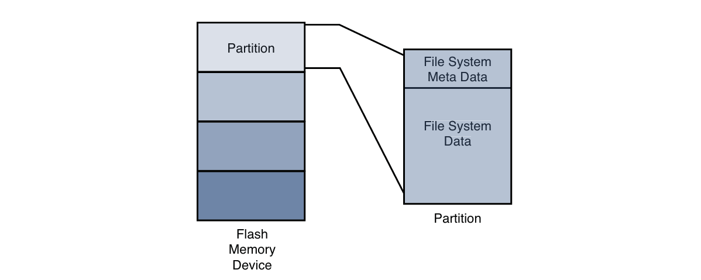
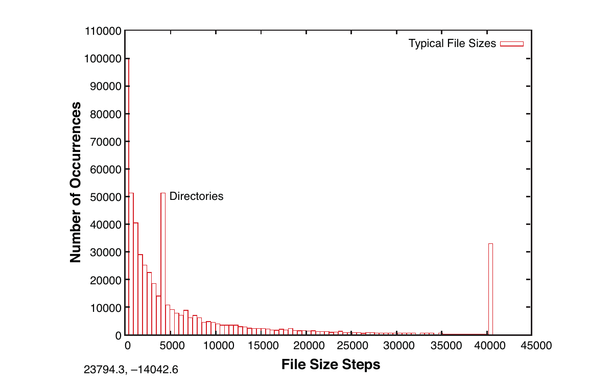
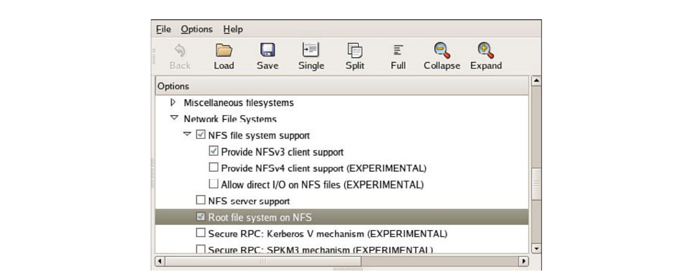

# Chương 9. File system

## Trong chương này

- 9\.1 Các khái niệm Linux file system 228

- 9\.2 ext2 230

- 9\.3 ext3 235

- 9\.4 ext4 237

- 9\.5 ReiserFS 238

- 9\.6 JFFS2 239

- 9\.7 `cramfs` 242

- 9\.8 Network File System 244

- 9\.9 Pseudo file system 248

- 9\.10 Các file system khác 255

- 9\.11 Tạo file system đơn giản 256

- 9\.12 Tổng kết 258

Có lẽ một trong những quyết định quan trọng nhất của lập trình viên embedded

là triển khai file system nào. Một số file system tối ưu cho hiệu

năng, số khác tối ưu kích thước. Những file system khác nữa tối ưu khôi phục dữ liệu

sau lỗi device hoặc mất nguồn. Chương này giới thiệu các file system chính

dùng trên hệ thống Linux và khảo sát đặc tính từng loại khi áp

dụng cho thiết kế embedded. Chương không nhằm khảo sát

chi tiết kỹ thuật nội bộ từng file system. Thay vào đó, chương khảo sát

đặc tính hoạt động và vấn đề phát triển liên quan đến từng file system

được trình bày.

Bắt đầu từ file system phổ biến nhất trên Linux desktop distribution trước đây,

chúng ta giới thiệu khái niệm từ Second Extended File System (ext2) để

làm nền tảng thảo luận tiếp. Sau đó xem hậu duệ Third

Extended File System (ext3), vốn rất phổ biến với vai trò

file system mặc định của nhiều Linux desktop distribution và server distribution. Sau đó mô tả

các cải tiến dẫn đến ext4.

Sau một số kiến thức nền, chúng ta khảo sát nhiều file system chuyên biệt,

gồm những loại tối ưu khôi phục dữ liệu và dung lượng lưu trữ, cùng

loại thiết kế cho Flash memory device. Network File System

(NFS) được trình bày, tiếp theo là thảo luận những pseudo file system quan trọng hơn,

gồm file system `/proc` và `sysfs`.

## 9.1 Các khái niệm Linux file system

Trước khi đi vào từng file system, hãy xem tổng thể cách lưu dữ liệu trên Linux system. Khi nghiên cứu device driver trong Chương 8, “Kiến thức cơ bản về device driver”, chúng ta xem cấu trúc character device. Nhìn chung, character device lưu và lấy dữ liệu theo serial stream. Ví dụ cơ bản nhất là serial port hoặc mouse. Ngược lại, block device lưu và lấy dữ liệu theo từng phần equal-sized, tại vị trí ngẫu nhiên trên media có thể định địa chỉ. Ví dụ, IDE hard disk controller điển hình có thể truyền 512 byte mỗi lần đến và từ vị trí cụ thể định địa chỉ được trên physical medium.

### 9.1.1 Partition

Trước khi thảo luận file system, chúng ta giới thiệu partition, sự phân chia logic physical device chứa file system. Ở cấp cao nhất, dữ liệu được lưu trên physical device trong partition. Partition là phần chia logic của physical medium (hard disk, Flash memory), có dữ liệu tổ chức theo đặc tả partition type nhất định. Physical device có thể có một partition bao phủ toàn bộ dung lượng, hoặc chia nhiều partition phù hợp tác vụ cụ thể. Có thể xem partition là logical disk để ghi file system hoàn chỉnh lên đó.

Hình 9-1 cho thấy quan hệ giữa partition và file system.



HÌNH 9-1 Partition và file system

Linux dùng tiện ích `fdisk` thao tác partition trên block device. Tiện ích `fdisk` gần đây trong nhiều Linux distribution nhận biết hơn 90 partition type. Thực tế chỉ vài loại thường dùng trên Linux system. Một số partition type phổ biến là Linux, FAT32 và Linux Swap.

Listing 9-1 hiển thị output tiện ích `fdisk` nhắm đến CompactFlash device nối USB port. Trên target system này, physical CompactFlash device được gán cho device node `/dev/sdb`.[^1]

LISTING 9-1 Hiển thị partition information bằng `fdisk`

```
# fdisk /dev/sdb

Command (m for help): p

Disk /dev/sdb: 49 MB, 49349120 bytes
4 heads, 32 sectors/track, 753 cylinders
Units = cylinders of 128 * 512 = 65536 bytes

   Device Boot    Start       End      Blocks   Id  System
/dev/sdb1   *         1       180       11504   83  Linux
/dev/sdb2           181       360       11520   83  Linux
/dev/sdb3           361       540       11520   83  Linux
/dev/sdb4           541       753       13632   83  Linux
```

Trong thảo luận này, chúng ta tạo bốn partition trên device bằng `fdisk`. Một partition đánh dấu bootable, thể hiện qua dấu sao ở cột Boot. Điều này phản ánh boot indicator flag trong data structure biểu diễn partition table trên device. Như listing cho thấy, đơn vị lưu trữ logic mà `fdisk` dùng là cylinder.[^2] Trên device này, cylinder chứa 64KB. Mặt khác, Linux biểu diễn đơn vị lưu trữ nhỏ nhất bằng logical block. Từ listing có thể suy ra block là đơn vị 1024 byte.

Sau khi CompactFlash được partition như vậy, mỗi device biểu diễn partition có thể được format bằng file system bạn chọn. Khi partition được format theo file system type nhất định, Linux có thể mount file system tương ứng từ partition đó.

## 9.2 ext2

Tiếp nối Listing 9-1, cần format các partition tạo bằng `fdisk`. Chúng ta dùng tiện ích Linux `mkfs.ext2`. `mkfs.ext2` tương tự lệnh DOS `format` quen thuộc. Nó tạo file system kiểu ext2 trên partition chỉ định. `mkfs.` `ext2` dành riêng ext2 file system; các file system khác có phiên bản tiện ích riêng. Listing 9-2 ghi output quá trình.

LISTING 9-2 Format partition bằng `mkfs.ext2`

```
# mkfs.ext2 /dev/sdb1 -L CFlash_Boot_Vol
mke2fs 1.40.8 (13-Mar-2008)
Filesystem label=CFlash_Boot_Vol
OS type: Linux
Block size=1024 (log=0)
Fragment size=1024 (log=0)
2880 inodes, 11504 blocks
575 blocks (5.00%) reserved for the super user
First data block=1
Maximum filesystem blocks=11796480
2 block groups
8192 blocks per group, 8192 fragments per group
1440 inodes per group
Superblock backups stored on blocks:
     8193

Writing inode tables: done
Writing superblocks and filesystem accounting information: done

This filesystem will be automatically checked every 33 mounts or 180
days, whichever comes first.  Use tune2fs -c or -i to override.
```

Listing 9-2 chứa nhiều chi tiết liên quan ext2 file system. Đây là cách tốt để bắt đầu hiểu đặc tính hoạt động ext2. Partition này được format kiểu ext2 (biết vì dùng tiện ích `mkfs` của ext2), với volume label `CFlash_Boot_Vol`. Nó được tạo trên Linux partition (OS Type:) với block size 1024 byte. Dung lượng được cấp cho 2.880 inode, chiếm 11.504 block. Inode là data structure nền tảng biểu diễn một file. Để biết thêm cấu trúc nội bộ ext2 file system, xem phần cuối chương.

Nhìn output `mkfs.ext2` trong Listing 9-2, có thể xác định một số đặc tính tổ chức storage device. Chúng ta đã biết block size 1024 byte. Nếu ứng dụng cụ thể cần, có thể yêu cầu `mkfs.ext2` format ext2 file system với block size khác. Implementation hiện tại cho phép block size 1.024, 2.048 và 4.096 block.

Việc chọn block size luôn là sự cân đối để đạt hiệu năng tốt nhất. Một mặt, block size lớn gây lãng phí nhiều dung lượng hơn trên disk có nhiều file nhỏ vì mỗi file phải chiếm một số nguyên block. Bất kỳ phần dư nào vượt quá `block_size *` `n` đều phải chiếm thêm một block đầy đủ, dù phần dư chỉ có 1 byte. Mặt khác, block size rất nhỏ làm tăng overhead của file system trong việc quản lý metadata mô tả mapping block-to-file. Chạy benchmark trên hardware implementation và các data format cụ thể của bạn là cách duy nhất để chắc chắn đã chọn block size tối ưu.

### 9.2.1 Mount file system

Sau khi tạo file system, có thể mount trên Linux system đang chạy. Kernel phải được compile hỗ trợ file system type đó, dưới dạng module compiled-in hoặc dynamically loadable module. Lệnh sau mount ext2 file system vừa tạo vào mount point chúng ta chỉ định:

```
# mount /dev/sdb1 /mnt/flash
```

Ví dụ giả định đã tạo directory `/mnt/flash` trên target Linux machine. Nó gọi là mount point vì cài (mount) file system có gốc tại điểm này trong file system hierarchy. Chúng ta mount Flash device mô tả trước đó được gán device `/dev/sdb1`. Trên Linux desktop machine (phát triển) điển hình, cần root privilege để thực thi lệnh.[^3] Mount point là directory path bất kỳ bạn chọn trong file system, trở thành cấp cao nhất (root) của device mới mount. Trong ví dụ trên, để tham chiếu file trên Flash device, phải thêm prefix `/mnt/flash` vào path.

Lệnh `mount` có nhiều option. Một số option `mount` nhận phụ thuộc target file system type. Phần lớn thời gian, `mount` xác định được kiểu file system đã format đúng mà kernel nhận biết. Chúng ta sẽ bổ sung ví dụ dùng lệnh `mount` xuyên suốt chương.

Listing 9-3 hiển thị directory content của Flash device cấu hình cho embedded system bất kỳ.

LISTING 9-3 Danh sách Flash device

```
$ ls -l /mnt/flash
total 24
drwxr-xr-x  2 root root  1024 Jul 18 20:18 bin
drwxr-xr-x  2 root root  1024 Jul 18 20:18 boot
drwxr-xr-x  2 root root  1024 Jul 18 20:18 dev
drwxr-xr-x  2 root root  1024 Jul 18 20:18 etc
drwxr-xr-x  2 root root  1024 Jul 18 20:18 home
drwxr-xr-x  2 root root  1024 Jul 18 20:18 lib
drwx------  2 root root 12288 Jul 17 13:02 lost+found
drwxr-xr-x  2 root root  1024 Jul 18 20:18 proc
drwxr-xr-x  2 root root  1024 Jul 18 20:18 root
drwxr-xr-x  2 root root  1024 Jul 18 20:18 sbin
drwxr-xr-x  2 root root  1024 Jul 18 20:18 tmp
drwxr-xr-x  2 root root  1024 Jul 18 20:18 usr
drwxr-xr-x  2 root root  1024 Jul 18 20:18 var
$
```

Listing 9-3 là ví dụ hình dạng root file system của embedded system tại cấp cao nhất (root). Chương 6, “Khởi tạo user space”, cung cấp hướng dẫn và ví dụ xác định nội dung root file system.

### 9.2.2 Kiểm tra tính toàn vẹn file system

Lệnh `e2fsck` được dùng để kiểm tra tính toàn vẹn của ext2 file system. File system có thể bị hỏng vì nhiều lý do, trong đó phổ biến nhất là mất nguồn bất ngờ. Các Linux distribution đóng tất cả file đang mở và unmount các file system trong shutdown sequence (giả sử hệ thống được shutdown có trình tự). Tuy nhiên, với embedded system, các lần power-downs bất ngờ thường xảy ra nên chúng ta cần có biện pháp phòng vệ cho những trường hợp này. `e2fsck` là tuyến phòng vệ đầu tiên.

Listing 9-4 cho output `e2fsck` chạy trên CompactFlash của các ví dụ trước. Nó đã được format và unmount đúng, nên không nên có lỗi.

LISTING 9-4 Kiểm tra file system sạch

```
# e2fsck /dev/sdb1
e2fsck 1.40.8 (13-Mar-2008)
CFlash_Boot_Vol: clean, 11/2880 files, 471/11504 blocks
#
```

Tiện ích `e2fsck` kiểm tra tính nhất quán của một số khía cạnh file system. Nếu không thấy vấn đề, `e2fsck` đưa thông báo tương tự Listing 9-4. Chú ý chỉ nên chạy `e2fsck` trên file system chưa mount. Dù có thể chạy trên file system đã mount, điều đó có thể gây hư hại đáng kể cấu trúc file system nội bộ trên disk hoặc Flash device.

Để có ví dụ thú vị hơn, Listing 9-5 được tạo bằng cách rút CompactFlash device khỏi khe khi vẫn đang mount. Chúng ta cố ý tạo file và bắt đầu phiên chỉnh sửa file trước khi rút khỏi hệ thống. Điều này có thể làm hỏng cả data structure mô tả file lẫn data block thực chứa dữ liệu file.

LISTING 9-5 Kiểm tra file system hỏng

```
# e2fsck -y /dev/sdb1
e2fsck 1.40.8 (13-Mar-2008)
/dev/sdb1 was not cleanly unmounted, check forced.
Pass 1: Checking inodes, blocks, and sizes
Inode 13, i_blocks is 16, should be 8.  Fix? yes

Pass 2: Checking directory structure
Pass 3: Checking directory connectivity
Pass 4: Checking reference counts
Pass 5: Checking group summary information

/dev/sdb1: ***** FILE SYSTEM WAS MODIFIED *****
/dev/sdb1: 25/2880 files (4.0% non-contiguous), 488/11504 blocks
#
```

Từ Listing 9-5, bạn có thể thấy `e2fsck` phát hiện CompactFlash không được unmount sạch. Bạn cũng có thể thấy quá trình xử lý file system trong khi `e2fsck` kiểm tra. Tiện ích `e2fsck` thực hiện năm lượt duyệt file system để kiểm tra các thành phần khác nhau của những data structure bên trong file system. Một lỗi liên quan đến file được xác định bởi inode[^4] 13 đã được sửa tự động vì flag `-y` có mặt trên command line của `e2fsck`.

Tất nhiên trong hệ thống thực có thể không may như vậy. Một số lỗi file system không thể sửa bằng `e2fsck`. Người thiết kế embedded system cần hiểu nếu mất nguồn không shutdown đúng, boot cycle có thể bị chậm bởi thời gian scan boot device và sửa lỗi. Thực tế, nếu lỗi không sửa được, system boot dừng và cần can thiệp thủ công. Hơn nữa, nếu file system lớn, file system check (`fsck`) có thể mất nhiều phút, thậm chí nhiều giờ với file system nhiều gigabyte.

Một biện pháp khác để phòng tránh hỏng file system là bảo đảm các thao tác ghi được commit xuống disk ngay khi thực hiện. Tiện ích `sync` có thể được dùng để buộc tất cả I/O request đang nằm trong queue được commit xuống các device tương ứng. Một chiến lược giảm thiểu khoảng thời gian dữ liệu dễ bị hỏng do mất nguồn hoặc drive failure bất ngờ là gọi lệnh `sync` sau mỗi lần ghi file, hoặc tại các thời điểm được lựa chọn theo yêu cầu ứng dụng. Sự trade-off ở đây tất nhiên là suy giảm hiệu năng. Trì hoãn ghi disk là biện pháp tối ưu hiệu năng được dùng trong mọi operating system hiện đại. Sử dụng `sync` về thực chất vô hiệu hóa biện pháp tối ưu này.

Ext2 file system đã trưởng thành thành file system nhanh, hiệu quả, vững chắc cho Linux system. Tuy nhiên nếu cần độ tin cậy bổ sung của journaling file system, hoặc boot time sau shutdown không sạch là vấn đề thiết kế, nên cân nhắc ext3 file system.

## 9.3 ext3

Ext3 file system đã trở thành journaling file system mạnh, high-performance và vững chắc. Hiện nó là file system mặc định của nhiều desktop Linux distribution phổ biến.

Về cơ bản, ext3 file system là phần mở rộng của ext2 file system với khả năng journaling bổ sung. Journaling là kỹ thuật ghi lại mỗi thay đổi của file system vào một file đặc biệt để có thể khôi phục từ các journaling point đã biết. Một ưu điểm chính của ext3 file system là khả năng được mount ngay sau một lần shutdown không sạch. Như đã nêu trong mục trước, khi hệ thống tắt bất ngờ, chẳng hạn do mất điện, hệ thống buộc phải kiểm tra tính nhất quán của file system; đây có thể là một thao tác kéo dài. Với ext3 file system, không cần kiểm tra tính nhất quán vì chỉ cần phát lại journal để bảo đảm file system nhất quán.

Không đi sâu vào các chi tiết thiết kế nằm ngoài phạm vi cuốn sách, chúng ta sẽ giải thích ngắn gọn cách journaling file system hoạt động. Journaling file system chứa một file đặc biệt, thường được ẩn khỏi user, dùng để lưu file system metadata[^5] và chính dữ liệu của file. File đặc biệt này được gọi là journal. Mỗi khi file system có thay đổi (chẳng hạn một thao tác ghi), các thay đổi được ghi vào journal trước. File system driver bảo đảm thao tác ghi này được commit vào journal trước khi các thay đổi thực được đưa đến và commit vào môi trường lưu trữ, chẳng hạn disk hoặc Flash. Sau khi các thay đổi được ghi nhận trong journal, driver áp dụng chúng lên file thực và metadata trên môi trường lưu trữ. Nếu mất nguồn trong lúc ghi vào môi trường lưu trữ rồi hệ thống reboot, chỉ cần phát lại các thay đổi trong journal để khôi phục tính nhất quán của file system.

Một mục tiêu thiết kế quan trọng nhất của ext3 là tương thích backward- và forward-compatible với ext2. Có thể chuyển ext2 sang ext3 rồi ngược lại mà không format hoặc ghi lại toàn bộ dữ liệu disk. Hãy xem cách thực hiện.[^6] Listing 9-6 trình bày chi tiết quy trình.

LISTING 9-6 Chuyển ext2 file system sang ext3 file system

```
# mount /dev/sdb1 /mnt/flash     <<< Mount the ext2 file system
# tune2fs -j /dev/sdb1          <<< Create the journal
tune2fs 1.37 (21-Mar-2005)
Creating journal inode: done
This filesystem will be automatically checked every 23 mounts or 180
days, whichever comes first.  Use tune2fs -c or -i to override.
#
```

Chú ý đầu tiên mount file system tại `/mnt/flash` chỉ để minh họa. Bình thường thực thi lệnh trên ext2 partition chưa mount. Hành vi thiết kế của `tune2fs` khi file system đã mount là tạo journal file `.journal`, một hidden file. File Linux bắt đầu bằng dấu chấm (`.`) được coi là hidden file; phần lớn tiện ích file command-line Linux âm thầm bỏ qua loại này. Trong Listing 9-7 thấy lệnh `ls` gọi với flag `-a`, yêu cầu tiện ích `ls` liệt kê mọi file.

LISTING 9-7 Journal file của ext3

```
$ ls -al /mnt/flash
total 1063
drwxr-xr-x  15 root root    1024 Aug 25 19:25 .
drwxrwxrwx   5 root root    4096 Jul 18 19:49 ..
drwxr-xr-x   2 root root    1024 Aug 14 11:27 bin
drwxr-xr-x   2 root root    1024 Aug 14 11:27 boot
drwxr-xr-x   2 root root    1024 Aug 14 11:27 dev
drwxr-xr-x   2 root root    1024 Aug 14 11:27 etc
drwxr-xr-x   2 root root    1024 Aug 14 11:27 home
-rw-------   1 root root 1048576 Aug 25 19:25 .journal
drwxr-xr-x   2 root root    1024 Aug 14 11:27 lib
drwx------   2 root root   12288 Aug 14 11:27 lost+found
drwxr-xr-x   2 root root    1024 Aug 14 11:27 proc
drwxr-xr-x   2 root root    1024 Aug 14 11:27 root
drwxr-xr-x   2 root root    1024 Aug 14 11:27 sbin
drwxr-xr-x   2 root root    1024 Aug 14 11:27 tmp
drwxr-xr-x   2 root root    1024 Aug 14 11:27 usr
drwxr-xr-x   2 root root    1024 Aug 14 11:27 var
```

Sau khi tạo journal file trên Flash module, về thực chất chúng ta đã format module thành một ext3 file system. Ở lần reboot tiếp theo, hoặc khi tiện ích `e2fsck` được chạy trên partition chứa ext3 file system vừa tạo, journal file sẽ tự động được ẩn đi. Metadata của nó được lưu trong một inode dành riêng cho mục đích này. Chừng nào file `.journal` còn xuất hiện trong directory listing, việc sửa đổi hoặc xóa file này vẫn nguy hiểm.

Có thể và đôi khi có lợi khi tạo journal file trên device khác. Ví dụ nếu hệ thống có hơn một physical device, đặt ext3 journaling file system trên drive đầu và journal file trên drive thứ hai. Phương pháp hoạt động dù physical storage dựa trên Flash hay rotational media. Để tạo journaling file system từ ext2 hiện có với journal file ở partition riêng, gọi `tune2fs` như sau:

```
# tune2fs -J device=/dev/sda1 -j /dev/sdb1
```

Để hoạt động, device chứa journal phải được format với journal file từ trước—phải là ext3 file system.

## 9.4 ext4

Ext4 file system xây dựng trên thành công của ext3. Như tiền nhiệm, nó là journaling file system. Nó được phát triển thành chuỗi patch nhằm loại bỏ một số giới hạn ext3. Có khả năng ext4 sẽ trở thành file system mặc định của nhiều Linux distribution phổ biến.

Ext4 loại bỏ giới hạn 16-terabyte của file system, tăng lên 1 exbibyte (2\^60 byte, nếu bạn đếm được cao đến thế!) và hỗ trợ kích thước file riêng tới 1024 gigabyte. (Tôi còn không phát âm nổi exbibyte, huống hồ hiểu lượng đó!) Một số cải tiến khác tăng hiệu năng cho loại tải dự kiến trên server lớn và database system, nơi ext4 dự kiến làm mặc định.

Nếu yêu cầu embedded system bao gồm journaling file system lớn, high-performance, bạn có thể cân nhắc tìm hiểu ext4.

## 9.5 ReiserFS

ReiserFS phổ biến trong một số desktop distribution như SuSE và Gentoo. Reiser4 là phiên bản hiện tại của journaling file system này. Như ext3, ReiserFS bảo đảm một file system operation hoặc hoàn tất toàn bộ hoặc không phần nào hoàn tất. Khác ext3, Reiser4 đưa API cho lập trình viên hệ thống bảo đảm atomicity của file system transaction. Xét ví dụ:

Một database program đang cập nhật record. Một số write được gửi tới file system. Mất nguồn sau write đầu nhưng trước write cuối hoàn tất. Journaling file system bảo đảm metadata change lưu trong journal file để khi cấp nguồn lại, kernel ít nhất thiết lập trạng thái file system nhất quán. Tức nếu file A được báo có 16KB trước mất nguồn, nó vẫn báo 16KB sau đó, và directory entry biểu diễn file (thực tế inode) ghi đúng kích thước. Tuy nhiên điều đó không nghĩa file data được ghi đúng vào file, chỉ cho biết file system không lỗi. Thực tế có thể database program đã mất dữ liệu trong tình huống trên, và database logic phải khôi phục phần đã mất, nếu thực sự còn có thể khôi phục.

Reiser4 triển khai file system operation “atomic” high-performance nhằm bảo vệ cả trạng thái file system (tính nhất quán) và dữ liệu trong operation. Reiser4 cung cấp user-level API để chương trình như database manager gọi file system write command được bảo đảm hoặc thành công toàn bộ, hoặc thất bại toàn bộ tương tự. Điều này không chỉ bảo đảm duy trì nhất quán file system mà còn không để lại dữ liệu một phần hoặc rác trong file sau system crash.

Để biết chi tiết và phần mềm ReiserFS thực, tham khảo tài liệu cuối chương.

## 9.6 JFFS2

Flash memory được dùng rộng trong sản phẩm embedded. Do bản chất công nghệ, nó vốn kém hiệu quả hơn và dễ hỏng dữ liệu do mất nguồn hơn. Nguyên nhân là write time lớn hơn nhiều. Sự kém hiệu quả đến từ block size. Block size của Flash memory device thường tính bằng hàng chục hoặc hàng trăm kilobyte. Flash memory chỉ xóa được từng block, dù write thường thực thi từng byte hoặc word. Để cập nhật một file, phải xóa và ghi lại cả block.

Một điều được biết rõ là phân bố kích thước file trên một máy Linux bất kỳ (hoặc OS khác) có số lượng file nhỏ nhiều hơn rất nhiều so với file lớn. Histogram trong Hình 9-2, được tạo bằng `gnuplot`, minh họa phân bố kích thước file trên một Linux development system điển hình.



HÌNH 9-2 Kích thước file theo byte

Hình 9-2 cho thấy phần lớn file có kích thước nhỏ hơn nhiều so với khoảng 5KB. Đỉnh tại 4096 biểu diễn các directory. Các directory entry (bản thân chúng cũng là file) có chiều dài đúng 4096 byte, và có rất nhiều entry như vậy. Đỉnh phía trên 40.000 byte là hệ quả của phương pháp đo: nó đếm số file lớn hơn khoảng 40KB, tức điểm cuối của khoảng đo. Điều đáng chú ý là đại đa số file đều rất nhỏ.

File nhỏ tạo thách thức riêng cho người thiết kế Flash file system. Vì Flash memory phải xóa cả block mỗi lần, và Flash block thường lớn gấp nhiều lần file nhỏ, Flash chịu các operation ghi lại block time-consuming. Ví dụ giả sử Flash block 128KB chứa vài chục file 4096 byte hoặc nhỏ hơn. Giờ giả sử một file cần sửa. Điều này khiến Flash file system invalidate cả block 128KB rồi ghi lại mọi file sang block mới xóa. Quá trình có thể time-consuming.

Vì Flash write có thể time-consuming (chậm hơn hard disk write nhiều), khoảng có thể hỏng dữ liệu do mất nguồn đột ngột tăng lên. Mất nguồn bất ngờ phổ biến trong embedded system. Ví dụ, nếu mất nguồn khi ghi lại block dữ liệu 128KB vừa nói, tất cả vài chục file có thể mất.

Đây là lúc Journaling Flash File System second-generation (JFFS2) xuất hiện. Những vấn đề vừa thảo luận và vấn đề khác phần lớn được giảm hoặc loại bỏ bởi thiết kế JFFS2. JFFS ban đầu do Axis Communications AB của Thụy Điển thiết kế, nhắm riêng Flash memory device phổ biến lúc đó. JFFS hiểu Flash architecture và quan trọng hơn, giới hạn architecture do device áp đặt.

Một vấn đề khác của Flash file system là Flash memory có tuổi thọ hữu hạn. Flash memory device điển hình được quy định chịu được tối thiểu 100.000 write cycle; gần đây, các device 1,000,000-cycle đã trở nên phổ biến. Thông số này áp dụng cho từng block của Flash device. Giới hạn đặc biệt đó đặt ra yêu cầu phải phân bổ các thao tác ghi đồng đều giữa các block của Flash memory device. JFFS2 sử dụng kỹ thuật gọi là wear leveling để thực hiện chức năng này.

### 9.6.1 Build JFFS2 image

Build JFFS2 image tương đối đơn giản. Dù có thể build JFFS2 image trên workstation không có kernel support, bạn không thể mount. Trước khi tiếp tục, bảo đảm kernel hỗ trợ JFFS2 và development workstation có phiên bản tiện ích `mkfs.jffs2` tương thích. Có thể download và build tiện ích từ source code, ftp://ftp.infradead.org/pub/mtd-utils/. Tốt hơn nên có từ người duy trì desktop Linux package. Ví dụ trên Ubuntu có thể cài bằng lệnh:

```
$ sudo apt-get install mtd-tools
```

Distribution có thể gọi tên khác như mtd-utils. Tham khảo tài liệu đi kèm desktop Linux distribution.

JFFS2 image được build từ directory chứa các file muốn có trên file system image. Listing 9-8 cho thấy directory structure điển hình cho Flash device dùng làm root file system.

LISTING 9-8 Directory layout cho JFFS2 file system

```
$ ls -l
total 44
drwxr-xr-x  2 root root 4096 Aug 14 11:27 bin
drwxr-xr-x  2 root root 4096 Aug 14 11:27 dev
drwxr-xr-x  2 root root 4096 Aug 14 11:27 etc
drwxr-xr-x  2 root root 4096 Aug 14 11:27 home
drwxr-xr-x  2 root root 4096 Aug 14 11:27 lib
drwxr-xr-x  2 root root 4096 Aug 14 11:27 proc
drwxr-xr-x  2 root root 4096 Aug 14 11:27 root
drwxr-xr-x  2 root root 4096 Aug 14 11:27 sbin
drwxr-xr-x  2 root root 4096 Aug 14 11:27 tmp
drwxr-xr-x  2 root root 4096 Aug 14 11:27 usr
drwxr-xr-x  2 root root 4096 Aug 14 11:27 var
$
```

Khi được bổ sung đầy đủ các runtime file thích hợp, directory layout này có thể được dùng làm mẫu cho lệnh `mkfs.jffs2`. Lệnh `mkfs.jffs2` tạo ra một JFFS2 file system image được format đúng từ một directory tree như trong Listing 9-8. Các parameter Command-line được dùng để truyền cho `mkfs.jffs2` vị trí directory cũng như tên output file sẽ chứa JFFS2 image. Mặc định, JFFS2 image được tạo từ current directory. Listing 9-9 trình bày lệnh build JFFS2 image.

LISTING 9-9 Ví dụ lệnh `mkfs.jffs2`

```
# mkfs.jffs2 -d ./jffs2-image-dir -o jffs2.bin
# ls -l
total 4772
-rw-r--r--   1 root  root   1098640 Sep 17 22:03 jffs2.bin
drwxr-xr-x  13 root  root      4096 Sep 17 22:02 jffs2-image-dir
#
```

Directory structure và file của Listing 9-8 nằm trong directory `jffs2-image-dir` ở ví dụ. Chúng ta tùy chọn thực thi lệnh `mkfs.jffs2` từ directory bên trên file system image. Dùng flag `-d` báo lệnh `mkfs.jffs2` vị trí file system template. Dùng flag `-o` đặt tên output file nhận JFFS2 image kết quả. Image `jffs2.bin` được dùng trong Chương 10, “MTD subsystem”, khi khảo sát JFFS2 file cùng MTD subsystem.

Cần lưu ý rằng bất kỳ file system Flash-based nào hỗ trợ thao tác ghi cũng có thể gặp những điều kiện khiến Flash device bên dưới hỏng sớm. Ví dụ, bật các system logger (`syslogd` và `klogd`) được cấu hình ghi dữ liệu vào file system Flash-based có thể dễ dàng khiến Flash device phải chịu các thao tác ghi liên tục quá mức. Một số loại lỗi chương trình cũng có thể dẫn đến ghi liên tục. Cần cẩn thận giới hạn lượng ghi Flash ở mức phù hợp với tuổi thọ của Flash device.

## 9.7 cramfs

Theo file `README` của dự án `cramfs`, mục tiêu `cramfs` là “nhét file system vào ROM nhỏ”. File system `cramfs` rất hữu ích cho embedded system có ROM hoặc FLASH memory nhỏ chứa dữ liệu và chương trình tĩnh. Trích tiếp README của `cramfs`, “`cramfs` được thiết kế đơn giản, nhỏ và nén tốt”.

File system `cramfs` là read-only. Nó được tạo bằng tiện ích command-line tên `mkcramfs`. Nếu development workstation chưa có, có thể download từ URL cuối chương. Như JFFS2, `mkcramfs` build file system image từ directory chỉ định trên command line. Listing 9-10 trình bày quy trình build image `cramfs`. Chúng ta dùng cùng file system structure từ Listing 9-8 đã dùng build JFFS2 image.

LISTING 9-10 Ví dụ lệnh `mkcramfs`

```
# mkcramfs
usage: mkcramfs [-h] [-v] [-b blksize] [-e edition] [-i file] [-n name]
dirname outfile
 -h         print this help
 -E         make all warnings errors (non-zero exit status)
 -b blksize use this blocksize, must equal page size
 -e edition set edition number (part of fsid)
 -i file    insert a file image into the filesystem (requires >= 2.4.0)
 -n name    set name of cramfs filesystem
 -p         pad by 512 bytes for boot code
 -s         sort directory entries (old option, ignored)
 -v         be more verbose
 -z         make explicit holes (requires >= 2.3.39)
 dirname    root of the directory tree to be compressed
 outfile    output file

# mkcramfs . ../cramfs.image
warning: gids truncated to 8 bits (this may be a security concern)
# ls -l ../cramfs.image
-rw-rw-r--  1 chris chris 1019904 Sep 19 18:06 ../cramfs.image
```

Ban đầu, lệnh `mkcramfs` được gọi mà không có parameter command-line nào để hiển thị lại usage message. Vì tiện ích này không có man page, đây là cách tốt nhất để hiểu cách sử dụng nó. Sau đó, chúng ta gọi lệnh với current directory (`.)` làm nguồn các file cho file system `cramfs`, và file có tên `cramfs.image` làm đích. Cuối cùng, chúng ta liệt kê file vừa tạo và thấy file mới có tên `cramfs.image`.

Chú ý nếu kernel cấu hình hỗ trợ `cramfs`, có thể mount file system image trên Linux development workstation rồi khảo sát nội dung. Tất nhiên vì là file system read-only nên không thể sửa. Listing 9-11 minh họa mount file system `cramfs` tại mount point `/mnt/flash`.

LISTING 9-11 Khảo sát file system `cramfs`

```
# mount -o loop cramfs.image /mnt/flash
# ls -l /mnt/flash
total 6
drwxr-xr-x  1 root  root 704 Dec 31  1969 bin
drwxr-xr-x  1 root  root   0 Dec 31  1969 dev
drwxr-xr-x  1 root  root 416 Dec 31  1969 etc
drwxr-xr-x  1 root  root   0 Dec 31  1969 home
drwxr-xr-x  1 root  root 172 Dec 31  1969 lib
drwxr-xr-x  1 root  root   0 Dec 31  1969 proc
drws------  1 root  root   0 Dec 31  1969 root
drwxr-xr-x  1 root  root 272 Dec 31  1969 sbin
drwxrwxrwt  1 root  root   0 Dec 31  1969 tmp
drwxr-xr-x  1 root  root 124 Dec 31  1969 usr
drwxr-xr-x  1 root  root 212 Dec 31  1969 var
#
```

Có thể bạn thấy cảnh báo group ID (GID) trong Listing 9-10 khi thực thi lệnh `mkcramfs`. File system `cramfs` dùng metadata rất gọn để giảm kích thước và tăng tốc thực thi. Một “tính năng” của file system `cramfs` là cắt group ID field còn 8 bit. Linux dùng group ID field 16-bit. Kết quả là file tạo với group ID lớn hơn 255 bị cắt và phát cảnh báo trong Listing 9-10.

Dù có giới hạn về file size tối đa, số file tối đa, v.v., file system `cramfs` lý tưởng cho boot ROM, nơi operation read-only và nén nhanh là tính năng mong muốn.

## 9.8 Network File System

Nếu từng phát triển trong môi trường UNIX, chắc chắn bạn quen Network File System (NFS). Cấu hình đúng, NFS cho phép export directory trên NFS server rồi mount trên remote client machine như local file system. Điều này hữu ích cho network UNIX/Linux machine lớn và có thể là giải pháp tuyệt vời cho lập trình viên embedded. Dùng NFS trên target board, lập trình viên có thể truy cập lượng lớn file, library, tool và utility trong phát triển, debug, ngay cả khi target embedded system resource-constrained.

Như file system khác, kernel phải cấu hình hỗ trợ NFS cho cả chức năng server-side và client side. Chức năng NFS server và client cấu hình độc lập trong kernel configuration.

Hướng dẫn chi tiết về cấu hình và tinh chỉnh NFS nằm ngoài phạm vi cuốn sách, nhưng phần giới thiệu ngắn sẽ giúp minh họa NFS hữu ích như thế nào trong quá trình phát triển ở môi trường embedded. Xem mục ở cuối chương này để tìm thông tin chi tiết về NFS, bao gồm tài liệu NFS Howto đầy đủ.

Trên development workstation bật NFS, configuration file chứa danh sách chỉ định từng directory muốn export qua Network File System. Trên Red Hat, Ubuntu và phần lớn distribution khác, file nằm trong directory `/etc`, tên `exports`. Listing 9-12 là `/etc/exports` mẫu như trên workstation phát triển embedded.

LISTING 9-12 Nội dung `/etc/exports`

```
$ cat /etc/exports
# /etc/exports
/coyote-target  *(rw,sync,no_root_squash,no_all_squash,no_subtree_check)
/home/chris/workspace  *(rw,sync,no_root_squash,no_all_squash,no_subtree_check)
$
```

File chứa tên hai directory trên Linux development workstation. Directory đầu chứa target file system cho ADI Engineering Coyote reference board. Directory thứ hai là workspace chung chứa dự án nhắm embedded system. Đây là lựa chọn tùy ý; bạn cấu hình NFS theo ý muốn.

Trên embedded system bật NFS, lệnh sau mount directory `.../workspace` do NFS server export tại mount point tùy chọn:

```
# mount -t nfs pluto:/home/chris/workspace /workspace
```

Chú ý một số điểm quan trọng của lệnh. Chúng ta yêu cầu lệnh `mount` mount remote directory (trên machine tên pluto, development workstation trong ví dụ) tại local mount point `/workspace`. Để ngữ nghĩa lệnh hoạt động, embedded target phải đáp ứng hai yêu cầu. Đầu tiên, để target nhận symbolic machine name pluto, nó phải resolve được tên. Cách dễ nhất là đặt entry trong file `/etc/hosts` trên target. Điều này cho networking subsystem resolve symbolic name sang IP address tương ứng. Entry trong file `/etc/hosts` của target như sau:

```
192.168.11.9        pluto
```

Yêu cầu thứ hai là embedded target phải có một directory mang tên `/workspace` trong root directory. (Bạn có thể chọn pathname bất kỳ. Ví dụ, bạn có thể mount nó tại `/mnt/mywork`.) Directory này được gọi là mount point. Yêu cầu ở đây là target phải có một directory đã được tạo với tên giống tên được chỉ định trong lệnh `mount`.

Lệnh `mount` trong ví dụ khiến nội dung directory `/home/chris/workspace` của NFS server có sẵn trên path `/workspace` của embedded system.

Điều này rất hữu ích, đặc biệt trong môi trường cross-development. Giả sử bạn đang làm việc trên một dự án lớn cho embedded device. Mỗi khi thay đổi dự án, bạn cần chuyển ứng dụng sang target để kiểm thử và debug. Khi dùng NFS theo cách vừa mô tả, giả sử bạn đang làm việc trong directory được NFS export trên host, các thay đổi lập tức có sẵn trên target embedded system mà không cần upload các file dự án vừa compile. Cách này có thể tăng tốc đáng kể quá trình phát triển.

### 9.8.1 Root file system trên NFS

Mount project workspace trên target embedded system rất hữu ích cho phát triển và debug vì tạo điều kiện truy cập nhanh thay đổi, source code để debug source-level. Đặc biệt hữu ích khi target resource-constrained nghiêm trọng. NFS thực sự tỏa sáng như công cụ phát triển khi mount toàn bộ root file system của embedded system từ NFS server. Trong Listing 9-12, chú ý entry `coyote-target`. Directory này trên development workstation có thể chứa hàng trăm hoặc hàng nghìn file tương thích target architecture.

Embedded Linux distribution hàng đầu cho embedded system cung cấp hàng chục nghìn file đã compile và test cho target architecture chọn. Để minh họa, Listing 9-13 chứa directory listing của directory `coyote-target` tham chiếu trong Listing 9-12.

LISTING 9-13 Tổng quan ví dụ target file system

```
$ du -h --max-depth=1
724M    ./usr
4.0K    ./opt
39M     ./lib
12K     ./dev
27M     ./var
4.0K    ./tmp
3.6M    ./boot
4.0K    ./workspace
1.8M    ./etc
4.0K    ./home
4.0K    ./mnt
8.0K    ./root
29M     ./bin
32M     ./sbin
4.0K    ./proc
64K     ./share
855M    .
$
$ find -type f | wc -l
29430
```

Target file system này chứa gần một gigabyte binary file cho ARM architecture. Như listing cho thấy, đây là hơn 29.000 binary file, configuration file và documentation file. Khó có thể vừa Flash device trung bình trong embedded system!

Đó là sức mạnh của NFS root mount. Trong quá trình phát triển, việc embedded system được trang bị đầy đủ những công cụ và tiện ích mà bạn quen dùng trên Linux workstation sẽ giúp tăng năng suất. Thực tế, có lẽ có hàng chục command-line tool và development utility mà bạn chưa từng biết đến có thể giúp rút ngắn lịch trình phát triển. Bạn sẽ tìm hiểu thêm về một số công cụ hữu ích này trong Chương 13, “Công cụ phát triển”.

Cấu hình embedded system để mount root file system qua NFS khi boot tương đối đơn giản. Trước tiên, bạn phải cấu hình kernel của target để hỗ trợ NFS. Ngoài ra còn có một configuration option cho phép mount một remote NFS directory làm root file system. Hình 9-3 minh họa điều này.



HÌNH 9-3 Kernel configuration cho NFS

Chú ý đã chọn NFS file system support cùng “Root file system on NFS”. Sau khi chọn các parameter kernel-configuration, còn lại là cung cấp thông tin cho kernel biết nơi tìm NFS server. Có thể dùng nhiều phương pháp, một số phụ thuộc target architecture và bootloader chọn. Tối thiểu có thể truyền parameter đúng trên kernel command line để cấu hình IP port và server information lúc power-up. Kernel command line điển hình như sau:

```
console=ttyS0,115200 ip=bootp root=/dev/nfs
```

Điều này yêu cầu kernel chờ root file system qua NFS và lấy parameter liên quan (server name, server IP address, root directory để mount) từ BOOTP server. Đây là cấu hình phổ biến, rất hữu ích trong giai đoạn phát triển dự án. Nếu cấu hình IP address target tĩnh, kernel command line có thể như sau:

```
console=ttyS0,115200                                      \
ip=192.168.11.139:192.168.11.1:192.168.11.1:255.255.255.0:coyote1:eth0:off  \
nfsroot=192.168.11.1:/coyote-target  \
root=/dev/nfs
```

Tấtnhiên,tấtcảnằmmộtdòng.Parameter`ip=`đượcđịnhnghĩatrong`.../Documentation/filesystems/nfsroot.txt` và có cú pháp sau, tất cả trên một dòng:

```
ip=<client-ip>:<server-ip>:<gw-ip>
:<netmask>:<hostname>:<device>:<autoconf>
```

Ở đây, `client-ip` là IP address target; `server-ip` là địa chỉ NFS server; `gw-ip` là gateway (router) nếu server ở subnet khác; còn `netmask` định nghĩa lớp IP addressing. `hostname` là string truyền làm target hostname; `device` là Linux device name như `eth0`; còn `autoconf` định nghĩa giao thức lấy IP parameter ban đầu như BOOTP hoặc DHCP. Cũng có thể đặt `off` để không autoconfiguration.

## 9.9 Pseudo file system

Một số file system nằm trong nhóm Pseudo File Systems của menu kernel-configuration. Cùng nhau, chúng cung cấp nhiều tiện ích hữu ích cho nhiều ứng dụng. Để biết thêm, đặc biệt về file system `/proc`, hãy dành buổi chiều khám phá tiện ích hệ thống hữu ích này. Tham chiếu tài liệu đọc thêm ở phần cuối chương.

### 9.9.1 File system /proc

File system `/proc` lấy tên từ mục đích ban đầu: interface cho kernel truyền thông tin từng process đang chạy trên Linux system. Theo thời gian, nó phát triển để cung cấp nhiều hơn process information. Chúng ta giới thiệu điểm chính ở đây; việc khám phá toàn bộ file system `/proc` để bạn tự thực hiện.

File system `/proc` gần như đã trở thành thành phần thiết yếu của mọi Linux system, kể cả embedded system, ngoại trừ những hệ thống đơn giản nhất. Nhiều function user-level dựa vào nội dung file system `/proc` để thực hiện công việc. Chẳng hạn, lệnh `mount` khi được gọi không có parameter sẽ liệt kê mọi mount point đang hoạt động trên hệ thống, dựa trên thông tin do `/proc/mounts` cung cấp. Nếu file system `/proc` không có sẵn, lệnh `mount` trả về mà không hiển thị gì. Listing 9-14 minh họa điều này trên ADI Engineering Coyote board.

LISTING 9-14 Sự phụ thuộc của mount vào `/proc`

```
# mount
rootfs on / type rootfs (rw)
/dev/root on / type nfs
(rw,v2,rsize=4096,wsize=4096,hard,udp,nolock,addr=192.168.11.19)
tmpfs on /dev/shm type tmpfs (rw)
/proc on /proc type proc (rw,nodiratime)

< Now unmount proc and try again ...>

# umount /proc
# mount
#
```

Chú ý Listing 9-14 liệt kê chính `/proc` là mounted file system, kiểu proc mount tại `/proc`. Đây không phải cách nói vòng vo; hệ thống phải có mount point `/proc` ở directory tree top-level làm nơi mount file system `/proc`.[^7] Để mount file system `/proc`, dùng lệnh `mount` như file system khác:

```
$ mount -t proc /proc /proc
```

Dạng chung lệnh `mount` từ man page là:

```
mount [-t fstype] something somewhere
```

Trong lời gọi trên, có thể thay `none` cho `/proc` như sau:

```
$ mount -t proc none /proc
```

Điều này có vẻ ít vòng vo hơn. Parameter `something` không bắt buộc vì `/proc` là pseudo file system, không phải physical device thực. Tuy nhiên chỉ định `/proc` như ví dụ đầu giúp nhớ đang mount file system `/proc` tại directory `/proc` (đúng hơn là mount point `/proc`).

Tất nhiên đến đây có thể rõ rằng muốn chức năng file system `/proc`, phải bật trong kernel configuration. Option kernel-configuration này nằm trong submenu File Systems dưới nhóm Pseudo File Systems.

Mỗi user process chạy trong kernel được biểu diễn bằng một entry trong file system `/proc`. Ví dụ, process `init` được giới thiệu trong Chương 6 luôn được gán process ID (PID) bằng 1. Các process trong file system `/proc` được biểu diễn bằng directory có tên là số PID. Chẳng hạn, process `init` với PID bằng 1 được biểu diễn bằng directory `/proc/1`. Listing 9-15 cho thấy nội dung directory này trên embedded Coyote board của chúng ta.

LISTING 9-15 Các entry của process `init` trong `/proc`

```
# ls -l /proc/1
total 0
-r--------    1 root  root   0 Jan  1 00:25 auxv
-r--r--r--    1 root  root   0 Jan  1 00:21 cmdline
lrwxrwxrwx    1 root  root   0 Jan  1 00:25 cwd -> /
-r--------    1 root  root   0 Jan  1 00:25 environ
lrwxrwxrwx    1 root  root   0 Jan  1 00:25 exe -> /sbin/init
dr-x------    2 root  root   0 Jan  1 00:25 fd
-r--r--r--    1 root  root   0 Jan  1 00:25 maps
-rw-------    1 root  root   0 Jan  1 00:25 mem
-r--r--r--    1 root  root   0 Jan  1 00:25 mounts
-rw-r--r--    1 root  root   0 Jan  1 00:25 oom_adj
-r--r--r--    1 root  root   0 Jan  1 00:25 oom_score
lrwxrwxrwx    1 root  root   0 Jan  1 00:25 root -> /
-r--r--r--    1 root  root   0 Jan  1 00:21 stat
-r--r--r--    1 root  root   0 Jan  1 00:25 statm
-r--r--r--    1 root  root   0 Jan  1 00:21 status
dr-xr-xr-x    3 root  root   0 Jan  1 00:25 task
-r--r--r--    1 root  root   0 Jan  1 00:25 wchan
```

Những entry này hiện diện trong file system `/proc` cho từng process đang chạy và chứa nhiều thông tin hữu ích, đặc biệt cho việc phân tích và debug process. Chẳng hạn, entry `cmdline` chứa toàn bộ command line được dùng để gọi process, bao gồm mọi argument. Các directory `cwd` và `root` chứa góc nhìn của process về current working directory và current root directory.

Một trong những entry hữu ích hơn cho việc debug hệ thống là entry `maps`. Nó chứa danh sách từng virtual memory segment được gán cho chương trình, cùng các attribute của từng segment. Listing 9-16 là output từ `/proc/1/maps` trong ví dụ process `init` của chúng ta.

LISTING 9-16 Memory segment của process `init` từ `/proc`

```
# cat /proc/1/maps
00008000-0000f000 r-xp 00000000 00:0a 9537567    /sbin/init
00016000-00017000 rw-p 00006000 00:0a 9537567    /sbin/init
00017000-0001b000 rwxp 00017000 00:00 0
40000000-40017000 r-xp 00000000 00:0a 9537183    /lib/ld-2.3.2.so
40017000-40018000 rw-p 40017000 00:00 0
4001f000-40020000 rw-p 00017000 00:0a 9537183    /lib/ld-2.3.2.so
40020000-40141000 r-xp 00000000 00:0a 9537518    /lib/libc-2.3.2.so
40141000-40148000 ---p 00121000 00:0a 9537518    /lib/libc-2.3.2.so
40148000-4014d000 rw-p 00120000 00:0a 9537518    /lib/libc-2.3.2.so
4014d000-4014f000 rw-p 4014d000 00:00 0
befeb000-bf000000 rwxp befeb000 00:00 0
#
```

Tính hữu ích của thông tin này rất dễ thấy. Bạn có thể thấy các program segment của chính process `init` trong hai entry đầu tiên. Bạn cũng có thể thấy các memory segment được những shared library object mà process `init` sử dụng chiếm giữ. Định dạng như sau:

```
vmstart-vmend  attr  pgoffset  devname inode filename
```

Ở đây `vmstart` và `vmend` lần lượt là virtual memory address đầu, cuối. `attr` chỉ memory region attribute như read, write, execute và cho biết region có shareable không. `pgoffset` là page offset của region (kernel virtual memory parameter). `devname`, hiển thị `xx:xx`, là biểu diễn kernel của device ID gắn với memory region. Region không gắn file cũng không gắn device—do đó `00:00`. Hai entry cuối là inode và file gắn với memory region. Tất nhiên nếu memory segment không gắn file, inode field là 0. Đây thường là data segment.

Các entry hữu ích khác cũng được liệt kê cho từng process. Entry status chứa thông tin về process đang chạy, bao gồm parent PID, user ID và group ID, mức sử dụng virtual memory, signal và capability. Bạn có thể tìm thêm chi tiết trong các tài liệu tham khảo ở cuối chương này.

Một số entry `/proc` thường dùng là `cpuinfo`, `meminfo` và `version`. Entry `cpuinfo` liệt kê attribute mà kernel phát hiện về processor chạy trên hệ thống. Entry `meminfo` cung cấp thống kê tổng system memory. Entry `version` phản ánh Linux kernel version string, cùng thông tin compiler và machine dùng build kernel.

Kernel sinh nhiều entry `/proc` hữu ích hơn nữa; chúng ta mới chỉ chạm bề mặt subsystem này. Nhiều tiện ích được thiết kế trích xuất, báo cáo thông tin trong file system `/proc`. Hai ví dụ phổ biến là `top` và `ps`, mà mọi lập trình viên embedded Linux nên rất quen. Chúng được giới thiệu trong Chương 13. Tiện ích khác hữu ích để giao tiếp file system `/proc` gồm `free`, `pkill`, `pmap` và `uptime`. Xem package `procps` để biết thêm.

### 9.9.2 sysfs

Như file system `/proc`, sysfs không biểu diễn physical device thực. Thay vào đó, sysfs mô hình các kernel object cụ thể như physical device và cung cấp cách liên kết device với device driver. Một số agent trong Linux distribution điển hình phụ thuộc thông tin trên sysfs.

Có thể hình dung loại object được export bằng cách xem trực tiếp directory structure mà sysfs export. Listing 9-17 cho directory `/sys` top-level trên Coyote board.

LISTING 9-17 Nội dung directory `/sys` Top-Level

```
# ls -l /sys
drwxr-xr-x  2 root root 0 Jan  1 00:00 block
drwxr-xr-x 10 root root 0 Jan  1 00:00 bus
drwxr-xr-x 23 root root 0 Jan  1 00:00 class
drwxr-xr-x  4 root root 0 Jan  1 00:00 dev
drwxr-xr-x  6 root root 0 Jan  1 00:00 devices
drwxr-xr-x  2 root root 0 Jan  1 00:00 firmware
drwxr-xr-x  2 root root 0 Jan  1 00:00 fs
drwxr-xr-x  4 root root 0 Jan  1 00:00 kernel
drwxr-xr-x 20 root root 0 Jan  1 00:00 module
#
```

sysfs cung cấp subdirectory top-level cho một số thành phần hệ thống, gồm system bus. Ví dụ dưới subdirectory `block`, mỗi block device được biểu diễn bằng subdirectory entry. Điều tương tự đúng với các directory khác ở cấp cao nhất.

Phần lớn thông tin do sysfs lưu trữ có định dạng phù hợp để máy đọc hơn là để con người đọc. Ví dụ, để tìm các device trên PCI bus, bạn có thể xem trực tiếp subdirectory `/sys/bus/pci`. Trên Coyote board của chúng ta, chỉ có một PCI device được kết nối (một Ethernet card), directory này có nội dung như sau:

```
# ls -l /sys/bus/pci/devices/
0000:00:0f.0 -> ../../../devices/pci0000:00/0000:00:0f.0
```

Một phần output được cắt cho rõ. Entry thực tế là symbolic link trỏ đến node khác trong sysfs directory tree. Tên symbolic link là biểu diễn PCI bus của kernel, trỏ đến devices subdirectory `pci0000:00` (biểu diễn PCI bus). Subdirectory này chứa một số subdirectory và file biểu diễn attribute của PCI device cụ thể. Như thấy, dữ liệu khá khó tìm và parse.

Một tiện ích hữu ích giúp duyệt sysfs file system directory structure. Tên `systool`, thuộc package sysfsutils trên sourceforge.net. Đây là cách `systool` hiển thị PCI bus từ thảo luận trước:

```
$ systool -b pci
“Bus = “pci”
  0000:00:0f.0 8086:1229
```

Lại thấy biểu diễn bus và device (0f ) của kernel, nhưng công cụ hiển thị vendor ID (8086 = Intel) và device ID (1229 = eepro100 Ethernet card) lấy từ nhánh `/sys/devices/pci0000:00` của `/sys`, nơi giữ attribute. Thực thi không parameter, `systool` hiển thị system hierarchy top-level. Listing 9-18 là ví dụ từ Coyote board.

LISTING 9-18 Output từ `systool`

```
$ systool
Supported sysfs buses:
        hid
        i2c
        ide
        mdio_bus
        pci
        platform
        scsi
        usb
Supported sysfs classes:
        atm
        bdi
        block
        firmware
        hwmon
        i2c-adapter
        i2c-dev
        ide_port
        input
        leds
        mdio_bus
        mem
        misc
        mtd
        net
        pci_bus
        rtc
        scsi_device
        scsi_disk
        scsi_host
        tty
Supported sysfs devices:
        pci0000:00
        platform
        system
        virtual
Supported sysfs modules:
        8250
        ehci_hcd
        hid
        ide_gd_mod
        kernel
        libata
        lockd
        mousedev
        nfs
        printk
        scsi_mod
        spurious
        sunrpc
        tcp_cubic
        uhci_hcd
        usb_storage
        usbcore
        usbhid
```

Từ listing này, bạn có thể thấy sự đa dạng của thông tin hệ thống có sẵn từ sysfs. Nhiều tiện ích sử dụng thông tin này để xác định đặc điểm của các system device hoặc thực thi các system policy, chẳng hạn power management và khả năng hot-plug.

Bạn có thể học thêm sysfs từ http://en.wikipedia.org/wiki/Sysfs và các tham chiếu ở đó.

## 9.10 Các file system khác

Linux hỗ trợ nhiều file system. Dung lượng trình bày không cho phép bao quát tất cả. Tuy nhiên nên biết một số file system quan trọng thường gặp trong embedded system.

Tốt nhất xem ramfs file system trong context Linux source code module triển khai nó. Listing 9-19 tái hiện vài dòng đầu file đó.

LISTING 9-19 Source module comment của Linux ramfs

```
/*
 * Resizable simple ram filesystem for Linux.
 *
 * Copyright (C) 2000 Linus Torvalds.
 *               2000 Transmeta Corp.
 *
 * Usage limits added by David Gibson, Linuxcare Australia.
 * This file is released under the GPL.
 */
/*
 * NOTE! This filesystem is probably most useful not as a real
 * filesystem, but as an example of how virtual filesystems can be
 * written.
 *
 * It doesn’t get much simpler than this. Consider that this file
 * implements the full semantics of a POSIX-compliant read-write
 * filesystem.
```

Module này được viết chủ yếu để minh họa cách viết virtual file system. Một khác biệt chính giữa file system này và ramdisk có trong Linux kernel hiện đại là khả năng thu nhỏ và mở rộng theo mức sử dụng. Ramdisk không có đặc tính này. Source module này nhỏ gọn và được viết tốt. Nó được giới thiệu ở đây vì giá trị học tập. Bạn nên nghiên cứu ví dụ này nếu muốn tìm hiểu thêm về Linux file system.

Tmpfs file system tương tự và có liên hệ với ramfs. Giống ramfs, mọi thứ trong tmpfs được lưu trong kernel virtual memory, và nội dung tmpfs mất đi khi power-down hoặc reboot. Tmpfs file system hữu ích để lưu trữ file tạm với tốc độ cao. Một ví dụ điển hình là mount directory `/tmp` của bạn trên tmpfs. Điều này cải thiện hiệu năng cho các ứng dụng dùng nhiều file tạm nhỏ. Đây cũng là một cách rất tốt để giữ directory `/tmp` sạch, vì nội dung của nó mất đi sau mỗi lần reboot. Mount tmpfs tương tự mount mọi virtual file system khác:

```
# mount -t tmpfs /tmpfs /tmp
```

Như virtual file system khác, chẳng hạn `/proc`, parameter tmpfs đầu trong lệnh `mount` là “no-op”. Nói cách khác, có thể là từ `none` mà vẫn hoạt động. Tuy nhiên nó nhắc rằng đang mount virtual file system tên tmpfs.

## 9.11 Tạo file system đơn giản

Việc tạo một file system image đơn giản khá dễ thực hiện. Ở đây, chúng ta minh họa cách sử dụng loopback device của Linux kernel. Loopback device cho phép sử dụng một regular file như một block device. Nói ngắn gọn, chúng ta tạo file system image trong một regular file rồi dùng Linux loopback device để mount file đó theo cùng cách mount mọi block device khác.

Để tạo root file system đơn giản, bắt đầu bằng file fixed-sized chứa toàn số 0:

```
# dd if=/dev/zero of=./my-new-fs-image bs=1k count=512
```

Lệnh tạo file 512KB chỉ chứa số 0. Điền 0 để hỗ trợ nén sau đó và có data pattern nhất quán cho data block chưa khởi tạo trong file system. Thận trọng khi dùng lệnh `dd`. Thực thi `dd` không boundary (`count=`) hoặc boundary sai có thể làm đầy hard drive và khiến hệ thống crash. `dd` là công cụ mạnh; hãy dùng thận trọng tương xứng. Lỗi gõ đơn giản trong lệnh như `dd`, chạy bằng root, đã phá hủy vô số file system.

Khi có image file mới, thực sự format file để chứa data structure được file system nhất định định nghĩa. Trong ví dụ, tạo ext2 file system. Listing 9-20 trình bày quy trình.

LISTING 9-20 Tạo ext2 file system image

```
# /sbin/mkfs.ext2 ./my-new-fs-image
mke2fs 1.40.8 (13-Mar-2008)
./my-new-fs-image is not a block special device.
Proceed anyway? (y,n) y
Filesystem label=
OS type: Linux
Block size=1024 (log=0)
Fragment size=1024 (log=0)
64 inodes, 512 blocks
25 blocks (4.88%) reserved for the super user
First data block=1
Maximum filesystem blocks=524288
1 block group
8192 blocks per group, 8192 fragments per group
64 inodes per group

Writing inode tables: done
Writing superblocks and filesystem accounting information: done

This filesystem will be automatically checked every 21 mounts or 180
days, whichever comes first.  Use tune2fs -c or -i to override.
```

Như `dd`, lệnh `mkfs.ext2` có thể phá hủy hệ thống nên cẩn thận. Ở đây yêu cầu `mkfs.ext2` format file thay vì hard drive partition (block device) mà nó vốn nhắm tới. Vì vậy `mkfs.ext2` phát hiện và yêu cầu xác nhận. Sau xác nhận, `mkfs.ext2` ghi ext2 superblock và file system data structure vào file. Sau đó mount file như block device bằng Linux loopback device:

```
# mount -o loop ./my-new-fs-image /mnt/flash
```

Lệnh này mount file `my-new-fs-image` làm một file system tại mount point có tên `/mnt/flash`. Tên mount point không quan trọng; bạn có thể mount ở bất cứ đâu mình muốn, miễn là mount point đó tồn tại. Hãy dùng `mkdir` để tạo mount point.

Sau khi image file vừa tạo được mount làm file system, chúng ta có thể tự do sửa đổi nó. Chúng ta có thể thêm và xóa directory, tạo device node, v.v. Chúng ta có thể dùng tar để copy file vào hoặc ra khỏi file system. Khi hoàn tất, các thay đổi được lưu trong file, với giả định bạn không vượt quá kích thước device. Hãy nhớ rằng với phương pháp này, kích thước được cố định khi tạo và không thể thay đổi.

## 9.12 Tổng kết

Chương giới thiệu nhiều file system dùng trên desktop/server Linux system và embedded system. Các file system riêng cho embedded, đặc biệt Flash file system được mô tả. Các pseudo file system quan trọng cũng được trình bày.

- Partition là phân chia logic của physical device. Linux hỗ trợ nhiều partition type.

- File system được mount tại mount point trong Linux. Root file system mount ở gốc file system hierarchy và được tham chiếu là `/`.

- Ext2 file system phổ biến, trưởng thành, nhanh. Thường gặp trên embedded và Linux system khác như Red Hat, dòng Fedora Core.

- Ext3 thêm journaling trên ext2 để tăng tính toàn vẹn dữ liệu và độ tin cậy hệ thống.

- ReiserFS là journaling file system phổ biến, high-performance khác trên nhiều embedded và Linux system khác.

- JFFS2 là journaling file system tối ưu cho Flash memory. Có tính năng Flash-friendly như wear leveling để kéo dài tuổi thọ Flash memory.

- cramfs là file system read-only hoàn hảo cho boot ROM small-system và chương trình, dữ liệu read-only khác.

- NFS là một công cụ phát triển mạnh nhất cho lập trình viên embedded, đưa sức mạnh workstation đến target device. Hãy học dùng NFS làm root file system của embedded target. Sự thuận tiện và tiết kiệm thời gian sẽ xứng đáng công sức.

- Linux có nhiều pseudo file system. Một số loại quan trọng hơn được trình bày, gồm file system `/proc` và sysfs.

- File system tmpfs RAM-based có nhiều ứng dụng trong embedded system. Cải tiến quan trọng nhất của nó so với ramdisk truyền thống là khả năng tự thay đổi kích thước một cách động để đáp ứng các yêu cầu vận hành.

### 9.12.1 Gợi ý đọc thêm

“Design and Implementation of the Second Extended Filesystem” Rémy Card, Theodore Ts’o, and Stephen Tweedie First published in the Proceedings of the First Dutch International Symposium on Linux http://e2fsprogs.sourceforge.net/ext2intro.html

“A Non-Technical Look Inside the EXT2 File System” Randy Appleton www.linuxjournal.com/article/2151

Red Hat’s New Journaling File System: ext3 Michael K. Johnson www.redhat.com/support/wpapers/redhat/ext3/

Reiser4 File System http://en.wikipedia.org/wiki/Reiser4

JFFS: The Journaling Flash File System David Woodhouse http://sources.redhat.com/jffs2/jffs2.pdf

README file của dự án cramfs Không ký tên (giả định tác giả dự án) http://sourceforge.net/projects/cramfs/

Trang chủ NFS http://nfs.sourceforge.net

Tài liệu file system `/proc` www.tldp.org/LDP/lkmpg/2.6/html/c712.htm

“File System Performance: The Solaris OS, UFS, Linux ext3, and ReiserFS” Tài liệu kỹ thuật Dominic Kay www.sun.com/software/whitepapers/solaris10/fs\_performance.pdf Trang này được cố ý để trống

[^1]: Bạn sẽ học cách thực hiện trong Chương 19, “udev”.

[^2]: Thuật ngữ cylinder được mượn từ đơn vị lưu trữ trên môi trường lưu trữ quay. Nó bao gồm dữ liệu nằm dưới một nhóm head trên một sector nhất định của disk device. Ở đây, thuật ngữ này được dùng nhằm bảo đảm tính tương thích với các tiện ích file system hiện có.

[^3]: Có thể cho nonroot user mount file system, như cdrom, bằng entry thích hợp trong `/etc/fstab`.

[^4]: Một file trên file system được biểu diễn bằng một data structure nội bộ của ext2 có tên là inode.

[^5]: Metadata là dữ liệu mô tả file, khác với chính dữ liệu bên trong file. Ví dụ bao gồm ngày, giờ, kích thước của file, các block được sử dụng, v.v.

[^6]: Việc chuyển đổi file system theo cách này chỉ nên được xem là một hoạt động trong quá trình phát triển.

[^7]: Bạn hoàn toàn có thể mount `/proc` ở bất kỳ đâu trong file system của mình, nhưng mọi tiện ích cần proc (bao gồm mount) đều mong đợi nó được mount tại `/proc`.
