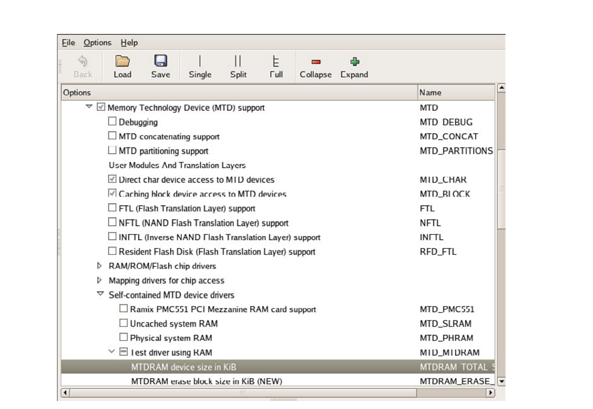
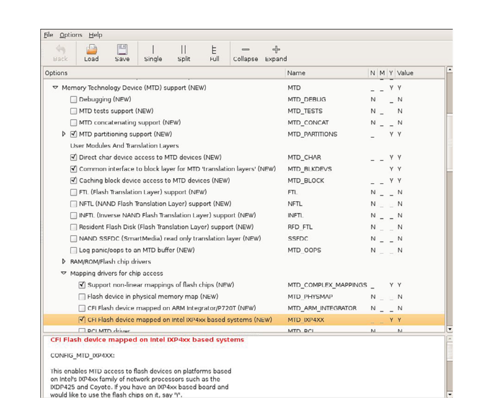
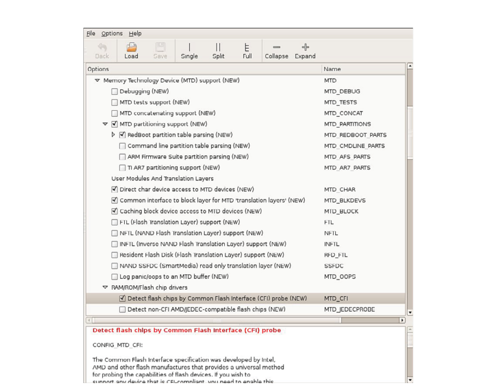
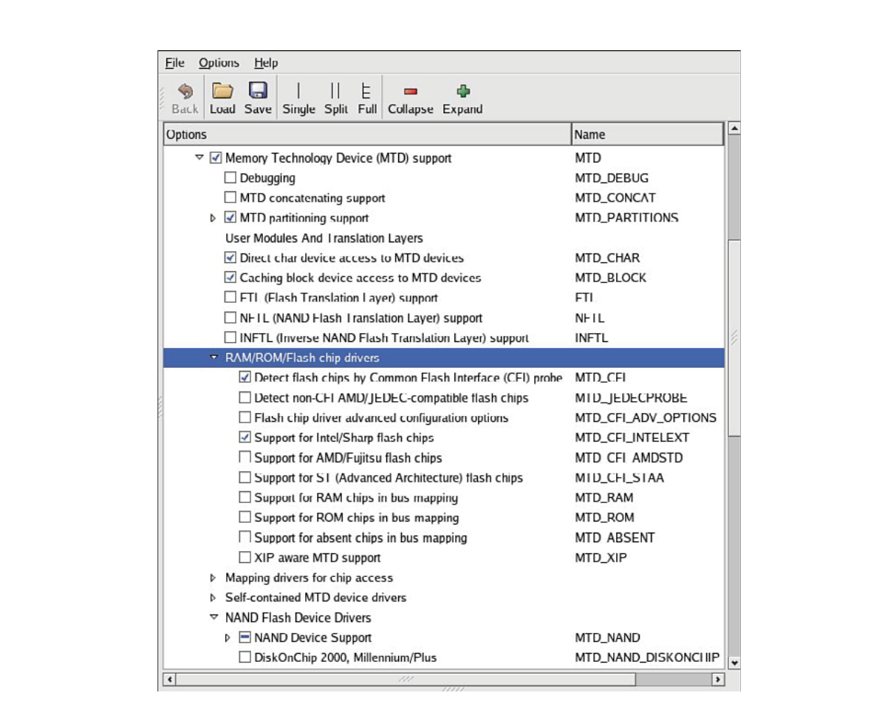

# Chương 10. MTD subsystem

## Trong chương này

- 10\.1 Tổng quan MTD 262

- 10\.2 MTD partition 267

- 10\.3 MTD utility 279

- 10\.4 UBI file system 284

- 10\.5 Tổng kết 287

Memory Technology Device (MTD) subsystem phát triển từ nhu cầu

hỗ trợ nhiều device memory-like như Flash memory chip.

Có nhiều loại Flash chip, cùng nhiều phương pháp

lập trình chúng, một phần do nhiều chế độ chuyên biệt và high-performance

được hỗ trợ. Architecture của MTD layer cho phép tách biệt

độ phức tạp device low-level khỏi cách tổ chức dữ liệu higher-layer và

storage format dùng memory device và flash device.

Chương này giới thiệu MTD subsystem và cung cấp các ví dụ đơn

giản về sử dụng. Đầu tiên xem kernel cần gì để hỗ trợ MTD

service. Chúng ta trình bày thao tác đơn giản trên development workstation

bật MTD để giúp hiểu cơ bản subsystem. Chương này

cũng tích hợp MTD với JFFS2 file system.

Sau đó thảo luận khái niệm partition liên quan MTD

layer. Chúng ta khảo sát chi tiết tạo partition từ bootloader và cách

Linux kernel phát hiện. Chương tiếp tục giới thiệu ngắn

MTD utility. Kết thúc bằng kết hợp mọi thứ, boot target

board bằng JFFS2 file system image in-Flash.

## 10.1 Tổng quan MTD

Nói đơn giản, MTD là một lớp device driver cung cấp API thống nhất để giao tiếp với các raw Flash device. MTD hỗ trợ rất nhiều loại Flash device. Tuy nhiên, MTD không phải block device. MTD làm việc với device theo đơn vị erase block, mà kích thước không phải lúc nào cũng đồng nhất, trong khi block device hoạt động trên các block đọc/ghi fixed-size gọi là sector. Block device có hai thao tác chính là đọc và ghi một sector, còn MTD có ba thao tác: đọc, ghi và xóa. MTD device có số lần ghi hữu hạn, và MTD có logic phân bổ các thao tác ghi trong suốt vòng đời device nhằm tăng tuổi thọ của device. Kỹ thuật này được gọi là wear leveling.

Trái quan niệm phổ biến, SD/MMC card, CompactFlash card, USB Flash drive và device phổ biến khác không phải MTD device. Tất cả chứa Flash translation layer nội bộ xử lý chức năng MTD-like như block erasure và wear leveling. Vì vậy chúng xuất hiện với hệ thống như block device truyền thống, không cần xử lý chuyên biệt của MTD.

Phần lớn device driver Linux là character device hoặc block device. MTD không thuộc loại nào. Dù translation mechanism có thể làm MTD giống character device hoặc block device, MTD là trường hợp riêng trong Linux driver architecture. Nguyên nhân là MTD driver phải thực hiện operation Flash-specific như erase block và wear leveling, không có tương đương trong block driver truyền thống.

### 10.1.1 Bật MTD service

Để sử dụng MTD service, kernel của bạn phải được cấu hình với MTD được bật. Điều này áp dụng như nhau cho development workstation và embedded system. Để đơn giản, chúng ta sẽ minh họa các thao tác MTD trên development workstation. Để thực hiện theo, bạn phải bật MTD trên workstation như mô tả ở đây. Tương tự, bạn cũng phải bật MTD trên embedded target để sử dụng các khả năng của MTD ở đó.

MTD có nhiều configuration option, một số gây khó hiểu. Cách tốt nhất hiểu vô số lựa chọn là bắt đầu làm việc với chúng. Để minh họa cơ chế MTD subsystem và cách tích hợp hệ thống, chúng ta bắt đầu với một số thao tác đơn giản trên Linux development workstation. Hình 10-1 cho kernel configuration (gọi bằng `make ARCH=<arch> gconfig` như thường lệ) cần để bật chức năng bare-minimum MTD. Listing 10-1 hiển thị entry file `.config` từ lựa chọn Hình 10-1. Các option nằm dưới Device drivers trong kernel configuration utility.

LISTING 10-1 Cấu hình MTD cơ bản từ `.config`

```
CONFIG_MTD=y
CONFIG_MTD_CHAR=y
CONFIG_MTD_BLOCK=y
CONFIG_MTD_MTDRAM=m
CONFIG_MTDRAM_TOTAL_SIZE=8192
CONFIG_MTDRAM_ERASE_SIZE=128
```



HÌNH 10-1 Cấu hình MTD

MTD subsystem được bật thông qua configuration option đầu tiên, bằng cách đánh dấu ô đầu tiên trong Hình 10-1, Memory Technology Device (MTD) Support. Hai entry tiếp theo trong cấu hình ở Hình 10-1 cho phép truy cập device-level đặc biệt từ user space đến các MTD device, chẳng hạn Flash memory. Entry đầu tiên (`CONFIG_MTD_CHAR`) cho phép truy cập ở character device mode, về cơ bản là truy cập tuần tự với các thao tác đọc và ghi byte-at-a-time. Entry thứ hai (`CONFIG_MTD_BLOCK`) cho phép truy cập MTD device ở block device mode, phương pháp dùng cho disk drive, trong đó các block gồm nhiều byte dữ liệu được đọc hoặc ghi trong một lần. Các access mode này cho phép dùng những lệnh Linux quen thuộc để đọc và ghi dữ liệu vào Flash memory, như bạn sẽ thấy ngay sau đây.

Phần tử `CONFIG_MTD_MTDRAM` bật test driver đặc biệt cho phép khảo sát MTD subsystem trên development host ngay cả khi không có MTD device (như Flash memory). Nhớ trong các ví dụ chúng ta làm việc với MTD trên development workstation như cách thuận tiện làm quen subsystem. Bạn hiếm khi hoặc không bao giờ làm điều này trên embedded target.

Đi kèm lựa chọn cấu hình này là hai parameter liên quan đến test driver RAM-based: device size và erase size. Trong ví dụ này, chúng ta chỉ định tổng dung lượng 8192KB và erase size 128KB. Mục tiêu của test driver là mô phỏng Flash device, chủ yếu để hỗ trợ kiểm thử và phát triển MTD subsystem. Vì Flash memory được tổ chức theo các erase block fixed-size, test driver cũng có khái niệm erase block. Bạn sẽ sớm thấy các parameter này được sử dụng như thế nào.

### 10.1.2 Kiến thức MTD cơ bản

Các Linux kernel release gần đây đã tích hợp MTD, nên bạn không cần áp dụng MTD patch để bật nó. Nếu muốn theo sát những bước phát triển mới nhất của MTD, bạn có thể download source code mới nhất từ trang chủ MTD được liệt kê ở phần cuối chương. Tất nhiên, trong cả hai trường hợp, MTD đều phải được bật trong kernel configuration, như Hình 10-1.

Sau khi bật MTD, chúng ta có thể xem xét cách subsystem này hoạt động trên Linux development workstation. Với RAM test driver vừa cấu hình, chúng ta có thể mount một JFFS2 image bằng MTD device. Giả sử bạn đã tạo JFFS2 image theo hướng dẫn chi tiết trong Chương 9, “File system”, bạn có thể muốn mount và xem xét nó. Image mà chúng ta tạo trong Chương 9 có tên `jffs2.bin`.[^1] Hãy nhớ rằng trong Chương 9, chúng ta tạo image `jffs2.bin` bằng lệnh sau:

```
# mkfs.jffs2 -d ./jffs2-image-dir -o jffs2.bin
```

Linux kernel không hỗ trợ mount trực tiếp JFFS2 file system image trên loopback device như ext2 và image khác. Vì vậy cần phương pháp khác. Có thể thực hiện bằng MTD RAM test driver trên development Linux workstation. Listing 10-2 minh họa các bước.

LISTING 10-2 Mount JFFS2 trên MTD RAM device

```
# modprobe jffs2
# modprobe mtdblock
# modprobe mtdram
# dd if=jffs2.bin of=/dev/mtdblock0
 4690+1 records in
 4690+1 records out
# mkdir /mnt/flash
# mount -t jffs2 /dev/mtdblock0 /mnt/flash
# ls -l /mnt/flash
total 0
drwxr-xr-x   2 root root 0 Sep 17 22:02 bin
drwxr-xr-x   2 root root 0 Sep 17 21:59 dev
drwxr-xr-x   7 root root 0 Sep 17 15:31 etc
drwxr-xr-x   2 root root 0 Sep 17 22:02 lib
drwxr-xr-x   2 root root 0 Sep 17 15:31 proc
drwxr-xr-x   2 root root 0 Sep 17 22:02 sbin
drwxrwxrwt   2 root root 0 Sep 17 15:31 tmp
drwxr-xr-x   9 root root 0 Sep 17 15:31 usr
drwxr-xr-x  14 root root 0 Sep 17 15:31 var
#
```

Trong Listing 10-2, trước tiên chúng ta cài các loadable module mà Linux kernel yêu cầu để hỗ trợ JFFS2 và MTD subsystem. Chúng ta load module `jffs2`, tiếp theo là các module `mtdblock` và `mtdram`. Sau khi các device driver cần thiết được load, chúng ta dùng lệnh Linux `dd` để copy JFFS2 file system image vào MTD RAM test driver thông qua device `mtdblock`. Về bản chất, chúng ta đang dùng system RAM làm backing device để mô phỏng một MTD block device.

Sau khi copy JFFS2 file system image vào MTD block device, có thể mount bằng lệnh `mount` như Listing 10-2. Khi MTD pseudo-device đã mount, có thể làm việc với image theo ý muốn. Giới hạn duy nhất của phương pháp là không đổi kích thước image. Nó bị giới hạn bởi hai yếu tố. Đầu tiên, khi cấu hình MTD RAM test device trong Linux kernel configuration user interface, đặt kích thước tối đa 8MB. Thứ hai, khi tạo JFFS2 image, đã cố định kích thước bằng tiện ích `mkfs.jffs2`. Kích thước được xác định bởi nội dung directory chỉ định lúc tạo. Tham khảo Listing 9-9 ở Chương 9 để nhớ cách build image `jffs2.bin`.

Cần hiểu các giới hạn của phương pháp khảo sát nội dung JFFS2 file system này. Hãy xem lại những gì chúng ta đã làm: sao chép nội dung của một file (JFFS2 file system binary image) vào một kernel block device (`/dev/mtdblock0`), rồi mount kernel block device (`/dev/mtdblock0`) đó dưới dạng JFFS2 file system. Sau đó, chúng ta có thể dùng tất cả tiện ích file system truyền thống để khảo sát, thậm chí sửa đổi file system. Các công cụ như `ls`, `df`, `dh`, `mv`, `rm` và `cp` đều có thể được dùng để khảo sát và sửa đổi file system. Tuy nhiên, khác với loopback device, không có mối liên hệ nào giữa file đã sao chép và JFFS2 file system image đang được mount. Vì vậy, nếu unmount file system sau khi thay đổi, những thay đổi đó sẽ bị mất. Muốn lưu lại chúng, bạn phải sao chép chúng trở lại một file. Sau đây là một cách thực hiện:

```
# dd if=/dev/mtdblock0 of=./your-modified-fs-image.bin
```

Lệnh này tạo một file có tên `your-modified-fs-image.bin`, có kích thước bằng device `mtdblock0` được chỉ định trong quá trình cấu hình. Trong ví dụ của chúng ta, kích thước đó là 8MB. Khi không có công cụ chỉnh sửa JFFS2 phù hợp, đây là một cách hoàn toàn hợp lệ để xem xét và sửa đổi JFFS2 file system. Quan trọng hơn, nó minh họa các nguyên tắc cơ bản của MTD subsystem trên development system mà không cần Flash memory thực. Bây giờ hãy xem một số hardware có các Flash device vật lý.

### 10.1.3 Cấu hình MTD trên target

Để dùng MTD với Flash memory trên board, phải cấu hình MTD đúng. Cần thực hiện những việc sau để cấu hình cho board, Flash và Flash layout:

- Chỉ định partitioning trên Flash device.

- Chỉ định loại Flash và vị trí.

- Cấu hình Flash driver đúng cho chip đã chọn.

- Cấu hình kernel với driver thích hợp.

Từng bước được khảo sát trong các phần sau.

## 10.2 MTD partition

Phần lớn Flash device trên một hardware platform được chia thành nhiều phần gọi là partition, tương tự các partition trên hard drive của desktop workstation điển hình. MTD subsystem hỗ trợ các Flash partition như vậy. MTD subsystem phải được cấu hình để hỗ trợ MTD partitioning. Hình 10-2 trình bày các configuration option cho MTD partitioning support từ một Linux kernel snapshot gần đây.



HÌNH 10-2 Kernel configuration hỗ trợ MTD partitioning

Bạn có thể truyền partition data cho Linux kernel theo nhiều cách. Có thể xem configuration option của từng cách trong Hình 10-2, dưới mục “MTD partitioning support”. Hiện tại, những phương pháp sau được hỗ trợ:

- Parse Redboot partition table

- Định nghĩa partition table qua kernel command-line

- Mapping driver Board-specific

- Hỗ trợ partitioning TI AR7

MTD cũng cho phép cấu hình không có partition data. Khi đó chỉ coi toàn Flash memory là một device.

### 10.2.1 Partitioning bằng Redboot partition table

Một phương pháp định nghĩa và phát hiện MTD partition phổ biến hơn bắt nguồn từ implementation ban đầu: Redboot partition. Redboot là bootloader trên nhiều embedded board, đặc biệt ARM XScale board như ADI Engineering Coyote Reference Platform.

MTD subsystem định nghĩa phương pháp lưu partition information ngay trên Flash device, tương tự khái niệm partition table trên hard disk. Với Redboot partition, lập trình viên dành riêng và chỉ định Flash erase block chứa partition definition. Mapping driver được chọn gọi partition parsing function lúc boot để phát hiện partition trên Flash device. Hình 10-2 cho mapping driver của board mẫu; entry được làm nổi cuối cùng định nghĩa `CONFIG_MTD_IXP4XX`.

Như thường lệ, việc xem xét chi tiết một ví dụ giúp minh họa các khái niệm này. Chúng ta bắt đầu bằng thông tin do Redboot bootloader cung cấp cho Coyote platform. Listing 10-3 ghi lại một phần output của Redboot bootloader khi power-up.

LISTING 10-3 Thông báo Redboot khi Power-Up

```
Platform: ADI Coyote (XScale)
IDE/Parallel Port CPLD Version: 1.0
Copyright (C) 2000, 2001, 2002, Red Hat, Inc.

RAM: 0x00000000-0x04000000, 0x0001f960-0x03fd1000 available
FLASH: 0x50000000 - 0x51000000, 128 blocks of 0x00020000 bytes each.
...
```

Console output cho biết RAM trên board được map vật lý từ địa chỉ `0x00000000`, Flash map tại physical address `0x50000000` đến `0x51000000`. Cũng thấy Flash có 128 block, mỗi block `0x00020000` (128KB).

Redboot có một lệnh để tạo và hiển thị thông tin partition lưu trên Flash. Listing 10-4 là output của lệnh `fis list`, thuộc họ lệnh Flash Image System có trong Redboot bootloader.

LISTING 10-4 Danh sách Flash partition của Redboot

```
RedBoot> fis list
Name              FLASH addr  Mem addr    Length      Entry point
RedBoot           0x50000000  0x50000000  0x00060000  0x00000000
RedBoot config    0x50FC0000  0x50FC0000  0x00001000  0x00000000
FIS directory     0x50FE0000  0x50FE0000  0x00020000  0x00000000
RedBoot>
```

Từ Listing 10-4, chúng ta thấy Coyote board có ba partition được định nghĩa trên Flash. Partition có tên RedBoot chứa executable image của Redboot bootloader. Partition có tên RedBoot config chứa các configuration parameter do bootloader duy trì. Partition cuối cùng, có tên FIS directory, chứa thông tin về chính partition table.

Khi được cấu hình đúng, Linux kernel có thể phát hiện và parse partition table này, rồi tạo các MTD partition biểu diễn những physical partition trên Flash. Listing 10-5 trình bày lại một phần boot message được xuất từ ADI Engineering Coyote board đã đề cập, khi boot một Linux kernel được cấu hình hỗ trợ phát hiện Redboot partition.

LISTING 10-5 Phát hiện Redboot partition khi Linux boot

```
...
IXP4XX-Flash.0: Found 1 x16 devices at 0x0 in 16-bit bank
 Intel/Sharp Extended Query Table at 0x0031
Using buffer write method
Searching for RedBoot partition table in IXP4XX-Flash.0 at offset 0xfe0000
3 RedBoot partitions found on MTD device IXP4XX-Flash0
Creating 3 MTD partitions on “IXP4XX-Flash.0”:
0x00000000-0x00060000 : “RedBoot”
0x00fc0000-0x00fc1000 : “RedBoot config”
0x00fe0000-0x01000000 : “FIS directory”
...
```

Thông báo đầu Listing 10-5 được in khi phát hiện Flash chip qua Common Flash Interface (CFI) driver, bật bởi `CONFIG_MTD_CFI`. CFI là phương pháp industry-standard xác định đặc tính Flash chip như nhà sản xuất, device type, total size, erase block size. Xem phần cuối để có link CFI specification.

CFI bật qua tiện ích kernel-configuration trong menu top-level Memory Technology Device (MTD). Chọn “Detect flash chips by Common Flash Interface (CFI) probe” dưới “RAM/ROM/Flash chip drivers”, như Hình 10-3.



HÌNH 10-3 Kernel configuration hỗ trợ MTD CFI

Vì chúng ta cũng bật `CONFIG_MTD_REDBOOT_PARTS` (xem Hình 10-3), MTD quét tìm Redboot partition table trên Flash chip. Cũng hãy chú ý rằng chip được enumerate với device name `IXP4XX-Flash.0`. Từ Listing 10-5, bạn có thể thấy Linux kernel phát hiện ba partition trên Flash chip, giống những partition đã được liệt kê trước đó bằng lệnh `fis list` trong Redboot.

Khi hạ tầng đã được thiết lập như mô tả ở đây, Linux kernel tự động phát hiện và tạo các kernel data structure biểu diễn ba Flash partition. Có thể tìm thấy bằng chứng về các partition này trong file system `/proc` khi kernel hoàn tất khởi tạo, như trong Listing 10-6.

LISTING 10-6 MTD Flash partition của kernel

```
root@coyote:~# cat /proc/mtd
dev:    size   erasesize  name
mtd0: 00060000 00020000 “RedBoot”
mtd1: 00001000 00020000 “RedBoot config”
mtd2: 00020000 00020000 “FIS directory”
#
```

Có thể dễ tạo Redboot partition mới. Chúng ta dùng Redboot FIS command cho ví dụ nhưng không trình bày chi tiết lệnh Redboot trong sách. Có thể tham khảo Redboot user documentation để biết thêm, xem phần cuối. Listing 10-7 cho chi tiết tạo Redboot partition mới.

LISTING 10-7 Tạo Redboot partition mới

```
RedBoot> load -r -v -b 0x01008000 coyote-40-zImage
Using default protocol (TFTP)
Raw file loaded 0x01008000-0x0114dccb, assumed entry at 0x01008000
RedBoot> fis create -b 0x01008000 -l 0x145cd0 -f 0x50100000 MyKernel
... Erase from 0x50100000-0x50260000: . .........
... Program from 0x01008000-0x0114dcd0 at 0x50100000: ....
... Unlock from 0x50fe0000-0x51000000: .
... Erase from 0x50fe0000-0x51000000: .
... Program from 0x03fdf000-0x03fff000 at 0x50fe0000: .
... Lock from 0x50fe0000-0x51000000: .
```

Trước tiên, chúng ta load image sẽ được dùng để tạo partition mới. Trong ví dụ này, chúng ta dùng kernel image và load nó vào memory address `0x01008000`. Sau đó, chúng ta tạo partition mới bằng lệnh Redboot `fis create`. Chúng ta yêu cầu Redboot tạo partition mới trong vùng Flash bắt đầu tại `0x50100000`. Bạn có thể thấy Redboot trước tiên xóa vùng Flash này rồi lập trình kernel image vào đó. Ở bước cuối, Redboot unlock vùng directory của nó và cập nhật FIS Directory bằng thông tin partition mới. Listing 10-8 cho thấy output của `fis list` với partition mới. Hãy so sánh output này với output trong Listing 10-4.

LISTING 10-8 Danh sách Redboot partition mới

```
RedBoot> fis list
Name              FLASH addr  Mem addr    Length     Entry point
RedBoot           0x50000000  0x50000000  0x00060000  0x00000000
RedBoot config    0x50FC0000  0x50FC0000  0x00001000  0x00000000
FIS directory     0x50FE0000  0x50FE0000  0x00020000  0x00000000
MyKernel          0x50100000  0x50100000  0x00160000  0x01008000
```

Tất nhiên, khi chúng ta boot Linux kernel, kernel sẽ phát hiện partition mới và chúng ta có thể thao tác trên đó theo nhu cầu. Có lẽ bạn đã nhận ra một lợi ích khác của partition mới này: giờ đây chúng ta có thể boot kernel từ Flash thay vì phải load kernel bằng TFTP mỗi lần. Lệnh Redboot để thực hiện việc đó được trình bày dưới đây. Chỉ cần truyền cho lệnh Redboot `exec` địa chỉ bắt đầu của partition trong Flash và chiều dài image cần chuyển vào RAM:

```
RedBoot> exec -b 0x50100000 -l 0x145cd0
   Uncompressing Linux........... done, booting the kernel.
   ...
```

### 10.2.2 Partitioning qua kernel Command-Line

Như chi tiết trong Phần 10.2, “MTD partition”, raw Flash partition information có thể truyền cho kernel bằng phương pháp khác. Thực tế, có lẽ cách trực tiếp nhất, dù chưa chắc đơn giản nhất, là truyền partition information thủ công ngay trên kernel command line. Như đã học, một số bootloader làm dễ (như U-Boot), còn một số không có cơ chế truyền kernel command line lúc boot. Khi đó phải cấu hình kernel command line lúc compile nên khó đổi hơn, cần compile lại kernel mỗi khi sửa partition.

Để bật partitioning command-line trong MTD subsystem, kernel phải cấu hình hỗ trợ. Có thể thấy option trong Hình 10-2 dưới “MTD partitioning support”. Chọn command-line partition table parsing, định nghĩa option `CONFIG_MTD_CMDLINE_PARTS`.

Listing 10-9 cho định dạng định nghĩa partition trên kernel command line (lấy từ `.../drivers/mtd/cmdlinepart.c`).

LISTING 10-9 Định dạng MTD partition qua kernel Command-Line

```
mtdparts=<mtddef>[;<mtddef]
 * <mtddef>  := <mtd-id>:<partdef>[,<partdef>]
 * <partdef> := <size>[@offset][<name>][ro]
 * <mtd-id>  := unique name used in mapping driver/device (mtd->name)
 * <size>    := std linux memsize OR “-” to denote all remaining space
 * <name>    := ‘(‘ NAME ‘)’
```

Mỗi parameter `mtddef` truyền trên kernel command line định nghĩa partition riêng. Như Listing 10-9, mỗi định nghĩa `mtddef` có nhiều phần. Có thể chỉ định unique ID, partition size, offset từ đầu Flash. Cũng có thể truyền tên và attribute read-only tùy chọn cho partition. Dựa định nghĩa Redboot partition trong Listing 10-4, có thể định nghĩa tĩnh trên kernel command line như sau:

```
mtdparts=MainFlash:384K(Redboot),4K(config),128K(FIS),-(unused)
```

Với định nghĩa này, kernel tạo bốn MTD partition, MTD ID MainFlash, chứa kích thước và bố cục khớp Listing 10-4.

### 10.2.3 Mapping driver

Phương pháp cuối định nghĩa Flash layout board-specific là dùng mapping driver board-specific chuyên dụng. Linux kernel source tree chứa nhiều ví dụ trong `.../drivers/mtd/maps`. Bất kỳ ví dụ nào cũng hướng dẫn tốt cách tạo riêng. Chi tiết implementation thay đổi theo architecture.

Mapping driver là một kernel module hoàn chỉnh, có đầy đủ các lời gọi `module_init()` và `module_exit()`, như đã mô tả trong Chương 8, “Kiến thức cơ bản về device driver”. Mapping driver điển hình có kích thước nhỏ và dễ đọc, thường chứa ít hơn vài chục dòng code C.

Listing 10-10 tái hiện một phần `.../drivers/mtd/maps/pq2fads.c`. Mapping driver định nghĩa Flash device trên Freescale PQ2FADS evaluation board hỗ trợ MPC8272 và processor khác.

LISTING 10-10 Flash mapping driver cho PQ2FADS

```
...
static struct mtd_partition pq2fads_partitions[] = {
      {
#ifdef CONFIG_ADS8272
            .name       = “HRCW”,
            .size       = 0x40000,
            .offset       = 0,
            .mask_flags = MTD_WRITEABLE,  /* force read-only */
      }, {
            .name       = “User FS”,
            .size       = 0x5c0000,
            .offset       = 0x40000,
#else
            .name       = “User FS”,
            .size       = 0x600000,
            .offset       = 0,
#endif
      }, {
            .name       = “uImage”,
            .size       = 0x100000,
            .offset       = 0x600000,
            .mask_flags = MTD_WRITEABLE,  /* force read-only */
      }, {
            .name       = “bootloader”,
            .size       = 0x40000,
            .offset     = 0x700000,
            .mask_flags = MTD_WRITEABLE,  /* force read-only */
      }, {
            .name       = “bootloader env”,
            .size       = 0x40000,
            .offset            = 0x740000,
            .mask_flags = MTD_WRITEABLE,  /* force read-only */
      }
};

/* pointer to MPC885ADS board info data */
extern unsigned char __res[];

static int __init init_pq2fads_mtd(void)
{
      bd_t *bd = (bd_t *)__res;
      physmap_configure(bd->bi_flashstart, bd->bi_flashsize,
                      PQ2FADS_BANK_WIDTH, NULL);

      physmap_set_partitions(pq2fads_partitions,
                      sizeof (pq2fads_partitions) /
                      sizeof (pq2fads_partitions[0]));
      return 0;
}

static void __exit cleanup_pq2fads_mtd(void)
{
}

module_init(init_pq2fads_mtd);
module_exit(cleanup_pq2fads_mtd);
...
```

Linux device driver đơn giản nhưng hoàn chỉnh này truyền PQ2FADS Flash mapping cho MTD subsystem. Nhớ Chương 8, khi function trong driver khai báo bằng macro `module_init()`, nó tự động được gọi khi Linux kernel boot. Trong mapping driver PQ2FADS, module initialization function `init_pq2fads_mtd()` chỉ gọi hai lệnh đơn giản:

- `physmap_configure()` truyền physical address, size, bank width của Flash chip cho MTD subsystem, cùng setup function đặc biệt cần để truy cập Flash.

- `physmap_set_partitions()` truyền partition information riêng của board cho MTD subsystem từ partition table định nghĩa trong array `pq2fads_partitions[]` ở đầu mapping driver.

Theo ví dụ đơn giản này, có thể tạo mapping driver cho board riêng.

### 10.2.4 Flash chip driver

MTD hỗ trợ rất nhiều Flash chip và device. Khả năng chip bạn chọn cũng được hỗ trợ là rất cao. Những Flash chip phổ biến nhất hỗ trợ Common Flash Interface (CFI) đã đề cập trước đó. Các Flash chip cũ hơn có thể hỗ trợ JEDEC, một tiêu chuẩn tương thích Flash cũ hơn. Hình 10-4 trình bày kernel configuration từ một Linux kernel snapshot gần đây. Phiên bản này hỗ trợ nhiều loại Flash.

Nếu Flash chip của bạn chưa được hỗ trợ, bạn phải tự cung cấp một device file. Hãy dùng một trong nhiều ví dụ trong `.../drivers/mtd/chips` làm điểm khởi đầu để tùy chỉnh hoặc tạo Flash device driver của riêng mình. Tốt hơn nữa, trừ khi chip vừa được giới thiệu với một interface mới lạ, có lẽ ai đó đã tạo sẵn một driver.

### 10.2.5 Khởi tạo Board-Specific

Cùng với mapping driver, phần thiết lập board-specific (platform) phải cung cấp các định nghĩa nền tảng để MTD Flash system hoạt động đúng. Listing 10-11 trình bày lại các phần liên quan của `.../arch/arm/mach-ixp4xx/coyote-setup.c`.



HÌNH 10-4 Hỗ trợ Flash device

LISTING 10-11 Board setup Coyote-Specific

```
static struct flash_platform_data coyote_flash_data = {
      .map_name   = “cfi_probe”,
      .width      = 2,
};

static struct resource coyote_flash_resource = {
      .flags            = IORESOURCE_MEM,
};

static struct platform_device coyote_flash = {
      .name       = “IXP4XX-Flash”,
      .id         = 0,
      .dev        = {
            .platform_data = &coyote_flash_data,
      },
      .num_resources      = 1,
      .resource   = &coyote_flash_resource,
};

...

static struct platform_device *coyote_devices[] __initdata = {
      &coyote_flash,
      &coyote_uart
};

static void __init coyote_init(void)
{
      ...

      platform_add_devices(coyote_devices,
                             ARRAY_SIZE(coyote_devices));
}

...
```

Từ cuối Listing 10-11, function `coyote_init()` gọi `platform_add_devices()`, chỉ định các device Coyote-specific định nghĩa trước trong file. Bạn thấy hai device định nghĩa ngay trên routine `coyote_init()`. Device quan tâm ở đây là `coyote_flash`. Structure kiểu `struct platform_device` chứa mọi chi tiết quan trọng Linux kernel và MTD subsystem cần.

Member `.name` của structure `coyote_flash` bind Flash resource platform-specific với mapping driver cùng tên. Có thể thấy trong mapping driver file `.../drivers/mtd/maps/ixp4xx.c`. Member `.resource` truyền Flash base address trên board. Member `.dev`, chứa member `.platform_data`, gắn Flash setup với chip driver. Ở đây chỉ định board dùng CFI probe method, định nghĩa trong kernel configuration là `CONFIG_MTD_CFI`. Có thể thấy lựa chọn trong Hình 10-4.

Tùy architecture và board, có thể dùng phương pháp tương tự định nghĩa Flash support cho board riêng.

## 10.3 MTD utility

MTD package chứa một số system utility hữu ích cho việc thiết lập và quản lý MTD subsystem của bạn. Các tiện ích được build riêng với MTD subsystem chính, vốn nên được build từ bên trong Linux kernel source tree. Các tiện ích này có thể được build theo cách tương tự mọi user space code cross-compiled khác.

Phải thận trọng khi dùng vì Linux không bảo vệ khỏi sai lầm. Lỗi gõ single-digit có thể xóa bootloader trên hardware platform. Điều đó có thể phá hỏng ngày của bạn trừ khi đã backup và biết lập trình lại bằng JTAG Flash programmer.

Theo cách trình bày thường dùng xuyên suốt cuốn sách này, chúng ta không thể dành đủ dung lượng để trình bày mọi MTD utility. Chúng ta sẽ nêu bật những tiện ích phổ biến và hữu ích nhất, còn việc khám phá những tiện ích còn lại được dành cho bạn như một bài thực hành. Một MTD snapshot gần đây chứa hơn 20 binary utility.

Họ tiện ích `flash_*` hữu ích cho raw device operation trên MTD partition, gồm `flashcp`, `flash_erase`, `flash_info`, `flash_lock`, `flash_unlock` và các loại khác. Hy vọng tên đủ mô tả để hình dung chức năng. Khi partition được định nghĩa và enumerate làm kernel device, có thể chạy bất kỳ user space utility này trên partition. Nhắc lại cảnh báo: nếu thực thi `flash_erase` trên partition chứa bootloader, bạn sẽ sở hữu cục chặn giấy silicon. Nếu định thử như vậy, nên backup bootloader image và biết cách re-Flash bằng hardware JTAG emulator hoặc công cụ Flash programming khác.

Partition mới tạo trong Listing 10-7 (`MyKernel`) xuất hiện trong kernel chạy trên Coyote board, như Listing 10-12. Ở đây thấy partition mới được tạo thành kernel device `mtd1`.

LISTING 10-12 Danh sách MTD partition của kernel

```
root@coyote:~# cat /proc/mtd
dev:    size   erasesize  name
mtd0: 00060000 00020000 “RedBoot”
mtd1: 00160000 00020000 “MyKernel”
mtd2: 00001000 00020000 “RedBoot config”
mtd3: 00020000 00020000 “FIS directory”
```

Dùng MTD utility, có thể thực hiện nhiều operation trên partition mới. Đây là kết quả lệnh `flash_erase` trên partition:

```
# flash_erase /dev/mtd1
Erase Total 1 Units
Performing Flash Erase of length 131072 at offset 0x0 done
```

Để copy kernel image mới vào partition, dùng lệnh `flashcp`:

```
root@coyote:~# flashcp /workspace/coyote-40-zImage /dev/mtd1
```

Làm việc với root file system partition thú vị hơn một chút. Chúng ta có thể chọn dùng bootloader hoặc Linux kernel để đặt image ban đầu lên Redboot Flash partition. Trước tiên, chúng ta dùng Redboot để tạo partition mới sẽ chứa root file system. Lệnh sau tạo một partition mới trên Flash device có tên `RootFS`, bắt đầu tại physical memory address `0x50300000`, với chiều dài 30 block. Hãy nhớ rằng trên Flash chip này, một block, thường gọi chung là erase unit, có kích thước 128KB.

```
RedBoot> fis create -f 0x50300000 -l 0x600000 -n RootFS
```

Tiếp theo, chúng ta boot kernel và copy root file system image vào partition mới có tên `RootFS`. Việc này được thực hiện bằng lệnh sau từ Linux command prompt trên target board của bạn. Lưu ý rằng điều này giả định bạn đã đặt file system image trong một directory mà board có thể truy cập. Như đã đề cập nhiều lần trong cuốn sách, NFS root mount là người bạn tốt nhất của bạn trong quá trình phát triển.

```
root@coyote:~# flashcp /rootfs.ext2 /dev/mtd2
```

File system có thể có kích thước từ vài megabyte đến giới hạn lớn nhất mà chúng ta cho phép trên partition này, nên thao tác có thể mất một chút thời gian. Hãy nhớ rằng thao tác này lập trình image vào Flash memory, đôi khi được gọi là flashing. Sau khi copy, chúng ta có thể mount partition làm file system. Listing 10-13 trình bày trình tự này.

LISTING 10-13 Mount MTD Flash partition làm ext2 file system

```
root@coyote:~# mount -t ext2 /dev/mtdblock2 /mnt/remote ro
root@coyote:~# ls -l /mnt/remote/
total 16
drwxr-xr-x  2 root root 1024 Nov 19  2005 bin
drwxr-xr-x  2 root root 1024 Oct 26  2005 boot
drwxr-xr-x  2 root root 1024 Nov 19  2005 dev
drwxr-xr-x  5 root root 1024 Nov 19  2005 etc
drwxr-xr-x  2 root root 1024 Oct 26  2005 home
drwxr-xr-x  3 root root 1024 Nov 19  2005 lib
drwxr-xr-x  3 root root 1024 Nov 19  2005 mnt
drwxr-xr-x  2 root root 1024 Oct 26  2005 opt
drwxr-xr-x  2 root root 1024 Oct 26  2005 proc
drwxr-xr-x  2 root root 1024 Oct 26  2005 root
drwxr-xr-x  2 root root 1024 Nov 19  2005 sbin
drwxr-xr-x  2 root root 1024 Oct 26  2005 srv
drwxr-xr-x  2 root root 1024 Oct 26  2005 sys
drwxr-xr-x  2 root root 1024 Oct 26  2005 tmp
drwxr-xr-x  6 root root 1024 Oct 26  2005 usr
drwxr-xr-x  2 root root 1024 Nov 19  2005 var
root@coyote:~#
```

Listing 10-13 có hai chi tiết tinh tế quan trọng. Chú ý chỉ định `/dev/mtdblock2` trên command line `mount`. Đây là MTD block driver cho phép truy cập partition như block device. Chỉ định `/dev/mtd2` yêu cầu kernel dùng MTD character driver. Cả `mtdchar` và `mtdblock` là pseudo driver cung cấp truy cập character-based hoặc block-oriented đến Flash partition bên dưới. Vì `mount` cần block device, phải dùng chỉ định block-device. Hình 10-1 cho kernel configuration bật các access method. Các macro tương ứng là `CONFIG_MTD_CHAR` và `CONFIG_MTD_BLOCK`.

Chi tiết tinh tế thứ hai là việc sử dụng command-line switch read-only (`ro`) trong lệnh `mount`. Việc mount ext2 image từ Flash bằng MTD block emulation driver cho mục đích read-only là hoàn toàn hợp lệ. Tuy nhiên, driver `mtdblock` không hỗ trợ ghi vào ext2 device. Lý do là ext2 không có hiểu biết về Flash erase block. Để truy cập ghi vào một file system Flash-based, chúng ta cần dùng file system có hiểu biết về Flash, chẳng hạn JFFS2.

### 10.3.1 JFFS2 root file system

Tạo một JFFS2 root file system là quá trình khá đơn giản. Ngoài khả năng nén, JFFS2 còn hỗ trợ wear leveling, một tính năng được thiết kế để tăng tuổi thọ Flash bằng cách phân bổ đều các write cycle giữa những block của device. Như đã nêu ở Chương 9, Flash memory chỉ chịu được số write cycle hữu hạn. Wear leveling nên được xem là tính năng bắt buộc trong bất kỳ file system Flash-based nào bạn sử dụng. Như đã đề cập ở những phần khác của cuốn sách, bạn nên coi Flash memory là phương tiện lưu trữ write-occasional. Cụ thể, hãy tránh để bất kỳ process nào cần ghi thường xuyên ghi vào Flash file system. Đặc biệt chú ý các chương trình ghi log như `syslogd`.

Chúng ta có thể build một JFFS2 image trên development workstation bằng ext2 image đã dùng trên Redboot partition `RootFS`. Lợi ích của việc nén sẽ rõ ràng ngay lập tức. Image mà chúng ta dùng trong ví dụ `RootFS` trước đó là một ext2 file system image. Sau đây là listing ở định dạng long (`-l`):

```
# ls -l rootfs.ext2
-rw-r--r--  1 root root 6291456 Nov 19 16:21 rootfs.ext2
```

Giờ chuyển image sang JFFS2 bằng tiện ích `mkfs.jffs2` trong MTD package. Listing 10-14 cho lệnh và kết quả.

LISTING 10-14 Chuyển RootFS sang JFFS2

```
# mount -o loop rootfs.ext2 /mnt/flash/
# mkfs.jffs2 -r /mnt/flash -e 128 -b -o rootfs.jffs2
# ls -l rootfs.jffs2
-rw-r--r--  1 root root 2401512 Nov 20 10:08 rootfs.jffs2
#
```

Trước tiên, chúng ta mount ext2 file system image bằng loopback device tại một mount point tùy ý trên development workstation. Tiếp theo, chúng ta gọi tiện ích MTD `mkfs.` `jffs2` để tạo JFFS2 file system image. Flag `-r` cho `mkfs.jffs2` biết vị trí root file system image. Flag `-e` yêu cầu `mkfs.jffs2` build image với giả định block size là 128KB. Block size mặc định là 64KB. JFFS2 không hoạt động hiệu quả nhất nếu Flash device có block size khác block size của image. Cuối cùng, chúng ta hiển thị một long listing và thấy rằng JFFS2 root file system image kết quả đã giảm kích thước hơn 60 phần trăm. Khi làm việc với Flash memory hạn chế, đây là mức giảm đáng kể trong việc sử dụng tài nguyên Flash quý giá.

Chú ý command-line flag quan trọng truyền cho `mkfs.jffs2` trong Listing 10-14. Flag `-b` là flag `-big-endian`, yêu cầu tiện ích `mkfs.jffs2` tạo JFFS2 Flash image phù hợp target big-endian. Vì nhắm ADI Engineering Coyote board chứa Intel IXP425 processor chạy big-endian, bước này thiết yếu để hoạt động đúng. Nếu không chỉ định big-endian, sẽ nhận nhiều màn hình đầy phàn nàn từ kernel khi cố xử lý superblock JFFS2 file system thực chất vô nghĩa.[^2] Bạn muốn đoán tôi nhớ chi tiết này thế nào không?

Theo cách tương tự ví dụ trước, chúng ta có thể copy image này vào Redboot RootFS Flash partition bằng tiện ích `flashcp`. Sau đó, chúng ta có thể boot Linux kernel bằng JFFS2 root file system. Listing 10-15 trình bày chi tiết, với các MTD utility chạy trên target hardware của chúng ta.

LISTING 10-15 Copy JFFS2 vào partition `RootFS`

```
root@coyote:~# cat /proc/mtd
dev:    size   erasesize  name
mtd0: 00060000 00020000 “RedBoot”
mtd1: 00160000 00020000 “MyKernel”
mtd2: 00600000 00020000 “RootFS”
mtd3: 00001000 00020000 “RedBoot config”
mtd4: 00020000 00020000 “FIS directory”
root@coyote:~# flash_erase /dev/mtd2
Erase Total 1 Units
Performing Flash Erase of length 131072 at offset 0x0 done
root@coyote:~# flashcp /rootfs.jffs2 /dev/mtd2
root@coyote:~#
```

Quan trọng phải bật JFFS2 file system trong kernel configuration. Thực thi `make ARCH=<arch> gconfig` rồi chọn JFFS2 dưới File Systems, Miscellaneous File Systems. Gợi ý khác là dùng flag `-v` (verbose) trên MTD utility, cung cấp cập nhật tiến độ và thông tin hữu ích khi thao tác Flash.

Chúng ta đã thấy boot kernel bằng lệnh Redboot `exec`. Listing 10-16 trình bày chuỗi lệnh load, boot Linux kernel với JFFS2 file system mới làm root.

LISTING 10-16 Boot với JFFS2 làm root file system

```
RedBoot> load -r -v -b 0x01008000 coyote-zImage
Using default protocol (TFTP)
Raw file loaded 0x01008000-0x0114decb, assumed entry at 0x01008000
RedBoot> exec -c “console=ttyS0,115200 rootfstype=jffs2 root=/dev/mtdblock2”
Using base address 0x01008000 and length 0x00145ecc
Uncompressing Linux...... done, booting the kernel.
...
```

## 10.4 UBI file system

Unsorted Block Image (UBI) File System được thiết kế để khắc phục một số giới hạn của JFFS2 file system. Nó có thể được xem là thế hệ kế tiếp của JFFS2, dù JFFS2 vẫn được dùng rộng rãi trên các embedded Linux device có Flash memory. UBI File System (UBIFS) được xây dựng trên các UBI device, còn các device này lại phụ thuộc vào MTD device.

UBIFS cải thiện một trong những giới hạn đáng kể của JFFS2 file system: mount time. JFFS2 duy trì indexing metadata trong system memory và phải đọc index này để xây dựng một directory tree hoàn chỉnh mỗi lần hệ thống boot. Điều này có thể đòi hỏi đọc một phần đáng kể của Flash device. Ngược lại, UBIFS duy trì indexing metadata ngay trên Flash device, loại bỏ nhu cầu quét và xây dựng lại dữ liệu này trong mỗi lần mount. Vì vậy, UBIFS mount nhanh hơn JFFS2 nhiều lần.

UBIFS còn hỗ trợ write caching, có thể tăng hiệu năng đáng kể. Đọc thêm ưu điểm tại www.linux-mtd. infradead.org/doc/ubifs.html.

### 10.4.1 Cấu hình UBIFS

Để sử dụng UBIFS, kernel của bạn phải được bật UBI support. Bạn phải bật hai mục khác nhau trong kernel configuration menu để có UBIFS. Trước tiên, hãy bật hỗ trợ MTD\_UBI. Bạn có thể tìm option này trong kernel configuration tại Device Drivers --\> Memory Technology Device (MTD) support --\> UBI - Unsorted block images --\> Enable UBI. Khi được chọn, mục này cho phép các file system support configuration option nằm tại File Systems --\> Miscellaneous filesystems --\> UBIFS file system support.

### 10.4.2 Build UBIFS image

Build UBIFS image phức tạp hơn build JFFS2 image một chút. Phần phức tạp bổ sung xuất phát từ công nghệ NAND Flash. Để build UBIFS image, bạn cần hiểu NAND Flash architecture trên target system; điều này sẽ rõ ngay sau đây. Bạn cũng cần cài một phiên bản MTD Utils tương đối mới trên development workstation. Có thể tìm MTD Utils tại git://git.infradead.org/mtd-utils.git.

Listing 10-17 trình bày chi tiết quá trình tạo UBIFS image trên development workstation của bạn. Trong bài thực hành này, giả sử bạn đã có nội dung mong muốn của file system trong một directory có tên `rootfs`.

LISTING 10-17 Build UBIFS image

```
$ mkfs.ubifs -m 2048 -e 129024 -c 1996 -o ubifs.img -r ./rootfs
$ ubinize -m 2048 -p 128KiB -s 512 -o ubi.img ubinize.cfg
$ ls -l
total 200880
drwxr-xr-x 17 chris chris      4096 2010-03-01 11:33 rootfs
-rw-r--r--  1 chris chris 101799936 2010-03-01 11:55 ubifs.img
-rw-r--r--  1 chris chris 103677952 2010-03-01 11:58 ubi.img
-rw-r--r--  1 chris chris       112 2010-03-01 11:54 ubinize.cfg
```

Raw UBIFS image được build bằng tiện ích `mkfs.ubifs` từ package mtd-utils. Thao tác này tạo ra target file `ubifs.img`. Điều thiết yếu là phải truyền đúng parameter cho `mkfs.ubifs`. Các parameter này được xác định từ hardware design và NAND Flash architecture của bạn. `-m` chỉ định minimum I/O unit size, ở đây là 2KB. `-e` chỉ định kích thước logical erase block (LEB) của image. Số LEB tối đa của image được chỉ định bằng `-c`. Tên output image được chỉ định bằng `-o`. Trong ví dụ này, chúng ta đặt tên image là `ubifs.img`.

Giờ đã có UBIFS image, chúng ta phải tạo UBI volume image. Chúng ta dùng công cụ `ubinize` (thuộc package mtd-utils) để thực hiện việc này. Một lần nữa, chúng ta phải dùng các parameter chính xác cho target environment. Ngoài ra, bạn sẽ thấy `ubinize` yêu cầu một configuration file. File `ubinize.cfg` chứa volume name cùng các thông tin khác, như chúng ta sẽ thấy ngay sau đây.

Listing 10-17 chỉ minimum I/O size 2KB như trong `mkfs.ubifs`. Ở đây chỉ physical erase block size bằng parameter `-p`. Trong trường hợp này dùng NAND Flash có physical erase block 128KiB. Parameter `-s` chỉ subpage size, minimum I/O unit. Đặt tên target output file bằng `-o ubi.img`. Chúng ta sẽ flash image này vào device.

Configuration file của `ubinize` chỉ các volume công cụ `ubinize` cần sinh. Listing 10-18 trình bày cấu hình đơn giản dùng trong Listing 10-17.

LISTING 10-18 Configuration file `ubinize`

```
$ cat ubinize.cfg
[ubifs]
mode=ubi
image=ubifs.img
vol_id=0
vol_size=200MiB
vol_type=dynamic
vol_name=rootfs
```

Ở đây, bạn có thể thấy chúng ta đặt tên volume là rootfs và lấy raw image từ file có tên `ubifs.img`. Hãy nhớ từ Listing 10-17 rằng đây là image do tiện ích `mkfs.ubifs` tạo ra. Bạn có thể đọc thêm về configuration file của `ubinize` trong man page của tiện ích này.

Khi có image cuối cùng, chúng ta có thể flash nó vào device. Chúng ta sẽ dùng lệnh `ubiformat` để thực hiện việc này. Bạn không thể chỉ đơn giản flash raw image vào device. Lý do là NAND Flash được UBI layer sử dụng có các header đặc biệt ghi lại erase count, cùng những thông tin khác, cho từng physical erase block. Thông tin này được dùng cho wear leveling. Việc sử dụng `ubiformat` bảo toàn các error count header này. Listing 10-19 trình bày chi tiết.

LISTING 10-19 Dùng UBIFS image

```
root@beagleboard:~# flash_eraseall /dev/mtd4
Erasing 128 Kibyte @ f980000 -- 100 % complete.
root@beagleboard:~# ubiformat /dev/mtd4 -s 512 -f /ubi.img
ubiformat: mtd4 (NAND), size 261619712 bytes (249.5 MiB), 131072 eraseblocks of
131072 bytes (128.0 KiB), min. I/O size 2048 bytes
<...>
root@beagleboard:~# ubiattach /dev/ubi_ctrl -m 4
UBI device number 0, total 1996 LEBs (257531904 bytes, 245.6 MiB), available 0
LEBs (0 bytes), LEB size 129024 bytes (126.0 KiB)
root@beagleboard:~# mount -t ubifs  ubi0:rootfs /mnt/ubifs
root@beagleboard:~# ls /mnt/ubifs
bin     dev     home    linuxrc  mnt     sbin    sys     usr
boot    etc     lib     media    proc    srv     tmp     var
```

Ở đây, bạn có thể thấy chuỗi thao tác dẫn đến việc mount UBIFS file system. Trước hết, chúng ta xóa Flash device bằng `flash_eraseall`, một tiện ích của mtd-utils. Hãy cân nhắc nhu cầu sử dụng tiện ích xóa này vì nó không giữ lại các error counter. Đây là trường hợp sử dụng lần đầu, hay first-time-use.

Trong ví dụ của chúng ta, lệnh `ubiformat` ghi image lên NAND Flash. `-s` chỉ định subpage size, giá trị này phải khớp với image, còn `-f` được dùng để chọn image file. Sau khi thao tác này hoàn tất, chúng ta có thể attach UBI device; đây là bước bắt buộc trước khi mount UBI device. `ubiattach` yêu cầu UBI control device (`/dev/ubi_ctrl`) và một giá trị chỉ định MTD device cần attach. Vì đã ghi image vào MTD partition 4 (`/dev/mtd4`), chúng ta chỉ định partition đó cho `ubiattach` bằng parameter `-m 4`.

Với mọi thứ sẵn, giờ mount UBIFS image. Chú ý Listing 10-19 truyền volume name chỉ định trong configuration file `ubinize.cfg` cho lệnh `mount`.

### 10.4.3 Dùng UBIFS làm root file system

Giờ đã có image trên `/dev/mtd4`, chúng ta có thể yêu cầu kernel mount file system này làm root file system. Để thực hiện, hãy truyền các kernel command-line parameter sau cho kernel:

```
ubi.mtd=4 root=ubi0:rootfs rw rootfstype=ubifs
```

Tập hợp kernel command-line parameter này yêu cầu kernel attach device mtd4 vào ubi0 và mount UBI device kết quả làm root file system. Nếu gặp khó khăn, hãy bảo đảm bạn thêm một option `rootdelay` phù hợp vào kernel command line. Trong bài thực hành này, cần có `rootdelay=1` để UBI layer và UBIFS layer có đủ thời gian sẵn sàng khi đến lúc mount UBIFS làm root file system.

## 10.5 Tổng kết

Chương trình bày một trong các chủ đề quan trọng và difficult-to-master hơn mà lập trình viên embedded quan tâm. MTD hiện diện dưới dạng nào đó trong nhiều embedded system.

- Memory Technology Device (MTD) subsystem cung cấp hỗ trợ memory device như Flash memory trong Linux kernel.

- Phải bật MTD trong Linux kernel configuration. Một số hình chương này trình bày chi tiết configuration option.

- Trong MTD kernel configuration, phải chọn Flash driver đúng cho Flash chip. Hình 10-4 cho chip driver được hỗ trợ trong Linux kernel snapshot gần đây.

- Có thể quản lý Flash memory device như một device lớn hoặc chia nhiều partition.

- Có nhiều phương pháp truyền partition information cho Linux kernel, gồm Redboot partition information, kernel command-line parameter và mapping driver.

- Mapping driver cùng định nghĩa từ board support architecture-specific cho kernel biết Flash configuration.

- MTD kèm một số user space utility quản lý image trên Flash device.

- Journaling Flash File System 2 (JFFS2) là bạn đồng hành tốt của MTD subsystem cho file system Flash-based nhỏ, hiệu quả. Chương này build JFFS2 image và mount làm root trên target device.

- UBIFS cải tiến JFFS2 và nhanh chóng phổ biến trong embedded system.

### 10.5.1 Gợi ý đọc thêm

Trang chủ MTD Linux www.linux-mtd.infradead.org/

Tài liệu người dùng Redboot http://ecos.sourceware.org/ecos/docs-latest/redboot/redboot-guide.html

Common Flash Memory Interface Specification AMD Corporation www.amd.com/us-en/assets/content\_type/DownloadableAssets/cfi\_r20.pdf

[^1]: Bạn có thể dễ dàng re-create một file system tối thiểu cho bài thực hành này bằng cách sử dụng ví dụ trong Listing 6-1.

[^2]: Kernel có thể được cấu hình để hoạt động với một MTD file system wrong-endian, nhưng phải đánh đổi bằng hiệu năng thấp hơn. Trong một số cấu hình, chẳng hạn thiết kế multiprocessor, đây có thể là một tính năng hữu ích.
